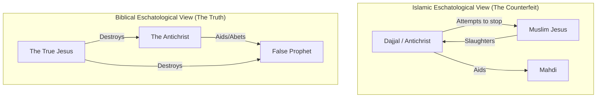

### False Prophets and Deception

- False prophets and false Christs will arise
    - They will perform signs and wonders
    - Their goal is to lead people astray
- **[Who is targeted?]**
    - The elect cannot be led astray
    - They will lead those who are not true believers to follow them
- False teachers and claimants to be Jesus Christ are a constant throughout history
- This phenomenon becomes notable as human history approaches its end

## Islam and the Antichrist

- A specific fulfillment of prophecy is linked to Islam
- **[The Strategy of Deception]**
    - Satan seeks to counterfeit and deceive by getting as close to the truth as possible
    - This is why some religions connect to Christianity while others do not
- **Comparison of Religious Connections**
    - Religions with no connection to Christianity:
        - Hinduism
        - Buddhism
    - Islam is noted for having a connection via monotheism
- **Common Misconceptions**
    - Some evangelicals believe Muslims are "okay" simply because they are monotheistic believers in one God

### Arguments for Religious Dialogue

- **[The Shared View of Jesus]**
    - Muslims regard Jesus as a great prophet
    - This connection is used by some to suggest a basis for religious dialogue
- **Brian McLaren's Perspective**
    - In his book, *The Secret Message of Jesus*, he argues that a "shared reappraisal of Jesus' message" could provide common ground
    - He suggests this reappraisal might be the only way to "save" several religions, including Christianity
    - The logic is that because Muslims already believe in Jesus, it should be easy to start dialogue with them

### Tony Campolo's Perspective

- Campolo argues that when Muslims speak of their love for Jesus, they appear closer to New Testament Christianity than many actual Christians

### Islamic Eschatology and the Role of Jesus

- **[Theological Framework]**
    - Islam possesses its own eschatology, or a theology regarding the end times
    - Their understanding of the future is defined by their own religious writings
- **[Sources of Islamic Doctrine]**
    - The Quran
    - The Sunnah
- **[The Muslim Jesus]**
    - Jesus plays a crucial role within Islamic eschatology
    - However, the speaker notes that the Jesus described in these texts is not the same as the Jesus of the New Testament

### Sources of Islamic Authority

- The two primary sources of authoritative truth in Islam are:
    - The Quran: Considered holy scripture
    - The Sunnah: Also known as the Hadith; constitutes holy tradition consisting of the words and works of Mohammed
- **[Comparison of Theological Sources]**
    - Islamic theology: Derived from the Quran and the Sunnah
    - Roman Catholic theology: Derived from the Bible and tradition
    - Judaism: Derived from the Old Testament and rabbinic tradition

### The Nature of the Muslim Jesus

- In the Islamic system, Jesus is fundamentally different from the biblical Jesus:
    - He was a man, not God
    - He did not die
    - He ascended to heaven (comparable to Elijah)
- **[Theological Consequences]**
    - Because he did not die, he did not rise from the dead
    - Because he did not die, he could not provide atonement

### The Return of the Muslim Jesus

- **[Current Status in Islam]**
    - Jesus is viewed as a prophet and a man, nothing more
    - He is believed to be currently in heaven, standing alongside Allah
    - His presence in heaven is comparable to the biblical Elijah
- **[The Purpose of His Return]**
    - In the Islamic end-times framework, Jesus will return from heaven when sent by Allah
    - He will return without having died
    - **[Why Jesus?]**
        - His return serves to correct Christians who have misunderstood who he is

### The Purpose of the Muslim Jesus's Return

- In Islamic eschatology, the return of Jesus serves a corrective purpose
    - He returns to "straighten out" Christians who hold biblical views
    - Specifically, he aims to correct those who believe he was God, died, rose again, and provided atonement
- **[Life after the return]**
    - After returning, the Muslim Jesus is described as living a human life
    - He will marry, have children, and eventually die
    - He will be buried next to Muhammad

### Signs of the End in Islamic Eschatology

- Islamic eschatology categorizes the signs of the end of history into different levels:
    - Minor signs
    - Major signs
    - Three great signs

### Three Great Signs of Islamic Eschatology

- Islamic eschatology identifies three great signs of the end of history, each represented by a man
- **The Mahdi**
    - Also referred to as the 12th Imam
    - His purpose is to slaughter all who refuse to worship Allah or convert to Islam
    - Islamic writings identify those who do not convert as "pigs and dogs"

### The Mahdi (The 12th Imam)

- The Mahdi, or the 12th Imam, is described as the "guided one"
    - He is the long-awaited savior in Islamic eschatology
- **[Mission and Rule]**
    - He will establish the final caliphate
    - His goal is to establish an everlasting, world-dominating kingdom of Islam
- **[The Method of Conquest]**
    - He will lead a massive army from nation to nation to punish unbelievers
    - He will carry out holy war
    - The choice for those encountered is to convert to Islam or be killed
    - Islamic writings specify that this army will carry black flags

### The Mahdi's Army and Rule

- **[The Black Flags]**
    - The Mahdi's army will carry black flags
    - These flags will bear a single word: "punishment"
- **[Military Objectives]**
    - The army will first target Israel to slaughter the Jews
    - Following this, the Mahdi will establish his rule in Jerusalem on the Temple Mount
- **[Method of Gaining Devotion]**
    - According to Islamic literature, the Mahdi will provide signs of prosperity to ensure absolute loyalty:
        - Bringing rain
        - Providing wind and crops
        - Granting wealth and happiness
    - The goal of these blessings is to ensure that "no one will speak of anyone but him"

### The Reign and Arrival of the Mahdi

- **[Initial Diplomacy]**
    - The Mahdi will first enter into a peace agreement with the West and the Jews
    - This peace agreement is intended to last for seven years
- **[The Seven-Year Reign]**
    - During these seven years, the Mahdi works to establish Islam on the earth
- **[Symbolic Imagery of His Arrival]**
    - Islamic writings describe him arriving while riding a white horse
    - He is depicted as carrying a sword to kill infidels
    - This imagery is noted as being similar to the descriptions found in Revelation 6:1-2

### The Discovery of Hidden Scriptures

- The Mahdi will discover "hidden scriptures" near the Sea of Galilee
    - These include hidden Gospels and a hidden Torah
- **[The Claim of Truth]**
    - He will use these to claim they are the "true" scriptures
    - This serves to prove to Jews and Christians that their existing scriptures are false

### Summary of the Mahdi's Profile

- **[Identity and Character]**
    - A messianic figure
    - A descendant of Mohammed
    - An unparalleled and unequal leader
- **[Rise to Power]**
    - Emerges out of a period of crisis and turmoil
    - Takes control of the world to establish a new world order
- **[Actions and Rule]**
    - Destroys all who resist him
    - Invades many nations
    - Makes a seven-year peace treaty with the Jews

### Comparison of the Mahdi and the Biblical Antichrist

- The Mahdi's profile serves as a precise, step-by-step description of the biblical Antichrist
- **[Key Parallels]**
    - **The White Horse**: Islamic writings describe the Mahdi arriving on a white horse, which matches the description of the rider in Revelation 6:1-2
    - **Supernatural Power**: He is described as possessing supernatural power and being loved by all people on earth
    - **Global Rule**: His mission to establish a single world religion and a global headquarters in Jerusalem mirrors the reign of the beast in Revelation 13
- **[Theological Conclusion]**
    - From a biblical perspective, the Mahdi is the Antichrist
    - Every detail of the Mahdi's predicted rise and reign aligns with the characteristics of the biblical Antichrist

### The Second Great Sign: The Return of Jesus

- While the Mahdi is the first great sign, Jesus is the second
- **[The Hierarchy of Power]**
    - In the Islamic system, the Mahdi is considered greater than Jesus
    - This distinction is crucial to their theology, as it suggests the biblical view of Jesus's supremacy was incorrect
- **[The Role of the Returning Jesus]**
    - Muslims believe in the return of Jesus, but not the 'true' Jesus of the New Testament
    - The Islamic Jesus is a prophet who did not die, did not rise, and did not provide sacrifice for sin
    - **[His Purpose]**
        - His primary purpose upon returning is to assist and aid the Mahdi

### The Arrival and Actions of the Muslim Jesus

- **[Nature of the Return]**
    - He returns as a "radical Muslim"
    - He arrives at a minaret near Damascus
    - He is described as being held by the wings of two angels who flew him down to meet the Mahdi's army of black flags in the east
- **[Subordination to the Mahdi]**
    - Jesus's return is characterized by his submission to the Mahdi's authority
    - He will pray to the Mahdi, acknowledging him as his Lord
    - He will perform a pilgrimage to Mecca and worship Allah
- **[Theological Impact]**
    - His actions are intended to lead Christians to reject their traditional view of Jesus
    - He acts to guide them toward the Islamic view: that Jesus is merely a man and a prophet, rather than the divine Savior of the New Testament

### The Role of the Returning Jesus as a Witness

- **[The Ultimate Evangelist]**
    - He will become the greatest Muslim evangelist in the world
    - He acts as the final witness on the day of judgment against non-Muslims
- **[Dismantling Christian Doctrine]**
    - His return is intended to prove that the Gospel and the New Testament are wrong
    - He will personally point out that Jesus is not God, not the Son of God, and did not die or rise
    - **[Symbolic and Literal Actions]**
        - He will "shatter crosses"
            - This is a metaphor for the destruction of the Church and the symbols of Christianity
        - He will kill pigs
        - He will abolish the tax on non-Muslims
            - This occurs because, under his rule, there will be no living non-Muslims left to tax

### The End of the Muslim Jesus

- **[Final Actions]**
    - He will kill the Islamic Antichrist (the Mahdi)
    - After this, he will die and be buried by Muhammad
- **[Theological Mission Accomplished]**
    - His death occurs only after he has successfully destroyed Christianity by revealing his true nature as a mere man and prophet

### Parallel to the Biblical False Prophet

- The role of the 'Muslim Jesus' is an exact parallel to the False Prophet mentioned in Revelation 13, 16, 19, and 20
- **[The Comparison]**
    - In the Bible, the False Prophet is the one who emerges from the earth to aid and abet the Antichrist
    - Similarly, the Islamic Jesus returns to aid and validate the Mahdi, who is the exact replica of the biblical Antichrist

### The Third Great Sign: The Antichrist (Dajjal)

- **[The Identity of the Deceiver]**
    - Known in Islam as **Dajjal**, the "great deceiver"
    - He is characterized as an infidel and a false miracle worker
- **[Physical and Behavioral Traits]**
    - He arrives on earth riding a mule
    - He is described as being blind in one eye
- **[The Ultimate Deception]**
    - Despite being an infidel, he will claim to be Jesus, the Son of God
    - He will claim to possess divinity

### The Final Conflict in Islamic Eschatology

- **[The Clash of Figures]**
    - The Dajjal (the Islamic Antichrist) will attempt to stop both the Mahdi and the 'Muslim Jesus'
    - The 'Muslim Jesus' will ultimately slaughter the Dajjal
- **[The Great Inversion]**
    - The speaker characterizes the Islamic eschatological system as a "satanic counterfeit" that is a complete reverse of biblical reality
    - **[Comparative Roles]**
        - In the Islamic view, their 'Redeemer' is the biblical Antichrist, and their 'Antichrist' is the biblical Jesus
        - The army of Satan is led by a figure claiming to be Jesus Christ

### Satan's Counterfeit Kingdom

- The Islamic eschatological vision is described as a complete counterfeit of the true kingdom of Christ
- **[The Great Reversal]**
    - What is the Redeemer in the Islamic view is the Antichrist in the Christian view
    - What is the Antichrist in the Christian view is the Redeemer in the Islamic view

### Historical Context: Rome and the Expansion of Islam

- The speaker connects the prophecy of world empires to the historical reality of the Roman Empire
- **[The Divided Empire]**
    - In Daniel 2, the final world empire is depicted with two legs
    - Historically, the Roman Empire was divided into West and East
    - The Western Roman Empire eventually dissolved
    - The Eastern Roman Empire (Byzantine) survived for over a millennium
- **[Territorial Shift]**
    - At the time of the New Testament, approximately 60% of the Roman Empire's territory is now under Muslim control

### Biblical Coalitions and Modern Nations

- **[Ezekiel 38 and Gog]**
    - Prophecy describes a coalition of eight nations that will act as the army for Gog/the Antichrist
    - The speaker notes that all eight of these nations are currently Muslim nations
    - These nations form a ring around the Mediterranean, extending to Libya
- **[The Sequence of Kingdoms in Revelation 17]**
    - Revelation 17:9-11 describes a progression of kingdoms: six existing kingdoms, followed by a 7th, and finally an 8th
    - The 7th kingdom is identified as the Ottoman Turk Empire
        - It lasted for approximately 500 years
        - The speaker notes it "didn't really fall" in the sense of total dissolution

### The Deception of Identity

- **[Conflicting Claims]**
    - At the end of history, multiple figures will claim to be Jesus
    - This creates a situation where people must discern which claim is true amidst widespread deception
- **[Theological Deception]**
    - A significant portion of the Muslim world holds a view of Jesus that is not the biblical Jesus
    - **[The Nature of the Error]**
        - Because they believe in a version of Jesus that is not the true Christ, they effectively reject the true Jesus
        - This is not a matter of "loving Jesus" in a general sense, as the person they love is fundamentally different from the actual person of Jesus Christ

### Wars and the Devaluation of Humanity

- **[The Inevitability of Conflict]**
    - Biblical prophecy (Matthew 24:7-8) describes wars and rumors of wars as necessary precursors to the end, though they do not signify the immediate end.
    - Nations rising against nations and kingdoms against kingdoms is presented as a constant throughout human history.
- **[Humanity's Moral Trajectory]**
    - The speaker argues that humanity is not progressing toward a more peaceful or advanced state.
    - Instead, society is expected to undergo a continuous devolution:
        - Moral devolution
        - Social devolution
        - Spiritual devolution

### Theories of Human Conflict

- War is described as a ubiquitous part of human history
- As technology advances, the capacity for killing increases
- Various academic theories attempt to explain the drivers of conflict:
    - **Marxist theory**: Centered on economic inequality
    - **Evolutionary theory**: Based on the concept of "survival of the fittest"
    - **Behavioral theory**: Suggests an inherent violent tendency in humans
    - **Demographic (Malthusian) theory**: Posits that expanding populations lead to conflict
    - **Rationalistic theory**: Attributed to information asymmetry (individuals lacking sufficient information)
    - **Political science theory**: Driven by a quest for security

### Historical Scale of Human Conflict

- War is a constant, recurring element of human history that shows no sign of changing
- The speaker notes that as technology advances, the capacity for killing increases
- **[Historical Death Tolls]**
    - World War II: 72 million deaths
    - Great War in China (755–763): 36 million deaths
    - Mongol Conquest (13th Century): 16 to 20 million deaths
    - World War I: 20 million deaths
    - Modern era (since 1985): nearly 500,000 deaths per year
- **[Prophetic Escalation]**
    - The speaker links this historical pattern to Revelation 6:9, 16
    - The end times are characterized by massive, unprecedented death through war

### Signs of End-Time Disasters

Beyond the escalation of warfare, other catastrophic events are identified as signs of the end times:

- **Earthquakes**
    - Described in Luke as "great earthquakes" (\*seismoi megaloi\`)
    - Examples include "megaquakes," such as a 9.0 magnitude earthquake located 80 miles off the coast of Japan
    - The scale of seismic activity is immense:
        - Approximately 500,000 earthquakes occur every year
        - 100,000 of these are felt by humans
- **Plagues and Terrors**
    - Luke 21 also foretells the occurrence of plagues and terrors from heaven
    - **[Historical Example: The Black Death]**
        - Occurred in Europe during the 1300s
        - Carried by rats
        - Killed approximately 60% of the European population

### Additional End-Time Disasters

- **Plagues and Pandemics**
    - The speaker notes the massive scale of death from historical diseases
    - **[The Great Influenza]**
        - Occurred in the early 20th century
        - Resulted in over 40 million deaths
- **Great Signs from Heaven**
    - The speaker lists various natural and atmospheric terrors that serve as signs:
        - Fires and diseases
        - Extreme heat and cold
        - Floods, hurricanes, and tornadoes
        - Drought

### The Concept of Birth Pangs

- The speaker references Revelation 6 and 8 to explain that current disasters are not yet the end
- **[The Analogy of Contractions]**
    - The text describes these events as "birth pangs"
    - Like a woman's contractions, these signs are:
        - Separated in time
        - Initially mild
        - Increasing in frequency and intensity just before the actual birth
- **[Implication]**
    - Current human history and disasters are merely the beginning of an intensifying cycle

### Transition to the Tribulation

- The current era of milder "birth pangs" is a precursor to an explosion of intensity
    - These 2,000 years of milder contractions will culminate in the period of tribulation
    - This period is described in greater detail in Revelation 6 through 19
- **[The Nature of the End Times]** Characterized by a combination of:
    - Destruction
    - Deception
    - Disaster
    - Distress

### Persecution of Believers

As the focus shifts from conditions affecting the entire world to those specifically affecting believers, the level of personal distress increases:

- **[Warning from Revelation 6:9]**
    - Believers are warned to "be on your guard"
    - The text foretells that they will be delivered to courts and flogged

### The Reality of Persecution

- The transition to the end times involves a shift from global disasters to personal distress for believers
- **[A Harsh Reality]**
    - The arrival of the Messiah was not expected to bring immediate comfort to his followers
    - Instead, it brings increased persecution and distress
- **[Biblical Precedent for Persecution]**
    - Jesus provided early warnings about the nature of his disciples' mission
    - **[Matthew 10 Warnings]**
        - Disciples would be like "sheep in the midst of wolves"
        - They were to be "shrewd as serpents and innocent as doves"
        - They were warned to "beware of men"
        - Specifically, they would be "handed over to the courts" and "scourged in the synagogues"
- **[Misconceptions of the Disciples]**
    - The disciples may have viewed these warnings as metaphoric or already fulfilled
    - They had already faced hostility and animosity from Jewish authorities
    - However, the specific physical trials (being hauled into court and flogged) were literal predictions of what was to come

### The Certainty of Escalating Persecution

- **[The Inevitability of Hostility]**
    - Persecution is a direct consequence of following Christ
    - **[John 15:18-20]**
        - "If the world hates you, know it hated me before you"
        - The logic is simple: if Christ was persecuted, His followers will be as well
    - **[Mark 16:2]**
        - Jesus warned during the Upper Room discourse that disciples would be made outcasts from the synagogues
        - He noted that people would kill them, mistakenly believing they were "offering service to God"
- **[The Pattern of Escalation]**
    - Persecution is not static; it follows an upward trajectory of intensity
    - **[2 Timothy 3]**
        - Foretells that as time progresses, persecution of Christ's followers will become "worse and worse"
- **[Specific Forms of Jewish Persecution]**
    - The persecution is characterized by legal and physical consequences
    - **[Legal and Physical Trials]**
        - Believers will be delivered to the courts
        - They will be flogged in the synagogue
        - **[Historical Context]** In ancient Israel, the courts were often held directly within the synagogues
- **[Mechanics of Synagogue Persecution]**
    - Cases were tried within synagogues by locally appointed judges
    - Scourgings were both decreed and executed within the synagogue setting
    - **[The 39 Lashes Rule]**
        - The maximum permitted number of lashes was 40
        - To avoid accidentally exceeding the limit and accidentally delivering a 40th lash, authorities would only administer 39 lashes
        - This explains why the Apostle Paul recorded receiving "thirty-nine lashes from the Jews" five separate times
        - Paul's experience involved being brought into synagogues, accused of blasphemy, and beaten
- **[The Scope of Persecution]**
    - While the Book of Acts provides an extensive record of Jewish persecution, it is not the final or primary form of hostility
    - **[Records in Acts]**
        - Jewish persecution is documented in multiple chapters, including Acts 4, 5, 8, 12, 13, 21, 22, 25, and 26
    - **[Shift to Gentile Persecution]**
        - Biblical prophecy (specifically in Mark) indicates that the ultimate persecution will come from Gentiles rather than the Jews

### The Dual Sources of Persecution

- Believers will face hostility from both Jewish and Gentile authorities
- **[Gentile Persecution]**
    - Mark 15:9 predicts believers will stand before governors and kings for Christ's sake
    - The Book of Acts records significant Gentile persecution in chapters 16, 17, 18, 21, 24, 25, and 26
- **[The Peak of Persecution]**
    - The most severe persecution is described in the Book of Revelation (chapters 6, 7, 13, 17, and 18)
    - This intense period occurs just before the Lord's return
- **[The Motivation for Hostility]**
    - Persecution is driven by a deep-seated hatred and resentment of Christ
    - False religions have historically massacred Christians and continue to do so in the modern world

### The Purpose and Grace in Persecution

- **[The Goal of Suffering]** Persecution serves as a testimony to others
    - Despite the intensity of the suffering, it is not intended to break a believer's faith or cause them to deny Christ
    - This aligns with the idea of "filling up in my flesh the sufferings of Christ"
- **[The Provision of Grace]** Divine grace abounds in the midst of suffering
    - **[2 Corinthians 12]** God provides whatever grace is necessary for the trial
    - God does not allow believers to be tempted beyond what they can bear
    - He provides "a way of escape" to ensure endurance

### The Resilience of the Gospel

- **[The Record of Martyrdom]** A massive historical record exists of those who gave testimony to Christ while facing death
- **[The Promise of Expansion]** Despite intense hatred and persecution, the gospel is promised to reach all nations
    - The gospel will not be stamped out by opposition
    - This fulfillment is seen in the spread of the gospel from Jerusalem to the ends of the earth
- **[The Paradox of Persecution]** Persecution often accelerates the growth of the faith
    - As the saying goes: "the blood of the martyrs becomes a seed of the church"
    - Historical opposition has frequently led to the further spread of the gospel across the world

### The Global Fulfillment of Prophecy

- **[The Prophetic Promise]** Jesus predicted that despite intense persecution, the gospel would cover the entire globe
    - This was spoken to a small, seemingly insignificant group of disciples
    - **[Matthew 24:14]** The gospel must be preached to all nations before the end comes
- **[The Reality of the Spread]** This prophecy has come to pass, with the gospel reaching the ends of the earth over the last 2,000 years

### Divine Assistance in Persecution

- **[The Promise of the Holy Spirit]** Believers are promised divine guidance when facing legal or religious authorities
    - **[Matthew 24:11]** When arrested and handed over, believers should not worry about what to say beforehand
    - The Holy Spirit will provide the necessary words in that specific hour
- **[The Testimony of Martyrs]** Historical accounts show martyrs often maintaining their testimony and even singing hymns in the midst of their suffering

### The Supernatural Power of Testimony

- **[Divine Empowerment]** The Holy Spirit provides strength and words that transcend human ability
    - During moments of arrest or trial, the Spirit enables believers to speak in ways that are beyond their own human strength and power
    - **[Luke 21:15]** Opponents will be unable to refute the testimony provided by the believer
- **[The Legacy of the Apostles]** The early church was defined by the ultimate sacrifice of its leaders
    - Virtually all of the apostles were martyred (beheaded, crucified, etc.)
    - John experienced a form of permanent martyrdom through exile
    - Despite these deaths, the Spirit of God was present in their final moments, lifting them above human limitations and ensuring the gospel continued to spread

### Persecution Within the Family

- **[Matthew 24:12]** Persecution will transcend religious and political boundaries to enter the home
    - Brother will betray brother to death
    - Fathers will turn against children, and children against parents
- **[The Accuracy of Prophecy]** This level of familial betrayal is a literal fulfillment of Jesus's predictions
    - These warnings were given to a group of disciples who had great hope, making the reality of such division even more difficult to bear
    - The speaker notes that this aligns with earlier teachings found in Matthew 10 regarding the cost of discipleship

### The Evidence of Divine Prophecy

- **[The Accuracy of Jesus's Predictions]** The historical fulfillment of specific warnings serves as proof of His divinity
    - He was correct about the destruction of the Temple
    - He accurately predicted the escalation of endless deception at the end times
    - He foretold disasters of all proportions increasing in intensity
    - He predicted the distress caused by persecution and martyrdom
    - He correctly stated the gospel would spread to the ends of the earth
    - **[Theological Conclusion]** Only God could possess such foreknowledge of these specific historical trajectories

### The Call to Endurance

- **[Matthew 24:13]** The reality of end-times life involves universal opposition
    - Believers will be hated by all because of Jesus's name
- **[The Promise of Salvation]** Despite the intensity of hatred and persecution, there is a definitive outcome for the faithful
    - "The one who endures to the end will be saved"

### The Significance of Endurance

- **[Luke 21:19]** "By your endurance you will gain your lives"
    - Endurance is not a means of earning salvation
    - Instead, it serves as proof of genuine, existing faith
- **[The Test of Authenticity]** Persecution acts as a filter for true believers
    - Superficial or "false" Christians will lack the strength to handle intense opposition
    - **[1 John 2:19]** This concept is supported by the principle that those who depart from the faith were never truly part of the community to begin with
    - True faith is characterized by the ability to remain steadfast despite family hatred, religious persecution, and the threat of death

### The Authentication of True Faith

- **[The Source of Endurance]** Believers are not expected to endure through sheer willpower
    - God-given faith endures because the Holy Spirit provides the necessary strength
    - God provides the grace required to navigate intense pressure
- **[The Refining Process]** Suffering acts as a separator between true and false believers
    - Trouble, deception, and persecution serve to "burn up the chaff"
    - These pressures reveal the quality of a person's spiritual foundation, exposing "shallow, weedy, rocky ground" of false professions
    - Superficial interest in Christ lacks the depth required to produce endurance
- **[The Nature of Salvation]** Clarifying the relationship between endurance and grace
    - **[Not Earning]** Endurance is not a method of earning salvation
    - **[Not Maintaining]** Endurance is not a way of "gritting teeth" to keep salvation
    - **[Demonstrating]** Instead, endurance is the way a believer demonstrates that their salvation is real
    - Salvation is a gift of grace that is authenticated through the experience of suffering

### The Strengthening Effect of Trials

- **[The Purpose of Testing]** The testing of faith is a productive process
    - It is designed to produce endurance
    - True faith is not just maintained through trials, but actually strengthened by them
- **[1 Peter 1]** The purpose and value of being tested
    - **[Living Hope]** Believers are born again to a "living hope" through the resurrection of Jesus
    - **[Divine Protection]** Believers are protected by the power of God through faith
    - **[The Value of Testing]** Faith is described as being "more precious than gold"
        - Just as gold is tested by fire to remove impurities
        - Faith is tested by "various trials" to serve as proof of its authenticity
        - This process results in praise, glory, and honor at the revelation of Jesus Christ

### The Proof of Faith

- **[The Function of Testing]** The testing of faith serves a specific purpose: it proves to the believer that their faith is the "real thing"
- **[Divine Provisions in History]** As history moves toward the inevitable tribulation, the Lord provides several tools for the faithful:
    - Warning
    - Promise
    - Comfort
    - Heavenly hope

---

### The Ultimate Security of Faith

- **[The Reality of the World]** The current world is a "dangerous place to live"
    - Even with signs of God's benevolence and common grace, the environment is inherently perilous
- **[The Necessity of Rescue]** True security requires being rescued from this danger through faith in the Lord Jesus Christ
- **[The Promise of Endurance]** Genuine faith—which is a gift from God—provides a foundation that withstands any calamity
    - Believers can face various trials, including:
        - War
        - Earthquakes
        - Famine
        - Fire
        - Floods
        - Persecution
    - **[The Outcome]** Those with "the real thing" (true faith) will endure to the end and enter into God's glory
- **[The Nature of Faith]** Faith is entirely a matter of divine grace
    - It is not something that can be earned through human effort
    - It is not something humans can do to maintain on their own
    - **[Divine Sovereignty]** God is the one who both grants faith and sustains it
- **[The Call to Faithful Living]** The objective of the believer's life
    - To live in a manner that brings honor to God
    - To provide a testimony of faith, modeled after the martyrs throughout history, even when facing extreme difficulty