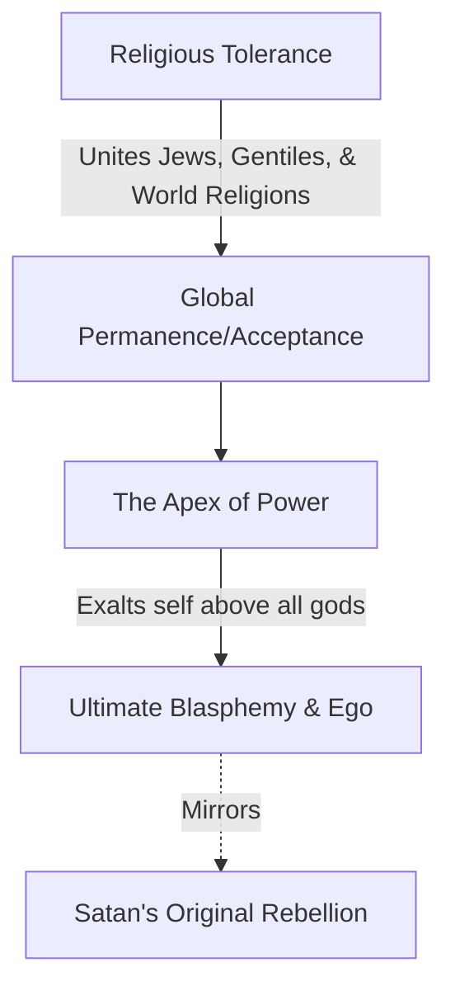

### The Simulated Rapture

- A prank orchestrated in a college dorm to address a roommate's intense fear of missing the rapture
    - The roommate had been raised with heavy emphasis on end-time prophecy and the horrors of the end times
- **[The Setup]** To make the simulation convincing, the group used several elements:
    - A large piece of sheet metal to simulate the sound of thunder
    - A Graflex camera with a large flash
    - A person with a "radio voice" to sound like an archangel

### The Execution of the Simulation

- **[The Preparation]** To maximize the illusion, the entire third floor participated in a coordinated effort:
    - Everyone vacated their rooms silently to avoid detection
    - Bedding was meticulously tucked in, with pillows shaped into "caves" to make it appear as though the occupants had vanished directly through the covers
- **[The Sequence of Events]** The prank was timed to trigger while the roommate was sound asleep:

    1. **The Sound**: The sheet metal was struck, creating a thunderous, echoing boom within the concrete room
    2. **The Light**: Immediately after the sound, a camera flash was triggered just inches from his face
    3. **The Voice**: A person in the hallway cupped their hands and commanded, "Come."

- **[The Aftermath]** The group used the ensuing chaos to disappear entirely, leaving the roommate to discover the "empty" beds and move from room to room in search of his peers.

### The Conclusion of the Prank

- **[The Climax]** After searching through multiple rooms and finding only empty, tucked-in beds, the roommate reached a breaking point:
    - He shouted, "I'm left, I'm left!"
    - The simulation had successfully made his worst fear feel like an objective reality.
- **[The Reveal]** The group jumped out to announce it was a surprise
    - The roommate's response was, "Oh, you got left too"
    - The intention behind the prank was a form of "role playing" to help him process and confront his intense anxiety.

### Transition to 2 Thessalonians

- **[The Psychological Parallel]** The speaker draws a connection between the student's irrational fear and the biblical context:
    - The young man's concern about "missing the rapture" mirrors the experiences and anxieties of the Thessalonians described in Paul's writings.
- **[Biblical Context]** Moving into the study of 2 Thessalonians, specifically chapters 1 and 2
    - The focus is on how Paul addresses the specific concerns regarding end-time events and prophecies.

### The Thessalonian Anxiety

- **[The Core Fear]** The primary issue facing the Thessalonians was a misunderstanding of timing:
    - They feared they had already missed the Rapture
    - Alternatively, they feared the Rapture wouldn't happen because they believed they were already living in the "Day of the Lord"

### Defining the "Day of the Lord"

- **[Technical Definition]** The "Day of the Lord" is a specific technical term referring to the final period of God's judgment at the end of the age
- **[Purpose of the Day]** It is a period of final, ultimate, and devastating judgment specifically directed at the ungodly
    - It is not intended as a time for the punishment of believers

### The Chronological Distinction

- **[The Rapture vs. The Day]** Based on 1 Thessalonians, there is a clear sequence of events that prevents believers from being overtaken by judgment:
    - **The Rapture**: The church is "caught up" to meet the Lord in the air (1 Thessalonians 4:13-17)
    - **The Day of the Lord**: Occurs *after* the Rapture has taken place
- **[Identity of Believers]** Because the church is removed before this period begins, believers are described as "children of the light" and "children of the day"
    - This status ensures that the Day of the Lord will not overtake them

### The Source of the Confusion

- **[The Catalyst of False Teaching]** Despite knowing the sequence of the Rapture followed by the Day of the Lord, the Thessalonians were misled by false teachers:
    - These teachers claimed the church would not be raptured out of the world
    - Instead, they asserted that the believers were already living within the "Day of the Lord"
- **[The Impact of Persecution]** The severity of their circumstances made this false teaching plausible:
    - The Thessalonians were facing intense persecution, with some even risking their lives for Christ
    - This period of suffering and death created a sense of formidable hardship that aligned with the idea of being in a time of judgment
- **[The Nature of the Deception]** The false teaching was presented with authority to shake their composure:
    - The deception arrived via a "spirit," a "message," or a "letter" purportedly from Paul
    - This caused the believers to be quickly shaken and disturbed regarding their standing and timing

### The Impact of the False Teaching

- **[The False Authority]** The confusion was fueled by claims of new revelation that appeared to carry apostolic weight:
    - The deception was presented as a "spirit," a "revelation," or a "message"
    - It was falsely attributed to Paul, Silas, and Timothy ("as if from us")
    - This gave the false teaching a veneer of legitimacy, making it seem as though the apostles had changed their stance
- **[The Contradiction of Truth]** The false teaching directly attacked the core promises previously given to the believers:
    - **The Promise**: They had been told they were "not destined for wrath" (1 Thessalonians 1:10; 5:9)
    - **The Expectation**: They were actively waiting for the "gathering together to Him" (the Rapture)
    - **The Deception**: The false teachers asserted they were already in the Day of the Lord and that no Rapture would rescue them from it
- **[The Psychological and Spiritual Impact]** The result of this misinformation was extreme instability:
    - Believers were "shaken from their composure" and "disturbed"
    - Paul uses intense imagery to describe their state of being "knocked off [their] pins" and "disconnected from [their] moorings"
    - They were described as being "wildly tossed around like a ship in the sea" due to their anxiety regarding the timing of Christ's return

### Paul's Objective in 2 Thessalonians

- **[Restoring Stability]** Paul's primary goal is to "straighten out" the believers and remind them that his previous teachings remain standing
    - He seeks to counter the false authority that claimed to have a "new word"
    - He aims to resolve the confusion and end the fear caused by the false teaching
- **[Reaffirming the Sequence]** The core of Paul's correction is the necessity of a specific order of events:
    - The believers' anxiety was rooted in the belief that they had missed the Rapture and were currently in the Day of the Lord
    - Paul asserts that it is impossible for them to be in the Day of the Lord because certain prerequisite features must occur first
    - These necessary precursors have not yet happened, meaning the Day of the Lord has not yet arrived

### Paul's Strategy for Restoring Composure

- **[The Goal of Verses 3–17]** Paul's intention is to systematically dismantle the fear and instability caused by false teachings
    - To "waylay" their fears
    - To remove anxiety and "shakenness"
    - To restore a state of being calm, collected, cool, comfortable, and hopeful
- **[Five Pitfalls to Avoid]** To prevent the confusion and distress associated with the coming of Christ, Paul identifies five specific conditions that must be avoided:
    - **Deception**: Being misled by false information or unauthorized "revelations"
    - **Forgetfulness**: Losing sight of the foundational truths previously established
    - **Ignorance**: Lacking the necessary understanding of the sequence of events
    - **Doubt**: Wavering in one's confidence in the truth
    - **Weakness**: Lacking the spiritual fortitude to remain steady

### The Pitfall of Deception

- **[The Core Problem]** Deception is the fundamental cause of the believers' being "shaken," "disturbed," and "distressed"
    - Deception functions by asserting that something is true when it is actually false
    - This creates a state of anxiety and fear because the believer's foundation is built on a falsehood
- **[The Command]** Paul issues a direct warning in verse 3: "let no one in any way deceive you"
    - This is presented as a prerequisite for regaining composure, joy, and hope
- **[Modern Context]** Deception is a pervasive issue, particularly regarding end-times theology
    - There is a massive volume of conflicting viewpoints, books, and pamphlets claiming to offer definitive truths about the end of the world
    - This prevalence echoes Jesus's own warnings in Matthew 24:4 and Mark 13:5 to be vigilant against being misled

### The Nature and Source of Deception

- **[The Mechanism of Deception]** Deception works by selling lies as if they were truth
    - It is a tool used to 'devour' believers through confusion and error
- **[The Spiritual Source]** Deception is a central component of spiritual warfare
    - Satan operates by disguising himself as an "angel of light"
    - His primary objective is to mislead and create instability
- **[The Human Element]** Deception often manifests through people within or near the church community
    - **False Ministers**: Individuals who act as "corruptors" or "mishandlers" of the Word of God (2 Corinthians 4:2)
    - **The Spirit of Antichrist**: Identified as the spirit behind many deceivers in the world (2 John 7)
    - **The Progression of Evil**: Evil men are described as growing worse over time, both in deceiving others and being deceived themselves (2 Timothy 3:13)
- **[The Consequence of Vulnerability]** Failing to guard against deception leads to spiritual immaturity and instability
    - Without vigilance, believers become like children, "tossed to and fro and carried about by every wind of doctrine" (Ephesians 4:14)
    - This instability is fueled by the "cunning craftiness and deception of Satan"
- **[The Context of the Thessalonians]** The deception in the Thessalonian church was particularly effective because of their environment
    - Their difficult circumstances made them an easy audience for those offering false or misleading revelations

### The Mechanics of Deception in Thessalonica

- **[The Nature of the Command]** Paul's prohibition, "Let no one in any way deceive you," is a high-stakes warning
    - **Complete Deception**: The Greek usage implies a compound action—to deceive successfully or completely, leading someone fully into error or delusion
    - **Universal Scope**: The phrase "in any way" means deception can arrive through any possible medium or method
        - Written: Books, letters, or pamphlets
        - Spoken: Sermons, prophecies, or personal revelations
- **[The Vulnerability of Circumstance]** Deception gains traction when it aligns with current fears
    - The Thessalonians were prone to believing a false letter because it sounded plausible given their difficult environment
    - **[The Danger of Gullibility]** Believers must avoid the trap of accepting new information simply because it provides an explanation for their current circumstances
- **[The Defense Against Deception]** The primary way to avoid being led astray is through verification
    - **Check against established truth**: New claims must be measured against the doctrine previously taught and known to be true
    - **Avoid contradiction**: A legitimate teaching will not contradict the foundational doctrine received from the Lord
    - Paul's own consistent teaching serves as the benchmark for the Thessalonians to identify the fraudulent apostolic letter

### The Vulnerability of Emotional Reaction

- **[The Root of the Error]** The Thessalonians' susceptibility to deception was not due to a lack of teaching, but an emotional response to stress
    - They already knew Paul's teaching on the Rapture and the Day of the Lord
    - Their error was an emotional reaction to the weight of their current circumstances
- **[The Principle of Theological Stability]** Theology must remain independent of personal struggle
    - **[Rising Above]** One should not adopt a belief simply because it provides a convenient explanation for personal problems
    - Truth should dictate how one views circumstances, rather than circumstances dictating one's theology

### The Purpose of Knowing the Truth of Christ's Return

Understanding the reality of Jesus Christ's coming serves two critical functions:

1. **Accountability and Reward**

    - The return of Christ is linked to judgment and recompense: "He will give to every man according to his work"
    - **[The Nature of the Reward]** The return is not just an event to witness, but a moment of personal transition:
        - Jesus brings His reward with Him
        - Believers are taken to their eternal home to dwell with Him
        - The encounter in the air results in a transformation (becoming like Him)

2. **Purifying Hope**

    - The expectation of Christ's return acts as a catalyst for spiritual growth
    - **[The Mechanism of Sanctification]** As 1 John suggests, this hope is a "purifying hope"
        - Knowing the reality of His return motivates the believer to purify themselves in anticipation

### The Spiritual Consequences of Deception

Clarity regarding the return of Christ is essential because deception does more than just cause intellectual error; it actively attacks the believer's spiritual state:

- **[The Loss of Joy]** Confusion about the timing or nature of Christ's return steals a believer's joy
    - If one fears they will miss the Rapture or be left behind in a period of judgment, the hope of deliverance is replaced by terror
    - Knowing the truth provides the stability needed to maintain joy even in difficult circumstances
- **[The Theft of Purity]** As noted previously, clarity is required for the "purifying hope" that motivates sanctification

### The Second Pitfall: Forgetfulness

Paul moves from the danger of active deception to the danger of passive forgetfulness regarding the established sequence of events.

#### The Necessary Precursors to the Day of the Lord

To prevent believers from thinking the Day of the Lord has already arrived or is imminent without cause, Paul outlines specific events that must occur first:

1. **The Apostasy**

        - A widespread falling away must occur before the Day of the Lord.

2. **The Revelation of the Man of Lawlessness**

        - Also referred to as the "son of destruction" or "perdition."
        - This figure is characterized by his opposition to God, exalting himself above every so-called god or object of worship.

#### The Connection Between Deception and Forgetfulness

Paul links the first two pitfalls—deception and forgetfulness—as two sides of the same coin. To avoid being deceived, one must actively remember what has been taught.

- **[The Role of Memory]** Paul appeals to the believers' memory to combat their current confusion
    - He uses the phrase "Do you not remember..." to remind them that the truths regarding the Rapture, the Day of the Lord, the Apostasy, and the Man of Lawlessness are not new information
    - Remembering is the practical mechanism that prevents deception from taking root

#### The Nature of Paul's Teaching

Paul emphasizes that his previous instruction was not a singular event but a consistent, repetitive process.

- **[Continual Instruction]** Paul uses the imperfect tense when saying "I was telling you these things"
    - This indicates a past continuous action, meaning he was *continually* teaching these themes throughout his time with them
    - It was a recurring theme in his ministry, not just a one-off lecture or a casual hint
- **[The Purpose of the Letter's Detail]** The level of detail in 2 Thessalonians serves a specific restorative function
    - Because he had already given them a full treatment of these topics in person, he provides just enough detail here to "restore their weak memories"
    - The text acts as a refresher to bring their focus back to the comprehensive truths they had previously received

### The Link Between Knowledge and Emotional Stability

- **[The Purpose of Clarity]** Understanding the sequence of end-times events serves two primary functions:
    - **Accountability/Purity:** Knowing the truth helps believers maintain obedience and moral integrity.
    - **Hope/Joy:** Clarity prevents the loss of joy that comes from being caught in confusion or fear.
- **[Anxiety as a Symptom]** Inordinate fear regarding the return of Christ is often a symptom of two underlying issues:
    - **Deception:** Believing false narratives about how or when Christ will return.
    - **Forgetfulness:** Failing to recall the established truths that provide a sense of security.

### The Foundational Necessity of Prophetic Teaching

- **[The Context of the Thessalonian Church]** The church in Thessalonica was extremely young, consisting of "baby Christians" only months old in the faith.
    - Paul had only spent a few weeks with them before writing these letters.
- **[The Priority of Doctrine]** Paul considered teaching about the Rapture, the Day of the Lord, the Apostasy, and the Man of Lawlessness to be essential foundational material.
    - **[Why it is foundational]** This is not information to be reserved for advanced students; it must be part of the initial foundation because it has a direct, tremendous impact on a believer's ability to maintain purity and joy.

### The Sequence of End-Times Events

- **[The Apostolic Eschatological Chart]** Paul provided a specific sequence of events to anchor the believers' hope and prevent them from being caught off guard by the Day of the Lord.
    - **The Goal:** To foster a "holy hope" and joy rather than fear.
    - **Key Elements of the Sequence:**
        - The return of Jesus Christ (the "Sun from heaven").
        - The gathering together (the "twinkling of an eye") where believers meet the Lord in the air.
        - Going to the place prepared in heaven.
- **[The Critical Precursor]** A vital distinction in the timeline is that the Day of the Lord is not the immediate next event after the Rapture.
    - **The Apostasy:** According to 2 Thessalonians 2:3, the Apostasy must come *before* the Day of the Lord.
    - **[Why this matters]** Because the Apostasy has not yet occurred, believers can be certain they are not currently living in the Day of the Lord, which helps mitigate the fear of being overtaken "like a thief."

### The Necessity of Prophetic Precursors

- **[Predictability of the Day of the Lord]** The Day of the Lord cannot arrive at any random moment; specific events must occur first as precursors.
- **[Examples of Prophetic Precursors]** The speaker cites several biblical passages that describe signs necessary before the Day of the Lord:
    - **Joel 2:31:** The sun turning into darkness and the moon turning into blood.
    - **Joel 3:14:** Multitudes gathering in the "valley of decision" near Jerusalem, accompanied by the darkening of the sun, moon, and stars.
    - **Zechariah 12:10:** A spiritual outpouring on the house of David and the inhabitants of Jerusalem, leading to a profound mourning for "him whom they've pierced."

### Additional Prophetic Precursors

- **[Zechariah's Signposts]** Further evidence of the required sequence includes:
    - **Zechariah 13:1:** The opening of a fountain for the house of David and inhabitants of Jerusalem for sin and impurity.
    - **Zechariah 13:2:** The salvation of all Israel.
    - **Zechariah 14:1:** The gathering of nations against Jerusalem and the ensuing battle.
- **[Malachi's Signpost]** The return of a specific figure:
    - **Malachi 4:** The sending of Elijah the prophet to restore the hearts of the fathers before the great and terrible Day of the Lord.
- **[Conclusion on the Sequence]** Because these specific events—the salvation of Israel, the battle against Jerusalem, and the revival led by Elijah—have not occurred, it is certain that the Day of the Lord is not present.
    - **Paul's Choice:** Rather than focusing on these various potential signs, Paul specifically identifies the **Apostasy** as the definitive precursor that must happen first (2 Thessalonians 2:3).

### The Sequence of the Apostasy and the Day of the Lord

- **[The Definitive Precursor]** Paul identifies the Apostasy as the necessary event that must occur before the Day of the Lord can arrive.
- **[Textual Nuance]** In 2 Thessalonians 2:3, there is a structural ellipsis where the text implies: "It will not come *unless* the apostasy comes first."

#### Clarification on the Rapture

- **[Not a discussion of timing]** Paul is not providing a specific timeline or details for the Rapture in this passage.
    - He states that the Day of the Lord is preceded by the Apostasy.
    - He does *not* specify whether believers will witness the Apostasy or how the Rapture specifically fits into the immediate moment.
- **[Theological Boundary]** Because the text focuses on the relationship between the Apostasy and the Day of the Lord, one should not attempt to read specific Rapture timing into this particular verse.

### Defining the Apostasy

- **Etymology**: The Greek term is *apostasio*.
- **Core Meaning**:
    - A revolt or rebellion.
    - Used in the Septuagint (Joshua 22:22) to describe a rebellion against God.
- **Specific Religious Definition**:
    - A deliberate abandonment of a formerly professed religious position.
    - It is characterized as a religious defection: revolting against a position one once held.
- **[Contextual Distinction]** This is not merely general apostasy or rebellion, which occurs throughout history; Paul is referring to a specific, signaling event.

### Distinguishing the Signaling Apostasy from General Defection

- **[Not General Church Defection]** Paul cannot be referring to the general presence of defectors within the church, as this has been a constant reality since its inception.
    - In Revelation 2 and 3, several of the seven churches contain defecting Christians or large groups of non-Christians who rejected the faith.
    - The church at Laodicea is described as being full of apostates who have defected from the true faith.
    - Because Laodicean-type churches have existed for 2,000 years, this cannot be the specific, identifying event Paul is describing.
- **[Not Historical Schisms or Cults]** The term does not refer to the various religious movements that have branched off from the main body of the church over time.
    - This includes the existence of cults, occults, schisms, and various "isms."
    - These are ongoing historical realities rather than a single, definitive precursor to the Day of the Lord.

### Potential Interpretations of the "End-Time" Apostasy

- **[The Escalated Apostasy Hypothesis]** One might wonder if Paul is referring to a final, culminating form of spiritual defection rather than general religious rebellion.
- **Biblical Examples of Final/Escalated Apostasy:**
    - **1 Timothy 4**: Some will fall away from the faith by following deceitful spirits and doctrines of demons.
    - **2 Timothy 3**: Describes "dangerous seasons" where departures from the faith occur and conditions grow progressively worse.
    - **2 Peter 2**: False teachers secretly introducing destructive heresies and denying the Master who bought them (defecting from having once named Christ).
    - **2 Peter 3**: The appearance of scoffers who mock the promise of Christ's return.
    - **Jude**: The presence of ungodly, worldly people who mock the truth and follow their own lusts in the end times.

### The Specificity of "The Apostasy"

- **[Not General Defection]** It is not the ongoing spiritual defection seen throughout church history.
- **[Not Accumulated End-Time Decay]** It is not the final, accumulated spiritual apostasy that occurs at the end of the church age.
- **[Not Tribulation Defection]** It is not the defection that will happen during the Tribulation (Daniel's 70th week).
    - Matthew 24 notes that during this period, false prophets will arise and mislead many, and lawlessness will cause love to grow cold.
- **[The Definitive Event]** The use of the definite article in the Greek text ("the apostasy") signifies that this is a specific, singular event rather than a general phenomenon.

### The Nature of "The Apostasy"

- It is not a general spirit, trend, or flow of defection
    - It is a specific, identifiable, and unique event
- It represents the "consummate" and "ultimate" apostasy
    - This event is the final act in the trajectory of evil established in Romans 1
    - It is described as an event of final evil with blasphemous magnitude

### The Key Figure: The Man of Lawlessness

- The Apostasy is directly associated with the revelation of a specific person
    - To understand the event, one must understand the character of this person
- **[Names]**
    - **The man of lawlessness**: The term used in better manuscripts and consistent with the themes of lawlessness in verses 7 and 8
    - **The man of sin**: A more familiar name found in some manuscripts
- **[Defining Characteristic]**
    - Lawlessness is defined as being "without law"
    - This individual lives with no regard for the law, will, or rule of God

### The Ultimate Lawless One

- **[Distinction from History]** While billions of people throughout history have been lawless, blasphemers, or God-rejecters, this figure is different
    - He is the "ultimate composite, wicked, blasphemous human being"
    - He represents the consummate sinner, far beyond the general defectors and rebels seen throughout the ages
- **[The Event of Revelation]** The apostasy is an event defined by the appearance of this individual
    - In 2 Thessalonians 2:3, the verb "revealed" is in an emphatic position and uses the aorist tense
    - **[Significance]** This grammatical structure points to a specific, definite time when he will be revealed
    - The sequence is: The apostasy comes first, then the revelation occurs

### The Revelation of the Man of Lawlessness

- **[The Meaning of "Revealed"]** The use of the word "revealed" rather than "born" is significant
    - It indicates that he has a previous existence and is not a new creation
    - He is being taken out from a "secret place" where he has been hidden
    - The event of the apostasy is when his true identity is fully disclosed to the world
- **[Pre-existing Influence]** He is already present and active before the formal apostasy
    - He is described as already being the ruler of the entire world, though his identity remains unknown
    - He is characterized as being "a hundred Judas's role into one"

### Debated Identities of the Man of Lawlessness

- Various commentators have attempted to identify this figure with historical or spiritual entities, but many are dismissed based on biblical context:
    - **Antiochus Epiphanes**: Dismissed because the Day of the Lord would have already passed
    - **Caligula**: Dismissed as a candidate
    - **Nero**: Dismissed as a candidate
    - **Pompey**: Dismissed as a candidate
    - **Satan**: Dismissed because 2 Thessalonians 2:9 states he works *in accord* with Satan, implying they are distinct entities
    - **A Principle of Evil**: Some suggest he is merely a personification of evil rather than an individual

### The Identity of the Antichrist

- If the man of lawlessness is not a mere principle of evil, he is a person: the Antichrist
- He is characterized by performing the ultimate act of apostasy
- He is further titled the "son of destruction" (or "son of perdition")

#### The Meaning of "Son of Destruction"

- In Hebrew idiom, the expression "son of [something]" indicates that the person possesses the very nature of that thing
    - Just as the Son of God is inherently Godlike
    - The son of destruction is inherently defined by destruction
- This title implies his inmost being is characterized by:
    - Perdition
    - Torment
    - Punishment
    - Judgment
    - *Apoleia* (Greek for ruin/ruination)
- He is essentially described as "human trash for the dump of hell"

#### Biblical Parallels

- Judas is the only other individual in the New Testament to be called the "Son of Perdition" (John 17:12)

### Comparing the Apostasies of Judas and the Antichrist

While many unbelievers could technically be called "sons of destruction," the title is reserved for those who commit the most extreme forms of apostasy.

#### The Apostasy of Judas

- Represented a monstrous betrayal due to his extreme proximity to God in human form
    - He lived, walked, talked, and ate with Christ for three years
    - He witnessed Christ's wisdom and felt His love firsthand
    - Despite this, he turned his back and sold Him
- This level of betrayal is considered a "monstrous" apostasy, deserving of the "hottest hell"

#### The Apostasy of the Antichrist

- Described as being "100 Judases"—a far more massive and blasphemous event
    - Where Judas merely threw money in the temple, the Antichrist enters the Holy of Holies to proclaim himself God
- **[Commonality]** Both figures are under the control of Satan:
    - **Judas**: "Satan entered into him" (John 13)
    - **Antichrist**: Controlled by Satan in the visions of John (Revelation 13)
- Ultimately, the Antichrist is destined for destruction

### The Character of the Antichrist

Prophetic descriptions from Zechariah and Daniel provide a clear picture of the Antichrist's nature and behavior.

#### The Worthless Shepherd

Zechariah describes a figure who is raised up but acts in direct opposition to the role of a true shepherd:

- A true shepherd cares for the perishing, seeks the scattered, heals the broken, and sustains the standing
- The Antichrist, however, is a "worthless shepherd" who:
    - Devours the flesh of the fat sheep
    - Tears off their hooves
- **[Meaning]** This "worthlessness" implies he is ruined, useless, and essentially "trash for the dump of hell"

#### The Willful King

Drawing from Daniel's descriptions (the "little horn"), the Antichrist's rise to power is marked by increasing control and insolence:

- He rises out of the other nations
- He starts with limited power but quickly grows to control the entire world
- He is characterized as a "willful king" and an "insolent king"
    - He does exactly what he pleases
    - He acts as the ultimate man of lawlessness and a son of destruction

### The Nature of the Antichrist's Apostasy

According to 2 Thessalonians 2:4, his apostasy is defined by his opposition to God and his self-exaltation:

- He opposes and exalts himself above every so-called god or object of worship
- This suggests he has risen to significant world power and likely operates within a religious context

#### The Symbolic Power of the Beast

Using the visionary imagery from Revelation 13, the scale of the Antichrist's dominion is illustrated through specific symbols:

| Symbol | Meaning |
| --- | --- |
| Horns | Power |
| Heads | Intelligence |
| Crowns | Dominion and authority |

- The beast is described as having ten horns, seven heads, and ten crowns
- This represents a massively powerful ruling entity with global reach
- **[Blasphemy]** Every one of the heads bears blasphemous names, marking him as a supreme blasphemer of God

### The Composite Nature of the Antichrist

Revelation 13:2 provides specific animal imagery that connects the Antichrist to the sequence of great world empires established in the Book of Daniel:

- **[Imagery]** The beast is described as having:
    - Feet like a bear
    - A body like a leopard
    - A mouth like a lion
- **[Historical Connection]** This imagery signifies that the Antichrist is a composite of the great empires:
    - **Babylon**: Represented by the lion
    - **Medo-Persia**: Represented by the bear
    - **Greece**: Represented by the leopard (noted for its swiftness and fierce strength)

#### The Emergence of the Antichrist from the Revived Islamic Caliphate

The Antichrist is expected to rise as the head of the Revived Islamic Caliphate. He is identified with the Mahdi (the 12th Imam) of Islamic eschatology.

- **[The Seven Heads, Revelation 17]**
    - The beast is a kingdom, the sea is the Gentile peoples, and the seven heads are seven mountains, meaning seven kingdoms (a mountain is a common biblical symbol for a kingdom)
    - The word is "mountains" (*oros*), not "hills", so Rome with its seven hills is not what the verse describes
    - Five had fallen in John's day (Egypt, Assyria, Babylon, Medo-Persia, Greece), one was (Rome), and one had not yet come
    - The seventh head is the historical Islamic Caliphate, which burst out of Arabia in the 7th century and dealt the final blow to the Eastern Roman Empire when Mehmet took Constantinople in 1453
    - The eighth is "of the seven": the seventh head returns to life as the Revived Islamic Caliphate
- **[The Fatal Head Wound, Revelation 13:3 and 17:8]** The beast "was, and is not, and is about to rise"
    - The Ottoman Empire ended in 1923 and the Caliphate was formally abolished in 1924, which is read as the mortal wound
    - The Antichrist's kingdom is the revival of that Caliphate, and the world will marvel when it comes back to life
- **[Daniel 2 and Daniel 7]** The same story is told in the statue and in the four beasts
    - The legs of iron and the fourth beast are the historical Islamic Caliphate, and the feet of iron and clay and the ten horns are the Revived Islamic Caliphate
    - Rome is not one of the four kingdoms there because those visions are Babylon-centred; Revelation 17 gives the full list of Satan's empires, including Egypt, Assyria and Rome
- **[Lion, Bear and Leopard, Revelation 13:2]** The beast is a combination of Babylon, Medo-Persia and Greece
    - The only empires to rise in that region after Greece were the Parthians (an extension of Persia), Rome and the Islamic Caliphate
    - Combined Babylonian, Persian and Greek lands look like the Islamic Caliphate, not like the Roman Empire, whose borders stayed about 500 miles west of Babylon
- **[Gog Is the Antichrist]**
    - Gog of Ezekiel 38 and 39 is the Antichrist, and the "Assyrian" in Micah 5 is the same invader (Micah 5:5-6)
    - The eight Gog coalition nations are Muslim nations ringing the Mediterranean to Libya
    - The invasion succeeds before the Messiah rescues Israel, and the battle is the end of the Tribulation, not the start
    - This differs from the Rapture-first order in this sermon; the difference is noted here and not reconciled
- **[The Mahdi as the Antichrist]** The Mahdi's profile matches the biblical Antichrist step by step
    - A messianic figure, a descendant of Mohammed, who emerges out of crisis and turmoil and takes control of the world to establish a new world order
    - He arrives on a white horse, which matches the rider of Revelation 6:1-2
    - He makes a seven-year peace treaty with the West and the Jews, then invades many nations and destroys all who resist him
    - He establishes his rule in Jerusalem on the Temple Mount, mirroring the reign of the beast in Revelation 13
    - He is supported by the "Muslim Jesus," who parallels the False Prophet of Revelation 13, 16, 19 and 20
- **[Islamic Supersessionism]**
    - Islam teaches that Muhammad is the "Seal of the Prophets", that Islam replaces Judaism and Christianity, and that earlier Scriptures were corrupted
    - In the last days Jesus returns as a Muslim, breaks crosses and abolishes the *jizyah* tax, which means he ends Christianity
    - The hadith of the gharqad tree describes a last-days war in which Muslims kill the Jews hiding behind rocks and trees; it is quoted in the Hamas charter
    - This is the mission the Bible gives the Antichrist and his followers
- **[The Result]** The Antichrist becomes the embodiment of the great empires in Daniel's visions—Babylon, Medo-Persia, and Greece—rolled into one single individual, and he rules the eighth kingdom, the Revived Islamic Caliphate.

### The Global Dominion and Blasphemy of the Antichrist

Upon reaching his apex of power, the Antichrist exerts absolute authority over the entire world.

- **[Universal Authority]** He is granted authority over every tribe, people, tongue, and nation on earth.
- **[Targeted Worship]** All who dwell on the earth worship him, specifically those whose names are not found in the "book of the life of the Lamb who's been slain."
- **[Temporal Limit]** While he speaks blasphemies, his period of active blasphemy is limited to 42 months (three and a half years), matching the prophecy in Daniel 7:25.

#### The Nature of His Blasphemy

The Antichrist's primary mode of expression at his height is directed against the divine:

- **[Targets of Blasphemy]** He directs his words against:
    - God and His name
    - His temple or tabernacle (His dwelling place)
    - Those who dwell in heaven
- **[The Goal]** He seeks to attack God and everything associated with Him.

### The Path to Global Permanence

Before the height of his blasphemy, the Antichrist achieves a state of world permanence where the entire globe embraces his leadership.

- **[Strategic Tolerance]** To maintain control over a diverse population, he must be religiously tolerant
    - He must be able to unify disparate groups, including both Jews and Gentiles
    - This involves creating a framework where different world religions can coexist under his influence

### The Ultimate Act of Self-Exaltation

At his peak, the Antichrist moves from a tolerant leader to the ultimate egotist.

- **[Exalting Himself]** He will oppose and exalt himself above every so-called god or object of worship
    - This includes anything held in reverence or considered a "holy article"
- **[Fulfilling Satan's Desire]** This behavior is a human manifestation of Satan's original intent during his fall
    - According to Isaiah 14, Satan's core ambition was to ascend to the highest heavens and make himself like the Most High

### The Shift from Coexistence to Destruction

- **[The End of Tolerance]** The Antichrist's period of religious tolerance is temporary
    - Previously, he coexisted with the "mother of harlots" (the false world religions) as described in Revelation 17
    - Eventually, he will devour these false religions rather than simply living alongside them

### The Occupation of the Temple

- **[The Location]** The Antichrist will take his seat in the "naos" of the Temple of God
    - The *naos* refers to the innermost part or the sanctuary of the temple
    - This action implies the existence of a physical temple in Jerusalem during this time
- **[The Purpose]** By occupying this space, he intends to display himself as God
    - "Showing himself as God" may mean sitting in God's seat as an act of defiance and superiority over the God of the Temple, since the Temple was where God's authority was seen on earth, and he honors a god of war, so he may stop just short of claiming to be God Almighty
- **[Why the Temple?]** The Temple is the ultimate target for his deception because of its historical significance:
    - Since the time God brought His people into the land, the Temple has been the primary symbol of His presence
    - Even though Israel has been apostate and the unique covenant blessing has been removed, Jerusalem still belongs to God
    - The Temple remains the most perfect earthly location for Satan to attempt to usurp God's place

### The Desecration of the Temple

- **[The Timing]** The Antichrist's entry into the Temple and his subsequent desecration occur at the midpoint of the seven-year period
    - This period is also known as the 70th week of Daniel
    - It is characterized as a time of testing and "Jacob's trouble"
- **[The Transition]** The first three and a half years serve as a period of deception where he captures the world's attention without revealing his true identity
    - He is "revealed" as a maniac only when he enters the Temple and declares himself to be God
- **[The Abomination of Desolation]** This act fulfills the prophecy of the "abomination of desolation" mentioned in Matthew 24:15
- **[The Consequences]** The revelation of his true nature triggers an indescribable period of violence and massacre
    - He will attempt to wipe out the people of God, including Jews and those who have come to believe in Christ during that time
    - Jesus's instruction for this moment is urgent: "run"

### The Antichrist's Deceptive Rise and Revelation

- **[The Deception]** Before his true nature is known, the Antichrist functions as a global leader and a perceived protector of Israel
    - He likely signs a treaty with Israel and brings peace to the Middle East
    - He appears religious, potentially speaking of his love for God to gain trust
- **[The Transition]** The reality of his character is revealed through a violent shift in his relationship with religion
    - He moves to oppose and consume the "mother of harlots" (the false religious systems of the world)
    - He enters the holy place to set himself up as God
- **[The Ultimate Apostasy]** This act of self-deification in the Temple is described as the "child of all apostasies" or the ultimate affront to the true God
- **[The Abomination of Desolation]** This specific event in the holy place is what Jesus referred to in Matthew 24:15
    - An "abomination" denotes an object that is detestable to the Lord
- **[The Reign of Terror]** Following this revelation, the Antichrist begins a three-and-a-half-year period of terror that continues until the Day of the Lord

### The Meaning and Impact of the Abomination

- **[Literal Meaning]** The "abomination of desolation" refers to something that causes disgust, revulsion, or abhorrence
    - It literally "lays waste" to the house of God, leaving it desolate
- **[The Act of Desecration]** The Antichrist's primary act is the desecration of the Temple through the worship of himself
    - This act serves as the definitive proof that the Day of the Lord has not yet occurred
- **[Enforced Worship]** Following the desecration, a period of forced worship begins
    - The false prophet compels the entire world to worship the Antichrist as God
    - Believers face a binary choice: accept the mark of the beast or face massacre

### Using the Apostasy as a Theological Anchor

- Paul uses the absence of the Apostasy to correct believers' anxieties about the timing of the Day of the Lord
- Instead of looking for celestial signs (blood moons, darkened suns, or disappearing stars), believers should look for the specific sequence of events:

    1. The Apostasy must occur
    2. The Antichrist must enter the Temple/holy place
    3. The Antichrist must blaspheme God through desecration and self-worship

- Because these specific events have not happened, the Day of the Lord cannot have arrived

### Comfort in Theological Clarity

- **[The Purpose of Knowledge]** Understanding the sequence of end-time events is intended to provide comfort rather than fear
    - Because the specific precursors (the Apostasy and the Antichrist's desecration) must happen first, believers can be certain the Day of the Lord has not arrived
- **[A Different Expectation]** Believers are not waiting for the Antichrist, but for the Son
    - The Day of the Lord will not take believers "as a thief" (unexpectedly in the dark)
    - Instead, believers are looking for the Rapture: the gathering together to Jesus Christ as He comes from heaven to prepare a place for them
- **[Spiritual Posture]** To maintain this composure, believers must adhere to two commands:
    - Do not be deceived
    - Do not be forgetful of established truths

### Final Exhortation and Hope

- **[The Hour of Testing]** There is a coming period of testing that will affect "those who dwell on the earth"
    - In the context of Revelation, this refers specifically to unbelievers
- **[The Believer's Hope]** While the Day of the Lord represents a time of judgment for the world, it represents salvation for the believer
    - Believers look forward to a Savior who comes to take them to be with Him
    - This hope serves as a call to holiness and a source of lasting joy