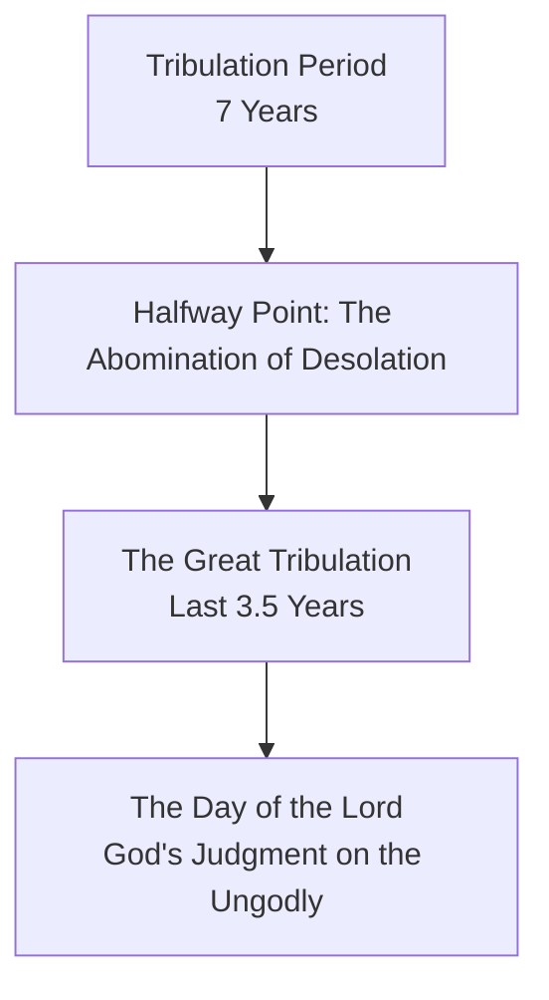

### Avoiding Fear Regarding the Lord's Return

- The return of Jesus Christ is a certainty, though the specific timing remains unknown
    - It is not for humans to know the times, seasons, or the exact hour
    - God alone knows the timing, and the plan is already established
- **[The proper mindset]** Instead of living in fear, believers should live in anticipation
- According to 2 Timothy 4, the Apostle Paul speaks of a "crown of righteousness"
    - This reward will be awarded by the Lord, the righteous judge, on that day
    - This promise extends not only to Paul but to all who have "loved his appearing"

### Living in Hope and Anticipation

- The return of Christ should be a believer's greatest hope and most joyous anticipation
    - This is expressed by the sentiment, "Even so, come, Lord Jesus"
- **[The danger of fear]** Some in the church experience distress or fear regarding the return of Christ

### The Disturbance of the Thessalonians

- In 1 Thessalonians, Paul addresses the believers' need to maintain composure
    - They were being shaken or disturbed by various sources:
        - A spirit
        - A message
        - A letter (falsely claiming to be from Paul)
- These disturbances often centered on the claim that the "Day of the Lord" had already arrived
    - **[The implication of such claims]** If the Day of the Lord had arrived, it would mean the rapture (the gathering of the church to Christ) had already occurred and they had missed it

### The Sequence of the Rapture and the Day of the Lord

- The Thessalonians' distress implies a specific theological understanding previously taught by Paul
    - They believed they were to be delivered (the rapture) *before* the Day of the Lord began
    - False messages claiming they were already in the Day of the Lord created fear that they had either missed the rapture or that it was non-existent
- **[The distinction between the two events]**
    - **The Rapture**: The gathering/catching away of the church to meet Christ
    - **The Day of the Lord**: A technical term for the period of final judgment on the ungodly
- Paul's method for resolving this confusion is to demonstrate that they are not currently in the Day of the Lord
    - He intends to prove this by pointing to specific precursor events that must occur before the Day of the Lord can begin

### Precursors to the Day of the Lord

- Paul provides specific evidence to prove the Thessalonians have not entered the Day of the Lord
    - The Day of the Lord cannot arrive unless certain events occur first
- **[Required Precursor Events]**
    - The apostasy must come first
    - The "man of lawlessness" (also called the son of destruction) must be revealed
        - This figure is most frequently identified as the Antichrist

### Paul's Strategy to Allay Fear

- Paul uses specific exhortations to stabilize the believers' composure and combat the anxiety caused by false messages
- **[Resisting Deception]**
    - Paul warns: "Let no one in any way deceive you"
    - Theological, spiritual, or doctrinal deception is a primary source of anxiety and fear
    - **[How to avoid it]** Stick to the established revelation of God and compare all claims against Scripture
- **[Combating Forgetfulness]**
    - Paul urges them not to be forgetful of the truths he previously taught while he was physically with them
    - Specifically, he wants them to remember the sequence of events (the apostasy and the man of lawlessness) so they are not caught off guard

### Characteristics of the Man of Lawlessness

- He is defined by extreme blasphemy and self-exaltation
    - He opposes and exalts himself above every so-called god or object of worship
    - He takes his seat in the temple of God, displaying himself as being God
- **[The Abomination of Desolation]**
    - This is the specific event where he desecrates the temple
    - It aligns with the prophecy in Daniel 9

### The Trigger for the Day of the Lord

- The arrival of the man of lawlessness is the catalyst for God's judgment
- **[The Sequence of Events]**
    - The Antichrist enters the temple and attempts to replace all worship of the true God
    - This blasphemous act triggers the events leading to the Day of the Lord

### Paul's Third Exhortation: Avoiding Ignorance

- Paul's third strategy to stabilize believers is to warn them not to be ignorant
- Ignorance regarding the character and specific actions of the Antichrist creates spiritual vulnerability

### The Nature and Purpose of the Antichrist

- The Antichrist is a counterfeit figure driven by Satan's ultimate objective: to overthrow God and Christ
- **[The Counterfeit Messiah]**
    - Satan's strategy is to present a "false Christ" to the world
    - This figure will appear powerful and be energized by all of Satan's forces
    - The purpose of this power is to provide "counterfeit credentials" so the world believes he is the true Messiah
- **[The Antichrist's Agenda]**
    - **Deception of Israel**: The text notes that Israel will accept this figure
    - **Dethroning God**: His ultimate goal is to desecrate the temple and establish the worship of himself
    - **Satanic Objective**: This is the final effort to dethrone Christ and allow Satan to reclaim the world
- **[Scope of the Threat]**
    - While the Antichrist is a specific, central personality in end-time prophecy, John warns that there are "many antichrists" in a broader sense

### The Revelation of the Antichrist

Paul identifies four specific aspects of the Antichrist's career, beginning with his revelation.

- **[The Coming and the Restraint]**
    - The Antichrist has not yet arrived; there is a specific time set for him to be revealed.
    - Currently, there is a force or influence "restraining" him from appearing.
    - **[The "You Know" Factor]**
        - Paul tells the Thessalonians "you know" what is doing the restraining.
        - This indicates that the specific nature of this restraint was a well-established teaching Paul had given them personally during his previous time with them.
        - While modern commentaries offer many different opinions on what this restraint is, for the original audience, it was a known and settled piece of information.

### The Restraining Force

- Paul notes that the Antichrist is currently being restrained so that he may be revealed in his proper time
- **[The Nature of the Restraint]**
    - The Greek verb literally means to "hold down" or "hold back"
    - It is described as a neuter force, implying a non-personal power or principle
    - While the specific identity of this force is not explicitly repeated in this verse, Paul's audience was already familiar with it from his previous teachings
- **[Theological Interpretations of the Restraint]**
    - There is significant debate regarding what specifically holds the Antichrist back:
        - **The Preaching of the Gospel**: The Antichrist is restrained as long as the Gospel is being preached; once the Gospel has reached its full extent, the restraint is removed
        - **The Jewish State**: The existence or specific role of Israel acts as a check on his arrival
        - **The Church**: The spiritual influence of the Church in the world serves as a restraining influence
        - **Human Government**: God-ordained civil governments provide a level of social order and power that prevents a total takeover
        - **Moral/Legal Principles**: A pervasive principle of morality or law embedded in the fabric of society prevents total chaos
        - **The Binding of Satan**: The ongoing spiritual work of believers in binding Satan's influence

### Additional Theories on the Restraining Force

- **The Angelic Theory**
    - Some suggest the restraint is an angel, specifically Michael
    - This is based on Daniel 10:21, where Michael is described as standing against evil forces
        - "...yet there is no one who stands firmly with me against these forces except Michael your prince."
- **Critique of Common Interpretations**
    - There is significant doubt that these proposed restraints are sufficient
    - **The Limitation of Human Effort**
        - Most common theories (preaching the gospel, the Jewish state, the church, human government, morality/law, the Roman Empire) are fundamentally human-driven
        - It is difficult to imagine human efforts having the capacity to restrain the supernatural power of Satan in releasing the Antichrist
    - **The Inadequacy of the Church or Government**
        - Even if the Church is considered a strong candidate for a restrainer, it is not guaranteed to be effective
        - Human government is not always successful at restraining evil or facilitating good

### The Necessity of a Supernatural Restraint

- **The Inadequacy of the Church**
    - While the Church is often proposed as the best candidate for a restrainer, it lacks the power to stop evil in the world at large
    - Although the Church acts as "salt and light" within its own community, it has not successfully restrained evil in the lives of those outside of it
    - The world continues to decline in morality, as noted in 2 Timothy, where evil men grow worse and worse
- **The Failure of Human Institutions**
    - Human forces (government, society, ingenuity) are designed to deal with human issues, not supernatural ones
    - Even if a political entity like the Roman Empire were revived, its power would be human, not spiritual
- **The Nature of the Restraint**
    - Because Satan's plans are supernatural, the force holding him back must also be supernatural
- **Satan's Urgency**
    - Satan is not content to wait for God's specific timetable
    - He is in a hurry to release the Antichrist and initiate the final apostasy

### The Divine Timetable and Supernatural Restraint

- **God's Control vs. Satan's Urgency**
    - Satan is in a hurry to initiate the final rebellion, the false messiah, and universal blasphemy
    - However, Satan is not operating on his own schedule; he is being held back by God's timetable
- **The Role of the Restraining Force**
    - The man of sin cannot be revealed until God removes the current restraining force
    - Because this force must counteract Satan's supernatural plans, the restraint itself must be supernatural
    - It operates on a level beyond just earthly or human institutions
- **The Consequences of the Removal of Restraint**
    - Once the restrainer is removed, the world will experience the full extent of Satan's plans
    - This period, known as the Day of the Lord, is described as a time when "all hell breaks loose" because God is no longer restraining Satan's actions

### The Purpose of the Divine Delay

- **God's Sovereignty Over the Timeline**
    - Satan's plans are restricted by a specific season appointed by God
    - No devilish plan or purpose from hell can operate until God allows it
    - As noted by one commentator: "evil will not pass beyond its limits"
- **The Necessity of Completing God's Plan**
    - If Satan were not restrained, he would release the Antichrist and initiate a final blasphemy and disaster immediately
    - However, an immediate end would prevent God's plan of redemption from being completed
    - God must wait for the "fullness of the Gentiles" (Romans 11) to be reached
    - This ensures that all individuals ordained for eternal redemption before the foundation of the world are born, believe, and are included in His kingdom
- **The Result of the Delay**
    - The delay prevents Satan from successfully thwarting God's plan for the Church
    - The Antichrist can only be revealed "in his time," meaning within the specific window God has permitted

### The Timing of the Antichrist's Revelation

- **An 'Apocalypse' or Unveiling**
    - The word used for the Antichrist's appearance is one of revelation or unveiling
    - This is an "apocalypse" in the literal sense of being made known
- **The Parallel of Divine Timing**
    - Just as Christ appeared in God's perfect time, the false Messiah will appear on God's specific schedule
    - Reference to Galatians 4:4: "In the fullness of time God sent forth his son made of a woman"
    - The Antichrist's manifestation is part of the same eternally ordained plan that governs Christ's first and second appearances
- **Divine Control vs. Human Effort**
    - God the Father knows the exact day, hour, and split second of these events
    - Human enterprises cannot "buy" or expedite the kingdom or the coming of the Antichrist
    - This stands in contrast to certain contemporary post-millennialist views that suggest human societal or cultural changes can hasten the coming of Christ's kingdom

### The Mystery of Lawlessness

- **Defining a Biblical 'Mystery'**
    - A mystery is not a fictional puzzle, but rather something that is unknown
    - Specifically, it refers to a reality or great truth that is incapable of being known unless it is revealed by God
    - **[Scriptural Definition]** Romans 16:25 describes a mystery that has been "kept secret for long ages past but now is manifest"
- **The Mystery of Lawlessness at Work**
    - Paul notes that this mystery is "already at work"
    - This implies a spiritual reality or pattern of lawlessness that is currently operating in the world, even if its full scope is not yet visible to all

### The Unfolding of the Mystery of Lawlessness

- **The Present Reality of Lawlessness**
    - The true character of lawlessness is "already at work"
    - It is not a future concept but a current, active force
    - **[Observation]** The world is witnessing a dying culture where evil is escalating and prevailing
    - Reference to 2 Timothy 3:13: "Evil men and impostors will go on from bad to worse, deceiving and being deceived"
- **The Gradual Unveiling**
    - The full scope of sin, Satan's wickedness, and the evil of the kingdom of darkness is currently somewhat of a secret
    - The world has not yet seen the true, wretched depth of lawlessness
    - This mystery is gradually unfolding through visible signs like violence, hypocrisy, and false teachers
- **The Full Manifestation**
    - The mystery reaches its fullness only when the restraining force is removed
    - This triggers a specific sequence of events:

        1. The apostasy takes place
        2. The Antichrist sets himself up as God
        3. The Great Tribulation begins
        4. The Day of the Lord, resulting in the destruction of all the ungodly

- **[The Result]** When evil is finally "let loose," it will result in "hell on earth" as the full mystery of iniquity is unveiled

### The Personhood of the Restraint

- **Grammatical Shift in Verse 6**
    - The text transitions from describing a generic, neuter "force" that restrains
    - To describing a masculine "he who restrains"
    - **[Significance]** This shift from neuter to masculine indicates that the restraint is not merely an abstract concept or power, but a supernatural person
- **Identifying the Restrainer**
    - The person exerting this force is believed to be the Holy Spirit
    - The Holy Spirit acts as the active agent holding back Satan and the full expression of lawlessness

### Biblical Evidence for the Spirit's Restraining Work

- **The Spirit's Battle Against Wickedness**
    - Genesis 6:3: "My spirit shall not strive with men forever"
        - This illustrates the concept of the Holy Spirit battling against the wickedness of humanity
        - **[Context]** This striving eventually ended with the Great Flood
    - Acts 7:51: Describes people who are "always resisting the Holy Spirit"
        - Shows the Spirit's active ministry in confronting and battling sin and iniquity
    - John 16: The Spirit works to convict
        - The Spirit's role involves wrestling with and confronting sin to bring conviction
- **Distinction from Angelic Assistance**
    - While the Holy Spirit could be assisted by Michael, Michael is not the primary restrainer
        - Michael is a created angel and is therefore limited
        - Unlike the Holy Spirit, Michael is not omnipresent

### Duration of the Restraint

- **The Midpoint Threshold**
    - The Holy Spirit's restraining work continues until halfway through the seven-year period known as the Tribulation
    - **[The Transition]** Once the restraint is removed at the midpoint, the following occurs:
        - The Antichrist is allowed to enter the temple
        - The "abomination" is set up
        - The apostasy begins
        - The horrors of the Book of Revelation unfold, leading toward the Day of the Lord
- **Timing of the Man of Sin**
    - The restraint lasts until the man of sin is revealed according to God's perfect, ordained timetable

### Linguistic Nuances of the Holy Spirit

- **Grammatical Gender in the Greek Text**
    - The Holy Spirit is described using both neuter and masculine forms in Scripture
    - **Neuter usage**: Refers to the Spirit as a force or power being exerted
    - **Masculine usage**: Emphasizes the Spirit's personality and personhood
- **Biblical Precedent: The Upper Room Discourse**
    - In John 13-17, Jesus fluctuates between these genders when speaking of the Holy Spirit
    - This fluctuation is not inconsistent but serves specific purposes:
        - Using a gender to agree with a specific grammatical term
        - Using a gender to emphasize the Spirit's identity as a Person

### The Restraint and the Rapture

- **[Clarification]** The Holy Spirit's restraining work is not tied to the presence of the Church
    - Some argue that the Rapture removes the Holy Spirit from the world because He lives in the Church
    - This is incorrect because the man of sin is not revealed until the midpoint of the seven-year Tribulation
    - Therefore, the Holy Spirit must continue to restrain until the abomination of desolation occurs at the midpoint
- **Implications for Rapture Theology**
    - If one holds a pre-tribulation Rapture view (based on being kept from the "hour of trial" in Revelation 3)
        - The Holy Spirit still continues His restraining work throughout the first half of the Tribulation
        - The removal of the restrainer cannot be used as evidence for the timing of the Rapture
- **The Nature of the Spirit's "Removal"**
    - When the text says the restrainer is "taken out of the way," it does not mean He is removed from the world or taken to heaven
    - **[Why?]** Because the Holy Spirit is omnipresent and must be everywhere
    - **[Why?]** Because people will still be saved during the Tribulation, and salvation requires the Spirit's work
    - Instead of being removed, the Holy Spirit is simply "taken out of the way"

### The Mechanism of Divine Restraint

- **The Divine Roadblock**
    - The Holy Spirit acts as a barrier, preventing Satan from implementing full, final lawlessness under the Antichrist
    - This restraint operates under God's direction and according to His perfect timing
- **The Transition to Lawlessness**
    - Currently, the worst Satan can do is promote a "spirit of lawlessness"
    - At the moment of the divine decree, the restraint is removed as a punishment for humanity's willingness to cooperate with that spirit
- **The Components of Restraint**
    - The text refers to both a "someone" and a "something" that hold back the deceiver
    - **The Something**: A supernatural force
    - **The Someone**: The personhood of the Holy Spirit
- **The Result of Removal**
    - Once the "someone" and "something" are taken out of the way, the man of lawlessness is revealed and Satan can begin to carry out his full plans

### The Career of the Antichrist

- Once the restrainer is removed, the lawless one's career enters full operation
    - He performs the abomination of desolation
    - He sets himself up to rule the world
    - He destroys all existing religion
        - Revelation 18 describes him consuming the false religious system so that he is not worshipped by the whole world
- His reign is followed by the fulfillment of the terrible judgments described in the seals and trumpets

### The Destruction of the Antichrist

- Despite his power, his end is certain and divinely ordained
- **[How?]** The Lord will slay him with the breath of His mouth
- **[When?]** This occurs at the very height of his operation
- **[Biblical Basis]**
    - Daniel 7:26: His dominion will be taken away, annihilated, and destroyed forever
    - Revelation 17: Provides further details on his end

### The Certainty and Method of the Antichrist's Destruction

- **Biblical Consensus on His End**
    - Multiple scriptures confirm his inevitable destruction:
        - Daniel: His dominion will be taken away and destroyed forever
        - Revelation: He goes to destruction
        - Paul's letters: He will be slain by the Lord
- **The Method: The Breath of His Mouth**
    - **[The Contrast]** Despite being the most formidable, powerful, and monumental world ruler in history with surpassing control over the earth, he is no match for God
    - **[The Ease]** Christ does not need to call an army or even speak a word; He simply breathes
    - **[Biblical Parallels]**
        - Paul's phrasing aligns with Psalm 33:6
        - Isaiah 30:33: The breath of the Lord acts like a torrent of brimstone to set a fire and consume
        - The imagery suggests God's word/breath acts as a consuming fire against the wicked

### The Total Annihilation of the Antichrist's Enterprise

- The destruction of the Antichrist involves two distinct actions:
    - Slain with the breath of His mouth
    - Bringing to an end (literally meaning to abolish, render inoperative, or immobilize)
- **[The Imitation]** Satan's 'false christ' mimics the attributes of Jesus Christ to deceive:
    - **Parousia/Revelation**: He has a coming and a manifestation
    - **Message**: He delivers a deceptive message
    - **Day**: He has a specific day/period of operation
    - **Power**: He performs signs and wonders through a supernatural power behind him (Revelation 13:12-13)
- **[The End]** Unlike Christ, this enterprise is brought to a sudden conclusion by the appearance of Christ's coming (the Second Coming)

### The Duration of the Antichrist's Reign

- His period of operation is extremely short
- **[Timeline]**
    - **Duration**: 3.5 years (or 42 months)
    - **Context**: This occurs during the middle of the seven-year period (the 70th week)
    - **Trigger**: He operates following the abomination of desolation
- **[The Conclusion]** His entire operation is terminated at the moment of Christ's appearance

### The End of the Antichrist's Career

- **[The Trigger]** His career concludes at the *epiphania* (shining forth/manifestation) of Christ's *parousia* (coming or presence)
    - This term was historically used by the Greeks to describe the manifestation of deities
- **[The Impact]** The visible, glorious appearance of the Lord Jesus Christ results in:
        - The immediate paralysis of the man of sin's daring, presumption, and arrogant activity
        - The total destruction of the Antichrist and his entire enterprise
- **[The Final Fate]** According to Revelation 20:10, the Antichrist's end is eternal:
        - He is thrown into the lake of fire and brimstone
        - He is tormented there forever with the devil, his angels, and the false prophet

### The Nature of the Antichrist's Power

- The Antichrist operates in the actual energy of Satan
    - This is not merely deception, tricks, or magic
    - It is real, supernatural power, though it is inherently limited when compared to God's unlimited power
- **[Dunamis]** The Greek word used to describe this power is `dunamis`
    - It refers to "power in action"
    - It is the same term used in various Pauline epistles (Ephesians 1:19, 20; 3:7; 4:16)
- **[The Counterfeit]** His power is a mimicry of divine and apostolic works
    - He uses "miracles, signs, and wonders" to establish his influence
    - These three descriptors are the same ones used to characterize the works of Christ and the apostles (e.g., Hebrews 2:4)
- **[The Deception]** Despite being a counterfeit, this power is convincing enough to facilitate widespread deception through the "deception that wickedness can muster"

### The Nature of False Miracles, Signs, and Wonders

- **[Definition of "False"]** The term "false" does not imply that the miracles are mere fakery or illusions
    - They are real, supernatural, satanic acts
    - They are "false" because they lead to false conclusions about the identity of the person performing them
- **[The Three Components of Deception]**
    - **Power (Miracles)**: Mighty displays of supernatural acts that demonstrate supernatural strength
    - **Signs**: Supernatural acts that serve as pointers, directing attention to the performer as the source
    - **Wonders**: Results that are so astonishing and shocking that they elicit wonder and awe
- **[The Goal of the Deception]** To create a state of world-wide astonishment so that people conclude he is divine
    - The Jewish people may conclude he is the Messiah
    - The world at large may conclude he is God
    - This allows him to set himself up as a god, consuming all other religions and demanding global worship

### The Scope of the Antichrist's Deception

- The entire operation is a lie designed to lure people into believing he is the world's savior and Messiah
    - **[Non-religious people]**: Will see him as the one who can solve the world's problems and fix the world
    - **[Religious people]**: Will believe he is God's chosen man and the world's true deliverer
- **[Why it will succeed]** Because the Holy Spirit will step out of the way
    - Once the restraint is removed, all evil, undiluted and unrestrained, will act to achieve this deception

### The Influence of the Antichrist

- His influence extends to "those who perish"
    - Specifically, those who did not receive the love of the truth so as to be saved
    - This includes the rejected and those currently perishing

### The Vulnerability to Deception

- **[The Target of Deception]** The Antichrist's influence extends to "those who perish"
    - This refers to the unregenerate: those who do not love the truth so as to be saved
    - If one does not love the Word of God and Jesus Christ, they will be caught up in the lie
- **[The Nature of the Lie]** Because the devil is a liar from the start, those who do not believe God's truth will inherently believe the devil's lie
- **[The "Love of the Truth"]** The phrase "did not receive the love of the truth" is a unique and compelling way to describe the state of the unsaved
    - It implies that salvation is a love relationship with truth, both as written Scripture and as the person of Jesus Christ (truth incarnate)
    - The unsaved do not just lack information; they have given the gospel no welcome and do not love it
- **[The Intensity of Deception]** As noted in Matthew 24, the deception will be so formidable and include so many signs and wonders that it would attempt to mislead even the elect, if it were possible
    - For the unregenerate, however, susceptibility is a certainty due to their self-imposed blindness and lack of love for the truth

### The Heart of Deception

- **[Intellect vs. Affection]** Unbelief is not primarily a matter of the mind or intellect
    - It is a matter of the heart and affection
    - People may understand the truth or even think it is true, but they lack a love for it
- **[Rejecting the Truth Incarnate]** Because Jesus is "the truth incarnate" (John 14:6), rejecting Him is a rejection of truth itself
    - People love darkness rather than light because of their evil deeds
    - They reject both Christ's words and His person
- **[The Universal State of the Unredeemed]** All unredeemed people are already living under some level of satanic deception
    - They are already believing a lie
    - This existing state makes them perfectly susceptible to the Antichrist, who will present the most powerful and body-scale deception yet

### The Ultimate Consequence of Rejecting Truth

- **[The Final Choice]** For those who do not love Christ and His truth, the end times represent a period where they will inevitably "buy the satanic lie"
- **[The Fate of the Unregenerate]** Those who refuse the love of truth will occupy the lake of fire and brimstone alongside:
    - The devil
    - His angels
    - The Antichrist
    - The false prophet
- **[The Assurance of the Believer]** Because the elect are raptured before the Day of the Lord begins, they are protected from its specific deceptions and wrath
    - This allows for a life of "joyous anticipation" rather than fear
    - It is impossible to deceive the elect because they are delivered from the wrath to come

### Prayer for Salvation and Deliverance

- **[Avoiding Deception]** The hope for those who do not yet know Christ is that they would:
    - Commit themselves to Jesus Christ
    - Accept His death and resurrection on their behalf
    - Believe in their hearts that God has raised Him from the dead
    - Recognize Him as the only true Savior
- **[The Purpose of Salvation]** This commitment is necessary so that they will never experience the "horrifying deception" of the Antichrist
- **[The Rapture]** A prayer for God to "catch away" His church and include many more in that gathering, sparing them from living through the period of eternal deception