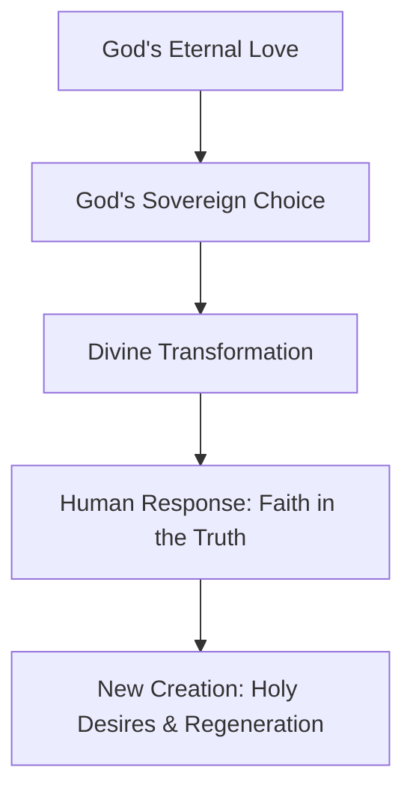

## 2 Thessalonians 2: The Antichrist Spirit

- The upcoming man of lawlessness, also known as the man of sin or the Antichrist
- **[The Antichrist Spirit]** This is an active force already present in the world today
    - It manifests as the "mystery of lawlessness"
    - It is characterized by a brash denial of the work and person of Christ
    - While it will ultimately culminate in the final Antichrist, many people currently demonstrate this attitude

### Satan's Deceptive Strategy

- The primary goal is to keep the world from accepting Christ and His work
    - Satan seeks to maintain enough deception to prevent people from being saved
- **[The Ultimate Deception]** The plan culminates in the introduction of a false Christ
    - This will be embodied in the "man of sin" or "son of perdition"
- Satan and his emissaries operate through disguise
    - Satan disguises himself as an "angel of light"
    - His workers are equally deceitful, using lies to obscure the truth about Christ

### The Antichrist Attitude and False Christology

- False religious systems inevitably possess an errant Christology
    - They use lies about Christ to mislead followers
- **[The Core Denial]** According to 2 John 7, the essence of the deceiver/Antichrist attitude is the denial of Jesus Christ coming in the flesh
    - This manifests as a denial of Jesus Christ as God in human flesh

### The Pattern of False Religions

- False religious systems attack both the person and the work of Christ
    - **Denial of Christ's Work**: They substitute salvation by Christ's finished work with human effort, such as works, ceremonies, rituals, or religious effort
    - **Distortion of Christ's Identity**: They hold skewed views of who Jesus is, portraying Him as various non-divine figures:
        - An angel
        - An elevated emanation
        - A glorious man
        - A prophet of God

### The Final Antichrist (The Beast)

- The culmination of the Antichrist spirit will be a single, supreme satanic religious leader
- **[Characteristics of the Beast]** As described in Revelation 13, he will be the most significant deceiver in human history
    - He will command the worship of the entire world, redirecting it away from the true Christ
    - He will possess immense global authority, ruling over every tribe, people, and nation

#### Profile of the Beast (Revelation 13)

| Attribute | Description |
| --- | --- |
| Nature | Known as "the Beast" |
| Speech | Speaks arrogant words and blasphemies |
| Duration of Rule | Granted authority for 42 months (3.5 years) |
| Conflict | Given authority to make war with and overcome the saints |
| Scope of Power | Authority over every tribe, people, and nation |
| Global Impact | All who dwell on the earth will worship him |

### The Mechanics of Deception and Control

- **[The Scope of Worship]** The Antichrist will gain the worship of the entire world, excluding only those whose names are written in the Book of Life of the Lamb
- **[The Use of Deceptive Signs]** Satan enables the Antichrist and his henchman, the false prophet, to perform deceptive signs
    - These signs increase the Antichrist's attractiveness to the world
    - They serve as the primary reason the global population falls into worship of him
- **[The Mark of the Beast]** To control the population, a mark is required
    - According to Revelation 13:16, all people—regardless of social status (small/great, rich/poor, free/slave)—must bear this mark on their right hand or forehead
    - This mark is a central part of the Antichrist's global operation

### The Ultimate Blasphemy and Judgment

- **[The Desecration of the Temple]** The Antichrist's career involves a specific, pivotal event in Jerusalem
    - He enters the temple and desecrates the Holy of Holies and the altar
    - He sets himself up as God, demanding worship
    - This is possible because those who rejected Christ are given over to deception by God
- **[The Nature of the Antichrist]** He is a human being energized by Satan, capable of performing astounding and blasphemous acts
- **[The Final End]** The rise of the Antichrist is not the final word; it leads to the Day of the Lord
    - This is the great judgment that comes to destroy the Antichrist

## The Thessalonians' Confusion

- **[The Source of Fear]** The Thessalonians were in a state of fear and doubt regarding the timing of Christ's return
    - They were experiencing persecution and hostility
    - They feared they had missed the rapture and were already living in the Day of the Lord
- **[The Deceptive Message]** Their confusion was specifically triggered by a fraudulent communication
    - Someone circulated a false letter, claiming to be written by Paul
    - The letter falsely claimed that a supernatural word had come from God and that the Day of the Lord had already arrived
    - This caused widespread panic and disturbance among the believers

### Reassurance Against Fear

- **[The Antichrist as a Precursor]** Paul uses the sequence of end-times events to logically disprove the false claim that the Day of the Lord has already arrived
    - The Antichrist must appear before the Day of the Lord breaks loose
    - The "abomination of desolations" (the apostasy) must occur first
    - Since the whole world is not yet worshipping the Antichrist, it is evident that the Day of the Lord has not come
- **[The Purpose of Paul's Teaching]** To move the believers from a state of being "shaken and disturbed" to a state of hope and encouragement
    - Paul wants to alleviate the fear of missing the rapture
    - He emphasizes that believers will escape the Antichrist's deception and the judgment of the Day of the Lord
- **[The Christian Outlook on Christ's Return]** Instead of fear, the return of Christ should be met with:
    - Joy
    - Hope
    - Eagerness
    - Exhilaration
    - Happiness

### Paul's Instructions for Stability

- **[First Principle: Do Not Be Deceived]** Paul begins a series of points to help believers maintain their footing
    - This serves as the first defense against the confusion caused by false messages and persecution

### Principles for Maintaining Spiritual Stability

- **[First Principle: Do Not Be Deceived]** Paul emphasizes that believers must not be misled by false theories or claims.
    - The Day of the Lord cannot have arrived because specific precursors have not occurred:
        - The apostasy has not happened
        - The man of sin/lawlessness has not been revealed
        - The son of destruction has not exalted himself above all so-called gods
        - The desecration of the temple has not taken place
    - **[The Goal]** To prevent people from concocting theories that strip away joy, hope, and composure.
- **[Second Principle: Do Not Be Forgetful]** Based on verse 5, Paul urges believers to hold fast to what they have already been taught.
    - **[The Danger of Forgetting]** Forgetting essential truths is one of the most traumatic experiences for a believer, as it undermines growth and encouragement.
    - **[How to combat forgetfulness]**
        - Constant review of foundational teachings
        - Constant recitation in the mind
        - An active effort to remember truths repeatedly so they cannot be easily shaken
    - **[A Principle for Doubt]** One should "doubt your doubts," but never doubt what you know to be true.
- **[Third Principle: Do Not Be Ignorant]** Paul instructs them to avoid ignorance to prevent fear and doubt from taking root.
    - Ignorance is a catalyst for questioning and instability
    - To counter this, Paul provides detailed information (from verse 6 through verse 10) to fill in the gaps regarding the nature and arrival of the Antichrist

### Further Principles for Spiritual Stability

- **[Third Principle: Do Not Be Ignorant]** Paul provides detailed information regarding the Antichrist's career, power, influence, and destruction to prevent ignorance from fueling fear.
- **[Fourth Principle: Do Not Be Unbelieving]** Paul warns against a specific type of unbelief that leads to destruction (verses 10–12).
    - **The Connection to Truth**: Perishing is linked to those who do not "receive the love of the truth" so as to be saved.
    - **[Judicial Unbelief]** For those who willfully reject the truth and take pleasure in wickedness, God's judgment includes a "deluding influence."
        - They are turned over to believe what is false.
        - This is a judicial consequence of their refusal to love and obey the truth.
    - **The Risk to Believers**: Being in the church but remaining unsaved creates a reason for fear, as these individuals may remain on earth during the Antichrist's rise and become victims of his deception.
- **[Fifth Principle: Do Not Be Insecure]** Paul instructs believers not to find any reason to be shaken or insecure regarding their standing or the timing of events.

### The Danger of Spiritual Insecurity

- **[The Fear of Imperfect Return]** A common source of anxiety is the belief that if Jesus returns while a believer has unconfessed sin, they will go to hell.
    - This view suggests that if everything is not on "perfect terms" with God at the moment of His return, the believer is lost.
    - Such a belief leads to living in constant, paralyzing fear.
- **[The Reality of Human Fallenness]** The Bible contradicts the idea that a believer can reach a state of sinless perfection.
    - **1 John 1 Reference**: "If we say we have no sin, we make him a liar."
        - Claiming to have no sin is a denial of the truth of God's Word.
        - At any given point in a Christian's life, there will be some manifestation of fallenness.
- **[Theological Roots of Perfectionism]** Certain theological frameworks may inadvertently encourage perfectionism as a coping mechanism.
    - Some views (such as certain Arminian perspectives) may develop a perfectionistic viewpoint to help people escape constant fear.
    - This creates a "plateau of security" where people believe they can reach a point where they no longer sin, which is fundamentally inconsistent with the reality of the human condition.

### Overcoming Spiritual Insecurity

- **[The Anxiety of 'Keeping One's Accounts Fresh']** Some may feel a constant pressure to perpetually confess sins to avoid being "doomed" if caught in sin when Jesus returns.
    - This mindset suggests a person must actively "keep themselves saved."
- **[The Thessalonian Context]** This type of thinking may have plagued the early church, leading to fears such as:
    - That the rapture had already occurred and they had somehow slipped out of salvation.
    - That the Lord had canceled the rapture due to the number of defectors, leaving them to face the Day of the Lord's judgment instead.
- **[The Basis for Confidence: God's Election]** Paul provides reassurance by pointing to the origin of their salvation in 2 Thessalonians 2:13-14.
    - **[Divine Purpose]** God chose believers from the beginning for a specific progression:

        1. Salvation
        2. Sanctification (by the Spirit and faith in the truth)
        3. Glory (to gain the glory of our Lord Jesus Christ)

    - **[The Guarantee]** Because God's plan from eternity past was to bring believers to glory, they do not have to fear "getting lost" along the way.

### The Purpose of Election: From Salvation to Glory

- Believers were not chosen simply to be saved in a temporal sense
    - The ultimate goal of being chosen is to be glorified
    - This allows believers to eventually stand in God's presence, holy and undefiled like Christ
- **[The Progression of Salvation]** Salvation in time is merely an element used to bring God's eternal choice to fruition

### The Theology of Salvation in 2 Thessalonians 2:13

- **[The Source of Gratitude]** Paul instructs to "always give thanks to God for you"
    - Gratitude is directed to God because salvation is entirely His work, not a result of human intelligence or effort
- **[The Starting Point: Divine Love]** Salvation begins with being "loved by the Lord"
    - This love is not a reaction to human behavior but is sovereign and foundational
    - **Definition of God's Love in Salvation:**
        - Uninfluenced
        - Undeserved
        - Initiating
- **[The Eternal Origin]** Salvation is rooted in eternity past
    - God predestined to set His love on believers without any outside influence
    - This aligns with Ephesians 1, where God "in love having predestinated"

### The Sequence of Salvation: Love and Election

- **[The Initiation: Divine Love]** Salvation begins with God's determination to love
    - This love is not based on any quality in the person being loved
    - It is a sovereign decision residing solely in God's own mind and plan
- **[The Result: Divine Choice]** Flowing from His predetermination to love is His choice (election)
    - God chooses believers from the beginning for salvation

### The Eternal Nature of Election

- **[Eternity Past]** Election is not a recent matter or an afterthought
    - It occurred "from the beginning," meaning in eternity past
    - This is illustrated by names being written in the Lamb's book of life "before the foundation of the world"
- **[Sovereign Pleasure]** The choice is made by God's own sovereign pleasure
    - It is not a reaction to human behavior or a search for specific traits
    - This is why the New Testament refers to the church as "the elect"

### The Security and Purpose of the Elect

- **[Unassailable Standing]** Being part of the 'elect' means one's position is secured by God Himself
    - According to Romans 8:33, no one can bring a charge against God's elect that would force Him to revoke their salvation
    - Because God is the one who justifies, His choice is fixed forever
- **[The Nature of Divine Selection]** Christ's choice is based on His love, not human merit
    - As Jesus stated in John 15, "You have not chosen me, I have chosen you"
    - This selection is intended to ordain believers to bear fruit
- **[The Impact of Election]** The doctrine of sovereign, predestinating love serves several purposes:
    - **Crushes Human Pride:** It gives all credit to God, exalting Him rather than the individual
    - **Produces Joy:** It provides unspeakable joy in the wonder of being chosen
    - **Grants Privilege:** It secures a full and eternal inheritance
    - **Promotes Holiness:** Knowing one is chosen as a child of God should create a longing to be like Him
    - **Provides Security:** It ensures that God will complete the work He started (Philippians 1:6)

### The Progression of Salvation

- **[The Threefold Process]** According to the text, the believer experiences a progression:
    - Loved by the Lord
    - Chosen by the Lord
    - Transformed by the Lord
- **[The Two Elements of Salvation]** Salvation is accomplished through a combination of divine and human components:
    - **Sanctification by the Spirit:** The divine side of the process
    - **Faith in the truth:** The human side of the process

### Sanctification by the Spirit

- **[Definition]** To be sanctified means to be set apart or detached from sin
- **[The Work of the Holy Spirit]** This is a sovereign, miraculous, and divine action
    - The Spirit detaches the individual from sin
    - A "new inner man" is created within the believer
- **[The Nature of the New Creation]** This internal transformation makes the believer fit for God's presence
    - It is the life of God dwelling within the person
    - The new nature possesses the divine nature
    - It produces holy aspirations and righteous longings
    - It finds delight in the law of God (as noted in Romans 7)

### The Supernatural Work of Regeneration

- **[The Nature of Regeneration]** Salvation is a miracle where the old nature dies and a new one is born
    - The Holy Spirit creates a holy nature within the person
    - This is a sovereign and supernatural act of God
- **[The Prayer for Salvation]** Rather than using a formulaic prayer, a person should ask God for the actual work of salvation
    - A sincere petition focuses on the need for God to separate the individual from sin
    - It asks God to declare the person righteous through the righteousness of Jesus Christ
    - It asks God to plant the "holy new inner man" within them
- **[The Twofold Aspect of the Spirit's Work]** The Holy Spirit operates in two distinct ways regarding the believer's nature:
        - **Initial Regeneration:** The Spirit separates the individual from sin and creates the new creation
        - **Continual Sanctification:** The Spirit keeps the process of separation going throughout life
            - As believers gain victory over the flesh, they experience ongoing sanctification
            - During this process, the "new man" may still feel incarcerated by the flesh, but the Spirit continues the work of setting them apart to God

### Faith in the Truth

- **[The Human Response]** While sanctification is the divine side, faith is the necessary human component
    - To be saved, one must believe in the Lord Jesus Christ
    - As stated in Acts 16:31: "Believe in the Lord Jesus, and you will be saved, you and your household"
    - This involves believing in the heart that God raised Him from the dead and confessing Him as Lord with the mouth
- **[The Role of Hearing]** Faith is predicated on hearing the truth
    - The Spirit's work becomes operative through faith in the truth (the gospel and Christ)
    - One cannot believe without hearing, as noted in Romans 10: "How shall they hear without a preacher?"

### The Summary of the Believer's Journey

- Paul describes a progression of God's work in the life of the believer:

    1. **Loved:** The foundation based on God's eternal love
    2. **Chosen:** The sovereign decision of God
    3. **Transformed:** The reality of salvation brought to life through the Holy Spirit

        - Separation from sin (regeneration)
        - Creation of a new nature
        - The production of faith to believe the truth

### The Effective Call

- **[The Nature of the Call]** Before the transformation occurs, there is a preceding step: being called by God through the gospel
    - This is described as an "effective" or "efficacious" call
    - It is characterized by what theologians call "irresistible grace"
- **[The Work of the Holy Spirit]** This call is a supernatural intervention rather than just information
    - It is the Holy Spirit calling an individual to Himself in a way that cannot be resisted
    - The call does more than just present facts; it provides the necessary components for salvation:
        - The truth to believe
        - The will to believe it
- **[The Power of the Gospel]** The gospel functions as a transforming force rather than just a set of instructions
    - As noted in 1 Thessalonians 2:13, the word of God is not merely the word of men, but it "energizes its work" in those who believe
    - The natural man cannot believe simply by hearing the gospel unless the call actually turns his heart

### The Ultimate Purpose: Glorification

- **[The End Goal]** The entire sequence of God's work is not an end in itself, but is done "in order that" believers may gain the glory of our Lord Jesus Christ (2 Thessalonians 2:14)
    - God's actions are purposeful and directed toward a specific outcome
    - The sequence is: Loved $\rightarrow$ Chosen $\rightarrow$ Called $\rightarrow$ Transformed $\rightarrow$ **Glorified**
- **[The Nature of Glorification]** It is the process of being made like Christ
    - The purpose of being chosen is to be made like the Son
    - This includes seeing Him as He is

### The Security of the Believer

- **[Why Believers are Secure]** Because God's election is aimed at the final destination (glory) rather than just the starting point (belief), the process is guaranteed
    - If God chose individuals to be glorified, the process cannot "slip through the cracks"
    - The intent of God's choice is the completed work of making them like Christ
- **[Nothing can separate]** Based on Romans 8, there is no force capable of causing the salvation process to default
    - Nothing can separate the believer from the love of God in Christ
    - This includes:
        - Principalities or powers
        - Things present or things to come
        - Height or depth
        - Any other creation

### Rejecting Spiritual Insecurity

- **[The Basis of Security]** There is no need for anxiety regarding the return of Christ or the fear of being 'caught' in the Day of the Lord
    - Believers are not destined for judgment; they are destined for glory
    - One cannot "default" or "slip through the cracks" of a plan established before the world began
- **[The Distinction of Destiny]** The elect are fundamentally different from those who will be deceived and judged
    - The plan is not just to save, but to make believers "sons of glory"

### Reasons for Fear vs. Reasons for Assurance

- **[Groups with Reason to Fear]** Different states of spiritual condition lead to vulnerability during the Day of the Lord:
    - **The Unbelieving**: They face the actual judgment to come
    - **The Ignorant**: They lack the necessary knowledge to avoid fear
    - **The Forgetful**: They fail to remember the truths they should know
    - **The Deceived**: They have been led into confusion by falsehoods
- **[The Remedy]** The Word of God provides ample instruction to remove this fear and provide stability

### Final Exhortation: Standing Firm

- **[The Command]** The passage concludes with a direct instruction to "stand firm" and "hold to the traditions"
    - **Stand firm**: Do not be weak, vacillating, fearful, doubtful, or agitated
        - It means to stay upright and exert strength to keep something from being pulled away
    - **Hold to the traditions**: Exert a firm grip on what was taught
- **[Defining "Traditions"]** The word "traditions" (Greek: *paradosis*) is often misunderstood in modern contexts
    - **Modern Misconception**: Often viewed as human cultural or religious customs, sometimes juxtaposed against the Bible
    - **Actual Meaning**: Literally "things handed down"
    - **In This Context**: It refers to the divine revelation and apostolic teaching given by the Lord through Paul
        - This includes teachings delivered "by word" (oral preaching) and "by letter" (written epistles)
    - **Key Takeaway**: Stability comes from holding fast to the specific, authoritative message of God revealed through the apostles, not human inventions.

### Standing Firm in the Truth

- **[The Command to Stand Firm]** Paul exhorts believers to resist being weak, vacillating, or agitated
    - To "stand firm" means to hold one's ground and stay upright
    - To "hold" implies exerting strength with a grip so that something cannot be pulled away
- **[The Role of Doctrinal Instruction]** Holding onto divine revelation acts as a safeguard against spiritual failure
    - It prevents being deceived, ignorant, forgetful, or insecure
    - It provides the stability needed to avoid the pitfalls of the Day of the Lord

### Defining Biblical Traditions

- **[Distinguishing Traditions]** The term "tradition" in the New Testament must be carefully distinguished to avoid confusion
    - **Human Traditions**: Man-made customs or philosophies
        - *Traditions of the elders*: Religious concoctions passed down by Pharisees (e.g., Matthew 15)
        - *Traditions of men*: Gentile philosophies and human wisdom passed through generations (e.g., Colossians 2:8)
    - **Divine Traditions**: Things handed down from God
        - These are the authoritative, revelatory teachings passed from God to the apostles, and then to the church
- **[Modes of Transmission]** Divine revelation was passed down in two forms:
    - **Oral**: The inspired spoken message (recorded in the Gospels and Acts)
    - **Written**: The inspired letters and epistles

### Guarding the Apostolic Doctrine

- **[The Nature of the 'Traditions']** In the context of Paul's exhortation, "traditions" refers specifically to the Apostolic Doctrine
    - This is the essential message handed down from God to the Apostles and subsequently to the Church
    - It is distinct from human customs; it is the authoritative teaching necessary for the life of the church
- **[The Modern Manifestation]** For the contemporary believer, this handed-down message is preserved in Scripture
    - **Oral Records**: The spoken words of the early church are recorded in the Gospels and the book of Acts
    - **Written Records**: The inspired letters and epistles
- **[The Mandate to Guard]** Believers are commanded to protect this entrusted truth
    - Paul instructs Timothy to "guard what has been entrusted to you" (1 Timothy 6:20)
    - This guarding is made possible because the Holy Spirit dwells within the believer to protect this "treasure" (2 Timothy 1:14)
- **[The Result of Guarding]** Holding firmly to this divine revelation provides the ultimate defense against spiritual failure
    - It prevents the believer from wavering, being confused, becoming ignorant, or feeling insecure

### Divine Comfort and Strength

- **[The Source of Operative Power]** Human ability alone is insufficient to live out the truth or remain steadfast
- **[The Benediction]** Paul concludes with a prayer for the Thessalonians, highlighting the divine sources of stability:
    - **God our Father**: The one who has loved us
    - **Eternal Comfort and Good Hope**: Provided through grace
- **[The Purpose of Grace]** This divine comfort is intended to provide strength in the heart for "every good work and word"

### The Divine Source of Strength

- **[The Limitation of Human Ability]** There is a "mysterious and wonderful reality" regarding the Christian life:
    - Even when a believer is fully committed to obeying and responding to God, the human flesh lacks the inherent capability to make that response operative
    - Spiritual endurance depends on God energizing the human response from within
- **[The Purpose of the Benediction]** Paul’s prayer (verses 16–17) is designed to provide two specific divine interventions:
    - **Comfort**: To encourage the believer in the midst of being shaken or discomforted
    - **Strength**: To empower the believer to hold on to the truth

### The Deity of Christ in the Benediction

- **[Grammatical Emphasis on Unity]** The structure of the prayer provides a strong argument for the equality of the Son and the Father:
    - The use of the emphatic pronoun "himself" (e.g., "may *himself* our Lord Jesus Christ and God our Father") applies to both the Son and the Father
    - Because a singular pronoun is used to refer to both, it equates Christ and God
    - The mention of the Son before the Father further emphasizes their shared status and equality
- **[The Core Target of Deception]** This theological reality—that God is revealed through Jesus Christ—is the central truth that the Spirit of the Antichrist constantly seeks to attack.

### The Theological Depth of the Benediction

- **[The Foundation of Salvation]** The prayer is rooted in the character and past actions of God and Christ:
    - **Eternal Love**: They loved us in eternity past
    - **Gracious Salvation**: They granted us eternal comfort and good hope through grace
- **[The Prayer for Transformation]** The core request is that the same power used for redemption would be applied to daily life:
    - **Comfort**: To encourage the believer so they are not discouraged or shaken
    - **Strength**: To empower the believer's "heart" (the inner man, the mind, and the seat of thought and action)
    - **The Goal**: That this divine empowerment would manifest in "every good work and word"
- **[The Continuity of Divine Power]** There is a direct link between the power demonstrated in salvation and the power required for obedience:
    - The same God whose power was demonstrated in our salvation should be the one to demonstrate that power in our obedience.

### The Fruit of Divine Empowerment

- **[Practical Manifestation]** God's strength is intended to manifest in two specific areas of a believer's life:
    - **In Action**: Everything a believer *does* (good works)
    - **In Speech**: Everything a believer *says* (good words)
- **[The Resulting Character]** When empowered by God, the believer becomes:
    - Strong and bold
    - Immovable and stable
    - Fixed and mature
    - Unshaken
- **[The Believer's Posture Toward the Future]** Because salvation is eternal and the power to endure is divine, the believer's outlook should be characterized by:
    - **Joyous Hope**: Anticipating the return of Jesus Christ rather than fearing judgment
    - **Confidence**: Knowing that the same God who had the power to save is the one who will sustain them until the end.