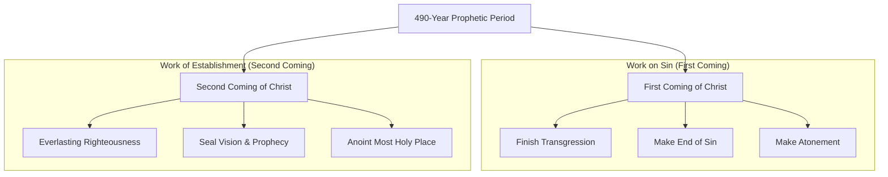

## 2 Thessalonians Chapter 2

- Introduction to a study of the text
    - Focuses on the figure known as the Antichrist
        - Described as fiendish and wicked

### The Nature and Titles of the Antichrist

- The Antichrist is the most destructive human to ever exist
    - He represents the culmination of all hatred toward God and Jesus Christ
    - He embodies the collective essence of all satanic false prophets, false teachers, and false Christs
    - He is the ultimate expression of hypocritical liars who claim to speak for God but actually operate under the "doctrines of demons" and seducing spirits
- Paul uses several specific titles for this figure in 2 Thessalonians 2
    - "The man of lawlessness" (verse 3)
    - "The son of destruction" (verse 3)
    - "That lawless one" (verse 8)
    - "The coming one" (verse 9)

### The Individual vs. the Spirit of Antichrist

- The Antichrist is a singular, specific person
    - He functions in accord with the activity of Satan
- The "spirit of Antichrist" is an attitude present in the world even now
    - It is characterized by any individual who, under Satan's influence, attempts to:
            - Thwart the work of God
            - Attack or oppose the work of Christ
            - Counterfeit the work of God/Christ

### The "Last Hour"

- Referenced in 1 John 2:18
- Defined as the messianic era since the coming of Christ
- Contextualizes the reality that while the individual Antichrist is coming, his spirit is already active

### Defining the Antichrist through Denial

- The core identity of the Antichrist is rooted in denial
    - He is the one who denies that Jesus is the Christ
    - He denies the relationship between the Father and the Son
- **[Theological Implication]** Anyone who denies the deity of Christ or the connection between the Father and the Son falls under the category of the Antichrist

### The Presence of Many Antichrists

- While the Antichrist is a culminating individual, his spirit is already widespread
- Many deceivers have gone out into the world
    - These individuals do not acknowledge Jesus Christ as coming in the flesh
    - They act as counterfeit religious leaders who, while hating and denying Christ, purport to be the Christ themselves

### The Scale of the Final Antichrist

- While many have possessed the spirit of Antichrist throughout history, the one who comes in final form will be unparalleled in evil
    - He will be worse than the worst of men or any historical abominator
- **[Historical Comparisons]** The final Antichrist will surpass these figures in blasphemy and malice:
    - **Antiochus Epiphanes**: Known for blaspheming God by slaughtering a pig in the Holy of Holies
    - **Adolf Hitler**: Known for mocking and blaspheming God, operating via mediums and demons, and attempting to exterminate the Jews
    - **Saddam Hussein**: Mentioned as being pale in comparison to the coming figure

### Etymology of Antichrist

- The term comes from the Greek word *Antichristos*
    - It is a combination word
    - The prefix *anti-* functions much like it does in English, signifying opposition or being against

### The Role of the Antichrist as a Usurper

- The term implies more than just being against Christ
    - It carries the idea of being "in the place of"
    - He is a usurper who seeks to replace Christ
- **[Theological Identity]** He is described as a satanic liar and a *pseudo Christus* (false Christ)

### Biblical Awareness of the Antichrist

- The coming of the Antichrist was common knowledge among early believers
    - **1 John**: John writes to believers noting that they "have heard that antichrist is coming"
    - **2 Thessalonians 2:5**: Paul asks the believers, "Do you not remember... I was telling you these things?"
        - This indicates that teachings regarding the lawless one and the son of perdition were already part of their established understanding

### The Long-Standing Presence of the Antichrist Spirit

- Early believers were aware of the Antichrist because they had already encountered his agents and forerunners
    - These agents proliferated globally, using blasphemous attacks against God and Christ
    - Their goal was to attempt to substitute themselves for Him
- The effort to thwart the work of Christ did not begin with His birth; it was an ongoing spiritual battle
    - **[Genesis 6]** Satan attempted a massive corruption of mankind using demons to create a "demon human race"
        - The intent was to produce people who were unredeemable
        - Because demons are unredeemable, the God-man would be unable to redeem these individuals
        - This necessitated the destruction of that entire civilization via the flood
    - **[Exodus]** A later effort involved Satan endeavoring to destroy all the male children in Israel

### Satanic Efforts to Break the Messianic Line

- Satan has consistently employed Antichrist-style efforts to destroy the royal line that would ultimately bring the Messiah
- **[Jehoram's Action]** According to 2 Chronicles 21, Jehoram attempted to kill all his brothers
    - This reduced the royal line to a single person
    - The entire messianic hope of the world hung on one fragile life
- **[The Arabian Massacre]** 2 Chronicles 22 describes a further attempt to sever the line
    - Arabians came to the camp and massacred all the sons except one
    - Again, the lineage was reduced to a single individual: the youngest son, Ahaziah
- **[Ahaziah's Reign]** Ahaziah took the throne but ruled for only one year
    - He was wickedly counseled by his mother, Athaliah
    - Despite being severely wounded and his life hanging in the balance, he survived
    - His survival was critical because he had sons, ensuring the line continued

### Continued Preservation of the Messianic Line

- Ahaziah's life was spared through divine intervention
    - He had to be hidden in the temple of God for six years to protect him from his mother, Athaliah
- **[The Time of Ezra]** A plot to wipe out the Jews in a foreign culture was thwarted
    - A pagan king's insomnia led to the uncovering of the conspiracy
    - This prevented the destruction of the line of Christ

### Historical Antichrist Activities and Thwarted Efforts

- Throughout history, various figures and groups have acted in an Antichrist capacity to oppose God's people or the Messiah
- **[Antiochus Epiphanes]** The King of Syria during the intertestamental period
    - Attempted to wipe out the Jews but failed due to the Maccabean revolution
- **[King Herod]** Attempted to destroy the Messiah by killing all baby boys
- **[Personal Attacks on Christ]** Direct attempts to divert or destroy His mission:
    - **Satan:** Attempted to thwart Christ through temptation
    - **The people of Nazareth:** Attempted to throw Him off a cliff
    - **Peter:** Attempted to divert Him from the path of the cross (met with Jesus' rebuke: "Get thee behind me, Satan")
    - **The Romans:** Attempted to thwart His work through their authority and actions

### The Culmination of the Antichrist Spirit

- The Antichrist spirit has operated throughout history
- In the last days, this spirit will be embodied in a single individual: the Antichrist
- This figure is described as Satan's final Antichrist

### Context of 2 Thessalonians

- The epistle addresses three primary issues confronting the church
- **[The Issue of Persecution]** The Thessalonian church was undergoing severe persecution
    - This persecution had escalated in the months between 1 Thessalonians and 2 Thessalonians
- **[The Purpose of Chapter 1]** Written to provide consolation and comfort
    - It reminds the believers that Jesus is coming to provide relief

### The Three Issues in 2 Thessalonians

- **[Chapter 1] Severe Persecution**: Written to provide comfort to those suffering.
- **[Chapter 3] Severe Insubordination**: Addressed internal issues of disobedience and lack of discipline.
    - Certain members were leading "unruly" lives (verse 6)
    - They failed to obey the traditions received from the apostles (the Word of God)
    - They were undisciplined and refused to work, instead acting as "busybodies" (verse 11)
    - This behavior was present even among fellow Christian brothers
- **[Chapter 2] Severe Confusion**: Addressed misconceptions regarding eschatology (the end times)

| Chapter | Primary Issue | Purpose |
| --- | --- | --- |
| Chapter 1 | Severe Persecution | Comfort for the persecuted |
| Chapter 2 | Severe Confusion | Clarification on the end times |
| Chapter 3 | Severe Insubordination | Correction for the undisciplined |

### The Nature of the Confusion in Chapter 2

- **[The Core Confusion]** Misunderstandings regarding eschatology (the end times)
    - Some believers concluded they were already in the "Day of the Lord"
    - This conclusion was driven by the intense hostility and persecution they were facing
    - This led to the fear that they had somehow missed the Rapture
- **[Clarification on the Rapture]** Paul had previously addressed these fears in 1 Thessalonians 4:13-18
    - The Rapture is not something a believer can miss
    - Whether alive or dead, believers are caught up: the dead in Christ rise first, then the living
- **[Distinction between the Rapture and the Day of the Lord]**
    - The Rapture occurs *before* the Day of the Lord
    - The Day of the Lord is characterized by darkness, night, and judgment
    - Believers are described as "children of the day" and are not part of that judgment-focused period

### The Sources of Confusion in Verse 2

- **[The Deception]** Believers were being misled by external influences to believe the Day of the Lord had already come
    - **A Spirit or Message**: An individual infected by the Antichrist spirit acted as a messenger to spread false doctrine
    - **A Counterfeit Letter**: The deceiver used a forged letter, claiming it was from Paul, to provide false authority for the message
- **[The Goal of the Deceiver]** To cause believers to be "quickly shaken from [their] composure" or "disturbed" by the false claim that the end times had begun

### Additional Reasons Why the Day of the Lord Has Not Come

- **[Believers' Identity]** Believers are "of the day," whereas the Day of the Lord is intended for "the people of the night"
- **[The Role of the Antichrist]** The Day of the Lord cannot occur until the Antichrist has appeared
    - According to verse 3, the Day of the Lord is preceded by:
        - The apostasy
        - The man of lawlessness (the Antichrist)
        - The son of destruction
- **[The Antichrist as a Trigger]** The Antichrist is a precursor who plays a vital role in actually triggering the Day of the Lord

### The Biblical Foundation of Antichrist Teaching

- **[New Testament Specifics]** 2 Thessalonians offers more specific details about the Antichrist than nearly any other New Testament book
    - Only the book of Revelation provides a comparable level of detail
- **[The Old Testament Connection]** To understand the personality and background of the Antichrist, one must reference the Old Testament
    - Daniel 9 is the foundational text for this teaching
    - Specifically, Daniel 9:24-27 provides the essential context used by Paul and John

> You can't understand Antichrist unless you see it in the context of Daniel 9, 24 to 27.

### The Context of Daniel 9

- **[Historical Setting]** The period of the Babylonian captivity for the children of Israel, nearing its conclusion
- **[Daniel's Prayer]** Daniel pleaded with God to fulfill His plan for Israel, specifically asking for:
    - The return of the people from captivity
    - The cleansing of the nation
    - The restoration of Israel
- **[The Divine Response]** God answered Daniel's long prayer by sending the angel Gabriel
    - Gabriel provided more than just a current answer; he delivered a comprehensive prophecy
    - This prophecy outlines the entire history of God's future plan for Israel

> Daniel 9:24-27 is the foundational text upon which Paul and John built their teachings regarding the Antichrist.

### The 70 Weeks of Daniel 9:24

- **[The Decree]** The prophecy states that "70 weeks have been decreed" for Israel and Jerusalem
    - The Hebrew word for "decreed" can be translated as "cut off"
    - This implies that God is taking a specific "chunk" or continuum of history to focus on His plan for these two entities
- **[Calculating the Timeline]** The "weeks" mentioned are not units of days, but units of seven years
    - To find the total duration, multiply the 70 weeks by 7 years per week
    - This results in a planned period of 490 years

| Calculation | Result |
| --- | --- |
| 70 weeks $\times$ 7 years/week | 490 years |

### The Connection Between Captivity and the 490-Year Prophecy

- **[The Sabbath Year Law]** The land was required to observe a period of rest every seven years
    - Farmers would work the land for six years
    - The seventh year was dedicated to letting the land rest
- **[Reason for Babylonian Captivity]** According to 2 Chronicles 36:21, the Jews were removed from the land to allow it to rest
    - The captivity lasted 70 years because the Sabbath years had been violated 70 times
    - God imposed a period of captivity equal to the number of years the land was denied its required rest
- **[Mathematical Link to Daniel 9]** The 490-year prophecy is a precise divine response to the violation of the Sabbath years
    - Violating 70 Sabbath years (each spanning 7 years) equals a 490-year period
    - The 490 years "cut out" of history is the period God uses to deal with Israel and Jerusalem

| Violation Period | Calculation | Prophetic Period |
| --- | --- | --- |
| 70 Sabbath Years | 70 $\times$ 7 years | 490 years |

### The Six Objectives in Daniel 9:24

Within the 490-year period, God outlines six specific actions He will take to work with His people:

- **Finish the transgression**
    - This involves bringing sin under control and restraining its influence
- **Make an end of sin**
    - This refers to bringing sin to its logical conclusion, which involves final judgment
    - This aligns with the principle that "the wages of sin is death"
- **Make atonement for iniquity**
    - **[The Grace of Atonement]** This is a gracious response to the 490 years of violation
    - While the first 490 years were a period where Israel violated God's laws, the subsequent 490-year prophetic period is used to offer salvation and atonement

### Fulfillment of the First Three Objectives

The first three goals in Daniel 9:24 focus on the removal of sin through control, judgment, and atonement. These were accomplished during the first coming of Jesus Christ:

- **Finish the transgression**
    - Accomplished by bringing transgression to its culmination and taking charge over it
    - Jesus' act on the cross allowed Him to gain the right to be the judge of all sinners
- **Make an end of sin**
    - Accomplished by dealing sin its "death blow" on the cross
    - Though sin is still present in the world, its power and legal standing were broken
- **Make atonement for iniquity**
    - Accomplished by providing the work of reconciliation to God
    - This provides the means for atonement and forgiveness for iniquity

### The Second Coming and the Remaining Objectives

While the first three objectives addressed the problem of sin through Christ's first coming, the final three objectives are associated with His second coming:

- **Bring in everlasting righteousness**
    - This begins with the establishment of the millennial kingdom
    - The kingdom is characterized by ruling righteousness

### The Remaining Objectives of Daniel 9:24

- **Bring in everlasting righteousness**
    - This begins with the establishment of the millennial kingdom
    - It extends through the eternal state, where the "righteousness of the ages" becomes permanent
- **Seal up vision and prophecy**
    - In Hebrew, "to seal up" means to enclose something so it is no longer used or is hidden from view
    - This implies that the function of prophecy and vision will be completed
    - **[The End of Revelation]** This occurs because, in the eternal state, there will be no need to learn anything more
        - This is described in 1 Corinthians 13: "Then shall you know, as you are known"
        - Once everyone possesses perfect knowledge, the role of vision and prophecy is finished

### Anointing the Most Holy Place

- Interpreted as the anointing of the New Jerusalem
    - Described as the "jewel of eternity" and the capital city of heaven
    - A city made of jewels that refract God's glorious light throughout the infinite universe

### Summary of the 490-Year Prophetic Period

God's work through the 490-year period involves a comprehensive process of addressing sin and establishing His kingdom, divided between the two comings of Christ:

| Timing | Objective | Purpose/Result |
| --- | --- | --- |
| First Coming | Finish the transgression | Bringing transgression to its culmination |
|  | Make an end of sin | Dealing the "death blow" to sin |
|  | Make atonement for iniquity | Providing reconciliation to God |
| Second Coming | Bring in everlasting righteousness | Establishing the millennial kingdom |
|  | Seal up vision and prophecy | Completing the function of revelation |
|  | Anoint the most holy place | Establishing the New Jerusalem |

### Determining the Start of the 490-Year Period

- To understand the timeline, one must identify the specific event that triggers the countdown
- According to Daniel 9:25, the period begins with the "issuing of a decree to restore and rebuild Jerusalem"
- **[Distinguishing Temple vs. City]** Not all decrees to rebuild Jerusalem are the same
    - The book of Ezra records three specific decrees:

        1. Cyrus
        2. Darius
        3. Artaxerxes (Ezra 1, Ezra 6, Ezra 7)

    - However, these three decrees focused exclusively on the rebuilding of the **temple**, not the city itself
- The decree that fits the prophetic requirement must be the one authorizing the rebuilding of the **city**
    - This is found in Nehemiah chapter 2
    - It occurred in the month of Nisan, during the 20th year of King Artaxerxes

### The Timeline of the Decree (444 B.C.)

- The decree to rebuild the city occurred in the 20th year of King Artaxerxes, which corresponds to **444 B.C.**
- **[Calculating the Year]** The math can be confusing due to ancient customs regarding the accession year:
    - Artaxerxes rose to power in 465 B.C., but the accession year (the year he took the throne) was not counted as a full year of his reign.
    - Counting begins in 464 B.C.; therefore, 20 years from 464 B.C. brings the timeline to 444 B.C.
- The decree was issued in the month of Nisan, marking the official start of the prophetic countdown.

### The 69-Week Breakdown (7 + 62)

- Daniel 9:25 specifies the time from the decree until the Messiah: "seven weeks and sixty-two weeks."
- While these total 69 weeks, the text splits them into two distinct segments:
    - **The first 7 weeks (49 years):** From 444 B.C. to 395 B.C. (moving backward in B.C. years).
    - **The purpose of this period:** During these 49 years, the city was rebuilt.

### The First 7 Weeks: Rebuilding the City

- The first 7 weeks (49 years) are dedicated to the physical reconstruction of Jerusalem
    - Daniel 9:25 specifies that the city, including its plaza and moat, will be rebuilt
    - This period is characterized by "times of distress," as detailed in the book of Nehemiah
- **[Significance of 396 B.C.]** This 49-year period concludes around 396 B.C.
    - This date marks the end of the Old Testament era, coinciding with the sealing up of Old Testament scripture at the book of Malachi

### The 69-Week Prophetic Span (483 Years)

- The prophecy describes a total of 69 weeks (7 weeks + 62 weeks) leading up to the Messiah
- **[Calculating the Total]** In this prophetic context, 69 weeks equates to 483 years
    - The countdown begins from the decree in 444 B.C.
    - The timeline moves forward from that decree until the arrival of "Messiah the Prince"

| Segment | Duration (Weeks) | Duration (Years) | Purpose/Event |
| --- | --- | --- | --- |
| First Segment | 7 weeks | 49 years | Rebuilding the city (ends ~396 B.C.) |
| Second Segment | 62 weeks | 434 years | Leads to the arrival of the Messiah |
| Total | 69 weeks | 483 years | From the decree to the Messiah |

### Calculating the Prophetic Timeline in Days

- To find the exact duration of the 483-year period, the calculation must account for the ancient method of using 360-day years
    - Calculation: $483 \\times 360 = 173,880$ days
- **[The Prophetic Match]** This specific number of days provides a precise timeline from the decree to the arrival of the Messiah
    - **Start Date:** March 5, 444 B.C. (the converted date for the month of Nisan during Artaxerxes' time)
    - **End Date:** March 30, A.D. 33
    - This marks the day Jesus (the Messiah, the Prince) entered Jerusalem, exactly 173,880 days after the decree.

### The Significance of the Triumphal Entry

- The arrival of the Messiah in Jerusalem (the Triumphal Entry) marks the end of the 69th week of the prophecy
    - This occurred on March 30, A.D. 33
    - Jesus was hailed as king and received palm branches as He entered the city
- **[The Historical Irony]** After waiting 173,880 days for the fulfillment of the prophecy, the Jewish people rejected and killed the Messiah
    - Jesus was crucified shortly after His entry, on April 3, A.D. 33

### The Remaining Week

- The 70-week prophecy is not yet fully fulfilled because there is one "loose week" remaining
    - The 69 weeks led to the Messiah, but the full 490-year period requires one more week to be completed

### The Messiah Being "Cut Off"

- Following the 69th week, the Messiah is "cut off"
    - This occurs *after* the 69th week, not at the end of it
    - The term "cut off" expresses the idea of an execution, such as being placed on a block and cut off
- **[The Nature of the Rejection]** The execution is described as having "nothing in it for him"
    - He was executed like a common criminal
    - He received no honor, no respect, and no portion
    - Even His clothing was taken and gambled for
- **[The Spiritual Paradox]** While the event was a total loss for the Messiah, it was the catalyst for salvation
    - **The Loss:** He was executed for nothing He did and lost even fellowship with God
    - **The Gain:** His execution provided redemption for everyone else

### The Destruction of the City and Sanctuary

- Daniel 9:26 predicts that "the people of the prince who is to come will destroy the city and the sanctuary"
    - This follows the Messiah's arrival as the Prince at the end of the 69th week (March 30, A.D. 33)
    - The Messiah is then "cut off"
- **[Historical Fulfillment]** The destruction of Jerusalem and the temple was carried out by the Romans in 70 A.D.
    - This occurred just decades after the crucifixion of Jesus
    - The Roman conquest involved the massacre of over a million Jews
- **[Connecting the Prince to the Antichrist]** The "prince who is to come" mentioned in the prophecy is identified as the Antichrist
    - The speaker notes the connection between this figure and the Romans
    - According to Daniel's prophecy, the final form of world government will be a revived Roman Empire

### The Characteristics of the Antichrist in Daniel

The Antichrist is expected to rise out of a revived Roman Empire, emerging from the "feet of mixed clay and iron."

#### Attributes from Daniel Chapter 7

- A military genius with overwhelming power
    - He wages war and devours the earth
    - He treads the earth down under his might
- A persecutor of believers
    - He wears out the saints of the Most High through intense persecution
- A religious counterfeit
    - He introduces a new religion with new morals and viewpoints to mimic Christ
- An agent of injustice
    - He utilizes seizure and punishment as tools of power

#### Attributes from Daniel Chapter 8

- A master of deception and intrigue
    - He is described as insolent and highly skilled in intrigue
    - He is shrewd and deceitful
- A destructive force
    - He possesses mighty power and a "fierce face"
    - He is capable of destruction on an extraordinary degree
- An opponent of God
    - He actively opposes the "Prince of princes"

#### Attributes from Daniel Chapter 11

- A figure of extreme self-exaltation
    - He does whatever he wants
    - He exalts and magnifies himself above all else

#### Additional Attributes from Daniel Chapter 11

- **Blasphemy and Profanity**
    - He speaks against the God of gods (Daniel 11:36)
    - He is characterized as blasphemous and profane
- **Disregard for Norms and Traditions**
    - He shows no regard for the gods of his fathers
    - He shows no regard for the "desire of women"
        - This may imply a disregard for sexual/gender norms (homosexuality)
        - Alternatively, it may refer to the Jewish desire for the Messiah's mother to arrive, which he would disregard
- **Immense Wealth and Brilliance**
    - He is brilliant in warfare
    - He finances his activities with vast riches, including gold, silver, costly stones, and treasures (Daniel 11:38)

#### The Antichrist's Origin and Identity

- **Connection to the Destruction of Jerusalem**
    - He is identified as the "Prince who is to come"
    - He belongs to a people associated with the massacre of Jerusalem and the desecration of the Holy of Holies
- **Emergence from a Revived Empire**
    - He is expected to rise out of a revived Roman Empire
    - This could manifest as a political entity or a religious entity (such as the Papacy)

### The Geopolitical Context of the Antichrist

- **The Rise of Europe**
    - There is a potential shift where Europe becomes the global focal point of power
    - This aligns with the Antichrist emerging from a revived Roman environment, as ancient Rome occupied that region
- **A Destructive People**
    - He will belong to a people whose goal mirrors the Romans of 70 AD
    - Their objective is to wipe out God, His city, and His people

### The Covenant of the 70th Week

- **The Firm Covenant**
    - According to Daniel 9:27, the Antichrist (the willful king/little horn) will make a firm covenant with many for one week
- **The Prophetic Gap**
    - There is an undetermined time gap between the 69th and 70th weeks
    - This creates a tension in the prophecy: God provides extremely exact timelines for some periods, yet leaves the timing of this specific week inexact, such that "no man knows the hour"

### The Antichrist's Covenant with Israel

- **The Motivation for the Pact**
    - Israel is expected to be perpetually embattled and under threat from numerous hostile actors (described as a proliferation of "Saddam Husseins")
    - The Antichrist will leverage this instability by positioning himself as a protector through a firm covenant
- **The Geopolitical Shift**
    - This move implies a shift where the United States may no longer be the primary protector of Israel
    - A unified European power would provide the strategic capacity to act in this role

### The Unification of Europe as a Prophetic Sign

- **Strategic Unification**
    - For the Antichrist to rule a massive portion of the world, the region must be unified under a single power structure
    - A coexistence of free-market and communist cultures would be incompatible with the rise of a single ruler
- **The End of Communism**
    - The fall of communism in Eastern Europe is viewed as a step toward European unification
    - This unification looks "right down the prophetic tunnel" toward the emergence of the Antichrist as a global leader

### The Religious Motives of the Antichrist

- **The True Objective**
    - The covenant is not driven by economic interests, but by a religious agenda
    - The heart motive is to destroy the Temple and the worship of God in Jerusalem
    - He intends to set himself up as God within the holy city
- **Strategic Access**
    - Satan's ultimate goal is to establish a false religion in Jerusalem (God's city) rather than elsewhere
    - A functional relationship with Israel via the covenant provides the necessary access to perform his blasphemy

### The Mid-Week Breaking of the Covenant

- **Halting the Sacrifices**
    - At the midpoint of the week (3.5 years in), the Antichrist will put a stop to the "sacrifice and grain offering"
- **Implications for the Temple**
    - This interruption implies that a Temple will have been rebuilt and active in Jerusalem
    - For this to occur, the Jews must have regained the ability to perform their religious offerings, suggesting a period of peace and accommodation from surrounding nations
- **The Abomination of Desolation**
    - Just as things appear to be going well and religious life is restored, the Antichrist will intervene
    - This act of blasphemy and disruption is identified as the "abomination of desolation"

### The Desecration of Jerusalem

- **The Target of Blasphemy**
    - The Antichrist targets Jerusalem because it remains God's city and the location where Jesus will return to rule
    - Desecrating this site serves as a direct assault on the symbol of God's authority
- **Nature of the Act**
    - His actions will mirror historical precedents of desecration and mockery, such as those of the Romans and Antiochus Epiphanes
    - He seeks to abominate, blaspheme, and mock God within the holy city
- **The Trigger for Divine Judgment**
    - The act of desecration "pulls the trigger" on the Day of the Lord
    - This event initiates a period of intense divine judgment poured out upon the Antichrist and his followers
    - This judgment ultimately leads to the execution of God's plan and the beginning of the everlasting righteousness He promised

### Recognizing the End Times via Matthew 24

- **The Prophetic Sign**
    - Jesus refers back to the prophecy of Daniel to give His followers a recognizable sign
    - The key marker is the "abomination of desolations" standing in the holy place
- **The Sequence of Events**
    - The Antichrist (the "prince who is to come") enters the temple
    - He performs his abomination, making the place desolate through blasphemy
    - This act triggers the **Great Tribulation**
    - The Great Tribulation culminates in the **Day of the Lord**
- **Urgency of the Moment**
    - The speaker emphasizes that when this sign occurs, there is an immediate need for flight/escape
    - He notes the difficulty of such an escape, mentioning potential obstacles like winter, travel hardships, or religious restrictions (e.g., the Sabbath)

### The Antichrist as a Theological Marker

- Paul uses the absence of the Antichrist to dispel eschatological confusion
    - He argues that the Day of the Lord cannot have arrived because the Antichrist has not yet appeared
    - This provides a strong theological indication to thwart the error of believing the end times are already underway
- This distinction connects back to previous teachings
    - In his first letter, Paul noted that believers would be raptured first and would not belong to the "people of the night" during the Day of the Lord
- **The Establishment of a False Religion**
    - A powerful figure may rise to unify the disintegrated pieces of Europe
    - This leader will act as a protector of Israel
    - He will form a false religion to facilitate his own worship
    - **[Goal]** To set himself up in the holy place and be worshipped by everyone as the God of the world, fulfilling Revelation 13
- **Hope for the Believer**
    - While the Antichrist's career and the Day of the Lord are significant, believers have a distinct promise
    - They will be caught up in the clouds to meet Christ in the air (the Rapture)
    - Consequently, they will not experience the Day of the Lord

### The Nature of the Day of the Lord

- For those who do not know God, the Day of the Lord will be characterized by:
    - Devastating divine judgment breaking loose from heaven
    - A state of eternal terror and fright beyond description
    - Permanent alienation and isolation from everything good, pure, and holy
    - Eternal punishment
- **[Theological Warning]** This retribution is for those who have hardened their hearts and erred, resulting in a lack of relief
- **The Coming of Christ**
    - The Lord Jesus will return from heaven in "flaming fire"
    - He will be accompanied by His mighty angels
    - His purpose will be to take vengeance on those who do not know God and do not obey the gospel of the Lord Jesus Christ