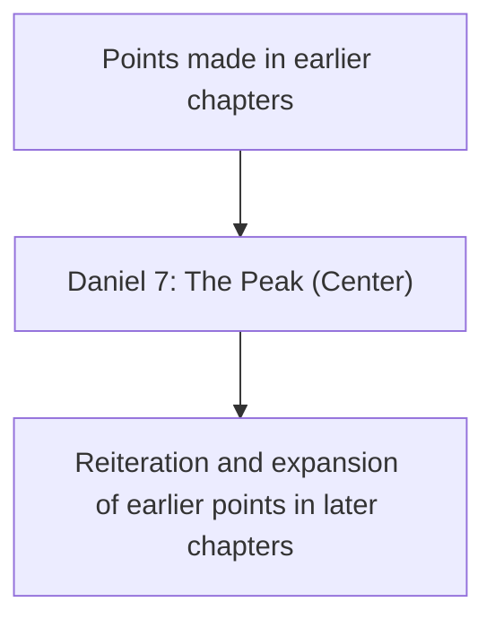
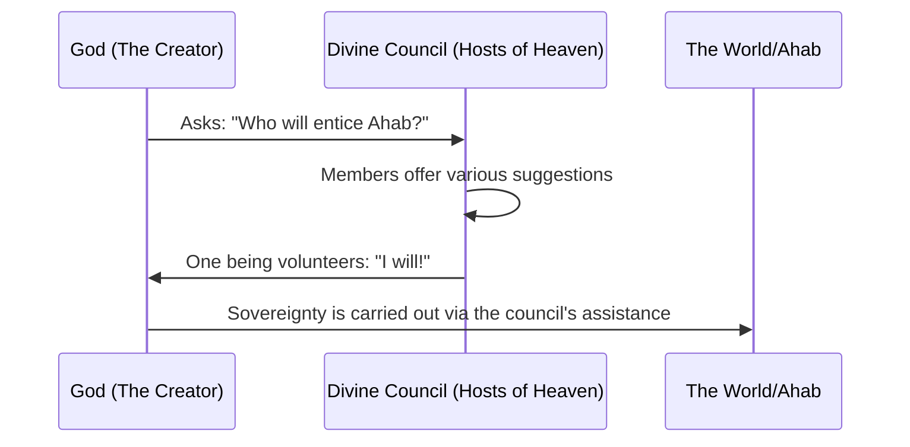
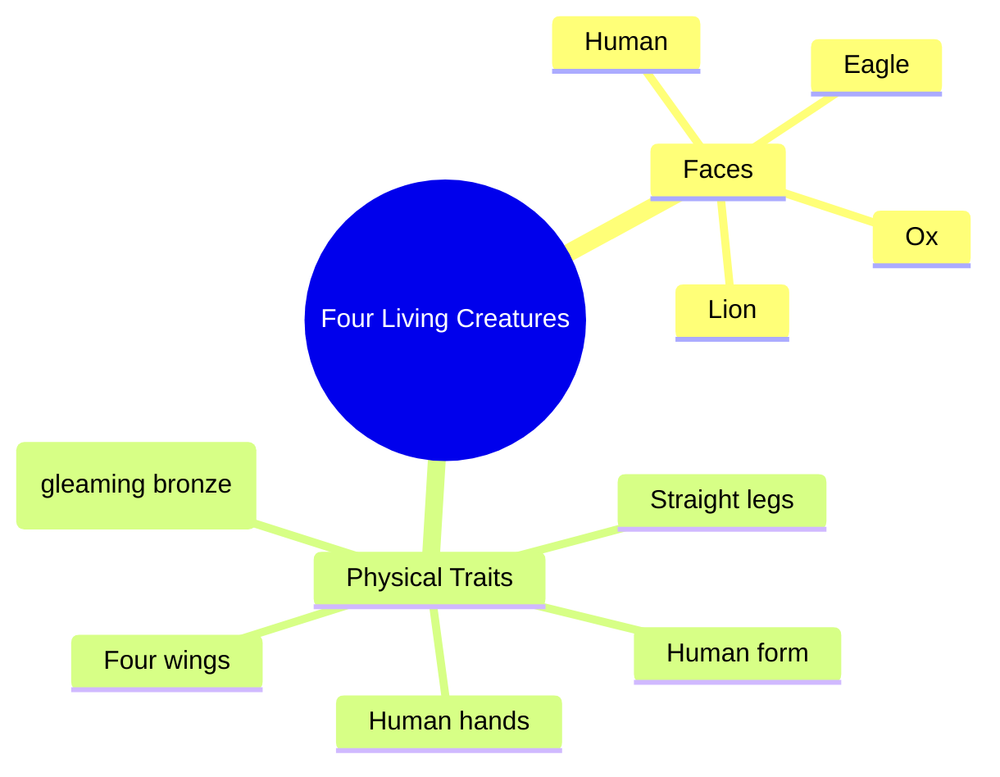
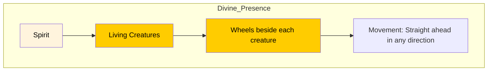

## Maranatha Global Bible Study

- Second study session
- Focus: Daniel chapters 7 through 12
    - This covers the section from the center of the Book of Daniel to the end

### Accessing Maranatha Global Bible Study

- Classes can be accessed via the Frontier Alliance International app
    - The app is available for download in any app store
    - This is the recommended way to view the study if not using the dedicated platform

### Previous Study Recap

- Covered Daniel chapter 7:
    - Verses 1 through 8
    - A brief look at verse 11

### Daniel 7:9-14

- This section is identified as the heart and center of the book
    - It is arguably the most important part of the entire Book of Daniel

### Chiastic Structure in Daniel

- The Book of Daniel is written using a chiastic structure
- **[Comparison to modern writing]** Unlike modern books that often follow a linear progression:
    - Modern authors typically state a primary point at the beginning and then develop the case
    - Or, they build a case and conclude by restating the point at the end

### Defining Chiastic Structure

- In biblical times, many passages, prophecies, and entire books were written using a chiastic structure
- **[The Core Principle]** The main point is located in the center of the work
    - This differs from modern writing where the point is typically at the beginning (to be defended) or at the end (as a summary)
- **[The Mountain Analogy]** The structure can be visualized like a mountain:
    - The main content acts as the peak
    - In this study, Daniel chapter 7 represents that peak

### The Symmetrical Nature of Chiastic Structure

- The structure involves a movement of "going up the mountain and then coming down"
    - Points made while ascending toward Daniel chapter 7 are reiterated and expanded upon after chapter 7
- **[The Pinnacle]** Daniel chapter 7 serves as the absolute peak and center
    - It is the most important part of the entire Book of Daniel

### The Peak on Top of the Peak

- Within a chiasm, there can be a specific key element that acts as a "peak on top of the peak"
    - This serves as the ultimate focal point within the already central structure
    - Described as being like a wheel

### The Culmination of Daniel

- The section acts as a "mountain peak on top of a mountain peak"
    - It is the center, focus, and ultimate culmination of the entire Book of Daniel
- **[Theological Significance]** These verses serve as a concise Old Testament articulation of the "gospel of the kingdom"
- **[Capstone of Revelation]** It represents the capstone of Old Testament progressive revelation concerning the Messiah
    - Throughout scripture, the concept of the Messiah unfolds through various prophets
    - Daniel 7 brings these disparate ideas together into a single, profound summary

### Study Methodology and Context

- **[Recommended Resource]** *The Gospel of Daniel 7* by Samuel Whitfield
- **[Comparative Reading Approach]**
    - The primary reading will be from the NIV (New International Version)
    - Detailed parsing will involve cross-referencing with the NASB (New American Standard Bible)
- **[Recap: The Four Beasts]**
    - Daniel chapter 7 describes four beasts rising from the earth
    - These beasts represent historical, pagan, and "satanically empowered" empires
    - **[Connection to Daniel 2]** These are the same empires previously described in Nebuchadnezzar's dream of the metallic statue

### The Little Horn and the Antichrist

- Emerging from the fourth beast is a "little horn"
    - Characterized as arrogant and boastful
    - Speaks blasphemies against God
- **[Identity]** This little horn is ultimately the Antichrist

### The Heavenly Vision

- The narrative shifts from the earthly beasts to an incredibly important heavenly scene
- **[The Ancient of Days]**
    - Thrones are set in place
    - He takes His seat
    - His clothing is as white as snow
    - The hair of His head is as white as wool
- **[The Divine Throne]**
    - The throne is flaming with fire
    - The wheels of the throne are all ablaze
    - A river of fire flows out from before Him
- **[The Heavenly Court]**
    - Thousands upon thousands attend Him
    - Ten thousand times ten thousand stand before Him
    - The court is seated and the books are opened

### The Fate of the Little Horn

- The horn was speaking until the beast was slain
    - The beast's body is destroyed and thrown into blazing fire
- **[Contrast in Authority]** While the other beasts had their authority stripped, they were permitted to live for a period of time

### The Centrality of the Messiah

- **[The Vision]** "In my vision at night I looked, and there before me was one like a son of man."
- **[The Core Message]** The Messiah is the true center of the entire Book of Daniel
    - Biblical prophecy is primarily about Jesus
    - While the following are important and worthy of study, they are not the primary focus:
        - The beasts
        - The Antichrist (the little horn)
        - The mark of the beast
        - The tribulation
- **[The Role of the Messiah]** He is the promised one and the coming one
    - He is not merely coming to fix or heal everything
    - He is not just coming to take away pain

### The Messiah as the Revelation of God

- **[Beyond Restoration]** The Messiah's work is more than just fixing, healing, or removing pain
    - While a restored and healed earth is glorious, its value lies in how it reflects the God who created it
- **[The Core Desire]** The central theme is the self-revelation of God
    - Humans have a fundamental yearning to know their Creator
    - The Messiah (the "son of man") serves as the essence of the God of all creation revealed to mankind

### The Approach of the Son of Man

- The Messiah approaches the Ancient of Days
    - He comes "with the clouds of heaven"
    - He is led into the presence of the Ancient of Days
- **[Divine Empowerment]** Upon his approach, he is granted:
    - Authority
    - Glory
    - Sovereign power over all nations and peoples

### The Eternal Dominion of the Messiah

- **[The Nature of the Kingdoms]** There is a sharp contrast between the end of the fourth beast's kingdom and the Messiah's kingdom
    - The kingdom of the Antichrist is destroyed completely, utterly, and immediately
    - In contrast, the Messiah's dominion is an everlasting kingdom that will never pass away and will never be destroyed

### Parsing Daniel 7:9-10

- **[The Appearance of the Ancient of Days]** The vision describes the setting of the heavenly court:
    - Thrones were set up
    - The Ancient of Days took His seat
    - His clothing (vesture) was white like snow
    - The hair of His head was like pure wool

### The Heavenly Throne Room

- **[Visual Details of the Court]** The vision presents a scene of intense, fiery majesty:
    - The Ancient of Days' vesture blazes with flames
    - His wheels are burning fire, with a river of fire flowing from before Him
    - The court is attended by "thousands upon thousands" and "myriads upon myriads"
    - The court sits in session and the books are opened
- **[God's Dwelling Place]** The location of the throne is significant:
    - God's throne is placed at the "height of the heavens"
    - This indicates that God has chosen to dwell within His own creation
- **[The Purpose of God's Presence]** God is not merely a distant, transcendent being:
    - By dwelling within creation, He alleviates the "cosmic loneliness" that humans ultimately feel
    - He is a God who draws near to be known and to reveal Himself to mankind

### The Divine Courtroom

- **[God's Nature]** God is characterized as a self-revealing and sharing being
    - He actively seeks to be known by His creation
    - His decision to dwell within creation is an act of drawing near to humanity
- **[Location]** The throne room is situated at the "height of the heavens"
    - This location encompasses both the earth and the heavens
- **[The Divine Counsel]** The heavenly throne room functions as a courtroom
    - While there is only one supreme God and Creator, He sits on His throne amidst a divine counsel
    - This council includes other divine beings referred to as *Elohim*
        - These are created beings, not the one true God
        - They are distinct from, and more than, just angels

### The Divine Council

- **[Interaction with Heavenly Beings]** The scriptures describe a dynamic relationship where God communicates with and consults a council of other divine beings
    - This is a foundational biblical concept, not a modern invention
- **[Scriptural Evidence]** Multiple passages reinforce the existence of this assembly:
    - **Psalm 82:1**: "God (*Elohim*) has taken his place in the divine council; in the midst of the gods (*Elohim*) he holds judgment"
    - **Psalm 89:5-7**: Describes God's faithfulness within the "assembly of the holy ones"
- **[Nature of the Council Members]** These beings are distinct from both the one true Creator and standard angels
    - They are powerful, created heavenly beings
    - They are referred to by different names depending on the context:
        - *Elohim* (the Hebrew term for divine beings/gods)
        - Principalities
        - Watchers (as named in the Book of Daniel)
    - While some of these beings became rebellious or fell, they remain a significant part of the heavenly structure

### The Function of the Divine Council

- **[Role in Sovereignty]** The members of the council are not gods in competition with the Creator, but beings who assist Him in carrying out His sovereignty over all creation
- **[Consultation in Action]** The scriptures depict God actively engaging with these beings to discuss and execute His purposes
    - **1 Kings 22:19-23**: A prophetic vision describes God sitting on His throne in the heavenly throne room, surrounded by the "hosts of heaven"
        - The hosts are positioned on His right and left hands
        - God poses a question to the assembly: "Who will entice Ahab that he may go up and fall at Ramah in Gilead?"
        - The council members respond by offering different suggestions or volunteering for the task

### The Execution of Divine Will

- **[The Role of Heavenly Beings]** Members of the divine council assist God in carrying out His sovereignty over all creation
    - This is not a sign of God's weakness, but a description of how His will is enacted through the heavenly structure
- **[Example: The Lying Spirit]** In 1 Kings 22:19-23, a vision shows God consulting the council
        - One spirit offers to entice King Ahab by being a "lying spirit in the mouth of his prophets"
        - The Lord approves this, declaring that the spirit will succeed in carrying out the sovereign judgment intended for Ahab

### Watchers and the Divine Council

- **[Terminology]** The Book of Daniel uses specific terms for these powerful heavenly beings
    - **Watchers**: Mentioned in Daniel 4:13-14 (e.g., "a watcher, a holy one, came down from heaven")
    - This term is also central to the Book of Enoch
- **[Context of Interaction]** These interactions take place within the established setting of the divine council
    - Location: The throne room of God, at the height of the heavens

### The Ancient of Days

- **[Identity]** The title refers to God the Father
    - While the term is evocative of His existence before all things, Christians identify this figure as God the Father
- **[Anthropomorphic Description]** The text uses human-like terms to describe Him, rather than portraying Him as an abstract concept or a mere orb of light
    - He is depicted with specific physical attributes:
        - Sitting on a throne
        - Wearing clothing as white as snow
        - Having hair on His head like wool
- **[Context of Presence]** He is seated in the midst of other heavenly beings
    - This distinguishes Him from other council members, as not all heavenly beings share this human-like form

### The Merkabah (Chariot Throne)

- **[Definition]** The throne of God is often referred to in Hebrew as the *Merkabah*
    - Rather than a simple, stationary seat, it is a "chariot throne"
- **[Visual Description]** The throne is described as having wheels that are "all ablaze"
    - This imagery emphasizes a dynamic, powerful presence
- **[Scriptural Connection]** This concept is not unique to Daniel
    - The same imagery of a chariot throne with fire is reiterated in Ezekiel chapter 1

### The Vision in Ezekiel 1

- **[Setting]** The vision involves a dramatic celestial event:
    - A windstorm coming out of the north
    - An immense cloud with flashing lightning
    - A center of fire that looks like glowing metal
- **[The Four Living Creatures]** These beings possess a unique, multi-faceted appearance:
    - **General Form**: They have a human form but with additional features
    - **Faces**: Each creature has four distinct faces:
        - Human
        - Lion (on the right)
        - Ox (on the left)
        - Eagle
    - **Wings and Limbs**:
        - Four wings (each touching the wings of another)
        - Straight legs with feet like those of a calf
        - Feet that gleam like burning bronze
        - Human hands under their wings
    - **Movement**: They move straight ahead without turning

### The Living Creatures and the Wheels (Ezekiel 1)

- **[Appearance of the Creatures]** The living creatures possess a fiery, intense quality
    - They appear like burning coals of fire or torches
    - Fire moves back and forth among them
    - They move with incredible speed, described as "flashes of lightning"
    - **[Movement]** Their movement is perfectly synchronized with the Spirit; they go wherever the Spirit goes without needing to turn
- **[The Wheels (Ophanim)]** Beside each of the four living creatures is a wheel touching the ground
    - **[Structure]** The wheels are described as "a wheel intersecting a wheel" (a wheel within a wheel)
    - **[Appearance]** They sparkle like topaz
    - **[Rims]** The rims are high and awesome, and they are covered with eyes
    - **[Function]** The wheels move in perfect unison with the creatures; as the creatures move, the wheels beside them move, allowing for movement in any of the four directions without changing orientation

### The Synchronization of Creatures and Wheels

- **[Unified Movement]** The wheels and the living creatures move as one unit
    - Wherever the spirit of the creatures goes, the wheels rise or move with them
    - When the creatures stand still, the wheels stand still
    - **[The Reason]** This perfect synchronization occurs because the spirit of the living creatures is contained within the wheels
- **[Connection to Daniel]** This imagery of a divine throne with wheels that are ablaze is a shared element between the visions of Ezekiel and Daniel
- **[The Ophanim]** In Orthodox Jewish tradition, there is a theory regarding the nature of these wheels
    - The wheels themselves are considered living beings
    - They are referred to as the "Ophanim"

### The Ophanim in Orthodox Tradition

- **[Liturgical Reference]** The concept of these living wheels is reflected in the Kiddush, a section of the morning Orthodox Jewish prayer said before the Shema
    - The prayer references holy creatures rising with a great uproar to face the seraphim
    - They offer praise, saying "blessed be God's glory from His place"
- **[Nature of the Chariot]** The divine chariot is described as having wheels that are covered with eyes and are all ablaze
- **[Complexity]** This imagery is described as being beyond human ability to fully grasp or comprehend

### The Divine Courtroom

- **[The Scene]** The vision shifts to a formal, solemn setting of judgment
    - The court sits
    - The books are opened
- **[Atmosphere]** This transition conveys an intense sense of solemnity and divine authority

### The Relationship Between the Beast and the Horn

- **[The Distinction]** While the horn and the beast are distinct, they are intrinsically linked
    - The **beast** represents the empire itself
    - The **horn** represents the human leader or dictator of that empire
- **[The Mouthpiece Concept]** The horn can be viewed as the "mouth" of the beast
    - This is because the horn is the entity that speaks the boastful words against God
- **[Telescoping Dynamic]** A recurring pattern in scripture where a kingdom and its king are treated as one and the same
    - This creates a layering effect where the characteristics of the empire are expressed through its leader
    - **[Example]** The boastful words of the horn are the direct expression of the beast's nature

### The Fate of the Beast

- **[Destruction]** The beast is slain and its body is destroyed
    - The remains are thrown into the blazing fire
- **[Loss of Power]** As a result, its dominion is taken away

### Biblical Cosmic Geography

- **[Gehenna / The Lake of Fire]** There is a theological idea regarding its physical location
    - It is believed to be located just south of the present-day Old City of Jerusalem
    - Specifically, it is situated south of the Temple Mount
- **[The Valleys of Jerusalem]** The area is characterized by several converging valleys
    - Kidron Valley
    - Hinnom Valley (the Hebrew origin of the Greek "Gehenna")
    - These valleys converge on the southern side of the Temple Mount

### Gehenna and Spiritual Judgment

- **[The Metaphor]** Historically, Gehenna was a literal trash heap
    - Jesus used this as a metaphor for the coming spiritual judgment on the wicked
- **[The Nature of Judgment]** Drawing from Isaiah, the judgment is characterized by its permanence
    - The flames never die
    - The worm never dies
    - The bodies are never fully consumed
    - **[Purpose]** This serves as a constant remembrance of God's justice and His judgment on the wicked

### The Messiah's Return and the River of Fire

- **[Heavenly Source]** In the heavenly vision, a river of fire proceeds from the throne
- **[Earthly Connection]** There is a prophetic link between the heavenly throne and the earthly geography of Jerusalem
    - The Messiah's throne is expected to be on Mount Zion
    - It is suggested that the river of fire from His throne will eventually fill and flood the Valley of Gehenna

### The Nature of the Lake of Fire

- **[Literal vs. Spiritual]** There is a difficulty in grasping whether the descriptions of the Lake of Fire are literal or are communicating spiritual realities that are beyond human comprehension
- **[The Reality of Punishment]** Regardless of the interpretation, the scriptures are clear regarding the outcome for the wicked
    - They will be cast into the Lake of Fire
    - The experience involves weeping and bitter regret
    - The imagery used is that of everlasting punishment
- **[The Duration of Suffering]** A central theological question is whether the punishment is an unending, agonizing pain or a process that concludes once the debt for sin is paid
    - The scriptures use the language of eternity and often employ hyperbole
    - **[Key takeaway]** While the exact nature of the duration is not fully known, Jesus was clear that it is a place of conscious punishment
    - **[Response]** The appropriate response to this reality is to flee from the coming wrath

### The Son of Man and His Eternal Kingdom

- **[The Vision]** Daniel 7:13 describes a pivotal moment in the heavenly realm
    - "With the clouds of heaven one like a son of man was coming"
    - This figure approaches the Ancient of Days and is presented before Him
- **[The Nature of His Authority]** Unlike earthly empires, the Messiah's dominion is characterized by its permanence and scope
    - **[Everlasting]** His kingdom is an "everlasting dominion which will not pass away"
    - **[Universal]** It is not limited to Israel; it is for "all the peoples, nations of every language"
- **[Contrast with Earthly Kingdoms]** The Messiah's rule stands in direct opposition to the kingdoms of this world
    - Earthly kingdoms, such as the fourth beast mentioned earlier, are ultimately destroyed and cast into the blazing fire
    - The Messiah's kingdom is established to endure forever

### The Significance of the Clouds of Heaven

- **[The Theme]** A key element of Daniel 7:13 is the description of the Son of Man coming "on the clouds of heaven"
- **[Biblical Context]** This theme is not an isolated idea but is deeply rooted in previous Old Testament revelations
    - Daniel was intimately familiar with the sacred writings of his time
    - He would have understood this imagery through his interaction with the words of prophets like Jeremiah, Isaiah, Hosea, and Joel
    - His understanding was also shaped by the Psalms, Proverbs, and the teachings of Moses
- **[Prophetic Interconnection]** The prophets and biblical authors frequently interact with one another, building upon established themes and language to convey new revelations

### The Divinity of the Cloud Rider

- **[Divine Identity]** For an Old Testament literate Jew, the description of someone coming on the "clouds of heaven" would immediately signal divinity
    - This imagery identifies the figure as God (Yehovah, Adonai, or Hashem)
- **[Biblical Basis: The Blessing of Moses]** This concept is rooted in the scriptures, specifically in the final blessings spoken by Moses
    - Deuteronomy 33:26 states: "There is no one like the God of Jeshurun"
    - **[Context]** Jeshurun is an honorific or a special name for Israel, emphasizing that God rides across the heavens in His majesty to help His people
- **[Theological Polemic: God vs. Baal]** The imagery serves to correct ancient pagan misconceptions
    - In ancient times, the deity Baal was believed to be the one who rode on the clouds
    - The biblical narrative asserts that God, not Baal, is the true "cloud rider" who rides the chariots through the skies

### The Convergence of Divine and Human Revelations

- **[The Synthesis]** Daniel 7:13 serves as the point where two major biblical prophetic threads intersect and blossom
    - **Thread 1: The Promised Human**
        - Rooted in Genesis 3:15: The promise of the "seed of the woman" who will crush the head of the serpent
        - Rooted in the Davidic Covenant: The promise that a descendant would come from David whose throne would be established forever
    - **Thread 2: The Coming God**
        - Rooted in Deuteronomy 33: The promise that God would come from heaven to save His people
- **[The Identity of the Son of Man]** Because the Son of Man comes on the clouds, He shares the identity of the Ancient of Days
    - The Ancient of Days is God Almighty
    - The Son of Man is revealed as possessing that same divine nature
- **[Theological Progression]** This moment in Daniel is not a new idea but the culmination of promises progressing through the scriptures

### The Divine Nature of the Son of Man

- **[Appearance vs. Essence]** The title "one like a son of man" is a crucial descriptor
    - It signifies that the figure *looks* like a human
    - However, the figure is actually God Almighty
- **[The Boldness of the Figure]** The figure's actions are inherently non-human
    - He comes boldly before the Ancient of Days
    - No mere human has the capacity or the right to approach God in such a manner
- **[Scriptural Support: Psalm 68:4]** The imagery of riding on the clouds is a recurring divine attribute
    - "Sing to God, sing praises to his name. Extol him who rides on the clouds. The Lord is his name. Yehovah is his name. Rejoice before him."
    - This reinforces the idea that the "cloud rider" is a title belonging to God (Yehovah)

### The Complexity of Divine Unity

- **[The Divine Duality]** Daniel 7 presents a profound theological paradox where two distinct figures are both identified as fully divine
    - The Ancient of Days is God Almighty
    - The Son of Man is also fully divine
- **[Theological Perspectives on Unity and Complexity]** The text sits at the center of a long-standing debate regarding how God can be both unified and complex
    - **Christian Perspective:** This convergence is seen as a foundation for the doctrine of the Trinity (God the Father and God the Son)
    - **Jewish Perspective:** While emphasizing the *Shema* ("The Lord is one"), Jewish tradition also acknowledges complexity through concepts like the "angel of the Lord"
- **[Daniel 7 as a Key Text]** Although written in Aramaic, this section of the book is a primary source in the Hebrew Bible for discussing the nature of God's being and His interactions within the divine realm

### Jesus as the Ultimate Revelation of God

- **[The Return of the Messiah]** The imagery of "coming on the clouds of heaven" is a consistent theme used to describe the return of Jesus
    - This portrayal fulfills multiple prophetic threads: the coming of God from heaven, the coming of the "crushing one," and the coming of the King of Israel/Son of David
- **[The Purpose of Revelation]** Jesus is the ultimate revelation of God to humanity because God chooses to send His very essence into the earth
    - **[Why?]** Because God is self-revealing; He wants humanity to know Him
    - **[The Result]** Through knowing the Creator, humans find:
            - The fullness of what they were created for
            - The fulfillment of emotional and spiritual longings
            - Fullness of joy in His presence
- **[The Method of Revelation]** God cannot simply "open the curtains" to the second world, as the direct presence of His full glory would consume humanity

### The Son of Man as a Divine Veil

- **[The Nature of the Incarnation]** The Son of Man takes on human flesh, but this is actually God Almighty in a veiled form
    - **[The Purpose]** This allows Him to step into the earth and reveal the heart and essence of the Ancient of Days to humanity

### Linguistic Parallels in Daniel 7:21-26

- **[The Conflict]** The little horn wages war against the saints, attempting to overpower them until divine judgment is passed
- **[Divine Titles]** The text uses nearly identical terms for the two divine figures, signifying they both refer only to God:
    - **The Ancient of Days** is called the "Most High"
    - **The Son of Man** is called the "Highest One"
    - **[Note]** While the Hebrew terms are slightly different, they are functionally synonymous in their reference to God's supreme authority

### The Everlasting Kingdom of the Son of Man

- **[The Transfer of Sovereignty]** Daniel 7:27 describes a total shift in power:
    - The sovereignty, dominion, and greatness of all kingdoms under heaven will be given to the "saints of the Highest One"
    - **[Note]** The "saints of the Highest One" refers to the people of the Son of Man (Jesus)
- **[The Nature of His Rule]** The Son of Man's authority is characterized by its permanence and universality:
    - His kingdom is an "everlasting kingdom"
    - All other dominions will "serve and obey Him"
- **[[Scriptural Context]** This concept of a vast, non-localized authority is reinforced in other biblical texts:
    - **Psalm 2 and Psalm 72**: These reveal that the Son of David would possess authority far exceeding that of a mere king of Israel, extending across the earth.

### The Global Scope of the Kingdom

- **[Universal Dominion]** The Son of Man's kingdom is not a localized political entity for Israel, but a global, universal rule:
    - It is described as encompassing the "whole globe"
    - All of the earth will be His "minion" (servant/subject)
    - The authority is described as lasting forever
- **[Israel as the Headquarters]** While the kingdom is global, Israel serves as the spiritual center or "headquarters":
    - Knowledge and the law of God flow from Zion
    - The influence is likened to waters covering the sea

### The Theological Weight of "Son of Man"

- The term "Son of Man" is a primary identifier for the Messiah in the New Testament, carrying more weight in the Gospels than other common titles:

| Title | Frequency in Gospels |
| --- | --- |
| Son of Man | 78 times |
| Christ / Messiah | 49 times |
| Son of God | 25 times |
| Son of David | 14 times |

- **[Conclusion]** This high frequency demonstrates how foundational the vision in Daniel 7 is to the entire New Testament understanding of Jesus's identity and mission.

### The Significance of the 'Son of Man' Title

- **[Self-Identification]** In the Gospels, 'Son of Man' was the premier term Jesus used to refer to Himself
    - **Frequency of Jesus's Titles:**

| Title | Frequency of Use |
| --- | --- |
| Son of Man | 78 times |
| Messiah (Christ) | 11 times |
| Son of God | 5 times |
| Son of David | 1 time |

- **[Linguistic Context]** The term used in Daniel 7 is Aramaic, which distinguishes it from the Hebrew used in much of the Old Testament
    - **Aramaic vs. Hebrew terms for 'Son of Man':**
        - **Daniel 7 (Aramaic):** `Bar Enash`
        - **Ezekiel (Hebrew):** `Ben Adam`
    - **[Note]** While similar, this distinction is important for precise biblical study.

### The Theological Weight of 'Bar-Hanasha'

- **[Linguistic Intent]** Jesus's choice of terminology was a deliberate pointer to Daniel 7:
    - While Ezekiel uses the Hebrew term `Ben-Adam` (son of man/humanity),
    - Jesus used the Aramaic term `Bar-Hanasha` (the specific term from Daniel 7)
    - **[Note]** This distinction suggests that when Jesus called himself the "Son of Man," he wasn't just claiming to be human, but was claiming the divine identity of the figure in Daniel.
- **[The Accusation of Blasphemy]** This claim was the basis for the religious leaders' opposition:
    - By identifying as the one from Daniel 7, Jesus was claiming to be God Almighty.
    - This directly led to the charges of blasphemy during his trial before the high priest.

#### The Trial of Jesus (Matthew 26:62-63)

> "The high priest stood up and said to him, 'Do you not answer? What is it that these men are testifying against you?' But Jesus kept silent, and the high priest said to him, 'I adjure you by the living God that you tell us whether you are the Messiah, the Christ, the Son of God.' But Jesus kept silent..."

### The Blasphemy Charge and Jesus's Self-Identification

- **[The Intentionality of Language]** Jesus's use of the Aramaic term `Bar Anasha` was not merely a linguistic preference, but a calculated theological statement:
    - By avoiding the Hebrew `Ben Adam` (often used to denote human frailty or mortality, as in Ezekiel), He bypassed the connotation of being "just a man."
    - Instead, by adopting the specific Aramaic phrasing from Daniel 7, He directly identified Himself with the divine, cloud-riding figure of Daniel's vision.
- **[The Basis for Blasphemy]** This distinction is central to understanding the legal accusations against Him:
    - When Jesus called Himself the "Son of Man," His audience understood He was not claiming mere humanity, but was claiming to be God Almighty.
    - This specific claim to divinity—linking Himself to the celestial authority of Daniel 7—was the primary reason He was accused of blasphemy during His trial.

### The Blasphemy Charge and the Son of Man

- **[The Confrontation]** When questioned about his identity, Jesus explicitly linked himself to the Daniel 7 prophecy:
    - He responded to the high priest's inquiry by declaring his role as the one who would sit at the right hand of power and return on the clouds of heaven.
    - **[The Theological Claim]** By doing this, he was asserting:
        - He is the 'Son of Man' spoken of in Daniel 7.
        - He is the one appointed by God to judge the living and the dead on behalf of the Ancient of Days.

#### The High Priest's Reaction (Matthew 26:64-66)

> "Jesus said to him, 'You have said it yourself. Nevertheless, I tell you hereafter you will see the Son of Man sitting at the right hand of power and coming on the clouds of heaven.' When the high priest heard this, he tore his robes and said, 'He has blasphemed! What further need do we have in you?'"

- **[The Verdict]** The high priest's reaction (tearing his robes) signifies that Jesus's claim to be the divine judge from Daniel 7 was recognized as an intolerable claim to divinity, resulting in the charge of blasphemy.

### The Martyrdom of Stephen

- **[The Fatal Claim]** The identification of Jesus as the 'Son of Man' was not merely a theological debate but a life-threatening assertion:
    - Stephen, recognized as the first Christian martyr, was killed specifically for proclaiming that Jesus was the Son of Man.
- **[Stephen's Rebuke]** In Acts 7, Stephen delivers a sharp critique of the religious establishment:
    - He accuses them of being "stiff-necked" and resisting the Holy Spirit.
    - He highlights a pattern of historical resistance, noting that their ancestors persecuted the prophets who announced the coming of the "righteous one."
- **[The Vision of Glory]** The immediate cause of the crowd's outrage was Stephen's spiritual vision:
    - While being confronted, he gazed into heaven and saw the glory of God.
    - He witnessed Jesus standing at the right hand of God (a post-resurrection position).

#### Stephen's Testimony (Acts 7:51-54)

> "You men who are stiff-necked and uncircumcised in your heart and ears, you're always resisting the Holy Spirit... They killed those who had previously announced the coming of the righteous one, whose betrayers and murderers you have now become..."

#### The Catalyst for Stephen's Execution

- **[The Connection to Jesus]** The crowd's violent reaction to Stephen was driven by the fact that his vision was a direct testimony to the same identity that led to Jesus's crucifixion:
    - By stating he saw the "Son of Man standing at the right hand of God," Stephen was affirming the very claim that the religious leaders had deemed blasphemous.
- **[The Violent Response]** The reaction was immediate and visceral:
    - The crowd covered their ears and rushed at him with a single impulse.
    - They ultimately stoned him to death.

---

### Session Conclusion

- **[The Centrality of Daniel 7]** The speaker emphasizes that Daniel 7 serves as the theological center of the Book of Daniel.
- **[Next Steps]** The study will continue by revisiting this specific scene before moving forward into the rest of the chapter.