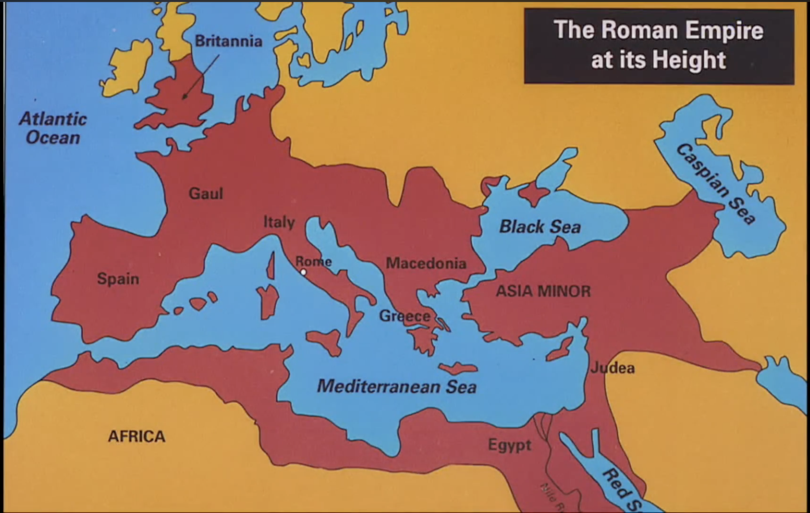

<h1 style="text-align: center; color: #153E75; font-size: 44px; font-weight: bold;">ಕಳೆದ ವಾರದ ಪಾಠದ recap ಮಾಡಣ:</h1>

<h2 style="text-align: center; color: #176B63; font-size: 36px; font-weight: bold;">ಮೊದಲನೇದಾಗಿ ದಾನಿಯೇಲ 7ನೇ ಅಧ್ಯಾಯನ ಯಾಕೆ ನೋಡ್ಬೇಕು ಅನ್ನೋದು</h2>

ಕಳೆದ ವಾರ ನಾವು ದಾನಿಯೇಲ 7ನೇ ಅಧ್ಯಾಯದ ಬಗ್ಗೆ ಶುರು ಮಾಡಿದ್ವಿ ಮತ್ತೆ ಅಂತ್ಯಕಾಲದ ಬಗ್ಗೆ ಮಾತಾಡಿದ್ವಿ. ದಾನಿಯೇಲನ ಪ್ರವಾದನೆಯಲ್ಲಿ ಬರೋ ಮೃಗಗಳು, ಹತ್ತು ಕೊಂಬುಗಳು ಮತ್ತೆ ರಾಜ್ಯಗಳ ಬಗ್ಗೆ ನೋಡಿದ್ವಿ.

<h2 style="text-align: center; color: #176B63; font-size: 36px; font-weight: bold;">ಎರಡನೇದಾಗಿ ದಾನಿಯೇಲ 2 ಮತ್ತು 7ನೇ ಅಧ್ಯಾಯಗಳು.</h2>

Next 2ನೇ ಅಧ್ಯಾಯದಲ್ಲಿ ನೆಬೂಕದ್ನೆಚ್ಚರನಿಗೆ ಒಂದು ದೊಡ್ಡ ವಿಗ್ರಹದ ಕನಸು ಬರುತ್ತೆ. ಹಾಗೆ ಅದೇ ವಿಷಯನ ದೇವರು ದಾನಿಯೇಲ 7ನೇ ಅಧ್ಯಾಯದಲ್ಲಿ ನಾಲ್ಕು ಮೃಗಗಳ ರೂಪದಲ್ಲಿ ತೋರಿಸ್ತಾರೆ. ಅಂದರೆ, ಒಂದೇ ವಿಷಯನ ಎರಡು ಬೇರೆ ಬೇರೆ ರೀತಿಲಿ ದೇವರು ಹೇಳ್ತಿದ್ದಾರೆ.

<h2 style="text-align: center; color: #176B63; font-size: 36px; font-weight: bold;">ಮೂರನೆದಾಗಿ ನಾಲ್ಕು ಮೃಗಗಳು ಏನನ್ನ ಸೂಚಿಸುತ್ತವೆ?</h2>

ಆಮೇಲೆ ದಾನಿಯೇಲ ಸಮುದ್ರದಿಂದ ನಾಲ್ಕು ಮೃಗಗಳು ಏಳೋದನ್ನ ನೋಡ್ತಾನೆ. ಮೊದಲನೆದು ಸಿಂಹದ ಹಾಗೆ, ಎರಡನೆದು ಕರಡಿಯ ಹಾಗೆ, ಮೂರನೆದು ಚಿರತೆಯ ಹಾಗೆ, ನಾಲ್ಕನೆಯದು ಒಂದು ವಿಲಕ್ಷಣ ಮೃಗ, ಅದು ಭಯಾನಕವಾಗಿತ್ತು, ಅದಕ್ಕೆ ಕಬ್ಬಿಣದ ಹಲ್ಲುಗಳಿದ್ವು, ಹತ್ತು ಕೊಂಬುಗಳಿದ್ವು. ಆ ಹತ್ತು ಕೊಂಬುಗಳ ಮಧ್ಯದಿಂದ ಒಂದು ಚಿಕ್ಕ ಕೊಂಬು ಏಳೋದನ್ನ ಹೇಳ್ತಾನೆ.

<h2 style="text-align: center; color: #176B63; font-size: 36px; font-weight: bold;">ನಾಲ್ವನೇದು ಸಮುದ್ರ ಅನ್ನೋದು ಯಾಕೆ ಮುಖ್ಯ?</h2>

ಮತ್ತೆ ನಾವು ಸಮುದ್ರ ಅನ್ನೋ ಪದನ ಕೇವಲ ನೀರಿಗೆ ಹೋಲಿಸದೆ ಅದನ್ನ ಅನ್ಯಜನಾಂಗಗಳು (Gentiles) ಅಂತ ಅರ್ಥ ಮಾಡ್ಕೋಬೇಕು ಅನ್ನೋದು ಗೊತ್ತಾಯಿತು and ಅದಕ್ಕೆ ಯೆಶಾಯ 60ನೇ ಅಧ್ಯಾಯನ ಉದಾಹರಣೆಯಾಗಿ ತೊಗೊಂಡು ಹೇಗೆ millenniumನಲ್ಲಿ ಸಮುದ್ರ ಅಂದ್ರೆ ಅನ್ಯ ಜನಾಂಗದ ಸಂಪತ್ತು Israelನ ಕಡೆಗೆ ಹರಿದು ಬರುತ್ತೆ ಅನ್ನೋದು ನೋಡಿದ್ವಿ.

<h2 style="text-align: center; color: #176B63; font-size: 36px; font-weight: bold;">ಐದನೇದು ನಾಲ್ಕು ಮೃಗಗಳ ಬಗ್ಗೆ ಬೇರೆ ಬೇರೆ ಅಭಿಪ್ರಾಯಗಳ ಬಗ್ಗೆ ನೋಡಿದ್ವಿ</h2>

ಮತ್ತೆ Christians ಅಲ್ಲೇ ಎರಡು different interpretations ಇದೆ ಅನ್ನೋದು.
- ಅದರಲ್ಲಿ ಒಂದು ಅಭಿಪ್ರಾಯದ ಪ್ರಕಾರ, ಈ ನಾಲ್ಕು ಮೃಗಗಳು ಇತಿಹಾಸದಲ್ಲಿ ಒಂದಾದ್ಮೇಲೆ ಒಂದು ಬಂದ ನಾಲ್ಕು ಸಾಮ್ರಾಜ್ಯಗಳನ್ನ ಸೂಚಿಸುತ್ತೆ ಅನ್ನೋ ಒಂದು interpretation ಆದ್ರೆ.
- ಇನ್ನೊಂದು ಅಭಿಪ್ರಾಯದ ಪ್ರಕಾರ, ಇವೆಲ್ಲ ಅಂತ್ಯಕಾಲದಲ್ಲಿ ಬರೋ ನಾಲ್ಕು ಅನ್ಯಜನಾಂಗದ super-powers ಅಂತ ಹೇಳೋ interpretation.

<h2 style="text-align: center; color: #176B63; font-size: 36px; font-weight: bold;">ಆರನೆದು ದಾನಿಯೇಲ 7:12 ಮತ್ತು 7:17ರ ಬಗ್ಗೆ ಚರ್ಚೆ ಮಾಡಿದ್ವಿ</h2>

ಈ Futurist interpretation ಬೆಂಬಲಿಸೋರು ದಾನಿಯೇಲ 7:17ರಲ್ಲಿ ಇರೋ ಒಂದು ವಾಕ್ಯ "ಏರತಕ್ಕ ನಾಲ್ಕು ರಾಜ್ಯಗಳು" ಮತ್ತೆ 7:12ರಲ್ಲಿ ಇರೋ "ಜೀವ ವಿಸ್ತರಣೆ" (Extension of Life) ಅನ್ನೋ ಮಾತನ್ನ ಮುಖ್ಯ ಆಧಾರವಾಗಿ ಇಟ್ಕೊಂಡು America, Russia, Germany ದೇಶಗಳು end times ಅಲ್ಲಿ powerful ಆಗ್ತಾವೆ ಅನ್ನೋದು ಒಂದು groupನ ವಾದ.

ಆದರೆ ಮೂಲ Aramaic ಭಾಷೆಯಲ್ಲಿ ಕ್ರಿಯಾಪದಗಳ ಕಾಲನ (past, present and future tense) ಅರ್ಥ ಮಾಡ್ಕೊಳ್ಳುವಾಗ ಸ್ವಲ್ಪ ವ್ಯತ್ಯಾಸ ಇರೋದ್ರಿಂದ translate ಮಾಡೋವಾಗ "ಏರತಕ್ಕ" ಅನ್ನೋ ಪದ ಸೇರಿಸೋ ಬದಲು "ಏರಿದ" ಅಥವ "ಏರುತ್ತಿರುವ" ಅಂತ ಕೂಡ ಬರಿಬಹುದಿತ್ತು ಮತ್ತೆ ಅದನ್ನ "perfect prophetic tense" ಅಂತ ಹೇಳ್ತಾರೆ. ಇದು translators ಇಂದ ಆಗಿರೋ problem ಹಾಗೆ ಅದಕ್ಕೆ ನಾವು ಧರ್ಮೋಪದೇಶಕಾಂಡ 33:2 ಅನ್ನ ಕೂಡ ನೋಡಿದ್ವಿ.

<h2 style="text-align: center; color: #176B63; font-size: 36px; font-weight: bold;">ಕೊನೆಯದಾಗಿ ನಾವು ನೋಡಿದ್ದು ಏನಂದ್ರೆ</h2>

ದಾನಿಯೇಲ 2:35ರಲ್ಲಿ ಒಂದು ಬಂಡೆ ಯಾವ ಕೈಯಿಂದ ಕತ್ತರಿಸಲ್ಪಡದೆ ಬಂದು ಆ ವಿಗ್ರಹನ ಸಂಪೂರ್ಣವಾಗಿ ಪುಡಿಮಾಡುತ್ತೆ. ಆಮೇಲೆ ಆ ಬಂಡೆ ದೊಡ್ಡ ಪರ್ವತವಾಗಿ ಇಡೀ ಲೋಕನ ಆವರಿಸಿಕೊಳ್ಳುತ್ತೆ ಅಂತ. 

ಅಂದರೆ, ದೇವರ ರಾಜ್ಯ ಸ್ಥಾಪನೆಯಾದ ಮೇಲೆ ಈ ಲೋಕದಲ್ಲಿ ಬೇರೆ ಯಾವ ಸಾಮ್ರಾಜ್ಯಗಳಿರೋದಕ್ಕೆ ಸಾಧ್ಯ ಇಲ್ಲ ಅಂದ್ರೆ ಈ futurists ಹೇಳುವಂತೆ America, Russia, ಅಥವ Germany ಅಂತ ದೇಶಗಳಿಗೆ ಅವರದೇ ಆದಂತ ಸ್ಥಾನಮಾನಗಳು ಇರೋದಕ್ಕೆ ಸಾಧ್ಯ ಇಲ್ಲ ಅನ್ನೋದನ್ನ ನೋಡಿದ್ವಿ.

<h3 style="text-align: center; color: #7A3E65; font-size: 31px; font-weight: bold;">ದಾನಿಯೇಲ 2 ಮತ್ತೆ 7ರಲ್ಲಿ ಇರೋ commonalities ಬಗ್ಗೆ ನೋಡಣ</h3>

ನಾವು historyಲಿ, Babylon, Medo-Persia ಮತ್ತೆ Greeceನ ಗಮನಿಸಿದ್ರೆ, ದಾನಿಯೇಲ 7ನೇ ಅಧ್ಯಾಯ ದಾನಿಯೇಲ 2ರ ಪುನರಾವರ್ತನೆ. ಅದು ನಿಜ ಅನ್ನೋದಾದ್ರೆ, ಸಿಂಹ, ಕರಡಿ ಮತ್ತು ಚಿರತೆ ಈ ಸಾಮ್ರಾಜ್ಯಗಳನ್ನೇ represent ಮಾಡ್ಬೇಕು.

ಅವು ಯಾವ ಸಾಮ್ರಾಜ್ಯಗಳು ಅಂತ ನಮಗೆ ಗೊತ್ತು. Babylon, ಅಂದ್ರೆ ನೆಬೂಕದ್ನೆಚ್ಚರನ ಕಾಲದ್ದು. ಇದಾದ ಮೇಲೆ Medo-Persia, ಅದು ದಾರ್ಯಾವೆಷನ (Darius) ಕಾಲದ್ದು. ಅದರ ನಂತರ ಬರೋದೇ Alexanderನ Greek-Macedonian ಸಾಮ್ರಾಜ್ಯ.

ಈ ಮೂರು empires, ಮೂರು ಮೃಗಗಳನ್ನ represent ಮಾಡ್ತಾವೆ. ದಾನಿಯೇಲ 2ನೇ ಅಧ್ಯಾಯದಲ್ಲಿ ಕೂಡ ಬಂಗಾರದ ತಲೆ, ಬೆಳ್ಳಿಯ ಎದೆ ಮತ್ತೆ ತೋಳುಗಳು, ಕಂಚಿನ (Bronze) ಹೊಟ್ಟೆ ಮತ್ತು ತೊಡೆಗಳು ಅದನ್ನೇ represent ಮಾಡುತ್ತೆ.

ಈಗ ನಾಲ್ಕನೇ ಮೃಗದ ವಿಷಯಕ್ಕೆ ಬರೋದಾದ್ರೆ ಇಲ್ಲಿ commonalities ನೋಡಣ. ಎರಡನೇ ಅಧ್ಯಾಯದಲ್ಲಿ ಕಬ್ಬಿಣದ ಕಾಲುಗಳಿದ್ರೆ, ಏಳನೇ ಅಧ್ಯಾಯದಲ್ಲಿ ಅವು ಕಬ್ಬಿಣದ ಹಲ್ಲುಗಳಾಗಿ (Iron Teeth) ಬದಲಾಗುತ್ತೆ.

ಅದೇ ರೀತಿ 2ನೇ ಅಧ್ಯಾಯದಲ್ಲಿ ಕಬ್ಬಿಣ-ಜೇಡಿಮಣ್ಣು mix ಆಗಿರೋ ಪಾದಗಳಲ್ಲಿ ಹತ್ತು ಕಾಲು ಬೆರಳು ಹೇಗೆ ಇದ್ಯೋ ಹಾಗೆ 7ರಲ್ಲಿ ಹತ್ತು ಕೊಂಬುಗಳಾಗಿ ಬದಲಾಗುತ್ತೆ. ಇಲ್ಲಿ mix ಆಗಿರೋ ಪಾದಗಳು ಅಂದ್ರೆ ಅದೊಂದು "divided kingdom " ಅಥವಾ "divided idealogies"ನ represent ಮಾಡುತ್ತೆ.

ಈಗ 7ನೇ ಅಧ್ಯಾಯ 12ನೇ ವಚನಕ್ಕೆ ಬರೋಣ.

"ಹಿಂದಿನ ಮೂರು ರಾಜ್ಯಗಳು ಸೋತಾಗ ಅವುಗಳ ಅಧಿಕಾರವನ್ನ ಮಾತ್ರ ಕಿತ್ತುಕೊಳ್ಳುತ್ತಾರೆ ಆದರೆ ಅವು ಸ್ವಲ್ಪ ಕಾಲ ಬದುಕಿ ಉಳಿಯುತ್ತೆ"

ಏನು ಹಾಗಂದ್ರೆ?

Babylon ಬಿದ್ದು ಹೋಯಿತು ಅದು ಹೇಗೆ ಅನ್ನೋದು ನಮಗೆಲ್ಲ ಗೊತ್ತು. But Babylonನ ಸಂಸ್ಕೃತಿ, ಅದರ ದೇವರುಗಳು, ಆಚಾರ, ವಿಚಾರ, ಅದರ ಭಾಷೆ ಮತ್ತೆ ಇಂಥ ಇನ್ನೂ ಅನೇಕ ವಿಷಯಗಳು ಉಳಿದುಕೊಂಡಿದ್ವು. ಅದು Medo-Persia ಬಂದಾಗ್ಲೂ ಹಾಗೆನೇ ಮುಂದುವರಿದವು. ಹೀಗಾಗಿ Babylonನ ಸಂಸ್ಕೃತಿ ಸ್ವಲ್ಪ ಕಾಲ ಬದುಕಿ ಉಳಿಯಿತು.

ಉದಾಹರಣೆಗೆ ಈ astrology, astronomy, ಮತ್ತೆ zodiac signsನ ಕಂಡು ಹಿಡಿದಿದ್ದು ಇದೆ Babylon ಅವರೆ. ಅದನ್ನ ಈಗಿನ ಕಾಲದಲ್ಲೂ ಅದು ಚಾಲ್ತಿಯಲ್ಲಿದೆ. Babylon ಅಲ್ಲಿ ಕೆಲು ಗುಂಪುಗಳು ಇವತ್ತಿಗೂ 'ಅಕಿಟು' (Akitu) ಅನ್ನೋ ಹೊಸ ವರ್ಷದ ಹಬ್ಬವನ್ನ ಆಚರಿಸ್ತಾರೆ.

ಅದೇ ರೀತಿಲಿ ನಾವು Medo-Persiaನ ನೋಡೋದಾದ್ರೆ, ಇವತ್ತಿಗೂ Iran ಅಲ್ಲಿ Farsi ಭಾಷೆ ಚಾಲ್ತಿ ಅಲ್ಲಿದೆ, Zoroastrianism ಅನ್ನ Parsiಗಳು ಮತ್ತು Zoroastrian (ಝೊರಾಸ್ಟ್ರಿಯನ್) ಸಮುದಾಯಗಳು ಇವತ್ತಿಗೂ practice ಮಾಡ್ತಾರೆ.

ಅದಾದ ಮೇಲೆ Alexander, Persiaನ ಗೆಲ್ತಾನೆ ಆದ್ರೆ ಅವನು ಎಷ್ಟೇ ಪ್ರಯತ್ನ ಪಟ್ರು Medo-Persiaದ ಸಂಸ್ಕೃತಿನ ನಾಶ ಮಾಡೋಕೆ ಆಗ್ಲಿಲ್ಲ.  

ಅವನು Greek Philosophyನ (ತತ್ವಶಾಸ್ತ್ರ) Persiaನ್ನರಿಗೆ ಪರಿಚಯಿಸೋಕೆ ಪ್ರಯತ್ನ ಪಡ್ತಾನೆ. Medo-Persian region ಈ Greekನ ಸಂಸ್ಕೃತಿಯ influenceಗೆ ಒಳಗಾಯ್ತು. ಇದನ್ನೇ ನಾವು ಹೆಲೆನೀಕರಣ (Hellenization) ಅಂತ ಕರಿಯೋದು.

Hellenization ಅಂದರೆ, ಬೇರೆ ಜನರಿಗೆ Greekನ ಭಾಷೆ, culture, ಅವರ ಆಚರ-ವಿಚಾರಗಳನ್ನ ಮತ್ತೆ ಅವರ life-styleನ ಹರಡೋದು. ಆದರೆ ಇದೆಲ್ಲರ ನಡುವೆ Perisan ಸಂಸ್ಕೃತಿ ಕೂಡ ಬದುಕಿ ಉಳ್ಕೊಳ್ತು ಅದೆಲ್ಲೂ ಹೋಗ್ಲಿಲ್ಲ.

ಅದೇ ರೀತಿಯಲ್ಲಿ Greek culture, religion ಸಹ ಉಳ್ಕೊತು ಅದು ಇವತ್ತಿಗೂ ಇದೆ. ಹಾಗಾದ್ರೆ ಎಲ್ಲಿ ವರೆಗೂ ನಮ್ಮ ಮಧ್ಯೆ ಉಳ್ಕೊಳುತ್ತೆ? ಎಲ್ಲಿವರ್ಗು ನಾವು ಇವನ್ನ ಈ ಜಗತ್ತಲ್ಲಿ ನೋಡ್ತೀವಿ?

<h3 style="text-align: center; color: #7A3E65; font-size: 31px; font-weight: bold;">ದಾನಿಯೇಲ 2:34-35</h3>

ಈಗ ದಾನಿಯೇಲ 2:34-35 ವಚನಾನ ಓದೋಣ.

ದಾನಿಯೇಲ ಹೇಳ್ತಿರೋದು: ನಾನು ಬೆಟ್ಟದಿಂದ ಮನುಷ್ಯರ ಕೈಯಿಂದ ಕತ್ತರಿಸಲ್ಪಡದೆ ಇರೋ ಒಂದು ಬಂಡೆನ ನೋಡ್ದೆ. ಆ ಬಂಡೆ ಬಂದು ನಿರ್ದಿಷ್ಟವಾಗಿ (specific) ಕಬ್ಬಿಣ ಮತ್ತು ಜೇಡಿಮಣ್ಣಿನ ಪಾದಗಳಿಗೆ ಹೊಡಿತು. ಹೊಡೆದಾಗ, ಆ ಪ್ರತಿಮೆ ಚೂರುಚೂರಾಗೋದನ್ನ ನೋಡಿದೆ ಅಂತ ಹೇಳ್ತಿದ್ದಾನೆ.

ಈ ಪಾದ Revived Antichristನ ರಾಜ್ಯ ಮತ್ತೆ ಆ ಬಂಡೆ ಬಂದು ಹೊಡಿಯೋ ಕ್ರಿಯೇನ ಯೇಸು ಕ್ರಿಸ್ತನ ಎರಡನೇ ಬರೋಣ ಅನ್ನದನ್ನ represent ಮಾಡ್ತಿವೆ. ಅವರು ಬಂದಾಗ ಕ್ರಿಸ್ತವಿರೋಧಿಯ ಆಡಳಿತ ನಾಶ ಆಗೋಗುತ್ತೆ. 

ಆ ಬಂಡೆ ಬಂದು ಒಡೆದಾಗ, ಬಂಗಾರ, ಬೆಳ್ಳಿ, ಕಂಚು, ಕಬ್ಬಿಣ ಮತ್ತು ಜೇಡಿಮಣ್ಣು ಎಲ್ಲಾನು ಒಂದೇ ಸಾರಿ ನಾಶಮಾಡುತ್ತೆ. ಯಾವ ರೀತಿಲಿ ಅಂದ್ರೆ ಅದು ಬೇಸಿಗೆಯ ಕಣದಲ್ಲಿರೋ ಹೊಟ್ಟಿನ ಹಾಗೆ ಅವೆಲ್ಲನು ಗಾಳಿಯಲ್ಲಿ ತೂರೋಗುತ್ತೆ.

ಅಂದ್ರೆ ಅಲ್ಲಿ ತನಕ ಉಳ್ದಿದ್ದ Babylon, Persian, Greek ಮತ್ತೆ ಅವರೆಲ್ಲರ cultureಗಳು ಕ್ರಿಸ್ತನ ಎರಡನೇ ಬರೋಣದ ಕ್ರಿಯೆ ಮತ್ತೆ Millenniumನಲ್ಲಿ ಇರೋದಿಲ್ಲ. ಈ Futuristsಗಳ ಒಂದು ಪಂಗಡ ಆ ಮೂರು ರಾಜ್ಯಗಳನ್ನ USA, Russia, Germany ಗೆ compare ಮಾಡೋರು "Extension Of Life" Millenniumನಲ್ಲಿ ಕೊಡಲಾಗುತ್ತೆ ಅನ್ನೋದೇ ಸುಳ್ಳು.

<h2 style="text-align: center; color: #176B63; font-size: 36px; font-weight: bold;">ದಾನಿಯೇಲ 7 ದಾನಿಯೇಲ 2ರ ಪುನರಾವರ್ತನೆ</h2>

ದೇವರು ಅದೇ ಕಥೆನ ಮತ್ತೆ ಮತ್ತೆ ಹೇಳ್ತಿರೋದು. ಸ್ವಲ್ಪ detailsನ ಆ ಕಡೆ ಇನ್ನ ಸ್ವಲ್ಪ detailsನ ಇನ್ನೊಂದ್ ಕಡೆ ಹೇಳ್ತಾರೆ. ಯಾಕಂದ್ರೆ ಇದು ತುಂಬ important ಆದಂತ ವಿಷಯ ಆಗಿರೋದ್ರಿಂದ ಪದೇ ಪದೇ ಅದೆ ವಿಷಯಾನ ಹೇಳಿ ಎಚ್ಚರಿಕೆನಾ ನೀಡೋ ಪ್ರಯತ್ನ ಮಾಡ್ತಿದ್ದಾರೆ.

Babylon, Medo-Persia ಮತ್ತೆ Greece ಏನೋ ಆಯಿತು ಆದರೆ almost ಎಲ್ಲರೂ ಈ ಕಬ್ಬಿಣದ ಕಾಲುಗಳನ್ನ "Rome"ಗೆ ಹೋಲಿಸಿ ಎಲ್ಲರನ್ನ divert ಮಾಡಿಬಿಟ್ಟಿದ್ದಾರೆ. ಹಾಗೆ ಕಬ್ಬಿಣ ಮತ್ತೆ ಜೇಡಿಮಣ್ಣು mix ಆಗಿರೋ ಪಾದಗಳನ್ನ "Revived Rome" ಅಂತ ಹೇಳ್ತಾರೆ.

ದಾನಿಯೇಲ 2:34-35ರ ಪ್ರಕಾರ

ಈ ನಾಲ್ಕನೇ ರಾಜ್ಯ ಎಷ್ಟು ವರ್ಷಗಳ ಕಾಲ ಆಡಳಿತ ಮಾಡಿತ್ತೋ ಆ period (ಕಾಲಘಟ್ಟದಲ್ಲಿ) ಅಲ್ಲಿ, ಉಳಿದ ಎಲ್ಲ ರಾಜ್ಯಗಳನ್ನ ಗೆಲ್ಲಬೇಕಾಗಿತ್ತು. ಆದ್ರೆ Rome ಆ ರೀತಿ ಮಾಡಿತ್ತೋ ಇಲ್ವೋ ಅದನ್ನ ನೋಡಣ.

ನಾಲ್ಕನೇ ಸಾಮ್ರಾಜ್ಯ Babylon, Persia, Greeceನ ಮೇಲೆ ಆಕ್ರಮಣ ಮಾಡಿ ಗೆಲ್ಲುತ್ತೆ ಅಂತ Bible ಹೇಳುತ್ತೆ. So "Rome Medo-Persiaನ ಆಕ್ರಮಣ ಮಾಡಿ ಗೆಲ್ತಾ?" - ಇಲ್ಲ.

ಇದನ್ನ ಎಲ್ಲಿ ನೋಡ್ತೀವಿ? ದಾನಿಯೇಲ 2:40

**ಸಕಲವನ್ನೂ ಧ್ವಂಸಮಾಡುವ ಕಬ್ಬಿಣದಂತೆಯೇ ಅದು ಚೂರುಚೂರಾಗಿ ಧ್ವಂಸಮಾಡುವುದು**

Rome ಇವರೆಲ್ಲರನ್ನ ಯಾವತ್ತೂ ಸೋಲಿಸಲಿಲ್ಲ. ಆದ್ರೆ ಚಕ್ರವರ್ತಿ ಟ್ರಾಜನ್ (Trajan) ಕ್ರಿ.ಶ. 116ರ ಸುಮಾರಿಗೆ Babylon-ruinsನ (ಹಾಳುಬಿದ್ದ Babylonನ) ಕೆಲವು ಜಾಗಗಳನ್ನ ಮಾತ್ರ ವಶ ಪಡಿಸಕೊತಾನೆ, ಆದರೆ ಅವನು ಕೂಡ ಸ್ವಲ್ಪ ತಿಂಗಳಾದ್ಮೇಲೆ ಅಲ್ಲಿಂದ ಹೊರಟುಹೋಗ್ತಾನೆ.

ಇದನ್ನ ನಾವು consider ಮಾಡಿದ್ರು ಕೂಡ, history ಅಲ್ಲಿ Rome Persiaನ ಯಾವತ್ತೂ occupy ಮಾಡಲೇ ಇಲ್ಲ.

Rome ಇದ್ದ 1,500 ವರ್ಷಗಳ ಕಾಲ, ಅವರು most of the time ಇದ್ದಿದ್ದು Mediterranean region ಹತ್ತಿರ. So ಅವರು ಪೂರ್ವಕ್ಕಾಗಲಿ (East) ಅಥವಾ ದಕ್ಷಿಣಕ್ಕಾಗಲಿ (South) ಪೂರ್ತಿಯಾಗಿ ಗೆಲ್ಲೋಕೆ ಸಾಧ್ಯ ಆಗಿರ್ಲಿಲ್ಲ. ಹೀಗಾಗಿ ದಾನಿಯೇಲ 2:40 ಮತ್ತು 45 ವಚನ ಹೇಳೋ ಆ criteria meet ಆಗಿಲ್ಲ.

<h1 style="text-align: center; color: #153E75; font-size: 44px; font-weight: bold;">ಯಾರದು ಕ್ರಿಸ್ತವಿರೋಧಿ (Antichrist)? ಹೇಗೆ ಗುರುತು ಹಿಡಿಯೋದು?</h1>
<h2 style="text-align: center; color: #176B63; font-size: 36px; font-weight: bold;">ಸಾಂಪ್ರದಾಯಿಕ ನಂಬಿಕೆ</h2>

European Antichrist - scholarsಗಳಲ್ಲಿ ಇದೊಂದು ನಂಬಿಕೆ ಇದೆ. ಅವರ ಈ ನಂಬಿಕೆ ದಾನಿಯೇಲ 9ನೇ ಅಧ್ಯಾಯ, ವಚನ 26ನೇ ವಚನದ ಮೇಲೆ ನಿಂತಿದೆ - 70 ವಾರಗಳ ಪ್ರವಾದನೆ.

ದಾನಿಯೇಲ 9:26

**ಅರವತ್ತೆರಡು ವಾರಗಳಾದ ಮೇಲೆ ಅಭಿಷಿಕ್ತನೊಬ್ಬನು ಛೇದಿಸಲ್ಪಡುವನು; ಅವನಿಗೆ ಏನೂ ಇರದು; ನುಗ್ಗುವ ಪ್ರಭುವಿನ ಜನರು (the people of the prince that shall come) ಪಟ್ಟಣವನ್ನೂ, ಪವಿತ್ರಾಲಯವನೂ ಹಾಳು ಮಾಡುವರು**

ಈಗ, "ನುಗ್ಗುವ ಪ್ರಭು" ಅಂದ್ರೆ Antichrist ಅನ್ನೋದು ಗೊತ್ತಿರೋ ವಿಷಯ.

ದಾನಿಯೇಲ 9:27

**ಆ ಪ್ರಭುವು ಒಂದು ವಾರದ ಮಟ್ಟಿಗೆ ಬಹುಜನರೊಂದಿಗೆ ದೃಢವಾದ ಒಡಂಬಡಿಕೆಯನ್ನು ಮಾಡಿಕೊಳ್ಳುವನು; ಅರ್ಧವಾರ ಯಜ್ಞಾನೈವೇದ್ಯಗಳನ್ನ ನಿಲ್ಲಿಸುವನು; ಅಸಹ್ಯಗಳನ್ನು ವಾಹನಮಾಡಿಕೊಂಡು ಒಬ್ಬ ಘಾತುಕನು ಹಾರಿಬಂದು ನಿಶ್ಚಿತಪ್ರಲಯವು ಅವನನ್ನು ಮುಣುಗಿಸುವ ತನಕ ಹಾಳುಮಾಡುವನು**

ಮೆಶ್ಶಾಯ ಛೇದಿಸಲ್ಪಟ್ಟ (cut-off) ಸ್ವಲ್ಪ ಸಮಯ ಆದ್ಮೇಲೆ, ನುಗ್ಗುವ ಪ್ರಭುವಿನ ಜನರು ಅಥವ ಬರಲಿರೋ ಅರಸನ ಜನರು, ಅಂದ್ರೆ **ಕ್ರಿಸ್ತವಿರೋಧಿಯ ಜನರು**, ಅವರು Jerusalem ಪಟ್ಟಣವನ್ನ ಮತ್ತೆ ಅದರ ದೇವಾಲಯವನ್ನ ನಾಶ ಮಾಡ್ತಾರೆ ಅಂತ ಹೇಳುತ್ತೆ. 

ಕ್ರಿ.ಶ. 70ರಲ್ಲಿ Roman Emperor ಟೈಟಸ್ (Titus) ಇದ್ದಾಗ Roman ಸೈನಿಕರೇನೇ Jerusalem ಪಟ್ಟಣವನ್ನ, ದೇವಾಲಯವನ್ನ ನಾಶ ಮಾಡಿದ್ರು ಅಂತ ಅಂದುಕೊಂಡು 9:26ರಲ್ಲಿ ಹೇಳ್ತಿರೋ ಆ ನುಗ್ಗುವ ಪ್ರಭುವಿನ ಜನರು Romans ಅಲ್ಲದೆ ಇನ್ನ್ಯಾರು ಅಲ್ಲ ಅಂತ, future ಅಲ್ಲಿ ಬರೋ ಕ್ರಿಸ್ತವಿರೋಧಿ Revived European ಇಂದಾನೆ ಬರೋದು ಅಂತ ಜನರ ನಂಬಿಕೆ.

<h2 style="text-align: center; color: #176B63; font-size: 36px; font-weight: bold;">ನಾನು ಯಾಕೆ ಒಪ್ಪಲ್ಲ</h2>

ಇದು ಯಾಕೆ ತಪ್ಪು ಅನ್ನೋದನ್ನ ಈಗ ನೋಡಣ.

ಮತ್ತೆ ಇನ್ನೊಂದು ಸಾರಿ ದಾನಿಯೇಲ 9, ವಚನ 26ಕ್ಕೆ ಹೋಗಿ, ಅದನ್ನ ಓದೋಣ.

**ಅರವತ್ತೆರಡು ವಾರಗಳಾದ ಮೇಲೆ ಅಭಿಷಿಕ್ತನೊಬ್ಬನು ಛೇದಿಸಲ್ಪಡುವನು; ಅವನಿಗೆ ಏನೂ ಇರದು; ನುಗ್ಗುವ ಪ್ರಭುವಿನ ಜನರು (the people of the prince that shall come) ಪಟ್ಟಣವನ್ನ, ಪವಿತ್ರಾಲಯವನ್ನ ಹಾಳು ಮಾಡುವರು**

ಅರವತ್ತೆರಡು ವಾರಗಳ ನಂತರ ಮೆಶ್ಶಾಯ / ಅಭಿಷಿಕ್ತನೊಬ್ಬನು (an annointed one) ಛೇದಿಸಲ್ಪಡುವನು (He will be cut off). ಇಲ್ಲಿ ಛೇದಿಸಲ್ಪಡುವನು ಅಂದ್ರೆ ಕ್ರಿಸ್ತನನ್ನ ಶಿಲುಬೆಗೆ ಏರಿಸಿದ್ದು ಅಂತ ಹೇಳುತ್ತೆ.

ಇದಾಗಿ ಕೆಲವೇ ಕೆಲವು ವರ್ಷಗಳಾದ್ಮೇಲೆ ಅಂದ್ರೆ ಕ್ರಿ.ಶ. 70ರಲ್ಲಿ Jerusalem ಪಟ್ಟಣಾನ attack ಮಾಡ್ತಾರೆ. ಯಾರು ಮಾಡೋದು? 

"ನುಗ್ಗುವ ಪ್ರಭುವಿನ ಜನರು" ಮಾಡ್ತಾರೆ.

ಇಲ್ಲಿ "ಜನರು" ಅನ್ನೋ ಪದನ Hebrew ಅಲ್ಲಿ "ಆಮ್" (aam) ಅನ್ನೋ ಪದದಿಂದ ಅನುವಾದ ಮಾಡಿರೋದು, ಮತ್ತೆ ಅದನ್ನ ಒಂದು ನಿರ್ದಿಷ್ಟ (specific) ಜನಾಂಗೀಯ ಗುಂಪಿಗೆ (specific ethnic groupಗೆ) ಹೇಳೋಕೆ ಬಳಸೋ ಒಂದು ಪದ ಆಗಿದೆ.

<h3 style="text-align: center; color: #7A3E65; font-size: 31px; font-weight: bold;">ಆದಿಕಾಂಡ 11:6 – ಬಾಬೆಲ್ ಗೋಪುರ</h3>

ಈ "ಜನ" ಅನ್ನೋ ಪದನ ಹೇಗೆ ಬಳಸಿದ್ದಾರೆ ಅಂತ ನಾವು ಆದಿಕಾಂಡ 11ನೇ ಅಧ್ಯಾಯ, ವಚನ 6-7ರಲ್ಲಿ ನೋಡಣ. 

11ನೇ ಅಧ್ಯಾಯ Tower of Babel ಬಗ್ಗೆ ಮಾತಾಡ್ತಿರೋದು ಅನ್ನೋದು ನಮಗೆ ಗೊತ್ತು. ಮೊದಲೇ ಈ ರೀತಿ ದೊಡ್ಡ ಕೆಲಸಕ್ಕೆ ಕೈ ಹಾಕ್ತಿರೋ ಮನುಷ್ಯರು ಮುಂದೆ ಬೇರೆ ಯಾವ ಕೆಲಸಾನು ಇವರಿಂದ ಅಸಾಧ್ಯ ಅಲ್ಲ ಅಂತ ಹೇಳಿ ಬೇರೆ ಬೇರೆ ಭಾಷೆಗಳನ್ನ ಕೊಟ್ಟು confuse ಮಾಡಿ ಅಲ್ಲಿಂದ ಚದುರಿಸ್ಬಿಡ್ತಾರೆ. So ಒಂದು ಕಾಲದಲ್ಲಿ ಎಲ್ಲರು ಒಂದೇ ಭಾಷೆ ಮಾತಾಡ್ತಿದ್ರು ಅನ್ನೋದು ನಮಗೆ ಗೊತ್ತಾಗುತ್ತೆ.

ಇಗೋ "ಜನರು ಒಂದಾಗಿದ್ದಾರೆ" ಅಂತ ಹೇಳ್ತಿರೋದು Hebrew ನಲ್ಲಿ "ಆಮ್" ಪದ ಬಳಸಿದ್ದಾರೆ. ಅಂದ್ರೆ ಬಾಬೆಲ್ ಗೋಪುರನ ಕಟ್ಟುತ್ತಿದ್ದ ಜನ ಒಂದೇ ಜನಾಂಗದವರಾಗಿದ್ರು ಮತ್ತೆ ಅವರಿಗೆ ಒಂದೇ ಭಾಷೆ, ಒಂದೇ ಸಂಸ್ಕೃತಿ ಇತ್ತು ಅನ್ನೋದು ಸ್ಪಷ್ಟವಾಗುತ್ತೆ.

<h3 style="text-align: center; color: #7A3E65; font-size: 31px; font-weight: bold;">ಜನಾಂಗ, ದೇಶ, ಸಾಮ್ರಾಜ್ಯ: ಮೂರು ಬೇರೆ ಪದಗಳು</h3>

ಯಾಕೆ ಇದನ್ನ ಓದಿದ್ವಿ ಅಂದ್ರೆ ದಾನಿಯೇಲ 9 ರಲ್ಲಿ ಕೂಡ ಅದೇ "ಆಮ್" ಅನ್ನೋ ಪಾದನ use ಮಾಡಿರೋದ್ರಿಂದ ಕ್ರಿಸ್ತವಿರೋಧಿ ಯಾವ ಜನಾಂಗದ ಗುಂಪಿನಿಂದ (ethnic group) ಬರ್ತಾನೆ ಅನ್ನೋದನ್ನ ನಮಗೆ ಹೇಳ್ತಿದ್ದಾನೆ. ಆದ್ರೆ ಯಾವ ದೇಶ, ಯಾವ ಸಾಮ್ರಾಜ್ಯದಿಂದ ಬರ್ತಾನೆ ಅಂತ ಹೇಳ್ತಿಲ್ಲ.

ಆ ರೀತಿ ಹೇಳೊದಾಗಿದ್ರೆ ಅವನು Hebrew ಭಾಷೆಯ "ಗೋಯ್" (goy but pronounced as go-ee) ಪದ ಬಳಸಬೇಕಿತ್ತು. "ಗೋಯ್" ಅಂದ್ರೆ ಒಂದು ದೇಶನ specific ಆಗಿ ಹೇಳೋಕೆ use ಮಾಡುವಂತ ಒಂದು ಪದ. 

ಅದೇ ರೀತಿಲಿ ಯಾವುದೊ ಒಂದು ರಾಜ್ಯದಿಂದ, ಅಥವಾ ಸಾಮ್ರಾಜ್ಯದಿಂದ ಬರ್ತಾನೆ ಅಂತ ಹೇಳೋಹಾಗಿದ್ರೆ Hebrew ಅಲ್ಲಿರೋ "ಮಮ್ಲಾಕಾ" (mamlaka) ಅನ್ನೋ ಪದನ ಬಳಸಬೇಕಾಗಿತ್ತು.

ಅವೆರಡು ಅಲ್ಲದೆ ಅವನು "ಆಮ್" ಪಾದನೆ ಬಳಸಿದ್ದಾನೆ ಅಂತ ಅಂದ್ರೆ ಕ್ರಿಸ್ತವಿರೋಧಿಯ ಯಾವ ಜನಾಂಗೀಯ ಗುಂಪಿನಿಂದ (ethnic group) ಬರ್ತಾನೆ ಅನ್ನೋದು ನಮಗೆ ಗೊತ್ತಾಗಬೇಕು ಅಂತ ಅವನು ಈ ರೀತಿ ಬರ್ದಿದ್ದಾನೆ.

<h2 style="text-align: center; color: #176B63; font-size: 36px; font-weight: bold;">ಹಾಗಾದ್ರೆ ಕ್ರಿ.ಶ. 70ರಲ್ಲಿ ಯೆರೂಸಲೇಮನ್ನ ನಾಶ ಮಾಡಿದ ಆ ಜನಾಂಗ ಯಾವುದು?</h2>

ಇದಕ್ಕೆ ಉತ್ತರ ಕೊಡ್ಬೇಕು ಅಂದ್ರೆ Rome ಸಾಮ್ರಾಜ್ಯದ ಬಗ್ಗೆ, ಅದರ ಸೈನ್ಯದ ಬಗ್ಗೆ ಒಂದು ಕಥೆ ಹೇಳಬೇಕು. Rome ಬಲಿಷ್ಠ ಸಾಮ್ರಾಜ್ಯವಾಗಿ ಬೆಳೆಯೋ ಮುಂಚೆ, ಅದರ ಹೆಚ್ಚಿನ ಸೈನಿಕರು Romeನವರೇ ಆಗಿದ್ರು ಮತ್ತೆ ಹತ್ತಿರದ Italyಯವರಾಗಿದ್ರು. ಅಂದ್ರೆ ಅವರೆಲ್ಲರೂ Italians ಆಗಿದ್ರು.

ಆದ್ರೆ ಸಾಮ್ರಾಜ್ಯ ಬೆಳಿತಾ ಬೆಳಿತಾ, ಆ ಸೈನ್ಯದಲ್ಲಿ ಬರಿ Italians ಅವರೇ ಇದ್ರ? ಇಲ್ಲ. ಅದನ್ನ ಅವರಿಂದ ಮಾತ್ರ ತುಂಬೋದು ಸಾಧ್ಯ ಇರ್ಲಿಲ್ಲ. ಅವರ ಸಾಮ್ರಾಜ್ಯದ ಉದ್ದಕ್ಕೂ ಸೈನ್ಯದಲ್ಲಿ ಸೇವೆ ಮಾಡೋಕೆ ಸಾಕಷ್ಟು Italians ಇರಲಿಲ್ಲ.

ಈ ಸಮಸ್ಯೆನ ಬಗೆಹರಿಸೋಕೆ Caesar Augustus ಏನು ಮಾಡ್ತಾನೆ ಅಂದ್ರೆ ಮೊದಲನೆದಾಗಿ, Italian soldiersನ Praetorian Guard ಅನ್ನೋ ಒಂದು ಸೈನ್ಯದ ತುಕಡಿಗೆ (army unit) use ಮಾಡ್ಕೋತಾನೆ ಮತ್ತೆ ಅವರ main ಕೆಲಸ ಚಕ್ರವರ್ತಿಯ ಮತ್ತೆ ಸೇನಾಧಿಪತಿಗಳ ಡೇರೆಗಳನ್ನ (army commander tents) ಕಾಯೋದಾಗಿತ್ತು.

ಆಮೇಲೆ Rome ಸಾಮ್ರಾಜ್ಯ (legion - Roman armyಯ ದೊಡ್ಡ ತುಕಡಿ) ಯಾವ ಯಾವ ಪ್ರಾಂತ್ಯಗಳಲ್ಲಿ (region) ಇತ್ತೋ ಅದೇ ಪ್ರಾಂತ್ಯದಲ್ಲಿರೋ ಜನರನ್ನ ಅವನ army ಅಲ್ಲಿ use ಮಾಡ್ಕೋತಿದ್ದ.

<h3 style="text-align: center; color: #7A3E65; font-size: 31px; font-weight: bold;">ಯೆರೂಸಲೇಮಿನ ಮುತ್ತಿಗೆಯಲ್ಲಿ ಇದ್ದ Legionಗಳು</h3>

**Edomites: Modern-day Jordan and Southern Israel / West Bank region**

Israelನವರು Rome ವಿರುದ್ಧ ದಂಗೆ ಎದ್ದಾಗ, ಆ ದಂಗೆಯನ್ನ ನಿಲ್ಲಿಸೋಕೆ, ಅದೇ Roman legionಗಳನ್ನ use ಮಾಡ್ಕೋತಾರೆ. 

ಅವರು ಮೊದಲು Israelನ North partನ ವಶಪಡಿಸ್ಕೊಂಡ ಮೇಲೆ South partಗೆ ಹೋಗಿ Jerusalemಗೆ ಮುತ್ತಿಗೆ ಹಾಕ್ತಾರೆ.

Jerusalemನ ಮುತ್ತಿಗೆಯಲ್ಲಿ ಮುಖ್ಯವಾಗಿ ಐದು legionಗಳು ಇದ್ವು.
 

* legion 3, Syriaದಿಂದ ಇರುತ್ತೆ, ಅದೂ Syrianರಿಂದಲೇ ಮಾಡಲ್ಪಟ್ಟಿತ್ತು.
 

* legion 5, Judeaದಿಂದ ಇರುತ್ತೆ, ಅದು Arabs, Syrians ಮತ್ತೆ Edomitesರಿಂದ ಮಾಡಲ್ಪಟ್ಟಿತ್ತು.
 

* legion 10, Syriaದಿಂದ ಇರುತ್ತೆ, ಅದೂ Syriansರಿಂದ ಮಾಡಲ್ಪಟ್ಟಿತ್ತು.
 

* legion 12, Asia Minor ಮತ್ತೆ Syriaದಿಂದ ಇರುತ್ತೆ, ಅದರ ಸೈನಿಕರು ಮುಖ್ಯವಾಗಿ Syriaದವರೇ ಆಗಿದ್ರು. ಜೊತೆಗೆ ಈಗಿನ East-Turkeyಯಿಂದ, Northern-Iraqನಿಂದ ಸ್ವಲ್ಪ ಜನ.
 

* legion 15, ಅದೂ ಕೂಡ Syrians ಅವರೇ ಇದ್ರು.   
 

So bottomline ಕ್ರಿ.ಶ. 70ರಲ್ಲಿ, First Jewish-Roman war ಅಲ್ಲಿ Jerusalemನ್ನ ಮುತ್ತಿಗೆ ಹಾಕೋಕೆ, Titus ಚಕ್ರವರ್ತಿ ಈ 5 Roman Legionsನ deploy ಮಾಡ್ತಾನೆ.

ನಾನು ಹೇಳೋದಕ್ಕೆಲ್ಲ ಏನು ಸಾಕ್ಷಿ?

Flavius Josephus - 'The Jewish War' (Bellum ludaicum) 

ಈ Josephus ಒಬ್ಬ ಯಹೂದಿ ಸೇನಾಪತಿಯಾಗಿದ್ದ, ನಂತರ ಅವನು Rome ಅವರಿಗೆ ಶರಣಾಗಿ. ಅವನು Titusನ advisor ಆಗ್ತಾನೆ ಮತ್ತೆ Romans ಕಡೆ ನಿಂತ್ಕೋತಾನೆ ಮತ್ತೆ ಇವನು ಆ ಮುತ್ತಿಗೆಯನ್ನ ಕಣ್ಣಾರೆ ಕಂಡಂತ ಒಬ್ಬ ಪ್ರತ್ಯಕ್ಷ ದರ್ಶಿ.

ಕ್ರಿ.ಶ. 70ರ ಈ campaignನಲ್ಲಿ Roman Legionsನ identity, ಅಲ್ಲಿದಂತ army placement, ಮತ್ತೆ ಪ್ರತಿಯೊಂದು legionಗಳಲ್ಲಿ ಎಷ್ಟು ಜನ ಇದ್ರು, ಹಾಗೆ almost ಎಲ್ಲ small details ಅನ್ನ ಅವನ ಏಳು ಪುಸ್ತಕಗಳಲ್ಲಿ ಬರ್ದಿದ್ದಾನೆ. ಅದು ನಿಮಗೆ ಇವತ್ತಿಗೂ internet ಅಲ್ಲಿ ಸಿಗುತ್ತೆ. 

ಆದ್ರೆ ಈ Syrians ಮತ್ತೆ Arabs, Jewsನ ಯಾಕಷ್ಟು ದ್ವೇಷ ಮಾಡ್ತಿದ್ರು? ಕ್ರಿ.ಶ. 70ರಲ್ಲಿ Islam ಇರಲೇ ಇಲ್ಲ ಅಲ್ವ ಅಂತ ನೀವು ಕೇಳ್ಬಹುದು. 

Josephus ಈ ಜಗಳದ ಬಗ್ಗೆ ಕೂಡ ಬರ್ದಿದ್ದಾನೆ. ಇವರೆಲ್ಲ ಅಲ್ಲೇ ಅಕ್ಕಪಕ್ಕದ ರಾಜ್ಯಗಳಲ್ಲಿ ಇದ್ದಿದ್ದರಿಂದ ಇವರಗಳ ಮಧ್ಯೆ ಮೊದಲಿನಿಂದಾನು ದ್ವೇಷ ಇತ್ತು. ಅಂದ್ರೆ ಈ Judea, Syria ಮತ್ತೆ Northern Arabia ಇವುಗಳ ಮಧ್ಯೆ ಗಡಿ ವಿಚಾರಕ್ಕೆ ಯಾವಾಗಲೂ ಜಗಳ ಇತ್ತು ಅಂತ ಬರೀತಾನೆ.

ಹೀಗೆ ಅವರೆಲ್ಲ ವರ್ಷಾನು ಗಟ್ಟಲೆ ಗಡಿ ವಿಚಾರದ ಬಗ್ಗೆ ಜಗಳ ಇದ್ದಿದ್ದರಿಂದ ಅದು ದ್ವೇಷವಾಗಿ convert ಆಗಿ ರಕ್ತಪಾತಕ್ಕೆ ತಿರಿಗ್ಬಿಟ್ಟಿತ್ತು ಅನ್ನೋದನ್ನ ಕೂಡ ಬರೀತಾನೆ.

ಅವನ ಒಂದು ಪುಸ್ತಕದಲ್ಲಿ (5 ಅಧ್ಯಾಯ 13 section 553 ರಿಂದ 556ರಲ್ಲಿ) Titusಗೆ ಈ Syrians ಮತ್ತೆ Arabs ಇಂದ ಬಂದಿರೋ ಜನರ ಮೇಲೆ ಅವನಿಗೆ control ಇರ್ಲಿಲ್ಲ ಅಂತ ಬರೀತಾನೆ.

ನಾವು legions ಬಗ್ಗೆ ಆಗ್ಲೇ ನೋಡಿದ್ವಲ್ಲ ಹಾಗಾದ್ರೆ ಕ್ರಿ.ಶ. 70ರಲ್ಲಿ Jerusalem ಪಟ್ಟಣನ ಅದರ ದೇವಾಲಯನ ನಾಶ ಮಾಡಿದ್ದು ಯಾವ ಜನಾಂಗದ ಗುಂಪಿನವರು? Syrians.

ಗಮನದಲ್ಲಿ ಇಟ್ಕೊಬೇಕಾಗಿರೋ ಇನ್ನೊಂದು ವಿಷಯ ಏನಂದ್ರೆ Rome ಅವರು Syrians, Iraq ಅಂತ ಇನ್ನು ಎಷ್ಟೇ ಜನರನ್ನ ಅವರ legionಗಳಲ್ಲಿ ಇಟ್ಕೊಂಡಿದ್ರು ಕೂಡ ಅವರು ಇಡೀ ಮಧ್ಯ-ಪ್ರಾಚ್ಯದ (Middle-East) regionsನ ಗೆಲ್ಲೋಕೆ ಸಾಧ್ಯವಾಗಿರಲಿಲ್ಲ. ಈ ವಿಷಯ ಒಂದನ್ನ ನೀವು ನೆನಪಲ್ಲಿ ಇಟ್ಕೊಳಿ ನಾನು ಈ pointಗೆ ಮತ್ತೆ ಬರ್ತೀವಿ.

<h2 style="text-align: center; color: #176B63; font-size: 36px; font-weight: bold;">ನನ್ನ ನಿಲುವು: ಕ್ರಿಸ್ತವಿರೋಧಿ ಒಬ್ಬ ಮುಸ್ಲಿಂ</h2>

ಹಾಗಾಗಿ ದಾನಿಯೇಲ 9:26 ಪ್ರಕಾರ ಕ್ರಿಸ್ತವಿರೋಧಿಯ ಜನಾಂಗ Syrians ಆಗಿತ್ತು. ಇವತ್ತಿನ Syria ಎಲ್ಲಿದೆ? ಅದು Middle-Eastನ ಒಂದು ದೇಶ. So ಕ್ರಿಸ್ತವಿರೋಧಿ Revived Rome ಒಳಗಿಂದ ಅಧಿಕಾರಕ್ಕೆ ಏರಿ ಬರೋ European ಆಗಿರಲ್ಲ instead ಅವನು Middle-Eastನ ಯಾವುದೋ ಒಂದು ದೇಶದಿಂದ ಅಧಿಕಾರಕ್ಕೆ ಬರೋ ಒಬ್ಬ Islam ಧರ್ಮದವನಾಗಿರ್ತಾನೆ ಅನ್ನೋದು.

ಆದ್ರೆ ಈಗಿನ Syria ದೇಶನ ನಾವು ನೋಡಿದ್ರೆ, ಕ್ರಿಸ್ತವಿರೋಧಿ ಆ ದೇಶದಿಂದಾನೆ ಬರ್ತಾನೆ ಅಂತ ಹೇಳೋಕೆ ಸಾಧ್ಯ ಇಲ್ಲ ಅಥವಾ ಹೇಳೋಕೆ ಆಗಲ್ಲ. ಯಾಕೆ ಅಂದ್ರೆ ದಾನಿಯೇಲನ ಕಾಲದಲ್ಲಿ ಹಾಗೂ ಯೇಸು ಕ್ರಿಸ್ತನ ಕಾಲದಲ್ಲಿ, Syria ಬಹಳ ವಿಶಾಲವಾದ ಪ್ರದೇಶವಾಗಿತ್ತು. ಅದು ಇಂದಿನ Turkeyಯ Eastern part ಇಂದ ಹಿಡಿದು, ಇಡೀ Syria, ಜೊತೆಗೆ Jordan ಮತ್ತು Lebanonನ ಕೆಲವು ಭಾಗಗಳು ಹಾಗೂ Iraqನ ಬಹುತೇಕ ಪ್ರದೇಶನ ಒಳಗೊಂಡಿತ್ತು.

ಹಾಗಾಗಿ ನಮಗೆ ಇದ್ರಿಂದ ಗೊತ್ತಾಗೋದು ಇಷ್ಟೇ: ಕ್ರಿಸ್ತವಿರೋಧಿ ಆ ಸುತ್ತ-ಮುತ್ತಲಿರೋ ಆ ಜನಾಂಗದ ಗುಂಪಿನಿಂದ ಬರ್ತಾನೆ ಅನ್ನೋದು.

<h2 style="text-align: center; color: #176B63; font-size: 36px; font-weight: bold;">ಹಳೆ ಒಡಂಬಡಿಕೆಯಲ್ಲಿ ಕ್ರಿಸ್ತವಿರೋಧಿಗೆ ಇರೋ ಹೆಸರು</h2>

ಹಳೆ ಒಡಂಬಡಿಕೆಯಲ್ಲಿ ಕೂಡ ನಾವು ನೋಡಿದ್ರೆ ಕ್ರಿಸ್ತವಿರೋಧಿಯನ್ನ ಹಲವು ಹೆಸರುಗಳಿಂದ ಕರೆದಿದ್ದಾರೆ. ಹೊಸ ಒಡಂಬಡಿಕೆಯಲ್ಲೂ ಕೂಡ ಅವನನ್ನ ಹಲವು ಬೇರೆ ಬೇರೆ ಹೆಸರುಗಳಿಂದ ಕರೆದಿದ್ದಾರೆ. 

ಮತ್ತೆ ಆ ಎಲ್ಲ ಹೆಸರುಗಳು, ಅವನ description ಮಾತ್ರ - ವಿನಾಶದ ಮಗ (son of perdition) ಆಗ್ಲಿ, ಕ್ರಿಸ್ತವಿರೋಧಿ (Antichrist) ಅನ್ನೋ ಹೆಸರಾಗಿರಲಿ, ಅದು ಅವನ ಹೆಸರಲ್ಲ ಅದು just a description ಅಷ್ಟೆ.

Antichrist ಅನ್ನೋ padadalli "Anti" ಅಂದ್ರೆ ವಿರುದ್ಧ, ಮತ್ತೆ "Christ" ಅಂದ್ರೆ "ಮೆಶ್ಶಾಯ" ಅಂತ. ಅವನು ಮೆಶ್ಶಾಯನ ವಿರುದ್ಧ ಇರೋನು, ಮೆಶ್ಶಾಯನಿಗೆ ವಿರೋಧವಾಗಿ ನಿಲ್ಲೋನು ಅನ್ನೋ ಅರ್ಥ ಕೊಡುತ್ತೆ.

ಹಳೆ ಒಡಂಬಡಿಕೆಯಲ್ಲಿ Israelನ ಭವಿಷ್ಯದ ಶತ್ರುನ ಅವರು "ಅಶ್ಶೂರ್ಯನಾದವನು" ಅಥವಾ "Assyrian" ಅಂತ ವರ್ಣಿಸಿರೋ ಎಷ್ಟೊಂದು ಪ್ರವಾದನಾ ವಾಕ್ಯಗಳನ್ನ ನೋಡ್ತೀವಿ. 

Isaiah 10:5-27, 14:24-27, 30:27-33, 31:4-9, 33:1-24. ಮತ್ತೆ Micah 5:1-6ರಲ್ಲಿ ಕ್ರಿಸ್ತವಿರೋಧಿಯನ್ನ Assyrian ಅಂತ ಕರೀತಾರೆ. ಬೇರೆ ಯಾವ ಹೆಸರಿಗಿಂತ ಹೆಚ್ಚು ಸಲ ಅವನನ್ನ "ಅಸ್ಸ್ಯರಿಅನ್" ಅಂತ ಕರೀತಾರೆ.

ಮತ್ತೆ ಇನ್ನೊಂದು ಸಾರಿ ಹೇಳ್ಬೇಕು ಅಂದ್ರೆ ನಮಗೆ ಇದರಿಂದ confirmation ಸಿಕ್ಕೋದೇನು? ಕ್ರಿಸ್ತವಿರೋಧಿ ಒಬ್ಬ Revived Rome ಇಂದ ಬರೋ Future European ಅಲ್ಲ, ಅವನು Middle-Eastನ ಯಾವುದೊ ಒಂದು ದೇಶದಿಂದ ಬರೋ ಒಬ್ಬ Islam ಧರ್ಮದವನಾಗಿರ್ತಾನೆ ಅನ್ನೋದು.

ಈಗ Caliphate ಅಂದರೆ ಏನು? Caliphate ಅಂದ್ರೆ Islamic Government ಅಂತ ಅರ್ಥ. ಈ ಸಾಮ್ರಾಜ್ಯ Bibleನಲ್ಲಿ ಹೇಳಿರೋ ಎಲ್ಲ criteriaಗಳನ್ನ ಪೂರೈಸುತ್ತೆ. ಈ Caliphate Mohammad Paigambar ಸತ್ತ ತಕ್ಷಣ ಹುಟ್ಕೊಂಡಿರೋ ಒಂದು Geo-political ಮತ್ತೆ religious state. Caliphate ಅನ್ನೋದು ನಾಲ್ಕು ಸತತವಾಗಿ ಬರೋವಂತ ಯುಗಗಳು.

• Rashidun Caliphate (632–661 AD): ಇವರು Arabian Peninsula ಇಂದ ಆಚೆ Persia, Syria ಮತ್ತೆ Egyptಗೆ Islam ಧರ್ಮನ ವಿಸ್ತಾರ ಮಾಡೋಕೆ try ಮಾಡ್ತಾರೆ.

• Umayyad Caliphate (661–750 AD): ಇವರು Spain ಇಂದ ಹಿಡಿದು India ವರೆಗೂ ತಲುಪ್ತಾರೆ.

• Abbasid Caliphate (750–1258 AD): ಇದು Iraqನ Baghdad ಇಂದ operate ಮಾಡ್ತಿತ್ತು.  

• Ottoman Caliphate (1517–1924 AD): Constantinople (Istanbul) ಅಲ್ಲಿ ಇದರ center ಇದ್ದಿದ್ದು. Ottoman Sultans ಅಧಿಕೃತವಾಗಿ 'ಖಲೀಫ' ಅನ್ನೋ Titleನ ತೊಗೊತಾರೆ. 1924 ಅಲ್ಲಿ "Mustafa Kemal Atatürk" leadership ಅಲ್ಲಿ Republic of Turkey ಬಂದು Ottoman Turks systemನ complete ಆಗಿ abolish ಮಾಡ್ತಾರೆ.

ಈ Islamic Caliphate, Babylon, Media, Greece, Iraq, Persia (Iran), Turkey, ಇಡೀ Middle-East  ನ capture ಮಾಡಿದ್ರ? YES.

ಆದರೆ Romeನ ಅವರು peak ಅಲ್ಲಿದ್ದಾಗ ಅವರ map ನೋಡಿದ್ರೆ ಅವರು West ಕಡೆಗೆ ಇರೋದನ್ನ ನೋಡ್ತೀವಿ. ಆದ್ರೆ Islamic Caliphateನ ನೋಡಿದ್ರೆ, ಅವರು East ಮತ್ತೆ South ಕಡೆಗೆ ಅಂದ್ರೆ Babylon, Persia, Saudi Arabia ಅಲ್ಲಿ ಅವರ ಆಡಳಿತ ಇತ್ತು.

ಹಾಗೆ ಅಂತ್ಯಕಾಲದಲ್ಲಿ ಕೂಡ ಈ Islamic caliphate ಮತ್ತೆ Revived Islamic Caliphate ಆಗಿ powerಗೆ ಬರುತ್ತೆ. ಅದ್ರಲ್ಲಿ ಹತ್ತು ರಾಷ್ಟ್ರಗಳ ಒಕ್ಕೂಟ ಇರುತ್ತೆ.

Antichrist ಆ ಹತ್ತು ರಾಷ್ಟ್ರಗಳ ನಡುವೆ ಎದ್ದು ಬಂದು, ಅವುಗಳಲ್ಲಿ ಮೂರು ರಾಷ್ಟ್ರಗಳ ನಾಯಕರನ್ನ ಸೋಲಿಸಿ ಅವರ ಅಧಿಕಾರನ ಕಿತ್ತುಕೊಳ್ಳುತ್ತಾನೆ. ಈ 7ನೇ ಅಧ್ಯಾಯದಲ್ಲಿ ಹೇಳಿರೋ ಹಾಗೆ ಆ ಮೂರು ಕೊಂಬುಗಳು ಕಿತ್ತುಹಾಕಲ್ಪಡುತ್ತೆ ಅನ್ನೋದು ಇದೇನೇ. 

ಆದರೆ ಇದರ ಅರ್ಥ Antichrist ಆ ಮೂರು ರಾಷ್ಟ್ರಗಳನ್ನ ಮಾತ್ರ ತನ್ನ control ಅಲ್ಲಿ ಇಟ್ಕೋತಾನೆ ಅನ್ನೋದಲ್ಲ. ಬದಲಾಗಿ, ಆ ಮೂರು ರಾಜರನ್ನ ಸೋಲಿಸಿದ್ಮೇಲೆ, ಅವನು ಇಡೀ ಒಕ್ಕೂಟದ ಮೇಲೆ ತನ್ನ ಅಧಿಕಾರನ ಸ್ಥಾಪಿಸುತ್ತಾನೆ. ಉಳಿದ ಏಳು ರಾಜರು ಸೇರಿದಂತೆ ಆ ಒಕ್ಕೂಟದಲ್ಲಿರೋ ಎಲ್ಲರ ಮೇಲೂ ಅವನಿಗೆ ಕಂಟ್ರೋಲ್ ಬಂದ್ಬಿಡುತ್ತೇ. ಈ 10 nation confederation ಅಲ್ಲಿ Middle-East ಸೇರಿದಂಗೆ North-African Muslim nations ಅದ್ರಲ್ಲಿ ಇರುತ್ತೆ.

ವಾಪಸ್ಸು ಆ ನಾಲ್ಕು ಮೃಗಗಳ descriptions ಒಂದು ಸಾರಿ ಮತ್ತೆ ನೋಡಿ ಈ ಪಾಠನ ಮುಗಿಸೋಣ. 

ಸಿಂಹ Babylonನ power ಮತ್ತೆ ವೈಭವವನ್ನ (grandeur) represent ಮಾಡುತ್ತೆ. ಅದಕ್ಕೆ ಕೊಟ್ಟಿದ್ದ ಹದ್ದಿನ ರೆಕ್ಕೆಗಳು ಮತ್ತೆ ಬೇರೆ ರಾಷ್ಟ್ರಗಳನ್ನ ಗೆಲ್ಲೋದ್ರಲ್ಲಿ ಅದಕ್ಕಿದ್ದ speed ಮತ್ತೆ ಸಾಮರ್ಥ್ಯನ represent ಮಾಡುತ್ತೆ.

Next ಅದರ ರೆಕ್ಕೆಗಳನ್ನ ತೆಗೆದುಹಾಕಲಾಗುತ್ತೆ, ಅದನ್ನ ಮನುಷ್ಯನ ರೀತಿ ಅದನ್ನ ನಿಲ್ಲಿಸಿ ಅದಕ್ಕೆ ಮನುಷ್ಯನ ಹೃದಯವನ್ನ ಕೊಡ್ತಾರೆ.

ಇದು ದಾನಿಯೇಲ 4ನೇ ಆಧ್ಯಾಯ 30ನೇ ವಚನದಲ್ಲಿ ನೆಬೂಕದ್ನೆಚ್ಚರನಿಗೆ ಆದ ಘಟನೆನ ನೆನಪಿಸುತ್ತೆ. ಅವನು Hanging-Gardens Of Babylon ಅಲ್ಲಿ ನಿಂತ್ಕೊಂಡು ಅವನ ರಾಜ್ಯನ ನೋಡ್ಕೊಂಡು ಕೊಚ್ಕೊತಾನೆ, ಆಗ ದೇವರು ಅವನನ್ನು ತಗ್ಗಿಸ್ತಾರೆ.

ಅವನ ಸ್ಥಾನವನ್ನ ಕಳಕೊಂಡು, ಸ್ವಲ್ಪ ಕಾಲದವರೆಗೆ ಪ್ರಾಣಿಯ ರೀತೀಲಿ ಜೀವಿಸ್ತಾನೆ. ಆಮೇಲೆ, ಅವನಿಗೆ ವಿವೇಕ ಅಂದ್ರೆ ಅವನ sense ವಾಪಸ್ಸು ಬಂದಾಗ ಅವನು ದೇವರ ಸರ್ವಾಧಿಕಾರವನ್ನ (sovereignity) ಒಪ್ಕೊತಾನೆ.

Next ಬರೋದು ಕರಡಿ. ಅಂದ್ರೆ Medo-Persia. ಕರಡಿ ಒಂದು ಕಡೆಗೆ ವಾಲಿಕೊಂಡಿರುತ್ತೆ ಯಾಕೆಂದರೆ ಅದರಲ್ಲಿ Persiaಗೆ ಹೆಚ್ಚಿನ ಪ್ರಾಬಲ್ಯತೆ ಇರೋ ಕಾರಣಕ್ಕೆ. ಅದರ ಬಾಯಲ್ಲಿ ಇರೋ ಆ ಮೂರು ಪಕ್ಕೆಲುಬುಗಳು (three ribs) ಅವರು ಗೆದ್ದು ವಶಪಡಿಸಿಕೊಳ್ಳುವಂತ ಆ ಮೂರು ಪ್ರಮುಖ ರಾಜ್ಯಗಳು.

Next ಬರೋದು ಚಿರತೆ. ಅಂದ್ರೆ The Great Alexanderನ Greek-Macedonian ಸಾಮ್ರಾಜ್ಯ. ಅವನು ಮಿಂಚಿನ ವೇಗದಲ್ಲಿ Middle-East ಇಂದ Indiaವರೆಗೂ ಅವನು conquer ಮಾಡ್ಕೋತಾನೆ ಅನ್ನೋ ಕಾರಣಕ್ಕೆ ಅದಕ್ಕೆ ಚಿರತೆಯ ರೀತಿಯ ಒಂದು ಮೃಗಕ್ಕೆ ಹೋಲಿಸಿ ನಮಗೆ clue ಕೊಟ್ಟಿರೋದು.

ಇನ್ನು ನಾಲ್ಕನೇ ವಿಲಕ್ಷಣ ಮೃಗ. ಅದಕ್ಕೆ Iron teeth ಇರುತ್ತೆ ಅಂತಾರೆ ಮತ್ತೆ ಅದು ಬೇರೆ ಮೃಗಗಳು ಬಿಟ್ಟು ಹೋಗಿರೋದನ್ನ ನಾಶ ಮಾಡುತ್ತೆ ಅಂತ ಹೇಳ್ತಾರೆ. ಈ ನಾಲ್ಕನೇ ಮೃಗ Islamic Caliphate. ಈ 10-nation  confederation ಒಟ್ಟಿಗೆ ಸೇರಿ Israel ದೇಶದ ಮೇಲೆ ದಾಳಿ ಮಾಡೋ ಬಹುರಾಷ್ಟ್ರೀಯ ಒಂದು ಒಕ್ಕೂಟ.

<h2 style="text-align: center; color: #176B63; font-size: 36px; font-weight: bold;">ಮುಕ್ತಾಯ</h2>

ಇಲ್ಲಿಗೆ ದಾನಿಯೇಲ 7ನೇ ಅಧ್ಯಾಯದ ಮೊದಲ ಭಾಗದ ನಾಲ್ಕು ಮೃಗಗಳ ಬಗ್ಗೆ ಮುಗಿಯುತ್ತೆ. Next ಈ ಮೃಗಗಳ ನಂತರ The Heavenly Courtroom scene ಬಗ್ಗೆ ನೋಡ್ತೀವಿ. ಅದನ್ನ ಮುಂದಿನ ವಾರ ನಾವು ವಚನ 9 ರಿಂದ 14ರವರೆಗೆ ನೋಡೋಣ. 

ಅಲ್ಲಿ ದೇವರ ಸಿಂಹಾಸನ, ಅದರ ಮೇಲೆ ಕೂತಿರೋ Ancient of days ಅಂದ್ರೆ ಯಾಹ್ವೆ ದೇವರನ್ನ ಮತ್ತೆ ಮನುಷ್ಯಕುಮಾರನ ಬಗ್ಗೆ ನಾವು ನೋಡ್ತೀವಿ.

ದೇವರು ಈ ವಾಕ್ಯಗಳನ್ನ ಅರ್ಥ ಮಾಡ್ಕೊಳ್ಳೋ ಜ್ಞಾನ, ಅದನ್ನ ವಿನಮ್ರತೆಯಿಂದ ಸ್ವೀಕಾರ ಮಾಡೋ ಅಂತ ಹೃದಯನ ನಮ್ಮೆಲ್ಲರಿಗೂ ಕೊಡಲಿ ಅಂತ ಬೇಡ್ಕೊಳ್ತ ಇವತ್ತಿನ ಪಾಠಾನ ಮುಗಿಸ್ತೀನಿ. ದೇವರ ನಾಮಕ್ಕೆ ಸ್ತೋತ್ರ.

