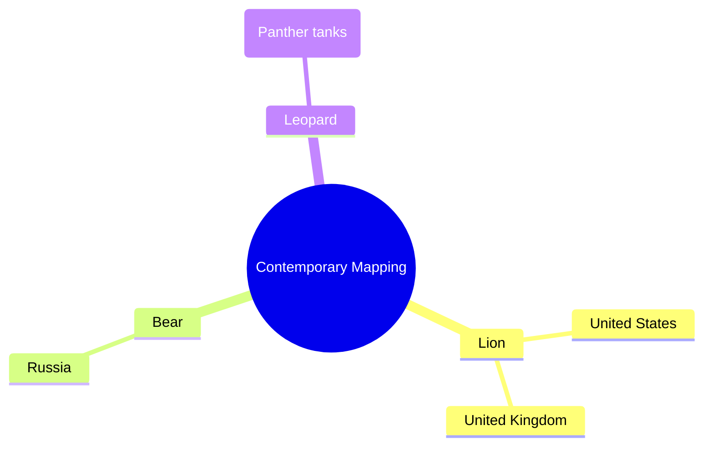
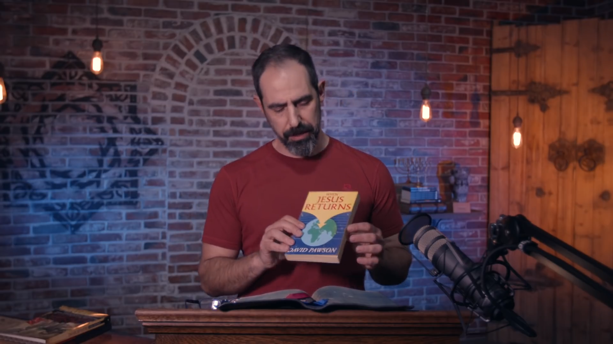

## Maranatha Global Bible Study

- An initiative by Frontier Alliance International (FAI)
- Developed in response to the coronavirus pandemic
- Rooted in the "Maranatha Fast"
    - A 14-day period of fasting and prayer
    - Focused on gathering around the study of God's Word
    - Specifically examining key end-time biblical texts to seek wisdom for current events

### The Purpose of the Maranatha Global Bible Study

- To continue the study beyond the initial fast due to global interest
- **[Why continue?]** Because the coronavirus crisis is viewed as a 'prelude' or 'dress rehearsal'
    - Future crises are expected to expand and spread like 'birth pains'
    - These difficulties increase as the world approaches the end of the current age
- To equip the body of Christ, which the speaker believes is currently ill-equipped for these challenges

### The Maranatha Message

- Described as the "plumb line" and the primary focus point of the entire Bible
- Represents the essence of the gospel and the "blessed hope"
- Centered on the return of Jesus to:
    - Restore all things
    - Bring an end to the current system of wickedness
- Serves as an "anchor of hope" for believers as global storms increase

### Recapturing the Maranatha Message

- The modern global church is perceived as weak in its focus on the return of Jesus
    - There is a loss of the "Maranatha cry" seen in the early church
    - There is a loss of the spiritual "groan" or longing for Christ's return mentioned in Romans 8
- **[Why it matters]** Because the message is powerfully motivating for personal sanctification
    - Having this hope should lead believers to "purify themselves"
    - It reclaims the "fear of the Lord" in light of the coming Day of the Lord

### Accountability and Repentance

- The reality of Jesus' return implies a coming judgment
    - Every person will stand before Him as King, Master, and Judge
    - All must give an account for their deeds, whether good or bad, faithful or unfaithful
- This reality serves as a call to repentance
    - The speaker notes that the modern Western church is often weak in walking in true holiness and repentance

### The Impact of the Maranatha Message

- It is characterized by a "burning passion" for the return of Jesus
- **[Historical impact]** This passion drove the early church to "turn the ancient world upside down" within just one generation

### Participating in the Global Bible Study

- **Ways to join and access content:**
    - **YouTube:** Sessions will be posted on the channel
    - **FAIstudios.org:** The primary website to participate with various teachers
    - **FAI Mobile App:** The best way to access the large volume of content being produced
        - Available on the Apple App Store and Google Play Store
        - Compatible with smartphones and tablets

### Accessing FAI Content

- The FAI app provides a massive volume of content, including Bible studies, programs, and movies
    - Described as a "Christian Netflix" due to the quality and quantity of content
    - Users are encouraged to download the free app and enable notifications to receive updates on new releases
- **[Available Platforms]**
    - **Mobile:** FAI Mobile App (iOS and Android)
    - **Web/Computer:** FAIstudios.org
    - **Streaming/TV:** Amazon Fire, Roku, and Apple TV

### Goal of the Movement

- The intention is to spark a movement within the body of Christ
- **[The Objective]** To move away from "fluffy, therapeutic, self-centered, shallow, modern, popular Christianity"
- To return to the authentic faith practiced by the apostles and the early church
    - This is not intended to be an arrogant or elite religious pursuit
    - The focus is on seeking the Lord's face in light of His coming

### Study Scope and Structure

- **Primary Focus Area:** The end of Daniel chapter 7 through chapter 12
    - The study will eventually transition into the book of Revelation
- **Teaching Team:** The sessions will be taught by the speaker and Dalton Thomas

### Overview of Daniel 7

- The study will approach Daniel 7 by dividing it into three sections
- **Section 1: The Four Beasts**
    - Covers verses 1 through 8 (and potentially 11-12)
    - Describes four "beasts," "monsters," or "animals" that rise up out of the sea
    - Often referred to in Bible commentaries as "four gruesome beasts" or "four terrifying beasts"

### Daniel 7 Structural Divisions

- **Section 1: The Four Beasts**
    - Focuses on verses 1 through 8
    - Describes unique and unusual beasts rising from the sea
- **Section 2: The Heavenly Courtroom**
    - Focuses on verses 9 through 14
    - **[Note on Verses 11-12]** These are often grouped with the first section because they tie back to the four beasts
    - Represents a shift in the vision from earthly monsters to the heavenly throne room or courtroom
- **[Significance of the Heavenly Courtroom]**
    - This is a recurring and foundational theme in the Old Testament (noted by scholars like Dr. Michael Heiser)
    - It is a critical prophetic revelation that informs the understanding of messianic prophecy in the New Testament

### Section 3: The Little Horn

- **Focus Range:** Verses 15 through 28
- **[The Little Horn]** A horn that emerges from the sockets of the beasts' horns (the fourth beast specifically has ten horns)
- This section acts as the divine interpretation of the vision provided in verses 1-14
- It narrows the focus to the final aspect of the vision: the Antichrist and his kingdom during the final period at the end of the age

### Daniel 7:1 Reading and Context

- **[Translation Choice]** The speaker uses the NIV (New International Version) for the reading of the verses to ensure a readable format.
- **Historical Setting (Verse 1):** "In the first year of Belshazzar king of Babylon..."
    - Belshazzar was the king of Babylon who was eventually defeated by the Medes and the Persians (the Medo-Persian Empire)
- **The Context of Sacrilege:**
    - During his reign, Belshazzar held a feast where he drank from sacred utensils
    - These vessels had been seized and stolen from the temple
    - This act was considered deeply unholy, as these items were specifically set aside as holy to God

### The Fall of Babylon

- **[The Handwriting on the Wall]** The message translates to a warning of division and judgment:
    - *Mene, Mene, Tekel, Parsin*: Roughly interpreted as a declaration that the kingdom is divided and given to the Persians
- **[The Method of Conquest]** The Medo-Persian Empire defeated Babylon through a strategic maneuver:
    - They stopped the river flowing under the city
    - This lowered the water level, allowing them to crawl under the city's impenetrable walls
- **[Divine Justice]** The fall of Babylon happened "that very night," which the speaker characterizes as "instant divine justice" rather than just "instant karma"

### Historical Context of Daniel 7

- **[The Transition of Empires]** Belshazzar was the final king of the Babylonian Empire before the transition to the Neo-Persian era
- **[Daniel's Service]** While Belshazzar was the last king of Babylon, Daniel's service spanned across various empires and rulers
- **[Daniel 7:1]** "In the first year Belshazzar king of Babylon Daniel had a dream."

### Daniel 7:1-2: Dreams and Visions

- **[Dream vs. Vision]** The text describes Daniel's experience as both a dream and a vision
    - A **vision** can occur while awake, where a person sees something supernatural
    - A **dream** occurs while lying in bed (as Daniel was in verse 1)
- **Daniel 7:2 Reading:** "In my vision at night I looked and there before me were the four winds of heaven churning up the sea."

### Symbolic Interpretations in Daniel 7

- **The Great Sea:**
    - Literally understood as the Mediterranean Sea
    - **[Symbolism]** Biblically, the sea represents the Gentiles

### The Biblical Identity of the Antichrist

- **[Origin in the Gentile World]**
    - The Antichrist's empire and religion are portrayed as emerging from the Gentiles (non-Jews)
    - This is a consistent theme throughout scripture
- **[The Nature of the Antichrist's Rise]**
    - He is portrayed as a Gentile dictator
    - He gathers a coalition of Gentile nations to attack, invade, and attempt to destroy the Jewish people
- **[Refuting Modern Interpretations]**
    - There is a growing teaching that the Antichrist will be a "pseudo-Messiah" or a Zionist leader from within Israel
    - This theory suggests he would be followed by Jews and deceived Christians after defeating surrounding Gentile nations
    - **[The Biblical Reality]** The Bible does not portray the Antichrist as an individual rising from within the state of Israel

### The Conflict of the Seed Lines

- **[Genesis 3:15 Prophecy]** The Antichrist, coming from the Gentiles, is an enemy of Israel
    - This aligns with the foundational prophecy of a conflict between:
        - The righteous seed line
        - The satanic seed line (those who follow the devil)

### Symbolic Use of the Sea

- **[The Sea as Gentiles]** The "great sea" in Daniel 7 is a recurring symbol for the Gentile nations
- **[Isaiah 60 Example]** Another instance where the sea represents Gentiles:
        - Isaiah 60 describes the wealth and abundance of the sea being turned toward Zion
        - This occurs after the return of the Messiah, depicted as caravans and resources (like those from Lebanon) being brought to Jerusalem to rebuild the temple and glorify God

### The Four Beasts of Daniel 7

- **[Symbolic Meaning]** The beasts emerging from the sea represent:
    - Kingdoms
    - Nations
    - Gentile powers
- **The First Beast**
    - It is described as being like a lion
    - It possesses the wings of an eagle
    - **[Comparison]** The speaker notes it is a combination, similar to how a liger is a combination of a lion and a tiger.

### The Four Beasts from the Sea

- **[General Symbolism]** The beasts represent Gentile kingdoms, nations, or powers emerging from the "great sea."

#### The First Beast (Daniel 7:4)

- **[Appearance]** Resembles a lion but possesses the wings of an eagle
- **[Transformation]**
    - Its wings are torn off
    - It is lifted from the ground to stand on two feet like a human being
    - It is given a "human mind"

#### The Second Beast (Daniel 7:5)

- **[Appearance]** Resembles a bear, but is described as "lopsided" or raised up on one of its sides
- **[Key Feature]** It has three ribs between its teeth
- **[Command]** It is told to "get up, eat your fill of flesh"

#### The Third Beast (Daniel 7:6)

- **[Appearance]** Resembles a leopard
- **[Key Features]**
    - Possesses four wings like those of a bird
    - Has four heads
    - Given authority to rule

#### The Fourth Beast (Daniel 7:7)

- **[Nature]** Highly distinct and unusual compared to the previous three
    - The text does not assign it a specific animal likeness (unlike the lion, bear, or leopard)
    - It is described simply as terrifying, frightening, and very powerful
- **[Key Features]**
    - Large iron teeth used to crush and trample whatever was left
    - Possesses ten horns

### The Ten Horns and the Little Horn

- The fourth beast is characterized by having ten horns
- Among these ten horns, a "little horn" emerges

### The Little Horn's Rise and Characteristics

- **[Emergence]** The little horn emerges among the ten existing horns
    - It is so significant that it uproots three of the first horns
- **[Human-like Features]** Despite being part of a beast, it possesses human qualities
    - It has eyes like the eyes of a man
    - It has a mouth that speaks boastfully and arrogantly
    - **[Identity]** These characteristics identify the little horn as the Antichrist

### Shift to the Heavenly Courtroom

- The focus of the vision shifts from the earthly realm to the heavens
    - **[Previous Focus]** The beasts rising from the sea onto the earth
    - **[New Focus]** The heavenly courtroom and the throne room of God
- **[Purpose of the Shift]** The vision moves toward the judgment of the beasts within this divine setting

### The Fate of the Beasts

- **[The Fourth Beast]**
    - It is slain due to the boastful words of the little horn
    - Its body is destroyed and thrown into the "blazing fire"
- **[The Other Beasts]**
    - Unlike the fourth beast, the other beasts are not immediately destroyed
    - **[Extension of Life]** They are stripped of their authority but are allowed to live for a period of time
    - Some translations describe this as being given an "extension of life" during their judgment

### Divine Interpretation

- Verses 15 through 28 provide the divine interpretation of the vision
- This section is primarily focused on the little horn (the Antichrist)

### Personal Approach to Studying Daniel

- **[Deep Interest]** A significant personal focus and passion
- **[Intellectual Challenge]** Despite extensive study, certain passages remain difficult and unresolved
    - Daniel 7 is specifically noted as a challenging text
- **[Methodology: Historical Interpretation]** Studying the text by tracing the history of how it has been interpreted
    - This involves collecting and analyzing various commentaries
    - The process begins with the earliest available historical sources
        - Example: Hippolytus (early 4th century)

### Historical Methodology of Interpretation

- **[Process]** Tracing the development of interpretation through history
    - Starts with the earliest available Jewish and Christian writings
    - Moves forward chronologically to modern times to see how understanding has evolved
    - **[Goal]** To establish a well-informed personal stance rather than an isolated opinion
- **[Early Source: Hippolytus]** A significant figure from the late third or fourth century
    - Identified as a premillennialist and a futurist
    - Held a relatively accurate understanding of end-times events
    - **[Note on Disagreement]** While largely accurate, the speaker notes a disagreement with Hippolytus's view that the Antichrist would be Jewish

### Principles of Interpretation

- **[Balancing Perspectives]** Seeking a check and balance for personal interpretation
    - **[Personal]** Valuing the voice of the Holy Spirit within the individual
    - **[Corporate]** Valuing the voice of the Holy Spirit within the collective Church
    - This dual focus prevents isolated or idiosyncratic interpretations by grounding them in the historical and communal experience of the faith

### Caution in Prophetic Interpretation

- **[The Trap of Novelty]** There is a dangerous tendency in the Bible prophecy world to seek out "new" ideas or revelations
    - This often stems from a desire to be the one who "solves" the mystery, treating prophecy like a prize or a puzzle
    - The speaker warns that this can be a spiritual trap used by Satan to foster pride
- **[The Danger of Pride]** Teaching prophecy can lead to carnal pride and delusions of grandeur
- **[The Humble Approach]** Interpretation should be rooted in humility and historical awareness
    - Rather than claiming new revelations, one should ask: "What has the Lord been speaking to His people throughout history?"
    - Personal insights should only be considered after understanding the long-standing, corporate voice of the Church

### The Sealing of Daniel

- **[Context]** Daniel 12 states that the book will be sealed until the end times
- **[Common Misinterpretations]** Many modern readers interpret specific phrases as descriptions of contemporary life:
    - "Many will go to and fro" $\rightarrow$ interpreted as modern travel (airplanes, trains, automobiles)
    - "Knowledge will increase" $\rightarrow$ interpreted as the rise of the internet and global information access
- **[The Speaker's Interpretation]** These phrases are actually tied to the sealing of the book itself:
    - They describe the process of studying the prophecy
    - "Go to and fro" refers to the imagery of reading a scroll over and over again
    - The "increase in knowledge" pertains to the depth of understanding gained through this repeated study of the prophetic text

### The Enigma of Daniel 12

- **[The Paradox]** There is a tension between two seemingly contradictory statements in the text:
    - The book is "sealed until the end times"
    - Throughout history, "many will go over this prophecy... and knowledge will increase"
- **[The Resolution]** This suggests a gradual opening or unveiling of the text. While the full meaning may not be realized until the end times, there is a continuous process of study and increasing understanding throughout history.

### Guarding Against "Prophet Syndrome"

- **[The Spiritual Trap]** Seeking out novel or unique interpretations can be a "satanic trap" that appeals to carnal pride.
- **[Prophet Syndrome]** This is the delusion that an individual has been given a special, unique revelation that sets them apart from the rest of the faith.
    - The speaker warns teachers and pastors to flee from this mentality
    - It shifts the focus from the corporate voice of God to the individual's ego

### Approaching Prophetic Mystery

- **[The Tension of Interpretation]** There is a dual responsibility when studying prophecy:
    - Consult a broad spectrum of historical interpretations to understand the corporate voice of the Church
    - Acknowledge that many mysteries in Daniel may remain unrevealed until the end times, meaning much of history's majority interpretation might be incorrect
- **[A Model for Study]** Rather than seeking novelties, one should approach the text with trembling and caution, seeking insight through the Holy Spirit
    - This approach is modeled after Daniel in chapter 9
    - Daniel fasted, prayed, and sought the Holy Spirit to gain insight into the prophecy of Jeremiah
    - This spiritual seeking is what ultimately provided clarity on the foundational prophecy of the 70 weeks

### Interpretations of the Four Beasts (Daniel 7:1-8)

- **[The Historical Interpretation]** One primary way to view the four beasts is as a representation of four historical Gentile empires/nations
    - These empires are successive, with one succeeding the other
    - This view covers a broad segment of history through these Gentile powers
- **[Relationship to Daniel 2]** This section is seen as a recapitulation (a repeat or summary) of the vision presented in Daniel chapter 2

### Linguistic Structure of Daniel

- **[The Aramaic Portion]** The book of Daniel is unique because it is written in two languages
    - Chapters 2 through 7 are written in Aramaic
    - The remainder of the book is written in Hebrew
- **[Significance]** While most of the Old Testament is in Hebrew, the Aramaic section provides the primary inspiration for the visions discussed in this segment

### Preterism and Historical Skepticism

- **[The Preterist View]** This interpretation suggests that the prophecies in Daniel have already been fulfilled in history
    - This view is often held by unbelievers or skeptics
    - It lacks an anti-eschatological (end-times) fulfillment
- **[Historical Roots of Skepticism]** The tension between literal/eschatological interpretation and historical/preterist interpretation is not new
    - In the early church, there was a significant conflict between Jerome (a Latin exegete) and Porphyry
    - Porphyry is described as the "original preterist"
    - Porphyry was a skeptic and mocker who argued that Daniel's visions were purely historical and already completed

### The Unity of the Maranatha Message

- **[The danger of detachment]** Without the Maranatha focus, individual prophecies can appear as disconnected pieces of information
    - For example, Daniel might seem detached from Isaiah, or specific prophecies might seem limited only to historical figures like Herod, Antiochus, or Nero
- **[The unifying principle]** The Maranatha message provides a cohesive framework for the entire Bible
    - It centers the scriptures on the "Day of the Lord"
    - It focuses on the return of Jesus and the renewal of all things, which is the common thread spoken of by all the prophets

### Futurist Interpretations and Recapitulation

- **[The Futurist Perspective]** Many believing interpreters are futurists who view prophecies through the lens of the Maranatha message
    - They see events as primarily pointing toward the return of Jesus in the Day of the Lord
- **[Daniel 7 as Recapitulation]** Most futurists hold that Daniel 7 is a recapitulation of Daniel 2
    - Daniel 2 was originally the dream of Nebuchadnezzar, the King of Babylon, which Daniel then interpreted

### Contemporary Pagan Nations Interpretation

- **[The View]** The four beasts do not represent successive historical Gentile kingdoms
    - Instead, they represent four contemporary Gentile pagan nations
    - These nations would rise concurrently at the end of the age
    - They would act as the primary power players in the last days
- **[The Consequence]** This perspective creates a disconnect between the different visions in Daniel
    - It detaches the vision of chapter 7 from the dream of chapter 2
    - In contrast, the metallic statue in Daniel 2 concerns a series of empires spreading across a broad period of history and culminating in the last days

### Proponents of the Contemporary Nations Interpretation

- **Erwin Baxter**
    - A prominent and well-known end-time prophecy teacher
    - Associated with the United Pentecostal churches (Oneness Pentecostal)
    - **[Theological View]** Holds a Roman-centric perspective regarding the Antichrist and his empire

### Mapping Beasts to Modern Nations

- **[Symbolic Logic]** Contemporary interpreters attempt to identify the four beasts by looking at the national animals or military equipment of modern nations
    - **The Lion**: Often identified as either the United Kingdom or the United States
        - This is supported by the lion having the wings of an eagle, which can be linked to the American bald eagle
    - **The Bear**: Generally identified as Russia
        - The speaker notes the cultural association of the "Russian bear" as a lumbering, dangerous threat
    - **The Leopard**: Identified as Germany
        - This connection is made because one of Germany's tanks is named the "Panther"

### David Pawson

- A highly respected and venerable British Bible teacher
- **[Theological View]** Holds the perspective that the four beasts in Daniel 7 are future-oriented
- **Notable Works**
    - *When Jesus Returns*: A study focusing on the book of Revelation
    - A study of the book of Isaiah

[00:38:26](https://www.youtube.com/watch?v=LJ0ii_oA4Cs&list=PLLUB0c5kWJifBr1cohNUtmRAR9zYwZuPR&index=12&t=2306s)

### Mark Davidson and 'Daniel Revisited'

- **Mark Davidson**
    - Author of the book *Daniel Revisited*
    - **[Theological View]** Also holds a contemporary interpretation of the beasts, though the speaker disagrees with his specific applications
- **[Davidson's Interpretation of the Lion]**
    - Identifies the lion as representing Baghdad under Saddam Hussein
    - Interprets the lion standing up and receiving wings as Iraq's transition toward democracy

### Mark Davidson's Contemporary Mapping (Continued)

- **The Bear**
    - Identified as modern-day Iran
    - Characterized by the internal split between the Iranian Revolutionary Guard and the Ayatollahs
- **The Leopard**
    - Identified as modern-day Turkey
- **The Fourth Beast**
    - Identified as the Antichrist

### Disagreement with Davidson's Interpretation

- **[The Distinction]** The speaker distinguishes between his agreement and disagreement with Davidson's work
    - **Agreement**: He believes Davidson "nailed it" regarding the interpretation of Daniel 8
    - **Disagreement**: He does not find the contemporary mapping of the four beasts in Daniel 7 to be biblically valid
- **[Methodological Note]** The speaker emphasizes that he holds his own interpretations and opinions of Daniel with humility

### Critiques of Contemporary Mapping

- **[The Problem of Forced Connections]** Proponents often attempt to validate their mappings by finding similar elements in other scriptures
    - For example, linking the four beasts in Daniel 7 to the four horses in Zechariah or the four horsemen in Revelation
    - The speaker argues that having a commonality of number (four) does not prove they are all discussing the same prophecy
    - He finds it unlikely that a prophecy written thousands of years ago would specifically point to a figure like Saddam Hussein from 20+ years ago

### Chris White

- An individual who also holds the view that the four beasts are contemporary nations
- **[Notable Work]** Wrote a book titled *Islamic Antichrist Debunk*
    - This book was written largely as a response to debunk the speaker's first book, \*Islamic Antichrist\*\*

### Arguments for the Contemporary Nations Interpretation

- **[Core Argument]** Proponents of this view consistently point to specific verses to argue that the four beasts represent four contemporary, end-times pagan nations.
- **[Key Scripture]** The first primary piece of evidence cited is Daniel 7:17.

### The Argument from Daniel 7:17

- **[The Proponent's View]** Proponents of the contemporary nations interpretation rely on the wording of Daniel 7:17 to argue that the beasts are future events.
    - The verse describes four kings that "will arise" from the earth.
    - **[The Logic]** Because the vision occurred in the first year of Belshazzar (when Babylon was already established), proponents argue that the use of a future tense must refer to nations that have not yet risen.
- **[Linguistic Nuance: Tense and Translation]** The speaker notes a significant issue with relying solely on English translations for this argument.
    - In the original Aramaic (and Hebrew), the verb tense does not necessarily denote the future as it does in English.
    - **[The Perfect Prophetic Tense]** The text may utilize what is known as the "perfect tense" or "perfect prophetic tense."
    - This is a common feature in Hebrew, Aramaic, and Greek prophetic literature.
    - It can describe events that are certain to happen, regardless of whether they are in the past or future, which complicates the "future tense" argument.

### Translation Challenges in Prophetic Literature

- **[The Translator's Dilemma]** English translations often require a choice based on the translator's opinion of the context.
    - A phrase that appears to be in the future tense in English might actually be a different tense in the original language.
    - In Greek, Aramaic, and Hebrew, certain verb forms can be translated in multiple ways, such as "will arise," "are arising," or "have arisen."
- **[The Perfect Prophetic Tense]** This linguistic feature allows for the description of certain future events using a tense that typically denotes completed action.
- **[Example: Deuteronomy 33]** The speaker uses this passage to illustrate how translation can shift the perceived timing of an event.
    - Many English translations say "God came from Sinai" because they interpret the language as historical.
    - However, using the prophetic tense, the text could just as easily be read as "God is coming" or "God will come" from Sinai.
    - Similar patterns are found in other scriptures, including:
        - Judges 5
        - Psalm 68
        - Habakkuk 3

### The Fragility of the 'Future Tense' Argument

- **[The Primary Pillar]** Proponents of the contemporary nations interpretation rely heavily on the phrasing of Daniel 7:17 (the idea that the four kings "will arise") to argue that the beasts must represent last-days kingdoms.
- **[Linguistic Counter-argument]** When examining the original Aramaic, the argument loses its foundation:
    - While English translations use the future tense for clarity, the original language often leans more toward a past tense.
    - Scholars have noted that the text's structure may not actually support a strictly future-oriented reading.
- **[Conclusion]** Because the argument is built on a specific translation of a verb tense rather than the underlying linguistic reality, it is a "pillar" that fails when scrutinized at the source level.

### The Fate of the Antichrist vs. the Other Beasts

- **[The Contrast]** Daniel 7 presents a distinction between the end of the Antichrist's empire and the end of the other three beast kingdoms.
    - The final beast (the Antichrist) and his empire are cast into the lake of fire.
    - The other beasts, however, are treated differently according to Daniel 7:12.
- **[The Fate of the Other Beasts]** According to the text, the other beasts are not immediately destroyed in the same manner.
    - They are stripped of their authority or power.
    - They are allowed to live on for a period of time (some translations describe this as being given an "extension of life").
- **[Implications for Contemporary Interpretations]** This distinction is a critical point for teachers like David Pawson, Robin Baxter, and Mark Davidson.
    - Their interpretation relies on the idea that when the Antichrist is destroyed, these other three nations (which they identify as modern powers like the United States, Russia, or Germany) will still exist as kings for a time.

### The Nature of the Fourth Beast's Destruction

- **[The Contemporary View]** Proponents of the contemporary nations interpretation suggest that the other three beast kingdoms (e.g., USA, Russia, Germany) are allowed an "extension of life" and will persist into the millennium.
- **[The Speaker's Counter-argument]** This view is seen as a misunderstanding of the text's broader context.
    - By looking at both Daniel 2 and Daniel 7, a different pattern emerges.
    - The destruction of the fourth beast (the Antichrist) and his empire is described as sudden and total.
- **[The Contrast with the Messianic Kingdom]** The suddenness of the Antichrist's end is meant to be contrasted with the nature of the Messiah's kingdom:
    - The Antichrist's empire is destroyed suddenly and completely.
    - The kingdom of the Messiah is also sudden, but it is characterized by its rapid spread and the way it fills the entire earth.

### The Recapitulation of Daniel 2 in Daniel 7

- **[The Core Argument]** Daniel 7 serves as a recapitulation of the vision found in Daniel 2.
    - The beasts in Daniel 7 represent the same successive Gentile empires described in the statue in Daniel 2.
- **[Empire Correlations]** The speaker maps the four beasts to the specific historical kingdoms and their corresponding materials from the statue:

| Daniel 7 Beast | Historical Empire | Daniel 2 Material |
| --- | --- | --- |
| Lion | Babylon (Nebuchadnezzar) | Head of Gold |
| Bear | Medo-Persian Empire (Darius) | Chest and Arms of Silver |
| Leopard | Greek Macedonian Empire (Alexander) | Belly and Thighs of Bronze |
| Fourth Beast | Subsequent Kingdom | Legs of Iron |

- **[Specific Parallels]** There are direct physical correlations between the descriptions in both chapters:
    - The fourth beast in Daniel 7 has **iron teeth**.
    - This corresponds to the **legs of iron** described in Daniel 2.
    - The transition from the fourth beast to the next stage mirrors the transition from the legs of iron to the feet of mixed iron and clay in Daniel 2.

### The Relationship Between the Beast and the Horns

- **[Empire vs. Nations]** A distinction exists between the beast and the horns that rise from it:
    - The **beast** represents the overarching Empire
    - The **ten horns** represent the individual nations that comprise that Empire
- **[The Fate of the Kingdoms]** The focus of Daniel 7:12 is not that the previous kingdoms (Babylon, Medo-Persia, Greece) are destroyed entirely, but rather that they are conquered:
    - Unlike the sudden and total destruction of the Antichrist's empire, these kingdoms are allowed an "extension of life"
    - They are stripped of their power but continue to exist for a period of time after being conquered

### Historical Persistence of Conquered Cultures

- **[The Nature of Conquest]** When one empire replaces another, it is often a replacement of power and leadership rather than a total erasure of the previous civilization
    - Much of the culture, gods, language, and existing social structures remain intact
- **[Historical Examples]**
    - **Babylon to Persia:** Although the Medes and Persians took over leadership, the culture of ancient Babylon lived on for a period of time under Persian rule
    - **Persia to Greece:** Alexander the Great's conquest did not crush or devour Persian culture
        - Instead, the era was characterized by "Hellenization"
        - Alexander attempted to indoctrinate the region with Greek philosophy, but Persian culture continued to exist alongside the new Greek influence

### Cultural Continuity in Successive Empires

- **[The Parthian Empire]** Following the Greek period, the Parthian Empire emerged
    - They were essentially Persian peoples
    - They maintained much of the existing Persian culture
- **[The Roman Empire and Greek Influence]** The Roman Empire did not crush or erase the Greek culture it conquered, but rather absorbed it
    - **Language:** Greek remained the primary *lingua franca* in Israel and much of the region during the first century under Roman dominance
    - **Religion:** Greek and Roman deities were often the same gods with different names, representing a cultural overlap rather than a replacement

| Greek Deity | Roman Equivalent |
| --- | --- |
| Zeus | Jupiter |
| Artemis | Diana |

- **[Summary of Transition]** Each successive kingdom involves a removal of political authority and power, but allows for the persistence of the previous culture, contrasting sharply with the sudden and decisive destruction of the Antichrist's empire.

### The Total Destruction of the Fourth Kingdom

- **[The Demise of the Fourth Kingdom]** According to Daniel 2:34-35, the end of the final kingdom is marked by a sudden and complete destruction
    - When the rock (the return of Jesus) strikes the statue at the feet of iron and clay, all previous components are destroyed simultaneously
    - The metals affected include:
        - Gold
        - Silver
        - Bronze
        - Iron
        - Clay
- **[The Manner of Destruction]** The destruction is described as absolute and effortless
    - The elements become like chaff from summer threshing floors, blowing away like dust
- **[The Catalyst for Destruction]** This destruction occurs by virtue of the calling of Jesus and the return of the Messiah (Yeshua), the King from the line of David, who destroys the Antichrist and his kingdom.

### Contradictions in Contemporary Mapping

- **[The Davidson Contradiction]** Mark Davidson's mapping (identifying nations like Iraq, Iran, Turkey, and Greece) aligns with the classic historical interpretation, but his conclusion creates a biblical conflict
    - Davidson argues that these previous nations are "allowed to live on into the will of the Antichrist"
    - This contradicts the account in Daniel 2 regarding the destruction of the statue
- **[The Simultaneous Destruction of Empires]** According to Daniel 2:34-35, the return of the Messiah (the rock cut without human hands) results in a total collapse of all previous kingdoms
    - When the rock strikes the feet of iron and clay, the entire statue is destroyed
    - The gold, silver, bronze, and iron are all destroyed at the same time
    - They become like "chaff from the summer threshing floors," blowing away like dust without a trace
- **[Contrast of Two Kingdoms]** The text presents a sharp dichotomy between the nature of the two kingdoms:

| Feature | Kingdom of the Antichrist | Kingdom of the Messiah |
| --- | --- | --- |
| Relationship to Past Empires | A revival or continuation of previous power structures | Total and simultaneous destruction of all preceding empires |
| Growth Pattern | Focused on the feet/legs (the final manifestation) | The rock grows and spreads to fill the whole earth |

### Critique of the Two Pillars of Contemporary Interpretation

- **[The Extension of Life Argument]** Proponents suggest that Babylon, Medo-Persia, and Greece are defeated but given an "extension of life" within the subsequent kingdoms
    - The speaker argues this aligns better with historical continuity but fails the biblical test of Daniel 2
    - In Daniel 2, the destruction of the statue is total and simultaneous, leaving no trace of the previous metals
- **[The Failure of the Interpretative Pillars]** The speaker identifies two primary supports for the contemporary nations view, both of which he finds lacking:
    - One pillar is fundamentally flawed in its logic
    - The other is directly contradicted by the clear statements in Daniel chapter 2
- **[Personal Stance]** The speaker clarifies his position is not an attack on the view, but a result of careful consideration and finding the biblical evidence insufficient to support it

### Daniel 7 as a Recapitulation of Daniel 2

- Daniel 7 is a retelling of the vision of Nebuchadnezzar's metallic statue from Daniel 2
    - The Lord uses different symbolism (beasts in Daniel 7 vs. a metallic statue in Daniel 2) to reiterate the same message
    - This follows the biblical principle of settling a matter by the testimony of two or three witnesses to drive the point home
- **[The Basis for Identification]** To understand who the beasts represent, one must first look to the foundation laid in Daniel 2

### The Classic Interpretation of the Metallic Statue

- Most believers identify the components of the statue as follows:
    - **Head of Gold**: Babylon
    - **Arms of Silver**: Medo-Persia
    - **Belly and Thighs of Bronze**: The Alexandrian Greek Empire
    - **Legs of Iron**: Rome
    - **Feet of Iron mixed with Clay**: A subsequent power structure

### Critique of the Roman Empire as the Fourth Kingdom

- **[The Roman Empire Argument]** A common interpretation identifies the feet of iron mixed with clay as a revival of the Roman Empire
    - The speaker argues this does not align with the biblical descriptions found in Daniel 2:34, 35, and 40
- **[The Requirement of Total Conquest]** According to the prophecy, the rise and demise of the fourth kingdom involve it crushing the previous empires
    - In Daniel 2, the fourth empire is described as crushing the preceding ones (Babylon, Medo-Persia, and Greece)
    - The speaker points out that Rome did not crush Persia; the Parthians, for example, were able to resist Roman rule in that region for much of their existence
    - While Emperor Trajan briefly occupied parts of the region in 81-16 (referring to historical context of Roman expansion), Rome did not achieve the total crushing of the preceding powers as the text describes

### The Islamic Empire as a Candidate for the Fourth Kingdom

- **[The Roman Empire Discrepancy]** The speaker reiterates that the Roman Empire fails the biblical criteria of Daniel 2:40 and 2:45
    - Rome did not destroy the preceding empires; it primarily occupied the Mediterranean and failed to crush powers like the Parthians in Persia
- **[The Islamic Empire Argument]** The Islamic Empire presents a stronger historical match for the fourth kingdom because it actively subsumed the previous powers
    - It conquered and consumed the territories of:
        - Babylon
        - Medo-Persia
        - Greece
    - This geographical and political takeover aligns more closely with the concept of the fourth kingdom crushing the preceding ones

### The Islamic Empire as the Fourth Kingdom

- The speaker argues that the Islamic Empire is a superior candidate for the fourth kingdom because it fulfills the biblical criteria of subsuming previous powers
    - It consumed Babylon, Medo-Persia, and Greece
    - This conquest was comprehensive: geographical, cultural, religious, and linguistic
- **[The Future Antichrist Empire]** The speaker posits that the end-times Antichrist empire will be a revival of the historical Islamic Caliphate
    - This revived empire is described as a ten-nation coalition
    - It will primarily consist of Middle Eastern and North African Muslim nations
- **[The Timing of Destruction]** According to this view, the transition of power occurs when Jesus returns
    - When the kingdom of Messiah is established, He crushes the Antichrist's kingdom
    - At that moment, the preceding empires (Babylon, Medo-Persia, and Greece) are all destroyed simultaneously, fulfilling the scriptural pattern

### Mapping Daniel 7 to Daniel 2

- The visions in Daniel 7 are a retelling of the metallic statue in Daniel 2
- **[The Beast-Metal Correlation]**
    - **Lion**: Represents Babylon
    - **Bear (raised on one side)**: Represents Media and Persia (specifically the Neo-Persian Empire)
        - The three ribs on the bear represent the primary kingdoms it conquered and defeated
    - **Leopard**: Represents the historical Greek Empire (Alexander the Great)
        - Characterized by "lightning speed" in its conquest of the Medes and Persians
    - **Fourth Beast (terrifying, brutal, with iron teeth)**: Represents the historical Islamic Empire (the Caliphate)
- **[The Ten Horns and the Antichrist]**
    - According to Daniel 7:27, ten horns arise from the fourth beast
    - These ten horns correlate to the "feet of iron and clay" from Daniel 2
    - This represents the kingdom of the Antichrist, which the speaker notes is currently a subject of interest through various movements aiming to revive the Caliphate

### The Antichrist's Multinational Coalition

- The Antichrist's kingdom is described as a multinational coalition that will gather together and invade the land of Israel
- **[Global Reaction]** The people of the earth will react with awe and fear, asking, "who can make war with the beast?"
- The speaker notes that the current geopolitical landscape appears to be moving into alignment with this prophetic description

### Summary of Interpretations

- The speaker has presented the arguments for and against the classic historical/futurist interpretation
    - This view posits that Daniel 7 is a recapitulation (a retelling) of the vision in Daniel 2
- He explicitly states his rejection of the interpretation involving four contemporary future kingdoms

### The Subjectivity of Contemporary Mapping

- The speaker argues that mapping the four beasts to specific modern nations is fundamentally subjective
- Proponents use various, often tenuous, correlations to make these connections:
    - **National Animals/Symbols**:
        - **Lion**: Some link this to the United States because the bald eagle (US national bird) has wings, similar to the winged lion
        - **Bear**: Linked to Russia (the "Russian Bear")
    - **Military Equipment**:
        - **Germany**: Proponents attempt to link Germany to the beasts by citing military hardware, such as the "Panther" tank, to create a connection to the text. The speaker notes this is a weak and forced correlation, as the tank is not a primary national symbol.

### The Problem with Subjective Interpretation

- The primary issue with mapping the four beasts to modern nations is that it is entirely subjective
    - There is no definitive text that identifies these specific entities
    - Different teachers propose completely different lists of nations, leading to a lack of consensus
- **[The Problem of Subjectivity]** Because there is no agreement among scholars, the connections made are often just one person's interpretation rather than biblical fact
- **[Internal vs. External Interpretation]**
    - Proponents often rely on external, tenuous correlations (like national animals or military hardware)
    - In contrast, the speaker argues that when scripture uses highly symbolic language, God provides the necessary tools for understanding within the text itself
    - For example, God often sends an interpreting angel to provide the specific meaning of a vision
- **[Summary of Rejections]** The contemporary nations interpretation is rejected because:
    - It is completely subjective, with different teachers proposing different nations without any textual evidence
    - It lacks solid spiritual/biblical support
- **[The Role of Interpretation]**
    - The speaker argues that if God provides highly symbolic visions for the church to understand, He provides the interpretive tools within the text itself
    - Relying on subjective external correlations (like national symbols) is not a reliable way to interpret scripture

### Challenges with the Historical Interpretation

- The speaker expresses a personal difficulty with the historical interpretation, noting that it is not something he is yet fully confident in
- **[The Leopard Detail]** One specific detail that causes hesitation is the description of the leopard in Daniel 7:
    - The leopard is described as having four heads and four wings

### Historical Interpretation of the Leopard

- The traditional historical view identifies the leopard's four heads as the four generals (the *diadochi*) who rose to power after Alexander the Great's death
    - These successors are typically listed as:
        - Cassander
        - Lysimachus
        - Seleucus
        - Ptolemy
- **[The Historical Complexity Problem]** The speaker argues this view is an oversimplification of the actual history of the Greek Empire
    - Following Alexander's death, the empire did not immediately split into four stable pieces
    - Instead, it fragmented into approximately 26 provinces
    - A period of intense conflict and warfare lasted over 22–23 years
    - This era included multiple wars among the *diadochi* and significant events like the Battle of Ipsus
    - There were actually at least five primary generals involved, rather than just four

### Specific Symbolic Difficulties in the Historical View

- The speaker admits a lack of full confidence in the historical interpretation due to specific symbolic details that are difficult to map to history
- **[Successful Alignments]** Some elements of the vision seem to fit historical patterns well:
    - The lion's wings: Could represent a period of madness or a loss of senses followed by a return to stability
    - The bear: The description of being raised up on one side and having three ribs in its mouth seems to align with historical data
- **[The Leopard Problem]** The primary difficulty lies in the leopard's specific characteristics:
    - Why does it have four heads and four wings?
    - If there is no clear fourfold division in the historical aftermath of Alexander the Great, this detail remains problematic
    - While one could argue there were four primary families involved, the historical reality was much more complex than a simple four-way split

### The Problem of Prophetic Precision

- **[The 'Close Enough' Dilemma]** The speaker expresses discomfort with trying to force a historical fit that is only approximate
    - He notes that while one could argue there were four primary families (such as the Antipatrid family) that rose to prominence, the scriptures appear to be very specific
    - Prophecy is often viewed as requiring exactness, making "four or five" or "close enough" interpretations feel insufficient
- **[Alternative Symbolic Interpretations]** Some commentators attempt to resolve the difficulty of the leopard's features by suggesting they are purely symbolic rather than historical
    - For example, some suggest the four wings and four heads might simply represent the speed or "lightning" nature of the empire's movement

### Concluding Thoughts on the Leopard Symbolism

- **[Alternative Interpretation]** Some commentators resolve the difficulty of the four heads and wings by suggesting they represent the speed of the empire's expansion
    - In this view, the features symbolize the "lightning" nature of Alexander the Great's conquests
- **[The Need for Humility]** The speaker expresses a preference for admitting uncertainty over forcing a historical fit that feels inadequate
    - He suggests that approaching these texts requires humility and a recognition that true insight comes through divine revelation
    - **[The Model of Daniel]** He points to Daniel's own method of approaching God for understanding:
        - Kneeling in prayer
        - Fasting
        - Supplication
        - Actively asking for the Lord to "open up" the meaning of the text