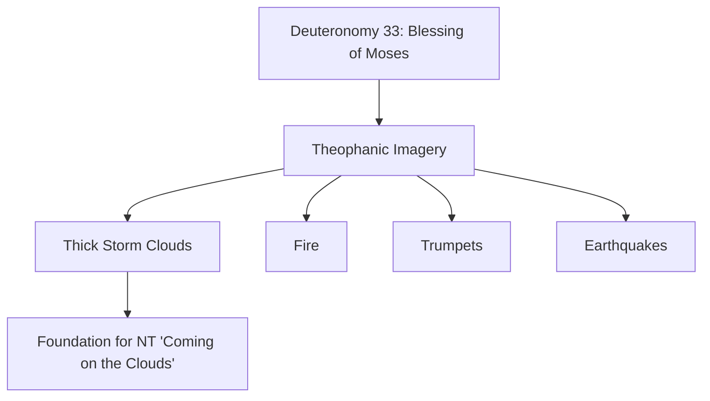
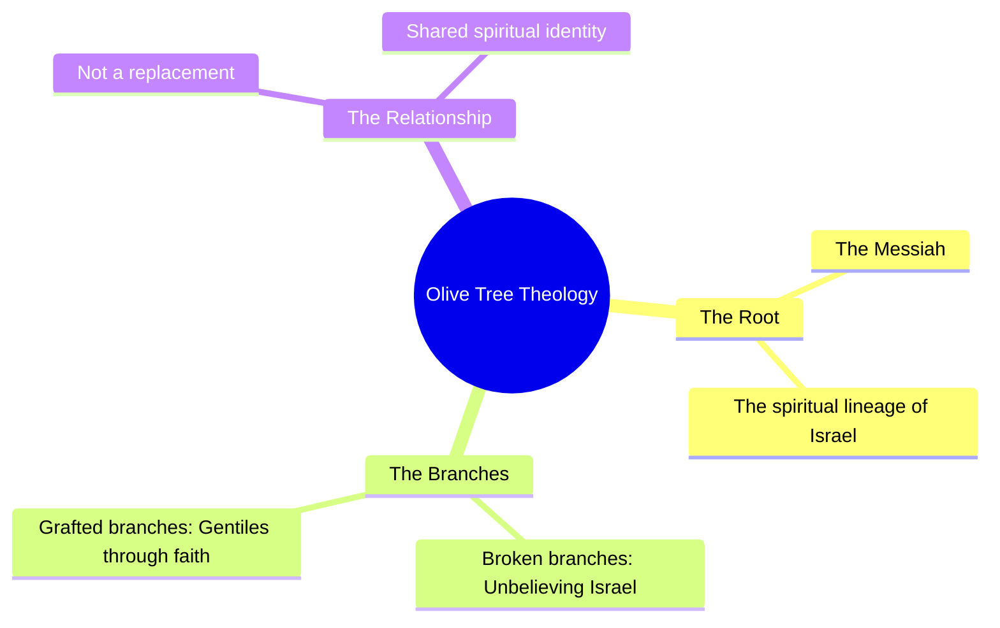

### Daniel 7 Overview

- The chapter is divided into two primary sections:
    - **Section 1: The Four Beasts**
        - These monsters represent four historical Gentile, pagan, and heathen empires
        - They are characterized by being adversarial to Israel and God's people
    - **Section 2: The Heavenly Courtroom**
        - The scene shifts to the heavenly throne room of God and the divine counsel
        - Features the "Ancient of Days" and a figure called the "Son of Man" who comes in the clouds of heaven
        - These two beings are described as being equally divine (equally Yahweh), though one appears in the form of a Son of Man

### The Heavenly Courtroom and Judgment

- **The Relationship of the Divine Figures**
    - The Ancient of Days and the Son of Man are portrayed in a way that Christians would identify as the Father and the Son
- **The Judgment of the Fourth Beast**
    - The court sits in judgment against the fourth beast empire
    - Judgment is also passed against its leader, the "little horn," who is identified as the Antichrist
- **The Eternal Kingdom**
    - Instead of the beast, the Son of Man and his "saints" (his holy ones) are given a kingdom
    - This kingdom is characterized as being one that will never pass away
- **Interpreting Symbolic Visions**
    - Because the visions are highly symbolic and difficult to interpret, the Lord often provides an "interpreting angel" or a holy one to explain them
    - Alternatively, clarity can be found by looking back to clear Old Testament references

### The Son of Man Coming on the Clouds

- Christian theologians debate the specific meaning of this imagery
- According to Daniel 7:13, the vision includes:
    - One like a son of man coming with the clouds of heaven
    - He approaches the Ancient of Days and is led into His presence
    - He is granted authority, glory, and sovereign power
    - All nations, peoples, and languages worship him
- **[Significance]** This represents an everlasting dominion that will never pass away, which is considered the heart of the gospel

### The Significance of the Son of Man

- The term "Son of Man" was the most frequent way Jesus referred to himself throughout the New Testament
- **[The Gospel Connection]** His coming represents the heart of the gospel:
    - The coming restoration of all things
    - The end of the current wicked system of oppression against Israel and Christians
- **The Motif of the Clouds**
    - The imagery of the Son of Man coming on the clouds is one of the most consistent themes in the New Testament regarding the return of Jesus
    - While many Christians interpret this as Jesus descending from heaven in the clouds, the text in Daniel 7:13 specifically describes him *coming on* the clouds and being led into the presence of the Ancient of Days

### Theological Debates on the Son of Man

- **The Realized Perspective**
    - Some theologians believe the kingdom was established at the cross, resurrection, and ascension
    - Under this view, the vision in Daniel 7:13 is seen as a historical image of Jesus being led before the Ancient of Days after His ascension
- **The Literal Return**
    - There is a debate regarding whether Jesus' return in the clouds is literal or merely symbolic
    - The speaker argues that views claiming the return is not literal are unbiblical and do not align with Scripture
    - He cautions against accepting these views simply because they are presented by articulate or highly educated scholars

### Critique of the Disciples' Expectations

- A common scholarly argument is that the disciples had no reason to expect a literal return of Jesus on the clouds
    - This claim suggests that nothing in Jesus' previous teachings or the disciples' own backgrounds prepared them for the concept of Him descending from the sky
- **[Scholar's Argument]** Antti Wright posits that:
    - After hearing Jesus' sermons on the end times (Matthew 24, Luke 21, Mark 13), the idea of Jesus or anything else floating down to earth on a cloud would have been a "foreign concept" to the disciples
    - There was nothing in Jesus' discourse up to that point that would have led them to expect such an event

### Additional Arguments from Antti Wright

- **The "Monstrosity" of the Concept**
    - Wright characterizes the idea of a literal return on clouds as a "monstrosity" embraced by both fundamentalists and critical scholars
    - He argues that no first-century Jew would have recognized or expected such an event
- **The Argument Regarding Paul**
    - Wright claims that the Apostle Paul never had the idea of Jesus appearing "flying downward on a cloud" in mind
    - He asserts that Paul makes no statements that would support such a literal interpretation
- **Symbolic vs. Literal Interpretation**
    - Wright posits that no interpreter should imagine the Son of Man as a literal human figure floating on a cloud
    - **[Wright's View]** The imagery is intended to speak to those attuned to the first-century context of the vindication of the true Israel over her enemies

### The Concept of "True Israel"

- The term "true Israel" implies a distinction between a physical lineage and a spiritual reality
    - A "true Jew" is defined not just by being a bloodline descendant of Abraham, Isaac, and Jacob, but by having the faith of Abraham (faith in God and His Messiah)
- **[Wright's Narrative Interpretation]** In this view, the Son of Man's coming is a motif understood in the first century as a judgment upon "fake Israel"
    - This "fake Israel" refers to the Pharisee class and the ruling aristocracy
    - The judgment is directed at the old system of Judaism, including the Temple and the nation of Israel itself
    - The purpose of this judgment is the permanent transfer of the kingdom to the "new and true Israel," which consists of believers

### Biblical Foundations of the Cloud Motif

- **The Concept of Judgment on Israel**
    - Wright's narrative suggests that instead of heathens or Gentiles being the primary targets, it is Israel itself that is judged by the heathens
- **Old Testament Roots: Deuteronomy 33**
    - The idea of God appearing in the clouds is not a new concept but has deep foundations in the "Blessing of Moses"
    - This refers to the last words of Moses, where he blessed the twelve tribes of Israel
- **The Language of Theophany**
    - The prophecy uses language reminiscent of the Exodus, describing God descending from heaven in a display of divine power
    - **[Visual Characteristics]** The imagery involves:
        - Thick storm clouds (not the white, fluffy cumulus clouds often seen in popular art)
        - Fire
        - The blasting of trumpets
        - Mighty earthquakes

### Transfer of Sinai Imagery to the Return of Jesus

- All the visual elements of the Sinai theophany are applied to the ultimate theophany: the return of Jesus from heaven
    - Thick rain clouds and storm clouds (the tempest)
    - Blazing fire
    - A sword to execute vengeance
    - Blasting of trumpets
    - A mighty earthquake

### Linguistic Nuance in Deuteronomy 33

- **The Prophetic Perfect Tense**
    - The text states: "The Lord came from Sinai"
    - While most translators treat this as a past-tense historical reference to the event at Sinai, the verb is in the prophetic perfect tense
    - **[Implication]** This allows the phrase to be legitimately translated as "is coming" or "will come"
- **Theological Interpretation**
    - Rather than viewing the passage solely as a historical account of what happened at Sinai, it can be read as a prophetic picture of the future
    - This provides the foundational link between the Old Testament theophanies and the New Testament descriptions of Christ's return

### New Testament Interpretation of Old Testament Theophany

- **[The Anthropomorphic Argument]** A key distinction between the Sinai theophany and the return of the Son of Man is the form of the appearance
    - At Sinai, God did not appear in an anthropomorphic (human-like) form
    - In contrast, the Son of Man is specifically portrayed in human form
- **Theological Continuity**
    - While some scholars dismiss these Old Testament descriptions as merely "dramatized" or "flamboyant" language, the New Testament treats them as literal
    - The New Testament interprets Old Testament passages describing Yahweh coming from heaven in human form to execute vengeance as referring directly to the return of Jesus
- **Deuteronomy 33 as Foundation**
    - The text provides a specific prophetic sequence for the Lord's appearance:
        - "The Lord will come from Sinai"
        - He will dawn from the southern regions (the deserts of Jordan and Saudi Arabia)
        - He will shine forth from Mount Paran
        - He will come from the midst of ten thousand of His holy ones with flaming fire at His right hand

### Themes in the Conclusion of Deuteronomy 33

The end of the prophecy in Deuteronomy 33 establishes key motifs that serve as a foundation for later Messianic expectations:

- **The Cloud Motif (v. 26)**
    - Describes God as one "who rides across the heavens to help you on the clouds in his majesty"
    - This is identified as the first instance of the language regarding God coming on the clouds specifically to save His people, Israel
- **The Sword of Triumph (v. 29)**
    - Characterizes the Lord as "the shield of your help, and the sword of your triumph"
    - **[Connection to Genesis 3]** This imagery relates to the ultimate victory of the Messiah, who will crush the head of Satan
- **The Victory of the People**
    - Describes the enemies of Israel falling and being crushed underfoot
    - **[Theological Implication]** This suggests that God's people will participate in this victory, treading upon the backs of their enemies alongside the Messiah

### Universal Application of Deuteronomy 33 Motifs

- The themes established in Deuteronomy 33 are not isolated; they are universally applied throughout the New Testament by Jesus, Peter, Paul, John, and in the book of Revelation
- These motifs are used specifically to describe the return of Jesus
- **Key Motifs Identified:**
    - Coming from heaven (as seen in the Exodus)
    - Accompanied by myriads of holy ones (thousands upon thousands of angels)
    - Riding on the clouds
    - Shining forth in glory (resembling the sun)
    - Returning as a divine warrior to strike down enemies

### Expansion in the Old Testament

- The imagery in Deuteronomy 33 is expanded upon in other Old Testament passages to reinforce the concept of the divine warrior
- **Isaiah 63 Connection**
    - Describes a figure marching from the same region (Sinai/Paran)
    - Characterized by specific, intense imagery:
        - Robes soaked in blood
        - Eyes speaking in righteousness
        - Mighty to save

### Expansion of Messianic Themes in the Old Testament

- **Isaiah 63: The Divine Warrior**
    - Describes a figure marching from the region of Sinai toward Jerusalem
    - The imagery of a divine warrior with robes soaked in blood (from crushing enemies) is presented as a prophetic picture of the return of Jesus
- **Isaiah 40: Preparing the Way**
    - Focuses on the preparation for the King's arrival, described as leveling the landscape:
        - "Let every valley be lifted up"
        - "Every mountain and hill made low"
        - "Let the rough ground be combed"
    - **[Modern Analogy]** This is akin to "rolling out the red carpet" for a royal arrival
- **The Revelation of Glory**
    - Following the preparation of the terrain, the text states: "Then the glory of the Lord will be revealed"
    - **[Theological Connection]** This "shining forth" or radiance is identified with Jesus, the Son of Man, who is the glory of God in the flesh
    - The return is characterized as a visible event where "all flesh will see it together"

### Further Messianic Expansions in Isaiah

- **The Arm of the Lord**
    - Isaiah 40:34 states: "Behold the Lord will come with might, with his arm ruling for him"
    - **[Theological Connection]** The "arm" is a reference to Jesus, representing God reaching down from heaven through the incarnation
    - This connects to Isaiah 53: "To whom has the arm of the Lord been revealed?"
- **Dual Nature of the Return**
    - The return involves both salvation and judgment, a theme repeated throughout Isaiah
    - **Salvation and Reward:** "His reward is with him to save the righteous to reward the righteous" (Isaiah 40:33)
    - **Judgment:** "His recompense goes before him... judgment for the wicked" (Isaiah 40:34)

### The Culmination of Motifs in Revelation

- The themes from Deuteronomy 33 and Isaiah are brought to a final capstone in the book of Revelation
- **Isaiah 66:15-16 Connection**
    - Describes the Lord coming "in fire"
- **The Final Return in Revelation 19**
    - Jesus returns from heaven, blazing with fire
    - Accompanied by the armies of heaven
    - Armed with a sword to execute judgment

### The Chariot Throne and Divine Warrior

- The imagery of God's return involves a chariot throne, a concept seen in both Daniel 7 and Ezekiel
    - This portrays Yahweh returning from heaven on His throne
    - The descriptions often use the language of a horse or a chariot interchangeably
- **[The Purpose of the Return]** To execute judgment against the wicked
    - He comes to "render his anger with fury"
    - He rebukes with "flames of fire"
    - He executes judgment by both "fire and by his sword"
    - This "sword" motif connects back to the themes in Deuteronomy 33

### The Son of Man's Return in the New Testament

- Matthew 16:27 serves as the first reference to Jesus' own words regarding His return
    - It establishes the expectation of the Son of Man coming in the clouds

### The Linguistic Significance of "Son of Man"

- **Distinction between Hebrew and Aramaic titles**
    - **Ben Adam (Hebrew):** Used in contexts like Ezekiel; generally refers to a human being.
    - **Bar in Asha (Aramaic):** Used specifically in Daniel 7
        - This term translates to "the most high"
        - It carries a divine weight that distinguishes it from simple humanity
- **[Theological Implication]** Jesus's use of "Son of Man" was a claim to divinity
    - By referring to himself with the weight of the Daniel 7 imagery, Jesus was identifying as Yahweh
    - **Consequences of this claim:**
        - It was viewed as blasphemy by the religious authorities of his day
        - This identification was the basis for the attempt to kill him
        - This same theological connection led to the martyrdom of Stephen, who also referred to Jesus in this divine capacity

### The Synthesis of Messianic Expectations in Daniel 7

Daniel 7 is critical because it brings together two seemingly contradictory threads of Old Testament prophecy:

1. **The Human Messiah (The Son of David/The Crushing One)**

    - Expectation of an anointed king and a human descendant of Abraham and David
    - Key scriptural foundations:
        - **Genesis 3:15**: The seed of the woman
        - **2 Samuel 7**: The promise of the Davidic line
        - **Psalm 2 & Psalm 72**: The coming king
        - **Psalm 110**: The Lord saying to "my right hand" until enemies are a footstool

2. **The Divine Return (God's Theophany)**

    - The promise that God Himself will return from heaven to save His people
    - This is reflective of the Sinai experience, where God's presence and intervention are central
- **[The Core Tension]**
    - On one hand, the promised one is clearly human (a seed of Eve, Abraham, and David)
    - On the other hand, the promises describe a divine movement of God returning from heaven
    - Daniel 7 resolves this by presenting a figure who embodies both identities

### The Unification of Messianic Threads in Daniel 7:13

Daniel 7:13 serves as the prophetic bridge that merges two previously distinct messianic threads into a single identity:

- **The Convergence of Identities**
    - **The Human Messiah:** The promised "Son of David" (rooted in Genesis 3:15 and 2 Samuel 7) who is a descendant of Abraham and Eve.
    - **The Divine Return:** The promise of Yahweh returning from heaven (theophanic imagery).
    - **The Revelation:** Daniel 7 reveals that these are not two separate figures, but one and the same: Yahweh returning as the Son of Man coming on the clouds.
- **[New Testament Fulfillment]**
    - Jesus explicitly utilizes this synthesis in **Matthew 16:27**:
        - He states the Son of Man will come "in the glory of his Father with his angels."
        - This statement intentionally combines the human identity of the Son of Man with the divine glory and presence of God.
    - This connection relies on the existing Old Testament "wealth of prophecies" regarding God's coming, including motifs found in:
        - **Isaiah 40**
        - **Isaiah 63**
        - **Isaiah 66**

### The "Son of Man" as Theological Glue

- **Connecting the Human and Divine**
    - The term "Son of Man" serves as the bridge between two distinct Old Testament motifs:
        - The human, anointed king (the Son of David/Crushing One)
        - The divine, returning God (Yahweh's theophany/judgment)
    - By using this title, Jesus is claiming to be the fulfillment of both threads simultaneously
- **Consistency with Jewish Expectation**
    - This was not an "esoteric" or "crazy" claim to first-century Jews
    - It was consistent with established biblical imagery regarding Yahweh returning to:
        - Execute judgment against the wicked
        - Give rewards to the righteous
- **[The Reason for the Crucifixion]**
    - Because Jesus applied these specific Old Testament descriptions of Yahweh to himself, his religious contemporaries viewed it as blasphemy
    - This direct identification with the divine return was a primary driver behind the decision to kill him

### Literal Nature of the Son of Man's Return

- **The Visibility of the Return**
    - The return is described as a concrete, physical, and earthy event
    - According to the imagery, "every eye will see him"
    - This is not merely a spiritual concept but a literal appearance in the clouds of the sky with great glory
- **The Establishment of the Kingdom**
    - **Matthew 25:31**: When the Son of Man comes in His glory with all the angels, He will sit upon His glorious throne
    - **Location**: This throne is specifically identified as the throne of His father David, located on Mount Zion in Jerusalem
- **[Consistent Apostolic Understanding]**
    - This literal interpretation was shared by the core figures of the early church:
        - Jesus
        - Paul
        - Peter
        - John

### The Ascension and the Promise of Return

- **The Account in Acts 1**
    - As Jesus was taken up into heaven in a cloud, two men in white clothing (angels) appeared to the disciples
    - The angels' message: "This Jesus, who has been taken up from you into heaven, will come in the same way as you just watched him go into heaven"
    - **[Key Implication]** This provides a direct scriptural link between the manner of his departure (physical, visible, in the clouds) and the manner of his return
- **Historical Christian Confession**
    - This literal interpretation is not a modern invention but is rooted in historical orthodoxy
    - The Nicene Creed and the broader historical church have consistently confessed the belief in the physical return of Jesus
    - The return is understood to be "in the same way" as the ascension: literal, visible, and in the clouds

### The Physicality of the Return

- **A Literal Event**
    - The return in the clouds is intended to be understood as a literal and physical occurrence
    - It is not merely a spiritual concept; it involves a visible appearance that people will see with their own eyes
- **The Believer's Experience**
    - Paul describes a transformation where believers are "caught up in the twinkling of an eye"
    - This process ensures that believers will be revealed with Him and be with Him during His return

### Timing and Context in Daniel 7

- **Addressing Misconceptions**
    - Some argue that Daniel 7 only portrays the divinity of the Son of Man or that the "coming on the clouds" refers to His ascent to heaven without specific timing
    - However, the text provides a clear temporal framework through its subject matter
- **[The Future Context of Judgment]**
    - The timing of the Son of Man's arrival is linked to the end times
    - This is evidenced by the context of the chapter: the judgment of the beast and the Antichrist
    - Because the judgment of these figures is a future event, the arrival of the Son of Man must also be a future event
    - This stands in contrast to "realized" views (like amillennialism or preterism) that attempt to place these events entirely in the past

### The Anticipation of the Return

- **The Unfulfilled Glory**
    - The Son of Man has not yet returned in glory
    - He has not yet appeared to all eyes in blazing fire with His angels
    - He is not yet seated on the throne of David
- **[The State of Groaning]**
    - While Jesus is currently at the right hand of God, He is waiting for the time to make His enemies His footstool
    - This waiting is accompanied by a universal 'groaning'
        - The Holy Spirit groans within believers
        - Jesus Himself groans
        - All of creation groans
- **The Maranatha Cry**
    - Recovering the "Maranatha" (Come, Lord Jesus) cry is about returning to this heart of the gospel
    - It is a response to the shared longing of God and all creation for the fulfillment of His promises

### Daniel 7:15-28: Daniel's Distress

- **The Emotional Impact of the Vision**
    - Daniel's spirit was distressed within him
    - The visions in his mind were "alarming"
- **The Search for Understanding**
    - Due to the intensity of these visions, Daniel approaches one of the figures standing there to seek explanation

### Interpretation of the Vision

- **Daniel's Inquiry**
    - Distressed by the vision, Daniel approaches an angel to ask for the meaning of what he has seen
    - The angel provides the interpretation: the four great beasts are actually four kings
- **The Telescopic Convention**
    - Scripture often uses a "telescopic" approach, zooming in and out between different scales of the same entity
    - Terms like king, kingdom, emperor, and empire are often used interchangeably
    - **[Why this matters]** This prevents over-dissecting the text with a rigid Western mindset that insists a passage must refer to either an individual (e.g., the Antichrist) or a kingdom, rather than recognizing they are two sides of the same reality

### The Kingdom of the Saints

- **[The Timing of Kings]** The text notes that kings will arise from the earth
    - Due to the nature of Aramaic, this can be interpreted as past, present, or future
- **The Eternal Inheritance**
    - The saints of the "Highest One" will receive and possess the kingdom
    - This possession is not temporary; it is for all ages, forever

### The Nature of the Fourth Beast

- **[Daniel's Specific Inquiry]** Daniel zeros in on the fourth beast because it is uniquely different and "exceedingly dreadful"
- **Destructive Characteristics**
    - It possesses iron teeth and claws of bronze
    - It functions through a process of devouring, crushing, and trampling
        - It devours the remainder of what it hits with its teeth
        - It tramples whatever is left with its bronze claws

### The Ten Horns and the Little Horn

- **The Ten Horns**
    - Daniel seeks understanding regarding the ten horns mentioned in the vision
- **The Emergence of the Little Horn**
    - Daniel focuses on a specific "other" horn that comes up among the others
    - This horn is characterized by having eyes and a mouth that utters great things

### The Progression and Conflict of the Little Horn

- **Growth of the Horn**
    - The horn starts smaller in appearance than its associates
    - It eventually grows to become larger and more dominant than the other horns
- **War Against the Saints**
    - The horn actively wages war with the saints
    - It is described as "overpowering them"
- **The Divine Resolution**
    - The horn's prevailing power is not permanent
    - The conflict continues until "the ancient days came and judgment was passed in favor of the Saints of the Pious One"
    - This judgment marks the time when the saints finally take possession of the kingdom

### The Interpretation of the Fourth Beast

- **A Unique Kingdom**
    - The interpreter clarifies that the fourth beast represents a fourth kingdom on earth
    - This kingdom is distinct from all others because of its destructive nature
- **Scope of Destruction**
    - The beast/kingdom is characterized by its tendency to "devour the whole earth"
    - **[Note on Scope]** In Hebrew, Greek, and English, terms like "the whole earth" can represent a range of scales rather than a strictly literal, planetary total

### The Scope of "The Whole Earth"

- **[Contextualizing Biblical Language]** Terms like "the whole earth" in Hebrew, Greek, or English can denote a range of scales
    - It does not necessarily mean the entire physical globe
    - It often refers to a massive, significant region, primarily the area surrounding Israel
- **Historical Parallel: The Roman Census**
    - In the Gospels, when a census is mentioned as being taken of "all the world," it did not include China, Canada, or South America
    - It referred specifically to the Roman Empire, which was the "world" of that era
- **Application to the Fourth Beast**
    - While the Antichrist's reach and impact will be massive ("his tentacles will expand"), his kingdom is described in terms that point to a regional dominance
    - The destruction described (treading down and crushing) is interpreted as applying to the Middle East region rather than the entire globe

### The Rise of the Antichrist

- **The Ten Kings and the Little Horn**
    - Ten kings will arise from the fourth kingdom
    - A subsequent leader (the Antichrist) will arise among them
    - **[Method of Control]** He will initially subdue three kings, eventually bringing all ten under his control
- **Actions of the Antichrist**
    - He will speak out against the Most High
    - He will "wear down the Saints of the highest one"
    - He will attempt to make alterations to "times and laws"
- **The Divine Judgment**
    - The saints will be given into his hand for a set period: "for time, times, and half a time"
    - **[The Turning Point]** The heavenly court will sit for judgment
    - **[Final Outcome]** His dominion will be "annihilated and destroyed forever"
    - This judgment extends to the sovereignty and greatness of all kingdoms under the whole heaven

### Daniel's Reaction to the Revelation

- **[Daniel 7:28]** The vision concludes with Daniel expressing extreme distress
    - His thoughts were "greatly alarming"
    - His face grew "pale"
    - He kept the matter to himself
- **[The Gravity of Prophecy]** Daniel's reaction serves as a benchmark for the seriousness of the content
    - As an experienced and seasoned prophet, his deep disturbance indicates that these are not trivial matters
    - The revelation should not be viewed with casual indifference or purely through a lens of comfort (e.g., simply focusing on being "raptured")

### Characteristics of the Fourth Kingdom

- The fourth beast represents a kingdom on earth that is fundamentally different from all preceding kingdoms
    - It is characterized by its extreme nature: devouring, trampling, and crushing

### Identifying the Fourth Kingdom

- The four beasts correspond to the four kingdoms described in Daniel 2:
    - Babylon
    - Medo-Persia
    - Greece
    - The fourth kingdom (the final manifestation)
- **[The Speaker's Identification]** The fourth kingdom is the historical Islamic empire, which will culminate in a "revived Islamic empire" representing the Antichrist
- **[Critique of the Roman Empire Theory]** The speaker argues the Roman Empire does not fit the scriptural criteria because:
    - Daniel 2:40 states the fourth beast must crush Babylon, Medo-Persia, and Greece
    - The Roman Empire did not fulfill this specific action of crushing those three preceding empires
- **[Connection to the Messianic Kingdom]**
    - The ten horns mentioned in Daniel 7:27 are identified as coming out of this fourth historical beast
    - The eventual return of Jesus involves crushing the "feet of iron and clay," which correlates to these ten horns (Daniel 2:44, 35)

### Identification of the Fourth Beast

- **[The Scriptural Criteria]** According to Daniel 2:40, when the fourth beast rises, it must crush the preceding kingdoms (Babylon, Medo-Persia, and Greece) simultaneously
    - If the Roman Empire were the fourth beast, it would not have fulfilled this specific pattern of simultaneous destruction
- **[Proposed Identity]** The fourth beast is interpreted as the historical Islamic empire
    - This includes a final manifestation: a revived Islamic empire associated with the Antichrist
    - This would likely be comprised of radical nations taking on a particularly radical form of Islam
- **[Distinction of Belief]** It is important to distinguish between the political/radical manifestation of an empire and the religion itself
    - The focus is on the radicalized political entity, not on arguing about the validity of all Muslims or the core tenets of Islam

### The Ten Kings and the Antichrist

- Out of the final antichrist empire, ten kings will arise
- **[The Emergence of a Unique Leader]** A singular individual will arise after these kings
    - This leader will be distinct from the previous ten
    - This individual will provide support to the ten horns

### The Identity of the Three Kings

- The "three kings" refers to specific nations or regions that will be impacted by the Antichrist
- This is clarified in Daniel 11, which describes the actions of the "king of the north"
- **[Geographical Scope]** The Antichrist's reach is not completely global; some nations in the region surrounding Israel will escape his hand

#### Daniel 11:41-43: Regional Conquests

- **[Nations Rescued]** Certain groups will be delivered from the king of the north:
    - Edom
    - Moab
    - The foremost sons of Ammon (likely referring to modern-day Jordan)
- **[Nations Conquered]** Other regions will fall under his control:
    - Egypt: He will gain control over its hidden treasures of gold, silver, and precious things
    - Libya and Sudan (referred to as the Libyans and Kush)

| Nation/Group | Outcome under Antichrist | Biblical Reference |
| --- | --- | --- |
| Edom, Moab, Ammon (Jordan) | Rescued/Delivered | Daniel 11:41 |
| Egypt | Controlled/Treasures seized | Daniel 11:42 |
| Libya and Sudan (Kush) | Fall at his heels | Daniel 11:43 |

### The Three Nations Falling to the Antichrist

- The "three kingdoms" mentioned in the context of the Antichrist's rise refer to three specific nations:
    - Egypt
    - Libya
    - Kush (interpreted as Sudan, located south of Egypt)
- **[Prophetic Reiteration]** This appears to be a reiteration of the points found later in Daniel chapter 11.

### The War Against the Saints of the Highest One

- The Antichrist is described as waging war against the "saints of the highest one."
- **[Theological Significance of "The Highest One"]**
    - The terms "Most High" or "the highest one" (and the "Ancient of Days") are Aramaic/biblical titles that can essentially only be used of Yahweh.
    - In Daniel 7, Jesus is identified as the "Son of Man," who is the "highest one."
    - This framing establishes that the conflict is not merely political, but a direct assault on those belonging to God.

### Identifying the "Saints of the Highest One"

- A central theological question is who constitutes the "saints" mentioned in Daniel 7
    - While the original context likely assumed the saints would be Israel, it is difficult to identify modern Israel as the "saints" given that the majority do not believe in Jesus
    - This leads to various theological debates (e.g., between dispensationalists and progressive dispensationalists) regarding who the people of God are at the end of the age
- **[Olive Tree Theology]** Based on Romans 11, this perspective explains the connection between Israel and the Church:
    - The "olive tree" represents the spiritual lineage of Israel
    - Throughout history, many individual branches (believers) have been broken off due to unbelief
    - Gentiles are not a replacement for Israel, but have been "grafted in" through faith and grace
    - By being grafted in, Gentiles now identify with Israel through a shared connection to the "rich root" of the Messiah

### The Nature of the War Against the Saints

- The Antichrist's war is specifically directed against the "saints of the highest one" (the saints of Jesus)
- **[Scope of Conflict]** While this includes a physical invasion of Israel, the primary target is the community of believers (Christians)
- **[The Temporal Victory of Evil]** The Antichrist is described as overpowering the saints for a short time
    - This victory is not an accident but is permitted by the Lord
    - This challenges "shallow" theologies that focus solely on immediate faith and healing without accounting for a theology of suffering
    - It addresses the reality that God may allow Satan or the Antichrist to appear successful in the short term

### The Wearing Down of the Saints

- Daniel 7:25 indicates the Antichrist will "wear down the saints of the highest one"
    - This suggests a period where believers are subject to being crushed or worn down by the Antichrist's power
- **[Critique of certain Rapture views]** The speaker argues that some interpretations of the pre-tribulational rapture create theological inconsistencies
    - If Jesus died to save believers from the wrath of God, it is inconsistent to suggest that salvation depends on a specific timing relative to the tribulation
- **[The Timing of Relief]** Relief for the saints is not found in escaping the conflict, but in the return of Christ
    - According to 2 Thessalonians, relief comes when Jesus is "revealed from heaven in flaming fire"
    - This connects the end of the saints' suffering to the physical, glorious appearance of Jesus

### The Mystery of the Cross

- **[The Pattern of Rejection]** The speaker compares modern theological pushback against the reality of suffering to Peter's reaction when Jesus predicted His crucifixion
    - When Jesus said the Son of Man would be crucified, Peter said, "Not so"
    - Jesus responded by calling Peter "Satan," because Peter did not understand the spiritual necessity of the cross
- **[Theological Misconceptions]** Many contemporary voices reject the idea that God would allow His "bride" (the church) to suffer or be turned over to the Antichrist
    - This rejection stems from a desire to avoid the uncomfortable reality of tribulation
    - The speaker argues that the idea of salvation being tied to a specific date to avoid wrath is inconsistent with the nature of the cross
- **[The Wisdom of the Cross]** Just as Jesus' death demonstrated the mercy of God to the world, God may allow His people to be subject to the Antichrist for a short time
    - This "wisdom of the cross" is necessary to avoid being offended when God permits temporary trials or the apparent victory of evil

### Martyrdom as Ultimate Witness

- **[The Purpose of Suffering]** The brief period of tribulation serves as a final, glorious opportunity to witness to the enemies of God
    - This period allows believers to demonstrate the mercy of God even in the face of death
- **[The Meaning of Martyr]** The term 'martyr' is intrinsically linked to the concept of being a witness
    - To be a martyr is to be a witness to the reality of God and the resurrection
    - Laying down one's life is described as the ultimate expression of this witness
- **[Imitating Christ]** Laying down one's life is an act of imitating Jesus
    - It is done to show others that God loves them and to provide them an opportunity to repent
    - This witness is based on the certain belief in the resurrection: "I'm laying it down because I fully believe that he will raise me up on that day"

### Overcoming the Enemy in Revelation 12

- **[The Target of Satan]** In Revelation 12, the dragon (Satan) pursues two specific entities:
    - The woman, identified with Israel, who is given wings to find refuge in the desert
    - Her other children, defined as those who "bear the testimony of Jesus"
- **[The Means of Victory]** Believers overcome the enemy through specific spiritual means rather than physical preservation:
    - By the blood of the Lamb
    - By the word of their testimony
    - By not loving their lives even unto death

### The Global Call to Witness

- **[No Special Privilege]** The call to be a witness is universal and not limited by geography or culture
    - Believers in Western countries are not exempt from the possibility of suffering
    - The speaker notes that more Christians are being martyred globally right now than at any other time in history, citing examples in Nigeria, Syria, and Afghanistan
- **[The Role of the Believer]** Every Christian is ultimately called to two roles in the context of the last days:
    - To be a witness
    - To be a martyr