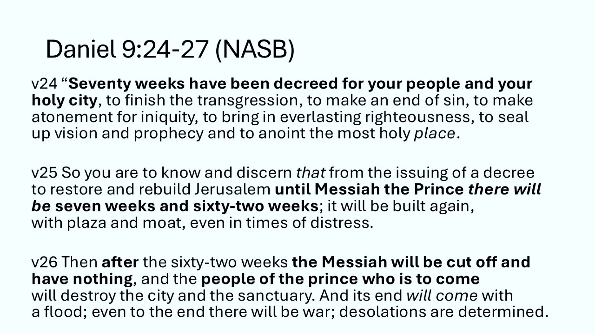
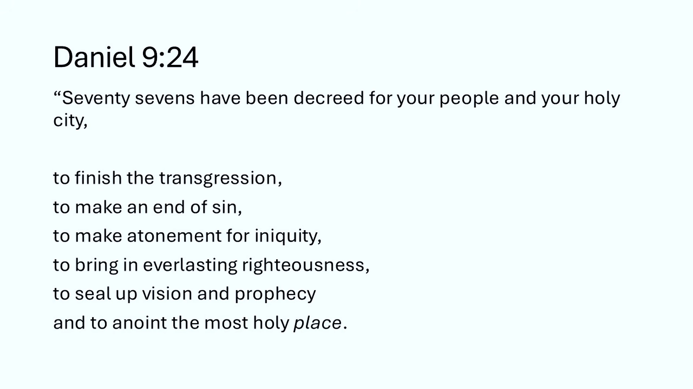
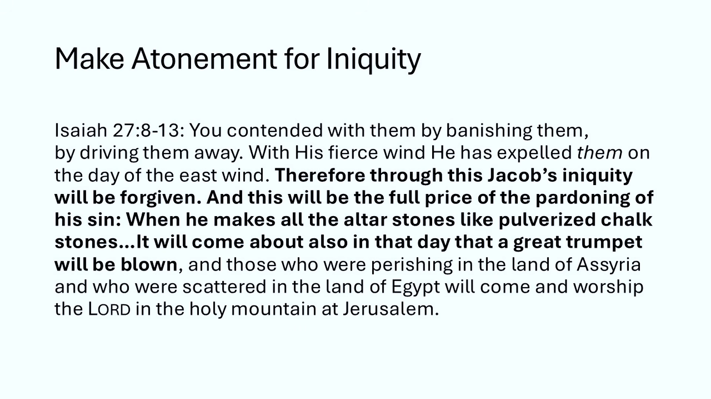
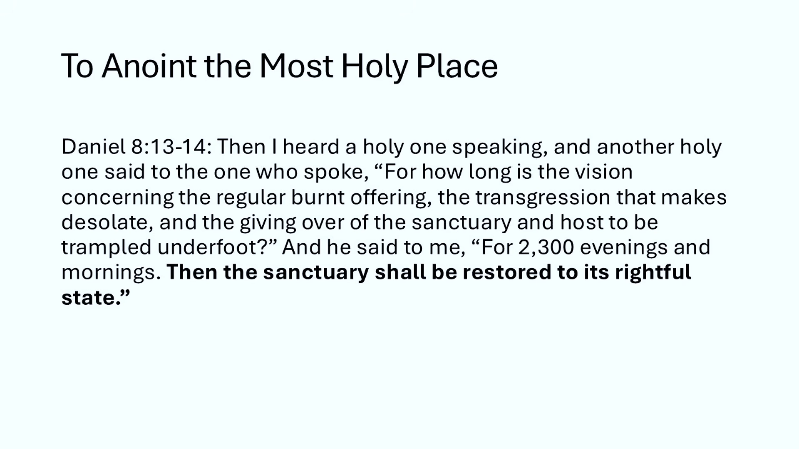

# ದಾನಿಯೇಲನ 70 ವಾರಗಳು (Daniel's 70 Weeks) – ಭಾಗ 1
## ದಾನಿಯೇಲ 9:1-24 – ಇಸ್ರಾಯೇಲಿಗೆ ನಿಗದಿ ಮಾಡಿರೋ ಎಪ್ಪತ್ತು ಏಳುಗಳು

---

## ಪೀಠಿಕೆ: ಈ ಹೊಸ ಸರಣಿ ಯಾಕೆ?

ಇವತ್ತಿಂದ ದಾನಿಯೇಲ (Daniel) ಪುಸ್ತಕದ ಎರಡನೇ ಅರ್ಧದಲ್ಲಿರೋ ಭವಿಷ್ಯವಾಣಿಗಳ (prophecies — ಮುಂದೆ 
ಏನಾಗುತ್ತೆ ಅಂತ ದೇವರು ಮೊದಲೇ ಹೇಳಿರೋ ಮಾತುಗಳು) ಬಗ್ಗೆ ಒಂದು ಹೊಸ ಅಧ್ಯಯನ ಶುರು ಮಾಡ್ತಿದ್ದೀವಿ. ಮೊದಲ 
ಸೆಷನ್, ಕನಿಷ್ಠ ಮೊದಲ ಮೂರು ಸೆಷನ್‌ಗಳಲ್ಲಿ, ದಾನಿಯೇಲ 9ನೇ ಅಧ್ಯಾಯವನ್ನ ಒಂದೊಂದೇ ವಚನ ತಗೊಂಡು ನೋಡ್ತೀವಿ.

ಇದನ್ನ ಈಗ್ಯಾಕೆ ಮಾಡ್ತಿದ್ದೀವಿ? ಮುಖ್ಯ ಕಾರಣ, ಈ ಭವಿಷ್ಯವಾಣಿಗಳ ಬಗ್ಗೆ ನಿಮ್ಮಲ್ಲಿ ತುಂಬಾ ಜನ 
ಇತ್ತೀಚೆಗೆ ಪ್ರಶ್ನೆ ಕೇಳ್ತಿದ್ದೀರಿ. ನಾವು ಈ ಅಧ್ಯಯನಗಳಿಗೆ ದಿನಾಂಕದ ಮುದ್ರೆ ಹಾಕೋದಿಲ್ಲ. ಇವು 
"ಎವರ್‌ಗ್ರೀನ್" (evergreen — ಯಾವ ಕಾಲದಲ್ಲಿ ಓದಿದ್ರೂ ಹಸಿರಾಗೇ ಇರೋ, ಅಂದ್ರೆ ಯಾವತ್ತೂ ಹಳೆಯದಾಗದ) 
ಆಗಿರಬೇಕು ಅನ್ನೋದು ನಮ್ಮ ಆಸೆ. ಆದ್ರೆ ಈಗ ಮಧ್ಯಪ್ರಾಚ್ಯದಲ್ಲಿ ಅಮೆರಿಕ, ಇಸ್ರಾಯೇಲ್ ಮತ್ತೆ ಇರಾನ್ ನಡುವೆ 
ದೊಡ್ಡ ಯುದ್ಧ ನಡೀತಿದೆ. ಆಗಾಗ ನಿಲ್ಲುತ್ತೆ, ಮತ್ತೆ ಶುರುವಾಗುತ್ತೆ. ಅದರಿಂದ ಬಹಳಷ್ಟು ಪ್ರಶ್ನೆಗಳು 
ಬಂದಿವೆ, ಅದರಲ್ಲೂ ದಾನಿಯೇಲ 9ರ ಬಗ್ಗೆ. ನಾವು ದಾನಿಯೇಲನ 70ನೇ ವಾರದ (Daniel's 70th Week) ಅಂಚಿಗೆ 
ಬಂದಿದ್ದೀವಾ ಅನ್ನೋ ಪ್ರಶ್ನೆ. ಆ 70ನೇ ವಾರ ಅಂದ್ರೆ ಏನು ಅಂತ ಈ ಸೆಷನ್‌ನಲ್ಲಿ ನೋಡ್ತೀವಿ.

ಒಂದು ಸ್ಪಾಯ್ಲರ್ ಅಲರ್ಟ್ ಈಗಲೇ ಹೇಳ್ತೀನಿ. ಆ ಪ್ರಶ್ನೆಗೆ ನಾನು ಉತ್ತರ ಕೊಡೋದಿಲ್ಲ. ಆ ಪ್ರಶ್ನೆಗೆ ಉತ್ತರ 
ಕೊಡೋದು ಜವಾಬ್ದಾರಿಯುತ ಅನ್ನೋ ಹಂತಕ್ಕೆ ನಾವಿನ್ನೂ ಬಂದಿಲ್ಲ ಅಂತ ನನ್ನ ಅನಿಸಿಕೆ. ನಮ್ಮ ಪಾಲಿಗೆ ತುಂಬಾ 
ಜವಾಬ್ದಾರಿಯುತ ಕೆಲಸ ಏನು ಅಂದ್ರೆ, ಈ ವಚನಗಳಲ್ಲಿ ಸ್ವಲ್ಪ ಸಮಯ ಕಳೆಯೋದು. ಅವನ್ನ ಓದೋದು, ಎಕ್ಸಿಜೀಸಿಸ್ 
(exegesis — ವಚನದಲ್ಲಿ ಏನಿದೆಯೋ ಅದನ್ನೇ ಹೊರತೆಗೆದು ಅರ್ಥ ಮಾಡ್ಕೊಳ್ಳೋದು, ನಮ್ಮ ಸ್ವಂತ ಅಭಿಪ್ರಾಯ 
ಒಳಗೆ ತುರುಕೋದಲ್ಲ) ಮಾಡೋದು, ಅವುಗಳ ಬಗ್ಗೆ ಮಾತಾಡೋದು, ಮತ್ತೆ ಅವು ಇವತ್ತಿನ ನಮ್ಮ ದಿನನಿತ್ಯದ ಜೀವನಕ್ಕೆ 
ಹೇಗೆ ಅನ್ವಯ ಆಗ್ತವೆ ಅಂತ ನೋಡೋದು. ಅದನ್ನೇ ಮಾಡ್ತೀವಿ.

---

## ಅಧ್ಯಯನದ ಯೋಜನೆ

ಈ ಸೆಷನ್‌ನಲ್ಲಿ ದಾನಿಯೇಲ 9ರ 1ರಿಂದ 24ನೇ ವಚನದವರೆಗೆ ನೋಡ್ತೀವಿ. ಅಂದ್ರೆ 70 ವಾರಗಳ ಭವಿಷ್ಯವಾಣಿಯ ಮೊದಲ 
ವಚನ ಮಾತ್ರ ತಗೊಳ್ತೀನಿ. ಆ ವಚನದವರೆಗೆ ಇಡೀ ಅಧ್ಯಾಯವನ್ನ ಓದ್ತೀವಿ. ಮುಂದಿನ ಸೆಷನ್‌ನಲ್ಲಿ ಅಧ್ಯಾಯದ 
ಕೊನೆಯ ಮೂರು ವಚನಗಳನ್ನ, 25 ರಿಂದ 27ನ್ನ, ತಗೊಂಡು ಭವಿಷ್ಯವಾಣಿ ಪೂರ್ತಿ ಮಾಡ್ತೀವಿ.

ದಾನಿಯೇಲನ 70 ವಾರಗಳ ಕ್ರೊನಾಲಜಿ (chronology — ಘಟನೆಗಳ ಕಾಲಕ್ರಮ, ಯಾವುದು ಯಾವಾಗ ಅನ್ನೋ ಲೆಕ್ಕ) 
ಮತ್ತೆ ಸಮಯ ಲೆಕ್ಕ ಹಾಕೋದಕ್ಕೆ ಒಂದು ಇಡೀ ಸೆಷನ್ ಮೀಸಲು ಇಡ್ತೀನಿ. ಅದು ನಿಮ್ಮಲ್ಲಿ ಕೆಲವರಿಗೆ ಆಸಕ್ತಿಕರ 
ಆಗಿರಬಹುದು, ಇನ್ನು ಕೆಲವರಿಗೆ ಅಷ್ಟಾಗಿ ಇಲ್ಲದಿರಬಹುದು. ಮುಖ್ಯವಾದ ವಿಷಯವನ್ನ ಗೋಜಲು ಮಾಡೋಕೆ ನಾನು 
ಬಯಸೋದಿಲ್ಲ. ಈ ವಚನಭಾಗದ ಅತ್ಯಂತ ಮುಖ್ಯ ಅಂಶ ಅದು ಅಂತ ನಾನು ಅಂದ್ಕೊಳ್ಳೋದಿಲ್ಲ. ಆದ್ರೆ ಅದು ಮುಖ್ಯ 
ಹೌದು, ಅತಿ ಮುಖ್ಯ ಅಲ್ಲ ಅಷ್ಟೇ.

ಹಾಗಾಗಿ ಮೊದಲ ಕೆಲವು ಸೆಷನ್‌ಗಳನ್ನ ವಚನಭಾಗದ ಭಾಷೆಯನ್ನ ನೋಡೋದರಲ್ಲಿ ಕಳೆಯೋಣ. ಆಮೇಲೆ 70 ವಾರಗಳನ್ನ 
ಇತಿಹಾಸದ ಪ್ರಕಾರ ಹೇಗೆ ಲೆಕ್ಕ ಹಾಕ್ತಾರೆ ಅನ್ನೋದನ್ನ ನೋಡ್ತೀವಿ. ಅದರಲ್ಲಿ ಪ್ರೀಟೆರಿಸ್ಟ್‌ಗಳು 
(Preterists — ಭವಿಷ್ಯವಾಣಿ ಹೆಚ್ಚಿನದು ಈಗಾಗಲೇ ಹಿಂದೆಯೇ ನೆರವೇರಿಹೋಗಿದೆ ಅನ್ನೋರು), 
ಫ್ಯೂಚರಿಸ್ಟ್‌ಗಳು (Futurists — ಅದರ ಮುಖ್ಯ ಭಾಗ ಇನ್ನೂ ಮುಂದೆ ನೆರವೇರುತ್ತೆ ಅನ್ನೋರು), 
ಪ್ರಿಮಿಲೆನಿಯಲ್ (Premillennial — ಕ್ರಿಸ್ತ ಮರಳಿ ಬಂದ ಮೇಲೆ ಅಕ್ಷರಶಃ ಸಾವಿರ ವರ್ಷದ ಆಳ್ವಿಕೆ 
ಅನ್ನೋರು) ಮತ್ತೆ ಆಮಿಲೆನಿಯಲ್ (Amillennial — ಆ ಸಾವಿರ ವರ್ಷ ಸಾಂಕೇತಿಕ ಅನ್ನೋರು) ದೃಷ್ಟಿಕೋನಗಳನ್ನ 
ನೋಡ್ತೀವಿ. ಆ ಪ್ರತಿ ಗುಂಪಿನೊಳಗೂ ಕೂಡ, 70 ವಾರಗಳನ್ನ ಎಲ್ಲಿ ನಿಲ್ಲಿಸಿ ಎಲ್ಲಿ ಮುಂದುವರಿಸಿ ಹೇಗೆ 
ಮುಗಿಸ್ತಾರೆ ಅನ್ನೋದರಲ್ಲಿ ತುಂಬಾ ಬೇರೆ ಬೇರೆ ವ್ಯತ್ಯಾಸಗಳಿವೆ.

ಅದು ಕೊನೆಯ ಸೆಷನ್‌ನಲ್ಲಿ. ಹೆದರಬೇಡಿ, ನಿಮಗೆ ಆ ವಿಷಯದಲ್ಲಿ ಆಸಕ್ತಿ ಇಲ್ಲದಿದ್ರೆ ಆ ಸೆಷನ್ 
ಬಿಟ್ಟುಬಿಡಬಹುದು. ಆದ್ರೆ ಉಳಿದವುಗಳಿಗೆ ಜೊತೆಯಲ್ಲೇ ಇರೋಕೆ ಪ್ರಯತ್ನಿಸಿ. ಯಾಕಂದ್ರೆ ಈ ಭವಿಷ್ಯವಾಣಿಯ 
ತುಂಬಾ ಮುಖ್ಯವಾದ, ಇವತ್ತಿಗೂ ಸಂಬಂಧಿಸಿದ ಭಾಗಗಳ ಬಗ್ಗೆ ಮಾತಾಡ್ತೀವಿ.

ಕೆಲವೊಮ್ಮೆ ನಾವು ಭವಿಷ್ಯವಾಣಿಯ ಸಮಯ ಮತ್ತೆ ಕ್ರೊನಾಲಜಿಗೆ ಸಂಬಂಧಿಸಿದ ಈ "ಪ್ರೊಫೆಸಿ ಗೀಕಿ" (prophecy 
geeky — ಭವಿಷ್ಯವಾಣಿಯ ಸೂಕ್ಷ್ಮ ಲೆಕ್ಕಾಚಾರಗಳಲ್ಲೇ ಮುಳುಗಿ ಹೋಗೋದು) ಭಾಗಗಳಲ್ಲಿ ಎಷ್ಟು ಕಳೆದುಹೋಗ್ತೀವಿ 
ಅಂದ್ರೆ ದೊಡ್ಡ ಚಿತ್ರ ಕಳೆದುಕೊಳ್ತೀವಿ. ದೇವರು ಗೇಬ್ರಿಯೇಲ ದೇವದೂತನ ಮೂಲಕ ಈ ವಚನಭಾಗದಲ್ಲಿ ದಾನಿಯೇಲನಿಗೆ 
"ನೀನು ಅರ್ಥ ಮಾಡ್ಕೋ, ನೀನು ಪಡೆಯುತ್ತಿರೋ ದರ್ಶನವನ್ನ ತಿಳ್ಕೋ" ಅಂತ ಆಜ್ಞೆ ಕೊಡ್ತಾನೆ. ಆ ದೇವರು ನಮಗೆ 
ಅರ್ಥ ಆಗಬೇಕು ಅಂತ ಬಯಸಿದ್ದನ್ನೇ ನಾವು ಕಳೆದುಕೊಳ್ತೀವಿ. ಹಾಗಾಗಿ ಮೊದಲ ಕೆಲವು ಸೆಷನ್‌ಗಳನ್ನ ಇವನ್ನ 
ಮಾತಾಡೋದರಲ್ಲಿ ಕಳೆಯೋದು ಮುಖ್ಯ. ಮೊದಲು ಮುಖ್ಯ ವಿಷಯ ಮೊದಲು. ಆಮೇಲೆ ತಿಳುವಳಿಕೆ ಮತ್ತೆ ಲೆಕ್ಕಾಚಾರದ 
ಬೋನಸ್ ಸೆಷನ್‌ಗೆ ಬರ್ತೀವಿ.

---

## ದಾನಿಯೇಲ 9:1-19 – ದಾನಿಯೇಲನ ಪ್ರಾರ್ಥನೆ

ಸರಿ, ಶುರು ಮಾಡೋಣ. ದಾನಿಯೇಲ 9, ವಚನ 1 ರಿಂದ 23. ನಾನು ಓದ್ತಾ ಹೋದ ಹಾಗೆ ನೀವು ನೋಡ್ತಾ ಇರಿ.

"ಮೇದ್ಯ ಜಾತಿಯವನಾದ ಅಹಷ್ವೇರೋಷನ ಮಗ ದರ್ಯಾವೆಷನ ಮೊದಲ ವರ್ಷದಲ್ಲಿ, ಅವನು ಕಸ್ದೀಯರ ರಾಜ್ಯಕ್ಕೆ ರಾಜನಾಗಿ 
ನೇಮಕವಾಗಿದ್ದ ಅವನ ಆಳ್ವಿಕೆಯ ಮೊದಲ ವರ್ಷದಲ್ಲಿ, ದಾನಿಯೇಲನಾದ ನಾನು, ಪ್ರವಾದಿ ಯೆರೆಮೀಯನಿಗೆ ಬಂದ ಕರ್ತನ 
ವಾಕ್ಯದ ಪ್ರಕಾರ ಯೆರೂಸಲೇಮಿನ ಹಾಳಾದ ಸ್ಥಿತಿ ಮುಗಿಯೋಕೆ ಮೊದಲು ಎಷ್ಟು ವರ್ಷ ಕಳೀಬೇಕು ಅಂತ ಪುಸ್ತಕಗಳಲ್ಲಿ 
ಗಮನಿಸಿದೆ: 70 ವರ್ಷ. ಆಗ ನಾನು ನನ್ನ ಮುಖವನ್ನ ಕರ್ತನಾದ ದೇವರ ಕಡೆ ತಿರುಗಿಸಿ, ಪ್ರಾರ್ಥನೆ ಮತ್ತೆ 
ಕರುಣೆಗಾಗಿ ಬೇಡಿಕೆ, ಉಪವಾಸ, ಗೋಣಿತಟ್ಟು ಮತ್ತೆ ಬೂದಿಯಿಂದ ಆತನನ್ನ ಹುಡುಕಿದೆ. ನನ್ನ ದೇವರಾದ ಕರ್ತನಿಗೆ 
ಪ್ರಾರ್ಥನೆ ಮಾಡಿ ನನ್ನ ಪಾಪ ಒಪ್ಪಿಕೊಂಡೆ. ಹೀಗೆ ಹೇಳಿದೆ: ಓ ಕರ್ತನೇ, ಮಹಾನ್ ಮತ್ತೆ ಭಯಂಕರ ದೇವರೇ, 
ನಿನ್ನನ್ನ ಪ್ರೀತಿಸಿ ನಿನ್ನ ಆಜ್ಞೆಗಳನ್ನ ಪಾಲಿಸೋರ ಜೊತೆ ಒಡಂಬಡಿಕೆಯನ್ನೂ ಅಚಲ ಪ್ರೀತಿಯನ್ನೂ ಕಾಯೋನೇ, 
ನಾವು ಪಾಪ ಮಾಡಿದ್ವಿ, ತಪ್ಪು ಮಾಡಿದ್ವಿ, ದುಷ್ಟತನದಿಂದ ನಡೆದ್ವಿ, ದಂಗೆ ಎದ್ವಿ, ನಿನ್ನ ಆಜ್ಞೆಗಳಿಂದ 
ಮತ್ತೆ ನಿಯಮಗಳಿಂದ ಪಕ್ಕಕ್ಕೆ ತಿರುಗಿದ್ವಿ. ನಿನ್ನ ಹೆಸರಲ್ಲಿ ನಮ್ಮ ರಾಜರಿಗೂ, ನಮ್ಮ ಪ್ರಧಾನರಿಗೂ, ನಮ್ಮ 
ಪಿತೃಗಳಿಗೂ, ದೇಶದ ಎಲ್ಲ ಜನರಿಗೂ ಮಾತಾಡಿದ ನಿನ್ನ ಸೇವಕರಾದ ಪ್ರವಾದಿಗಳ ಮಾತನ್ನ ನಾವು ಕೇಳಲಿಲ್ಲ.

ಕರ್ತನೇ, ನೀತಿ (righteousness — ಸರಿಯಾಗಿರೋ, ಶುದ್ಧವಾಗಿರೋ ಸ್ಥಿತಿ) ನಿನಗೆ ಸೇರಿದ್ದು. ಆದ್ರೆ ನಮಗೆ 
ಸೇರಿದ್ದು ಇವತ್ತಿನ ಹಾಗೆ ಬಹಿರಂಗ ನಾಚಿಕೆ. ಯೆಹೂದದ ಜನರಿಗೆ, ಯೆರೂಸಲೇಮಿನ ನಿವಾಸಿಗಳಿಗೆ, ಹತ್ತಿರದವರೂ 
ದೂರದವರೂ ಆದ ಇಡೀ ಇಸ್ರಾಯೇಲಿಗೆ, ಮತ್ತೆ ನಿನ್ನ ವಿರುದ್ಧ ಅವರು ಮಾಡಿದ ದ್ರೋಹದ (treachery — ನಂಬಿಕೆ 
ದ್ರೋಹ) ಕಾರಣ ನೀನು ಅವರನ್ನ ಓಡಿಸಿದ ಎಲ್ಲ ದೇಶಗಳಿಗೂ ಬಹಿರಂಗ ನಾಚಿಕೆ. ಓ ಕರ್ತನೇ, ನಮ್ಮ ರಾಜರಿಗೆ, ನಮ್ಮ 
ಪ್ರಧಾನರಿಗೆ, ನಮ್ಮ ಪಿತೃಗಳಿಗೆ ಬಹಿರಂಗ ನಾಚಿಕೆ ಸೇರಿದ್ದು, ಯಾಕಂದ್ರೆ ನಾವು ನಿನ್ನ ವಿರುದ್ಧ ಪಾಪ 
ಮಾಡಿದ್ವಿ. ನಮ್ಮ ದೇವರಾದ ಕರ್ತನಿಗೆ ಕರುಣೆಯೂ ಕ್ಷಮೆಯೂ ಸೇರಿದ್ದು, ಯಾಕಂದ್ರೆ ನಾವು ಆತನ ವಿರುದ್ಧ ದಂಗೆ 
ಎದ್ವಿ. ನಮ್ಮ ದೇವರಾದ ಕರ್ತನ ಧ್ವನಿಗೆ ನಾವು ವಿಧೇಯರಾಗಲಿಲ್ಲ, ಆತನ ಸೇವಕರಾದ ಪ್ರವಾದಿಗಳ ಮೂಲಕ ಆತನು 
ನಮ್ಮ ಮುಂದೆ ಇಟ್ಟ ದಾರಿಗಳಲ್ಲಿ ನಡೀಲಿಲ್ಲ. ಇಡೀ ಇಸ್ರಾಯೇಲ್ ನಿನ್ನ ಧರ್ಮಶಾಸ್ತ್ರವನ್ನ ಮೀರಿತು, 
ಪಕ್ಕಕ್ಕೆ ತಿರುಗಿತು, ನಿನ್ನ ಧ್ವನಿಗೆ ವಿಧೇಯರಾಗೋಕೆ ನಿರಾಕರಿಸಿತು. ದೇವರ ಸೇವಕ ಮೋಶೆಯ 
ಧರ್ಮಶಾಸ್ತ್ರದಲ್ಲಿ ಬರೆದಿದ್ದ ಶಾಪವೂ ಪ್ರಮಾಣವೂ (curse and oath — ಅವಿಧೇಯರಾದ್ರೆ ಬರುತ್ತೆ ಅಂತ 
ಮೊದಲೇ ಹೇಳಿದ್ದ ಶಿಕ್ಷೆ) ನಮ್ಮ ಮೇಲೆ ಸುರಿಯಲ್ಪಟ್ಟಿದೆ, ಯಾಕಂದ್ರೆ ನಾವು ಆತನ ವಿರುದ್ಧ ಪಾಪ ಮಾಡಿದ್ವಿ. 
ನಮ್ಮ ಮೇಲೆ ಮತ್ತೆ ನಮ್ಮನ್ನ ಆಳಿದ ನಮ್ಮ ಆಡಳಿತಗಾರರ ಮೇಲೆ ಆತನು ಹೇಳಿದ ತನ್ನ ಮಾತುಗಳನ್ನ, ನಮ್ಮ ಮೇಲೆ 
ಮಹಾ ವಿಪತ್ತು (great calamity) ತಂದು ದೃಢಪಡಿಸಿದ. ಯೆರೂಸಲೇಮಿಗೆ ಮಾಡಿದ್ದರ ಹಾಗೆ ಆಕಾಶದ ಕೆಳಗೆ ಬೇರೆ 
ಎಲ್ಲೂ ಮಾಡಿರಲಿಲ್ಲ. ಮೋಶೆಯ ಧರ್ಮಶಾಸ್ತ್ರದಲ್ಲಿ ಬರೆದಿರೋ ಹಾಗೆ ಈ ವಿಪತ್ತೆಲ್ಲ ನಮ್ಮ ಮೇಲೆ ಬಂದಿದೆ. 
ಆದ್ರೂ ನಾವು ನಮ್ಮ ಅಕ್ರಮಗಳಿಂದ ತಿರುಗಿ, ನಿನ್ನ ಸತ್ಯದಿಂದ ವಿವೇಕ ಪಡೆದು, ನಮ್ಮ ದೇವರಾದ ಕರ್ತನ ದಯೆಯನ್ನ 
ಬೇಡಲಿಲ್ಲ.

ಹಾಗಾಗಿ ಕರ್ತನು ವಿಪತ್ತನ್ನ ಸಿದ್ಧವಾಗಿ ಇಟ್ಟಿದ್ದ, ಅದನ್ನ ನಮ್ಮ ಮೇಲೆ ತಂದ. ಯಾಕಂದ್ರೆ ನಮ್ಮ ದೇವರಾದ 
ಕರ್ತನು ತಾನು ಮಾಡಿದ ಎಲ್ಲ ಕಾರ್ಯಗಳಲ್ಲಿ ನೀತಿವಂತ. ಆದ್ರೂ ನಾವು ಆತನ ಧ್ವನಿಗೆ ವಿಧೇಯರಾಗಲಿಲ್ಲ. ಈಗ 
ನಮ್ಮ ದೇವರೇ, ಬಲವಾದ ಕೈಯಿಂದ ನಿನ್ನ ಜನರನ್ನ ಈಜಿಪ್ಟ್ ದೇಶದಿಂದ ಹೊರಗೆ ತಂದು ಇವತ್ತಿನ ಹಾಗೆ ನಿನ್ನ 
ಹೆಸರನ್ನ ದೊಡ್ಡದು ಮಾಡಿಕೊಂಡವನೇ, ನಾವು ಪಾಪ ಮಾಡಿದ್ವಿ, ದುಷ್ಟತನ ಮಾಡಿದ್ವಿ. ಓ ಕರ್ತನೇ, ನಿನ್ನ ಎಲ್ಲ 
ನೀತಿಯ ಕಾರ್ಯಗಳ ಪ್ರಕಾರ, ನಿನ್ನ ಕೋಪ ಮತ್ತೆ ನಿನ್ನ ರೋಷ ನಿನ್ನ ಪಟ್ಟಣ ಯೆರೂಸಲೇಮಿನಿಂದ, ನಿನ್ನ ಪವಿತ್ರ 
ಬೆಟ್ಟದಿಂದ ತಿರುಗಲಿ. ನಮ್ಮ ಪಾಪಗಳಿಂದಲೂ ನಮ್ಮ ಪಿತೃಗಳ ಅಕ್ರಮಗಳಿಂದಲೂ ಯೆರೂಸಲೇಮೂ ನಿನ್ನ ಜನರೂ ನಮ್ಮ 
ಸುತ್ತಲಿನ ಎಲ್ಲರ ಮಧ್ಯೆ ಗಾದೆ (byword — ಜನ ನಕ್ಕು ಗೇಲಿ ಮಾಡೋ ವಿಷಯ, ಇಲ್ಲಾ "ಹೀಗೆ ಆಗಬಾರದು" ಅಂತ 
ಉದಾಹರಣೆಯಾಗಿ ಹೇಳೋ ಕಥೆ) ಆಗಿದ್ದಾರೆ.

ಈಗ ನಮ್ಮ ದೇವರೇ, ನಿನ್ನ ಸೇವಕರ ಪ್ರಾರ್ಥನೆಯನ್ನೂ ಕರುಣೆಗಾಗಿ ಅವರ ಬೇಡಿಕೆಗಳನ್ನೂ ಕೇಳು. ಓ ಕರ್ತನೇ, 
ನಿನ್ನ ನಿಮಿತ್ತವಾಗಿ ಹಾಳುಬಿದ್ದಿರೋ ನಿನ್ನ ಪವಿತ್ರಸ್ಥಾನದ (sanctuary — ದೇವರ ಆರಾಧನೆಯ ಪವಿತ್ರ ಸ್ಥಳ, 
ಅಂದ್ರೆ ದೇವಾಲಯ) ಮೇಲೆ ನಿನ್ನ ಮುಖ ಪ್ರಕಾಶಿಸಲಿ. ನನ್ನ ದೇವರೇ, ಕಿವಿ ಬಾಗಿಸಿ ಕೇಳು. ಕಣ್ಣು ತೆರೆದು 
ನೋಡು, ನಮ್ಮ ಹಾಳುಗೆಡುವಿಕೆಗಳನ್ನ, ನಿನ್ನ ಹೆಸರಿನಿಂದ ಕರೆಯಲ್ಪಟ್ಟ ಪಟ್ಟಣವನ್ನ. ಯಾಕಂದ್ರೆ ನಾವು ನಮ್ಮ 
ಬೇಡಿಕೆಗಳನ್ನ ನಿನ್ನ ಮುಂದೆ ಇಡ್ತಿರೋದು ನಮ್ಮ ನೀತಿಯ ಕಾರಣದಿಂದ ಅಲ್ಲ, ನಿನ್ನ ಮಹಾ ಕರುಣೆಯ ಕಾರಣದಿಂದ. ಓ 
ಕರ್ತನೇ, ಕೇಳು. ಓ ಕರ್ತನೇ, ಕ್ಷಮಿಸು. ಓ ಕರ್ತನೇ, ಗಮನಿಸಿ ಕಾರ್ಯ ಮಾಡು. ನನ್ನ ದೇವರೇ, ನಿನ್ನ 
ನಿಮಿತ್ತವಾಗಿ ತಡಮಾಡಬೇಡ, ಯಾಕಂದ್ರೆ ನಿನ್ನ ಪಟ್ಟಣ ಮತ್ತೆ ನಿನ್ನ ಜನ ನಿನ್ನ ಹೆಸರಿನಿಂದ 
ಕರೆಯಲ್ಪಟ್ಟಿದ್ದಾರೆ. ಸೆಲಾ."

### ಈ ದೃಶ್ಯ ಹೇಗಿದೆ?

ದೃಶ್ಯ ಇದು. ದಾನಿಯೇಲ ಬಾಬೆಲಿನಲ್ಲಿರೋ ಒಬ್ಬ ಮುದುಕ. ಅವನು ತನ್ನ ಬದುಕಿನ ಹೆಚ್ಚುಕಡಿಮೆ ಇಡೀ ಕಾಲ ಅಲ್ಲೇ 
ಇದ್ದಾನೆ. ಇಸ್ರಾಯೇಲ್ ದೇಶದ ಮೇಲೆ ಬಾಬೆಲಿನ ಮೊದಲ ದಾಳಿ ಆದಾಗ ಅವನು ಯುವಕನಾಗಿ ಸೆರೆಯಾಗಿ ಬಂದ. ಅದು 
ಹೆಚ್ಚುಕಡಿಮೆ 70 ವರ್ಷಗಳ ಹಿಂದೆ. ಹಾಗಾಗಿ ಅವನು ಈಗ ಕನಿಷ್ಠ 70 ಅಥವಾ 80ರ ಪ್ರಾಯದಲ್ಲಿ ಇರಬೇಕು. ಅವನು 
ದಿನನಿತ್ಯದ ಭಕ್ತಿಯಿಂದ ಯೆರೆಮೀಯನ ಸುರುಳಿಯನ್ನ ಓದ್ತಿದ್ದ. ಆಗ ಯೆರೆಮೀಯನ ಭವಿಷ್ಯವಾಣಿ ಅವನಿಗೆ 
ನೆನಪಾಯ್ತು. ಆ ಭವಿಷ್ಯವಾಣಿ ಅವನಿಗೆ ಬಹುಶಃ ಚೆನ್ನಾಗಿ ಗೊತ್ತಿತ್ತು. ಆ ಕಾಲ ಹತ್ತಿರ ಬಂದಿದೆ ಅಂತ ಅವನಿಗೆ 
ಅರಿವಾಯ್ತು.

ದಶಕಗಳ ಕಾಲ ಅವನು ಬಾಬೆಲಿನಲ್ಲಿ ದೊಡ್ಡ ಹುದ್ದೆಯ ಅಧಿಕಾರಿಯಾಗಿದ್ದ (captain). ಮೊದಲು ಬಾಬೆಲಿನ ರಾಜರ 
ಕೆಳಗೆ ಸೇವೆ ಮಾಡಿದ, ಆಮೇಲೆ ಸಾಮ್ರಾಜ್ಯ ಪರ್ಷಿಯಾಕ್ಕೆ ಬದಲಾಯ್ತು. ಮತ್ತೆ ಮತ್ತೆ ಅವನಿಗೆ ವಾಗ್ದತ್ತ 
ದೇಶದಿಂದ (Promised Land — ದೇವರು ಅಬ್ರಹಾಮನ ಸಂತತಿಗೆ ಕೊಟ್ಟ ದೇಶ) ಸುದ್ದಿ ಬರ್ತಿತ್ತು. ಬಾಬೆಲಿನವರು 
ಎರಡನೇ ಸಲ ದಾಳಿ ಮಾಡಿ ಇನ್ನೂ ಹೆಚ್ಚು ಸೆರೆಯಾಳುಗಳನ್ನ ಹಿಡ್ಕೊಂಡು ಬಂದ್ರು. ಕೊನೆಗೆ ಮೂರನೇ ಮತ್ತೆ ಕೊನೆಯ 
ಸಲ ಪಟ್ಟಣ ನಾಶವಾಯ್ತು, ದೇವಾಲಯ ನಾಶವಾಯ್ತು. ಅವನು ತನ್ನ ಪ್ರಾರ್ಥನೆಯಲ್ಲಿ ಹೇಳಿದ ಹಾಗೆ, "ನಿನ್ನ 
ಪವಿತ್ರಸ್ಥಾನ ಹಾಳುಬಿದ್ದಿದೆ." ಇಸ್ರಾಯೇಲ್ ಜನರ ಮೇಲೆ ದೇವರ ಶಿಕ್ಷೆಯ (chastisement) ಕಾಲ ಕೊನೆಗೆ 
ಹತ್ತಿರ ಬಂದಿದೆ ಅಂತ ಅರಿವಾಗಿ ಅವನು ಈ ಬೇಡಿಕೆಯ ಪ್ರಾರ್ಥನೆ ಶುರು ಮಾಡ್ತಾನೆ.

ಈ ವಚನಭಾಗ ಓದ್ತಿದ್ದರೆ, ಪ್ರಾರ್ಥನೆ ತೀವ್ರ ಅಂತ್ಯಕ್ಕೆ ಬರ್ತಿರೋವಾಗ ಅವನ ಒಳಗೆ ಭಾವನೆ ಉಕ್ಕುತ್ತಿರೋದು 
ನಿಮಗೇ ಅನ್ನಿಸುತ್ತೆ. "ಓ ಕರ್ತನೇ ಕೇಳು, ಓ ಕರ್ತನೇ ಕ್ಷಮಿಸು, ಓ ಕರ್ತನೇ ಗಮನಿಸಿ ಕಾರ್ಯ ಮಾಡು. ನನ್ನ 
ದೇವರೇ, ನಿನ್ನ ನಿಮಿತ್ತ ತಡಮಾಡಬೇಡ, ಯಾಕಂದ್ರೆ ನಿನ್ನ ಪಟ್ಟಣ ಮತ್ತೆ ನಿನ್ನ ಜನ ನಿನ್ನ ಹೆಸರಿನಿಂದ 
ಕರೆಯಲ್ಪಟ್ಟಿದ್ದಾರೆ."

---

## ದಾನಿಯೇಲನ ಪ್ರಾರ್ಥನೆಯ ಬಗ್ಗೆ ಗಮನಿಸಬೇಕಾದ ವಿಷಯಗಳು

ಈ ಪ್ರಾರ್ಥನೆಯ ಬಗ್ಗೆ ಹಲವು ವಿಷಯ ಹೇಳಬೇಕು.

### ಬಿರುಕಲ್ಲಿ ನಿಂತು ಮಧ್ಯಸ್ಥಿಕೆ

ದಾನಿಯೇಲ ಇಸ್ರಾಯೇಲ್ ಜನರ ಪರವಾಗಿ ಮಧ್ಯಸ್ಥಿಕೆ (intercession — ಇನ್ನೊಬ್ಬರ ಪರವಾಗಿ ದೇವರ ಮುಂದೆ 
ನಿಂತು ಬೇಡೋದು) ಮಾಡ್ತಿದ್ದಾನೆ. ಅವರ ಪರವಾಗಿ ಅವರ ಪಾಪಗಳನ್ನ ಒಪ್ಪಿಕೊಳ್ತಿದ್ದಾನೆ. ಆ ಪಾಪಗಳಲ್ಲಿ 
ಹೆಚ್ಚಿನದರಲ್ಲಿ ದಾನಿಯೇಲ ತಪ್ಪಿತಸ್ಥ ಅಲ್ಲ. ಆದ್ರೂ ಇಡೀ ರಾಷ್ಟ್ರದ ಪರವಾಗಿ ಮಾತಾಡ್ತಿದ್ದಾನೆ. 
ಬಿರುಕಲ್ಲಿ ನಿಂತಿದ್ದಾನೆ (standing in the gap — ದೇವರಿಗೂ ಜನರಿಗೂ ನಡುವಿನ ಬಿರುಕಲ್ಲಿ 
ನಿಂತುಕೊಳ್ಳೋದು), ರಾಷ್ಟ್ರಕ್ಕಾಗಿ ಬೇಡ್ತಿದ್ದಾನೆ.

### ದೀನತೆ

ಅವನು ದೇವರ ಹತ್ತಿರ ಹಕ್ಕಿನ ಭಾವನೆಯಿಂದ (entitlement — "ಇದು ನನಗೆ ಸಿಗಲೇಬೇಕು" ಅನ್ನೋ ಮನೋಭಾವ) 
ಬರೋದಿಲ್ಲ. ತುಂಬಾ ದೀನನಾಗಿ ಬರ್ತಾನೆ. "ನೀನು 70 ವರ್ಷ ಅಂತ ಹೇಳಿದೆ, ನಮ್ಮನ್ನ ಮರಳಿ ಕಳಿಸು" ಅಂತ ದೇವರ 
ಮೇಲೆ ಒತ್ತಾಯ ಮಾಡೋದಿಲ್ಲ. ದೇವರ ಕರುಣೆಗೆ ಮೊರೆ ಇಡ್ತಾನೆ. ಇಸ್ರಾಯೇಲಿನ ಜೊತೆ ದೇವರು ಮಾಡಿಕೊಂಡ 
ಒಡಂಬಡಿಕೆಯ (covenant — ದೇವರು ತನ್ನ ಜನರ ಜೊತೆ ಮಾಡಿಕೊಂಡ ಗಂಭೀರ ಒಪ್ಪಂದ) ನಂಬಿಗಸ್ತಿಕೆಗೆ ಮೊರೆ 
ಇಡ್ತಾನೆ.

### ಸಾಮಾನ್ಯ ಒಪ್ಪಿಗೆ ಅಲ್ಲ, ನಿರ್ದಿಷ್ಟ ಒಪ್ಪಿಗೆ

ಇದನ್ನ ಗಮನಿಸೋದು ಮುಖ್ಯ. ಅವನು ಬರೀ ಸಾಮಾನ್ಯವಾಗಿ "ನಾವು ಪಾಪಿಗಳು" ಅಂತ ಒಪ್ಪಿಕೊಳ್ಳೋದಿಲ್ಲ. 
ನಿರ್ದಿಷ್ಟವಾಗಿ ಒಪ್ಪಿಕೊಳ್ತಾನೆ. ಉದಾಹರಣೆಗೆ: "ನಾವು ಪಾಪ ಮಾಡಿದ್ವಿ, ತಪ್ಪು ಮಾಡಿದ್ವಿ, ದುಷ್ಟತನದಿಂದ 
ನಡೆದ್ವಿ, ದಂಗೆ ಎದ್ವಿ, ನಿನ್ನ ಆಜ್ಞೆಗಳಿಂದ ಮತ್ತೆ ನಿಯಮಗಳಿಂದ ಪಕ್ಕಕ್ಕೆ ತಿರುಗಿದ್ವಿ. ನಿನ್ನ ಸೇವಕರ 
ಮಾತನ್ನ ಕೇಳಲಿಲ್ಲ." ಆಮೇಲೆ: "ಹಾಗಾಗಿ ನಾವು ಆತನ ವಿರುದ್ಧ ದಂಗೆ ಎದ್ವಿ, ನಮ್ಮ ದೇವರಾದ ಕರ್ತನ ಧ್ವನಿಗೆ 
ವಿಧೇಯರಾಗಲಿಲ್ಲ." ಮತ್ತೆ: "ಆದ್ರೂ ನಾವು ನಮ್ಮ ಅಕ್ರಮಗಳಿಂದ ತಿರುಗಿ, ನಿನ್ನ ಸತ್ಯದಿಂದ ವಿವೇಕ ಪಡೆದು, 
ಕರ್ತನ ದಯೆ ಬೇಡಲಿಲ್ಲ."

### ಇಸ್ರಾಯೇಲಿನ ಪಾಪ: ದೇವರ ಧ್ವನಿ ಕೇಳದಿರೋದು

ಇಸ್ರಾಯೇಲಿನ ಪಾಪ, ದಾನಿಯೇಲನ ಪ್ರಾರ್ಥನೆಯಲ್ಲಿ, ನಿರ್ದಿಷ್ಟವಾಗಿ ದೇವರ ಧ್ವನಿಗೆ ಕಿವಿಗೊಡದಿರೋದಕ್ಕೆ 
ಸಂಬಂಧಿಸಿದ್ದು. ದೇವರು ಅವರನ್ನ ತಿದ್ದೋಕೆ ಪ್ರವಾದಿಗಳನ್ನ ಕಳಿಸಿದಾಗ ಅವರು ಪ್ರವಾದಿಗಳನ್ನ 
ಕಡೆಗಣಿಸಿದ್ರು. ದೇವರ ವಾಕ್ಯಕ್ಕೆ ಕಿವಿಗೊಡಲಿಲ್ಲ. ದೇವರ ಸತ್ಯದಿಂದ ವಿವೇಕ ಪಡೀಲಿಲ್ಲ. ದೇವರು ಮತ್ತೆ 
ಮತ್ತೆ ಮತ್ತೆ ಮತ್ತೆ ಮತ್ತೆ ಪ್ರೀತಿಯಿಂದ ಇಸ್ರಾಯೇಲಿಗೆ ಮೊರೆ ಇಟ್ಟ, ಅವರನ್ನ ಆಕರ್ಷಿಸಿದ, ಪ್ರವಾದಿಗಳ 
ಮೂಲಕ ಎಚ್ಚರಿಸಿದ, ಆದ್ರೆ ಅವರು ಕೇಳಲಿಲ್ಲ. ಇದಕ್ಕಾಗಿ ನಿರ್ದಿಷ್ಟವಾಗಿ, ಪದೇ ಪದೇ, ದಾನಿಯೇಲ ರಾಷ್ಟ್ರದ 
ಪರವಾಗಿ ಪಶ್ಚಾತ್ತಾಪ (repentance — ತಪ್ಪಿನ ಬಗ್ಗೆ ನಿಜವಾಗಿ ನೊಂದು ಬದಲಾಗೋದು) ಪಡ್ತಿದ್ದಾನೆ.

### ದೇವರ ನೀತಿಗೆ ಮೊರೆ

ಅವನು ಹಲವು ಸಲ ದೇವರ ನೀತಿಗೆ ಮೊರೆ ಇಡ್ತಾನೆ: "ಓ ದೇವರೇ, ನೀತಿ ನಿನಗೆ ಸೇರಿದ್ದು." ಇದು ಮುಖ್ಯ. 
ಯಾಕಂದ್ರೆ 70 ವಾರಗಳ ಭವಿಷ್ಯವಾಣಿ ನಿರ್ದಿಷ್ಟವಾಗಿ ಪಾಪ, ಅಕ್ರಮ ಮತ್ತೆ ನೀತಿಯ ವಿಷಯಗಳ ಬಗ್ಗೆ.

---

## ಭವಿಷ್ಯವಾಣಿಯ ಸಂದರ್ಭ ಯಾಕೆ ಬೇಕು?

ಹಾಗಾಗಿ ಈ ಭವಿಷ್ಯವಾಣಿಯ ಸಂದರ್ಭ ಬೇಕು. ಆ ನಾಲ್ಕು ವಚನಗಳನ್ನ ಮೀರಿ, ಅವಕ್ಕಿಂತ ಮೊದಲಿನ ವಚನಗಳನ್ನ 
ನೋಡಬೇಕು. ಅಲ್ಲಿ ನಮಗೆ ಅರ್ಥ ಆಗುತ್ತೆ. ಪಾಪ, ಅಕ್ರಮ ಮತ್ತೆ ನೀತಿಯ ಬಗ್ಗೆ ಮಾತಾಡ್ತಿದ್ದಾಗ ನಾವು ಯಾವುದರ 
ಬಗ್ಗೆ ಮಾತಾಡ್ತಿದ್ದೀವಿ? ಅವರು ಒಪ್ಪಿಕೊಳ್ತಿದ್ದ ಪಾಪ ಯಾವ ತರದ್ದು? ದಾನಿಯೇಲ ಘೋಷಿಸ್ತಿರೋ ನೀತಿ 
ಯಾರದ್ದು? ಅದು ದೇವರಿಗೆ ಸೇರಿದ ನೀತಿ. ಅದು ನಮ್ಮಿಂದ ಬರೋದಿಲ್ಲ, ಆತನಿಂದ ನಮಗೆ ಬರುತ್ತೆ.

ಜೊತೆಗೆ ಈ ಪ್ರಾರ್ಥನೆಯಲ್ಲಿ ಇಸ್ರಾಯೇಲ್ ಮತ್ತೆ ಯೆರೂಸಲೇಮಿನ ಉಲ್ಲೇಖಗಳು ಮತ್ತೆ ಮತ್ತೆ ಬರೋದನ್ನೂ 
ನೋಡಬೇಕು. "ಯೆಹೂದದ ಜನರಿಗೆ, ಯೆರೂಸಲೇಮಿನ ನಿವಾಸಿಗಳಿಗೆ, ಹತ್ತಿರದವರೂ ದೂರದವರೂ ಆದ ಇಡೀ ಇಸ್ರಾಯೇಲಿಗೆ." 
ಪ್ರಾರ್ಥನೆಯನ್ನ ಹೀಗೆ ಮುಗಿಸ್ತಾನೆ: "ಯಾಕಂದ್ರೆ ನಿನ್ನ ಪಟ್ಟಣ ಮತ್ತೆ ನಿನ್ನ ಜನ ನಿನ್ನ ಹೆಸರಿನಿಂದ 
ಕರೆಯಲ್ಪಟ್ಟಿದ್ದಾರೆ."

ಇದು ಮುಖ್ಯ ಯಾಕಂದ್ರೆ 70 ವಾರಗಳ ಭವಿಷ್ಯವಾಣಿ "ನಿನ್ನ ಜನರ ಮತ್ತೆ ನಿನ್ನ ಪವಿತ್ರ ಪಟ್ಟಣದ" ಬಗ್ಗೆ ಅಂತ 
ಹೇಳುತ್ತೆ. ಅಂದ್ರೆ ದಾನಿಯೇಲನ ಜನ, ದಾನಿಯೇಲನ ಪವಿತ್ರ ಪಟ್ಟಣ. ಭವಿಷ್ಯವಾಣಿಯ ಸಂದರ್ಭವಾದ ಈ 
ಪ್ರಾರ್ಥನೆಯಲ್ಲಿ ದಾನಿಯೇಲ ಅವರು ಯಾರು ಅಂತ ಗುರುತಿಸ್ತಾನೆ. ಅದು ಇಸ್ರಾಯೇಲ್ ರಾಷ್ಟ್ರ, ಯೆರೂಸಲೇಮಿನ 
ನಿವಾಸಿಗಳು, ನಿರ್ದಿಷ್ಟವಾಗಿ ಯೆಹೂದದ ಜನ. ಇಲ್ಲಿ ಇಸ್ರಾಯೇಲಿನ ಬಗ್ಗೆ ಯಾವುದೋ ಸಾಮಾನ್ಯ ಅರ್ಥದಲ್ಲಿ 
ಮಾತಾಡ್ತಿಲ್ಲ. ಯೆಹೂದಿ ಜನರ ಬದಲು ಬೇರೆ ಯಾರದ್ದೋ ಜೊತೆ ಗುರುತಿಸೋ ವಿಷಯ ಇದಲ್ಲ. ನಾವು ಯೆಹೂದಿ ಜನರ 
ಬಗ್ಗೆ, ಮತ್ತೆ ಆ ಕಾಲದಲ್ಲಿ ಹಾಳುಬಿದ್ದಿದ್ದ ಯೆರೂಸಲೇಮ್ ಪಟ್ಟಣದ ಬಗ್ಗೆ ಮಾತಾಡ್ತಿದ್ದೀವಿ. ಹಾಗಾಗಿ 
ಭವಿಷ್ಯವಾಣಿ ಬಂದಾಗ ಅದು ಈ ವಿಷಯಗಳನ್ನೇ ಉದ್ದೇಶಿಸುತ್ತೆ. ಎಲ್ಲ ಪಾತ್ರಧಾರಿಗಳು ಯಾರು ಅಂತ ಹೆಸರು ಹಿಡಿದು 
ನಾವು ಗುರುತಿಸಬೇಕು.

---

## ದಾನಿಯೇಲ 9:20-23 – ಗೇಬ್ರಿಯೇಲನ ಆಗಮನ

ಸರಿ, ಮುಂದೆ ಹೋಗೋಣ. "ನಾನು ಮಾತಾಡ್ತಾ, ಪ್ರಾರ್ಥನೆ ಮಾಡ್ತಾ, ನನ್ನ ಪಾಪವನ್ನೂ ನನ್ನ ಜನ ಇಸ್ರಾಯೇಲಿನ 
ಪಾಪವನ್ನೂ ಒಪ್ಪಿಕೊಳ್ತಾ, ನನ್ನ ದೇವರ ಪವಿತ್ರ ಪರ್ವತಕ್ಕಾಗಿ ನನ್ನ ದೇವರಾದ ಕರ್ತನ ಮುಂದೆ ಬೇಡಿಕೆ 
ಇಡ್ತಿರೋವಾಗ, ನಾನು ಪ್ರಾರ್ಥನೆಯಲ್ಲಿ ಮಾತಾಡ್ತಿರೋವಾಗ, ಅಧ್ಯಾಯ 8ರಲ್ಲಿ ಆರಂಭದ ದರ್ಶನದಲ್ಲಿ ನಾನು 
ನೋಡಿದ್ದ ಗೇಬ್ರಿಯೇಲ ಅನ್ನೋ ಮನುಷ್ಯ, **ಸಂಜೆಯ ಯಜ್ಞದ ಹೊತ್ತಿನಲ್ಲಿ**, ಬಿರುಸಾದ ಹಾರಾಟದಲ್ಲಿ ನನ್ನ 
ಹತ್ತಿರ ಬಂದ. ಅವನು ನನಗೆ ತಿಳಿಸಿ ಹೇಳಿದ: 'ಓ ದಾನಿಯೇಲ, ನಿನಗೆ ಒಳನೋಟ ಮತ್ತೆ ತಿಳುವಳಿಕೆ ಕೊಡೋಕೆ ಈಗ 
ನಾನು ಬಂದಿದ್ದೇನೆ.' ಇದು ಮುಖ್ಯ ಹೇಳಿಕೆ. 'ನೀನು ಕರುಣೆಗಾಗಿ ಬೇಡಿಕೆ ಇಡೋಕೆ ಶುರು ಮಾಡಿದಾಗಲೇ ಒಂದು 
ಮಾತು ಹೊರಟಿತ್ತು, ಅದನ್ನ ಹೇಳೋಕೆ ನಾನು ಬಂದಿದ್ದೇನೆ, ಯಾಕಂದ್ರೆ ನೀನು ತುಂಬಾ ಪ್ರೀತಿಪಾತ್ರ. 
**ಆದ್ದರಿಂದ ಆ ಮಾತನ್ನ ಗಮನಿಸು, ದರ್ಶನವನ್ನ ಅರ್ಥ ಮಾಡ್ಕೋ.**'"

### ಸಂಜೆಯ ಯಜ್ಞದ ಹೊತ್ತು ಯಾಕೆ ಮುಖ್ಯ?

ದಾನಿಯೇಲ ಈ ಘಟನೆಯನ್ನ ಹೇಳ್ತಾ, ಗೇಬ್ರಿಯೇಲ ದೇವದೂತ ತನ್ನ ಹತ್ತಿರ ಸಂಜೆಯ ಯಜ್ಞದ ಹೊತ್ತಿನಲ್ಲಿ ಬಂದ ಅಂತ 
ಹೇಳ್ತಾನೆ. ಇದು ಮುಖ್ಯ. ಯಾಕಂದ್ರೆ ಬೆಳಗಿನ ಮತ್ತೆ ಸಂಜೆಯ ಯಜ್ಞಗಳು ನಿರಂತರ (perpetual) ಯಜ್ಞ, 
ದಿನನಿತ್ಯದ ಯಜ್ಞ ಅನ್ನೋದರ ಭಾಗ. ಪ್ರತಿದಿನ ಬೆಳಿಗ್ಗೆ ಒಂದು ವರ್ಷದ, ಕಳಂಕವಿಲ್ಲದ, ಪೂರ್ಣ ಬೆಳವಣಿಗೆಯ 
ಕುರಿಮರಿಯನ್ನ ವಧಿಸಿ, ಸಂಜೆ ಇನ್ನೊಂದನ್ನ ವಧಿಸಿ, ಯಜ್ಞವೇದಿಯ ಮೇಲೆ ಸರ್ವಾಂಗ ಹೋಮವಾಗಿ (whole burnt 
offering — ಪೂರ್ತಿಯಾಗಿ ಸುಟ್ಟು ದೇವರಿಗೆ ಅರ್ಪಿಸೋದು) ಅರ್ಪಿಸ್ತಿದ್ರು. ಬೆಳಿಗ್ಗೆ ಮತ್ತೆ ಸಂಜೆ, 
ಬೆಳಿಗ್ಗೆ ಮತ್ತೆ ಸಂಜೆ. ದಿನಕ್ಕೆ ಎರಡು ಸಲ ಯೆರೂಸಲೇಮಿನ ನಿವಾಸಿಗಳು ದೇವಾಲಯದ ಬೆಟ್ಟದ ಕಡೆ ನೋಡಿ ಒಂದು 
ಕುರಿಮರಿಯನ್ನ ವಧಿಸೋದನ್ನ ನೋಡಬಹುದಿತ್ತು.

ಈ ನಿರ್ದಿಷ್ಟ ಯಜ್ಞ ದಾನಿಯೇಲ ಪುಸ್ತಕದ ಎರಡನೇ ಅರ್ಧದ ಭವಿಷ್ಯವಾಣಿಗಳಲ್ಲಿ ಮುಖ್ಯ ಪಾತ್ರ ವಹಿಸುತ್ತೆ. 
ಅಧ್ಯಾಯ 8 ರಿಂದ 12ರವರೆಗೆ ಅದು ಒಂದು ಸಾಮಾನ್ಯ ದಾರದ ಹಾಗೆ ಹರಿಯುತ್ತೆ. ಯಾಕೆ? ಯಾಕಂದ್ರೆ ಅದು ಒಂದು 
ತುಂಬಾ ಮುಖ್ಯ ಗುರುತಿನ ಘಟನೆಗೆ ಸಂಬಂಧಿಸಿದ್ದು. ಸಮಯ ಲೆಕ್ಕ ಹಾಕೋಕೆ, ಆರಂಭಗಳು, ಅಂತ್ಯಗಳು ಮತ್ತೆ 
ಪುನಃಸ್ಥಾಪನೆಗಳನ್ನ (restorations — ಹಾಳಾಗಿದ್ದನ್ನ ಮತ್ತೆ ಸರಿಯಾದ ಸ್ಥಿತಿಗೆ ತರೋದು) ಲೆಕ್ಕ ಹಾಕೋಕೆ 
ಬಳಸೋ ಯಜ್ಞ ಅದು. ಅದು ಇನ್ನೂ ನಿರ್ದಿಷ್ಟವಾಗಿ "ಹಾಳುಮಾಡುವ ಅಸಹ್ಯ" (abomination of desolation — 
ಪವಿತ್ರ ಸ್ಥಳವನ್ನ ಅಪವಿತ್ರ ಮಾಡಿ ಹಾಳುಗೆಡವೋ ಹೇಸಿಗೆಯ ಕೃತ್ಯ) ಅನ್ನೋ ಅತಿ ಮುಖ್ಯ, ದುರಂತ ಗುರುತಿನ 
ಘಟನೆಗೂ ಸಂಬಂಧಿಸಿದ್ದು. ಅದು "ಯಾಕೋಬನ ಸಂಕಟ" (Jacob's trouble — ಇಸ್ರಾಯೇಲಿಗೆ ಬರೋ ಮಹಾ ಸಂಕಟದ ಕಾಲ) 
ಅನ್ನೋ ಅವಧಿಯ ಆರಂಭ. ಅದರ ಬಗ್ಗೆ ದಾನಿಯೇಲ ಅಧ್ಯಾಯ 12ರಲ್ಲೂ ಹೇಳ್ತಾನೆ. ಕೊನೆಗೆ ಅಲ್ಲಿಗೆ ಬರ್ತೀವಿ. 
ಇದನ್ನ ಮನಸ್ಸಲ್ಲಿ ಇಟ್ಕೊಳ್ಳಿ. ಈ ಭವಿಷ್ಯವಾಣಿಗಳನ್ನ ಓದುವಾಗ ನಾವು ನಿರ್ದಿಷ್ಟ ಯಜ್ಞಗಳ ಬಗ್ಗೆ 
ಮಾತಾಡ್ತಿದ್ದೀವಿ.

ಗೇಬ್ರಿಯೇಲ ದೇವದೂತ ಎರಡು ಸಲ ದಾನಿಯೇಲನಿಗೆ ಒತ್ತಿ ಹೇಳ್ತಾನೆ, ಅವನಿಗೆ ಒಳನೋಟ ಮತ್ತೆ ತಿಳುವಳಿಕೆ ಇರಬೇಕು 
ಅಂತ. ದಾನಿಯೇಲ ದೇವರಿಂದ ಪಡೀತಿರೋ ಮಾತನ್ನ ಗಮನಿಸಬೇಕು, ಅರ್ಥ ಮಾಡ್ಕೊಳ್ಳಬೇಕು.

---

## ಮಧ್ಯದ ದಾರಿ

ಈ ಭವಿಷ್ಯವಾಣಿಯನ್ನ ಓದುವಾಗ ಒಂದು ಮಧ್ಯದ ದಾರಿ ಇದೆ. ಒಂದು ಕಡೆ ನೀವು "ಹೈಪರ್-ಅಕ್ಯುರೆಸಿ" 
(hyper-accuracy — ಅತಿಯಾದ ನಿಖರತೆ) ಅನ್ನೋ ಭಾವನೆ ಪಡೆಯಬಹುದು. ಅದು ಭವಿಷ್ಯವಾಣಿ ಲೋಕದ ಒಂದು ಕೋಡಂಗಿ 
ಮೂಲೆಯಲ್ಲಿ ಕಾಣುತ್ತೆ. ಈ ಭವಿಷ್ಯವಾಣಿಗಳ ಪ್ರತಿ ಅಂಶವನ್ನೂ, ಪ್ರತಿ ಚುಕ್ಕೆ ಮತ್ತೆ ಗೆರೆಯನ್ನೂ (jot and 
tittle — ಅತಿ ಸಣ್ಣ ಸೂಕ್ಷ್ಮ ವಿವರ), ಅಂತಿಮ ಮಟ್ಟದವರೆಗೆ ನಕ್ಷೆ ಹಾಕಬೇಕು ಅನ್ನೋ ಆಸೆ. ಅದನ್ನ 
ಮಾಡಬಹುದು ಅಂತ ಹೇಳೋ ಕಾಲಕ್ಕೆ ನಾವಿನ್ನೂ ಬಂದಿಲ್ಲ ಅಂತ ನನಗೆ ಅನ್ನಿಸುತ್ತೆ. ಅಧ್ಯಾಯ 12ಕ್ಕೆ ಬರೋವಾಗ 
ಇದರ ಬಗ್ಗೆ ಇನ್ನೂ ಮಾತಾಡ್ತೀವಿ.

ಆದ್ರೆ ಈಗ ಈ ಅಧ್ಯಯನದ ಹತ್ತಿರ ಬರೋವಾಗ ಸ್ವಲ್ಪ ಭಯ ಮತ್ತೆ ನಡುಕ ಇರಲಿ: "ನಮಗೆ ಇದೆಲ್ಲ ಇನ್ನೂ 
ಗೊತ್ತಾಗಿಲ್ಲ" ಅಂತ ಹೇಳೋ ಭಾವನೆ. ನಾವು ಈ ಪುಸ್ತಕಗಳನ್ನ ಮತ್ತೆ ಮತ್ತೆ ಓದ್ತಾ ಅತ್ತಿತ್ತ ಓಡಾಡಿದ ಹಾಗೆ, 
ಒಂದು ತಲೆಮಾರು ಹಿಂದಿನ ತಲೆಮಾರಿನ ಮೇಲೆ ಕಟ್ಟಿಕೊಂಡು ಹೋದ ಹಾಗೆ, ತಿಳುವಳಿಕೆ ಹೆಚ್ಚುತ್ತೆ ಅನ್ನೋದು ಒಂದು 
ಅರ್ಥದಲ್ಲಿ ನಿಜ. ಆದ್ರೆ ದಾನಿಯೇಲ ಪುಸ್ತಕದ ಈ ಎಲ್ಲ ಭವಿಷ್ಯವಾಣಿಗಳು, ಇಡೀ ಪುಸ್ತಕ, "ತೆರೆಯಲ್ಪಟ್ಟಿದೆ" 
(unsealed — ಮುದ್ರೆ ಒಡೆದು ತೆರೆಯೋದು) ಅಂತ ಹೇಳೋ ಹಂತಕ್ಕೆ ನಾವಿನ್ನೂ ಬಂದಿಲ್ಲ. ಭವಿಷ್ಯವಾಣಿಯ ಮುದ್ರೆ 
ಹಾಕುವಿಕೆ (sealing) ಬಗ್ಗೆ ಈ ಭವಿಷ್ಯವಾಣಿಯಲ್ಲೇ ಮಾತಾಡ್ತೀವಿ.

ಇನ್ನೊಂದು ಕಡೆ, ಇದು ಪೂರ್ತಿ ಅಸ್ಪಷ್ಟವಾಗಿರಬೇಕು ಅಂತ ಉದ್ದೇಶಿಸಿದ್ದೂ ಅಲ್ಲ ಅಂತ ನನಗೆ ಅನ್ನಿಸುತ್ತೆ. 
"ಓ, ಇದೆಲ್ಲ ಹೂವಿನ ಹಾಗೆ ಅಲಂಕಾರದ, ಸಾಂಕೇತಿಕ (allegorical — ಕಥೆಯ ರೂಪದಲ್ಲಿ ಬೇರೆ ಅರ್ಥ ಹೇಳೋ 
ರೀತಿ) ಭಾಷೆ. ನಮಗೆ ಏನೂ ಗೊತ್ತಾಗೋದಿಲ್ಲ" ಅನ್ನೋದು ಅಲ್ಲ. ಇಲ್ಲ. ಗೇಬ್ರಿಯೇಲ ದೇವದೂತ ದಾನಿಯೇಲನಿಗೆ, 
ಅವನ ಮೂಲಕ ನಮಗೂ, ಹೇಳ್ತಾನೆ: ನಾವು ಗಮನಿಸಬೇಕು, ನಮ್ಮ ಶಕ್ತಿ ಮೀರಿ ಅರ್ಥ ಮಾಡ್ಕೊಳ್ಳಬೇಕು. ನಾವು 
ಮುಂದಕ್ಕೆ ಜಿಗಿಯೋಕೆ ಆಗೋದಿಲ್ಲ. "ನನಗೆ ಎಲ್ಲ ಗೊತ್ತು" ಅಂತ ನಾವು ಹೇಳಬಾರದು. "ಓ, ದಾನಿಯೇಲ ಸರಳ, ನನಗೆ 
ಎಲ್ಲ ಅರ್ಥ ಆಗಿದೆ, ಎಲ್ಲ ಬಿಡಿಸಿ ಹೇಳ್ತೀನಿ" ಅಂತ ಹೇಳೋ ಯಾವ ಭವಿಷ್ಯವಾಣಿ ಬೋಧಕನನ್ನೂ ಆಫ್ ಮಾಡಿ, 
ಅವರಿಂದ ಓಡಿ. ಅದೇ ರೀತಿ ಇನ್ನೊಂದು ಕಡೆ, "ಅದರ ಬಗ್ಗೆ ಯಾರಿಗೆ ಗೊತ್ತು, ಅರ್ಥ ಮಾಡ್ಕೊಳ್ಳೋದು ಅಸಾಧ್ಯ" 
ಅಂತ ಹೇಳೋರೂ ಇದ್ದಾರೆ. ಅದರ ಪರಿಣಾಮ ಏನು ಗೊತ್ತಾ? ಬೈಬಲಿನ ಆ ಭಾಗಗಳನ್ನ ನೀವು ಓದೋದೇ ಇಲ್ಲ, ಅವನ್ನ 
ಯೋಚನೆಯೂ ಮಾಡೋದಿಲ್ಲ. ಹಾಗಾಗಿ ಮಧ್ಯದ ದಾರಿ ಹಿಡಿಯೋಣ.

---

## ದಾನಿಯೇಲ 9:24-27

ಸರಿ, ಶುರು ಮಾಡೋಣ. ಅಧ್ಯಾಯ 9, ವಚನ 24 ರಿಂದ 27. ವಚನಗಳನ್ನ ಅಲ್ಲಿ ಒಡೆದು ಇಟ್ಟಿದ್ದೀನಿ, ನೀವು 
ನೋಡಬಹುದು.

"ನಿನ್ನ ಜನರ ಮೇಲೆ ಮತ್ತೆ ನಿನ್ನ ಪವಿತ್ರ ಪಟ್ಟಣದ ಮೇಲೆ ಎಪ್ಪತ್ತು ವಾರಗಳು ನಿಗದಿಯಾಗಿವೆ, ದ್ರೋಹವನ್ನ 
ಮುಗಿಸೋಕೆ, ಪಾಪಕ್ಕೆ ಅಂತ್ಯ ಹಾಕೋಕೆ, ಅಕ್ರಮಕ್ಕೆ ಪ್ರಾಯಶ್ಚಿತ್ತ ಮಾಡೋಕೆ, ಶಾಶ್ವತ ನೀತಿಯನ್ನ ತರೋಕೆ, 
ದರ್ಶನ ಮತ್ತೆ ಪ್ರವಾದನೆಗೆ ಮುದ್ರೆ ಹಾಕೋಕೆ, ಅತಿ ಪವಿತ್ರ ಸ್ಥಳವನ್ನ ಅಭಿಷೇಕಿಸೋಕೆ. ಹಾಗಾಗಿ ನೀನು 
ತಿಳ್ಕೋ, ವಿವೇಚಿಸು: ಯೆರೂಸಲೇಮನ್ನ ಪುನಃಸ್ಥಾಪಿಸಿ (ಮರಳಿ ತಂದು) ಕಟ್ಟಿಸಬೇಕು ಅನ್ನೋ ಆಜ್ಞೆ 
ಹೊರಟಾಗಿನಿಂದ ಮೆಶ್ಶಾಯ ರಾಜಕುಮಾರ ಬರೋವರೆಗೆ ಏಳು ವಾರ ಮತ್ತೆ ಅರವತ್ತೆರಡು ವಾರ ಇರುತ್ತೆ. ಅದು ಬೀದಿ 
ಮತ್ತೆ ಕಂದಕದ ಜೊತೆ ಮತ್ತೆ ಕಟ್ಟಲ್ಪಡುತ್ತೆ, ಕಷ್ಟದ ಕಾಲದಲ್ಲೂ. ಅರವತ್ತೆರಡು ವಾರಗಳ ನಂತರ ಮೆಶ್ಶಾಯ 
ಕಡಿದುಹಾಕಲ್ಪಡ್ತಾನೆ, ಅವನಿಗೆ ಏನೂ ಇರೋದಿಲ್ಲ. ಬರಲಿರುವ ರಾಜಕುಮಾರನ ಜನ ಪಟ್ಟಣವನ್ನೂ ಪವಿತ್ರಸ್ಥಾನವನ್ನೂ 
ನಾಶ ಮಾಡ್ತಾರೆ. ಅದು ಪ್ರವಾಹದ ಹಾಗೆ ಬರುತ್ತೆ. ಕೊನೆಯವರೆಗೂ ಯುದ್ಧ ಇರುತ್ತೆ. ಹಾಳುಗೆಡುವಿಕೆಗಳು 
ನಿರ್ಣಯವಾಗಿವೆ. ಮತ್ತೆ ಅವನು ಒಂದು ವಾರಕ್ಕೆ ಅನೇಕರ ಜೊತೆ ದೃಢವಾದ ಒಡಂಬಡಿಕೆ ಮಾಡ್ತಾನೆ. ಆದ್ರೆ ಆ ಒಂದು 
ವಾರದ ಮಧ್ಯದಲ್ಲಿ ಅವನು ಯಜ್ಞವನ್ನೂ ಮಹಾ ಅರ್ಪಣೆಯನ್ನೂ ನಿಲ್ಲಿಸ್ತಾನೆ. ಅಸಹ್ಯಗಳ ರೆಕ್ಕೆಯ ಮೇಲೆ 
ಹಾಳುಮಾಡುವವನು ಬರ್ತಾನೆ, ನಿರ್ಣಯವಾದ ಸಂಪೂರ್ಣ ನಾಶ ಹಾಳುಮಾಡುವವನ ಮೇಲೆ ಸುರಿಯಲ್ಪಡೋವರೆಗೂ."

ಸರಿ, ಇದನ್ನ ಒಂದೊಂದಾಗಿ ಬಿಡಿಸೋಣ. ಹೇಳಿದ ಹಾಗೆ, ಇವತ್ತು ವಚನ 24 ಮಾತ್ರ ನೋಡ್ತೀವಿ. ಆ ಒಂದೇ ವಚನದಲ್ಲಿ 
ಎಷ್ಟು ವಿಷಯ ಇದೆ ಅಂದ್ರೆ, ಅದಕ್ಕಿಂತ ಮುಂದೆ ಹೋದ್ರೆ ಸೆಷನ್ ತುಂಬಾ ಉದ್ದ ಆಗಿಬಿಡುತ್ತೆ. ಹಾಗಾಗಿ 25 
ರಿಂದ 27ನೇ ವಚನಗಳನ್ನ ಮುಂದಿನ ಸಲಕ್ಕೆ ಬಿಡ್ತೀವಿ.

### ವಚನ 24 ಯಾಕೆ ನಿರ್ಣಾಯಕ?

ವಚನ 24 ತುಂಬಾ ನಿರ್ಣಾಯಕ. ಮೊದಲನೆಯದಾಗಿ, ಅದು ಕಾಲಾವಧಿಯನ್ನ ಸ್ಥಾಪಿಸುತ್ತೆ: 70 ವಾರಗಳು, ಅಥವಾ ಹೀಬ್ರೂ 
ಭಾಷೆಯಲ್ಲಿ ಅಕ್ಷರಶಃ "ಎಪ್ಪತ್ತು ಏಳುಗಳು" (seventy sevens). ಎರಡನೆಯದಾಗಿ, ಅದು ಭವಿಷ್ಯವಾಣಿಯ 
ನೆರವೇರಿಕೆಯ ಷರತ್ತುಗಳನ್ನ ಸ್ಥಾಪಿಸುತ್ತೆ. ಅಲ್ಲಿ ಆರು ವಾಕ್ಯಖಂಡಗಳಿವೆ: ದ್ರೋಹವನ್ನ ಮುಗಿಸೋದು, 
ಪಾಪಕ್ಕೆ ಅಂತ್ಯ ಹಾಕೋದು ಅಥವಾ ಮುದ್ರೆ ಹಾಕಿ ಮುಚ್ಚೋದು, ಅಕ್ರಮಕ್ಕೆ ಪ್ರಾಯಶ್ಚಿತ್ತ (atonement — ಪಾಪ 
ಮುಚ್ಚಿ ದೇವರ ಜೊತೆ ಸಂಬಂಧ ಸರಿಪಡಿಸೋದು) ಮಾಡೋದು, ಶಾಶ್ವತ ನೀತಿಯನ್ನ ತರೋದು, ದರ್ಶನ ಮತ್ತೆ ಪ್ರವಾದನೆಗೆ 
ಮುದ್ರೆ ಹಾಕೋದು, ಅತಿ ಪವಿತ್ರ ಸ್ಥಳವನ್ನ ಅಭಿಷೇಕಿಸೋದು.

ಹಾಗಾಗಿ ಗೇಬ್ರಿಯೇಲ ದೇವದೂತ ದಾನಿಯೇಲನಿಗೆ ಹೇಳ್ತಿದ್ದಾನೆ: ಈ ಭವಿಷ್ಯವಾಣಿ ನಿಗದಿಯಾಗಿದೆ, 
ನಿರ್ಧರಿಸಲ್ಪಟ್ಟಿದೆ. ಇದನ್ನ ನೀವು "ನೇಮಕವಾಗಿದೆ" (ordained) ಅಂತಲೂ ಭಾಷಾಂತರಿಸಬಹುದು. ಇಸ್ರಾಯೇಲ್ 
ಜನರಿಗೂ ಯೆರೂಸಲೇಮ್ ಪಟ್ಟಣಕ್ಕೂ ನೇಮಕವಾದ ಈ ಏಳುಗಳು ಆರು ಷರತ್ತುಗಳ ನೆರವೇರಿಕೆಗೆ ಸಂಬಂಧಿಸಿದ್ದು: ದ್ರೋಹ 
ಮುಗಿಸೋದು, ಪಾಪಕ್ಕೆ ಅಂತ್ಯ ಹಾಕೋದು, ಅಕ್ರಮಕ್ಕೆ ಪ್ರಾಯಶ್ಚಿತ್ತ ಮಾಡೋದು, ಶಾಶ್ವತ ನೀತಿ ತರೋದು, ದರ್ಶನ 
ಮತ್ತೆ ಪ್ರವಾದನೆಗೆ ಮುದ್ರೆ ಹಾಕೋದು, ಅತಿ ಪವಿತ್ರ ಸ್ಥಳವನ್ನ ಅಭಿಷೇಕಿಸೋದು. ಈ ಆರೂ ನೆರವೇರೋವರೆಗೂ 70ನೇ 
ವಾರ ಮುಗಿದಿಲ್ಲ.

### ಇದು ದೇವರ ತೀರ್ಮಾನ

ಗೇಬ್ರಿಯೇಲ ಬಳಸೋ ಭಾಷೆಯನ್ನ ಗಮನಿಸಿ. "ಎಪ್ಪತ್ತು ವಾರಗಳು, ಅಕ್ಷರಶಃ ಎಪ್ಪತ್ತು ಏಳುಗಳು, ನಿಗದಿಯಾಗಿವೆ." 
ನಿನ್ನ ಜನರಿಗಾಗಿ ಮತ್ತೆ ನಿನ್ನ ಪವಿತ್ರ ಪಟ್ಟಣಕ್ಕಾಗಿ ದೇವರಿಂದ ನಿರ್ಧರಿಸಲ್ಪಟ್ಟಿವೆ. ಹಾಗಾಗಿ ಈ 
ಭವಿಷ್ಯವಾಣಿ ಇಸ್ರಾಯೇಲಿಗಾಗಿ ದೇವರು ಏನು ಮಾಡಿದ್ದಾನೆ ಅನ್ನೋದರ ಬಗ್ಗೆ ಮಾತ್ರ ಅಲ್ಲ. ಇಸ್ರಾಯೇಲಿನಲ್ಲಿ 
ದೇವರು ಏನು ಮಾಡ್ತಾನೆ ಅನ್ನೋದರ ಬಗ್ಗೆ.

ಇದು ಮುಖ್ಯ. ಯಾಕಂದ್ರೆ ನಮ್ಮ ಪ್ರೀಟೆರಿಸ್ಟ್ ಸಹೋದರ ಸಹೋದರಿಯರು ಈ ಇಡೀ ಭವಿಷ್ಯವಾಣಿ ಈಗಾಗಲೇ ನೆರವೇರಿದೆ 
ಅಂತ ಲೆಕ್ಕ ಹಾಕ್ತಾರೆ, ಮೊದಲ ಶತಮಾನದಲ್ಲಿ ಯೇಸುವಿನ ಮರಣ, ಪುನರುತ್ಥಾನ (resurrection — ಸತ್ತವರೊಳಗಿಂದ 
ಜೀವಂತವಾಗಿ ಎದ್ದು ಬರೋದು) ಮತ್ತೆ ಆರೋಹಣದಲ್ಲಿ (ascension — ಸ್ವರ್ಗಕ್ಕೆ ಏರಿ ಹೋಗೋದು). ಅದರಲ್ಲಿ 
ಒಂದು ಸೂಕ್ಷ್ಮತೆ ಇದೆ, ಅದನ್ನ ಇದೇ ಸೆಷನ್‌ನಲ್ಲಿ ಮುಂದೆ ಹೇಳ್ತೀನಿ. ಆದ್ರೆ ಪ್ರೀಟೆರಿಸ್ಟ್ ಈ ಇಡೀ 
ವಚನಭಾಗ ಈಗಾಗಲೇ ನೆರವೇರಿದೆ ಅಂತ ನೋಡ್ತಾನೆ. ಆದ್ರೆ ನಾವು ನೋಡಿದ ಹಾಗೆ, ಇದು ಮತ್ತೆ ಮತ್ತೆ ಹೇಳೋದು 
ಇಸ್ರಾಯೇಲಿಗಾಗಿ ದೇವರು ಏನು ಮಾಡಿದ್ದಾನೆ ಅನ್ನೋದರ ಬಗ್ಗೆ ಮಾತ್ರ ಅಲ್ಲ, ಇಸ್ರಾಯೇಲಿನಲ್ಲಿ ದೇವರು ಏನು 
ಮಾಡ್ತಾನೆ ಅನ್ನೋದರ ಬಗ್ಗೆ.

ಈ ವಿಷಯಗಳು ಇಸ್ರಾಯೇಲಿಗೆ "ಆಜ್ಞಾಪಿಸಲ್ಪಟ್ಟಿವೆ" ಅಂತ ಅಲ್ಲ. ಅವು ಇಸ್ರಾಯೇಲಿಗಾಗಿ ನಿಗದಿಯಾಗಿವೆ, 
ನಿರ್ಧರಿಸಲ್ಪಟ್ಟಿವೆ. "ನಿಮಗೆ 70 ವಾರ ಇದೆ, ಅಷ್ಟರೊಳಗೆ ಇವನ್ನ ಮುಗಿಸಿ, ಇಲ್ಲದಿದ್ರೆ ನಾನು ಬೇರೆ ಕಡೆ 
ಹೋಗ್ತೀನಿ" ಅಂತ ದೇವರು ಹೇಳಿದ ಹಾಗಲ್ಲ. ಅವು ನಿಗದಿಯಾಗಿವೆ, ನಿರ್ಧರಿಸಲ್ಪಟ್ಟಿವೆ, ನೇಮಕವಾಗಿವೆ. ದೇವರು 
ಇಸ್ರಾಯೇಲಿನ ಮೂಲಕ ಮತ್ತೆ ಇಸ್ರಾಯೇಲಿನಲ್ಲಿ, ಎಲ್ಲರಿಗೂ ಕಾಣೋ ಹಾಗೆ, ಗಮನಿಸಬಹುದಾದ ಹಾಗೆ, ಸಾಧಿಸೋ 
ಕೆಲಸಗಳು ಇವು.

---

## "ಎಪ್ಪತ್ತು ಏಳುಗಳು" ಅಂದ್ರೆ ಏನು?

ಸರಿ, ಇವನ್ನ ಒಂದೊಂದಾಗಿ ಬೇಗ ನೋಡೋಣ. ಮೊದಲು, ಈ ಎಪ್ಪತ್ತು ಏಳುಗಳು ಅಂದ್ರೆ ಏನು? ಅದರ ಅರ್ಥ ಏನು? 
ಎಪ್ಪತ್ತು ಏಳುಗಳು ಗಂಟೆಗಳಾ, ದಿನಗಳಾ, ತಿಂಗಳುಗಳಾ, ವರ್ಷಗಳಾ, ಶತಮಾನಗಳಾ, ಇಲ್ಲಾ ಯಾವುದೋ ಅನಿರ್ದಿಷ್ಟ 
ಕಾಲಾವಧಿಯಾ? ನಮಗೆ ಶಾಸ್ತ್ರದಲ್ಲೇ ಒಂದು ಮಾದರಿ ಇದೆ. ನೆನಪಿಡಿ, ಇಡೀ ಶಾಸ್ತ್ರ ತೋರಾದ (Torah — ಮೋಶೆಯ 
ಐದು ಪುಸ್ತಕಗಳು, ದೇವರ ಬೋಧನೆ ಮತ್ತೆ ಉಪದೇಶ) ಮೇಲೆ ಕಟ್ಟಲ್ಪಟ್ಟಿದೆ, ಅಲ್ಲಿಂದ ಬೆಳೆದಿದೆ: ಮೋಶೆಯ 
ಪುಸ್ತಕಗಳು, ಪ್ರವಾದಿಗಳ ಬರಹಗಳು, ಸುವಾರ್ತೆಗಳು, ಎಲ್ಲವೂ.

ಯಾಜಕಕಾಂಡ 25ನೇ ಅಧ್ಯಾಯದಲ್ಲಿ ದೇವರು ಇಸ್ರಾಯೇಲಿಗೆ ವ್ಯವಸಾಯದ ಸಂದರ್ಭದಲ್ಲಿ ಸಬ್ಬತ್ ವರ್ಷಗಳ (Sabbath 
years) ಬಗ್ಗೆ ಆಜ್ಞಾಪಿಸ್ತಾನೆ. ಅಲ್ಲಿ "ವರ್ಷಗಳ ವಾರಗಳು" (weeks of years) ಅನ್ನೋ ಕಲ್ಪನೆ 
ಕಾಣುತ್ತೆ. ಯಾಜಕಕಾಂಡ 25, ವಚನ 2ರಿಂದ 10:

"ನಾನು ನಿಮಗೆ ಕೊಡಲಿರುವ ದೇಶಕ್ಕೆ ನೀವು ಪ್ರವೇಶಿಸಿದಾಗ, ಭೂಮಿಯೇ ಕರ್ತನಿಗೆ ಸಬ್ಬತ್ ಆಚರಿಸಬೇಕು. ಆರು 
ವರ್ಷ ನಿಮ್ಮ ಹೊಲದಲ್ಲಿ ಬಿತ್ತನೆ ಮಾಡಿ, ಆರು ವರ್ಷ ನಿಮ್ಮ ದ್ರಾಕ್ಷಿತೋಟಕ್ಕೆ ಕತ್ತರಿ ಹಾಕಿ ಬೆಳೆ 
ಕೂಡಿಸಿಕೊಳ್ಳಿ. ಆದ್ರೆ ಏಳನೇ ವರ್ಷ ಭೂಮಿಗೆ ವಿಶ್ರಾಂತಿಯ ವರ್ಷ, ಕರ್ತನಿಗಾಗಿ ಸಬ್ಬತ್. ನಿಮ್ಮ ಹೊಲದಲ್ಲಿ 
ಬಿತ್ತಬೇಡಿ, ದ್ರಾಕ್ಷಿತೋಟಕ್ಕೆ ಕತ್ತರಿ ಹಾಕಬೇಡಿ. ತಾನಾಗೇ ಬೆಳೆದದ್ದನ್ನ ಕೊಯ್ಯಬೇಡಿ, ಬೆಳೆಸದ ಬಳ್ಳಿಯ 
ದ್ರಾಕ್ಷಿಯನ್ನ ಕೂಡಿಸಬೇಡಿ. ಭೂಮಿಗೆ ವಿಶ್ರಾಂತಿಯ ವರ್ಷ ಇರಲಿ. ಸಬ್ಬತ್ ವರ್ಷದಲ್ಲಿ ಭೂಮಿ ಕೊಡೋದು ನಿಮಗೆ 
ಆಹಾರ ಆಗಲಿ. ಭೂಮಿ ಬೆಳೆಸಿದ್ದನ್ನ ತಿನ್ನಬಹುದು. ನೀವು ಏಳು ವರ್ಷಗಳ ವಾರಗಳನ್ನ ಎಣಿಸಬೇಕು, ಏಳು ಸಲ ಏಳು 
ವರ್ಷಗಳು." ಇದು ಮತ್ತೆ ಅಕ್ಷರಶಃ "ಏಳು ಏಳುಗಳು, ಏಳು ಸಲ ಏಳು ವರ್ಷಗಳು." "…ಹಾಗಾಗಿ ಆ ಏಳು ವರ್ಷಗಳ 
ವಾರಗಳ ಕಾಲ ನಿಮಗೆ 49 ವರ್ಷ ಕೊಡುತ್ತೆ. ಐವತ್ತನೇ ವರ್ಷವನ್ನ ಪವಿತ್ರ ಮಾಡಿ, ದೇಶದಾದ್ಯಂತ, ಅದರ ಎಲ್ಲ 
ನಿವಾಸಿಗಳಿಗೂ ಬಿಡುಗಡೆ ಸಾರಿ. ಅದು ನಿಮಗೆ ಜೂಬಿಲಿ ಆಗಲಿ."

ಸರಿ, ಈ ವಚನಭಾಗವನ್ನ ದಾನಿಯೇಲ ಅಧ್ಯಾಯಕ್ಕೆ ಜೋಡಿಸಿ ನೋಡಿ. ಅಲ್ಲಿ ಸಮಾನತೆ ಕಾಣುತ್ತೆ, ಅದೇ ನಿಖರವಾದ 
ಭಾಷೆ. ಇಲ್ಲಿ ಏಳು ಏಳುಗಳು. ದಾನಿಯೇಲನಲ್ಲಿ ಎಪ್ಪತ್ತು ಏಳುಗಳು. ಅಂದ್ರೆ ಎಪ್ಪತ್ತು ಗುಣಿಸು ಏಳು, 490. 
ಗಣಿತ ಚೆನ್ನಾಗಿ ಬರದವರಿಗೆ ಹೇಳ್ತೀನಿ: ಭೂಮಿ ಆರು ವರ್ಷ ಬೇಸಾಯ ಆಗುತ್ತೆ, ಏಳನೇ ವರ್ಷ ಬೀಳು. ಆ ಚಕ್ರ ಏಳು 
ಸಲ ಮುಂದುವರಿಯುತ್ತೆ. ಐವತ್ತನೇ ವರ್ಷ ಜೂಬಿಲಿ (Jubilee). ಆ ವರ್ಷ ಭೂಮಿ ಅದರ ಮೂಲ ಒಡೆಯರಿಗೆ, ಪ್ರತಿ 
ಕುಲಕ್ಕೆ, ಮತ್ತೆ ಹಂಚಲ್ಪಡುತ್ತೆ. ಅವು ಬೇರೆ ಕುಲಗಳಿಗೆ ಮಾರಲ್ಪಟ್ಟಿದ್ದರೂ ಮೂಲ ಕುಲಕ್ಕೆ ಹಿಂತಿರುಗಬೇಕು. 
ಅದೇ ಜೂಬಿಲಿ ವರ್ಷ.

ಅದೇ ಅರ್ಥದಲ್ಲಿ ಇಲ್ಲಿ ನಾವು "ಮೆಗಾ ಜೂಬಿಲಿ" (mega jubilee — ದೊಡ್ಡ ಜೂಬಿಲಿ) ಅನ್ನ ನೋಡ್ತಿದ್ದೀವಿ: 
ಎಪ್ಪತ್ತು ಏಳುಗಳು, 490 ವರ್ಷ. ಅದರ ನಂತರ ಒಂದು ಸಹಸ್ರಮಾನದ ಜೂಬಿಲಿ ಅಂತ ಕರೆಯಬಹುದು. ಹಾಗಾಗಿ ಎಪ್ಪತ್ತು 
ಏಳುಗಳು ವರ್ಷಗಳ ವಾರಗಳಿಗೆ ಸಂಬಂಧಿಸಿದ್ದು, ಇಸ್ರಾಯೇಲಿನ ಕ್ಯಾಲೆಂಡರಿನಲ್ಲಿ ಬಿಡುಗಡೆ ಮತ್ತೆ 
ಪುನಃಸ್ಥಾಪನೆಯ ವರ್ಷಗಳು.

---

## ಆರು ಷರತ್ತುಗಳ ಒಂದೊಂದರ ವಿವರಣೆ

ಈ 70 ಏಳುಗಳು ಯಾರಿಗೆ ನಿಗದಿಯಾಗಿವೆ? ನಿನ್ನ ಜನರಿಗೆ ಮತ್ತೆ ನಿನ್ನ ಪಟ್ಟಣಕ್ಕೆ. ವಚನ 7ಕ್ಕೆ ಹಿಂದಿರುಗಿ 
ನೋಡಿ: ಯೆಹೂದದ ಜನ, ಯೆರೂಸಲೇಮಿನ ನಿವಾಸಿಗಳು, ಮತ್ತೆ ಇಡೀ ಇಸ್ರಾಯೇಲ್, ಹತ್ತಿರದವರೂ ದೂರದವರೂ.

### 1. ದ್ರೋಹವನ್ನ ಮುಗಿಸೋದು, ಪಾಪವನ್ನ ಮುದ್ರೆ ಹಾಕಿ ಮುಚ್ಚೋದು

ವಚನ 11: "ಇಡೀ ಇಸ್ರಾಯೇಲ್ ನಿನ್ನ ಧರ್ಮಶಾಸ್ತ್ರವನ್ನ ಮೀರಿತು." ಇಂಗ್ಲಿಷ್‌ನಲ್ಲಿ "law" ಅಂತ ಭಾಷಾಂತರ 
ಆಗಿರೋ ಆ ಪದ ಹೀಬ್ರೂನಲ್ಲಿ "ತೋರಾ" (Torah). ಇದಕ್ಕೆ ಬರೀ ಕಾನೂನಿಗಿಂತ ತುಂಬಾ ಹೆಚ್ಚಿನ ಅರ್ಥ ಇದೆ. ಅದು 
ಬೋಧನೆ ಅಥವಾ ಉಪದೇಶಕ್ಕೂ ಸಂಬಂಧಿಸಿದ್ದು. ನಾವು ದೇವರನ್ನ ಹಿಂಬಾಲಿಸಿದಾಗ, ಆತನಿಂದ, ಆತನ ಆತ್ಮದಿಂದ (ಅವನೇ 
ನಮ್ಮ ದೊಡ್ಡಕ್ಷರದ "ಗುರು", Teacher) ನಾವು ಪಡೆಯೋ ಬೋಧನೆ ಮತ್ತೆ ಉಪದೇಶ ಒಂದು ಅರ್ಥದಲ್ಲಿ ದೇವರ ತೋರಾ. 
ಇಸ್ರಾಯೇಲ್ ದೇವರ ಧರ್ಮಶಾಸ್ತ್ರವನ್ನ, ಆತನ ತೋರಾವನ್ನ, ಮೀರಿತು, ಪಕ್ಕಕ್ಕೆ ತಿರುಗಿ ಆತನ ಧ್ವನಿಗೆ 
ಕಿವಿಗೊಡೋಕೆ ಇಲ್ಲಾ ವಿಧೇಯರಾಗೋಕೆ ನಿರಾಕರಿಸಿತು. ವಚನ 13ರಲ್ಲಿ: "ಆದ್ರೂ ನಾವು ನಮ್ಮ ಅಕ್ರಮಗಳಿಂದ 
ತಿರುಗಿ, ನಿನ್ನ ಸತ್ಯದಿಂದ ವಿವೇಕ ಪಡೆದು, ನಮ್ಮ ದೇವರಾದ ಕರ್ತನ ದಯೆ ಬೇಡಲಿಲ್ಲ."

### ಇದು ನೆರವೇರಿದೆಯಾ ಅಂತ ಹೇಗೆ ಪರೀಕ್ಷಿಸೋದು?

ಈ ಆರು ವಾಕ್ಯಖಂಡಗಳಲ್ಲಿ ಪ್ರತಿಯೊಂದರ ಜೊತೆ ಇವತ್ತು ನಾವು ನಮ್ಮನ್ನ ಕೇಳ್ಕೊಳ್ಳೋ ಪ್ರಶ್ನೆ ಇದು: 
ಇಸ್ರಾಯೇಲಿನಲ್ಲಿ ಈ ವಿಷಯಗಳು ಈಗಾಗಲೇ ನೆರವೇರಿರೋದನ್ನ ನಾವು ನೋಡ್ತಿದ್ದೀವಾ? ಯಾಕಂದ್ರೆ ಭವಿಷ್ಯವಾಣಿಯ 
ವಿಷಯ ಇಸ್ರಾಯೇಲ್ ಮತ್ತೆ ಯೆರೂಸಲೇಮ್ ಪಟ್ಟಣ, ಅದರ ಯೆಹೂದಿ ನಿವಾಸಿಗಳ ಸಮೇತ, ಅಂತಾದ್ರೆ (ಹೌದು ಅದು ಹಾಗೇ, 
ಸಂದರ್ಭ ಸ್ಪಷ್ಟವಾಗಿ ಹೇಳುತ್ತೆ), ಮತ್ತೆ ಈ ವಿಷಯಗಳು 70 ವಾರಗಳಲ್ಲಿ ಇಸ್ರಾಯೇಲಿಗಾಗಿ ನಿಗದಿ, ನಿರ್ಧಾರ, 
ನೇಮಕವಾಗಿವೆ ಅಂತಾದ್ರೆ, ಪ್ರಶ್ನೆ ಇದು: ಇವನ್ನ ಇಸ್ರಾಯೇಲಿನಲ್ಲಿ ನಾವು ಈಗಾಗಲೇ ನೋಡ್ತಿದ್ದೀವಾ? ಉತ್ತರ 
ಹೌದು ಅಂತಾದ್ರೆ 70 ವಾರಗಳು ಪೂರ್ಣವಾಗಿವೆ. ಉತ್ತರ ಇಲ್ಲ ಅಂತಾದ್ರೆ 70 ವಾರಗಳು ಇನ್ನೂ ಪೂರ್ತಿ ಆಗಿಲ್ಲ.

ಹಾಗಾಗಿ ಇಸ್ರಾಯೇಲಿನ ದ್ರೋಹ ಮತ್ತೆ ಪಾಪ ಅಂದ್ರೆ ದೇವರ ಧ್ವನಿಗೆ ವಿಧೇಯರಾಗೋಕೆ ನಿರಾಕರಿಸೋದು, ಆತನು 
ಕಳಿಸಿದ ಪ್ರವಾದಿಗಳ ಮತ್ತೆ ಅಪೊಸ್ತಲರ ಮಾತು ಕೇಳೋಕೆ ನಿರಾಕರಿಸೋದು ಅಂತಾದ್ರೆ, ಆ ಪಾಪ ಇವತ್ತಿನವರೆಗೂ 
ಮುಂದುವರಿದಿದ್ದರೆ, ಈ ಭವಿಷ್ಯವಾಣಿ ಇನ್ನೂ ನೆರವೇರಿಲ್ಲ.

### ಒಳನೋಟ ಇಡೀ ರಾಷ್ಟ್ರಕ್ಕೆ ಬರಬೇಕು

ಯೆಹೂದಿ ಜನ ಸಾಮೂಹಿಕವಾಗಿ (collectively and corporately — ಒಬ್ಬೊಬ್ಬರಲ್ಲ, ಇಡೀ ಸಮೂಹವಾಗಿ) 
ಇಸ್ರಾಯೇಲಿಗೆ ಬಂದ ಆತನಿಂದ, "ನಾನೇ ಮಾರ್ಗ, ಸತ್ಯ ಮತ್ತೆ ಜೀವ; ಯಾರಾದ್ರೂ ನನ್ನ ಶಿಷ್ಯರಾಗಬೇಕಂದ್ರೆ ನನ್ನ 
ಧ್ವನಿಗೆ ವಿಧೇಯರಾಗಲಿ, ಆಗ ಅವರು ಸತ್ಯ ತಿಳ್ಕೊಳ್ತಾರೆ" ಅಂತ ಸಾರಿದ ಆತನ ಮೂಲಕ ದೇವರ ಸತ್ಯದಿಂದ ಒಳನೋಟ 
ಪಡೆದಿದ್ದಾರಾ? ಅದು ಇಸ್ರಾಯೇಲಿನಲ್ಲಿ ಸಾಮೂಹಿಕವಾಗಿ ನೆರವೇರಿದೆಯಾ? ಒಂದು ಬಹಳ ಸಣ್ಣ ಉಳಿದ ಗುಂಪು 
(remnant) ಇದೆ ಅಂತ ನಾವು ನೋಡಬಹುದು. ಹೆಚ್ಚುಕಡಿಮೆ 1 ಕೋಟಿ 40 ಲಕ್ಷ ಜನಸಂಖ್ಯೆಯಲ್ಲಿ 1 ಲಕ್ಷದಿಂದ 2 
ಲಕ್ಷ ಯೆಹೂದಿ ಜನ ಯೆಶುವನ (Yeshua — ಯೇಸುವಿನ ಹೀಬ್ರೂ ಹೆಸರು) ಅನುಯಾಯಿಗಳು. ಇಸ್ರಾಯೇಲಿನಲ್ಲಿ ಅದನ್ನ 
ಸಾಮೂಹಿಕವಾಗಿ ನಾವು ಇನ್ನೂ ನೋಡ್ತಿದ್ದೀವಾ? ಇಲ್ಲ, ನೋಡ್ತಿಲ್ಲ. ಹಾಗಾಗಿ ಇಲ್ಲೇ ನಾವು ಹೇಳಬಹುದು, ಈ 
ಭವಿಷ್ಯವಾಣಿ ಇನ್ನೂ ನೆರವೇರಿಲ್ಲ. ಆದ್ರೆ ಮುಂದುವರಿಸೋಣ.

### 2. ಅಕ್ರಮಕ್ಕೆ ಪ್ರಾಯಶ್ಚಿತ್ತ ಮಾಡೋದು

ಸರಿ, ಅಕ್ರಮಕ್ಕೆ ಪ್ರಾಯಶ್ಚಿತ್ತ. ಇದನ್ನ ಮೊದಲ ನೋಟಕ್ಕೆ ಓದಿದ್ರೆ ಸುಮ್ಮನೆ ಟಿಕ್ ಹಾಕಿ, "ಇದು ಪಾಪಕ್ಕೆ 
ಪ್ರಾಯಶ್ಚಿತ್ತದ ಬಗ್ಗೆ ಅಂತಾದ್ರೆ, ಯೇಸು ಶಿಲುಬೆಯಲ್ಲಿ ನಮಗಾಗಿ ಸಾಧಿಸಿದ್ದು ಅದೇ" ಅಂತ ಹೇಳೋದು ಸುಲಭ. 
ಹಾಗಾಗಿ ಈ ಭಾಗ ನೆರವೇರಿದೆ ಅಂತ ಕರೆಯೋಣ ಅನ್ನಿಸಬಹುದು. ಹೌದು, ಖಂಡಿತ, ಯೇಸು ನಮ್ಮ ಪಾಪಗಳಿಗೆ 
ಪ್ರಾಯಶ್ಚಿತ್ತವನ್ನ ಶಿಲುಬೆಯಲ್ಲಿ ಸಾಧಿಸಿದ. ಅದು ಸಂದೇಹ ಇಲ್ಲದೆ ನಿಜ. ಯೆಹೂದ್ಯನಿಗೂ ಅನ್ಯಜನನಿಗೂ ಒಂದೇ. 
ನಾವು ಡ್ಯುಯಲ್-ಕೋವನೆಂಟಲಿಸ್ಟ್‌ಗಳಲ್ಲ (dual covenantalists — ಯೆಹೂದ್ಯರಿಗೆ ಒಂದು ದಾರಿ, 
ಅನ್ಯಜನರಿಗೆ ಇನ್ನೊಂದು ದಾರಿ ಅಂತ ನಂಬೋರು). ಅನ್ಯಜನರಾದ ನಾವು ರಕ್ಷಣೆ ಪಡೆಯೋ ಅದೇ ವಿಶ್ವಾಸದಿಂದ, ಅದೇ 
ರೀತಿಯಲ್ಲಲ್ಲದೆ ಬೇರೆ ಯಾವ ದಾರಿಯಲ್ಲೂ ಯೆಹೂದಿ ಜನ ರಕ್ಷಣೆ ಪಡೆಯಲ್ಲ ಅಂತ ನಾವು ನಂಬ್ತೀವಿ. ಹಾಗಾಗಿ ಆ 
ವಿಷಯಕ್ಕೆ ಹೌದು, ಆಮೆನ್.

ಆದ್ರೆ ನೆನಪಿಡಿ, ಇದು ಇಸ್ರಾಯೇಲಿಗಾಗಿ ದೇವರು ಏನು ಮಾಡಿದ್ದಾನೆ ಅನ್ನೋದರ ಬಗ್ಗೆ ಮಾತ್ರ ಅಲ್ಲ. 
ಇಸ್ರಾಯೇಲಿನಲ್ಲಿ ದೇವರು ಏನು ಮಾಡ್ತಿದ್ದಾನೆ ಅನ್ನೋದರ ಬಗ್ಗೆ. 70 ವಾರಗಳ ಅಂತ್ಯದ ಹೊತ್ತಿಗೆ ಇಸ್ರಾಯೇಲಿನ 
ಮೂಲಕ ದೇವರು ಏನು ಸಾಧಿಸ್ತಾನೆ ಅನ್ನೋದರ ಬಗ್ಗೆ. "ಪ್ರಾಯಶ್ಚಿತ್ತ" (atonement) ಅನ್ನೋ ಪದವನ್ನ ಹೀಬ್ರೂ 
ಬೈಬಲಿನಲ್ಲಿ ಬೇರೆ ಬೇರೆ ಅರ್ಥಗಳಲ್ಲಿ, ಬೇರೆ ಬೇರೆ ರೀತಿಗಳಲ್ಲಿ ಬಳಸಿದ್ದಾರೆ. ಉದಾಹರಣೆಗೆ ಯೆಶಾಯ 
27:8-13. ಇದು ಮುಖ್ಯವಾದ ವಚನಭಾಗ. ಇದನ್ನ ಸಾಮಾನ್ಯವಾಗಿ "ಯೆಶಾಯನ ಪುಟ್ಟ ಪ್ರಕಟನೆ" (Isaiah's little 
apocalypse — ಅಂತ್ಯಕಾಲದ ಬಗ್ಗೆ ಯೆಶಾಯ ಬರೆದ ಚಿಕ್ಕ ಭಾಗ) ಅಂತ ಕರೆಯುತ್ತಾರೆ. ಯೆಶಾಯನ ಪ್ರಕಟನೆ 24 
ರಿಂದ 27ನೇ ಅಧ್ಯಾಯಗಳು ಅಂತ ನನ್ನ ಅನಿಸಿಕೆ. ತುಂಬಾ ಅಂತ್ಯಕಾಲದ (eschatological) ಭಾಗ.

### ಯೆಶಾಯ 27:8-13 ರಲ್ಲಿ ಪ್ರಾಯಶ್ಚಿತ್ತ

ಆ ಸಂದರ್ಭದಲ್ಲಿ ದೇವರು ಇಸ್ರಾಯೇಲನ್ನ ದೇಶದಿಂದ ಹೇಗೆ ಹೊರಗೆ ಹಾಕಿದ ಅಂತ ಹೇಳ್ತಾನೆ, ಮತ್ತೆ ಅವರನ್ನ 
ಒಟ್ಟುಗೂಡಿಸ್ತೀನಿ ಅಂತ ವಾಗ್ದಾನ ಮಾಡ್ತಾನೆ. ಇದನ್ನ ಯೆಶಾಯನ ಮೂಲಕ ಪ್ರವಾದಿಸ್ತಾನೆ. ವಚನ 8: "ನೀನು 
ಅವರನ್ನ ಗಡೀಪಾರು ಮಾಡಿ ಅವರ ಜೊತೆ ವಾದಿಸಿದೆ", ಅಂದ್ರೆ ದೇವರು ಇಸ್ರಾಯೇಲನ್ನ ಗಡೀಪಾರು ಮಾಡಿ ಅವರ ಜೊತೆ 
ವಾದಿಸಿದ, ತನ್ನ ಉಗ್ರ ಗಾಳಿಯಿಂದ ಅವರನ್ನ ಓಡಿಸಿಬಿಟ್ಟ, ಪೂರ್ವದ ಗಾಳಿಯ ದಿನದಂದು ಹೊರಗೆ ಹಾಕಿಬಿಟ್ಟ. 
"ಹಾಗಾಗಿ ಇದರ ಮೂಲಕ ಯಾಕೋಬನ ಅಕ್ರಮ ಕ್ಷಮಿಸಲ್ಪಡುತ್ತೆ", ಹೀಬ್ರೂನಲ್ಲಿ "ಕಪಾರ್" (kaphar), ಅಕ್ಷರಶಃ 
"ಪ್ರಾಯಶ್ಚಿತ್ತ ಮಾಡಲ್ಪಡುತ್ತೆ". "ಮತ್ತೆ ಇದೇ ಅವನ ಪಾಪ ತೊಲಗಿಸೋದರ ಪೂರ್ಣ ಬೆಲೆ: ಅವನು ಯಜ್ಞವೇದಿಯ 
ಎಲ್ಲ ಕಲ್ಲುಗಳನ್ನ ಪುಡಿಯಾದ ಸುಣ್ಣದ ಕಲ್ಲುಗಳ ಹಾಗೆ ಮಾಡಿದಾಗ ಅದು ಹೊರಬರುತ್ತೆ. ಆ ದಿನ ಮಹಾ ತುತೂರಿಗಳು 
ಊದಲ್ಪಡುತ್ತವೆ. ಅಸ್ಸೀರಿಯಾ ದೇಶದಲ್ಲಿ ನಾಶವಾಗ್ತಿರೋರೂ, ಈಜಿಪ್ಟ್ ದೇಶದಲ್ಲಿ ಚದುರಿ ಹೋದವರೂ ಬಂದು 
ಯೆರೂಸಲೇಮಿನ ಪವಿತ್ರ ಪರ್ವತದಲ್ಲಿ ಕರ್ತನನ್ನ ಆರಾಧಿಸ್ತಾರೆ."

ಇಲ್ಲಿ ತುತೂರಿ ಊದಲ್ಪಡೋದು, ಅಸ್ಸೀರಿಯಾದಿಂದ ಈಜಿಪ್ಟಿನವರೆಗೆ ಚದುರಿ ಹೋದವರು ಬಂದು ಯೆರೂಸಲೇಮಿನಲ್ಲಿ 
ಕರ್ತನನ್ನ ಆರಾಧಿಸೋದು ಇದೆ. ಇದು ನಿಸ್ಸಂಶಯವಾಗಿ ಅಂತ್ಯಕಾಲದ ಭಾಷೆ, ಹೊಸ ಒಡಂಬಡಿಕೆಯಲ್ಲಿ ಯೇಸುವಿನ 
ಮರುಬರುವಿಕೆಯ ಬಗ್ಗೆ ಮತ್ತೆ ಮತ್ತೆ ಬಳಸೋ ಭಾಷೆ. ಇಲ್ಲಿ ಹೇಳಿರೋ ಪ್ರಕಾರ ಇಸ್ರಾಯೇಲ್ ಮತ್ತೆ ಚದುರಿದ 
ಮೇಲೆ, ಇದರ ಮೂಲಕ ಯಾಕೋಬನ ಅಕ್ರಮಕ್ಕೆ ಪ್ರಾಯಶ್ಚಿತ್ತ ಆಗುತ್ತೆ. ಪಾಪ ತೊಲಗಿಸೋದರ ಪೂರ್ಣ ಬೆಲೆ ಅಂದ್ರೆ ಆ 
ಚದುರುವಿಕೆ ಮತ್ತೆ ಮರು ಒಟ್ಟುಗೂಡುವಿಕೆ, ಅವನು ಯಜ್ಞವೇದಿಯ ಎಲ್ಲ ಕಲ್ಲುಗಳನ್ನ, ಎಲ್ಲ ವಿಗ್ರಹಗಳನ್ನ, 
ಎಲ್ಲ ಸುಳ್ಳು ಆರಾಧನೆಯನ್ನ ಪುಡಿಯಾದ ಸುಣ್ಣದ ಕಲ್ಲುಗಳ ಹಾಗೆ ಮಾಡಿದಾಗ. ವಿಗ್ರಹಗಳನ್ನ ಚೂರುಚೂರು 
ಮಾಡಿದಾಗ, ಸುಳ್ಳು ಆರಾಧನೆಯನ್ನ ಚೂರುಚೂರು ಮಾಡಿದಾಗ. ಮತ್ತೆ ಇದು ಮಹಾ ತುತೂರಿಯ ಸದ್ದಿನಲ್ಲಿ ಇಸ್ರಾಯೇಲ್ 
ಮತ್ತೆ ದೇಶಕ್ಕೆ ಒಟ್ಟುಗೂಡಿಸಲ್ಪಡೋ ಸಂದರ್ಭದಲ್ಲೇ ನಡೀತಿದೆ.

### ರಾಷ್ಟ್ರೀಯ ಪ್ರಾಯಶ್ಚಿತ್ತ ಕಣ್ಣಿಗೆ ಕಾಣೋದು ಯಾವಾಗ?

ನಾವೆಲ್ಲರೂ ವೈಯಕ್ತಿಕವಾಗಿ ಯೇಸು ಶಿಲುಬೆಯ ಮೇಲೆ ತನ್ನ ಮರಣದಿಂದ ಒದಗಿಸಿದ ಪ್ರಾಯಶ್ಚಿತ್ತದಿಂದಲೇ 
ರಕ್ಷಿಸಲ್ಪಟ್ಟಿದ್ದೀವಿ ಅಂತ ನಾವು ಸರಿಯಾಗಿಯೇ ಹೇಳಬಹುದು. ಆ ಶಿಲುಬೆಯ ಮೇಲೆ ಯೇಸುವಿನ 
ಪ್ರಾಯಶ್ಚಿತ್ತದಿಂದಲೇ (propitiating death — ದೇವರ ಕೋಪ ತಣಿಸೋ ಮರಣ) ಯಾರಿಗಾದ್ರೂ, ಎಲ್ಲಾದ್ರೂ, 
ಯಾವಾಗಲಾದ್ರೂ ಯಾವುದೇ ಕರುಣೆ, ಯಾವುದೇ ಕೃಪೆ ಸಿಗುತ್ತೆ. ವಿಶ್ವಾಸಿಗಳು ಇರಲಿ, ಅವಿಶ್ವಾಸಿಗಳು ಇರಲಿ, 
ಸಾಮಾನ್ಯ ಕೃಪೆ (common grace — ಎಲ್ಲ ಜನರಿಗೂ ಸಿಗೋ ದೇವರ ದಯೆ) ಇರಲಿ, ವಿಶೇಷ ಕೃಪೆ (special grace 
— ರಕ್ಷಣೆಗೆ ನಡೆಸೋ ದೇವರ ಕೃಪೆ) ಇರಲಿ. ಯೇಸುವಿನ ಪ್ರಾಯಶ್ಚಿತ್ತ ಇಲ್ಲದಿದ್ದರೆ ಯಾವ ತರದ ಕರುಣೆಯೂ 
ಇರ್ತಿರಲಿಲ್ಲ, ಯಾವ ತರದ ಕೃಪೆಯೂ ಇರ್ತಿರಲಿಲ್ಲ. ಪರಿಶುದ್ಧನೂ ನೀತಿವಂತನೂ ಆದ ದೇವರಿಂದ ಬರೋ ಎಲ್ಲ ಕರುಣೆ 
ಮತ್ತೆ ಕೃಪೆಯನ್ನ ಸಾಧ್ಯವಾಗಿಸೋದು ಅದೇ.

ಆದ್ರೆ ಇಸ್ರಾಯೇಲಿಗೆ ರಾಷ್ಟ್ರೀಯ ಮಟ್ಟದಲ್ಲಿ ಈ ಪ್ರಾಯಶ್ಚಿತ್ತ ಯಾವಾಗ ವಾಸ್ತವ ಆಗುತ್ತೆ? ಯಾವಾಗ ಕಣ್ಣಿಗೆ 
ಕಾಣೋ ಹಾಗೆ ಕಾಣುತ್ತೆ? ಅವರು ತಮ್ಮ ವಿಗ್ರಹಗಳನ್ನ ನಾಶ ಮಾಡಿದಾಗ, ಸುಳ್ಳು ಆರಾಧನೆಯನ್ನ ನಾಶ ಮಾಡಿದಾಗ, 
ಅಂದ್ರೆ ಯೆಹೋವನನ್ನ (Yahweh — ದೇವರ ಹೀಬ್ರೂ ಹೆಸರು) ಮಾತ್ರ ಆರಾಧಿಸೋಕೆ ಬಂದಾಗ. ಇದು ಜನಾಂಗಗಳ 
ಮಧ್ಯದಿಂದ ಮರು ಒಟ್ಟುಗೂಡಿಸುವಿಕೆಯ ಸಂದರ್ಭದಲ್ಲಿ ಹೇಳಲ್ಪಟ್ಟಿದೆ, ಒಂದು ಮಹಾ ತುತೂರಿಯ ನಂತರ. ಇದು 
ಇಸ್ರಾಯೇಲಿನಲ್ಲಿ, ಇಸ್ರಾಯೇಲಿಗೆ, ಇನ್ನೂ ನಡೆದಿದೆಯಾ? ಇಲ್ಲ. ಅವರು ಚದುರಿದ್ದಾರೆ, ಈಗ ದೇಶದಲ್ಲಿ ಭಾಗಶಃ 
ಮಾತ್ರ ಒಟ್ಟುಗೂಡಿದ್ದಾರೆ. ಆ ತರದ ಪಶ್ಚಾತ್ತಾಪ ಇನ್ನೂ ನಮಗೆ ಕಾಣ್ತಿಲ್ಲ. ಅದನ್ನೇ ಅವರ ಪ್ರಾಯಶ್ಚಿತ್ತ 
ಅಂತ ದೇವರು ಕರೆಯೋದು.

### 3. ಶಾಶ್ವತ ನೀತಿಯನ್ನ ತರೋದು

ಅದರ ಪಕ್ಕದಲ್ಲೇ "ಶಾಶ್ವತ ನೀತಿಯನ್ನ ತರೋದು". ಇಲ್ಲಿ ಬಳಸಿರೋ ಹೀಬ್ರೂ ಕ್ರಿಯಾಪದವನ್ನ ಹೀಬ್ರೂ 
ಬೈಬಲಿನಲ್ಲಿ ಹೆಚ್ಚಾಗಿ "ಒಳಗೆ ಬರೋದು" ಅಥವಾ "ಪ್ರವೇಶಿಸೋದು" ಅಂತ ಭಾಷಾಂತರಿಸಿದ್ದಾರೆ. ಹಾಗಾಗಿ ಇದನ್ನ 
"ಶಾಶ್ವತ ನೀತಿಯನ್ನ ತರೋದು" ಅಲ್ಲ, ಇನ್ನೂ ಸರಿಯಾಗಿ "ಶಾಶ್ವತ ನೀತಿಯೊಳಗೆ ಪ್ರವೇಶಿಸೋದು" ಅಂತ 
ಭಾಷಾಂತರಿಸಬಹುದು. ದಾನಿಯೇಲ 9:7ರ ಈ ಪ್ರಾರ್ಥನೆಯಲ್ಲಿ ನಮಗೆ ಸಂದರ್ಭ ಇದೆ: "ಓ ಕರ್ತನೇ, ನೀತಿ ನಿನಗೆ 
ಸೇರಿದ್ದು."

ಈ ಹೀಬ್ರೂ ಪದಗುಚ್ಛ "ಶಾಶ್ವತ ನೀತಿ" ಅಂತ ಭಾಷಾಂತರ ಆಗಿರೋ ಹೀಬ್ರೂ ಶಾಸ್ತ್ರದ ಇನ್ನೊಂದು ಜಾಗ ಕೀರ್ತನೆ 
119:142: "ನಿನ್ನ ನೀತಿ ಶಾಶ್ವತ ನೀತಿ, ಮತ್ತೆ ನಿನ್ನ ಧರ್ಮಶಾಸ್ತ್ರ (ತೋರಾ, ಅಂದ್ರೆ ಬೋಧನೆ ಅಥವಾ 
ಉಪದೇಶ) ಸತ್ಯ." ಅಂದ್ರೆ ಶಾಶ್ವತ ನೀತಿ ದೇವರ ನೀತಿ, ನಮ್ಮದಲ್ಲ.

ಪೌಲ ರೋಮಾ 10ನೇ ಅಧ್ಯಾಯದಲ್ಲಿ ಸೊಗಸಾಗಿ ಬರೀತಾನೆ: ಯೆಹೂದಿ ಜನರ, ಇಸ್ರಾಯೇಲಿನ ಬಗ್ಗೆ ಅವನು ಸಾಕ್ಷಿ 
ಹೇಳಬಹುದು, ಅವರಿಗೆ ದೇವರ ಬಗ್ಗೆ ಹುರುಪು ಇದೆ ಆದ್ರೆ ಅದು ತಿಳುವಳಿಕೆಯ ಪ್ರಕಾರ ಅಲ್ಲ. ಯಾಕಂದ್ರೆ 
ಮೆಶ್ಶಾಯನ ಮೂಲಕ ಸಿಗೋ ದೇವರ ನೀತಿಯಿಂದ ಅವರು ಪಕ್ಕಕ್ಕೆ ತಿರುಗಿ, ತಮ್ಮ ಕ್ರಿಯೆಗಳಿಂದ ತಮ್ಮದೇ ನೀತಿ 
ಸ್ಥಾಪಿಸೋಕೆ ಹುಡುಕಿದ್ರು. ಹಾಗಾದ್ರೆ ನೀತಿ ಯಾರಿಗೆ ಸೇರಿದ್ದು? ದೇವರಿಗೆ. ಫಿಲಿಪ್ಪಿಯರಿಗೂ ಅವನು 
ಬರೀತಾನೆ, ಅವರು ಯೇಸುವಿನ ಮೂಲಕ ಬರೋ "ನೀತಿಯ ಫಲ" ಪಡೆಯಲಿ ಅಂತ, ಯೇಸುವಿನ (ಯೆಶುವನ) ಮೂಲಕ, ದೇವರ ಮಹಿಮೆ 
ಮತ್ತೆ ಸ್ತುತಿಗಾಗಿ.

ಹಾಗಾದ್ರೆ ನಿಮ್ಮನ್ನ ಮತ್ತೆ ಕೇಳ್ತೀನಿ. ಇಸ್ರಾಯೇಲ್ ಸಾಮೂಹಿಕವಾಗಿ ಮೆಶ್ಶಾಯನ ಶಾಶ್ವತ ನೀತಿಯೊಳಗೆ ಇನ್ನೂ 
ಪ್ರವೇಶಿಸಿದೆಯಾ? ಅವರಿಗೆ ಅದನ್ನ ಖಂಡಿತ ಯೇಸುವಿನ ಮರಣ, ಸಮಾಧಿ, ಪುನರುತ್ಥಾನ ಮತ್ತೆ ದೇವರ ಬಲಗಡೆ 
ಆಸೀನನಾಗೋದರ (session — ಸಿಂಹಾಸನದ ಮೇಲೆ ಕೂತು ಆಳ್ವಿಕೆ ಶುರು ಮಾಡೋದು) ಮೂಲಕ ಒದಗಿಸಲಾಗಿದೆ. ಆದ್ರೆ 
ಅದು ಇನ್ನೂ ಅವರಲ್ಲಿ ಪರಿಣಾಮ ಬೀರಿದೆಯಾ? ರಾಷ್ಟ್ರದಲ್ಲಿ ಅದು ಜಾರಿಯಲ್ಲಿದೆಯಾ? ಇಲ್ಲ, ಇಲ್ಲ.

### 4. ದರ್ಶನ ಮತ್ತೆ ಪ್ರವಾದನೆಗೆ ಮುದ್ರೆ ಹಾಕೋದು

ಮುಂದೆ ದರ್ಶನ ಮತ್ತೆ ಪ್ರವಾದನೆಗೆ ಮುದ್ರೆ ಹಾಕೋದು. ದಾನಿಯೇಲನಿಂದ ಕೆಲವು ವಚನಗಳು ಇಲ್ಲಿ ದರ್ಶನ ಮತ್ತೆ 
ಪ್ರವಾದನೆಗೆ ಮುದ್ರೆ ಹಾಕೋದರ ಬಳಕೆಗಳನ್ನ ಕೊಡ್ತವೆ. ದಾನಿಯೇಲ 8:26: "ಸಂಜೆ ಮತ್ತೆ ಬೆಳಗುಗಳ ದರ್ಶನ 
ಹೇಳಲ್ಪಟ್ಟಿದೆ, ಅದು ಸತ್ಯ. ಆದ್ರೆ ದರ್ಶನಕ್ಕೆ ಮುದ್ರೆ ಹಾಕು, ಯಾಕಂದ್ರೆ ಅದು ಬಹಳ ದಿನಗಳ ನಂತರದ್ದು." 
ದಾನಿಯೇಲ 12:7ರ ಸಂದರ್ಭದಲ್ಲಿ: "ಆದ್ರೆ ನೀನು, ದಾನಿಯೇಲನೇ, ಆ ಮಾತುಗಳನ್ನ ಮುಚ್ಚಿ, ಪುಸ್ತಕಕ್ಕೆ ಮುದ್ರೆ 
ಹಾಕು, ಅಂತ್ಯಕಾಲದವರೆಗೆ. ಅನೇಕರು ಅತ್ತಿತ್ತ ಓಡಾಡ್ತಾರೆ, ತಿಳುವಳಿಕೆ ಹೆಚ್ಚುತ್ತೆ."

### ಮುದ್ರೆ ಹಾಕೋದರ ಅರ್ಥ

ಇಲ್ಲಿ "ಮುದ್ರೆ" ಅನ್ನೋ ಪದ ಪ್ರಾಚೀನ ಲೋಕದಲ್ಲಿ ಒಂದು ದಾಖಲೆಗೆ ಮುದ್ರೆ ಹಾಕೋದನ್ನ ಅರ್ಥ ಮಾಡ್ಕೊಳ್ಳೋ 
ಹಲವು ಅರ್ಥಗಳಿಗೆ ಸಂಬಂಧಿಸಿದೆ. ಮೊದಲನೆಯದು, ಅದು ದಾಖಲೆಯನ್ನ ದೃಢೀಕರಿಸುತ್ತೆ (authenticates). ರಾಜ, 
ಕುಲೀನ ಅಥವಾ ಶ್ರೀಮಂತ ವ್ಯಾಪಾರಿಯ ಯಾವುದೋ ಮುದ್ರೆ ಉಂಗುರದಿಂದ (signet) ಒತ್ತಿದ ಮುದ್ರೆ, ಸಂದೇಶ 
ನಿಜವಾಗಿ ಆ ವ್ಯಕ್ತಿಯಿಂದಲೇ ಬಂದದ್ದು ಅಂತ ನಿಮಗೆ ತಿಳಿಸುತ್ತೆ. ಎರಡನೆಯದು, ಯಾವುದನ್ನಾದ್ರೂ ಮುದ್ರೆ 
ಹಾಕೋದು ಅಂದ್ರೆ ಅದನ್ನ ಇನ್ನೂ ತೆರೆದಿಲ್ಲ, ಓದಿಲ್ಲ ಅಂತ. ಹಾಗಾಗಿ ನೀವು ಪಡೀತಿರೋ ಸಂದೇಶ ಬದಲಾಗದ್ದು, 
ಗುಟ್ಟಾಗಿರೋದು, ಬೇರೆ ಯಾರೂ ಅದನ್ನ ಓದಿಲ್ಲ ಅಂತ ನಿಮಗೆ ಗೊತ್ತಾಗುತ್ತೆ.

ಆ ಅರ್ಥದಲ್ಲಿ ಇದನ್ನ ಈ ಭವಿಷ್ಯವಾಣಿಯ ಭಾಗಕ್ಕೆ ಅನ್ವಯಿಸಬಹುದು. ದೇವರು ದಾನಿಯೇಲನಿಗೆ ಕೊನೆಯ 
ಅಧ್ಯಾಯದಲ್ಲಿ ಆಜ್ಞಾಪಿಸ್ತಾನೆ, ಕೊನೆಗೆ ಅಲ್ಲಿಗೆ ಬರ್ತೀವಿ, ಅಧ್ಯಾಯ 12, ವಚನ 7: "ಆ ಮಾತುಗಳನ್ನ ಮುಚ್ಚಿ 
ಪುಸ್ತಕಕ್ಕೆ ಮುದ್ರೆ ಹಾಕು, ಅಂತ್ಯಕಾಲದವರೆಗೆ; ಅನೇಕರು ಅತ್ತಿತ್ತ ಓಡಾಡ್ತಾರೆ, ತಿಳುವಳಿಕೆ ಹೆಚ್ಚುತ್ತೆ.
" ಆದ್ರೂ ನಾವು ದಾನಿಯೇಲನ ಸುರುಳಿಯ ಸಾಲುಗಳ ಮೇಲೆ ಅತ್ತಿತ್ತ ಓಡಾಡ್ತಿದ್ದರೂ, ಈ ಭವಿಷ್ಯವಾಣಿಯ ಬಗ್ಗೆ 
ನಮ್ಮ ಜ್ಞಾನ ಅಥವಾ ತಿಳುವಳಿಕೆ ಹೆಚ್ಚುತ್ತಿದ್ದರೂ, ಅಂತ್ಯಕಾಲದವರೆಗೆ ಅದು ಪೂರ್ತಿ ತೆರೆಯೋದಿಲ್ಲ. 
ದಾನಿಯೇಲನ ಭವಿಷ್ಯವಾಣಿಗಳ ಪೂರ್ಣ ತಿಳುವಳಿಕೆ ನಮಗೆ ಇನ್ನೂ ಇಲ್ಲ. ಯಾಕಂದ್ರೆ ದಾನಿಯೇಲನಲ್ಲಿ ವರ್ಣಿಸಿರೋ 
ಎಲ್ಲ ಘಟನೆಗಳು ಇನ್ನೂ ನಡೆದಿಲ್ಲ.

ಅಧ್ಯಾಯ 12 ಸತ್ತವರ ಪುನರುತ್ಥಾನವನ್ನ ವರ್ಣಿಸುತ್ತೆ. ನಮ್ಮ ಸ್ನೇಹಿತರು, ಅವರನ್ನ ಸಹೋದರರು ಅಂತ 
ಕರೆಯೋದಿಲ್ಲ ಆದ್ರೆ ಸ್ನೇಹಿತರು, ಫುಲ್ ಪ್ರೀಟೆರಿಸ್ಟ್ (full preterist — ಯೇಸುವಿನ ಮರುಬರುವಿಕೆ ಸೇರಿ 
ಎಲ್ಲವೂ ಈಗಾಗಲೇ ನೆರವೇರಿದೆ ಅನ್ನೋರು) ಗುಂಪಿನ ಸ್ನೇಹಿತರು ಏನೇ ಹೇಳಿದ್ರೂ, ಅದು ಖಂಡಿತ ಇನ್ನೂ ಆಗಿಲ್ಲ. 
ಸಂತರ ಸಾಮೂಹಿಕ ದೈಹಿಕ ಪುನರುತ್ಥಾನ, ಸಾಮಾನ್ಯ ಪುನರುತ್ಥಾನ ಅಂತ ಕರೆಯೋದು, ಆಗಿಲ್ಲ. ಅದು ಯುಗದ 
ಅಂತ್ಯದಲ್ಲಿ ಆಗುತ್ತೆ. ಹಾಗಾಗಿ ಈ ಘಟನೆಗಳು ತೆರೆದುಕೊಳ್ಳೋವರೆಗೂ ಸುರುಳಿ ಪೂರ್ತಿ ತೆರೆಯಲ್ಪಟ್ಟಿಲ್ಲ.

### 5. ಅತಿ ಪವಿತ್ರ ಸ್ಥಳವನ್ನ ಅಭಿಷೇಕಿಸೋದು

ಕೊನೆಯದು, ಆದ್ರೆ ಕಡಿಮೆಯದಲ್ಲ: ಅತಿ ಪವಿತ್ರ ಸ್ಥಳವನ್ನ ಅಭಿಷೇಕಿಸೋದು. ಇದನ್ನ ಹೆಚ್ಚಾಗಿ ಕ್ರಿಸ್ತನ 
ಬಗ್ಗೆಯೇ ಅಂತ ವ್ಯಾಖ್ಯಾನಿಸ್ತಾರೆ. ಸಭೆಯನ್ನ ಹೊಸ ದೇವಾಲಯವಾಗಿ, ಹೊಸ ಪವಿತ್ರ ಸ್ಥಳವಾಗಿ ಕಾಣೋದು ಅಂತಲೂ 
ಹೇಳ್ತಾರೆ. ಹಾಗಾಗಿ ಯೇಸುವಿನ ಮರಣ, ಪುನರುತ್ಥಾನ ಮತ್ತೆ ದೇವರ ಬಲಗಡೆಗೆ ಆರೋಹಣ, ಪಂಚಾಶತ್ತಮ ದಿನದಂದು 
(Pentecost — ಪವಿತ್ರಾತ್ಮ ಸುರಿಯಲ್ಪಟ್ಟ ದಿನ) ಪವಿತ್ರಾತ್ಮನ ಸುರಿಯುವಿಕೆ, ಇವು ದೇವರ ಹೊಸ ದೇವಾಲಯದ 
ಅಭಿಷೇಕ ಅಂತ ಕಾಣಬಹುದು.

ನಮ್ಮ ಸಹೋದರ ಸಹೋದರಿಯರು ಇಬ್ರಿಯ 9ನೇ ಅಧ್ಯಾಯವನ್ನ ಉಲ್ಲೇಖಿಸಿ ಭವಿಷ್ಯವಾಣಿಯ ಈ ಅಂಶದ ನೆರವೇರಿಕೆ ಅಂತ 
ಹೇಳ್ತಾರೆ. ಅದನ್ನ ಬೇಗ ಓದ್ತೀನಿ. ಇಬ್ರಿಯ 9, ವಚನ 18ಬಿ ರಿಂದ 21: "ಧರ್ಮಶಾಸ್ತ್ರದ ಪ್ರತಿ ಆಜ್ಞೆಯನ್ನ 
ಮೋಶೆ ಎಲ್ಲ ಜನರಿಗೆ ತಿಳಿಸಿದ ಮೇಲೆ, ಅವನು ಕರುಗಳ ಮತ್ತೆ ಮೇಕೆಗಳ ರಕ್ತವನ್ನ ನೀರು, ಕೆಂಪು ಉಣ್ಣೆ ಮತ್ತೆ 
ಹಿಸ್ಸೋಪಿನ ಜೊತೆ ತಗೊಂಡು, ಪುಸ್ತಕದ ಮೇಲೂ, ಎಲ್ಲ ಜನರ ಮೇಲೂ ಚಿಮುಕಿಸಿದ. 'ಇದು ದೇವರು ನಿಮಗೆ 
ಆಜ್ಞಾಪಿಸಿದ ಒಡಂಬಡಿಕೆಯ ರಕ್ತ' ಅಂದ. ಅದೇ ರೀತಿ ಅವನು ಡೇರೆಯ ಮೇಲೂ, ಆರಾಧನೆಗೆ ಬಳಸೋ ಎಲ್ಲ ಪಾತ್ರೆಗಳ 
ಮೇಲೂ ರಕ್ತ ಚಿಮುಕಿಸಿದ… ಯಾಕಂದ್ರೆ ಕ್ರಿಸ್ತನು ನಿಜವಾದ ವಸ್ತುಗಳ ನಕಲುಗಳಾದ, ಕೈಯಿಂದ ಮಾಡಿದ ಪವಿತ್ರ 
ಸ್ಥಳಗಳೊಳಗೆ ಪ್ರವೇಶಿಸಲಿಲ್ಲ, ಈಗ ನಮ್ಮ ಪರವಾಗಿ ದೇವರ ಸನ್ನಿಧಿಯಲ್ಲಿ ಕಾಣಿಸಿಕೊಳ್ಳೋಕೆ ಸ್ವರ್ಗದೊಳಗೇ 
ಪ್ರವೇಶಿಸಿದ್ದಾನೆ."

ಅಂದ್ರೆ ಯೇಸು ಸ್ವರ್ಗಕ್ಕೆ ಆರೋಹಣ ಆದಾಗ, ಸ್ವರ್ಗದ ದೇವಾಲಯದೊಳಗೆ ಹೋದಾಗ, ಮೋಶೆ ನಿರ್ಗಮನ 24ರಲ್ಲಿ ಭೂಮಿಯ 
ನಕಲನ್ನ, ಅಂದ್ರೆ ಗುಡಾರವನ್ನ, ಅಭಿಷೇಕಿಸಿದ ಹಾಗೆ, ಆ ದೇವಾಲಯವನ್ನ ತನ್ನ ರಕ್ತದಿಂದ "ಅಭಿಷೇಕಿಸಿದ". 
ಹಾಗಾಗಿ ಅದು ಆರೋಹಣದ ನಂತರ ಸ್ವರ್ಗದಲ್ಲಿರೋ ಅತಿ ಪವಿತ್ರ ಸ್ಥಳದ ಅಭಿಷೇಕ ಅಂತ ಅವರು ಹೇಳ್ತಾರೆ.

### ಇದರ ಬಗ್ಗೆ ಎರಡು ವಿಷಯ ಹೇಳಬೇಕು

ಮೊದಲನೆಯದಾಗಿ, ನೀವು ನಿರ್ಗಮನ 24 ಓದಿದ್ರೆ, ಮೋಶೆ ಡೇರೆಯನ್ನೂ ಎಲ್ಲ ಪಾತ್ರೆಗಳನ್ನೂ ರಕ್ತದಿಂದ 
ಅಭಿಷೇಕಿಸಿದ ಅಂತ ಅದು ಎಲ್ಲೂ ಸ್ಪಷ್ಟವಾಗಿ ಹೇಳೋದಿಲ್ಲ. ಇಬ್ರಿಯ ಪುಸ್ತಕದ ಲೇಖಕ ಹೇಳಿದ ಹಾಗೆ ಪುಸ್ತಕಕ್ಕೆ 
ಅಂದ್ರೆ ತೋರಾಗೆ, ಮತ್ತೆ ಜನರಿಗೆ ರಕ್ತ ಚಿಮುಕಿಸಲಾಯ್ತು ಅಂತ ಅದು ಹೇಳುತ್ತೆ. ಆ ಜನರನ್ನ ಬಹುಶಃ ಹನ್ನೆರಡು 
ಕಲ್ಲಿನ ಕಂಬಗಳು ಪ್ರತಿನಿಧಿಸ್ತಿದ್ದವು. ಆದ್ರೆ ಡೇರೆಗೆ, ಗುಡಾರಕ್ಕೆ, ಪಾತ್ರೆಗಳಿಗೆ ಎಂದೂ ಅಲ್ಲ. ಅದು 
ಯೆಹೂದಿ ಸಂಪ್ರದಾಯ. ಅಪೊಸ್ತಲ ಪೌಲ ಇಲ್ಲಿ ಅದನ್ನೇ ಬಳಸಿರಬೇಕು.

ಎರಡನೆಯದಾಗಿ, ಅಭಿಷೇಕದ ಬಗ್ಗೆ ಮಾತಾಡೋ ಜಾಗ ನಿರ್ಗಮನ 40:9. "ಆಮೇಲೆ ನೀನು ಅಭಿಷೇಕದ ಎಣ್ಣೆ ತಗೊಂಡು 
ಗುಡಾರವನ್ನೂ ಅದರ ಒಳಗಿರೋ ಎಲ್ಲವನ್ನೂ ಅಭಿಷೇಕಿಸಿ" — ಹೀಬ್ರೂನಲ್ಲಿ "ಮಾಶಾಕ್" (mashach), "ಮಾಶೀಯಾಕ್" 
(Mashiach, ಮೆಶ್ಶಾಯ) ಅನ್ನೋ ಪದದ ಅದೇ ಬೇರು — "ನೀವು ದೇವಾಲಯವನ್ನೂ ಅದರ ಒಳಗಿರೋ ಎಲ್ಲವನ್ನೂ 
ಅಭಿಷೇಕಿಸಿ ಪ್ರತಿಷ್ಠೆ ಮಾಡಿ, ಅದರ ಎಲ್ಲ ಸಾಮಾನುಗಳನ್ನೂ, ಅದು ಪರಿಶುದ್ಧ ಆಗೋ ಹಾಗೆ." ಹಾಗಾಗಿ ಪವಿತ್ರ 
ಸ್ಥಳದ ಅಭಿಷೇಕ ಎಣ್ಣೆಯಿಂದ ಆಗುತ್ತೆ, ನಿರ್ಗಮನದ ಪ್ರಕಾರ ರಕ್ತದಿಂದ ಅಲ್ಲ.

### ಹಾಗಾದ್ರೆ ಇಬ್ರಿಯದಲ್ಲಿರೋ ಉಲ್ಲೇಖ ಏನು?

ಸ್ವಲ್ಪ ಹಿಂದಕ್ಕೆ ಹೋಗಿ ಇಬ್ರಿಯ 6ನೇ ಅಧ್ಯಾಯ ನೋಡಿ. ಅಲ್ಲಿ ಇಷ್ಟಿದೆ: "ನಮಗೆ ಇದು ಆತ್ಮಕ್ಕೆ ಲಂಗರ, 
ಖಚಿತ ಮತ್ತೆ ಸ್ಥಿರ, ತೆರೆಯ ಹಿಂದಿನ ಒಳಗಿನ ಸ್ಥಳದೊಳಗೆ ಪ್ರವೇಶಿಸೋ ನಿರೀಕ್ಷೆ; ಅಲ್ಲಿ ಯೇಸು ನಮ್ಮ 
ಪರವಾಗಿ ಮುಂಚೂಣಿಯವನಾಗಿ (forerunner — ನಮಗೆ ಮೊದಲೇ ದಾರಿ ತೆರೆದು ಹೋದವನು) ಹೋಗಿದ್ದಾನೆ." ಹಾಗಾದ್ರೆ 
ಇಬ್ರಿಯದ ಲೇಖಕ ಯಾವ ಸಮಾರಂಭದ ಯಾಜಕ ಸೇವೆಯನ್ನ ವರ್ಣಿಸಿ ಯೇಸುವಿಗೆ ಜೋಡಿಸ್ತಿದ್ದಾನೆ? ಗುಡಾರದ ಅಭಿಷೇಕ 
ಅಲ್ಲ. ತೆರೆಯ ಹಿಂದೆ ಅತಿ ಪರಿಶುದ್ಧ ಸ್ಥಳಕ್ಕೆ (Holy of Holies) ಹೋಗಿ ಕೃಪಾಸನದ (mercy seat — 
ಒಡಂಬಡಿಕೆಯ ಪೆಟ್ಟಿಗೆಯ ಮುಚ್ಚಳ) ಮೇಲೆ ರಕ್ತ ಚಿಮುಕಿಸೋದು. ಅದು ಯೋಮ್ ಕಿಪ್ಪೂರ್ (Yom Kippur — 
ಪ್ರಾಯಶ್ಚಿತ್ತದ ದಿನ), ಮಹಾಯಾಜಕ ಪ್ರತಿವರ್ಷ ಮಾಡ್ತಿದ್ದದ್ದು. ಹಾಗಾಗಿ ಆರೋಹಣದ ನಂತರ ಸ್ವರ್ಗದ 
ದೇವಾಲಯದಲ್ಲಿ ಯೇಸು ತನ್ನ ರಕ್ತವನ್ನ ಕೃಪಾಸನದ ಮೇಲೆ ಚಿಮುಕಿಸಿದ ಕೆಲಸವನ್ನ ನಾವು ಆತನಿಗೆ ಜೋಡಿಸ್ತೀವಿ. 
ಇಬ್ರಿಯದ ಎರಡೂ ವಚನಭಾಗಗಳಲ್ಲಿ ಬಳಸಿದ ಭಾಷೆಯ ಪ್ರಕಾರ, ನಮ್ಮ ಪರವಾಗಿ ಮುಂಚೂಣಿಯವನಾಗಿ ಅವನು ಹೋದ ಜಾಗ ಅದೇ.

ಹಾಗಾಗಿ ದಾನಿಯೇಲ 9ರಲ್ಲಿ "ಅತಿ ಪವಿತ್ರ ಸ್ಥಳದ ಅಭಿಷೇಕ" ಅಂತ ಮಾತಾಡ್ತಿರೋವಾಗ, ದೇವಾಲಯದ ಅತಿ ಪವಿತ್ರ 
ಸ್ಥಳವನ್ನ ಎಣ್ಣೆಯಿಂದ ಅಭಿಷೇಕಿಸೋ ಬಗ್ಗೆ ಮಾತಾಡ್ತಿದ್ದೀವಿ. ಬಾಬೆಲಿನವರು ನಾಶ ಮಾಡಿದ ಮೇಲೆ 
ಹಾಳುಬಿದ್ದಿದೆ ಅಂತ ದಾನಿಯೇಲ ಮೊದಲು ಹೇಳಿದ ಅದೇ ದೇವಾಲಯ. ಮತ್ತೆ, ನಾವು ಮೊದಲು ಓದಿದ ಅದೇ 70 ವಾರಗಳ 
ಭವಿಷ್ಯವಾಣಿಯಲ್ಲಿ, ಅದು ಮತ್ತೆ ಒಂದು ಅಸಹ್ಯದಿಂದ ಹಾಳುಗೆಡಲ್ಪಡುತ್ತೆ.

### ಅಭಿಷೇಕ ಆಗಬೇಕಾದ ಸ್ಥಿತಿ

ಆದ್ದರಿಂದ ಅದು ಅಪವಿತ್ರ ಆಗಿದ್ದು, ಪುನಃಸ್ಥಾಪನೆ ಬೇಕಾಗಿದ್ದು, ಮತ್ತೆ ಅಭಿಷೇಕಿಸಲ್ಪಡಬೇಕಾದ 
ಸ್ಥಿತಿಯಲ್ಲಿದ್ರೆ, ಅದೂ ಏಳುಗಳ ಅಂತ್ಯದ ಷರತ್ತು. ಈಗ ನಮಗೆ ಯೆರೂಸಲೇಮಿನಲ್ಲಿ ದೇವಾಲಯವೇ ಇಲ್ಲ, ಅದು 
ಅಪವಿತ್ರವೂ ಆಗಿಲ್ಲ, ಪುನಃಸ್ಥಾಪಿತವೂ ಆಗಿಲ್ಲ. ಹಾಗಾಗಿ ದಾನಿಯೇಲನ 70ನೇ ಏಳು ಇತಿಹಾಸದಲ್ಲಿ 
ಮುಗಿದಿರೋದನ್ನ ನಾವಿನ್ನೂ ನೋಡಿಲ್ಲ.

ಉದಾಹರಣೆಗೆ ಹಿಂದಿನ ಅಧ್ಯಾಯ, ದಾನಿಯೇಲ 8, ವಚನ 14. ಆಮೇಲೆ ನಾನು ಒಬ್ಬ ಪರಿಶುದ್ಧ ಮಾತಾಡೋದನ್ನ ಕೇಳಿದೆ. 
ಇನ್ನೊಬ್ಬ ಪರಿಶುದ್ಧ ಮಾತಾಡಿದವನಿಗೆ ಕೇಳಿದ: "ನಿರಂತರ ದಹನಬಲಿ" (ಅದು ಮೊದಲು ಹೇಳಿದ ಯಜ್ಞ), "ಹಾಳುಮಾಡುವ 
ದ್ರೋಹ" (ಅದು ಹಾಳುಮಾಡುವ ಅಸಹ್ಯ), ಮತ್ತೆ "ಪವಿತ್ರಸ್ಥಾನವನ್ನೂ ಸೈನ್ಯವನ್ನೂ ಪಾದಗಳ ಕೆಳಗೆ ತುಳಿಯೋಕೆ 
ಒಪ್ಪಿಸೋದು" — ಈ ದರ್ಶನ ಎಷ್ಟು ಕಾಲ? ಅವನು ನನಗೆ ಹೇಳಿದ: "2,300 ಸಂಜೆಗಳು ಮತ್ತೆ ಬೆಳಗುಗಳು, ಆಮೇಲೆ 
ಪವಿತ್ರಸ್ಥಾನ ತನ್ನ ಸರಿಯಾದ ಸ್ಥಿತಿಗೆ ಮರಳಿ ಸ್ಥಾಪಿಸಲ್ಪಡುತ್ತೆ."

ಹಾಗಾಗಿ ದಾನಿಯೇಲ ಪುಸ್ತಕದ 7ರಿಂದ 12ನೇ ಅಧ್ಯಾಯಗಳ ಭವಿಷ್ಯವಾಣಿ ಕಥನದಲ್ಲಿ ಒಂದು ವಿಷಯ ಮತ್ತೆ ಮತ್ತೆ 
ಬರುತ್ತೆ: ದೇವಾಲಯ ಒಂದು ಅಸಹ್ಯದಿಂದ ಅಪವಿತ್ರ ಆಗೋದು, ಕೊನೆಗೆ ಒಂದು ನಿರ್ದಿಷ್ಟ ಕಾಲಾವಧಿಯ ನಂತರ ಮರಳಿ 
ಸ್ಥಾಪಿಸಲ್ಪಡೋದು. ದಾನಿಯೇಲ 8ರಲ್ಲಿ ಆ ಕಾಲಾವಧಿ 2,300 ದಿನಗಳು. ಮುಂದಿನ ಸೆಷನ್‌ನಲ್ಲಿ ಮಾತಾಡ್ತೀವಿ, 
ದಾನಿಯೇಲ 9ರಲ್ಲಿ ಅಪವಿತ್ರ ಆಗಿ ಮರುಸ್ಥಾಪನೆ ಆಗೋದು ಅರ್ಧ ವಾರದ ಕಾಲ.

---

## ತೀರ್ಮಾನ

ಸರಿ, ಈ ವಚನ 24 ಭವಿಷ್ಯವಾಣಿಯ ಉಳಿದ ಭಾಗಗಳನ್ನ ಅಗೆಯೋಕೆ ವೇದಿಕೆ ಹಾಕಿಕೊಟ್ಟಿದೆ ಅಂತ ನಂಬ್ತೀನಿ. ವಚನ 24 
ಅನ್ನ ಹೆಚ್ಚಾಗಿ ಹಾಗೇ ಹಾದುಹೋಗ್ತಾರೆ, ಆದ್ರೆ ಅದು ಹಲವು ವಿಧಗಳಲ್ಲಿ ಇಡೀ ಭವಿಷ್ಯವಾಣಿಯ ಅಡಿಪಾಯ. ನಾವು 
ಮಾತಾಡ್ತಿರೋ ಕಾಲದ ಉದ್ದ ನಮಗೆ ಮತ್ತೆ ತಿಳಿದಿರಬೇಕು: 70 ಏಳುಗಳು, ಅಂದ್ರೆ 490 ವರ್ಷ. ಅದು ನಿರಂತರವೋ 
ಅಲ್ಲವೋ ಅನ್ನೋದರ ಬಗ್ಗೆ ಮುಂದಿನ ಸಲ ಮಾತಾಡ್ತೀವಿ. ಆದ್ರೆ ಒಟ್ಟು 490 ವರ್ಷ. ಮತ್ತೆ 70ನೇ ವಾರವನ್ನ 
ನೆರವೇರಿಸೋಕೆ ಇಸ್ರಾಯೇಲಿನಲ್ಲಿ ಮತ್ತೆ ಇಸ್ರಾಯೇಲಿನ ಮೂಲಕ ಏನೇನು ಸಾಧಿಸಬೇಕು ಅನ್ನೋದು ಕೂಡ.

ಆ ವಿಷಯಗಳು ಇನ್ನೂ ಸಾಧಿಸಲ್ಪಟ್ಟಿಲ್ಲ ಅನ್ನೋದನ್ನ ಇಲ್ಲಿ ಪದೇ ಪದೇ, ಸ್ಪಷ್ಟವಾಗಿ ಹೇಳಿದ್ದೀನಿ ಅಂತ 
ಭಾವಿಸ್ತೀನಿ. ಆದ್ದರಿಂದ ಕನಿಷ್ಠ ಆ ಕೊನೆಯ ವಾರ, ಆ ಕೊನೆಯ ಏಳು, ಇನ್ನೂ ನಮ್ಮ ಭವಿಷ್ಯದಲ್ಲಿದೆ ಅಂತ ನಾವು 
ಹೇಳಬಹುದು. ಅದು ಇನ್ನೂ ನಮ್ಮ ಭವಿಷ್ಯದಲ್ಲಿದ್ರೆ, ಅದು ಹತ್ತಿರ ಇರಬಹುದಾ? ನಿಮ್ಮಲ್ಲಿ ಅನೇಕರು ಕೇಳಿರೋ 
ಪ್ರಶ್ನೆ ಅದು. ಅದರ ಬಗ್ಗೆ ಮುಂದಿನ ಸಲ ಇನ್ನೂ ಮಾತಾಡ್ತೀವಿ. ನಾವು ಆ ಕೊನೆಯ ವಾರಕ್ಕೆ ಹತ್ತಿರ 
ಆಗ್ತಿದ್ದೀವಿ ಅಥವಾ ಅದರೊಳಗೆ ಪ್ರವೇಶಿಸ್ತಿದ್ದೀವಿ ಅಂತ ಹೇಳೋದಕ್ಕೆ ಕೆಲವು ಸೂಚನೆಗಳ ಬಗ್ಗೆ ನೋಡ್ತೀವಿ.

ನೆನಪಿರಲಿ: ಆಕಾಶ ಕೆಂಪಾಗಿದ್ರೆ ಬಿರುಗಾಳಿ ಬರುತ್ತೆ ಅಂತ ನಿಮಗೆ ಆಕಾಶ ಓದೋಕೆ ಗೊತ್ತು. ಆದ್ರೆ ಕಾಲದ 
ಗುರುತುಗಳನ್ನ ಓದೋಕೆ ಗೊತ್ತಿದೆಯಾ?
