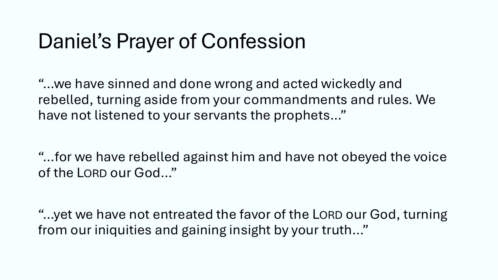
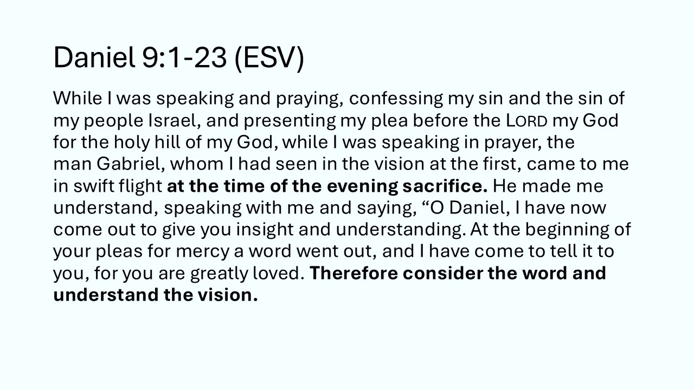
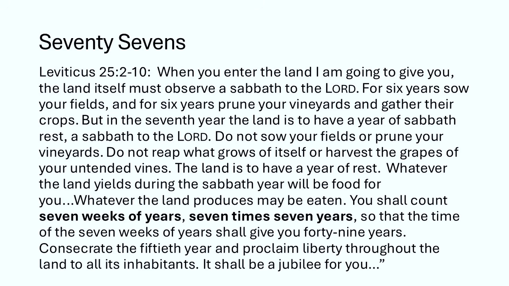
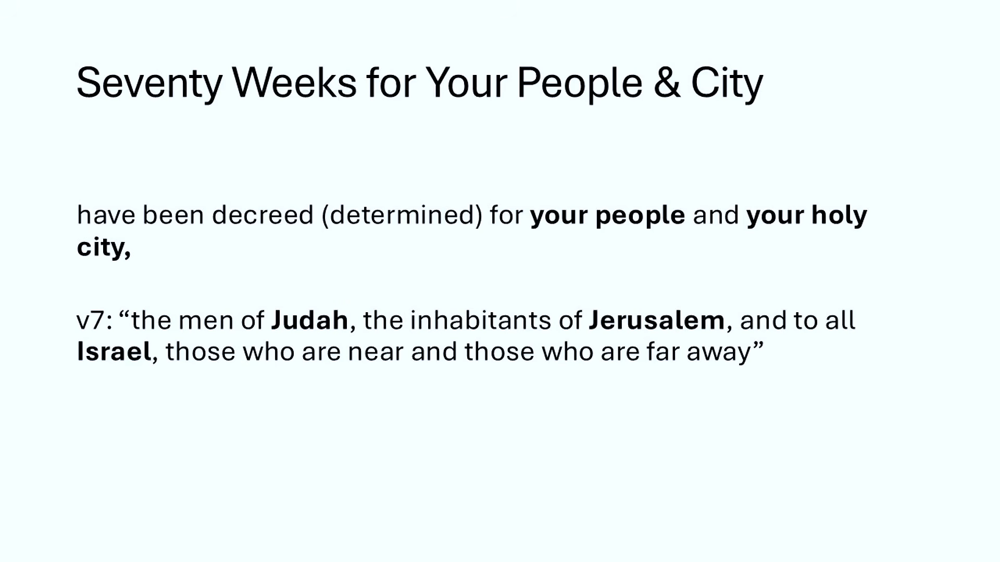
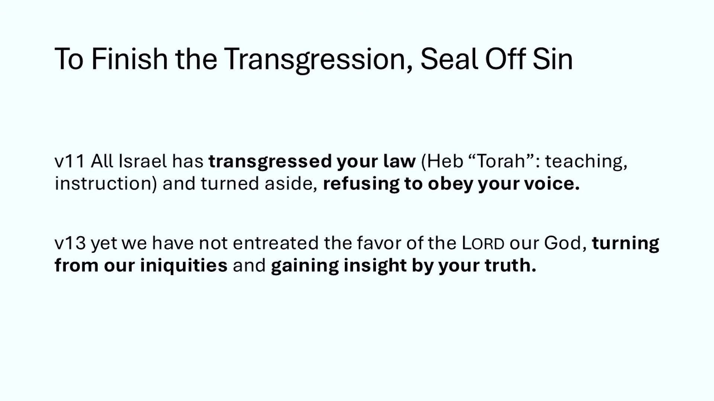
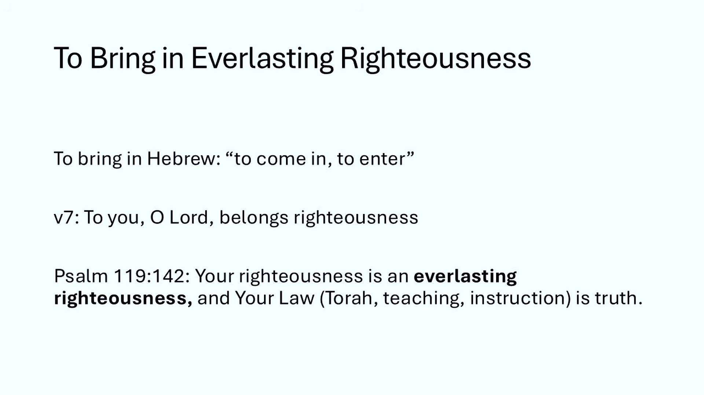
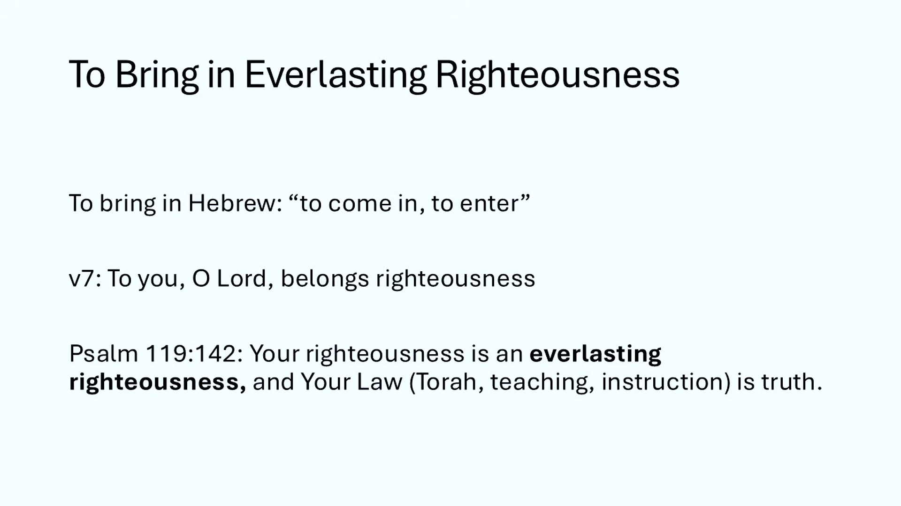
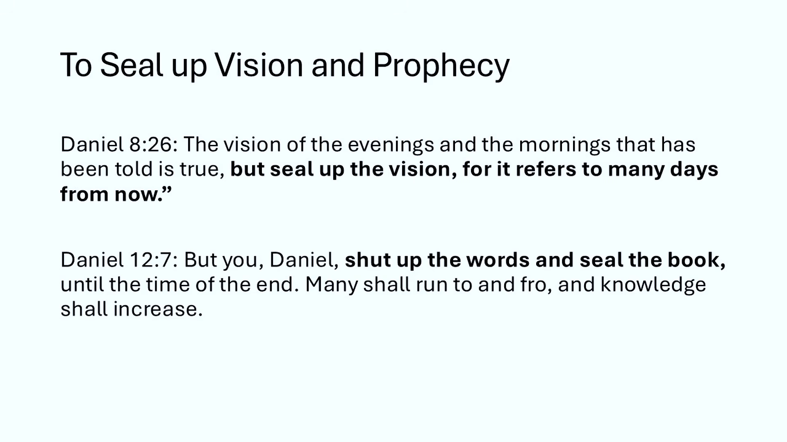
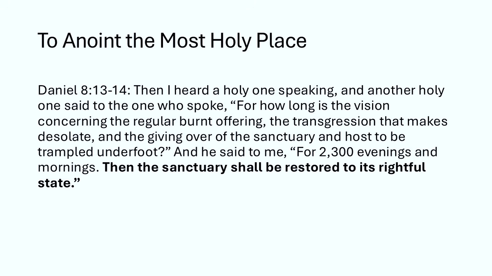

### The 70 Weeks Prophecy and Israel

- The question of whether the 70 weeks prophecy is fulfilled depends on the status of Israel
    - If the subject is Jerusalem and its Jewish inhabitants, the fulfillment is tied to their actions
- The fulfillment hinges on Israel's transgression and sin
    - This sin is defined as refusing to obey the voice of God and refusing to listen to sent prophets and apostles
    - If this refusal to listen continues to the present day, the prophecy is not yet fully complete

### New Study Series Announcement

- A new study series is beginning
    - This serves as a companion series to a recent documentary

### New Study Series: Daniel's Prophecies

- Focus on exploring prophecies in the latter half of the Book of Daniel
    - The first three sessions will walk through Daniel chapter 9
- **[Goal]** To create "evergreen" studies through reading and exegesis
    - Rather than providing speculative answers to current events, the focus is on studying the passages directly
- Context for the series:
    - Recent tensions/conflict between the United States, Israel, and Iran have led to many questions regarding Daniel 9
    - Specifically, questions about whether we are on the cusp of Daniel's 70th week

### Study Plan for Daniel 9

- **Session Breakdown**
    - First session: Daniel 9:1-24 (covering the first verse of the 70 weeks prophecy)
    - Second session: Daniel 9:25-27 (to complete the prophecy)
    - Dedicated session: Chronology and calculating the timing of the 70 weeks
- **Approach to Chronology**
    - The goal is to examine the language of the passage first
    - Calculating timing is considered important, though not the primary focus of the study
    - Historical viewpoints to be explored include:
        - Preterists
        - Futurists
        - Premillennialists
        - Amillennialists

### Daniel 9:1-23

- **[Core Focus]** Avoid getting lost in the "prophecy geeky" details of timing and chronology
    - The primary purpose is to understand the bigger picture and the message God intended for Daniel to know and understand through the angel Gabriel
- Reading Approach
    - Initial reading will be from the ESV (English Standard Version)
    - The version will be switched halfway through the chapter

### Daniel 9:1-23 (ESV)

[00:06:07](https://www.youtube.com/watch?v=_fhRe-5HqGY&list=PLU8vICW5zFGo&index=2&t=367s)

- **Historical Context**
    - Takes place in the first year of Darius the son of Ahasuerus
    - Darius was a Mede made king over the realm of the Chaldeans
- **The Catalyst for Daniel's Prayer**
    - Daniel perceived in the books the number of years that must pass before the end of the desolations of Jerusalem
    - This period was determined by the word of the Lord to the prophet Jeremiah
    - The duration specified was 70 years
- **Daniel's Response**
    - He turned his face to the Lord God, seeking Him through prayer, fasting, sackcloth, and ashes
    - He offered a prayer of confession, acknowledging that the people had sinned, acted wickedly, rebelled, and turned aside from God's commandments
    - A key part of this confession was the admission that they had not listened to God's servants, the prophets, who spoke in His name

### Daniel 9:1-23 (ESV) - Continued

- **The Contrast of Character**
    - To the Lord belongs righteousness
    - To the people (Judah, Jerusalem, and all Israel) belongs "open shame"
        - This shame extends to those near and far
        - It includes all the lands to which they were driven due to their treachery
- **The Nature of the Rebellion**
    - The shame belongs to the kings, princes, fathers, and all the people
    - **[Why the shame?]** Because they sinned against God and failed to obey His voice by not walking in the ways He set before them through His servants, the prophets
    - All Israel transgressed the law and turned aside, refusing to obey God's voice
- **The Fulfillment of Divine Judgment**
    - The curse and oath written in the Law of Moses have been poured out upon the people
    - God confirmed His words spoken against the people and their rulers by bringing a "great calamity"
        - The text notes that nothing under the whole heaven has been done like what was done against Jerusalem
        - This calamity is a direct result of their sin and the refusal to entreat the favor of the Lord or gain insight by His truth

### Daniel's Prayer of Confession and Petition

- **The Cause of the Calamity**
    - The calamity brought upon Jerusalem and its rulers was a confirmation of God's words
    - This occurred because the people had not entreated the favor of the LORD by turning from their iniquities or gaining insight through His truth
    - The judgment is framed as righteous because "the LORD our God is righteous in all the works he has done"
- **The Nature of the Sin**
    - Daniel acknowledges that they have "done wickedly"
    - He notes that Jerusalem and its people have become a "byword" (a subject of ridicule or a cautionary tale) among all those surrounding them
    - This shame is attributed to both their own sins and the "iniquities of our fathers"
- **The Plea for Mercy**
    - Daniel petitions God to listen to the prayers of His servants and to show mercy
    - He asks God to make His face shine upon the sanctuary, which currently lies desolate
    - **[Key Principle]** The basis of the plea is not merit:
        - Daniel explicitly states: "For we do not present our pleas before you because of our righteousness, but because of your great mercy."
- **The Basis of Daniel's Plea**
    - Daniel appeals to God's righteousness rather than his own
        - He asks God to act "according to all your righteous acts"
        - He acknowledges that the pleas are not based on human righteousness, but on God's "great mercy"
- **Daniel's Historical Context**
    - Daniel is an elderly man living in Babylon
        - He was likely in his 70s or 80s at the time of this prayer
        - He had been in Babylon since the first invasion of Israel, approximately 70 years earlier
    - **The Source of His Urgency**
        - His prayer was triggered by his daily devotional reading of the scroll of Jeremiah
        - Through this study, he realized that the time for Jeremiah's prophecy was drawing near

### The Climactic End of Daniel's Prayer

- The prayer reaches an intense, emotional peak as Daniel pleads for God's intervention
    - "Oh Lord hear, Oh Lord forgive, Oh Lord pay attention and act, delay not for your own sake, O my God, because your city and your people are called by your name."
- **[Contextual Motivation]** Daniel's urgency stems from his realization that the period of God's chastisement of Israel is coming to a close

### Daniel's Life and the Babylonian Invasions

- Daniel served as a high-ranking official (captain) in Babylon through various regime changes
    - He served under the Kings of Babylon
    - He continued his service after the empire transitioned to Persia
- **The Progression of Invasions**
    - Daniel witnessed the successive waves of Babylonian invasions into the promised land
    - These invasions resulted in increasing numbers of captives being taken to Babylon
    - The process culminated in the final invasion, which saw the destruction of the city and the Temple
- **The Resulting Desolation**
    - The destruction led to the state described in Daniel's prayer: the sanctuary being left desolate

### Characteristics of Daniel's Intercession

- **Standing in the Gap**
    - Daniel is not merely praying for his own needs
    - He is interceding on behalf of the entire nation of Israel
    - He confesses the collective sins of the people, even those he was not personally guilty of
- **A Humble Approach**
    - He does not approach God with entitlement or demands
    - Instead, he appeals to:
        - God's mercy
        - God's covenantal faithfulness to Israel
- **Specific Confessions of Rebellion**
    - Daniel moves from general confession to specific descriptions of Israel's disobedience

[00:12:16](https://www.youtube.com/watch?v=_fhRe-5HqGY&list=PLU8vICW5zFGo&index=2&t=736s)

    - The people have:
        - Sinned, done wrong, and acted wickedly
        - Rebelled by turning aside from God's commandments and rules
        - Refused to listen to God's servants, the prophets

### The Nature of Israel's Rebellion

- **Disregard for Divine Communication**
    - Israel's specific sin involved not listening to the voice of God when He sent prophets to correct them
    - They ignored the prophets and failed to gain insight from God's truth
    - This was not a one-time occurrence, but a repeated pattern of ignoring God's loving appeals and warnings
- **[The Core Issue]** The rebellion was characterized by a willful refusal to hear and obey the word of God despite constant divine pursuit

### Appeals to God's Character

- **God's Righteousness**
    - Daniel repeatedly appeals to the fact that righteousness belongs to God
    - This appeal to God's inherent nature serves as a foundation for the upcoming discussion on the 70 weeks prophecy

### Contextualizing the 70 Weeks Prophecy

- To grasp the prophecy, one must look beyond the specific verses of the prayer to understand the underlying definitions
    - **What kind of sin?** Understanding the specific nature of the sin and iniquity being confessed is crucial
    - **Whose righteousness?** Daniel is not proclaiming human righteousness, but the righteousness that belongs to God and is given to people
- **The Identity of the People**
    - Daniel's prayer repeatedly references the specific groups involved:
            - The men of Judah
            - The inhabitants of Jerusalem
            - All Israel (both those near and those far away)
- **The Divine Connection**
    - Daniel concludes by noting that God's city and His people are "called by [His] name"
    - This connection between God's name and His people is a vital component of the upcoming prophecy

### The Arrival of Gabriel

[00:15:58](https://www.youtube.com/watch?v=_fhRe-5HqGY&list=PLU8vICW5zFGo&index=2&t=958s)

> While I was speaking and praying, confessing my sin and the sin of my people Israel, and presenting my plea before the LORD my God for the holy hill of my God, while I was speaking in prayer, the man Gabriel, whom I had seen in the vision at the first, came to me in swift flight **at the time of the evening sacrifice**. He made me understand, speaking with me and saying, "O Daniel, I have now come out to give you insight and understanding. At the beginning of your pleas for mercy a word went out, and I have come to tell it to you, for you are greatly loved. **Therefore consider the word and understand the vision.**"

### The Appearance of Gabriel

[00:16:11](https://www.youtube.com/watch?v=_fhRe-5HqGY&list=PLU8vICW5zFGo&index=2&t=971s)

- **Gabriel's Arrival**
    - The angel Gabriel comes to Daniel in "swift flight"
    - This occurs while Daniel is in the middle of speaking and praying his plea for mercy
- **The Purpose of the Visit**
    - Gabriel comes to provide Daniel with "insight and understanding"
    - He emphasizes Daniel's value, telling him, "for you are greatly loved"
    - The command is given to "consider the word and understand the vision"
- **[Significance of Timing] The Evening Sacrifice**
    - Gabriel's arrival coincides with the time of the evening sacrifice
    - This was part of the perpetual or ongoing daily sacrifice system
    - **The Daily Ritual:**
        - One unblemished, one-year-old lamb in its prime was slaughtered in the morning
        - A second lamb was slaughtered in the evening
        - Both were offered on the altar as a whole burnt offering every single day

### The Role of Sacrifices in Prophetic Chronology

- The daily sacrifices (morning and evening) act as a recurring theme throughout the latter half of Daniel (chapters 8-12)
- **[Why they matter]** They serve as a vital temporal marker used to calculate:
    - Beginnings
    - Endings
    - Restorations
- **Connection to Major Events**
    - These sacrifices are specifically linked to the "abomination of desolations"
    - This event marks the beginning of a period known as "Jacob's trouble," which is addressed later in Daniel chapter 12

### The Mandate for Understanding

- Gabriel twice emphasizes the necessity for Daniel to achieve "insight and understanding"
- Daniel is commanded to "consider the word" and actively "understand the vision" being received from God

### Approach to Prophetic Study

- **Avoiding "Hyper-Accuracy"**
    - There is a temptation in prophecy study to try and map out every "jot and tittle" to an extreme degree
    - **[Current Status]** We are not yet at a point where every aspect of these prophecies can be perfectly mapped out
- **The Progressive Nature of Knowledge**
    - Understanding increases as each generation builds upon the study of the previous one
    - **The Concept of "Unsealing"**
        - The prophecies in the book of Daniel are not yet fully "unsealed"
        - The full unsealing of the prophecy is a topic that will be addressed later in the study

### Finding the Middle Ground in Prophetic Study

- **Avoiding Extremes**
    - **The Trap of Total Certainty**
        - Some teachers claim to have every detail of Daniel's prophecies perfectly figured out
        - **[Warning]** Such claims should be met with skepticism
    - **The Trap of Dismissive Ambiguity**
        - Some suggest the language is merely flowery or allegorical and therefore impossible to understand
        - **[Consequence]** This attitude leads to not reading or considering these portions of Scripture at all
- **The Mandate for Active Engagement**
    - The goal is to "consider and understand" to the best of one's ability
    - Prophecy is not meant to be a mystery that is ignored, but a truth that requires diligent study

### Daniel 9:24-27 (NASB)

[00:22:25](https://www.youtube.com/watch?v=_fhRe-5HqGY&list=PLU8vICW5zFGo&index=2&t=1345s)

- **The Six Purposes of the Seventy Weeks**
    - To finish the transgression
    - To make an end of sin
    - To make atonement for iniquity
    - To bring in everlasting righteousness
    - To seal up vision and prophecy
    - To anoint the most holy place
- **The Prophetic Timeline**
    - **Starting Point**: The issuing of a decree to restore and rebuild Jerusalem
    - **Sequence**:
        - Seven weeks
        - Followed by sixty-two weeks
    - **Jerusalem's Reconstruction**: It will be built again with plaza and moat, even in times of distress
- **The Messiah and the Destruction**
    - **The Messiah's Fate**: After the sixty-two weeks, the Messiah will be "cut off and have nothing"
    - **The Destruction**: The people of the prince who is to come will destroy the city and the sanctuary
    - **The End State**: The end will come with a flood, and even to the end there will be war; desolations are determined

### Deep Dive into Daniel 9:24

- **The Foundation of the Prophecy**
    - Verse 24 is considered critical because it establishes two key elements:
        - **The specific timeframe**: 70 weeks (literally "seventy sevens" in Hebrew).
        - **The conditions for fulfillment**: The verse outlines six specific clauses/purposes that must be accomplished.
- **The Six Clauses of Fulfillment**
    - To finish the transgression
    - To make an end of sin
    - To make atonement for iniquity
    - To bring in everlasting righteousness
    - To seal up vision and prophecy
    - To anoint the most holy place

### The Ordained Seventy Sevens

[00:23:45](https://www.youtube.com/watch?v=_fhRe-5HqGY&list=PLU8vICW5zFGo&index=2&t=1425s)

- **[Definition]** The term "decreed" can be understood as "ordained"
- **[The Scope]** These seventy sevens (literally "77s") are ordained specifically for:
    - The people of Israel
    - The holy city of Jerusalem
- **[The Requirement for Completion]** The 70th week is not considered finished until all six conditions are met:

    1. To finish the transgression
    2. To make an end of sin
    3. To make atonement for iniquity
    4. To bring in everlasting righteousness
    5. To seal up vision and prophecy
    6. To anoint the most holy place

### The Nature of the Decree

- **[Divine Determination]** The prophecy is not a set of commands given to Israel to fulfill
    - It is not as if God said, "You have 70 weeks to get these things done"
    - Instead, these seventy sevens are "decreed" or "determined" by God for His people and His holy city
- **[The Scope of Action]** The prophecy encompasses both historical and future divine actions
    - It concerns not just what God *has done* for Israel
    - But also what God *will do* in Israel
- **[Theological Perspectives]** There are differing views on the fulfillment of this passage
    - Some perspectives view the entire prophecy as already fulfilled through the death, resurrection, and ascension of Jesus in the first century

### Interpreting the Seventy Sevens

- **[The Question]** What is the actual unit of time being described by "seventy sevens"?
    - It could be interpreted as hours, days, months, years, centuries, or another indeterminate amount of time.
- **[Biblical Foundation]** Understanding prophecy requires looking at the foundation of all scripture: the Torah (the books of Moses).
- **[The Precedent of Sabbath Years]** Leviticus 25 provides a scriptural basis for the concept of "weeks of years" through agricultural laws:
    - **Sabbath Year Cycle**: For six years, fields are sown and vineyards are pruned.
    - **The Seventh Year**: The land must observe a Sabbath to the LORD, having a year of rest where no sowing or reaping occurs.
    - **Calculating the Cycle**: The text establishes a pattern of counting "seven weeks of years, seven times seven years," which results in a forty-nine-year period.

[00:27:26](https://www.youtube.com/watch?v=_fhRe-5HqGY&list=PLU8vICW5zFGo&index=2&t=1646s)

### Linguistic Parallels to Daniel

- **[Direct Connection]** There is a direct linguistic parallel between the agricultural laws in Leviticus and the prophecy in Daniel.
- **[Shared Terminology]** Both passages utilize the specific phrase "seven sevens" to define their respective cycles, establishing a biblical pattern for calculating prophetic time through "weeks of years."

### The Sabbath Year and Jubilee Cycles

- **[The Mathematical Pattern]** Following the Leviticus 25 model, the cycle functions as follows:
    - Seven cycles of seven years ($7 \\times 7$) equals 49 years
    - The 50th year is the **Jubilee**
- **[The Purpose of Jubilee]** A year of release and restoration where:
    - Land is reapportioned back to its original owners/clans
    - It serves as a divine reset for the people and the land
- **[Connection to Daniel]** The "seventy sevens" in Daniel can be interpreted as a "mega jubilee"
    - This represents a 490-year period
    - It functions as a millennial jubilee for Israel's calendar and restoration

### To Finish the Transgression, Seal Off Sin

[00:30:01](https://www.youtube.com/watch?v=_fhRe-5HqGY&list=PLU8vICW5zFGo&index=2&t=1801s)

- **[The Recipients of the Decree]** The seventy sevens are determined for:
    - The people of Judah
    - The inhabitants of Jerusalem
    - All Israel (both those near and those far away)
- **[Defining the Transgression]** Daniel identifies that all Israel has transgressed God's law.
    - The Hebrew word for "law" used here is \*Torah\`.
    - **[Meaning of Torah]** It encompasses more than just legal codes; it refers to divine teaching and instruction.
    - Transgression occurred because they turned aside and refused to obey God's voice/instruction.
- **[The Plea for Insight]** Daniel petitions for the Lord to turn from their iniquities and for the people to gain insight through God's truth.

[00:30:26](https://www.youtube.com/watch?v=_fhRe-5HqGY&list=PLU8vICW5zFGo&index=2&t=1826s)

### Evaluating Prophetic Fulfillment

- **[The Core Question]** To determine if the seventy sevens are complete, one must ask: "Do we see these things fulfilled in Israel yet?"
- **[The Basis for Inquiry]** This question is valid because:
    - The prophecy's subject is explicitly defined as Israel and the city of Jerusalem (with its Jewish inhabitants).
    - The seventy sevens are specifically decreed, determined, or ordained for these subjects.
- **[The Logic of Completion]**
    - If the events described in the clauses have been fulfilled $\rightarrow$ The seventy sevens are complete.
    - If the events have not been fulfilled $\rightarrow$ The seventy sevens are not fully complete.
- **[Example of Ongoing Fulfillment]**
    - If Israel's transgression is defined as refusing to obey the voice of God or refusing to listen to His prophets and apostles...
    - ...and if that sin continues to this day, then the prophecy is not yet fulfilled.

### Evaluating Corporate Fulfillment of Insight

- **[The Test of Corporate Fulfillment]** To satisfy the clause of gaining insight through God's truth, the fulfillment must be corporate to the nation of Israel.
    - **[The Current Reality]** While there is a remnant of approximately 100,000 to 200,000 Jewish followers of Yeshua within a population of roughly 14 million...
    - ...this does not constitute a corporate fulfillment for the nation as a whole.
    - **[Conclusion]** Because this corporate insight has not been realized, the prophecy is not yet fully fulfilled.

### Make Atonement for Iniquity

- **[Initial Observation]** At first glance, this clause might seem easily satisfied by the work of Jesus on the cross.
    - **[The Complexity]** The speaker suggests that simply checking this off based on individual atonement may overlook the specific prophetic context required for the seventy weeks.

### Distinguishing Atonement in Prophetic Context

- **[Universal vs. Specific Atonement]** While Jesus' work on the cross provides atonement for the sins of both Jews and Gentiles (rejecting dual-covenant theology), the prophecy in Daniel focuses on a different aspect:
    - It is not just about what God has done *for* Israel.
    - It is about what God is doing *in* Israel and what He will accomplish *through* Israel by the end of the seventy weeks.
- **[Linguistic Nuance]** The word "atonement" is used in various senses throughout the Hebrew Bible. For example, Isaiah 27:8-13 (part of what is often called "Isaiah's little apocalypse" in chapters 24-27) provides an important eschatological context for how atonement is discussed.

### Atonement in Isaiah's "Little Apocalypse"

- **[Isaiah 27:8-13 Context]** This passage is part of a larger eschatological section (Isaiah 24-27) that describes God's interaction with Israel.
    - **[Judgment through Banishment]** God contends with Israel by banishing them, driving them away with a "fierce wind" or "east wind."
    - **[The Link to Atonement]** Through this process of expulsion and judgment, Jacob's iniquity will be forgiven (atoned/`kaphar`).
    - **[Restoration and Gathering]** Following the period of judgment, a "great trumpet" will be blown, signaling the return of those scattered in Assyria and Egypt to worship the Lord in Jerusalem.

[00:35:15](https://www.youtube.com/watch?v=_fhRe-5HqGY&list=PLU8vICW5zFGo&index=2&t=2115s)

- **[Key Prophetic Elements]**
        - The "full price" of pardoning sin involves the transformation of altar stones into "pulverized chalk stones."
        - The restoration includes the gathering of those perishing in the land of Assyria and those scattered in Egypt.

### New Testament Parallels to Isaiah's Eschatology

- **[The Scattering and Regathering Motif]** The eschatological language used in Isaiah 27—specifically the cycle of Israel being scattered and subsequently regathered—serves as a prophetic template.
    - **[NT Application]** This specific pattern of dispersion and return is echoed repeatedly throughout the New Testament in reference to the return of Jesus.
    - **[Theological Significance]** The process of atonement in this context is not merely an individual event but is tied to the national restoration of Israel, where the destruction of false worship (the "pulverized chalk stones") coincides with the regathering of the people at the sound of a great trumpet.

### The Manifestation of National Atonement for Israel

- **[The Foundation of All Grace]** The atonement provided by Jesus through His death on the cross is the source of all mercy and grace available to humanity.
    - This applies to everyone: believers, unbelievers, and those receiving either common or special grace.
    - Without this foundational atonement, no mercy or grace from a holy and righteous God would be possible.
- **[National Atonement for Israel]** While Jesus' atonement is universal, there is a specific dimension of atonement concerning the nation of Israel.
    - This national atonement is not just a legal status but is something that must be *manifestly realized*.
    - **[The Condition of Realization]** For Israel, this atonement is seen when they:
        - Destroy their idols
        - Abandon false worship
        - Return to worshipping Yahweh exclusively

### To Bring in Everlasting Righteousness

[00:39:23](https://www.youtube.com/watch?v=_fhRe-5HqGY&list=PLU8vICW5zFGo&index=2&t=2363s)

- **[Linguistic Nuance]** In the context of Daniel 9:7, the Hebrew phrase for "to bring in" carries a deeper meaning:
    - It is most commonly translated in the Hebrew Bible as "to come in" or "to enter."
    - Therefore, a more precise translation might be "to enter into everlasting righteousness."
- **[Biblical Connection]** This concept of everlasting righteousness is reinforced by other scriptures, such as Psalm 119:142:
    - "Your righteousness is an everlasting righteousness, and Your Law (Torah, teaching, instruction) is truth."

### Entering into Everlasting Righteousness

[00:40:01](https://www.youtube.com/watch?v=_fhRe-5HqGY&list=PLU8vICW5zFGo&index=2&t=2401s)

- **[Linguistic Nuance]** The Hebrew phrase used for "to bring in" is more accurately understood as "to come in" or "to enter."
    - This suggests a movement of people *entering into* a state of righteousness that already exists.
- **[The Source of Righteousness]** Righteousness is an attribute belonging to God, not a human achievement.
    - **[Psalm 119:142 Connection]** This mirrors Psalm 119:142: "Your righteousness is an everlasting righteousness, and Your Law (Torah, teaching, instruction) is truth."
    - The "everlasting" nature refers to the eternal character of God's righteousness.
- **[The Danger of Self-Righteousness]** Attempting to establish righteousness through human effort is a departure from God's truth.
    - **[Romans 10 Context]** The speaker notes that the Jewish people have zeal for God, but it is not "according to righteousness" because they have sought to establish their own through works rather than the righteousness available through Messiah.
    - **[Philippians Connection]** This aligns with the call in Philippians to pursue the "fruit of righteousness that comes through Jesus."

### Corporate vs. Individual Righteousness

- **[The Distinction]** While righteousness has been provided for Israel through the death, burial, resurrection, and session of Yeshua, it has not yet been corporately effected within the nation.
    - The provision is complete, but the national application/effect is not yet realized.

### To Seal up Vision and Prophecy

[00:41:57](https://www.youtube.com/watch?v=_fhRe-5HqGY&list=PLU8vICW5zFGo&index=2&t=2517s)

- **[Definition]** "Sealing up" refers to the instruction to keep certain words or visions closed or hidden until a specific future time.
- **[Biblical Examples]**
    - **Daniel 8:26**: "The vision of the evenings and the mornings that has been told is true, but seal up the vision, for it refers to many days from now."
    - **Daniel 12:7**: "But you, Daniel, shut up the words and seal the book, until the time of the end. Many shall run to and fro, and knowledge shall increase."

### The Concept of Sealing Prophecy

In the ancient world, 'sealing' a document served several critical functions that help explain why certain prophecies are described as being 'sealed up':

- **Authentication**
    - A seal (such as a signet ring) stamped by a king, noble, or businessman proved the message was authentic.
    - It verified that the message truly originated from the stated authority.
- **Preservation and Secrecy**
    - Sealing indicated that a document had not yet been opened or read.
    - This ensured the message remained unaltered and secret, protected from being read by others before the appointed time.

**[Application to Prophecy]**

This concept is seen in Daniel 12:7, where God commands the sealing of words until a specific future era:

> "...shut up the words and seal the book until the time of the end; many shall run to and fro, and knowledge shall increase."

### The Unsealing of the Prophecy

- **[The Unsealed Scroll]** Even as knowledge and understanding of Daniel's prophecies increase, the 'scroll' is not fully opened until the time of the end.
    - Full understanding is withheld because not all described events have come to pass.
- **[The Role of Resurrection]** The timing of the prophecy is linked to specific events like the resurrection of the dead.
    - Daniel 12 describes a resurrection that has not yet occurred in the form of a mass, general bodily resurrection of the saints.
    - Until these end-of-the-age events unfold, the prophecy remains partially sealed.

### To Anoint the Most Holy Place

- This final clause of Daniel 9:24 is frequently interpreted as being in reference to Christ himself.

### To Anoint the Most Holy Place

[00:45:43](https://www.youtube.com/watch?v=_fhRe-5HqGY&list=PLU8vICW5zFGo&index=2&t=2743s)

- **[Interpretation]** This clause is often interpreted as referring to the establishment of the church as the new temple and the holy place.
    - The anointing of God's new temple is seen through the sequence of Christ's death, resurrection, and ascension.
    - The outpouring of the Holy Spirit at Pentecost serves as the definitive anointing of this new temple.
- **[Hebrews 9 Connection]** Hebrews 9 provides a theological framework for this transition from physical to spiritual sanctuary:
    - Under the old law, blood was sprinkled on the book, the people, the tent, and the vessels to establish the covenant.
    - In contrast, Christ has entered "not into holy places made with hands... but into heaven itself" to appear in the presence of God on our behalf.

> "...For Christ has entered, not into holy places made with hands, which are copies of the true things, but into heaven itself, now to appear in the presence of God on our behalf."

### The Heavenly Anointing

- **[The Connection to Christ]** The "anointing of the most holy place" is understood as Christ's entry into the heavenly temple.
    - Upon His ascension, Jesus entered the heavenly sanctuary.
    - In doing so, He "anointed" that heavenly temple with His blood.
- **[Parallel to Moses]** This act mirrors the ritual performed by Moses in the earthly Tabernacle.
    - In Exodus 24, Moses anointed the earthly copy (the tabernacle) to establish the covenant.
    - Christ's action fulfills this by anointing the true, heavenly sanctuary.

### Nuances in the Covenant Ritual

While the book of Hebrews describes the sprinkling of blood, there is a distinction between the biblical text and later tradition:

- **Biblical Account (Exodus 24)**
    - The text states that the blood was used to sprinkle the book (the Torah) and the people (likely represented by twelve pillars of stone).
    - It does *not* explicitly state that Moses anointed the tent, the tabernacle, or the vessels themselves with blood.
- **Jewish Tradition**
    - The idea that the tent and vessels were sprinkled with blood is a tradition that the Apostle Paul appears to employ in his writings, even if it is not explicitly detailed in the Exodus narrative.

### Oil vs. Blood in the Anointing

- **[Ritual Distinction]** There is a distinction between the blood used in covenant ceremonies and the oil used for consecration.
    - Hebrews 9 focuses on the sprinkling of blood to establish the covenant.
    - Exodus 40:9 specifies the use of anointing oil for the tabernacle and its contents.

[00:47:55](https://www.youtube.com/watch?v=_fhRe-5HqGY&list=PLU8vICW5zFGo&index=2&t=2875s)

> "Then you shall take the anointing oil and anoint the tabernacle and all that is in it, and consecrate it and all its furniture, so that it may become holy."
> — Exodus 40:9

- **[Linguistic Note]** The Hebrew term for anoint is *mashach*, which shares the same root as *Mashiach* (Messiah).

### Hebrews 6:19 and the Inner Place

- The speaker introduces the concept of a "hope that enters into the inner place behind the curtain."
    - This refers to the heavenly sanctuary where Jesus has entered as a forerunner on our behalf.

### Distinction Between Anointing and Atonement

While the term 'anointing' is used in various contexts, the speaker distinguishes between the ritual of oil and the ritual of blood:

- **The Ritual of Blood (Atonement)**
    - The author of Hebrews describes Jesus' work in the heavenly temple as entering behind the curtain to the Holy of Holies.
    - This is a parallel to **Yom Kippur** (the Day of Atonement), where the high priest would sprinkle blood on the mercy seat.
    - Jesus acts as a "forerunner" by performing this act in the heavenly sanctuary on our behalf.
- **The Ritual of Oil (Consecration)**
    - In the context of Daniel 9:24, "anointing the most holy place" refers to the traditional anointing of the temple with oil.
    - This is distinct from the sprinkling of blood used for atonement; oil is used to consecrate the sanctuary and its furniture.

---

### Conditions for Anointing the Sanctuary

- To fulfill the prophecy of "anointing the most holy place," the sanctuary must exist in one of two states:
    - It is currently defiled (e.g., by an abomination) and needs restoration.
    - It is currently in a state that requires being anointed again.
- **[Current Status]** The speaker notes that we have not yet seen the end of the seventy weeks in history because we have not seen the definitive defilement or restoration of the land/sanctuary.

### Parallel Prophecy: Daniel 8:13-14

[00:50:49](https://www.youtube.com/watch?v=_fhRe-5HqGY&list=PLU8vICW5zFGo&index=2&t=3049s)

- The speaker points to Daniel 8 as an example of a vision concerning the sanctuary's status:
    - The vision involves the regular burnt offering and a transgression that makes the sanctuary desolate.
    - This desolation involves the "abomination desolation" and the sanctuary/host being trampled underfoot.
- **[Timeline]** The prophecy specifies a duration of "2,300 evenings and mornings."
- **[Outcome]** The ultimate conclusion of this period is that "the sanctuary shall be restored to its rightful state."

### The Recurring Theme of Defilement and Restoration

- **[Narrative Pattern]** Within Daniel's narrative (chapters 7 through 12), a recurring theme is the temple being defiled by an abomination and subsequently being restored to its rightful state.
- **[Parallel in Daniel 8]** This pattern is seen in Daniel 8:13-14, where the sanctuary is defiled and then restored after a specific period.

[00:51:22](https://www.youtube.com/watch?v=_fhRe-5HqGY&list=PLU8vICW5zFGo&index=2&t=3082s)

> "Then I heard a holy one speaking, and another holy one said to the one who spoke, 'For how long is the vision concerning the regular burnt offering, the transgression that makes desolate, and the giving over of the sanctuary and host to be trampled underfoot?' And he said to me, 'For 2,300 evenings and mornings. Then the sanctuary shall be restored to its rightful state.'"
> — Daniel 8:13-14

- **[Comparison of Timeframes]**
    - In Daniel 8, the restoration occurs after 2,300 evenings and mornings.
    - In Daniel 9, the prophecy involves a different timeframe (the seventy sevens), but follows the same thematic structure of defilement and restoration.

### The Future Fulfillment of the 70th Week

- The events required to fulfill the 70th week must be accomplished specifically in and through Israel
    - Because these requirements have not yet been met, the final week is still in the future
- **[Looking Ahead]** Future sessions will explore potential indicators or signs that suggest we may be approaching or entering this final week