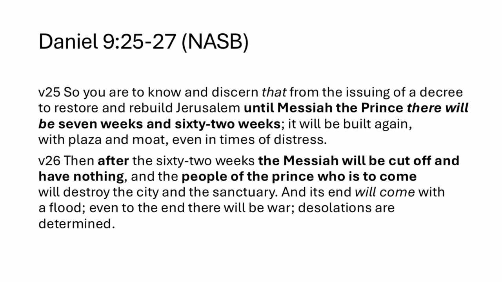
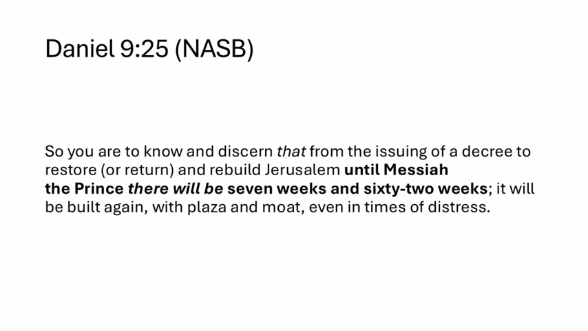
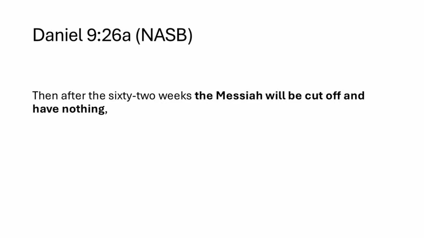
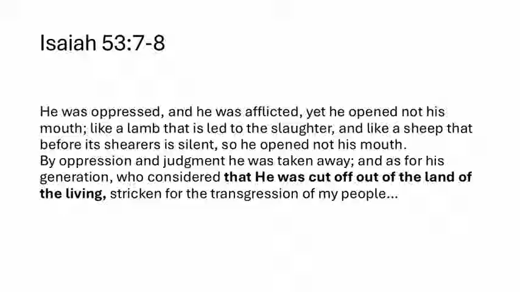
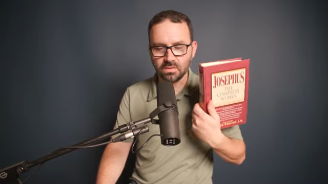
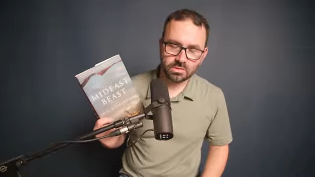

### Discerning the Signs of the Times

- The distinction between reading physical patterns and spiritual times
    - One might know how to read weather patterns (predicting a storm)
    - But one can still fail to read the 'times' or the 'time of visitation'
- Historical precedent: The first advent of Jesus
    - Many missed the signs of His first coming
    - Even His own disciples did not fully grasp the significance at the time
    - The speaker suggests that the timing could have been identified with precision if the signs had been correctly interpreted

### Daniel 9 Study Plan

- The upcoming study will focus on the 70 weeks prophecy in Daniel 9
- The study has been expanded from three sessions to four to allow for more thorough coverage
- **Session Breakdown**:
    - Sessions 1 and 2: Focused on a detailed examination of verses 25, 26, and 27
    - Session 4: Focused on the chronology and timing of the 70 weeks
        - Includes historical events
        - Covers beginnings, midpoints, milestone markers, and endings

### Context of Daniel's Prayer

- Daniel's situation in Babylon
    - He was an old man living in exile
    - He was aware of Jeremiah's prophecy that the Babylonian exile would last 70 years
- Daniel's intercession for Israel
    - He engaged in earnest prayer, repentance, and supplication on behalf of the nation
    - He acted as one "standing in the gap" for Israel
    - His prayers specifically addressed the people's failures, such as:
        - Not listening to the word of the Lord
        - Not accepting or receiving the truth of the Lord
        - Not following the prophets who delivered God's word
- The divine response
    - Even at the beginning of Daniel's prayer, the angel Gabriel was dispatched in the heavenly realms

### Parameters of the 70 Weeks Prophecy

- **The Prophetic Decree (Daniel 9:24)**
    - Verse 24 establishes the "who, what, and when" of the prophecy, serving as the essential guardrails or parameters for the entire timeline.
- **The Mathematical Span**
    - The prophecy covers 70 "weeks of years"
    - Calculation: $70 \\text{ weeks} \\times 7 \\text{ years/week} = 490 \\text{ years}$
    - Whether this span is entirely contiguous or interrupted is a topic for later discussion.
- **The Subjects of the Prophecy**
    - **The Who**: Daniel's people, specifically the people of Israel
    - **The What**: The decree concerns the holy city

### The Identity and Objectives of the 70 Weeks

- **The 'Who' of the Prophecy**
    - The subject is specifically the men of Judah, the people of Israel, and the Jewish inhabitants of Jerusalem
    - This excludes the church and Gentiles outside of the nation of Israel
- **The Six Objectives to be Accomplished**
    - For the 70 weeks to be complete, these six conditions must be met:

        1. To finish the transgression
        2. To make an end of sin
        3. To make atonement for iniquity
        4. To bring in everlasting righteousness
        5. To seal up vision and prophecy
        6. To anoint the most holy place

- **Current Status of the Prophecy**
    - The 70 weeks is not yet complete because none of these six conditions have been fulfilled in Israel yet

### Timeline of the 70 Weeks

- **Futurist Perspective**
    - The speaker agrees with most futurists that the 70th week is still in the future
    - This is because the mathematical span of 490 years does not align if the prophecy was completed in the first century
- **Disagreement with Preterist Views**
    - The speaker rejects the argument that the entire 70-week prophecy was fulfilled during the first century through the life, death, and resurrection of Jesus

### Key Prophetic Phrases and Upcoming Study

- **Focus Areas for Daniel 9:25-26**
    - The current study will prioritize the analysis of verses 25 and 26
- **Key Phrases to Watch**
    - "The firm covenant with many for one week" (or variations regarding the affirming of the covenant)
    - "The abomination that causes desolation" (a phrase used with variations throughout the book of Daniel)
    - These topics are slated for deeper exploration in the next session

### Analysis of Daniel 9:25-27 (NASB)

[00:07:29](https://www.youtube.com/watch?v=KGdFQr6-yWU&list=PLU8vICW5zFGo&index=2&t=449s)

- **The Purpose of the Prophecy (v25)**
    - Gabriel provides this information so that the recipient may "know and discern"
    - This knowledge is intended for both Daniel and future generations, specifically the Jewish people
- **The Timeline of Rebuilding (v25)**
    - The period begins from the issuing of a decree to restore and rebuild Jerusalem
    - This period lasts until "Messiah the Prince"
    - The span consists of seven weeks and sixty-two weeks
    - During this time, Jerusalem will be rebuilt with a plaza and a moat, even amidst times of distress
- **The End of the Messiah and the Destruction (v26)**
    - After the sixty-two weeks, the Messiah will be "cut off and have nothing"
    - Following this, the "people of the prince who is to come" will destroy both the city and the sanctuary
    - The end will arrive with a flood, characterized by war and determined desolations

### Purpose and Clarity of the Prophecy

- **The Goal of Divine Revelation**
    - The prophecy is intended to provide clarity, not confusion
    - The goal is for the recipient to "know and discern"
- **Historical Context**
    - The information pertains to people in the intertestamental period (the Second Temple period)
    - This period spans from the rebuilding of the temple after the exile until the beginning of John the Baptist's ministry
- **The Mathematical Timeline (v25)**
    - The timeline begins with the decree to restore and rebuild Jerusalem
    - It continues until the arrival of "Messiah the Prince"
    - The sequence includes:
        - Seven weeks (approximately 49 years)
        - Sixty-two weeks
        - Combined, these represent 69 weeks of the prophecy

### Mathematical Calculation of the 70 Weeks

- To convert the prophetic weeks into years, multiply the number of weeks by seven
    - 69 weeks $\times$ 7 = 483 years

### The Starting Point of the Prophecy

- **The Triggering Event**
        - The timeline begins with the issuing of a decree to restore and rebuild the city of Jerusalem
- **Nature of the Decree**
        - Decrees are typically issued by those in power, such as:
                - Kings
                - Nobles
                - Governors
- **Historical Context**
        - The decree follows the overthrow of the Babylonian empire by the Neo-Persians
        - This period involves Persian kings, such as Cyrus, who can be studied in the books of Ezra, Nehemiah, and Esther

### Candidates for the Decree

- The text does not specify which king issued the decree or the exact date
- Several Persian emperors and kings are potential candidates, including:
    - Darius the Great
    - Xerxes
    - Artaxerxes
- The decree's subject is the returning, restoring, and rebuilding of Jerusalem and its people

### Defining the Messiah

- The timeline continues until the arrival of "Messiah the Prince"
    - Hebrew term: *Mashiach Nagid*
    - Meaning: An anointed one

### The Concept of Anointing

- Throughout the Hebrew scriptures, many different types of individuals are described as "anointed"
    - High priests (e.g., Aaron)
    - Kings (e.g., David)
    - Prophets
    - Even pagan leaders, such as Cyrus the Great, the Persian King
- **Linguistic Note on "Messiah"**
    - The Hebrew scriptures do not use the phrase "the Messiah" with a definite article (\*HaMashiach")
    - The term used is simply *Mashiach*
- **Theological Development of the Messiah**
    - The concept of a specific, particular Messiah is built throughout the entirety of Scripture
    - It can be traced back to the beginning in Genesis 3 (the Protoevangelium)
        - The "seed of the woman" who would crush the head of the serpent

### The Evolution of Messianic Expectation

- **Prophetic Foundations**
    - The concept is woven throughout the prophetic narrative in several key books:
        - Isaiah (referring to a "branch")
        - Jeremiah
        - Ezekiel
        - Daniel (e.g., the "son of man" writing on the clouds)
- **Rabbinic and Jewish Theology by the First Century**
    - By the time of Jesus' birth, there was a well-established understanding of an "ultimate Messiah"
    - This was distinct from merely being an "anointed one"
- **Roles of the Ultimate Messiah**
    - He is expected to perform specific, definitive actions:
        - Deliver the people of God forever
        - Plant them in their covenant land permanently
        - Defeat all enemies
        - Rule over the nations within the kingdom of God

### The Rebuilding of Jerusalem

- **Scope of Reconstruction**
    - The prophecy mentions the rebuilding of the city with a plaza and a moat
    - This implies more than just religious structures like the Temple; it refers to the city's general infrastructure
- **Historical Parallels**
    - The process mirrors the events in the book of Nehemiah, where the city walls were rebuilt in approximately 50 days
- **Conditions of Rebuilding**
    - The reconstruction occurs under significant duress, characterized by:
        - Times of distress
        - Times of trouble
        - Intense opposition to the rebuilding efforts
- **Post-Reconstruction Hardship**
    - Even after the city was reconstructed and repopulated by exiles returning from Babylon, the Jewish people continued to experience significant distress leading up to the time of Jesus

### Historical Context of Jewish Suffering

- The Jewish people experienced significant distress under the Greek king Antiochus Epiphanes
    - This period is documented in the extra-biblical books of Maccabees
- The Hasmonean or Maccabean revolts
    - These revolts established an independent Jewish kingdom
    - This independence lasted until the kingdom was subsumed into the Roman Empire, a few decades before the birth of Jesus
- **State of Israel during this period**
    - Although the Jewish people had returned to the land and reestablished themselves
    - God had allowed them to rebuild the temple in the city, yet they lived in times of distress

### Analyzing the Daniel 9 Timeline

- **The Mathematical Division**
    - A key question arises regarding the division of the prophecy into 7 weeks and 62 weeks
    - This division occurs before the arrival of the Messiah, who appears after the total of 69 weeks (7 + 62)
- **Translation Nuances**
    - The choice of biblical translation affects how these verses are understood
    - The New American Standard Bible (NASB) and the English Standard Version (ESV) render certain parts of this passage differently

### Translation Differences in Daniel 9:25

Different English translations render the timeline of the 70 weeks differently, which impacts how the sequence of events is understood.

[00:17:44](https://www.youtube.com/watch?v=KGdFQr6-yWU&list=PLU8vICW5zFGo&index=2&t=1064s)

- **New American Standard Bible (NASB)**
    - Renders the verse as: "So you are to know and discern that from the issuing of a decree to restore (or return) and rebuild Jerusalem **until Messiah the Prince there will be seven weeks and sixty-two weeks**; it will be built again, with plaza and moat, even in times of distress."
    - This version links the 7 and 62 weeks directly to the period leading up to the Messiah.
- **English Standard Version (ESV)**
    - Follows modern rabbinic Jewish translations (like the JPS) in its phrasing.
    - Renders the verse as: "Know therefore and understand that from the going out of the word to restore and build Jerusalem **to the coming of an anointed one, a prince, there shall be seven weeks. And for sixty-two weeks it shall be built again** with squares and moat, but in a troubled time."
    - **[Key Distinction]** The ESV places a period after the seven weeks and before the 62 weeks, creating a structural break in the timeline that differs from the NASB.

### Implications of Translation on Messianic Figures

Depending on how the punctuation and wording of Daniel 9:25 are interpreted, the prophecy may describe two distinct anointed/messianic figures:

- **The Two-Figure Model**
    - **First Figure**: Appears after the initial 7 weeks (a 49-year period) following the decree.
    - **Second Figure**: Appears after the subsequent 62 weeks, totaling 69 weeks (483 years) from the decree.
- **Theological and Historical Challenges**
    - While the Hebrew scriptures contain multiple anointed figures, identifying specific historical candidates for these exact points in the timeline is difficult.
    - The difficulty is compounded by uncertainty regarding which specific Persian decree is being referenced as the starting point.

### Historical Leadership Post-Exile

Identifying a specific "anointed one" or "prince" (nagi) in the timeline following the decree to rebuild Jerusalem presents several historical challenges:

- **Absence of a Davidic Monarchy**
    - At this point in history, there was no Jewish king on the throne.
    - The term "prince" or "anointed one" would therefore need to be applied to a different type of leader.
- **The Role of the High Priest**
    - Following the return from Babylon, the Jewish people were primarily led by the high priest both religiously and politically.
    - While Persian governors were present in the region, they often allowed the high priests to govern the province of Judea with significant autonomy.
    - **[Note]** The high priests were often described as "heavy-handed" or "micromanagers" in their governance.

### Historical Case Study: Yonatan and Yeshua

To illustrate the difficulties of identifying specific leaders in the post-exilic period, the speaker highlights the story of the high priest Yonatan:

- **Lineage and Context**
    - Yonatan's lineage is documented in the books of Nehemiah and Ezra.
    - Nehemiah 12 specifically lists the lineage of the high priests who returned from the exile.
- **The Conflict with Yeshua**
    - According to historical sources such as Josephus, Yonatan had a brother named Yeshua.
    - The Persian governor was reportedly friendly with Yeshua and intended to appoint him as high priest instead of Yonatan.
    - This political tension escalated into a personal confrontation when Yeshua allegedly gloated toward his brother in the temple.
- **The Outcome**
    - The argument resulted in Yonatan killing Yeshua within the temple.
    - **[Irony]** The individual named Yeshua (a name meaning "salvation") was killed in the very place intended for religious service, highlighting the chaotic nature of leadership during this era.

### The Gap in the Daniel 9 Timeline

There is a notable temporal break between the 7 weeks (49 years) and the 62 weeks (434 years) in the prophecy. The speaker addresses why a specific "anointed one" might not be easily identifiable during this interval:

- **Lack of Distinct Messianic Figures**
    - It is difficult to "shoehorn" a specific messianic figure into the timeframe around 400 BC.
    - The leaders available during the Persian rule over Judah do not stand out as uniquely anointed by God compared to the high priests of that era.
- **The Context of Reconstruction**
    - The verse mentions the city being rebuilt with specific features, which provides a clue to the timeline.
    - **[Rebuilding Period]** The completion of these features likely occurred roughly 40 to 50 years after the initial decree was issued.
    - **Key Infrastructure Components:**
        - **Plaza:** Refers to a gathering place for the people.
        - **Moat:** A defensive structure surrounding the city walls.

### Interpretations of the 50-Year Rebuilding Period

- **Historical Uncertainty**
    - There is no direct historical evidence confirming that Jerusalem's infrastructure and repopulation were completed exactly 50 years after the decree.
    - The idea that the city was fully rebuilt within this timeframe is something that must be accepted on faith rather than through secular historical records.
- **The Completion of the Hebrew Canon**
    - An alternative interpretation suggests that the 'seven weeks' refers to the completion of the Old Testament (Hebrew) canon.
    - **[Context]** This view aligns with the belief that the era of prophecy ended with Malachi.
    - Most scholars place the end of the prophetic ministry in the generation following Nehemiah, around the end of the 5th century BCE.

### Daniel 9:26a and the Messianic Timeline

- **The Timing of the Messiah's Death**
    - Whether the verse is interpreted as occurring after the initial seven weeks or at the end of the 62 weeks, it does not fundamentally alter a futuristic theological interpretation.
    - There is still a messianic figure accounted for in verse 26 after the 69th week.
- **Translation Patterns**
    - Most Bible translations place the messianic figure at the end of the 62 weeks rather than after the first seven weeks.

[00:25:38](https://www.youtube.com/watch?v=KGdFQr6-yWU&list=PLU8vICW5zFGo&index=2&t=1538s)

### Chronology of the Messianic Timeline

- **Calculating the 483-Year Period**
    - The timeline follows 69 weeks (which equates to 483 years) from the initial decree.
    - **[Example Calculation]**
        - Assuming a starting point of approximately 450 BC for the decree.
        - 450 BC + 483 years $\approx$ AD 33.
- **Alignment with Historical Dates**
    - The calculated date of AD 33 is highly significant as it is one of the two primary dates proposed by historians and Bible scholars for the crucifixion and resurrection of Jesus.

### Historical Authenticity and Prophetic Alignment

- **Alignment of Timelines**
    - The 70-week prophecy, specifically the window beginning with the decree and leading through the 69 weeks, overlaps almost exactly with the timeframes of the crucifixion and resurrection of Jesus.
    - This alignment occurs within a margin of only a few years.
- **The Antiquity of the Book of Daniel**
    - **[Theological View]** Written by Daniel more than 500 years before the birth of Jesus.
    - **[Critical Scholar View]** Even if the book was written later than traditionally claimed, evidence from the Dead Sea Scrolls indicates the scroll of Daniel was completed prior to the birth of Jesus.
    - **[Implication]** Regardless of the specific authorship debate, the prophecy was established long before the events it describes took place.

### The Precision of the Daniel 9 Prophecy

- **Mathematical Alignment**
    - The 69-week timeframe (483 years) is highly specific.
    - This period brings the timeline directly to Jesus's final week in Jerusalem.
    - The speaker views this level of accuracy as evidence of divine inspiration that cannot be easily refuted.
- **Prophetic Language: "Being Cut Off"**
    - The text uses specific language: the Messiah will be "cut off" and "have nothing."
    - **[Key Observation]** This phrasing ("being cut off") is a significant motif that appears elsewhere in prophetic scriptures regarding a messianic figure.

### The "Cut Off" Motif in Isaiah 53

[00:29:59](https://www.youtube.com/watch?v=KGdFQr6-yWU&list=PLU8vICW5zFGo&index=2&t=1799s)

- **The Suffering Servant**
    - Isaiah 53 describes a servant who is oppressed, afflicted, and led to slaughter like a lamb.
    - This figure is characterized by silence in the face of oppression and wrongful judgment.
- **The Meaning of "Cut Off"**
    - The text states the servant was "cut off out of the land of the living."
    - **[Linguistic Nuance]** The specific Hebrew phrase used here is the same as that found in the Daniel 9 prophecy.
    - **[Key Distinction]** To be "cut off" implies more than just physical death;
        - It signifies being separated or removed from the people of Israel.

### Connecting the Messianic Threads

- **The Purpose of the Suffering Servant**
    - The servant in Isaiah 53 was "cut off from the land of the living" specifically for the transgression of God's covenant people (the Jewish people).
    - **[Theological Implication]** The servant took the "stroke" or judgment that was rightfully due to the nation.
- **Linguistic Connection: Isaiah to Daniel**
    - The speaker identifies a common language used to connect two distinct prophetic "dots":

        1. **Isaiah's Servant:** A figure who suffers on behalf of the nation and is "cut off from the land of the living."
        2. **Daniel's Messianic Figure:** A figure who, following the 483-year period from the decree to rebuild Jerusalem, is also "cut off."

    - This shared terminology suggests a unified messianic identity across different eras of prophecy.

### The Veiled Nature of the First Coming

- **Intentional Obscurity**
    - The details of Jesus's first coming (His sacrificial death, atoning death, and resurrection) were "veiled" from both men and angels.
    - **[Biblical Basis]** As Paul notes, if the "principalities and powers" had understood the true meaning of the crucifixion, they would not have carried it out.
- **Hidden in Plain Sight**
    - Although cryptic, the messianic plan is not missing; it is interconnected throughout the Scriptures.
    - **[The Prophetic Thread]** A cohesive narrative can be traced through several key stages:
        - **Genesis 3**: The initial prophecy to the serpent in the Garden.
        - **The Torah**: The words and laws established by Moses.
        - **The Prophets**: Specific declarations in books like Isaiah and Daniel.
    - This interconnectedness was a central theme in Jesus's own teaching to His disciples, religious leaders, and the travelers on the road to Emmaus.

### The Necessity of the First Advent

- **A Required Precursor**
    - The Messiah's death, resurrection, and ascension were necessary stages before He could return in glory to establish His kingdom.
    - This sequence was explicitly described and anticipated throughout the Hebrew Scriptures.
- **Hidden in Plain Sight**
    - The first coming was not a mystery in terms of its details; it was woven into prophecy with extreme precision.
        - It included not just the description of the Messiah being "cut off," but also the exact number of years until the event would occur.
- **The Failure to Recognize the Time**
    - Despite the clear prophetic indicators, the people missed the moment of their visitation.
    - **[Analogy]** Just as one can read the sky or weather patterns to predict a storm, the prophetic signs were present, yet the significance of the first advent was overlooked.

### The Necessity of Spiritual Alertness

- **Avoiding Historical Pitfalls**
    - Even those living during the first advent, including Jesus's own disciples, failed to fully grasp or recognize the timing of the messianic fulfillment.
    - **[The Warning]** Having more access to Scripture does not make a modern believer inherently wiser or more capable of recognizing the signs of the times.
- **Maintaining Watchfulness**
    - Jesus provided numerous warnings to ensure His followers would not miss His second visitation.
    - **[Required Disciplines]**
        - Staying awake and sober
        - Remaining alert and watchful
        - Keeping one's lamp filled with oil
- **Prophetic Continuity**
    - The specific prediction of the Messiah being "cut off" after 483 years (69 weeks) is a completed marker in the Daniel 9 timeline.
    - This timeline leaves the 70th week as the next significant prophetic period to be addressed.

### Analyzing Daniel 9:26b

- **The Prophetic Declaration (NASB)**
    - "and the **people of the prince who is to come** will destroy the city and the sanctuary."
    - "And its end will come with a flood; even to the end there will be war; desolations are determined."
- **Key Variables for Interpretation**
    - **The City and Sanctuary**: In the Jerusalem context, the sanctuary refers to the Temple sanctuary that Daniel had previously prayed about.
    - **The Identity of the Prince**: A point of theological debate is whether this "Prince" refers to Jesus.
        - While some argue this is the case, the speaker notes this interpretation does not hold up when examined against the wider context of the book of Daniel and the entire prophecy.
- **The Destruction of Jerusalem and the Temple**
    - The prophecy describes a judgment using the Roman military to destroy the city of Jerusalem and the Second Temple in 70 AD.
    - **[The Identity of the Prince]** Regardless of one's dispensationalist stance, it can be argued that the "prince" referenced in Daniel 9:26b is the leader of the army responsible for this destruction.
- **The Precision of Daniel's Prophecy**
    - Daniel received word of the Babylonian destruction of Jerusalem decades before it happened, yet his prophecy contained a complex sequence of events.
    - **[The Prophetic Sequence]** The prophecy encompasses:
        - The rebuilding of the city and the temple
        - The rebuilding of the city walls
        - The repopulation of the city
        - The end of the exile
        - The subsequent destruction of the city and temple shortly after the arrival of the "anointed one" who was "cut off".

### The Identity of the "People of the Prince"

- **Clarifying the Prophecy**
    - If the "Prince" is interpreted as Jesus, it would be logically inconsistent to say the Jewish people (His people) are the ones destroying the city and sanctuary.
    - The prophecy specifies that it is the *people* of the prince who carry out the destruction, not the prince himself.
- **Historical Context: The Zealot Rebellion**
    - The destruction of Jerusalem was tied to a specific cycle of judgment and rebellion.
    - **[The Rebellion]** Jewish Zealots and nationalists led a rebellion against Roman occupation:
        - Began in 66 AD
        - Lasted for four years
        - Resulted in the Zealots withdrawing into the city of Jerusalem for a final stand during the Roman siege.

### The Roman Siege of Jerusalem

- **[Command and Context]** The siege was led by Titus, the commander of the Roman legions.
    - Titus was the son of Emperor Vespasian.
    - Following Vespasian's death, Titus ascended to become the Emperor of Rome.
- **[The State of Jerusalem]** The city was effectively cut off by the Roman armies, mirroring the earlier Babylonian siege.
    - Residents faced starvation within the city.
    - Jewish Zealots were making a final, desperate stand on the Temple Mount.

### The Historical Role of Josephus

- Josephus serves as a primary historical source for students of prophecy regarding this era.
- **[From Zealot to Historian]** Josephus had a complex personal history:
    - He was originally a Zealot in Galilee during the early stages of the war against Rome.
    - He was captured by the Romans.
    - He was eventually shown favor (engraciated) by Vespasian and later by Titus.
    - This led to him serving as a sort of court historian for the Romans, documenting the history of the Jewish people from a unique vantage point.

[00:40:32](https://www.youtube.com/watch?v=KGdFQr6-yWU&list=PLU8vICW5zFGo&index=2&t=2432s)

### The Major Works of Josephus

- Josephus authored two significant works that are essential for understanding the era:
    - **Antiquities of the Jews**: A comprehensive history of the Jewish people that spans from the era of creation.
    - **The War of the Jews**: A detailed account of the Jewish rebellion and the Roman siege of Jerusalem.
- **[Historical Value]** Josephus is considered the best available source for these events because:
    - He was a contemporary of the period.
    - He was a direct eyewitness to the destruction of the city and the Temple.
- **[Potential for Bias]** Some modern scholars caution that Josephus's accounts may not be entirely objective:
    - His perspective shifted toward a pro-Roman stance after being captured.
    - He may have intentionally reported certain details inaccurately due to this bias.

### Interpretations of the Prince in Daniel 9:27

- **[The Futurist Premillennial View]** Many teachers within this tradition interpret the 'prince' of verse 27 as a future figure with Roman or European origins.
    - This view is often used as a "proof text" to argue that the end-times Antichrist will emerge from a Roman/European context.
    - This interpretation suggests that if the Roman military led the siege of Jerusalem, the prince associated with that era would naturally be Roman.
- **[Pop Culture Example]** The popular *Left Behind* book series from the 1990s illustrates this specific theological leaning:
    - The series' Antichrist figure is named **Nicolae Carpathia**.
    - He is depicted as being from Romania, characterized as being descended from the Romans.

### Linguistic Nuance of "People" in Daniel 9:26b

- The phrase "people of the prince to come" relies on a specific Hebrew word for "people" or "nation"
    - The word used is **'am**
- **[The Nuance of 'am]** It implies a sense of commonality among the group
    - This commonality can be based on shared ethnicity (the same tribe)
    - It can also be based on shared religion or a specific way of life
- **[Comparison: Nation vs. 'Am]**
    - A modern "nation" (like the United States) is often a collection of diverse people living under the same government and laws
    - An **'am**, however, suggests a more cohesive group with deep-seated shared identities

### Deepening the Nuance of 'Am' vs. 'Goy'

- **[Distinction: Goy vs. 'Am]**
    - **Goy**: Can be used to refer to a general nation or a political entity (e.g., the United States).
    - **'Am**: Refers to a specific "people group" characterized by tribal or cultural commonality.
- **[Analogy for 'Am]**
    - Being "American" is a national identity (similar to a modern nation-state).
    - Being "Italian-American" adds a layer of specific ethnic background and shared culture.
    - This specific, shared identity is what the word **'am** captures.
- **[Application: Am Yisrael]**
    - In Scripture, the people of Israel are called **Am Yisrael**.
    - This denotes a group with a specific commonality:
        - They are descendants of Jacob (Yaakov/Israel).
        - They are defined by their relationship to the God of Jacob.

### The Provincial Nature of the Roman Military

- To identify the "people" mentioned in Daniel 9:26, one must consider the composition of the Roman military during the late first century.
- **[Historical Shift]** By the end of the first century, the Roman legions had become thoroughly provincial.
    - At the beginning of the first century (during the reign of Caesar Augustus), the empire was expanding rapidly.
    - The empire became too large to rely exclusively on recruitment from Roman or Italian men.
    - Consequently, recruitment expanded beyond the Italian peninsula, which had previously been characterized by men who spoke languages similar to Latin.

[00:46:21](https://www.youtube.com/watch?v=KGdFQr6-yWU&list=PLU8vICW5zFGo&index=2&t=2781s)

### Composition of the Roman Legions by 70 A.D.

- To sustain the growing empire, recruitment shifted heavily toward the provinces.
- **[Shift to Provincial Recruitment]**
    - This was especially prevalent in the eastern provinces, including:
        - Modern Turkey (then known as Asia Minor)
        - Syria
        - Egypt
        - The Levant (modern Israel, Judea, and Lebanon)
- **[Demographics of the Legions]**
    - By 70 A.D., the process of recruiting provincials rather than ethnic Italians had been ongoing for several decades.
    - It is a historically proven fact that the vast majority of legionnaires (common foot soldiers) were local provincials.
    - **[Statistical Estimate]**: Possibly up to 80% (four out of every five) were not Italians.
- **[Scale of the Siege of Jerusalem]**
    - There were six legions involved in the siege.
    - Each legion consisted of a minimum of approximately 5,000 men.

### The Role of Auxiliaries in the Siege of Jerusalem

- Beyond the core legions, the Roman forces utilized **auxiliaries** to bolster their numbers.
- **[Definition of Auxiliaries]**
    - Soldiers borrowed from friendly kings of nations outside the Roman Empire.
    - This term is used by both Josephus and the Roman historian Tacitus.
- **[Demographics and Origins]**
    - These auxiliary forces were largely drawn from Middle Eastern kingdoms.
    - Common roles included archers, foot soldiers, and spearmen.
    - **[Geographic Composition]**
        - Modern-day Syria
        - Modern-day Egypt
        - Modern-day Turkey
        - Possibly Mesopotamia (modern-day Iraq)
- **[Historical Significance]**
    - When combining the legions and the auxiliaries, it is estimated that approximately 90% of the men on the field during the siege of Jerusalem were from the Middle East.
    - This composition mirrors the nations that God calls out by name in prophetic eschatology—nations that Jesus will judge when He returns to save His people.

### The Identity of the "Prince to Come"

- The identity of the "prince who is to come" is linked to the specific territories and nations identified in prophetic texts.
- **[Geographic Connection]** The nations/territories associated with these prophecies include:
    - Syria
    - Egypt
    - Mesopotamia (modern-day Iraq)
    - Modern-day Turkey
- **[Critique of European Identity]**
    - The "prince" is a descendant of these specific people/territories, not a Roman.
    - There is no mention in Scripture of Rome, or any specific European nation, in the context of eschatological judgment at the return of Christ.
    - While God may judge all nations, the absence of specific European names in these prophetic contexts suggests the "prince" is not of European descent.

### Addressing the Roman Command Structure

- A common objection is that even if the bulk of the soldiers were Middle Eastern, the command structure was Roman.
    - All senior officers and commanders of the Roman army, including Titus, were Italians/Romans.
    - **[The Counter-Argument]** Because the commanders were the ones ordering the destruction of the Temple and the taking of the city, some argue the "prince to come" must therefore be of Roman or European descent.
- Josephus's historical accounts serve as the key to resolving this tension between the ethnicity of the commanders and the prophetic descriptions of the prince.

### Josephus and the Siege of Jerusalem

- Josephus is considered a primary source for these events because he was a first-time eyewitness to the siege and the destruction of the Temple.
    - While his historical accuracy regarding specific calculations may be debated, his eyewitness testimony is invaluable.
- **[The Siege Context]** The stage is set for the final moments of the conflict:
    - The Romans have breached a wall in the newer part of the city.
    - Roman forces are moving through the city toward a retaining wall that leads to the Temple Mount.
    - The Zealots, along with priests and many citizens, are making a final stand on the Temple Mount.
- The upcoming historical account focuses on Titus's preparations to storm the Temple and his specific attitude toward its destruction.

### Titus's Decision to Storm the Temple

- According to Josephus in *The Jewish War* (Book 6, Chapter 4), Titus retreated to the Tower of Antonia and resolved to attack the Temple the following morning with his entire army.
- Josephus frames this not just as a military maneuver, but as a divinely ordained event, stating that God had long ago doomed the "Holy House" to fire.

### The Synchronicity of the Temple Destructions

- A notable historical detail noted by Josephus is the specific timing of the destruction within the Hebrew calendar.
- **[The 10th of Av]** Both the first Temple (destroyed by the King of Babylon) and the second Temple (destroyed by the Roman army) were destroyed on the same day: the 10th of Av.
    - This alignment of dates underscores the gravity and perceived inevitability of the Temple's destruction across different eras of Jewish history.

### The Roman Advance on the Temple

- After Titus retired to the Tower of Antonia, the Jewish rebels (whom Josephus calls "seditious") briefly lay still before launching a counter-attack against the Romans.
- A battle ensued between those guarding the Holy House and those attempting to quench the fires already burning in the inner court.
- The Roman forces successfully pushed back the Jewish defenders, advancing all the way to the courts of the Temple complex.
- **[The Ignition of the Fire]** The destruction was accelerated by an act of individual initiative rather than a direct command:
    - One soldier, being lifted up by another, acted without orders from his commanders.
    - This soldier set fire to a golden window, which provided a passage into the interior rooms, contributing to the destruction of the structure.

### The Spread of the Fire and the Jewish Last Stand

- The fire, ignited by the unauthorized action of a Roman soldier, spread to the Temple's buildings.
    - The soldier used existing flames to light the gold-colored, oil-based paint on one of the Temple structures.
    - This turned a localized incident into a structural fire within the Temple complex.
- **[The Desperate Defense]** In response to the rising flames, the Jewish defenders launched a frantic final effort to save the 'Holy House':
    - They made a "great clamor" and threw themselves into the fight without restraint.
    - Having concentrated their forces around the Temple to protect it, they fought with total abandon, no longer sparing their lives to prevent the destruction of the holy site.

### Titus's Reaction to the Temple Fire

- **[Contradicting the 'Prince' Identity]** The fact that the Jewish people were fighting to save the Temple, rather than destroy it, suggests that the 'prince' mentioned in Daniel cannot be Jesus.
- Titus did not order the Temple to be set on fire; instead, upon being informed of the fire, he rose in haste to try and stop it.
- The response to the fire caused significant disorder within the Roman ranks:
    - Titus's commanders followed him in an attempt to intervene.
    - Several legions joined the movement in great astonishment.
    - This sudden, massive movement of troops created a "great clamor and tumult," leading to a state of chaos within the army.

### The Failure of Command During the Fire

- **[Ignored Orders]** Despite Titus's urgent attempts to stop the destruction, his commands were ineffective:
    - He ordered the soldiers to quench the fire.
    - He used hand signals to direct them.
    - **[Why they failed]** The soldiers could not hear him because their ears were "dimmed" by the immense noise of the fire and the surrounding battle.
    - Some soldiers were too distracted by ongoing combat with others to pay attention.
- **[Uncontrolled Passion]** The soldiers' actions were driven by individual impulse rather than military discipline:
    - For the legions rushing forward, neither persuasion nor threats could restrain their violence.
    - Each soldier was driven by his own "passion" rather than his commander's intent.

### Chaos at the Temple Complex

- The Roman forces were largely composed of Middle Eastern men (approximately 89%).
- The intense crowding around the Temple led to significant casualties through accidental means:
    - As soldiers rushed the area, many were trampled by one another.
    - A great number of men fell during the chaotic movement.

### The Escalation of the Fire and the Massacre

- **[Defiance of Command]** As Roman forces neared the holy house, they acted as if they could not hear Titus's orders to the contrary:
    - Instead of quenching the fire, they encouraged those in front of them to set it on fire.
    - The cloisters were destroyed by the heat and smoke, much like the people they had conquered.
- **[The Fate of the Jewish Defenders]** The 'seditious' (Jewish rebels) were unable to assist in saving the Temple:
    - They were already in too much distress to help quench the flames.
    - They were being slaughtered and beaten throughout the area.
- **[Massacre of the Unarmed]** A large portion of the Jewish people sought refuge in the Temple but were defenseless:
    - Many were weakened and unarmed.
    - They were being cut down wherever they were caught.
- **[Scene at the Altar]** The destruction resulted in a scene of extreme carnage:
    - Dead bodies were heaped one upon another around the altar.
    - Large quantities of blood ran down the steps leading up to the altar.
    - Bodies fell onto the altar itself as the Romans flooded into the temple courts.

### Titus's Attempt to Save the Inner Sanctum

- **[Observation of the Temple]** Unable to restrain the soldiers' "enthusiastic fury," Titus entered the holy place with his commanders to witness its interior:
    - He found the Temple's contents to be far superior to the treasures of any foreign pagan temple.
    - The structure was described as more amazing than any other known temple.
- **[The Final Effort to Quench the Fire]** Because the flames were still consuming the rooms surrounding the holy house but had not yet reached the inward parts, Titus made a final attempt to save the core of the structure:
    - He entered in haste to persuade the soldiers to extinguish the fire for a third time.
    - **[Enforcing Discipline]** To combat the "refractory" (disobedient) soldiers, Titus issued a direct order to a centurion and a spearman:
        - They were commanded to use their staves to beat the soldiers and restrain them from the fire.

### The Motivation Behind the Soldiers' Disobedience

- **[Overriding Authority]** The soldiers' passions and hatred for the Jews were too strong to be restrained by their regard for Caesar or the fear of Titus:
    - Their "vehement inclination" to fight the Jews outweighed the dread they had of the commander who forbade the fire.
    - This resulted in a state of "demonic frenzy" where they actively worked to spread the fire throughout the temple complex.
- **[Recruitment and Animosity]** The composition of the Roman forces played a role in this uncontrolled destruction:
    - Most of these common soldiers had been recruited from the Middle East.
    - Their inherent hatred for the Jewish people made them willing to risk their lives and face physical beatings from the centurion's spearmen just to ensure the destruction of the Temple.

### The Total Destruction of the Temple

- **[Complete Dismantling]** The entire Temple complex was eventually burned down and disassembled:
    - The destruction was so thorough that "one stone [was] taken from another."
    - **[The Motivation for Dismantling]** This was done so that the gold paint that had melted during the fire could be retrieved.
- **[Prophetic Fulfillment]** This event serves as a literal fulfillment of Jesus' prophecy in Matthew 24.
- **[The Nature of the Destruction]** The destruction was characterized by a "demonic rage" and "ancient enmity":
    - This hatred surfaced as the Middle Eastern forces (the "people of the prince who has come") engaged in the destruction.
    - This historical event is significant because the angel Gabriel's message to Daniel juxtaposes this second chastisement (the destruction of the second Temple) within the context of the final 70th week.

### The Final Chastisement Cycle

- **[Pattern of Exile]** The destruction of the second Temple is part of a larger cycle of chastisement for the Jewish people:
    - This cycle includes the city being taken for a third time.
    - It involves the Jewish people being sent into exile for a third time.
- **[The Third Temple]** A future third temple is part of this prophetic timeline:
    - This temple does not exist yet.
    - It is described as being taken and defiled by the "prince who is to come" and his people.
    - This is linked to the "abomination that makes desolate" mentioned in Daniel.
- **[The Call to Wisdom]** Understanding these descriptions in Daniel 11 is vital for believers:
    - **[The Goal]** To be like the "wise ones" who know their God and are ready to take action.
    - **[The Risk of Ignorance]** Without this understanding, one might be confused about the timing of the rapture or dismayed when these historical and prophetic events begin to unfold.