### Upcoming Study Topics

- **Daniel 9:27**
    - The next session will focus on the specific details and implications of this verse
- **Chronology of the Seven Weeks**
    - A bonus session will be held to cover the timeline and sequence of these events
- **Impact on the Covenant People**
    - The "prince who is to come" and his armies (those who take his mark) will act against the covenant people

## Daniel Chapter 9 Prophecies

### Series Overview: Part 3

- Focuses on the prophecies found in Daniel chapter 9
- Explores the identity of the "Messiah Prince"
    - The speaker notes that destruction will eventually be turned back upon this prince's head by his holy ones

### Study Plan for Daniel 9

- Focus on the 70 weeks prophecy
    - Digging into Daniel 9:27
    - Reading back through verses 24-27 to provide context
- Goal: Round out the reading and study of the specific language used in this prophecy

### Deep Dive into Daniel 9:27

- **Contextual Foundation**
    - The study builds upon the previous two sessions covering Daniel 9:1-26
    - A brief review of those verses is necessary to understand the timing of the 70 weeks prophecy
- **Primary Focus**
    - The session centers on the 70th week of the 70 weeks, as detailed in verse 27

### Daniel 9:25-27 (NASB)

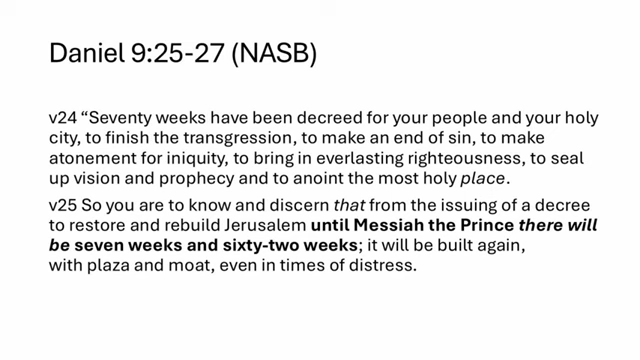
[00:01:51](https://www.youtube.com/watch?v=Zc4psmlA8H4&list=PLU8vICW5zFGo&index=3&t=111s)

- **Verse 24 Purposes**
    - To finish the transgression
    - To make an end of sin
    - To make atonement for iniquity
    - To bring in everlasting righteousness
    - To seal up vision and prophecy
    - To anoint the most holy place
- **Verse 25 Timeline and Decree**
    - The decree is issued to restore and rebuild Jerusalem
    - The timeline spans seven weeks and sixty-two weeks until "Messiah the Prince"
    - Jerusalem will be rebuilt with plaza and moat, even in times of distress

### Detailed Breakdown of Verses 25-26

- **Verse 25: The Rebuilding Timeline**
    - From the issuing of a decree to restore and rebuild Jerusalem until "Messiah the Prince," there will be seven weeks and sixty-two weeks
    - The city will be rebuilt with a plaza and a moat, even during times of distress
- **Verse 26: The Cutting Off and Destruction**
    - After the sixty-two weeks, the Messiah will be "cut off and have nothing"
    - The people of the prince who is to come will destroy both the city and the sanctuary
    - The end will come with a flood

### Detailed Breakdown of Verses 26-27

- **Verse 26: The Messiah and the City**
    - After the sixty-two weeks, the Messiah will be "cut off and have nothing"
    - The people of the "prince who is to come" will destroy both the city and the sanctuary
    - The end of this period is characterized by a "flood" and determined war/desolations
- **Verse 27: The Covenant and the Desolation**
    - A firm covenant will be made with many for the duration of "one week"
    - **Mid-week event**: In the middle of that week, a stop is put to both sacrifice and grain offering
    - **The Desolator**: "On the wing of abominations" comes one who makes desolate
    - This leads to a complete destruction, which is a decreed outpouring upon the one who makes desolate

### Parameters of the 70 Weeks Prophecy

- **Target Subjects**
    - The prophecy is specifically in regards to Daniel's people (the Jewish people/Israel)
    - It concerns Daniel's holy city (Jerusalem)
- **Prophetic Duration**
    - The "70 weeks" refers to 70 weeks of years
    - Total length: 490 years
    - Within this 490-year timeframe, the six specific purposes outlined in verse 24 must be accomplished for Daniel's people and city

### Reconstruction Details

- **Scope of Rebuilding**
    - The reconstruction encompasses the entire city of Jerusalem, rather than being limited to the temple structure alone
    - The city is to be repopulated as part of this process

### Timeline of the 69 Weeks

- **Interval after rebuilding**
    - Approximately 69 weeks (483 years) pass after the initial decree/rebuilding phase
- **Appearance of the Messiah**
    - After this 483-year period, an anointed one/prince (*Mashiach Nagid*) appears
    - This figure is described as being "cut off and would have nothing"
    - **Historical alignment**: This timeframe is believed to overlap with the dates of the crucifixion and resurrection

### Historical Context of the Prophecy

- **Timing of Jesus' Life**
    - The timeline discussed is believed to align with the crucifixion and resurrection of Jesus, specifically occurring in either AD 30 or AD 33
- **Destruction of Jerusalem**
    - The prophecy regarding the destruction of the city and sanctuary is historically realized through the Roman invasion
    - Josephus' narratives provide a record of the Roman legions destroying both the city of Jerusalem and the temple/sanctuary

### Identity of the Prince to Come

- **Regional Origin**
    - The prince is expected to be a Middle Eastern figure
    - He would likely be recruited from the nations surrounding the region, such as:
        - Syria
        - Egypt
        - Modern-day Turkey

### Examination of Verse 27

- The study will proceed by asking a series of questions to analyze the specific implications of this verse.

### Analyzing the Identity of "He" in Verse 27

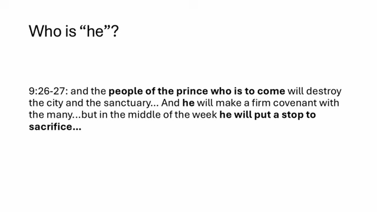
[00:06:10](https://www.youtube.com/watch?v=Zc4psmlA8H4&list=PLU8vICW5zFGo&index=3&t=370s)

- **The Central Question: Who is "he"?**
    - Verse 27 begins with the statement: "He will make a firm covenant with the many for one week."
    - While the identity might seem obvious, there is no consensus on who this "he" refers to.
- **Contextual Clues from Verse 26**
    - To understand the subject, one must look back at the preceding verse:
        - "...the people of the prince who is to come will destroy the city and the sanctuary."
        - "And **he** will make a firm covenant with the many..."
        - "...but in the middle of the week **he** will put a stop to sacrifice..."

### Interpretive Perspectives on the Identity of "He"

- **The Messiah-Centric Interpretation**
    - Some believe the "prince who is to come" in verse 26 refers to the Messiah (Jesus)
    - Under this view, the actions in verse 27 are attributed to Jesus:
        - **The Covenant**: Jesus makes the firm covenant with the many through His atoning death, securing the new/everlasting covenant
        - **The Cessation of Sacrifice**: Jesus puts a stop to sacrifice in the middle of the week
            - One interpretation is that if Jesus' ministry lasted three and a half years, this occurs during that timeframe.
            - Another interpretation suggests that in the three and a half years following Jesus' death, Levitical sacrifice is no longer effective as the Gospel spreads to the Gentiles beyond the Jewish nation.

### Critiquing the Historical-Only Interpretation

- **The 70 AD Argument**
    - Some suggest the prophecy refers to the period leading up to 70 AD (the Jewish-Roman War and the destruction of the Temple)
    - In this view, the "middle of the week" would coincide with the destruction of the Temple and the cessation of sacrifices
- **[The Exegetical Problem]** Identifying Jesus as the "prince who is to come" creates a logical contradiction with the text
    - The prophecy explicitly states that "the people of the prince who is to come will destroy the city and the sanctuary"
    - While one might argue the Jewish people were responsible because they started the rebellion against Rome, this is an indirect argument that reads into the language
    - Proper exegesis requires sticking to what the text explicitly states: that the destroyers are the people associated with the prince, not the covenant people themselves

### Distinguishing the Prince from the Roman Command

- **Identity of the Destroyer's People**
    - The people who destroy the city and sanctuary are described as Middle Eastern men
    - These men were recruited into the Roman army from the nations surrounding Judea
    - They acted against the specific orders of the Roman commander, Titus
- **Refuting the Titus-as-Prince Argument**
    - Some preterists argue Titus is the "prince who is to come" because he oversaw the period where sacrifices ceased
    - However, Josephus records that Titus's soldiers flagrantly disobeyed his orders to destroy the Temple
    - In fact, Titus reportedly sent centurions after his own men to beat them and force them to extinguish the fire in the Temple
    - This distinction is critical: the "prince" and the "people of the prince" are not synonymous with the Roman leadership itself, but rather the specific forces that carry out the desolation.

### The Future Nature of the 70th Week

- **Evidence for a Future Fulfillment**
    - The prophecy describes a Middle Eastern prince making a covenant with many and the stopping of sacrifices in the middle of the week
    - Levitical sacrifice has not resumed since the destruction of the Temple in AD 70
    - Because these specific conditions have not been met, the 70th week must be a future event
- **Relationship to the Return of Jesus**
    - The 70th week is described as the period immediately preceding the return of Jesus
    - This contradicts "full preterist" views because Jesus has not yet visibly returned in glory or physically resurrected the dead
    - This sequence of events (the 70th week leading to the return) is a recurring pattern in the latter half of Daniel, culminating in the resurrection described in Daniel 12.

### The Chronological Gap and Prophetic Patterns

- **The 2,000-Year Interval**
    - Because the 70th week is a future event, there is a massive gap between the end of the 69th week (the cutting off of the Messiah) and the start of the 70th week
    - This gap is estimated to be at least 2,000 years
- **Connecting Daniel 8 and Daniel 9**
    - The identity of the "he" in Daniel 9 can be understood by looking at similar figures in earlier prophecies
    - The "little horn" in Daniel 8 serves as a primary example of this type of figure

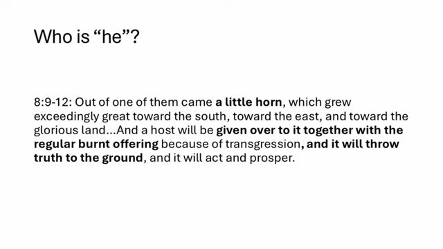
[00:12:14](https://www.youtube.com/watch?v=Zc4psmlA8H4&list=PLU8vICW5zFGo&index=3&t=734s)

### The Little Horn (Daniel 8:9-12)

- **Characteristics of the Little Horn**
    - It emerges from one of the horns of the shaggy goat
    - It grows "exceedingly great" in several directions:
        - Toward the south
        - Toward the east
        - Toward the "glorious land" (Israel)
- **Actions of the Little Horn**
    - It is given control over a "host"
    - It works in conjunction with the regular burnt offering because of transgression
    - It "throws truth to the ground"
    - It is characterized by its ability to act and prosper

### Parallelism Between Daniel 8 and Daniel 9

- **Shared Prophetic Details**
    - Both Daniel 8 and Daniel 9 describe a figure (the little horn) who is given power over the regular burnt offerings/sacrifices
    - This power is granted because of "transgression"
    - This control over sacrifices has both a historical fulfillment and an eschatological (end-times) fulfillment
- **Contrasting the Little Horn and the Messiah**
    - The little horn is described as one who "throws truth to the ground"
    - This stands in direct opposition to Jesus, who does not discard truth but exalts it
    - Jesus is identified as "the way, the truth, and the life"
- **Synthesizing Prophetic Imagery**
    - Although different prophecies use different imagery and perspectives, they describe the same underlying events
    - Seeing these different details across various books helps build a complete picture of the prophetic timeline

### Connections in Daniel 11

- **Prophetic Continuity**
    - Daniel 10, 11, and 12 function as one long, continuous prophecy
    - There are no chapter breaks in the original autograph
- **Daniel 11:31 as a Diagnostic Tool**
    - This verse describes the actions of the "final king of the north"
    - These actions provide a direct parallel to the description of "he" in Daniel 9:27
    - Because these actions are attributed to a figure who profanes the temple, they cannot be attributed to Jesus

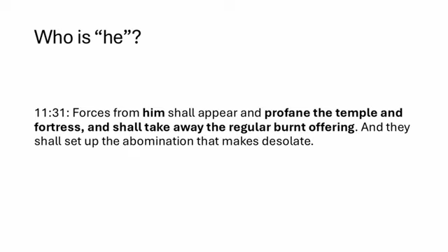
[00:14:27](https://www.youtube.com/watch?v=Zc4psmlA8H4&list=PLU8vICW5zFGo&index=3&t=867s)

| Action in Daniel 9:27 | Action in Daniel 11:31 | Why it excludes Jesus |
| --- | --- | --- |
| Stops sacrifices in the middle of the week | "shall take away the regular burnt offering" | Jesus does not stop sacrifices in this manner |
| "Throws truth to the ground" | "profane the temple and fortress" | Jesus exalts truth and does not profane the temple |

### The Anti-Christic Nature of the 70th Week Figure

- **Identification through Action**
    - The figure in the 70th week is an anti-christic figure, not a messianic one
    - He is referred to by different names across Daniel's prophecies, but his actions remain consistent:
        - The "prince" in Daniel 9
        - The "little horn" in Daniel 8
        - The "king of the north" in Daniel 11
- **Contrasting the Figure with the Messiah**
    - While a Messiah sanctifies, this figure defines through desecration
    - His actions are the direct opposite of what Jesus does:
        - He puts an end to sacrifices (in the middle of the 70th week)
        - He sets up an abomination that makes desolate
        - He throws truth to the ground
        - He profanes the temple

### Translation Nuances in Daniel 9:27

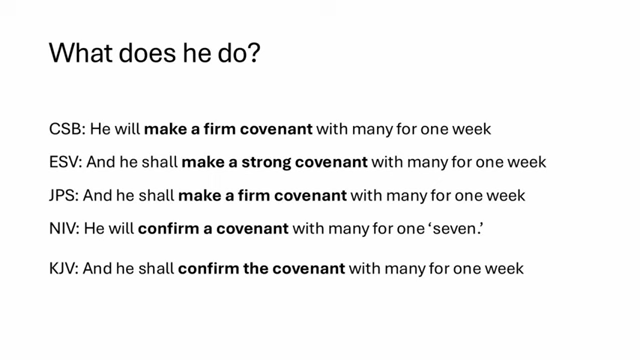
[00:17:10](https://www.youtube.com/watch?v=Zc4psmlA8H4&list=PLU8vICW5zFGo&index=3&t=1030s)

The Hebrew phrasing regarding the covenant made with the many is rendered differently across various English Bible versions. These variations focus on two main elements: the nature of the action (making vs. confirming) and the description of the time period (week vs. seven).

| Translation | Rendering of the Covenant Action |
| --- | --- |
| CSB (Christian Standard Bible) | He will make a firm covenant with many for one week |
| ESV (English Standard Version) | And he shall make a strong covenant with many for one week |
| JPS (Jewish Publication Society) | And he shall make a firm covenant with many for one week |
| NIV (New International Version) | He will confirm a covenant with many for one ‘seven.’ |
| KJV (King James Version) | And he shall confirm the covenant with many for one week |

### Linguistic Context of the Covenant

- **The Hebrew Verb \*gabar**\*
    - Used in Daniel 9:27 to describe the action taken regarding the covenant
    - Common translations include:
        - To make strong
        - To confirm
        - To strengthen
- **Cross-Reference: Isaiah 9:6**
    - Provides a famous example of the root word in a messianic context
    - The phrase "Mighty God" is linked to the name *El Gabor*
- **Usage in Prophetic Literature**
    - *gabar* is not used anywhere else within the book of Daniel
    - To find contemporaneous usage, one must look to other prophets, such as Zechariah, who prophesied shortly after Daniel's time.

### Affirming vs. Creating a Covenant

- **Reinterpreting the Action of the Prince**
    - Rather than the figure creating a brand new covenant, it may be more accurate to see him as **affirming or strengthening an existing covenant**
    - He does this by agreeing with it or joining it, at least temporarily
- **Evidence from Zechariah**
    - The speaker points to the use of *gabar* in Zechariah (chapter 10, verse 6)
    - In that context, the Lord says, "I will strengthen the house of Judah"
    - Because the house of Judah already existed, the verb here implies reinforcing something already in place, similar to how the prince might interact with a pre-existing covenant.

### The Holy Covenant as a Reference Point

- **Interpretation of the Covenant**
    - The covenant in Daniel 9:27 may refer to the "Holy Covenant"—the established relationship and principles between God and His people
    - The "prince to come" might seemingly agree with or affirm this covenant, at least temporarily
- **Cross-Reference: Daniel 11:30**
    - Provides context for how figures in Daniel interact with the holy covenant
    - Describes a figure who becomes "angered against (the) holy covenant"
    - This figure acts against and pays attention to those who are "forsaking (the) holy covenant"

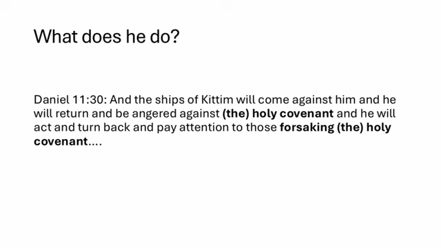
[00:21:08](https://www.youtube.com/watch?v=Zc4psmlA8H4&list=PLU8vICW5zFGo&index=3&t=1268s)

### Corroborating Evidence in Daniel 11

- **Daniel 11:32 as a Reference**
    - This verse provides additional context for the nature of the covenant mentioned in Daniel 9:27
    - Even though the word "holy" is not explicitly used here, the context implies it is a reference to the Holy Covenant
    - The passage describes the actions of the King of the North:
        - He will corrupt those acting wickedly toward the covenant through flatteries
        - Conversely, the people who know their God will remain strong and take action

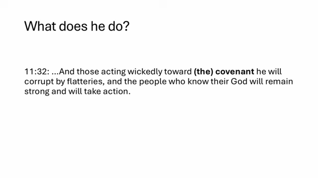
[00:22:06](https://www.youtube.com/watch?v=Zc4psmlA8H4&list=PLU8vICW5zFGo&index=3&t=1326s)

### Geopolitical Implications of the Prince's Actions

- **Affirming Israel's Right to Land**
    - The actions of this leader may involve affirming Israel's right to its land
    - This would be a significant act, especially if the leader is from a Muslim-majority country or professing Islam
- **Potential Peace Agreements**
    - The text might refer to a specific peace treaty or geopolitical agreement
    - This agreement could potentially include Israel and a larger group of nations (the "many")
    - The leader's role would be to join, strengthen, or affirm this existing arrangement

### Isaiah 28:5-19 and the "Covenant with Death"

- **Eschatological Context**
    - Isaiah uses eschatological language to describe the "day of the Lord" (the days immediately preceding it)
    - In this "day," the LORD of hosts acts in several ways for His people:
        - As a crown of glory and a diadem of beauty to the remnant
        - As a spirit of justice to those who sit in judgment
        - As strength to those who turn back the battle at the gate
- **The "Covenant with Death" (Berit et Mabet)**
    - The text addresses the "men of scorning" and rulers in Jerusalem who have made a false agreement
    - **[Linguistic Note]** The Hebrew term for covenant is *berit*
    - They have made a "covenant with death" (*berit et mabet*) and an agreement with Sheol (the grave)
    - This represents a false sense of security, where they believe the "overflowing scourge" will not reach them because they have hidden themselves in falsehood and deception

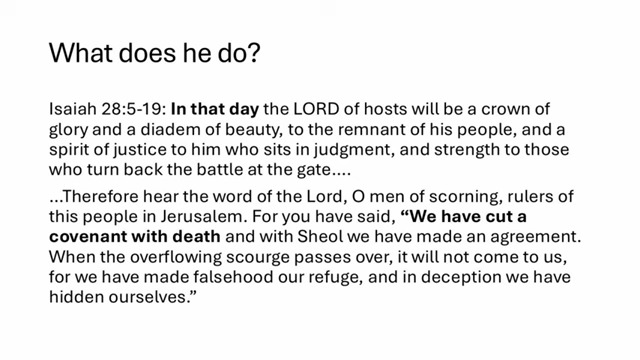
[00:24:09](https://www.youtube.com/watch?v=Zc4psmlA8H4&list=PLU8vICW5zFGo&index=3&t=1449s)

### The Divine Response to False Covenants

- **The Nature of the False Covenant**
    - It is an attempt to avoid the "overflowing scourge"
        - This imagery implies a flood of whips passing through the land
    - These agreements are characterized by falsehood and deception
        - They are disingenuous and made out of perceived necessity rather than sincerity
- **The Lord's Foundation in Zion**
    - In contrast to the false agreements, the Lord establishes a firm foundation:
        - A tested stone
        - A precious cornerstone
        - A sure foundation for those firm in faith
    - **[Divine Standards]** The Lord uses specific tools to establish this order:
        - Justice acts as the "measuring line"
        - Righteousness acts as the "plumb line"
- **The Failure of False Refuges**
    - The "refuge of lies" will be swept away by hail
    - The waters will overflow the hiding places, ensuring that deceptive agreements cannot withstand divine judgment

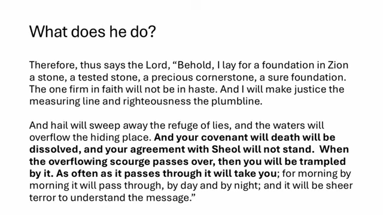
[00:26:12](https://www.youtube.com/watch?v=Zc4psmlA8H4&list=PLU8vICW5zFGo&index=3&t=1572s)

- **The Failure of False Security**
    - The "covenant with death" and "agreement with Sheol" (the grave) are ultimately futile
    - These agreements will be dissolved and will not stand when the "overflowing scourge" passes over
    - **[The Irony of Judgment]** The very actions taken to avoid being overwhelmed by armies or judgment are the exact things that will lead to being "trampled" by the scourge
    - This process is described as a "sheer terror"

### The Seven-Year Period and the Prince's Covenant

- **The Duration of the 'One Week'**
    - In this prophetic context, one week is interpreted as a seven-year period
- **The Nature of the Covenant**
    - The 'covenant' mentioned in the prophecy may be a peace agreement made by 'the prince' with 'the many'
    - **[Uncertainties]** Several details remain unknown regarding this agreement:
        - Whether the text explicitly states it will last for seven years
        - Whether the specific language of the treaty is clearly defined as a 'covenant'
        - Whether the treaty might already be in effect or if the prince has already arisen
- **The Identity of the Prince**
    - While the specific identity of the prince is not yet certain, his origin can be roughly identified by the region in which he arises
- **Connection to Tribulation**
    - The waves of scourging (the "overflowing scourge") are associated with Jacob's trouble, which can be interpreted as the Great Tribulation

### Indicators of the 70th Week

- **The Challenge of Recognition**
    - There is no absolute guarantee that the identity of the man affirming the covenant will be immediately obvious
    - **[The Hope for Discernment]** While not certain, there is a hope that divine grace will make the fulfillment of the prophecy recognizable to those looking for it
- **The Definitive Sign: Temple and Sacrifice**
    - The most certain way to identify the 70th week is the presence of a temple and the performance of sacrifices
    - According to the prophecy, in the middle of the week, this man will "put a stop to sacrifice and great offering"
    - **[Implication]** For this to occur, there must be a functioning temple and active sacrificial rites taking place on the Temple Mount in Jerusalem at that time
- **The Sequence of Events**
    - Sacrifices must be occurring (either before or after the covenant is affirmed)
    - The man confirms the covenant
    - In the middle of the week, he stops the sacrifices
    - The "scourge" then begins to pass through

### Interpretations of the Covenant's Purpose

- **Two potential perspectives on the covenant**:
    - It may be a specific peace agreement in place during the 70th week that the figure strengthens by joining it
    - Alternatively, the figure may be affirming God's people through this action
- **Geopolitical recognition**
    - Joining such an agreement could be seen as recognizing Israel's right to exist in the land
    - **[Modern Parallel]** This is conceptually similar to the Abraham Accords, where treaties with various Arab nations normalize relations and recognize Israel's right to exist

### Defining "The Many"

- **Context of the Covenant**
    - The covenant is made with "the many"
    - This could involve a future peace treaty that strengthens the standing of Israel as a sovereign political entity in Jerusalem
- **Linguistic Parallel in Daniel 11:33**
    - The term "the many" is used elsewhere in Daniel to describe a specific group

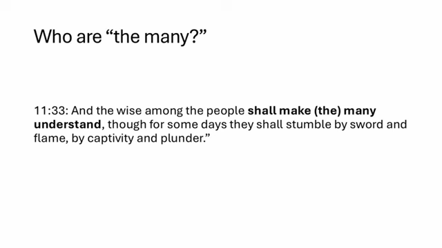
[00:32:36](https://www.youtube.com/watch?v=Zc4psmlA8H4&list=PLU8vICW5zFGo&index=3&t=1956s)

    - **[Who they are]** "The many" refers to the wise ones—God's people who possess spiritual understanding
    - **[The contrast]** These wise individuals make "the many" understand, even while others stumble through sword, flame, captivity, and plunder

### Isaiah 53 and the Identity of "the many"

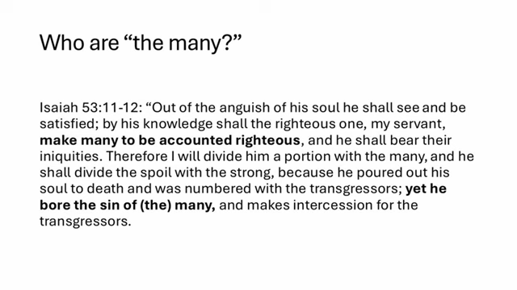
[00:33:10](https://www.youtube.com/watch?v=Zc4psmlA8H4&list=PLU8vICW5zFGo&index=3&t=1990s)

- **The work of the Suffering Servant** (Isaiah 53:11-12):
    - Out of the anguish of His soul, He shall see and be satisfied
    - By His knowledge, the righteous one (His servant) shall make many to be accounted righteous
    - He shall bear their iniquities
- **[The result of His sacrifice]** Because He poured out His soul to death and was numbered with transgressors, He bears the sin of "the many"
    - This action allows Him to make intercession for the transgressors
- **Connection to Jesus**
    - The language of Isaiah 53 applies directly to Jesus through His atoning death
    - His death is the mechanism by which "the many" are made righteous

### The Scope of "the many"

- **Dual identity of "the many"**
    - The group encompasses both those within the nation of Israel and those from all the nations of the earth
    - This dual scope aligns with the messianic work of bearing the sin of "the many" across both the Jewish people and the global community

### The Nature of the Sacrifice in Daniel 9

- **Identifying the specific sacrifice**
    - The sacrifice referred to is the **perpetual sacrifice** (the morning and evening sacrifice)
    - This involves a year-old male lamb sacrificed on the altar twice daily
    - It is offered as a whole burnt offering, intended to rise as a pleasing aroma to God
- **[Prophetic Significance]** This specific ritual marks the beginning, middle, and end of the 70 weeks
    - The prophetic timeline in Daniel uses specific numbers of days that revolve around this particular sacrifice
- **Linguistic Note on Daniel 9:27**
    - While some translations include "grain offering," the Hebrew text specifically states he will put a stop to "sacrifice"

[00:36:31](https://www.youtube.com/watch?v=Zc4psmlA8H4&list=PLU8vICW5zFGo&index=3&t=2191s)

### The Timing and Cessation of Sacrifice

- **Contextualizing the "stop to sacrifice"**
    - The phrase "he will put a stop to sacrifice and (grain) offering" refers to a cessation of temple offerings
    - This is not necessarily a reference to a specific holiday or the Shabbat
    - Instead, it likely refers to the regular, daily ritual service
- **Evidence from Daniel 9:21**
    - The text notes that Gabriel appeared to Daniel "about the time of the evening offering"
    - This linguistic link suggests the "sacrifice" in verse 27 is the daily morning and evening offering

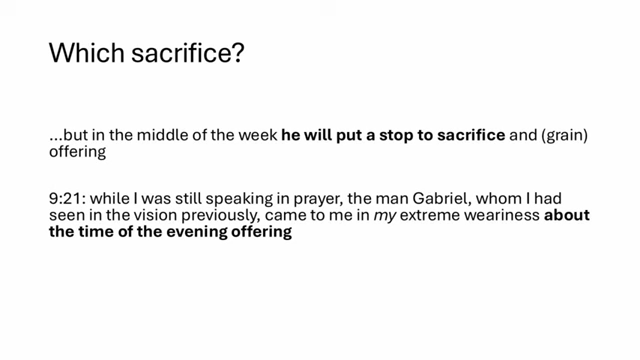
[00:36:34](https://www.youtube.com/watch?v=Zc4psmlA8H4&list=PLU8vICW5zFGo&index=3&t=2194s)

### Linguistic Nuances of 'Shanaf' (Wing)

- **The Hebrew term \*shanaf**\*
    - Used over a hundred times in the Old Testament
    - **Common usages include:**
        - The wings of a bird
        - A heavenly divine creature (e.g., seraphim or cherubim)
        - The edge of an object (e.g., the edge of a garment or the edge of the earth)
        - A covering (e.g., the Lord covering something with His wings for judgment or interception)
        - Prophetic references to specific nations (e.g., Moab and Edom in Jeremiah 48 and 49)
- **[Contextual Application]** In the context of the abomination
    - *Shanaf* can refer to a prominent or highly visible location of the thing being described
    - This implies the abomination takes place in a prominent, visible location within the sanctuary
- **Alternative interpretations of 'wing'**
    - **Prominence**: It could refer to the abomination being highly visible or prominent within the holy place
    - **Coverage/Desolation**: It could refer to an abomination that "covers" the land, bringing desolation
        - While the word "desolation" is not explicitly in Daniel 9, it is used in other parts of Daniel to describe this specific abomination
- **Historical Context of Temple Defilement**
    - The fulfillment of these prophecies includes historical events such as a Greek king defiling the temple in Jerusalem, which occurred a few hundred years after Daniel's time

### The Ultimate Fulfillment of the Abomination of Desolation

- **[Why Antiochus is not the final fulfillment]**
    - Antiochus Epiphanes defiled the temple by setting up a statue of Zeus and sacrificing a pig on the altar
    - However, Jesus makes specific reference to this prophecy in Matthew 24, which took place a couple hundred years after the events of Antiochus
    - Because Jesus speaks of it as a future event for His listeners, the event involving Antiochus cannot be the ultimate fulfillment

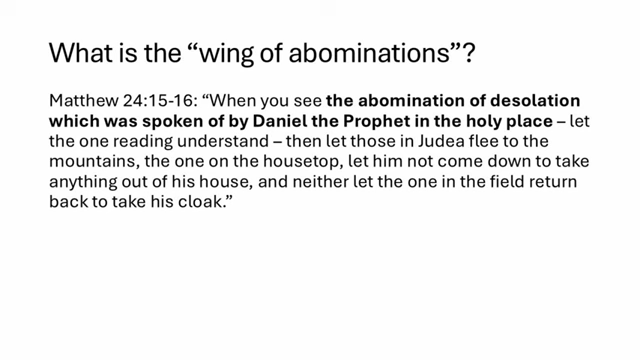
[00:41:07](https://www.youtube.com/watch?v=Zc4psmlA8H4&list=PLU8vICW5zFGo&index=3&t=2467s)

- **Jesus's Reference in Matthew 24:15-16**
    - "When you see the abomination of desolation which was spoken of by Daniel the Prophet in the holy place – let the one reading understand – then let those in Judea flee to the mountains, the one on the housetop, let him not come down to take anything out of his house, and neither let the one in the field return back to take his cloak."
    - By using these words, Jesus is directly applying the prophetic warnings of Daniel to a future context

### The Location of the Abomination of Desolation

- **[Linguistic Connection]** The reference to the "foundation of desolation" in Daniel 11 uses similar language to the event described in Daniel 9
- **The Significance of the "Holy Place"**
    - Jesus's instructions to his disciples treat the event as a future occurrence
    - The "holy place" refers to the inner structure of the Temple proper
    - **[Why this is an abomination]** This area was strictly restricted:
        - Only priests were permitted to enter for daily service
        - Access was forbidden to non-Levitical or non-priestly Jewish persons
        - Access was strictly forbidden to Gentiles
    - Consequently, a Gentile entering this space constitutes a supreme abomination
- **Historical Fulfillment**
    - The historical record (as noted in Josephus's narrative) describes Titus entering the holy place during the Roman siege

### The Urgency of Jesus's Warning

- **[Foreshadowing vs. Final Fulfillment]**
    - The Roman siege and Titus's entry into the Temple complex act as a logical fulfillment or foreshadowing of the abomination of desolation
    - However, this cannot be the final fulfillment because of the nature of Jesus's command to His disciples
- **The Necessity of Immediate Flight**
    - Jesus's warning in Matthew 24 was an instruction for immediate action: "get out of the city," "don't turn around," "don't grab your go bag" (meaning don't waste time gathering belongings)
    - **[The Consequence of Hesitation]**
        - As Isaiah prophesied, an overwhelming scourge was about to descend upon Jerusalem and Judea
        - Any hesitation or attempt to salvage possessions would result in being caught by the coming destruction

### The Timing of the Roman Siege

- **[The Window for Escape]**
    - The Roman army had already surrounded and cordoned off Jerusalem for weeks before Titus actually entered the holy place of the Temple
    - **[The Risk of Hesitation]**
        - Any disciples waiting for the specific visual sign of Titus entering the holy place to trigger their flight would have been "weeks too late"
        - By the time the sign manifested, the opportunity to escape the city safely had already passed
- **Roman Tactics of Intimidation**
    - Josephus records that the Romans captured individuals attempting to flee the city
    - These people were crucified outside the city walls as a method of intimidating the Jewish population remaining within Jerusalem

### The Nature of the Future Abomination

- **[Historical End vs. Prophetic Beginning]**
    - In AD 70, the defilement of the Temple by Titus was the conclusion of a siege that had already surrounded the city for weeks
    - In contrast, the event Jesus describes is the *start* of a judgment process
- **The Progression of Judgment**
    - The prophetic event begins at the Temple Mount
    - It then moves outward, surrounding the city and entering from the outside
    - **[The Great Tribulation]**
        - This event serves as the trigger for "Jacob's trouble" (the Great Tribulation)
        - Unlike the AD 70 event, which ended at the Temple, this future judgment starts there and expands across the region

### The Timing of Daniel's Seventh Week

- **[The Signal of the Abomination]**
    - The midpoint of Daniel's seventh week will be marked by a visible abomination appearing in the holy place of the Temple
    - This event acts as the trigger for an overwhelming scourge that begins within the city and expands outward
    - **[Urgency of Action]**
        - The appearance of this abomination is the signal to flee the city immediately
        - Any delay in leaving once this sign is visible will result in being caught by the approaching judgment
- **[The Prophetic Timeline]**
    - The first 69 weeks of Daniel's prophecy are considered complete, as they culminate in the "Anointed One" being cut off (referring to the crucifixion of Jesus)
    - The seventh week has not yet taken place
    - There has been a gap of nearly 2,000 years between the events of the 69th week (approx. AD 33) and the commencement of the seventh week

### Characteristics and Actions of the Prince

- **[Identity and Origin]**
    - The prince is expected to be a leader rising from the same people groups that destroyed the Temple (Middle Eastern/Arab groups)
    - He will act to confirm and strengthen an existing covenant that includes Israel and various other nations
    - This covenant includes the affirmation of Israel's right to the land promised by God
- **[The Midpoint Actions]**
    - At the midpoint of the seventh week, the prince will:
        - Put an end to sacrifice
        - Defile the Temple
        - Set up an abomination in the holy place
- **[The Signal for Believers]**
    - The appearance of this abomination serves as a critical marker event for all disciples of Jesus globally
    - **[Immediate Response]**
        - For those in Jerusalem and the province of Judea, the abomination is the signal to flee to the mountains immediately

### The Reversal of Judgment

- **[The Fate of the Prince]**
    - The one who sets up the abomination and causes desolation will face a complete destruction
    - A decree is poured out specifically against the one responsible for the desolation
- **[The Return of the Messiah]**
    - The Lord will personally return in glory, accompanied by thousands upon thousands of His holy ones
    - **[Divine Justice]**
        - The Messiah will turn the very destruction caused by the earthly prince back upon the prince's own head
- **[A Tale of Two Princes]**
    - The prophecy contrasts two distinct figures:
        - The earthly prince who initiates the abomination and desolation
        - The Messiah (the true Prince) who returns to execute judgment

### The Contrast of the Two Princes

- **[The Nature of their Actions]**
    - The earthly prince is defined by defilement and self-exaltation, whereas the Messiah is defined by His sacrificial death.
    - The earthly prince brings an end to sacrifices; the Messiah was the ultimate sacrifice.
- **[The Finality of Divine Justice]**
    - The destruction poured out upon the one who causes desolation is described as their "just due" or "just deserts."
    - The Messiah returns specifically to address the king who persecutes God's people and attempts to throw truth to the ground.

### Upcoming Topics

- **[Chronology of the 70 Weeks]**
    - A detailed dive into the timing and numbers associated with the 70 weeks
    - Analysis of historical events and ancient sources to establish a timeline
- **[Daniel Chapters 10-12]**
    - A forthcoming limited series focusing on the specific prophecies found in these chapters