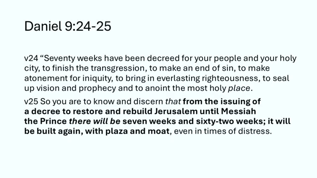
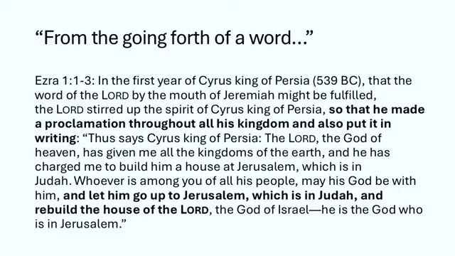
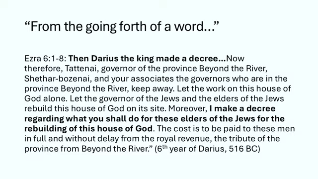
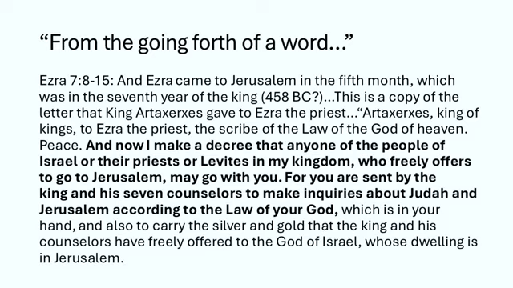
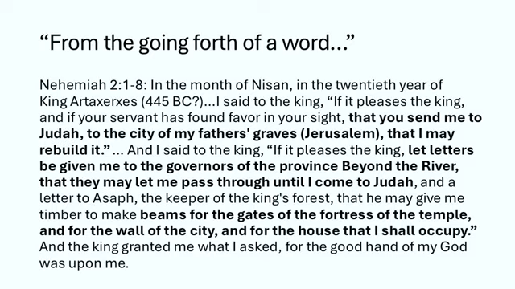
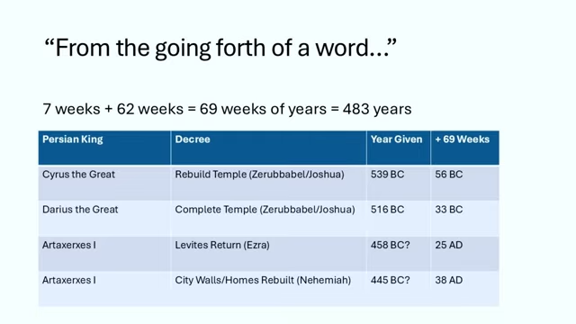
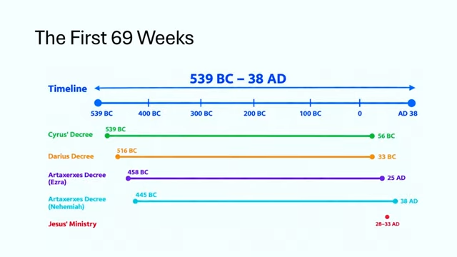

# ದಾನಿಯೇಲನ 70 ವಾರಗಳು (Daniel's 70 Weeks) – ಭಾಗ 4
## ಮೊದಲ 69 ವಾರಗಳ ಕ್ರೊನಾಲಜಿ – ಲೆಕ್ಕ ಎಲ್ಲಿಂದ ಶುರು, ಎಲ್ಲಿಗೆ ಬಂದು ನಿಲ್ಲುತ್ತೆ?

---

## ಪೀಠಿಕೆ: ಶಾಸ್ತ್ರದ ನಿಖರತೆ ಮತ್ತೆ ದೇವರ ಪ್ರೇರಣೆ

ಒಂದು ವಿಷಯ ಮೊದಲೇ ಹೇಳ್ತೀನಿ. ನೀವು ವಿಮರ್ಶಾತ್ಮಕ ವಿದ್ವಾಂಸರಾದ್ರೂ (critical scholars — ಬೈಬಲನ್ನ ಟೀಕಾತ್ಮಕವಾಗಿ ಪರೀಕ್ಷಿಸೋ ವಿದ್ವಾಂಸರು), ಈ ಬರಹ ಯೇಸು ಹುಟ್ಟೋದಕ್ಕೆ ಕನಿಷ್ಠ ಹಲವು ದಶಕ ಮೊದಲೇ ಬರೆಯಲ್ಪಟ್ಟಿದ್ದು ಅನ್ನೋದನ್ನ ಒಪ್ಪಲೇಬೇಕು. ಹಾಗಿದ್ದೂ ಅದು ವರ್ಷದ ತನಕ ನಿಖರವಾಗಿದೆ ಅನ್ನೋದು, ಅಥವಾ ವರ್ಷದ ತನಕ ನಿಖರವಾಗಿರೋದು ನಮಗೆ ಕಾಣುತ್ತೆ ಅನ್ನೋದು, ತಾನೇ ಒಂದು ಅದ್ಭುತ. ಅದು ಶಾಸ್ತ್ರದ ದೇವ-ಪ್ರೇರಣೆಗೆ (inspiration — ದೇವರೇ ಬರೆಸಿದ್ದು ಅನ್ನೋ ಅರ್ಥ) ಒಂದು ಸಾಕ್ಷಿ.

ಆದ್ರೆ ಇದರಲ್ಲಿ ಒಂದು ಎಚ್ಚರಿಕೆ. ಈ ವಿಷಯದಲ್ಲಿ ನಾವು ಅತಿ-ನಿಖರತೆಗೆ (hyper-accurate) ಹೋಗೋ ಅಗತ್ಯ ಇಲ್ಲ. ನಿಜ ಹೇಳಬೇಕಂದ್ರೆ ನಮ್ಮಿಂದ ಅದು ಹಠದಿಂದ, ಖಚಿತವಾಗಿ ಆಗೋದೂ ಇಲ್ಲ. ಅಲ್ಲಿ ಎಷ್ಟು ಸೂಕ್ಷ್ಮ ಗೆರೆ ಎಳೆಯ್ತೀರೋ ಅಷ್ಟು ಅಪಾಯಕರ ನೆಲಕ್ಕೆ ಕಾಲಿಡ್ತೀರಿ, ಐತಿಹಾಸಿಕ ಸತ್ಯದ ದೃಷ್ಟಿಯಿಂದ.

ಇದು ದಾನಿಯೇಲ ಪುಸ್ತಕದ ಎರಡನೇ ಅರ್ಧದ ಭವಿಷ್ಯವಾಣಿಗಳ ಸರಣಿಯ ನಾಲ್ಕನೇ ಸೆಷನ್. ಇದರೊಂದಿಗೆ ನಾವು ದಾನಿಯೇಲ 9ನೇ ಅಧ್ಯಾಯದ ಸರಣಿಯನ್ನ ಮುಗಿಸ್ತೀವಿ. ಇದು ನಾನು ನಿಮಗೆ ಕೊನೆಯ ಮೂರು ಸೆಷನ್‌ಗಳಿಂದ ಭರವಸೆ ಕೊಡ್ತಾ ಬಂದ ಬೋನಸ್ ಸೆಷನ್, ದಾನಿಯೇಲ 9ರ ಕ್ರೊನಾಲಜಿ (chronology — ಘಟನೆಗಳ ಕಾಲಕ್ರಮ, ಯಾವುದು ಯಾವಾಗ ಅನ್ನೋ ಲೆಕ್ಕ) ಮತ್ತೆ ಸಮಯದ ಬಗ್ಗೆ.

ಮೊದಲ ಮೂರು ಸೆಷನ್‌ಗಳಲ್ಲಿ ಇದರ ಗೋಜಲಿಗೆ ಹೋಗದೆ ಇರೋಕೆ ಪ್ರಯತ್ನಿಸಿದ್ವಿ. ಆ ಅಧ್ಯಾಯವನ್ನ ಓದ್ತಾ, ವಿಶೇಷವಾಗಿ 70 ವಾರಗಳ ಭವಿಷ್ಯವಾಣಿಯ ಕೊನೆಯ ನಾಲ್ಕು ವಚನಗಳ ಮೇಲೆ ಗಮನ ಇಟ್ಟು, ಆ ವಚನಗಳ ಭಾಷೆಯಲ್ಲಿ ನೆನೆದು, ಹೀರಿಕೊಂಡು, ಅದರಲ್ಲಿರೋ ಸಾರವನ್ನ ಹೊರತೆಗೆದ್ವಿ. ಈಗ ಅದನ್ನ ಮಾಡಿ ಮುಗಿಸಿದ್ದೀವಲ್ಲ, ಮುಖ್ಯ ಊಟ ಆಯ್ತು. ಈಗ ಸಿಹಿ ತಿಂಡಿ. ಕೆಲವರಿಗೆ ಅದು ಸಿಹಿ, ಇನ್ನು ಕೆಲವರಿಗೆ ಸೊಪ್ಪು, ನಿಮ್ಮ ಇಷ್ಟ ಏನೇ ಇರಲಿ. ಅದೇ 70 ವಾರಗಳ ಕ್ರೊನಾಲಜಿ ಮತ್ತೆ ಸಮಯ. ವಿಶೇಷವಾಗಿ ಒಂದನೇ ವಾರದಿಂದ 69ನೇ ವಾರದವರೆಗಿನ ತಾರೀಖುಗಳು ಮತ್ತೆ ಸಭೆಯ ಬೇರೆ ಬೇರೆ ಪಂಗಡಗಳು ಮತ್ತೆ ದೇವತಾಶಾಸ್ತ್ರದ ಸಂಪ್ರದಾಯಗಳು 70ನೇ ವಾರವನ್ನ ಹೇಗೆ ನೋಡ್ತವೆ ಅನ್ನೋದು.

ಅದರ ಬಗ್ಗೆ ಸ್ವಲ್ಪ ಮೊದಲೇ ಮಾತಾಡಿದ್ವಿ, ಅದರಲ್ಲೂ ಹಿಂದಿನ ಸೆಷನ್ 3ರಲ್ಲಿ. ನೀವು ಆ ಸೆಷನ್‌ಗಳನ್ನ ನೋಡಿಲ್ಲ ಅಂದ್ರೆ, ಇದಕ್ಕೆ ಹೋಗೋ ಮೊದಲು ಹಿಂದೆ ಹೋಗಿ ನೋಡಿ ಬನ್ನಿ ಅಂತ ನಾನು ಬಲವಾಗಿ ಹೇಳ್ತೀನಿ. ಯಾಕಂದ್ರೆ ನಾನು ಕೆಲವು ವಿಷಯಗಳನ್ನ ದಾಟಿಹೋಗ್ತೀನಿ, ನೀವು ಅವನ್ನ ಈಗಾಗಲೇ ಬಲ್ಲಿರಿ ಅಂತ ಭಾವಿಸ್ತೀನಿ. ಆದ್ರೆ ಭಾವಿಸಿದಾಗ ಏನಾಗುತ್ತೆ ಅಂತ ನಿಮಗೆ ಗೊತ್ತಲ್ಲ! ಹಾಗಾಗಿ ನೀವು ಆ ಸೆಷನ್‌ಗಳನ್ನ ನೋಡಿರ್ತೀರಿ ಅಂತ ನಂಬ್ತೀನಿ.

---

## 70 ವಾರಗಳ ಐತಿಹಾಸಿಕ ಹಿನ್ನೆಲೆ

ಸರಿ, ಶುರು ಮಾಡೋಣ. 70 ವಾರಗಳ ಭವಿಷ್ಯವಾಣಿಯ ಮೊದಲ ಎರಡು ವಚನಗಳನ್ನ ಓದ್ತೀನಿ. ಆಮೇಲೆ ನನಗೆ ತುಂಬಾ ಉಪಯುಕ್ತ ಅನ್ನಿಸೋ ಐತಿಹಾಸಿಕ ಸಂದರ್ಭಕ್ಕೆ ಹೋಗ್ತೀನಿ. ನಾವು ಮಾತಾಡ್ತಿರೋ ಕಾಲಾವಧಿಗಳನ್ನ ಗುರುತಿಸೋಕೆ ಅದು ನಮಗೆ ಬೇಕೇ ಬೇಕು. ಅಂದ್ರೆ ಬೈಬಲಿನ ಹೊರಗಿನ (extra-biblical) ಐತಿಹಾಸಿಕ ಮೂಲಗಳು. ನಾನು ಹೆಚ್ಚಾಗಿ ಅವಲಂಬಿಸೋದು ಸಮಕಾಲೀನ ಮೂಲಗಳನ್ನ (contemporaneous sources), ಅಂದ್ರೆ ಯಾವ ಘಟನೆಗಳನ್ನ ವರ್ಣಿಸ್ತಿವೆಯೋ ಅದೇ ಕಾಲಘಟ್ಟದಲ್ಲಿ ಬರೆದವು.

ಸರಿ, 70 ವಾರಗಳ ಭವಿಷ್ಯವಾಣಿಗೆ ಹಿಂದಿರುಗೋಣ. ದಾನಿಯೇಲ ಅಧ್ಯಾಯ 9, ವಚನ 24 ಮತ್ತೆ 25. ಗೇಬ್ರಿಯೇಲ ದೇವದೂತ ಕರ್ತನ ಭವಿಷ್ಯವಾಣಿಯನ್ನ ದಾನಿಯೇಲನಿಗೆ ಹೇಳ್ತಿದ್ದಾನೆ.

ದಾನಿಯೇಲ 9:24ರಲ್ಲಿ ಎಪ್ಪತ್ತು ವಾರಗಳು (ಅಕ್ಷರಶಃ ಎಪ್ಪತ್ತು ಏಳುಗಳು) ಇಸ್ರಾಯೇಲ್ ಜನರ ಮೇಲೆ ಮತ್ತೆ ಪವಿತ್ರ ಪಟ್ಟಣದ ಮೇಲೆ ನಿಗದಿಯಾಗಿವೆ, ಆರು ಷರತ್ತುಗಳ ನೆರವೇರಿಕೆಗೆ: ದ್ರೋಹ ಮುಗಿಸೋದು, ಪಾಪಕ್ಕೆ ಅಂತ್ಯ, ಅಕ್ರಮಕ್ಕೆ ಪ್ರಾಯಶ್ಚಿತ್ತ (atonement — ಪಾಪ ಮುಚ್ಚಿ ದೇವರ ಜೊತೆ ಸಂಬಂಧ ಸರಿಪಡಿಸೋದು), ಶಾಶ್ವತ ನೀತಿ, ದರ್ಶನ ಮತ್ತೆ ಪ್ರವಾದನೆಗೆ ಮುದ್ರೆ, ಅತಿ ಪವಿತ್ರ ಸ್ಥಳದ ಅಭಿಷೇಕ. ಅಂದ್ರೆ ಇಸ್ರಾಯೇಲಿನಲ್ಲಿ ಈ ಆರು ವಿಷಯಗಳು ಸಾಧಿಸಲ್ಪಡಬೇಕು, ಆ ವಾರಗಳ ಕೊನೆಯ ಹೊತ್ತಿಗೆ. "ಹಾಗಾಗಿ ನೀನು ತಿಳ್ಕೋ, ವಿವೇಚಿಸು: ಯೆರೂಸಲೇಮನ್ನ ಪುನಃಸ್ಥಾಪಿಸಿ ಕಟ್ಟಿಸಬೇಕು ಅನ್ನೋ ಆಜ್ಞೆ ಹೊರಟಾಗಿನಿಂದ ಮೆಶ್ಶಾಯ ರಾಜಕುಮಾರ ಬರೋವರೆಗೆ ಏಳು ವಾರ ಮತ್ತೆ ಅರವತ್ತೆರಡು ವಾರ ಇರುತ್ತೆ. ಅಂದ್ರೆ 69 ವಾರಗಳು. ಪಟ್ಟಣ ಬೀದಿ ಅಥವಾ ಚೌಕ ಮತ್ತೆ ಕಂದಕದ ಜೊತೆ ಮತ್ತೆ ಕಟ್ಟಲ್ಪಡುತ್ತೆ, ಕಷ್ಟದ ಕಾಲದಲ್ಲೂ."

ಈ ವಚನಗಳ ಮೇಲೆ ನಾವು ಈಗಾಗಲೇ ಸಾಕಷ್ಟು ಸಮಯ ಕಳೆದಿದ್ದೀವಿ. ಹಾಗಾಗಿ ಇಲ್ಲಿ ಹೆಚ್ಚು ಒತ್ತಿ ಹೇಳೋದಿಲ್ಲ, ಸಂಕ್ಷಿಪ್ತವಾಗಿ ಮತ್ತೆ ಹೇಳ್ತೀನಿ: 70 ವಾರಗಳು ಶುರುವಾಗೋದು, ಅಂದ್ರೆ ಗಡಿಯಾರ ಶುರುವಾಗೋದು, ಇಲ್ಲಿ NASB ಭಾಷಾಂತರದಲ್ಲಿ "ಆಜ್ಞೆ" (decree) ಅಂತ ಭಾಷಾಂತರ ಆಗಿರೋ ಒಂದು ಘೋಷಣೆಯಿಂದ, ಯೆರೂಸಲೇಮ್ ಪಟ್ಟಣವನ್ನ ಪುನಃಸ್ಥಾಪಿಸಿ (ಮರಳಿ ತಂದು) ಕಟ್ಟೋಕೆ. "ಮಾಶೀಯಾಕ್ ನಾಗೀದ್" (Mashiach Nagid), ಮೆಶ್ಶಾಯ ರಾಜಕುಮಾರ ಬರೋವರೆಗೆ.

ಏಳು ವಾರ, ಅರವತ್ತೆರಡು ವಾರ. ಆ ಎರಡು ಸಂಖ್ಯೆಗಳನ್ನ ಯಾಕೆ ಬೇರೆ ಮಾಡಿರಬಹುದು ಅಂತ ಮಾತಾಡಿದ್ವಿ. ವರ್ಷಗಳ ವಾರಗಳು ಏನು ಅನ್ನೋದರ ತೋರಾ (Torah) ಹಿನ್ನೆಲೆ, ಯಾಜಕಕಾಂಡ 25ರಿಂದ, ಅದರ ಬಗ್ಗೆಯೂ ಮಾತಾಡಿದ್ವಿ. ಅದಕ್ಕೆ ಸ್ವಲ್ಪ ನಿಮಿಷಗಳಲ್ಲಿ ಮತ್ತೆ ಬರ್ತೀನಿ. ಒಟ್ಟು, 69 ವಾರ ಗುಣಿಸು 7 ವರ್ಷ, ಅಂದ್ರೆ 483 ವರ್ಷ. ಏಳು ವಾರ, ಅಂದ್ರೆ 49 ವರ್ಷ, ಆದ ಮೇಲೆ ಪಟ್ಟಣ ಬೀದಿ ಮತ್ತೆ ಕಂದಕದ ಜೊತೆ ಮತ್ತೆ ಕಟ್ಟಲ್ಪಡುತ್ತೆ. ಅದು ಬರೀ ದೇವಾಲಯದ ಬಗ್ಗೆ ಅಲ್ಲ, ಪಟ್ಟಣದ ಮೂಲಸೌಕರ್ಯದ ಬಗ್ಗೆ. ಆದ್ರೂ ಅದು ಕಷ್ಟದ ಕಾಲಗಳಲ್ಲಿ. ಈ ಕಾಲಗಳು ಸಂಕಟದ ಕಾಲಗಳು, ಅವುಗಳಲ್ಲಿ ಪಟ್ಟಣ ಮತ್ತೆ ಕಟ್ಟಲ್ಪಡುತ್ತೆ. ಮೆಶ್ಶಾಯ ರಾಜಕುಮಾರ ಬರೋವರೆಗೂ, ಮತ್ತೆ ನಮಗೆ ಇತಿಹಾಸದಿಂದ ಗೊತ್ತಿರೋ ಹಾಗೆ, ಅವನು ಬಂದ ಮೇಲೂ.

### "ಆಜ್ಞೆ" ಅಲ್ಲ, "ಮಾತು" – ಹೀಬ್ರೂ ಪದ

NASB ಬಳಸಿರೋ "ಆಜ್ಞೆ" ಪದ ಹೀಬ್ರೂ ಪದಕ್ಕಿಂತ ಸ್ವಲ್ಪ ಬೇರೆ ಅಂತ ನಾನು ಹೇಳಿದ್ದೆ. ಇಲ್ಲಿ ಬಳಸಿರೋ ಹೀಬ್ರೂ ಪದ "ದಾವಾರ್" (davar). ಅದರ ಅರ್ಥ "ಮಾತು" (word). ಅಕ್ಷರಶಃ ಇದು ಹೀಗೆ ಓದುತ್ತೆ: "ಒಂದು ಮಾತು ಹೊರಟಾಗಿನಿಂದ." ಯಾವುದರ ಬಗ್ಗೆಯೋ ಸುದ್ದಿ ಹೊರಗೆ ಹರಡೋ ಹಾಗೆ. ಹಾಗಾಗಿ ಅದು ಬರೆದ ಆಜ್ಞೆ ಅಥವಾ ಘೋಷಣೆಯ ಹಾಗೆ ಅಧಿಕೃತವಾಗಿರಬೇಕು ಅಂತ ಏನೂ ಇಲ್ಲ. ಅನುವಾದಕರು ಸಂದರ್ಭದಿಂದ ಊಹಿಸಿ ಅದನ್ನ "ಆಜ್ಞೆ" ಅಂತ ಭಾಷಾಂತರಿಸಿರೋದು ಸಾಮಾನ್ಯವೇ. ಅವರು ಒಂದು ಪದದ ಸಂದರ್ಭ ಓದಿ, ಸುತ್ತಲಿನ ಸಂದರ್ಭದ ಆಧಾರದ ಮೇಲೆ ಅದನ್ನ ಹೇಗೆ ಭಾಷಾಂತರಿಸಬೇಕು ಅಂತ ತೀರ್ಮಾನಿಸ್ತಾರೆ. ಇದು ಅಧಿಕೃತ ಅನ್ನೋದನ್ನ ಕಂಡು ಅವರು ಇಂಗ್ಲಿಷ್‌ನಲ್ಲಿ "ಆಜ್ಞೆ" (decree) ಪದ ಬಳಸ್ತಾರೆ, "ಮಾತು ಹೊರಟಿದ್ದು" ಅಥವಾ "ಮಾತು ಹರಡಿದ್ದು" ಅನ್ನೋದರ ಬದಲು.

ಇದು ಮುಖ್ಯ. ಯಾಕಂದ್ರೆ ನಾಲ್ಕು ಬೇರೆ ಬೇರೆ ಆಯ್ಕೆಗಳಿವೆ. ಪರ್ಷಿಯನ್ ಸಾಮ್ರಾಜ್ಯದ ಕಾಲ, ಬಾಬೆಲ್ ಸಾಮ್ರಾಜ್ಯ, ಸುಮಾರು 200 ವರ್ಷ ನಂತರ ಅಲೆಕ್ಸಾಂಡರ್ ದಿ ಗ್ರೇಟ್‌ನ ಉದಯ. ಅಂದ್ರೆ 200 ವರ್ಷದ ಒಂದು ಕಾಲಾವಧಿ ಇದೆ. ಅದರಲ್ಲಿ ಪರ್ಷಿಯನ್ ರಾಜರು ಕೊಟ್ಟ ಹಲವು ಆಜ್ಞೆಗಳು, ಹಲವು ಘೋಷಣೆಗಳು, ಅಥವಾ ಹೊರಟ "ಮಾತುಗಳು" ಅಂತ ಹೇಳಬಹುದು, ಇದಕ್ಕೆ ಅರ್ಹ ಆಗಬಹುದು.

---

## ನಾವು ಹೇಗೆ ಲೆಕ್ಕ ಹಾಕ್ತೀವಿ?

ನಾವು ಮೊದಲ ವಾರ ಎಲ್ಲಿಂದ ಶುರು ಅಂತ ತಿಳ್ಕೊಳ್ಳಬೇಕು, 69ನೇ ವಾರ ಎಲ್ಲಿ ಕೊನೆ ಅಂತ ತಿಳ್ಕೊಳ್ಳಬೇಕಂದ್ರೆ. ಹಿಂದೆ ಚರ್ಚಿಸಿದ ಹಾಗೆ 70ನೇ ವಾರ ಇನ್ನೂ ಭವಿಷ್ಯದಲ್ಲಿದೆ ಅಂತ ನಾವು ನಂಬ್ತೀವಿ. ನಾವು ಹಾಗೆ ಯೋಚಿಸ್ತೀವಿ, ಆದ್ರೂ ಇವತ್ತಿನ ಪ್ರೀಟೆರಿಸ್ಟ್ (Preterist — ಭವಿಷ್ಯವಾಣಿ ಹಿಂದೆಯೇ ನೆರವೇರಿದೆ ಅನ್ನೋರು) ಮತ್ತೆ ಅಮಿಲೆನಿಯಲ್ (Amillennial — ಸಾವಿರ ವರ್ಷ ಸಾಂಕೇತಿಕ ಅನ್ನೋರು) ಗುಂಪುಗಳಲ್ಲಿ ಕೆಲವರು ಅದಕ್ಕೆ ತಾರೀಖು ಹೇಗೆ ಹಾಕ್ತಾರೆ ಅನ್ನೋದರ ಬಗ್ಗೆಯೂ ಮಾತಾಡ್ತೀವಿ.

ಒಂದು ಸಣ್ಣ ಸೂಚನೆ. ಮೊದಲ 69 ವಾರಗಳ ತಾರೀಖಿಗೆ ಪರಮ-ನಿಖರ ತೀರ್ಮಾನಕ್ಕೆ ಬರೋಕೆ ನಾನು ಪ್ರಯತ್ನಿಸೋದಿಲ್ಲ. 19ನೇ ಶತಮಾನದ ಕೊನೆಯಲ್ಲಿ, ಅಂದ್ರೆ 1800ರ ಕೊನೆಯಲ್ಲಿ, ಜನಪ್ರಿಯವಾದ ಒಂದು ವಿಧಾನ ಇದೆ. ಅದನ್ನ "ಪ್ರವಾದನಾ ವರ್ಷ" (prophetic year) ಅಂತಾರೆ. ಅದು ಒಂದು ನಿರ್ದಿಷ್ಟ ಆಜ್ಞೆಯಿಂದ ಯೇಸುವಿನ ಸೇವೆಯ ಸಮಯದಲ್ಲಿನ ಒಂದು ಘಟನೆಯವರೆಗೆ ದಿನಗಳನ್ನ ಅಕ್ಷರಶಃ ಲೆಕ್ಕ ಹಾಕಿ ಅದರ ದಿನದವರೆಗೂ ತಲುಪಿತು ಅಂತ ಹೇಳುತ್ತೆ. ಆ ಲೆಕ್ಕ ಹಾಕುವ ವಿಧಾನದ ಬಗ್ಗೆ ಮುಂದೆ ಮಾತಾಡ್ತೀವಿ. ನಾವು ಅಷ್ಟು ನಿಖರತೆಗೆ ಹೋಗೋಕೆ ಪ್ರಯತ್ನಿಸೋದಿಲ್ಲ. ನಮಗೆ ಅಷ್ಟು ನಿಖರತೆ ಬೇಕಿಲ್ಲ ಅಂತ ನನ್ನ ಅನಿಸಿಕೆ. ವರ್ಷಗಳು, ವರ್ಷಗಳ ವಾರಗಳ ಬಗ್ಗೆ ಇರೋ ಭವಿಷ್ಯವಾಣಿಗಳು, ನಾವು ಒಂದು ವ್ಯಾಪ್ತಿಯೊಳಗೆ ಸಾಕಷ್ಟು ಹತ್ತಿರ ಬಂದ್ರೆ ಸಾಕು ಅಂತ ನನಗೆ ಅನ್ನಿಸುತ್ತೆ.

ಯಾಕಂದ್ರೆ ಮುಂದೆ ಮಾತಾಡೋ ಹಾಗೆ, ಈ ಕೆಲವು ತಾರೀಖುಗಳಿಗೆ, ಏಳನೇ ವಾರದ ಆರಂಭದಲ್ಲೂ ಮತ್ತೆ ಅಂತ್ಯದಲ್ಲೂ ಒಂದು ನಿರ್ದಿಷ್ಟ ಘಟನೆಯ ದಿನಕ್ಕೆ ಒಂದು ಅಥವಾ ಎರಡು ಅಥವಾ ಮೂರು ಒಳ್ಳೆಯ ಅಭ್ಯರ್ಥಿಗಳು ಇರ್ತಾರೆ. ಹಾಗಾಗಿ ಎರಡೂ ತುದಿಯಲ್ಲಿ ಸರಿಯಾದ ವ್ಯಾಪ್ತಿಗೆ ಬಂದ್ರೆ, ಅಂದ್ರೆ ಆರಂಭದ ಮತ್ತೆ ಅಂತ್ಯದ ವರ್ಷಗಳು ವಚನಭಾಗ ವರ್ಣಿಸೋ ನಿರ್ದಿಷ್ಟ ಐತಿಹಾಸಿಕ ಘಟನೆಗಳ ಜೊತೆ ಹೊಂದಿಕೊಳ್ಳೋ ಹಾಗೆ ಇದ್ರೆ ಸಾಕು. ಅದು ಮುಖ್ಯ. ಇತಿಹಾಸದಿಂದ ಯಾವುದೋ ಒಂದನ್ನ ಸುಮ್ಮನೆ ಆರಿಸ್ತಿಲ್ಲ, ಭವಿಷ್ಯವಾಣಿಯ ಭಾಷೆಯ ವರ್ಣನೆಗೆ ಹೊಂದುವ ಘಟನೆಗಳನ್ನ ಹುಡುಕ್ತಿದ್ದೀವಿ. ಆ ಹೊಂದಾಣಿಕೆ ಸಿಕ್ಕರೆ ನಮಗೆ ಅಷ್ಟು ಸಾಕು.

ದಿನದವರೆಗೆ ಹೈಪರ್-ನಿಖರ ಆಗೋ ಅಗತ್ಯವೇ ಇಲ್ಲ. ಈ ಪುಸ್ತಕ ಅದು ವರ್ಣಿಸೋ ಘಟನೆಗಳಿಗೆ ನೂರಾರು ವರ್ಷ ಮೊದಲೇ, 500 ವರ್ಷಕ್ಕೂ ಹೆಚ್ಚು ಮೊದಲೇ ಬರೆಯಲ್ಪಟ್ಟಿದೆ. ಮೊದಲೇ ಹೇಳಿದ ಹಾಗೆ, ವಿಮರ್ಶಾತ್ಮಕ ವಿದ್ವಾಂಸರೂ ಕೂಡ ಅದು ಯೇಸು ಹುಟ್ಟೋದಕ್ಕೆ ಕನಿಷ್ಠ ದಶಕಗಳ ಮೊದಲು ಬರೆದದ್ದು ಅಂತ ಒಪ್ಪಲೇಬೇಕು. ವರ್ಷದ ತನಕ ನಿಖರ ಅನ್ನೋದು ಅದ್ಭುತ, ಶಾಸ್ತ್ರದ ಪ್ರೇರಣೆಗೆ ಸಾಕ್ಷಿ.

ಆದ್ರೂ ಸಾಕಷ್ಟು ನಿಖರವಾಗಿರೋದು ಮುಖ್ಯ. ಕರ್ತನು ದಾನಿಯೇಲನಿಗೆ ಈ ಭವಿಷ್ಯವಾಣಿ ಕೊಟ್ಟ, ಅವನ ಮೂಲಕ ಇಸ್ರಾಯೇಲ್ ರಾಷ್ಟ್ರಕ್ಕೆ ಕೊಟ್ಟ, ಘಟನೆಗಳಿಗೆ ಹೆಚ್ಚುಕಡಿಮೆ 500 ವರ್ಷ, ದಾನಿಯೇಲನ ಕಾಲದಲ್ಲಿ 500ಕ್ಕೂ ಹೆಚ್ಚು ವರ್ಷ ಮೊದಲು. 70 ವಾರಗಳ ಆರಂಭದಿಂದ 69ನೇ ವಾರದ ಅಂತ್ಯದವರೆಗೆ ಸುಮಾರು 400 ವರ್ಷ ಇದೆ, ಇಸ್ರಾಯೇಲ್ ಜನರಿಗೆ ದೇವರು ಒಂದು ಭವಿಷ್ಯವಾಣಿ ಕೊಡ್ತಿದ್ದ. ಅದು ಅವರಿಗೆ ತಕ್ಕಮಟ್ಟಿನ ನಿಖರತೆಯಿಂದ, ಕಡಿದುಹಾಕಲ್ಪಟ್ಟು ಏನೂ ಇಲ್ಲದವನಾಗೋ ಒಬ್ಬ ಮೆಶ್ಶಾಯ ಯಾವಾಗ ಬರ್ತಾನೆ ಅಂತ ತಿಳ್ಕೊಳ್ಳೋಕೆ ಅವಕಾಶ ಕೊಡ್ತಿತ್ತು. ಈ ವಚನಭಾಗದಲ್ಲಿ ಅವನನ್ನ "ಮೆಶ್ಶಾಯ ರಾಜಕುಮಾರ" ಅಂತ ಹೆಸರಿಸಲಾಗಿದೆ. ಹಾಗಾಗಿ ಹತ್ತಿರ ಇರೋದು ಮುಖ್ಯ.

---

## ದೇವರ ಭೇಟಿಯನ್ನ ಗುರುತಿಸೋ ಜವಾಬ್ದಾರಿ

ವಾಸ್ತವದಲ್ಲಿ ಯೇಸು ತನ್ನ ಸೇವೆಯ ಸಮಯದಲ್ಲಿ, ಯೆರೂಸಲೇಮಿನ ಬಗ್ಗೆ ಅಳ್ತಿರೋವಾಗ, ಇಸ್ರಾಯೇಲ್ ಮತ್ತೆ ಯೆರೂಸಲೇಮ್ ಪಟ್ಟಣಕ್ಕೆ ಆತನು "ನನ್ನ ಭೇಟಿ" (visitation) ಅಂತ ಕರೆದದ್ದರ ಸಮಯ, ಅಂದ್ರೆ ಆತನ ಮೊದಲ ಬರುವಿಕೆಯ ಸಮಯ, ತಿಳ್ಕೊಳ್ಳೋ ಜವಾಬ್ದಾರಿ ಇದೆ ಅಂತ ಹೇಳ್ತಾನೆ. ಲೂಕ 19:44-45: "ನಿನ್ನ ಮೇಲೆ ದಿನಗಳು ಬರ್ತವೆ, ಆಗ ನಿನ್ನ ಶತ್ರುಗಳು ನಿನ್ನ ಸುತ್ತ ಮುತ್ತಿಗೆ ಕಟ್ಟೆ ಹಾಕಿ, ನಿನ್ನನ್ನ ಸುತ್ತುವರಿದು, ಎಲ್ಲ ಕಡೆಯಿಂದ ಕಟ್ಟಿಹಾಕಿ, ಯೆರೂಸಲೇಮನ್ನ ನೆಲಸಮ ಮಾಡ್ತಾರೆ. ನಿನ್ನನ್ನೂ ನಿನ್ನೊಳಗಿರೋ ನಿನ್ನ ಮಕ್ಕಳನ್ನೂ. ನಿನ್ನಲ್ಲಿ ಒಂದು ಕಲ್ಲಿನ ಮೇಲೆ ಇನ್ನೊಂದು ಕಲ್ಲನ್ನ ಬಿಡೋದಿಲ್ಲ, ಯಾಕಂದ್ರೆ ನಿನ್ನ ಭೇಟಿಯ ಸಮಯ ನಿನಗೆ ಗೊತ್ತಾಗಲಿಲ್ಲ."

ಇಲ್ಲಿ ಆತನು ಎರಡನ್ನೂ ಹೇಳ್ತಿದ್ದಾನೆ ಅಂತ ನಾನು ನಂಬ್ತೀನಿ: ಕ್ರಿ.ಶ. 70, ಮತ್ತೆ ಭವಿಷ್ಯದಲ್ಲಿ ಬರಲಿರುವ ಇನ್ನೊಂದು ದೇಶದ ಆಕ್ರಮಣ. ಹಿಂದೆ ಇದರ ಬಗ್ಗೆ ಮಾತಾಡಿದ್ವಿ. ಕರ್ತನು ತನ್ನ ಮಗನ ಮೊದಲ ಬರುವಿಕೆಯ ಬಗ್ಗೆ ಸ್ವಲ್ಪ ಗೂಢವಾಗಿದ್ದಾನೆ, ಬೇಕೂಂತಲೇ ಮುಚ್ಚಿಟ್ಟಿದ್ದಾನೆ. ಆದ್ರೆ ಆ ಕಾಲದ ದೇವರ ಜನ "ಜವಾಬ್ದಾರರು" (on the hook) ಆಗುವಷ್ಟು ಮಾಹಿತಿ ಕೊಟ್ಟಿದ್ದಾನೆ. ಮೆಶ್ಶಾಯನ ಭೇಟಿಯ ಸಮಯ ಮತ್ತೆ ಆತ ಕಷ್ಟ ಅನುಭವಿಸಿ, ಸತ್ತು, ಮತ್ತೆ ಎದ್ದು, ಮಹಿಮೆ ಹೊಂದಿ, ಆಮೇಲೆ ರಾಜ್ಯ ತರಬೇಕು ಅನ್ನೋದು ಅವರಿಗೆ ಗೊತ್ತಿರಬೇಕಿತ್ತು.

ಅದು ಅವರಿಗೆ ಗೊತ್ತಾಗಬೇಕಂದ್ರೆ ಆ ಭೇಟಿಯ ಸಮಯದ ಬಗ್ಗೆ ಕರ್ತನು ಅವರಿಗೆ ಸಾಕಷ್ಟು ನಿರ್ದಿಷ್ಟ ಭವಿಷ್ಯವಾಣಿ ಕೊಡಬೇಕಿತ್ತು. ಕೊಟ್ಟ ಕೂಡ. ಅದು ದಾನಿಯೇಲ 9:24 ರಿಂದ 27.

---

## ಆರಂಭದ ಆಜ್ಞೆಗೆ ನಾಲ್ಕು ಅಭ್ಯರ್ಥಿಗಳು

ಸರಿ, ಈ "ಹೊರಟ ಮಾತಿನ" ನಾಲ್ಕು ಬೇರೆ ಬೇರೆ ಅಭ್ಯರ್ಥಿಗಳನ್ನ ವರ್ಣಿಸೋ ನಾಲ್ಕು ವಚನಭಾಗಗಳನ್ನ ಓದೋಣ. ಎಜ್ರದ ಪುಸ್ತಕದಿಂದ ಮೂರು, ನೆಹೆಮೀಯನಿಂದ ಒಂದು. ಇವು ಎಲ್ಲವೂ ಒಂದೇ ಕಾಲದಲ್ಲಿ ಬರೆದ ಪುಸ್ತಕಗಳು.

### ಅಭ್ಯರ್ಥಿ 1: ಮಹಾನ್ ಕೋರೆಷ್

ಎಜ್ರ ಅಧ್ಯಾಯ 1, ವಚನ 1 ರಿಂದ 3. ಪರ್ಷಿಯಾದ ರಾಜ ಕೋರೆಷನ ಮೊದಲ ವರ್ಷದಲ್ಲಿ, ಅದು ಇತಿಹಾಸಕಾರರು ಸಾಮಾನ್ಯವಾಗಿ ಒಪ್ಪೋ ಕ್ರಿ.ಪೂ. 539. ಯೆರೆಮೀಯನ ಮೂಲಕ ಹೇಳಿದ ಕರ್ತನ ವಾಕ್ಯ ನೆರವೇರೋ ಹಾಗೆ ಕೋರೆಷ ತನ್ನ ಇಡೀ ರಾಜ್ಯದಾದ್ಯಂತ ಘೋಷಣೆ ಮಾಡ್ತಾನೆ: ಯೆಹೂದದಲ್ಲಿರೋ ಯೆರೂಸಲೇಮಿನಲ್ಲಿ ಕರ್ತನ ಆಲಯ ಕಟ್ಟೋಕೆ ಹೋಗೋಕೆ ದೇವರ ಜನರಿಗೆ ಅನುಮತಿ.

ಅಭ್ಯರ್ಥಿ ನಂಬರ್ ಒಂದು: ಮಹಾನ್ ಕೋರೆಷನ ಘೋಷಣೆ, ಬಾಬೆಲ್ ಸಾಮ್ರಾಜ್ಯವನ್ನ ಉರುಳಿಸಿ ಅಧಿಕಾರಕ್ಕೆ ಬಂದ ತಕ್ಷಣ. ಗಡೀಪಾರಿನ (exile — ತಮ್ಮ ದೇಶದಿಂದ ಹೊರಗೆ ಬಲವಂತವಾಗಿ ಇರೋದು) ಅಂತ್ಯಕ್ಕೆ, ಕನಿಷ್ಠ ಅಂತ್ಯದ ಆರಂಭಕ್ಕೆ ಇದು ಕಾರಣವಾಯ್ತು. ಹತ್ತಾರು ಸಾವಿರ ಯೆಹೂದ್ಯರು ಯೆರೂಸಲೇಮಿಗೆ ಮರಳೋಕೆ ಶುರು ಮಾಡಿದ್ರು. ಯೆರೂಸಲೇಮಿನಲ್ಲಿ ಕರ್ತನ ಆಲಯವನ್ನ, ಅಂದ್ರೆ ದೇವಾಲಯವನ್ನ, ಮತ್ತೆ ಕಟ್ಟೋಕೆ ಅನುಮತಿ ಕೊಡೋ ಈ ಘೋಷಣೆಯನ್ನ ಅವನು ಬರೆದ. ಅಭ್ಯರ್ಥಿ ಒಂದು, ಕ್ರಿ.ಪೂ. 539. ಬೇಗ ಲೆಕ್ಕ ಹಾಕಿ, ಮೈನಸ್ 483, ನಾವು ಸರಿಯಾಗಿ ಹೊಂದ್ತಿಲ್ಲ, ಆದ್ರೆ ಮೊದಲ ಶತಮಾನದ ಹತ್ತಿರ ಬರ್ತಿದ್ದೀವಿ. ಮತ್ತೆ ಈ ಘೋಷಣೆ ದಾನಿಯೇಲ 9ರಲ್ಲಿ ವರ್ಣಿಸಿರೋ ಹಾಗೆ ಪಟ್ಟಣದ ಬಗ್ಗೆ ಅಲ್ಲ, ದೇವಾಲಯದ ಬಗ್ಗೆ ಮಾತ್ರ. ಹಾಗಾಗಿ ಇದು ಬಹಳ ಮುಖ್ಯ ಘೋಷಣೆ, ಆದ್ರೆ ಬಹುಶಃ, ಖಂಡಿತ ಅಂತ ನಾನು ಹೇಳ್ತೀನಿ, 70 ವಾರಗಳ ಭವಿಷ್ಯವಾಣಿ ಹೇಳಿದ ಘೋಷಣೆ ಅಲ್ಲ.

### ಅಭ್ಯರ್ಥಿ 2: ಮಹಾನ್ ದರ್ಯಾವೆಷ

ಕೆಲವು ದಶಕಗಳ ಮೇಲೆ, ಎಜ್ರ ಅಧ್ಯಾಯ 6, ವಚನ 1 ರಿಂದ 8. ಯೆಹೂದದ ಜನ, ಮರಳಿ ಬಂದ ಗಡೀಪಾರಾದವರು, ದೇವಾಲಯ ಕಟ್ಟೋಕೆ ಶುರು ಮಾಡಿದ್ರು. ಅದಕ್ಕೆ ಅಡಿಪಾಯ ಹಾಕಿದ್ರು, ಯಜ್ಞವೇದಿ ಕಟ್ಟಿ ಯಜ್ಞಗಳನ್ನ ಅರ್ಪಿಸಿದ್ರು. ಆದ್ರೆ ಆ ಪ್ರದೇಶದಲ್ಲಿ ಆಗಲೇ ನೆಲೆಸಿದ್ದ ಸುತ್ತಲಿನ ಜನರ, ಸಮಾರ್ಯದವರ ವಿರೋಧ ಎದುರಾಯ್ತು. ಕೆಲಸ ನಿಂತುಹೋಯ್ತು. ಆಮೇಲೆ ಒಂದೆರಡು ರಾಜರ ನಂತರ ಮಹಾನ್ ದರ್ಯಾವೆಷ ಅನ್ನೋ ರಾಜ ತನ್ನ ಎರಡನೇ ಘೋಷಣೆ ಕೊಡ್ತಾನೆ.

ಎಜ್ರ 6:1-8. ರಾಜ ದರ್ಯಾವೆಷನ ಆಜ್ಞೆ: ನದಿಯಾಚೆಯ ಪ್ರಾಂತ್ಯದ ರಾಜ್ಯಪಾಲರು ದೂರ ಇರಬೇಕು, ಯೆಹೂದ್ಯರು ದೇವರ ಆಲಯವನ್ನ ಅದರ ಜಾಗದಲ್ಲೇ ಕಟ್ಟಲಿ, ಮತ್ತೆ ಖರ್ಚನ್ನ ರಾಜನ ಖಜಾನೆಯಿಂದ, ನದಿಯಾಚೆಯ ಪ್ರಾಂತ್ಯದ ತೆರಿಗೆಯಿಂದ ಪೂರ್ತಿಯಾಗಿ ತಡ ಇಲ್ಲದೆ ಕೊಡಬೇಕು.

ಈ ವಚನಭಾಗದ ಸಂದರ್ಭ ಈ ಆಜ್ಞೆಯನ್ನ ದರ್ಯಾವೆಷನ 6ನೇ ವರ್ಷದಲ್ಲಿ ಇಡುತ್ತೆ, ಅದು ನಮಗೆ ಗೊತ್ತಿರೋ ಹಾಗೆ ಸುಮಾರು ಕ್ರಿ.ಪೂ. 516. ಸರಿ, ಅಭ್ಯರ್ಥಿ ನಂಬರ್ ಎರಡು: ಬೇರೆ ರಾಜ, ಸುಮಾರು 23 ವರ್ಷಗಳ ನಂತರ, ದೇವಾಲಯದ ಪುನರ್‌ನಿರ್ಮಾಣ ನಿಂತುಹೋಗಿದ್ದಾಗ, ಅವನು ಹೇಳ್ತಾನೆ: "ಇಲ್ಲ ಇಲ್ಲ ಇಲ್ಲ, ದಾರಿಯಿಂದ ಹೊರಗೆ ಹೋಗಿ, ಅವರು ದೇವಾಲಯ ಮುಗಿಸಲಿ, ಇನ್ನೂ ಒಂದು ಹೆಜ್ಜೆ ಮುಂದೆ ಹೋಗ್ತೀನಿ, ನೀವೇ ಹಣ ಕೊಡ್ತೀರಿ." ನದಿಯಾಚೆಯವರು ಹಣ ಕೊಟ್ಟರು. ಹಣಕಾಸು ಸಿಕ್ಕಿತು, ದೇವಾಲಯ ಬೇಗ ಪೂರ್ಣಗೊಂಡಿತು, ಪಟ್ಟಣದಲ್ಲಿ ಪೂರ್ಣ ಲೇವಿಯ ಆರಾಧನೆ ಮತ್ತೆ ಯಾಜಕತ್ವ ಮತ್ತೆ ಶುರು ಆಯ್ತು.

ಆದ್ರೆ ಮತ್ತೆ, 516 ಮೈನಸ್ 483 ಅಂತ ನಿಮ್ಮ ತಲೆಯಲ್ಲಿ ಲೆಕ್ಕ ಹಾಕಿ, ಇದು ಕ್ರಿ.ಪೂ. 33. ಅದು ಇನ್ನೂ ಮೊದಲ ಶತಮಾನಕ್ಕೆ ಬಂದಿಲ್ಲ. ಮತ್ತೆ ಈ ಆಜ್ಞೆಯ ವಿಷಯ ಕೂಡ ದೇವಾಲಯದ ಬಗ್ಗೆ ಅಷ್ಟೇ, ಯೆರೂಸಲೇಮ್ ಪಟ್ಟಣದ ಪುನರ್‌ನಿರ್ಮಾಣ ಮತ್ತೆ ಜನರ ಮರಳುವಿಕೆಯ ಬಗ್ಗೆ ಅಲ್ಲ.

### ಅಭ್ಯರ್ಥಿ 3: ಅರ್ತಷಸ್ತ I (ಎಜ್ರನ ಆಜ್ಞೆ)

ಸರಿ, ಹೀಗೇ ಮುಂದುವರಿಯೋಣ. ಇಲ್ಲಿಂದ ಸುಮಾರು 60 ವರ್ಷ ಮುಂದಕ್ಕೆ ಹೋಗೋಣ. ಎಜ್ರ ಅಧ್ಯಾಯ 7, ವಚನ 8 ರಿಂದ 15. ಇದು ಈಗ ಬೇರೆ ತಲೆಮಾರು. ಜೆರುಬ್ಬಾಬೆಲ್ ಮತ್ತೆ ಯಾಜಕ ಯೆಶುವ ಅಲ್ಲ, ಈಗ ಎಜ್ರ ಮತ್ತೆ ನೆಹೆಮೀಯನ ತಲೆಮಾರು. ಮತ್ತೊಬ್ಬ ಪರ್ಷಿಯನ್ ರಾಜ, ಅರ್ತಷಸ್ತ ದಿ ಫಸ್ಟ್. ಅವನನ್ನ "ಲಾಂಗಿಮೇನಸ್" (Longimanus) ಅಂತಲೂ ಕರೀತಾರೆ, ಯಾಕಂದ್ರೆ ಅವನ ಬಲಗೈ ಎಡಗೈಗಿಂತ ಉದ್ದ ಇತ್ತಂತೆ. ಇದನ್ನ ಒಂದು ಪಾರ್ಟಿ ಫ್ಯಾಕ್ಟ್ ಆಗಿ ಹೇಳಿ ಜನರನ್ನ ಮೆಚ್ಚಿಸಬಹುದು.

ಎಜ್ರ 7:8-15. ಎಜ್ರ ರಾಜನ ಏಳನೇ ವರ್ಷದಲ್ಲಿ, ಐದನೇ ತಿಂಗಳಲ್ಲಿ ಯೆರೂಸಲೇಮಿಗೆ ಬಂದ. ಅದು ಕ್ರಿ.ಪೂ. 458 (ಅಲ್ಲಿ ಪ್ರಶ್ನಾರ್ಥಕ ಚಿಹ್ನೆ ಇರೋದನ್ನ ನೀವು ಗಮನಿಸ್ತೀರಿ, ಅದಕ್ಕೆ ಮತ್ತೆ ಬರ್ತೀನಿ). ರಾಜ ಅರ್ತಷಸ್ತ ಯಾಜಕ ಎಜ್ರನಿಗೆ ಕೊಟ್ಟ ಪತ್ರದಲ್ಲಿ, ಇಸ್ರಾಯೇಲ್ ಜನರಲ್ಲೂ ಯಾಜಕರಲ್ಲೂ ಲೇವಿಯರಲ್ಲೂ ಸ್ವಇಚ್ಛೆಯಿಂದ ಯೆರೂಸಲೇಮಿಗೆ ಹೋಗೋಕೆ ಬಯಸೋ ಯಾರಾದ್ರೂ ಎಜ್ರನ ಜೊತೆ ಹೋಗಬಹುದು, ಮತ್ತೆ ರಾಜ ಹಾಗೂ ಅವನ ಸಲಹೆಗಾರರು ಸ್ವಇಚ್ಛೆಯಿಂದ ಕೊಟ್ಟ ಬೆಳ್ಳಿ ಬಂಗಾರವನ್ನ ಒಯ್ಯಬಹುದು ಅಂತ ಇದೆ.

ಹಾಗಾಗಿ ಮತ್ತೆ, ಕೆಲವು ದಶಕಗಳ ನಂತರ, ಬೇರೆ ತಲೆಮಾರು. ಮರಳಿ ಬಂದ ಜನ, ಅವರ ಮಕ್ಕಳು ಮತ್ತೆ ಮೊಮ್ಮಕ್ಕಳು ಕರ್ತನನ್ನ ಹಿಂಬಾಲಿಸೋದರಲ್ಲೂ ಆತನ ಮಾತಿಗೆ ವಿಧೇಯರಾಗೋದರಲ್ಲೂ ಕಷ್ಟಪಡ್ತಿದ್ದಾರೆ. ಈಗ ದರ್ಯಾವೆಷನ ಮೊಮ್ಮಗ ಅರ್ತಷಸ್ತ ರಾಜ. ಅವನ ತಂದೆ, ನಮ್ಮ ಅಂದಾಜಿನ ಪ್ರಕಾರ, ಎಸ್ತೇರಳನ್ನ ಮದುವೆಯಾಗಿ, ಆಮೇಲೆ ದುರದೃಷ್ಟವಶಾತ್ ಹತ್ಯೆಯಾದ ರಾಜ.

ಇಲ್ಲಿ ಆಜ್ಞೆ ಬಾಬೆಲಿನಿಂದ ಮರಳೋ ಯಾಜಕರು ಮತ್ತೆ ಲೇವಿಯರ ಬಗ್ಗೆ. ಬಾಬೆಲಿನಲ್ಲಿ ಇನ್ನೂ ಹತ್ತಾರು ಸಾವಿರ ಇಸ್ರಾಯೇಲ್ಯರು ಇದ್ದಾರೆ, ಅವರ ಮಕ್ಕಳು ಮತ್ತೆ ಮೊಮ್ಮಕ್ಕಳು, ತಲೆಮಾರುಗಳು ಇನ್ನೂ ಬಾಬೆಲಿನಲ್ಲಿವೆ. ಅರ್ತಷಸ್ತ ಈ ಪತ್ರವನ್ನ ಎಜ್ರನಿಗೆ ಮತ್ತೆ ಅವನ ಯಾಜಕರ ಲೇವಿಯರ ಗುಂಪಿಗೆ ಯೆರೂಸಲೇಮಿಗೆ ಮರಳೋಕೆ ಅಧಿಕೃತ ಅನುಮತಿ ಕೊಡೋಕೆ ಬರೆದ. ಜನರಿಗೆ ಬೋಧಿಸಿ ದೇವರ ಜನರನ್ನ ಕುರಿಗಾಹಿ ಹಾಗೆ ನೋಡ್ಕೊಂಡು, ಅವರು ಕರ್ತನ ಸರಿಯಾದ ಆರಾಧನೆಗೆ ಮರಳೋ ಹಾಗೆ ಮಾಡೋಕೆ. ಇದಕ್ಕೆ ಭೌತಿಕ ನಿರ್ಮಾಣಕ್ಕೆ ಏನೂ ಸಂಬಂಧ ಇಲ್ಲ.

ಆದ್ರೆ ಸಮಯ ಇನ್ನೂ ಚೆನ್ನಾಗಿದೆ. ಕ್ರಿ.ಪೂ. 458. ಆ ತಾರೀಖು ತಪ್ಪಿರಬಹುದಾದ ಕಾರಣಗಳನ್ನ ಕೆಲವು ನಿಮಿಷದಲ್ಲಿ ಕೊಡ್ತೀನಿ, ಅದು ಕೆಲವು ವರ್ಷ ತಪ್ಪಿರಬಹುದು. ಇತ್ತೀಚಿನ ಕೆಲವು ಸಂಶೋಧನೆ ಹಾಗೆ ಸೂಚಿಸುತ್ತೆ. ಆದ್ರೆ ಈಗ ನಾವು ಹತ್ತಿರ ಬಂದಿದ್ದೀವಿ. 458ರಿಂದ 483 ಕಳೆದ್ರೆ ನಮಗೆ ಮೊದಲ ಶತಮಾನ ಸಿಗುತ್ತೆ. ಯೇಸುವಿನ ಸೇವೆಯ ವಿಷಯ ಅಂತ ನಾವು ಹೇಳೋದಾದ್ರೆ ಬೇಕಾದಷ್ಟು ದೂರ ಅಲ್ಲ, ಹತ್ತಿರ. ಆದ್ರೆ ವಿಷಯ ಇಲ್ಲಿ ಸರಿಯಾಗಿ ಹೊಂದ್ತಿಲ್ಲ.

ಕೆಲವರು ಇದೇ ಗೇಬ್ರಿಯೇಲ ದೇವದೂತ ಹೇಳಿದ ಆಜ್ಞೆ ಅಂತ ವಾದಿಸಿದ್ದಾರೆ, ಮತ್ತೆ ಯೆರೂಸಲೇಮಿನ ಪುನರ್‌ನಿರ್ಮಾಣ ಅಂದ್ರೆ ಭೌತಿಕ ನಿರ್ಮಾಣ ಅಲ್ಲ, ಆತ್ಮಿಕ ಪುನರ್‌ನಿರ್ಮಾಣ ಅಂತ. ಅದು ತಪ್ಪು ಅಂತ ನನಗೆ ಗೊತ್ತು. ಕರ್ತನ ಕಡೆಗೆ ಮರಳೋ ಒಂದು ಅಂಶ ಅದರಲ್ಲಿದೆ. ಅವೆರಡೂ ಹೆಚ್ಚಾಗಿ ಒಟ್ಟಿಗೇ ಹೋಗ್ತವೆ, ಗೋಡೆ ಮತ್ತೆ ಕಟ್ಟಲ್ಪಡ್ತಿರೋವಾಗ ಆತ್ಮಿಕ ನವೀಕರಣ ನಡೆಯೋದು. ಆದ್ರೆ ಭವಿಷ್ಯವಾಣಿ ಹೇಳೋದು ಇದನ್ನೇ ಅಂತ ನನಗೆ ಅನ್ನಿಸೋದಿಲ್ಲ. ಭವಿಷ್ಯವಾಣಿ ಬೀದಿಗಳು, ಚೌಕಗಳು, ಕಂದಕ ಅಥವಾ ಬಯಲು ಜಾಗ, ಒಂದು ಪಟ್ಟಣದ ಮೂಲಸೌಕರ್ಯದ ಪುನರ್‌ನಿರ್ಮಾಣವನ್ನ ಹೇಳುತ್ತೆ. ಎಜ್ರ ಅಲ್ಲಿಗೆ ಬಂದದ್ದು ಅದಕ್ಕಲ್ಲ.

### ಅಭ್ಯರ್ಥಿ 4: ಅರ್ತಷಸ್ತ I (ನೆಹೆಮೀಯನ ಪತ್ರಗಳು)

ಆದ್ರೆ ಆ ಕೆಲಸ ಮಾಡೋಕೆ ಬಂದವನು ಅವನ ಸಮಕಾಲೀನ, ಅವನ ಗೆಳೆಯ ನೆಹೆಮೀಯ. ಅವನ ಹೆಸರು ಅವನ ಪುಸ್ತಕದಲ್ಲಿದೆ. ನೆಹೆಮೀಯ ಅಧ್ಯಾಯ 2, ವಚನ 1 ರಿಂದ 8: ನೀಸಾನ್ ತಿಂಗಳಲ್ಲಿ, ರಾಜ ಅರ್ತಷಸ್ತನ ಇಪ್ಪತ್ತನೇ ವರ್ಷದಲ್ಲಿ, ಮತ್ತೆ ಅದೇ ವ್ಯಕ್ತಿ, ಅದು ಕ್ರಿ.ಪೂ. 445. ನೆಹೆಮೀಯ, ತನ್ನ ಪಿತೃಗಳ ಸಮಾಧಿಗಳಿರೋ ಪಟ್ಟಣವನ್ನ ಕಟ್ಟೋಕೆ ತನ್ನನ್ನ ಯೆಹೂದಕ್ಕೆ ಕಳಿಸಬೇಕು ಅಂತ ರಾಜನನ್ನ ಬೇಡ್ತಾನೆ. ಅಬ್ಬಾ, ಈಗ ಮಾತಾಡ್ತಿದ್ದೀವಿ! ನದಿಯಾಚೆಯ ಪ್ರಾಂತ್ಯದ ರಾಜ್ಯಪಾಲರಿಗೆ ಪತ್ರಗಳನ್ನ ಕೇಳ್ತಾನೆ, ಹಾಗಾಗಿ ಇಲ್ಲಿ ಒಂದು ಲಿಖಿತ ಪತ್ರ ಇದೆ. ಜೊತೆಗೆ ರಾಜನ ಕಾಡಿನ ಕಾವಲುಗಾರ ಆಸಾಫನಿಗೂ ಒಂದು ಪತ್ರ, ದೇವಾಲಯದ ಕೋಟೆಯ ಬಾಗಿಲುಗಳಿಗೆ, ಪಟ್ಟಣದ ಗೋಡೆಗೆ, ತಾನು ವಾಸ ಮಾಡೋ ಮನೆಗೆ ಮರದ ದಿಮ್ಮಿ ಕೊಡೋಕೆ. ದೇವರ ಒಳ್ಳೆಯ ಹಸ್ತ ಅವನ ಮೇಲೆ ಇದ್ದದ್ದರಿಂದ ರಾಜ ಅರ್ತಷಸ್ತ ಅವನ ಬೇಡಿಕೆಗಳನ್ನ ಈಡೇರಿಸಿದ.

ಈಗ ನಮಗೆ ಸ್ಪಷ್ಟವಾಗಿ ಕಾಣುತ್ತೆ. ನೆಹೆಮೀಯ ಯೆರೂಸಲೇಮಿನ ಯಾವ ತರದ ಮೂಲಸೌಕರ್ಯ ಬಗ್ಗೆ ಮಾತಾಡ್ತಿದ್ದಾನೆ ಅಂದ್ರೆ, ದಾನಿಯೇಲ 9ರ ಭವಿಷ್ಯವಾಣಿಗೆ ಸಂಬಂಧಿಸಿದ್ದು: ಗೋಡೆ, ಗೋಡೆಯ ಬಾಗಿಲುಗಳು, ದೇವಾಲಯದ ಕೋಟೆ. ಅದನ್ನ ರಕ್ಷಿಸೋ ಕೋಟೆ ಇತ್ತು. ಅದು ಪಟ್ಟಣದ ರಕ್ಷಣೆ ಆಗಿತ್ತು. ಮತ್ತೆ ಈಗ ನಾವು ಕಟ್ಟಡಗಳ ಜಾಗಗಳನ್ನ ಪುನರ್‌ನಿರ್ಮಿಸೋ ಬಗ್ಗೆಯೂ ಮಾತಾಡ್ತಿದ್ದೀವಿ, ಬೇರೆ ಇಸ್ರಾಯೇಲ್ಯರೂ ಯೆರೂಸಲೇಮ್ ಪಟ್ಟಣದೊಳಗೆ ಬಂದು ವಾಸ ಮಾಡೋಕೆ ಆಗೋ ಹಾಗೆ. ಈಗ ದೇವಾಲಯ ಮತ್ತೆ ಕಟ್ಟಲ್ಪಟ್ಟಿದೆ, ಪಟ್ಟಣದ ಗೋಡೆ ಕಟ್ಟೋ ಸಮಯ, ವಾಸಕ್ಕೆ ಯೋಗ್ಯ ಆಗಿರೋ ಹಾಗೆ ಮೂಲಸೌಕರ್ಯ ಮರುಸ್ಥಾಪಿಸೋ ಸಮಯ. ಇದು ನಮಗೆ ಗೊತ್ತಿರೋ ಹಾಗೆ ಈ ಹಂತದಿಂದ ಸುಮಾರು 50 ವರ್ಷದ ನಂತರ ಪೂರ್ಣಗೊಂಡಿತು. ಹಾಗಾಗಿ ಸಮಯ ತುಂಬಾ ಚೆನ್ನಾಗಿ ಹೊಂದುತ್ತೆ, ಕ್ರಿ.ಪೂ. 445ಕ್ಕೆ 483 ವರ್ಷ ಕೂಡಿಸಿದ್ರೆ ಯೇಸುವಿನ ಸೇವೆಯ ಹತ್ತಿರದ, ಮೊದಲ ಶತಮಾನದ ಮೊದಲ ದಶಕಗಳಲ್ಲಿ ಬಂದು ನಿಲ್ಲುತ್ತೆ.

---

## ನಾಲ್ಕು ಆಜ್ಞೆಗಳ ಹೋಲಿಕೆ

ಸರಿ, ಸಂಕ್ಷಿಪ್ತ ಸಾರಾಂಶ. ಈ ನಾಲ್ಕನ್ನೂ ಹೋಲಿಸಬಹುದು. ಏಳು ವಾರ ಕೂಡಿಸು ಅರವತ್ತೆರಡು ವಾರ ಅಂದ್ರೆ 69 ವರ್ಷ-ವಾರಗಳು, 483 ವರ್ಷ.

ಜೆರುಬ್ಬಾಬೆಲ್ ಮತ್ತೆ ಯೆಹೋಶುವನ ಕಾಲದಲ್ಲಿ ದೇವಾಲಯ ಕಟ್ಟೋಕೆ ಶುರು ಮಾಡಿದಾಗ, ಕ್ರಿ.ಪೂ. 539ಕ್ಕೆ ಮೈನಸ್ 483 ಅಂದ್ರೆ 69ನೇ ವಾರದ ಅಂತ್ಯ ಕ್ರಿ.ಪೂ. 56ಕ್ಕೆ ಬರುತ್ತೆ. ಮಹಾನ್ ದರ್ಯಾವೆಷ ದೇವಾಲಯ ಪೂರ್ತಿ ಮಾಡೋ ಘೋಷಣೆ ಕೊಟ್ಟು, ಮತ್ತೆ ಜೆರುಬ್ಬಾಬೆಲ್ ಮತ್ತೆ ಯೆಹೋಶುವನ ತಲೆಮಾರಿಗೆ, ಕ್ರಿ.ಪೂ. 516, ಅದು 69ನೇ ವಾರದ ಅಂತ್ಯವನ್ನ ಕ್ರಿ.ಪೂ. 33ಕ್ಕೆ ತರುತ್ತೆ. ಅರ್ತಷಸ್ತ, ಹಲವು ದಶಕಗಳ ನಂತರ, ಲೇವಿಯರ ಮರಳುವಿಕೆಗೆ, ಜನರೂ ಸೇರಿ, ಆಜ್ಞೆ ಕೊಡ್ತಾನೆ, ಬಹುಶಃ ಸುಮಾರು ಕ್ರಿ.ಪೂ. 458ರಲ್ಲಿ. ಆ ವರ್ಷಕ್ಕೆ 483 ಕೂಡಿಸಿದ್ರೆ ಕ್ರಿ.ಶ. 25. ಆಮೇಲೆ ಅರ್ತಷಸ್ತ, ನೆಹೆಮೀಯನ ಪತ್ರಗಳು, ಯೆರೂಸಲೇಮಿನ ಗೋಡೆ ಮತ್ತೆ ಮನೆಗಳ ಪುನರ್‌ನಿರ್ಮಾಣಕ್ಕೆ, ಕ್ರಿ.ಪೂ. 445 ಸುಮಾರು (ಪ್ರಶ್ನಾರ್ಥಕ). 483 ವರ್ಷ ಮುಂದಕ್ಕೆ ಹೋದ್ರೆ ಅದು ಕ್ರಿ.ಶ. 38.

ಅಂದ್ರೆ ನಾವು ಯೆರೂಸಲೇಮಿನ ಪುನರ್‌ನಿರ್ಮಾಣಕ್ಕೆ ಆರಂಭ ಗೆರೆ ಅಂತ ಹಿಡಿದು 70ನೇ ವಾರಕ್ಕೆ ಮುಂದೆ ಓಡಿಸಿದ್ರೆ, ನಮಗೆ ಬೇಕಾದ ವರ್ಷಗಳ ಸಂಖ್ಯೆ 483. ಹತ್ತಿರ ಇರೋ, ಅಂದ್ರೆ ಮೊದಲ ಶತಮಾನದ "ಬಾಲ್‌ಪಾರ್ಕ್"ನೊಳಗೆ (ಹೆಚ್ಚುಕಡಿಮೆ ಹತ್ತಿರದ ವ್ಯಾಪ್ತಿ) ಬರೋ ತಾರೀಖುಗಳು ಇವು ಮಾತ್ರ.

ಇಲ್ಲಿ ಒಂದು ಪ್ರಶ್ನೆ. ಯೇಸು ಮಾಶೀಯಾಕ್ ನಾಗೀದ್, ಅಂದ್ರೆ ಕಡಿದುಹಾಕಲ್ಪಟ್ಟು ಏನೂ ಇಲ್ಲದವನಾದ ರಾಜಕುಮಾರ ಅಂತಾದ್ರೆ, ಮತ್ತೆ ಮಾತು ಹೊರಟಿದ್ದರಿಂದ ಮೆಶ್ಶಾಯ ರಾಜಕುಮಾರ ಬರೋವರೆಗೆ ಈ 483 ವರ್ಷಗಳ ಬಹಳ ನಿರ್ದಿಷ್ಟ ಸಂಖ್ಯೆ ನಮಗೆ ಇದೆ ಅಂತಾದ್ರೆ, ಆ 69ರ ಅಂತ್ಯ ಕನಿಷ್ಠ ಯೇಸುವಿನ ಸೇವೆಯ ಒಳಗೇ ಎಲ್ಲಿಯಾದ್ರೂ ಇರಬೇಕು ಅಂತ ನಾನು ಭಾವಿಸ್ತೀನಿ. ಯಾಕಂದ್ರೆ ಮಾನದಂಡ ಮಾತು ಹೊರಟಾಗಿನಿಂದ ಮೆಶ್ಶಾಯ ಬರೋವರೆಗೆ. ಹಾಗಾದ್ರೆ ಆ ಸಮಯ ನಾವು ಹೇಗೆ ಹಿಡಿಯೋದು? ಅದಕ್ಕೆ ನಮ್ಮಲ್ಲಿ ಬೇಕಾದಷ್ಟು ಒಳ್ಳೆಯ ಮೂಲಗಳಿವೆ.

---

## ಯೇಸುವಿನ ಸೇವೆಯ ಸಮಯವನ್ನ ಸ್ಥಾಪಿಸೋದು

ಲೂಕನಿಂದ ಶುರು ಮಾಡೋಣ. ಅವನು ತನ್ನ ಸುವಾರ್ತೆಯನ್ನ ಬರೆದ ಕಾಲ ಹೆಚ್ಚುಕಡಿಮೆ ಮೊದಲ ಶತಮಾನ. ಲೂಕ ವೈದ್ಯ, ಅವನ ಬರಹ ಸ್ವಲ್ಪ ಹೆಚ್ಚು ವೈಜ್ಞಾನಿಕ, ಹೆಚ್ಚು ಕಾಲಕ್ರಮದ್ದು ಅಂತ ನಾವು ನಂಬ್ತೀವಿ. ಅವನು ಕಥನವನ್ನ ಕಟ್ಟುನಿಟ್ಟಾಗಿ ಕಾಲಕ್ರಮದಲ್ಲಿ ಬರೆದಿರಲೇಬೇಕು ಅಂತ ಇಲ್ಲ. ಪ್ರಾಚೀನ ಲೋಕದಲ್ಲಿ ಅದು ನಿರೀಕ್ಷೆಯೂ ಆಗಿರಲಿಲ್ಲ.

ಬೇರೆ ಕೆಲವು ಸುವಾರ್ತೆಗಳು ಕಾಲಕ್ರಮದಲ್ಲಿ ಬರೆಯಲ್ಪಟ್ಟಿಲ್ಲ ಅಂತ ನಮಗೆ ಹೇಳಬಹುದು. ಕೆಲವೊಮ್ಮೆ ಅವನ್ನ ನಿರ್ದಿಷ್ಟ ಸಮಯದ ನಿರ್ದಿಷ್ಟ ವಿಷಯಗಳ ಬಗ್ಗೆ ವಿಷಯವಾರು ಬರೆದಿದ್ದಾರೆ, ಕೊನೆಯ ಯಾತನೆಯ ವಾರವನ್ನ ಬಿಟ್ಟು. ಉಳಿದ ಸುವಾರ್ತಾ ಬರಹಗಾರರು ಬೇರೆ ಬೇರೆ ಘಟನೆಗಳನ್ನ ಬೇರೆ ಬೇರೆ ಜಾಗದಲ್ಲಿ ಇಟ್ಟಿದ್ದಾರೆ. ಲೂಕ ಮತ್ತೆ ಯೋಹಾನ ಈ ಘಟನೆಗಳ ಅನುಕ್ರಮದಲ್ಲಿ ಹೆಚ್ಚುಕಡಿಮೆ ಹೆಚ್ಚು ಕಾಲಕ್ರಮ ಪಾಲಿಸಿದವರು. ಜೊತೆಗೆ ಲೂಕ ಯೂದಾಯ, ಸಿರಿಯಾ ಮತ್ತೆ ರೋಮನ್ ಸಾಮ್ರಾಜ್ಯದ ನಾಯಕರು ಯಾರು ಅಂತ ಸುತ್ತಲಿನ ಬಹಳಷ್ಟು ಐತಿಹಾಸಿಕ ಸಂದರ್ಭ ಕೊಡ್ತಾನೆ. ಇದರಿಂದ ಯೇಸುವಿನ ಸೇವೆಯ ಘಟನೆಗಳ ಸಮಯವನ್ನ ಗೂಟ ಹಾಕಿ ನಿಲ್ಲಿಸೋಕೆ ಸಾಧ್ಯ.

### ಲೂಕ 3:1

ಯೇಸುವಿನ ಸೇವೆಯ ಸಮಯವನ್ನ ಗೂಟ ಹಾಕೋಕೆ ಲೂಕ 3:1 ತುಂಬಾ ಮುಖ್ಯ ವಚನ. ಇದು ಸ್ನಾನಿಕ ಯೋಹಾನನ ಸೇವೆ ಶುರು ಆಗೋ ಮೊದಲು. ವಚನ ಹೀಗೆ ಹೇಳುತ್ತೆ: "ತಿಬೇರಿಯ ಕೈಸರನ ಆಳ್ವಿಕೆಯ ಹದಿನೈದನೇ ವರ್ಷದಲ್ಲಿ, ಪೊಂತ್ಯ ಪಿಲಾತ ಯೂದಾಯದ ರಾಜ್ಯಪಾಲನಾಗಿದ್ದಾಗ… ಅರಣ್ಯದಲ್ಲಿ ಜಕರೀಯನ ಮಗ ಯೋಹಾನನ ಮೇಲೆ ದೇವರ ವಾಕ್ಯ ಬಂತು."

ಇಲ್ಲಿ ಎರಡು ಅಂಶ. ಸ್ನಾನಿಕ ಯೋಹಾನನ ಸೇವೆ, ಅದು ಯೇಸುವಿನ ಸೇವೆಗೆ ಹಲವು ತಿಂಗಳು ಮೊದಲು ಶುರುವಾದದ್ದು, ತಿಬೇರಿಯ ಕೈಸರನ ಆಳ್ವಿಕೆಯ 15ನೇ ವರ್ಷದಲ್ಲಿ ಶುರುವಾಯ್ತು. ಅದು ಯಾವಾಗ ಅಂತ ನಮಗೆ ಹಲವು ಐತಿಹಾಸಿಕ, ಸಮಕಾಲೀನ ಮೂಲಗಳಿಂದ ಗೊತ್ತು. ಮತ್ತೆ ಪೊಂತ್ಯ ಪಿಲಾತ ಯೂದಾಯದ ರಾಜ್ಯಪಾಲ ಅಂತ ನಮಗೆ ಗೊತ್ತು. ವಾಸ್ತವದಲ್ಲಿ ಯೇಸುವಿನ ಇಡೀ ಸೇವೆಯ ಕಾಲದಲ್ಲಿ ಅವನು ಯೂದಾಯದ ರಾಜ್ಯಪಾಲನಾಗಿದ್ದ ಅಂತ ನಮಗೆ ಗೊತ್ತು. ಯಾಕಂದ್ರೆ ಸ್ನಾನಿಕ ಯೋಹಾನನ ಸೇವೆ ಶುರು ಆಗೋ ಮೊದಲೇ ಅವನು ರಾಜ್ಯಪಾಲ ಅಂತ ಇಲ್ಲಿ ಹೇಳಿದೆ. ಮತ್ತೆ ಹಲವು ವರ್ಷ ನಂತರ ಯೇಸುವಿನ ಶಿಲುಬೆಗೇರಿಸುವಿಕೆಗೆ ಅನುಮತಿ ಕೊಟ್ಟ ರಾಜ್ಯಪಾಲನೂ ಅವನೇ, ನಾಲ್ಕೂ ಸುವಾರ್ತೆಗಳ ಪ್ರಕಾರ ಮತ್ತೆ ಜೋಸೀಫಸ್‌ನಂಥ ಬೇರೆ ಐತಿಹಾಸಿಕ ಮೂಲಗಳ ಪ್ರಕಾರ. ಹಾಗಾಗಿ ಯೇಸುವಿನ ಸೇವೆ ಪೊಂತ್ಯ ಪಿಲಾತನ ರಾಜ್ಯಪಾಲತ್ವದ ಕಾಲದೊಳಗೇ ಹೊಂದಿಕೊಳ್ಳಬೇಕು. ಅದಕ್ಕೂ ಸಹ ಹಲವು ಐತಿಹಾಸಿಕ ಮೂಲಗಳ ಸಾಕ್ಷ್ಯ ಇದೆ.

ಅಪೊಸ್ತಲರ ತಲೆಮಾರಿನ ಸುಮಾರು ಒಂದು ತಲೆಮಾರು ನಂತರ ಬದುಕಿದ್ದ, ರೋಮನ್ ಇತಿಹಾಸಕಾರ ಟಾಸಿಟಸ್ (Tacitus) ಚೆನ್ನಾಗಿ ಮನ್ನಣೆ ಪಡೆದ ಇತಿಹಾಸಕಾರ. ಅವನು ಬರೆದ ಘಟನೆಗಳಿಗೆ ತುಂಬಾ ಹತ್ತಿರದವನು, ಕನಿಷ್ಠ ಈ ವಿಷಯದಲ್ಲಿ. ಅವನು ಪಿಲಾತನ ಯೂದಾಯದ ರಾಜ್ಯಪಾಲತ್ವ ಕ್ರಿ.ಶ. 26 ಮತ್ತೆ ಕ್ರಿ.ಶ. 36ರ ನಡುವೆ ಅಂತ ಇಡ್ತಾನೆ. ಹಾಗಾಗಿ ಯೇಸುವಿನ ಇಡೀ ಸೇವೆ ಮತ್ತೆ ಅದಕ್ಕೆ ಹಲವು ತಿಂಗಳು ಮೊದಲಿನ ಸ್ನಾನಿಕ ಯೋಹಾನನ ಸೇವೆ ಆ 10 ವರ್ಷದ ಕಿಟಕಿಯೊಳಗೆ ಹೊಂದಬೇಕು. ಟಾಸಿಟಸ್ ಮಾತ್ರ ಅಲ್ಲ, ಅಲೆಕ್ಸಾಂಡ್ರಿಯದ ಫಿಲೋ (Philo), ಮುಂದಿನ ಶತಮಾನದ ಇನ್ನೊಬ್ಬ ವಿದ್ವಾಂಸ ಇತಿಹಾಸಕಾರ, ಮತ್ತೆ ಜೋಸೀಫಸ್, ಅವನ ಬಗ್ಗೆ ಹಿಂದಿನ ಎರಡು ಸೆಷನ್‌ಗಳಲ್ಲಿ ಓದಿದ್ವಿ, ಯೆರೂಸಲೇಮಿನ ನಾಶವನ್ನ ಕಣ್ಣಾರೆ ಕಂಡವನು, ಇವರೂ ಇದಕ್ಕೆ ಸಾಕ್ಷಿ.

### ತಿಬೇರಿಯನ 15ನೇ ವರ್ಷ ಯಾವುದು?

ತಿಬೇರಿಯನ ಆಳ್ವಿಕೆಯ 15ನೇ ವರ್ಷ ಯಾವುದು ಅಂತ ನಾವು ತಿಳ್ಕೊಳ್ಳಬೇಕು. ಯಾಕಂದ್ರೆ ಆಗ ನಾವು ಯೇಸುವಿನ ಸೇವೆಯ ಒಂದು ದಶಕದ ಒಳಗೆ ಮಾತ್ರ ಅಲ್ಲ, ಆ ಸೇವೆಯ ವರ್ಷವನ್ನೇ ಹೆಚ್ಚುಕಡಿಮೆ ನಿರ್ಧರಿಸಬಹುದು. 15ನೇ ವರ್ಷ ಯಾವುದು ಅಂತ ತಿಳಿದ್ರೆ. ಹಲವು ಮೂಲಗಳಿಂದ ನಮಗೆ ಗೊತ್ತು, ಸ್ವಲ್ಪ ತಡವಾದ ಇತಿಹಾಸಕಾರರಿಂದಲೂ, ತಿಬೇರಿಯ ಕೈಸರ ರೋಮಿನ ಏಕೈಕ ಚಕ್ರವರ್ತಿಯಾಗಿ ಆಳ್ವಿಕೆ ಶುರು ಮಾಡಿದ್ದು ಕ್ರಿ.ಶ. 14ರಲ್ಲಿ.

ತಿಬೇರಿಯ ಕ್ರಿ.ಶ. 14ರಲ್ಲಿ ರೋಮಿನ ಸಿಂಹಾಸನಕ್ಕೆ ಬಂದ ಅಂತಾದ್ರೆ, ಅದರ 15 ವರ್ಷ ನಂತರ ಸ್ನಾನಿಕ ಯೋಹಾನನ ಸೇವೆ ಶುರು ಆಯ್ತು ಅಂತಾದ್ರೆ, ವರ್ಷಗಳ ಆರಂಭ ಹೇಗೆ ಲೆಕ್ಕ ಹಾಕ್ತೀರಿ ಅನ್ನೋದರ ಮೇಲೆ (ಅದು ಲೋಕದ ಬೇರೆ ಬೇರೆ ಕಡೆ ಬದಲಾಗುತ್ತೆ), ನಾವು ಕ್ರಿ.ಶ. 28ರ ಕೊನೆ ಅಥವಾ ಕ್ರಿ.ಶ. 29ರಲ್ಲಿ ನೋಡ್ತಿದ್ದೀವಿ. ಇದು ಸ್ನಾನಿಕ ಯೋಹಾನನ ಸೇವೆಯ ಆರಂಭ. ಅದು ಯೇಸುವಿನ ಸೇವೆ ಶುರು ಆಗೋದಕ್ಕೆ ಬಹುಶಃ ಹೆಚ್ಚುಕಡಿಮೆ ಆರು ತಿಂಗಳಿಂದ ಒಂದು ವರ್ಷ ಮೊದಲು. ಹಾಗಾಗಿ ಯೇಸುವಿನ ಸೇವೆಯ ಆರಂಭ ತಾರೀಖು ಬಹುಶಃ ಕ್ರಿ.ಶ. 29 ಮತ್ತೆ ಕ್ರಿ.ಶ. 30ರ ನಡುವೆ ಎಲ್ಲೋ.

### ಸಹ-ಆಡಳಿತದ ಪ್ರಶ್ನೆ

ಇದಕ್ಕೆ ವಾದ ಮಾಡಬಹುದು: ತಿಬೇರಿಯನ ಆಳ್ವಿಕೆಯ ಆರಂಭವನ್ನ ಅವನು ತನ್ನ ದತ್ತು ತಂದೆ ಅಗಸ್ಟಸ್‌ನ ಜೊತೆ ಸಹ-ಆಡಳಿತಗಾರ (co-regent) ಆದಾಗಿಂದ ಲೆಕ್ಕ ಹಾಕ್ಬೇಕು. ಅದು ಕ್ರಿ.ಶ. 11 ಅಥವಾ 12ರ ಸುಮಾರಿಗೆ ಶುರುವಾಯ್ತು, ಅಂದ್ರೆ ಎರಡು ವರ್ಷ ಮೊದಲು. ವರ್ಷಗಳ ಲೆಕ್ಕದಲ್ಲಿ ಹಾಗೆ ನೋಡಿದ್ರೆ, ಯೇಸುವಿನ ಸೇವೆ ಸುಮಾರು ಕ್ರಿ.ಶ. 26-27ರಲ್ಲಿ ಬರುತ್ತೆ, ಮತ್ತೆ ಯೇಸುವಿನ ಶಿಲುಬೆಗೇರಿಸುವಿಕೆ ಸುಮಾರು 30.

ಹೆಚ್ಚಿನ ಇತಿಹಾಸಕಾರರು ಬಹುಶಃ ಕ್ರಿ.ಶ. 14ರ ಕಡೆಗೇ ವಾಲ್ತಾರೆ, ಯಾಕಂದ್ರೆ ನಾಣ್ಯಗಳಿಂದ, ದಾಖಲೆಗಳಿಂದ, ಶಿಲಾಶಾಸನಗಳಿಂದ ನಮಗೆ ಗೊತ್ತಿರೋ ಹಾಗೆ ರೋಮನ್ನರು ಚಕ್ರವರ್ತಿಯ ಆಳ್ವಿಕೆಯ ಆರಂಭವನ್ನ ಸಹ-ಆಡಳಿತದ ಆರಂಭದಿಂದ ಎಣಿಸಲೇ ಇಲ್ಲ. ಸಹ-ಆಡಳಿತ ಅಂದ್ರೆ ರಾಜನ ಉತ್ತರಾಧಿಕಾರಿ ಅವನ ಜೊತೆ ಕೆಲವು ವರ್ಷ ಆಳೋದು, ಬಹುಶಃ ರೋಗ ಅಥವಾ ಹತ್ಯೆಯಂಥ ಕಾರಣಗಳಿಂದ. ಒಂದು ಆಳ್ವಿಕೆಯಿಂದ ಇನ್ನೊಂದಕ್ಕೆ ಸುಗಮ ಹಸ್ತಾಂತರ ಸೃಷ್ಟಿಸೋ ಒಂದು ವಿಧಾನ, ರಾಜನ ಪರಂಪರೆ ಉಳಿಯೋ ಹಾಗೆ ಮಾಡೋದು, ಮುಂದಿನ ರಾಜನಿಗೆ ಶಿಷ್ಯನಾಗಿ ತರಬೇತಿ ಕೊಡೋದು ಮಾತ್ರವಲ್ಲ, ಅವನ ಜೊತೆ ಅವಕಾಶಗಳನ್ನೂ ಕೊಡೋದು.

ತಿಬೇರಿಯನನ್ನ ಅಗಸ್ಟಸ್ ದತ್ತು ತಗೊಂಡ ಮೇಲೆ ಅವನು ಕನಿಷ್ಠ ಎರಡು ಅಥವಾ ಮೂರು ವರ್ಷ ಅವನ ಸಹ-ಆಡಳಿತಗಾರ ಆಗಿದ್ದ. ಆದ್ರೆ ಸಾಮಾನ್ಯವಾಗಿ ರೋಮನ್ನರು ಸಹ-ಆಡಳಿತದ ಆರಂಭವನ್ನ ಚಕ್ರವರ್ತಿಯ ಆಳ್ವಿಕೆಯ ಆರಂಭ ಅಂತ ಪರಿಗಣಿಸಿದ್ರು ಅನ್ನೋದಕ್ಕೆ ಸಾಕ್ಷ್ಯ ಇಲ್ಲ. ಹಿಂದಿನ ಚಕ್ರವರ್ತಿ ಅಥವಾ ರಾಜ ಸತ್ತ ಮೇಲೆ ಏಕೈಕ ಚಕ್ರವರ್ತಿಯಾಗಿ ಸಿಂಹಾಸನ ಏರಿದಾಗಲೇ ಅದು ಯಾವಾಗಲೂ ಇತ್ತು. ಪ್ರಾಚೀನ ಲೋಕದಲ್ಲಿ ರಾಜರ ಆಳ್ವಿಕೆಯನ್ನ ಸಾಮಾನ್ಯವಾಗಿ ಹಾಗೆ ಎಣಿಸ್ತಿದ್ದರು. ಹಾಗಾಗಿ ಕ್ರಿ.ಶ. 14ರ ಜೊತೆ ಹೋಗೋದು ಬಹುಶಃ ಉತ್ತಮ. ಇದರ ಬಗ್ಗೆ ತುಂಬಾ ನಾಟಕೀಯವಾಗಿ ಮಾತಾಡೋದಿಲ್ಲ. ನೀವು ಒಪ್ಪದಿದ್ರೆ ಅಡ್ಡಿಯಿಲ್ಲ, ಆದ್ರೂ ನಾನು ನಿಮ್ಮನ್ನ ಪ್ರೀತಿಸ್ತೀನಿ. ಆದ್ರೆ ಕ್ರಿ.ಶ. 14ರ ಜೊತೆ ಹೋಗೋದು ಬಹುಶಃ ಹೆಚ್ಚು ನಿಖರ. ಲೂಕ ಬಹುಶಃ ತಿಬೇರಿಯನ ಆಳ್ವಿಕೆಯನ್ನ ಆ ಕಾಲದ ರೋಮನ್ ಲೋಕದಲ್ಲಿ ಸಾಮಾನ್ಯವಾಗಿ ಅರ್ಥ ಮಾಡ್ಕೊಂಡಿದ್ದ ರೀತಿಯಲ್ಲೇ ಅರ್ಥ ಮಾಡ್ಕೊಳ್ಳಬೇಕು ಅಂತ ಬಯಸಿರ್ತಾನೆ. ಹಾಗಾಗಿ ಅವನ ಆಳ್ವಿಕೆಯ 15ನೇ ವರ್ಷ ಕ್ರಿ.ಶ. 28 ಅಥವಾ 29, ಯೇಸುವಿನ ಸೇವೆಯ ಆರಂಭ ಕ್ರಿ.ಶ. 29 ಅಥವಾ 30.

---

## ಯೇಸುವಿನ ಸೇವೆ ಎಷ್ಟು ವರ್ಷ?

ಈಗ ಯೇಸುವಿನ ಸೇವೆ ಎಷ್ಟು ಕಾಲ ಇತ್ತು ಅಂತ ಮಾತಾಡೋಣ. ಯೇಸುವಿನ ಸೇವೆ ಬಹುಶಃ ಮೂರರಿಂದ ನಾಲ್ಕು ವರ್ಷ ಇತ್ತು ಅಂತ ನಮಗೆ ಗೊತ್ತು. ಯಾಕಂದ್ರೆ ಯೋಹಾನ ತನ್ನ ಸುವಾರ್ತೆಯಲ್ಲಿ ಯೇಸು ಯೆರೂಸಲೇಮಿನಲ್ಲಿ ಹಾಜರಾದ ಮೂರು ಬೇರೆ ಬೇರೆ ಪಸ್ಕ ಹಬ್ಬಗಳನ್ನ ವರ್ಣಿಸ್ತಾನೆ: ಯೋಹಾನ 2:13, ಯೋಹಾನ 6:4, ಯೋಹಾನ 12:1. ಸಿನಾಪ್ಟಿಕ್ ಸುವಾರ್ತೆಗಳಲ್ಲಿ (Synoptic Gospels — ಮತ್ತಾಯ, ಮಾರ್ಕ, ಲೂಕ) ನಾಲ್ಕನೇ ಪಸ್ಕ ಕೂಡ ಇರೋ ಸಾಧ್ಯತೆ ಇದೆ. ಹಾಗಾಗಿ ಯೇಸುವಿನ ಸೇವೆ ನಾಲ್ಕು ವರ್ಷಕ್ಕಿಂತ ಹೆಚ್ಚು ಇದ್ದಿರಲೂ ಸಾಧ್ಯ. ಆದ್ರೆ ಕನಿಷ್ಠ ಮೂರರಿಂದ ನಾಲ್ಕು ವರ್ಷದ ನಡುವೆ ಇರಬೇಕು. ಇದರ ಬಗ್ಗೆ ಆಮೇಲೆ ಇನ್ನೂ ಮಾತಾಡ್ತೀವಿ. ಯಾಕಂದ್ರೆ ಅದು ಸಭೆಯ ಒಂದು ಭಾಗದ 70ನೇ ವಾರದ ವ್ಯಾಖ್ಯಾನಕ್ಕೆ ಪ್ರಭಾವ ಬೀರುತ್ತೆ. ವಾದಕ್ಕಾಗಿ, ಯೇಸುವಿನ ಸೇವೆ ಮೂರರಿಂದ ನಾಲ್ಕು ವರ್ಷ, ಹೆಚ್ಚುಕಡಿಮೆ ಮೂರೂವರೆ ವರ್ಷ ಅಂತ ಇಟ್ಕೊಳ್ಳೋಣ.

### ಶಿಲುಬೆಗೇರಿಸುವಿಕೆ: ಯಾವ ದಿನ?

ಯೋಹಾನ 19ರಲ್ಲಿ ಯೋಹಾನ ಒಂದು ವಿಷಯ ಹೇಳ್ತಾನೆ: ಯೇಸುವನ್ನ ಪಸ್ಕದ ಸಿದ್ಧತೆಯ ದಿನದಂದು ಶಿಲುಬೆಗೇರಿಸಲಾಯ್ತು. ಇದು ಮತ್ತಾಯ, ಮಾರ್ಕ ಮತ್ತೆ ಲೂಕ ಸುವಾರ್ತೆಗಳ ಜೊತೆ ಘರ್ಷಣೆ ಇದ್ದ ಹಾಗೆ ಕಾಣುತ್ತೆ. ಯಾಕಂದ್ರೆ ಅವುಗಳಲ್ಲಿ ಯೇಸು ತನ್ನ ಶಿಷ್ಯರ ಜೊತೆ ಪಸ್ಕದ ಊಟ ಮಾಡ್ತಿದ್ದಾನೆ ಅನ್ನೋ ಹಾಗೆ ಕಾಣುತ್ತೆ. ಅದು ಪಸ್ಕದ ರಾತ್ರಿ ನಡೆಯಬೇಕಾದ್ದು. ಆದ್ರೆ ಯೋಹಾನ ಇದನ್ನ ಒಂದು ದಿನ ಮೊದಲಿಗೆ ಇಡ್ತಾನೆ. ಇದು ವಿರೋಧಾಭಾಸ ಅಂತ ನನಗೆ ಅನ್ನಿಸೋದಿಲ್ಲ.

ಯೇಸು ತನ್ನ ಶಿಷ್ಯರ ಜೊತೆ ಮಾಡಿದ ಊಟವನ್ನ ಎಲ್ಲೂ ನಿಜವಾಗಿ ಪಸ್ಕದ ಊಟ ಅಂತ ಹೇಳಿಲ್ಲ. ಅದಕ್ಕೆ ಪಸ್ಕದ ಊಟದ ಲಕ್ಷಣಗಳಿವೆ: ಮೇಜಿನ ಬಳಿ ಒರಗಿ ಕೂರೋದು, ಸ್ತೋತ್ರ ಹಾಡೋದು, ರೊಟ್ಟಿ ಮತ್ತೆ ದ್ರಾಕ್ಷಾರಸ. ಆದ್ರೆ ಕುರಿಮರಿಯ ಉಲ್ಲೇಖ ಇಲ್ಲ. ಮತ್ತೆ ಅದು ಸಿದ್ಧತೆಯ ದಿನ ಆಗಿದ್ರೆ, ಪಸ್ಕದ ಕುರಿಮರಿಗಳನ್ನ ಇನ್ನೂ ವಧಿಸಿರ್ತಿರಲಿಲ್ಲ. ನಿರ್ಗಮನ ಪುಸ್ತಕದ ಪ್ರಕಾರ ಪಸ್ಕದ ರಾತ್ರಿ ಕತ್ತಲಾದ ಮೇಲೆ, ಅಂದ್ರೆ ನೀಸಾನ್ 15ರ ಶುರುವಿನಲ್ಲಿ, ಅದು ಆಗೋದು. ಹಾಗಾಗಿ ಯೇಸು ತನ್ನ ಶಿಷ್ಯರ ಜೊತೆ ಪಸ್ಕಕ್ಕೆ ಹಿಂದಿನ ರಾತ್ರಿ ಪಸ್ಕ-ತರದ ಊಟ ಮಾಡಿರಬೇಕು ಅಂತ ನನ್ನ ಅನಿಸಿಕೆ.

ಯಾಕೆ? ಯಾಕಂದ್ರೆ ಆತ ಮರುದಿನ ಶಿಲುಬೆಯ ಮೇಲೆ ಇದ್ದಾಗ, ಆ ಮರುದಿನ ಮಧ್ಯಾಹ್ನದ ನಂತರದ ಹೊತ್ತು ಅದೇ ಸಂಜೆಯ ಊಟಕ್ಕೆ ತಯಾರಿಯಾಗಿ ದೇವಾಲಯ ಸಂಕೀರ್ಣದಲ್ಲಿ ಪಸ್ಕದ ಕುರಿಮರಿಗಳನ್ನ ವಧಿಸ್ತಿದ್ದ ಸರಿಯಾದ ಸಮಯ. ಹಾಗಾಗಿ ದೇವರ ಕುರಿಮರಿ ಶಿಲುಬೆಯ ಮೇಲೆ ವಧಿಸಲ್ಪಟ್ಟದ್ದು, ಪಸ್ಕಕ್ಕೆ ತಯಾರಿಯಾಗಿ ಪಟ್ಟಣದ ಸುತ್ತ ಪಸ್ಕದ ಕುರಿಮರಿಗಳನ್ನ ವಧಿಸ್ತಿದ್ದ ಅದೇ ಸಮಯದಲ್ಲೇ ಅಂತ ನಾನು ನಂಬ್ತೀನಿ. ಸಿದ್ಧತೆಯ ದಿನ ಅದು 14ನೇ ತಾರೀಖು, ಪಸ್ಕ 15ನೇ ತಾರೀಖು.

### ಡಬಲ್ ಸಬ್ಬತ್

ಆ ದಿನದ ಬಗ್ಗೆ ನಮಗೆ ಇನ್ನೊಂದು ವಿಷಯ ಗೊತ್ತಾಗುತ್ತೆ: ಅದು ಶುಕ್ರವಾರ. ಯಾಕಂದ್ರೆ ಅದೇ ವಚನದಲ್ಲಿ ಯೋಹಾನ ಆ ಸಬ್ಬತ್ ದಿನವನ್ನ "ಉನ್ನತ ಸಬ್ಬತ್" (high Sabbath) ಅಂತ ಕರೀತಾನೆ. ಕೆಲವೊಮ್ಮೆ "ಡಬಲ್ ಸಬ್ಬತ್" ಅಂತಲೂ ಕರೀತಾರೆ. ಅಂದ್ರೆ ಸಾಮಾನ್ಯ ವಾರದ ಸಬ್ಬತ್ ಯೆಹೂದಿ ಪವಿತ್ರ ದಿನಕ್ಕಾಗಿ ಆಜ್ಞಾಪಿಸಲ್ಪಟ್ಟ ಸಬ್ಬತ್‌ನ ಜೊತೆ ಒಂದೇ ದಿನ ಬರೋದು. ಹೆಚ್ಚಿನ ಯೆಹೂದಿ ಪವಿತ್ರ ದಿನಗಳನ್ನ ಸಬ್ಬತ್‌ನ ಹಾಗೆ ಆಚರಿಸಬೇಕು. ಅದು ವಾರದ ಶಬ್ಬತ್‌ನ ಜೊತೆ ಒಂದೇ ದಿನ ಬಂದಾಗ ಅದು ಹೈ ಸಬ್ಬತ್ ಅಥವಾ ಡಬಲ್ ಸಬ್ಬತ್. ಯೋಹಾನ ಆ ದಿನವನ್ನ ಹಾಗೇ ವರ್ಣಿಸ್ತಾನೆ. ಆ ವರ್ಷ ಪಸ್ಕ ಶಬ್ಬತ್ ದಿನದಂದು, ಸಬ್ಬತ್‌ನಲ್ಲಿ, ಬಿತ್ತು. ಅದು ಶುಕ್ರವಾರ ಸೂರ್ಯಾಸ್ತದಿಂದ ಶನಿವಾರ ಸೂರ್ಯಾಸ್ತದವರೆಗೆ. ಇದು ಅರ್ಥ ಆಗುತ್ತೆ. ಯಾಕಂದ್ರೆ ಯೆಹೂದಿ ನಾಯಕರು ರಾತ್ರಿ ಯೇಸುವನ್ನ ವಿಚಾರಿಸೋದರಲ್ಲಿ, ಬಂಧಿಸೋದರಲ್ಲಿ ಆತುರದಲ್ಲಿದ್ದರು.

### ಯಾತನೆಯ ವಾರದ ಅನುಕ್ರಮ

ಬಹುಶಃ ಬೆಳಿಗ್ಗೆ ಶಿಲುಬೆಗೇರಿಸಲ್ಪಟ್ಟು, ಆಮೇಲೆ ಸಬ್ಬತ್ ಶುರುವಾಗೋ ಹೊತ್ತಿಗೆ ಸಮಾಧಿ ಮಾಡಲ್ಪಟ್ಟಿರೋ ಹಾಗೆ ಅವರು ಮುಗಿಸೋಕೆ ಪ್ರಯತ್ನಿಸ್ತಿದ್ದರು. ಅದು ಹಾಗಾದ್ರೆ, ಯಾತನೆಯ ವಾರದ ಕ್ಯಾಲೆಂಡರ್ ಅನ್ನ ನೀವು ಅನುಸರಿಸಿದ್ರೆ, ಯೇಸು ಗುರುವಾರ ರಾತ್ರಿ ತನ್ನ ಕೊನೆಯ ಭೋಜನ ಮಾಡಿರಬೇಕು. ಅದೇ ರಾತ್ರಿ ತಡವಾಗಿ, ಶುಕ್ರವಾರ ಮುಂಜಾನೆ ಬಂಧನ. ಶುಕ್ರವಾರ ಬೆಳಿಗ್ಗೆ ವಿಚಾರಣೆ. ಶುಕ್ರವಾರ ಹಗಲು ಶಿಲುಬೆಗೇರಿಸುವಿಕೆ, ಯೇಸು ಕನಿಷ್ಠ ಆರು ಗಂಟೆ ಶಿಲುಬೆಯ ಮೇಲೆ ತೂಗಾಡಿದ. ಶುಕ್ರವಾರ ಸಂಜೆ ಹೊತ್ತಿಗೆ ಸತ್ತು, ಶಿಲುಬೆಯಿಂದ ಇಳಿಸಿ, ಸಮಾಧಿ ಮಾಡಲ್ಪಟ್ಟ.

ಇದು ಯೆಹೂದಿ ಪವಿತ್ರ ದಿನಗಳ ದೃಷ್ಟಿಯಿಂದಲೂ ಮುಖ್ಯ. ಈ ಕಾಲದ ಸುತ್ತ ಹಲವು ಇವೆ ಅಂತ ನಿಮಗೆ ಗೊತ್ತಿರಬಹುದು. ಪಸ್ಕ, ಅದು ಹುಳಿಯಿಲ್ಲದ ರೊಟ್ಟಿಯ ಏಳು ದಿನದ ಹಬ್ಬವನ್ನ ಶುರು ಮಾಡುತ್ತೆ. ಆಮೇಲೆ ಪ್ರಥಮ ಫಲಗಳ ದಿನ (Feast of First Fruits). ಅದು ಆ ವಾರದ ಸಬ್ಬತ್ ನಂತರದ ಮೊದಲ ದಿನ ಬರುತ್ತೆ. ಆ ದಿನ ಜನ ಬಾರ್ಲಿಯ ಸುಗ್ಗಿಯ ಆರಂಭದ ಒಂದು ಹೆಣಿಗೆಯನ್ನ (omer) ದೇವಾಲಯಕ್ಕೆ ತರ್ತಾರೆ. ಅವರು ಆ ಹೆಣಿಗೆಯನ್ನ ಯಜ್ಞವೇದಿಯ ಮುಂದೆ ಕರ್ತನ ಸನ್ನಿಧಿಯಲ್ಲಿ ಬೀಸಿ ಅರ್ಪಣೆ (wave offering) ಮಾಡ್ತಾರೆ. ಯೇಸುವನ್ನ ಶುಕ್ರವಾರ ಶಿಲುಬೆಗೇರಿಸಿ, ಶನಿವಾರ ಸಬ್ಬತ್ ಆದ್ರೆ, ಸಬ್ಬತ್ ನಂತರದ ದಿನ ಭಾನುವಾರ. ಅಂದ್ರೆ ಯೇಸು ಭಾನುವಾರ ಸತ್ತವರೊಳಗಿಂದ ಎದ್ದ. ಮಹಾಯಾಜಕ ದೇವಾಲಯ ಬೆಟ್ಟದಲ್ಲಿ ಬಾರ್ಲಿಯ ಹೆಣಿಗೆಯನ್ನ ಕರ್ತನ ಮುಂದೆ ಬೀಸಿ ಅರ್ಪಿಸ್ತಿರೋ ಹಾಗೆಯೇ, ಯೇಸು ಪುನರುತ್ಥಾನದ ಪ್ರಥಮ ಫಲ ಆಗಿ ಎದ್ದ.

---

## ಖಗೋಳ ಶಾಸ್ತ್ರದಿಂದ ತಾರೀಖು ಕಂಡುಹಿಡಿಯೋದು

ಈ ಕ್ಯಾಲೆಂಡರ್ ತಾರೀಖುಗಳು ಮತ್ತೆ ವಾರದ ದಿನಗಳು ಎಲ್ಲಾ ಹೊಂದಬೇಕಂದ್ರೆ, ವಿಜ್ಞಾನಿಗಳು, ಖಗೋಳ ಶಾಸ್ತ್ರಜ್ಞರು, ಗಣಿತದ ಮೂಲಕ ಹಿಂದಕ್ಕೆ ಹೋಗಿ ಚಂದ್ರನ ಹಂತಗಳನ್ನೂ ತಾರೀಖುಗಳನ್ನೂ, ಹಾಗಾಗಿ ಪ್ರಾಚೀನ ಲೋಕದ ತಾರೀಖುಗಳನ್ನೂ ಲೆಕ್ಕ ಹಾಕಬಹುದು. ನಾವು ಮಾತಾಡಿದ ಕಾಲದಲ್ಲಿ, ಪೊಂತ್ಯನ ರಾಜ್ಯಪಾಲತ್ವದಲ್ಲಿ, ವಾಸ್ತವವಾಗಿ ನಾಲ್ಕು ವರ್ಷಗಳಿವೆ. ಅವುಗಳಲ್ಲಿ ಎರಡು ವ್ಯಾಪ್ತಿಯಿಂದ ಹೊರಗೆ, ಕ್ರಿ.ಶ. 27 ತೀರಾ ಬೇಗ. ಕ್ರಿ.ಶ. 30ರ ಏಪ್ರಿಲ್ 7 ಒಂದು ಸಾಧ್ಯ ದಿನ, ನೀವು ತಿಬೇರಿಯನ ಆಳ್ವಿಕೆಯ ಹಿಂದಿನ ತಾರೀಖು ಹಿಡಿದ್ರೆ. ಮತ್ತೆ ಯೇಸುವಿನ ಶಿಲುಬೆಗೇರಿಸುವಿಕೆಗೆ ಅತ್ಯಂತ ಸಂಭಾವ್ಯ ತಾರೀಖು ಅಂತ ನಾನು ಭಾವಿಸೋದು, ಅಂದ್ರೆ 14ನೇ ದಿನ, ಪಸ್ಕದ ಮೊದಲಿನ ಸಿದ್ಧತೆಯ ದಿನ, ಕ್ರಿ.ಶ. 33ರ ಏಪ್ರಿಲ್ 3. ಇದರ ಬಗ್ಗೆ ಒಂದು ಕುತೂಹಲಕರ ವಿಷಯ ಇದೆ.

ಕ್ರಿ.ಶ. 33ರ ಏಪ್ರಿಲ್ 3ರ ಆ ಸೂರ್ಯಾಸ್ತ, ಯೆಹೂದಿ ಜನ ಮರುದಿನ ಪಸ್ಕಕ್ಕೆ ಸಿದ್ಧರಾಗ್ತಿದ್ದ ಆ ಸೂರ್ಯಾಸ್ತ, ಯೇಸುವನ್ನ ಶಿಲುಬೆಯಿಂದ ಇಳಿಸಿದ ಕೆಲವೇ ನಿಮಿಷ ಅಥವಾ ಹೆಚ್ಚೆಂದರೆ ಕೆಲವು ಗಂಟೆಗಳ ನಂತರ, ಅಂದು ಒಂದು ಚಂದ್ರಗ್ರಹಣ ಇತ್ತು. ಚಂದ್ರ ಗ್ರಹಣದಲ್ಲಿ ಯೆರೂಸಲೇಮಿನ ಮೇಲೆ ಉದಯಿಸಿದ. ಪೂರ್ತಿ ಮುಚ್ಚಿರಲಿಲ್ಲ, ಹೆಚ್ಚುಕಡಿಮೆ 60 ಪರ್ಸೆಂಟ್, ಆದ್ರೂ ಚಂದ್ರ ಹೆಚ್ಚಾಗಿ ಕೆಂಪಾಗಿ, ಅಥವಾ ಹೆಚ್ಚಾಗಿ ಕಪ್ಪಾಗಿ ಅನ್ನಬೇಕು, ಕಾಣಿಸ್ತಿತ್ತು. ಭೂಮಿ, ಚಂದ್ರ ಮತ್ತೆ ಸೂರ್ಯನ ಆಗಿನ ಸ್ಥಾನದ ಕಾರಣ ಕನಿಷ್ಠ ಕೆಂಪಾಗಿ ಕಾಣಿಸ್ತು. ಈ ಕಾರಣಕ್ಕೂ ಇತರ ಕಾರಣಗಳಿಗೂ ನಾನು ಕ್ರಿ.ಶ. 33ರ ತಾರೀಖಿನ ಜೊತೆ ಹೋಗೋದನ್ನ ಇಷ್ಟಪಡ್ತೀನಿ. ಕ್ರಿ.ಶ. 30ಕ್ಕೆ ನನ್ನ ವಿರೋಧ ಇಲ್ಲ, ಆದ್ರೆ ಅದಕ್ಕೆ ಈ ನಿರ್ದಿಷ್ಟ ಖಗೋಳ ಪುಷ್ಟೀಕರಣ ಇಲ್ಲ. ಕ್ರಿ.ಶ. 34 ಬಹುಶಃ ತೀರಾ ತಡ.

---

## ಕಾಲರೇಖೆಯ ಸಮನ್ವಯ

ಸರಿ, ಈಗ ಹೋಲಿಸೋಣ. ನಾನು ನಿಮಗೆ ಕೊಟ್ಟ ನಾಲ್ಕೂ ಕಾಲರೇಖೆಗಳು, ನಾಲ್ಕೂ ಪರ್ಷಿಯನ್ ಘೋಷಣೆಗಳು, ಯೇಸುವಿನ ಕಾಲದೊಳಗೆ ಎಲ್ಲಿ ಬೀಳ್ತವೆ ಅಂತ ನೋಡೋಣ. ಯೇಸುವಿನ ಸೇವೆಯ ಆರಂಭ ಅತ್ಯಂತ ಬೇಗ ಕ್ರಿ.ಶ. 28 ಅಂತಲೂ, ಶಿಲುಬೆಗೇರಿಸುವಿಕೆ ಮತ್ತೆ ಪುನರುತ್ಥಾನ ಅತ್ಯಂತ ತಡ ಕ್ರಿ.ಶ. 33 ಅಂತಲೂ ಇಟ್ಕೊಳ್ಳೋಣ.

ನಾನು ಚಾಟ್‌ಜಿಪಿಟಿಯಲ್ಲಿ ಜೋಡಿಸಿದ ಒಂದು ಕಾಲರೇಖೆ ಇದೆ. ಇಡೀ ಕಾಲರೇಖೆ ಕ್ರಿ.ಪೂ. 539ರಿಂದ ಶುರುವಾಗುತ್ತೆ, ಅದು ಮಹಾನ್ ಕೋರೆಷನ ಘೋಷಣೆ. ಅದು ಕ್ರಿ.ಶ. 38ರವರೆಗೆ ಹೋಗುತ್ತೆ. ಅಲ್ಲಿ ಒಂದು ಸಮಸ್ಯೆ ನೀವು ನೋಡಬಹುದು. ನೇರಳೆ ಬಣ್ಣದಲ್ಲಿ ಎಜ್ರನಿಗಾಗಿ ಅರ್ತಷಸ್ತನ ಆಜ್ಞೆ, ಮತ್ತೆ ನೆಹೆಮೀಯನಿಗಾಗಿ ಹಸಿರು-ನೀಲಿ ಬಣ್ಣದ ಇನ್ನೊಂದು. ಒಂದು ಕ್ರಿ.ಶ. 25ರಲ್ಲಿ ಮುಗಿಯುತ್ತೆ, ಒಂದು ವರ್ಷದಷ್ಟು ತಪ್ಪಬಹುದು, ತಿಂಗಳುಗಳ ವ್ಯತ್ಯಾಸ ಇರಬಹುದು, ಹಾಗಾಗಿ ಕ್ರಿ.ಶ. 25 ಅಥವಾ 26 ಅಂತ ಇಟ್ಕೊಳ್ಳೋಣ. ಆಮೇಲೆ ಅರ್ತಷಸ್ತ ನೆಹೆಮೀಯನಿಗೆ ಕೊಟ್ಟ ಪತ್ರಗಳ ಕ್ರಿ.ಪೂ. 445ರಿಂದ 483 ಕಳೆದರೆ ಕ್ರಿ.ಶ. 38, ಅಂದ್ರೆ 37 ಅಥವಾ 38. ಅದು ಕೆಳಗಿನ ಕೆಂಪು ಚುಕ್ಕೆಯ ಎರಡೂ ತುದಿಯಿಂದ ಹೊರಗೆ ಬೀಳುತ್ತೆ. ನಾವು ಸಾಕಷ್ಟು ನಿಖರವಾಗಿರೋಕೆ ಪ್ರಯತ್ನಿಸ್ತಿದ್ದೀವಿ. ಆ ವರ್ಷಕ್ಕೆ ಹೊಡೆಯುತ್ತಿಲ್ಲ. ನಾವು ಪೊಂತ್ಯ ಪಿಲಾತನ ಕಾಲದೊಳಗೇ ಬರಬೇಕು ಅಂತ ಪ್ರಯತ್ನಿಸ್ತಿದ್ದೀವಿ. ಆ ಎರಡು ಆಜ್ಞೆಗಳ ಜೊತೆ ಅದರೊಳಗೂ ಇಲ್ಲ. ಕ್ರಿ.ಶ. 28ರಿಂದ 33ರ ಒಳಗೆ ಬರೋದಂತೂ ದೂರದ ಮಾತು, ಅದಕ್ಕಿಂತ ಹೆಚ್ಚು ನಿಖರತೆ ಬೇಕು.

ಈಗ ಕೆಲವರು ಹೇಳ್ತಾರೆ, "ಹೌದು, ಆದ್ರೂ ಸಾಕಷ್ಟು ಹತ್ತಿರ ಇದೆ", ಅದು ಸರಿ. ಆದ್ರೆ ನನಗೆ ಆ ಉತ್ತರದಿಂದ ಪೂರ್ತಿ ತೃಪ್ತಿ ಆಗೋದಿಲ್ಲ. ಕರ್ತನು ಇಸ್ರಾಯೇಲ್ ಜನರಿಗೆ, ದಾನಿಯೇಲನಿಗೆ ಮತ್ತೆ ಅವನ ಮೂಲಕ ಇಸ್ರಾಯೇಲ್ ಜನರಿಗೆ, ಇನ್ನೂ ಸ್ವಲ್ಪ ನಿಖರವಾದ ಸಮಯ ಕೊಡ್ತಿದ್ದಾನೆ ಅಂತ ನನಗೆ ಅನ್ನಿಸುತ್ತೆ. ಕನಿಷ್ಠ ಒಂದು ವರ್ಷದಷ್ಟರ ಒಳಗೆ ನಾವು ಹತ್ತಿರ ಬರೋಕೆ ಸಾಧ್ಯ ಆಗಬೇಕು. ಆದರ್ಶವಾಗಿ ಆ 69ನೇ ವಾರ ಯೇಸುವಿನ ಬರುವಿಕೆಯ ಸುತ್ತ ಎಲ್ಲೋ, ಅಂದ್ರೆ ಬಹುಶಃ ಆತನ ಸೇವೆ ಶುರು ಆಗೋವರೆಗೆ, ಬಂದು ನಿಲ್ಲಬೇಕು. ಹಾಗಾದ್ರೆ ಇದನ್ನ ಹೇಗೆ ಹೊಂದಿಸೋದು?

---

## "ಪ್ರವಾದನಾ ವರ್ಷ" ವಿಧಾನ

ಮೊದಲ 69 ವಾರಗಳನ್ನ ಲೆಕ್ಕ ಹಾಕೋಕೆ ಒಂದು ತುಂಬಾ ಜನಪ್ರಿಯ ವಿಧಾನ ಇದೆ. ಇದನ್ನ ಸಾಮಾನ್ಯವಾಗಿ "ಪ್ರವಾದನಾ ವರ್ಷ" (prophetic year) ಅಂತ ಕರೀತಾರೆ. ಇದರ ಬೇರೆ ಬೇರೆ ರೂಪಗಳು ಸಭೆಯ ಇತಿಹಾಸದುದ್ದಕ್ಕೂ ಇದ್ದವು. ಆದ್ರೆ ಇದರ ಆಧುನಿಕ ರೂಪ, ಇವತ್ತಿನ ಜನಪ್ರಿಯ ಇವ್ಯಾಂಜೆಲಿಕಲ್ ಕ್ರೈಸ್ತತ್ವದಲ್ಲಿ, ವಿಶೇಷವಾಗಿ ಡಿಸ್ಪೆನ್ಸೇಷನಲಿಸ್ಟ್‌ಗಳ (dispensationalists — ದೇವರು ಬೇರೆ ಬೇರೆ ಯುಗಗಳಲ್ಲಿ ಬೇರೆ ಬೇರೆ ರೀತಿ ಕೆಲಸ ಮಾಡ್ತಾನೆ ಅಂತ ನಂಬೋರು) ನಡುವೆ, 1882ರಲ್ಲಿ ಸರ್ ರಾಬರ್ಟ್ ಆಂಡರ್ಸನ್ ಅನ್ನೋ ವ್ಯಕ್ತಿ ತನ್ನ "ದಿ ಕಮಿಂಗ್ ಪ್ರಿನ್ಸ್" (The Coming Prince) ಪುಸ್ತಕದಲ್ಲಿ ಇದನ್ನ ಜನಪ್ರಿಯಗೊಳಿಸಿದ.

ಆಂಡರ್ಸನ್ ಯಾರು? ಅವನು ಜಾಕ್ ದಿ ರಿಪ್ಪರ್ ಕೊಲೆಗಳ ಕಾಲದಲ್ಲಿ ಸ್ಕಾಟ್ಲೆಂಡ್ ಯಾರ್ಡ್‌ನ ತನಿಖಾ ವಿಭಾಗದ ಮುಖ್ಯಸ್ಥನಾಗಿ ಪ್ರಸಿದ್ಧ. ಜಾಕ್ ದಿ ರಿಪ್ಪರ್ ಯಾರು ಅಂತ ತನಗೆ ಗೊತ್ತು, ಅವನು ಪೋಲೆಂಡಿನ ಒಬ್ಬ ಯೆಹೂದ್ಯ, ವರ್ಷಗಳ ನಂತರ ಒಂದು ಮಾನಸಿಕ ಆಸ್ಪತ್ರೆಯಲ್ಲಿ ತೀರಿಕೊಂಡ ಅಂತ ಅವನು ಹೇಳಿದ್ದ. ಅದು ಇಲ್ಲಿಗೆ ಸಂಬಂಧ ಇಲ್ಲದ ಇನ್ನೊಂದು ಪಾರ್ಟಿ ಫ್ಯಾಕ್ಟ್. ಆದ್ರೆ ಅವನು ಒಬ್ಬ ವಿದ್ವಾಂಸನೂ ಆಗಿದ್ದ, ಮತ್ತೆ 70 ವಾರಗಳ ಭವಿಷ್ಯವಾಣಿಯ ವರ್ಷಗಳ ದಿನಗಳನ್ನ ನಿಖರವಾಗಿ ಲೆಕ್ಕ ಹಾಕೋಕೆ ಬಯಸಿದ್ದ.

### ಕ್ಯಾಲೆಂಡರ್‌ಗಳ ವ್ಯತ್ಯಾಸ

ಅವನ ವಿಧಾನ, ನಾವು ಮಾಡೋ ಹಾಗೆ 365 ದಿನದ ವರ್ಷ ತಗೊಳ್ಳೋದಾಗಿರಲಿಲ್ಲ. ಅಂದ್ರೆ ಚಂದ್ರ ವರ್ಷಗಳನ್ನ ತಗೊಳ್ಳೋದು ಅಲ್ಲ. ಅಂದಹಾಗೆ ಪೂರ್ವ ಪ್ರಾಂತ್ಯದ ಎಲ್ಲ ಪ್ರಾಚೀನ ನಾಗರಿಕತೆಗಳೂ, ಲೋಕದಾದ್ಯಂತ ಚೈನೀಸ್, ಮೆಸೊಅಮೆರಿಕನ್ ಕೂಡ, ಚಂದ್ರ ವರ್ಷಗಳನ್ನ ಬಳಸ್ತಿದ್ದವು. ಸೂರ್ಯ, ಚಂದ್ರ ಮತ್ತೆ ನಕ್ಷತ್ರಗಳನ್ನ ಓದಿ ಕ್ಯಾಲೆಂಡರ್ ಮಾಡೋದನ್ನ ಮನುಷ್ಯ ಬೇಗ ಮತ್ತೆ ಚೆನ್ನಾಗಿ ಕಲಿತ. ಕನಿಷ್ಠ ನಾಗರಿಕ ಕ್ಯಾಲೆಂಡರ್‌ಗಳಿಗೆ, ಕೆಲವೊಮ್ಮೆ ಧಾರ್ಮಿಕ ಕ್ಯಾಲೆಂಡರ್‌ಗಳಿಗೂ, ಅವು ಬರೀ ಚಂದ್ರ ವರ್ಷಗಳು ಆಗಿದ್ವು. ಆದ್ರೆ ಹೆಚ್ಚಿನ ನಾಗರಿಕ ಕ್ಯಾಲೆಂಡರ್‌ಗಳು ಸೌರ ಕ್ಯಾಲೆಂಡರ್‌ಗಳು. ಅಂದ್ರೆ ನಮ್ಮ ಕ್ಯಾಲೆಂಡರ್‌ನಲ್ಲಿ ನಾಲ್ಕು ವರ್ಷಕ್ಕೊಮ್ಮೆ ಅಧಿಕ ದಿನ (leap day) ಸೇರಿಸೋ ಹಾಗೆ ಅವು ಹೆಚ್ಚುವರಿ ದಿನಗಳನ್ನ ಲೆಕ್ಕಕ್ಕೆ ತಗೊಳ್ಳುತ್ತವೆ.

### ಇಸ್ರಾಯೇಲಿನ ಕ್ಯಾಲೆಂಡರ್

ಕ್ಯಾಲೆಂಡರ್ ಋತುಗಳ ಜೊತೆ ಮತ್ತೆ ಭೂಮಿಯ ಪರಿಭ್ರಮಣೆಯ ಜೊತೆ ಸರಿಯಾಗಿರೋ ಹಾಗೆ ನೋಡ್ಕೊಳ್ಳೋಕೆ ಅವರು ಈ ಚಂದ್ರ ವರ್ಷಗಳನ್ನ ಬೇರೆ ಬೇರೆ ರೀತಿಯಲ್ಲಿ ಲೆಕ್ಕ ಹಾಕ್ತಿದ್ರು. ಇಸ್ರಾಯೇಲ್ಯರಿಗೆ ಅಧಿಕ ತಿಂಗಳು (leap month) ಇತ್ತು. ಅವರ ಚಂದ್ರ ಚಕ್ರ 29 ರಿಂದ 30 ದಿನ, ಸರಾಸರಿ 29 ಮತ್ತೆ ಅರ್ಧ ದಿನ, ಅಮಾವಾಸ್ಯೆಯಿಂದ ಹುಣ್ಣಿಮೆ, ಮತ್ತೆ ಚಂದ್ರನೇ ಇಲ್ಲದ ಸ್ಥಿತಿಗೆ. ಆಮೇಲೆ ಇಡೀ ಚಂದ್ರ ಚಕ್ರ 19 ವರ್ಷದ್ದು, ಮತ್ತೆ ಪ್ರತಿ ಕೆಲವು ವರ್ಷಕ್ಕೊಮ್ಮೆ ಅಧಿಕ ತಿಂಗಳು ಸೇರಿಸ್ತಿದ್ರು. ಆ 19 ವರ್ಷಗಳಲ್ಲಿ ಏಳು ಸಲ ಹೆಚ್ಚುವರಿ ಸುಮಾರು 30 ದಿನ ಸೇರಿಸ್ತಿದ್ರು. ಹೇಗೆ ಮಾಡ್ತಿದ್ರು ಅಂತ ನನಗೆ ನೆನಪಿಲ್ಲ. ಸ್ವಲ್ಪ ವಿಚಿತ್ರ ಅನ್ನಿಸುತ್ತೆ, ಆದ್ರೆ ಅವರು ಮಾಡಿದ್ದು ಅದೇ. ಆ ಅಧಿಕ ತಿಂಗಳು ಸೇರಿಸೋದರಿಂದ ಅವರ ಕ್ಯಾಲೆಂಡರ್ ಋತುಗಳ ಜೊತೆ ಹೊಂದಿಕೊಂಡಿರ್ತಿತ್ತು.

ಇದು ಯಾಕೆ ಮುಖ್ಯ?

### ಹಬ್ಬಗಳು ಮತ್ತೆ ಕೃಷಿ ಚಕ್ರ

ಯಾಕಂದ್ರೆ ಬೈಬಲಿನ ಎಲ್ಲ ಪವಿತ್ರ ದಿನಗಳು ಎರಡು ವಿಷಯಗಳ ಸುತ್ತ ಸುತ್ತುತ್ತವೆ: ಒಂದು, ನಿರ್ಗಮನ ಮತ್ತೆ ಸೀನಾಯಿ ಬೆಟ್ಟದಲ್ಲಿ ತೋರಾ ಕೊಡಲ್ಪಟ್ಟ (ಪಂಚಾಶತ್ತಮ, Shavuot) ಹಾಗೆ ಐತಿಹಾಸಿಕ ಘಟನೆಗಳು. ಎರಡು, ಕೃಷಿ ಚಕ್ರ, ವಸಂತ ಹಬ್ಬಗಳು ಮತ್ತೆ ಶರತ್ಕಾಲದ ಹಬ್ಬಗಳು. ಇದನ್ನ ನೆನಪಿಡಿ. ಸಬ್ಬತ್ ವರ್ಷಗಳ ಬಗ್ಗೆ ನಾವು ಓದಿದ್ವಿ. ಅವು ಭೂಮಿ ಆರು ವರ್ಷ ಬೇಸಾಯ ಆಗೋದು, ಏಳನೇ ವರ್ಷ ಭೂಮಿಗೆ ವಿಶ್ರಾಂತಿಯ ಸಬ್ಬತ್ ಆಗಿ ಬೀಳು ಬಿಡೋದಕ್ಕೆ ಸಂಬಂಧಿಸಿದ್ದು (ಶ್ಮಿತಾ, Shmita). ಏಳು ಚಕ್ರ ಏಳು ವರ್ಷ, ಆ 49ನೇ ಸಬ್ಬತ್ ವರ್ಷದ ನಂತರ ನೀವು ಮತ್ತೆ ಎಣಿಕೆ ಶುರು ಮಾಡಬೇಕು, ಜೂಬಿಲಿ ಆಚರಣೆ. ಸಾಲದ ಸೇವಕರಾಗಿದ್ದ ಎಲ್ಲ ಇಸ್ರಾಯೇಲ್ಯರು ಬಿಡುಗಡೆಯಾಗ್ತಿದ್ರು, ಅವರ ಸೇವೆಯ ವರ್ಷಗಳು ಎಷ್ಟೇ ಉಳಿದಿರಲಿ. ಭೂಮಿಯೆಲ್ಲ ಅವರವರ ಕುಲಗಳಿಗೆ, ಗೋತ್ರಗಳಿಗೆ ಮರಳ್ತಿತ್ತು. ಎಲ್ಲವೂ ಮೊದಲಿನ ಸ್ಥಿತಿಗೆ ರೀಸೆಟ್ ಆಗ್ತಿತ್ತು. ಆರ್ಥಿಕ ಮತ್ತೆ ಸಾಮಾಜಿಕ ಸ್ಥಾನ ಮೊದಲಿನ ಸ್ಥಿತಿಗೆ ಮರಳ್ತಿತ್ತು. ಅದು 490 ವರ್ಷಗಳ 70 ವಾರಗಳ ಭವಿಷ್ಯವಾಣಿಯ ಸೂಪರ್-ಚಕ್ರ, ಒಂದು ತರದ ರಾಜ್ಯಯುಗದ ಜೂಬಿಲಿ.

ಬೈಬಲಿನ ಪವಿತ್ರ ದಿನಗಳನ್ನ ಕೃಷಿ ಘಟನೆಗಳಿಗೆ ಮತ್ತೆ ಋತು ಚಕ್ರಗಳಿಗೆ ಜೋಡಿಸಲಾಗಿದೆ. ವಸಂತ ಹಬ್ಬಗಳು ಗೋಧಿ ಕೊಯ್ಲಿಗೆ ಸಂಬಂಧಿಸಿದ್ದು. ಶರತ್ಕಾಲದ ಹಬ್ಬಗಳು ಹಣ್ಣಿನ ಕೊಯ್ಲಿಗೆ, ದಾಳಿಂಬೆ, ಖರ್ಜೂರ, ದ್ರಾಕ್ಷಿ. ದ್ರಾಕ್ಷಾರಸ ಮತ್ತೆ ಎಣ್ಣೆ ಇವು ಹಿಂಗಾರು ಮಳೆ (latter rains) ಬರೋ ಮೊದಲು ತಯಾರಾಗ್ತವೆ.

### ಸುಗ್ಗಿಯ ಹಬ್ಬ (ಸುಕ್ಕೋತ್)

ಸುಕ್ಕೋತ್ (Booths) ಹಬ್ಬಕ್ಕೆ ಶಾಸ್ತ್ರದಲ್ಲಿ "ಸುಗ್ಗಿಯ ಹಬ್ಬ" (feast of ingathering) ಅಂತಲೂ ಹೆಸರಿದೆ. ಎಲ್ಲ ಹಣ್ಣುಗಳ ಸಂಗ್ರಹವನ್ನ ಅದು ಆಚರಿಸುತ್ತೆ. ಅದನ್ನ ಇಸ್ರಾಯೇಲಿನ ಸ್ಥಳೀಯ ಸಸ್ಯಗಳೊಂದಿಗೆ ಆಚರಿಸ್ತಾರೆ. ಎತ್ರೋಗ್ (etrog) ಅನ್ನೋ ನಿರ್ದಿಷ್ಟ ಹಣ್ಣು ಮತ್ತೆ ಲುಲಾವ್ (lulav) ಅಂದ್ರೆ ಖರ್ಜೂರದ ಮರದ ಕೊಂಬೆ.

### 1,290 ದಿನ ಮತ್ತೆ 360 ದಿನದ ವರ್ಷ

ಇದನ್ನ ಮನಸ್ಸಲ್ಲಿ ಇಟ್ಕೊಳ್ಳಿ. ಒಂದು ಕುತೂಹಲಕರ ಕಥೆ. ನೀವು ದಾನಿಯೇಲ ಪುಸ್ತಕ ಓದಿದ್ರೆ, ದಾನಿಯೇಲ ಪ್ರವಾದನಾ ಘಟನೆಗಳ ಕಾಲಾವಧಿಗಳನ್ನ ಹೇಗೆ ಲೆಕ್ಕ ಹಾಕ್ತಾನೆ ಅಂತ ನೋಡ್ತೀರಿ. 1,290 ದಿನ. ಅದು ಸೌರ ಕ್ಯಾಲೆಂಡರ್ ಪ್ರಕಾರ ಸರಿಯಾಗಿ ಮೂರೂವರೆ ವರ್ಷ ಅಲ್ಲದ ಒಂದು ಸುತ್ತು ಸಂಖ್ಯೆ. ಆದ್ರೆ 30 ದಿನದ ತಿಂಗಳ ಕ್ಯಾಲೆಂಡರ್ ಪ್ರಕಾರ, ಅಂದ್ರೆ ಒಂದು ವರ್ಷಕ್ಕೆ 360 ದಿನ ಇರೋ ಕ್ಯಾಲೆಂಡರ್ ಪ್ರಕಾರ, ಅದು ಹತ್ತಿರ ಬರುತ್ತೆ.

ಹಾಗಾಗಿ ಆಂಡರ್ಸನ್ ಯೋಚಿಸಿದ್ದು ಹೀಗೆ: ದಾನಿಯೇಲ ಮತ್ತೆ ಪ್ರಕಟನೆ ಪುಸ್ತಕದಲ್ಲಿ ಪ್ರವಾದನಾ ವರ್ಷ ಚಂದ್ರ ವರ್ಷ ಅಲ್ಲ, 360 ದಿನ. ಹಾಗಾಗಿ ನೆಹೆಮೀಯನಿಗೆ ಯೆರೂಸಲೇಮಿನ ಗೋಡೆ ಕಟ್ಟೋಕೆ ಅರ್ತಷಸ್ತ ಅನುಮತಿ ಕೊಟ್ಟ ಆ ನಿಖರ ದಿನ ಯಾವುದು ಅಂತ ಅವನು ಲೆಕ್ಕ ಹಾಕಿದ. ಅಲ್ಲಿಂದ 69 ವಾರಗಳ ಪ್ರಕಾರ ಸುಮಾರು 1,70,000 ದಿನಗಳನ್ನ ಮುಂದಕ್ಕೆ ಹಾಕಿದ. ಅದು ಕ್ರಿ.ಶ. 33ರ ಪಸ್ಕಕ್ಕೆ ಸರಿಯಾಗಿ ಆರು ದಿನ ಮೊದಲಿನ ದಿನಕ್ಕೆ ಬಂದು ನಿಂತಿತು. ಆ ದಿನ ಯೇಸು ಶಿಲುಬೆಗೇರಿಸಲ್ಪಟ್ಟು ಪುನರುತ್ಥಾನ ಆದ ವರ್ಷದಲ್ಲಿ ಆತ ಯೆರೂಸಲೇಮಿಗೆ ಸವಾರಿ ಮಾಡಿ ಬಂದ ದಿನ ಆಗಿರ್ತಿತ್ತು.

ಮತ್ತೆ ಅದು ಪರಿಪೂರ್ಣ ಅರ್ಥ ಕೊಡುತ್ತೆ ಅಲ್ವಾ? ಪರಿಪೂರ್ಣ ಅರ್ಥ. ಆ ಪುಸ್ತಕ ಪ್ರಕಟವಾದಾಗಿನಿಂದ ಸುಮಾರು 150 ವರ್ಷದಲ್ಲಿ ಬೈಬಲ್ ವ್ಯಾಖ್ಯಾನಗಳಲ್ಲೂ ಅಧ್ಯಯನ ಬೈಬಲ್‌ಗಳಲ್ಲೂ ಇದು ಜನಪ್ರಿಯವಾಯ್ತು. ನಾವು ಅದನ್ನ ಓದಿ "ಇದೆಲ್ಲ ಪರಿಪೂರ್ಣ ಅರ್ಥ ಕೊಡುತ್ತೆ" ಅಂತ ಅಂದ್ಕೊಳ್ತೀವಿ. ದಾನಿಯೇಲನಲ್ಲೇ ಇದೆ, 360 ದಿನ, ಅದು ಯೇಸು ಯೆರೂಸಲೇಮಿನಲ್ಲಿದ್ದ ದಿನ. ಸೂಪರ್ ನಿಖರ. ಪರಿಪೂರ್ಣ. ಕೇಸ್ ಕ್ಲೋಸ್ಡ್. ಆದ್ರೆ ಇದರಲ್ಲಿ ಕೆಲವು ಸಮಸ್ಯೆಗಳಿವೆ.

### ಆಂಡರ್ಸನ್‌ನ ವಿಧಾನದ ಸಮಸ್ಯೆಗಳು

ಮೊದಲನೆಯದಾಗಿ, ನಾನು ಹೋಲಿಸ್ತಿರೋ ಕೆಲವು ವಿಷಯಗಳಲ್ಲಿ: ಒಂದು ಚಂದ್ರ ಚಕ್ರ 30 ದಿನ ಅಲ್ಲ. ಸರಾಸರಿ 29 ಮತ್ತೆ ಅರ್ಧ ದಿನ. ಅದು ದೊಡ್ಡ ವಿಷಯ ಅಲ್ಲ ಅನ್ನಿಸಬಹುದು. ಆದ್ರೆ ಒಂದು ವರ್ಷದ ಉದ್ದಕ್ಕೆ ಲೆಕ್ಕ ಹಾಕಿದ್ರೆ, 12 ತಿಂಗಳು, ಅದು 354 ದಿನ, 360ಕ್ಕಿಂತ 6 ದಿನ ಕಡಿಮೆ. ಹಾಗಾಗಿ ನೀವು ದಿನದ ಲೆಕ್ಕದಲ್ಲಿ ಎಣಿಸ್ತಿದ್ರೆ ತಪ್ಪುತ್ತೀರಿ. ಕಾಲು ಭಾಗ ದಿನಗಳಿಗಿಂತ ಹೆಚ್ಚು ತಪ್ಪುತ್ತೀರಿ, ಮತ್ತೆ 483 ವರ್ಷಗಳಲ್ಲಿ ವರ್ಷಕ್ಕೆ ಆರು ದಿನ ಕಳೆದುಕೊಳ್ತೀರಿ.

ಜೊತೆಗೆ, ಯೇಸುವನ್ನ ಶಿಲುಬೆಗೇರಿಸಿ ಪುನರುತ್ಥಾನ ಆದ ವರ್ಷಕ್ಕೆ ಕ್ರಿ.ಶ. 32 ಸರಿಹೋಗುತ್ತೆ ಅಂತ ನಾವು ಈಗಾಗಲೇ ಮಾತಾಡಿದ್ವಿ. ಸಿದ್ಧತೆಯ ದಿನ ಶುಕ್ರವಾರ, ಆಮೇಲೆ ಪಸ್ಕ ಮತ್ತೆ ಶಬ್ಬತ್ ಶನಿವಾರ, ಆಮೇಲೆ ಪುನರುತ್ಥಾನ ಭಾನುವಾರ ಅಂತ ಮಾತಾಡಿದ್ವಿ. ಅದು 30 ಅಥವಾ 33 ಆಗಿರಬೇಕು. ಆದ್ರೂ ನೀವು ಯೇಸುವಿನ ಸೇವೆಯ ಕಾಲದೊಳಗೇ ಇದ್ದೀರಿ, ಅಂದ್ರೆ ನಾವು ಹೊಡೆಯಲು ಪ್ರಯತ್ನಿಸ್ತಿರೋ ಗುರಿ ಮುಟ್ಟಿದ್ದೀರಿ, ಅಲ್ವಾ? ನಾವು ಆ ಕಾಲದೊಳಗೆ ಇದ್ದೀವಿ.

ಆಂಡರ್ಸನ್‌ನ ಸಿದ್ಧಾಂತದ ಅತಿ ದೊಡ್ಡ, ಅತಿ ಸ್ಪಷ್ಟ ಸಮಸ್ಯೆ ಏನು ಅಂದ್ರೆ, ಅದು ಸಿದ್ಧಾಂತದಲ್ಲಿ ಕೆಲಸ ಮಾಡುತ್ತೆ, ಆದ್ರೆ ವಾಸ್ತವದಲ್ಲಿ ಎಂದೂ ಕೆಲಸ ಮಾಡಿಲ್ಲ. ಹೀಬ್ರೂಗಳು ಯಾವತ್ತಾದ್ರೂ ತಮ್ಮ ಕ್ಯಾಲೆಂಡರನ್ನ ಪ್ರವಾದನಾ ವರ್ಷವಾಗಿ ಲೆಕ್ಕ ಹಾಕಿದ್ರು ಅನ್ನೋದಕ್ಕೆ ನಮ್ಮಲ್ಲಿ ಯಾವ ಸಾಕ್ಷ್ಯವೂ ಇಲ್ಲ. ಹಾಗೆ ಮಾಡಬೇಕು ಅಂತ ಹೇಳೋ ಯಾವುದೂ ಪ್ರವಾದನೆಗಳ ಪಠ್ಯದಲ್ಲಿ ಇಲ್ಲ. ಅವರು ಎಂದಾದ್ರೂ ಹಾಗೆ ಮಾಡಿದ್ರು ಅನ್ನೋದಕ್ಕೂ ಸಾಕ್ಷ್ಯ ಇಲ್ಲ. ಮತ್ತೆ, ಅವರ ಪವಿತ್ರ ದಿನಗಳು ಚಂದ್ರ-ಸೌರ ಕ್ಯಾಲೆಂಡರ್ (lunisolar — ಚಂದ್ರನ ಚಕ್ರಗಳ ಆಧಾರದ್ದು, ಆದ್ರೆ ಸೂರ್ಯನ ಋತುಗಳ ಜೊತೆ ಹೊಂದಿಕೊಳ್ಳೋ ಹಾಗೆ ಹೊಂದಿಸಿದ್ದು) ಸುತ್ತ ಸುತ್ತುತ್ತವೆ. ಅದರಲ್ಲಿ ಯಾಜಕಕಾಂಡ ವರ್ಣಿಸಿದ ಹಾಗೆ ಕ್ಯಾಲೆಂಡರ್‌ನ ನಿರ್ದಿಷ್ಟ ದಿನಗಳು ನಿರ್ದಿಷ್ಟ ಕೊಯ್ಲುಗಳ ನಿರ್ದಿಷ್ಟ ಋತುಗಳ ಜೊತೆ ಸರಿಯಾಗಿ ಹೊಂದಬೇಕು. ಹಾಗಾಗಿ ಅವರು ಸಾಮಾನ್ಯವಾಗಿ ಅಧಿಕ ತಿಂಗಳು ಸೇರಿಸಿ ಚಂದ್ರ-ಸೌರ ಕ್ಯಾಲೆಂಡರ್ ಬಳಸಬೇಕಾಗಿತ್ತು.

ನಮಗೆ ಗೊತ್ತಿರೋ ಹಾಗೆ ಸೌರ ವರ್ಷ 365 ಮತ್ತೆ ಕಾಲು ದಿನ. 360 ದಿನದ ವರ್ಷ ಇಟ್ಟುಕೊಂಡು ಕ್ಯಾಲೆಂಡರ್ ಓಡಿಸೋಕೆ ಅವರಿಗೆ ಆಗ್ತಿರಲಿಲ್ಲ. ಅದು ವರ್ಷಕ್ಕೆ ಸುಮಾರು ಐದು ದಿನ ತಪ್ಪುತ್ತೆ. ಹೀಬ್ರೂಗಳು ತಮ್ಮ ಕ್ಯಾಲೆಂಡರನ್ನ ಬರೀ 12 ಚಂದ್ರ ತಿಂಗಳಿಂದ (354 ದಿನ) ಓಡಿಸಿದ್ರೆ, ಒಂದು ವರ್ಷದಲ್ಲಿ 11 ದಿನ ತಪ್ಪುತ್ತೆ, ಹತ್ತು ವರ್ಷದಲ್ಲಿ 110 ದಿನ ತಪ್ಪುತ್ತೆ. ಅವರು ಅಂಥ ಕ್ಯಾಲೆಂಡರ್ ಓಡಿಸಿದ ಸಾಕ್ಷ್ಯ ಇಲ್ಲ. ಹಾಗಾಗಿ ಯೇಸುವಿನ ಸೇವೆಯ ಕಾಲ ನೀವು ಹುಡುಕ್ತಿದ್ರೆ ತುಂಬಾ ಹತ್ತಿರ ಬರುತ್ತೆ ನಿಜ. ಆದ್ರೆ ವಾಸ್ತವದಲ್ಲಿ ಅದು ಕೆಲಸ ಮಾಡೋದಿಲ್ಲ. ಲೋಕದ ಕಾಲನಿರ್ಣಯಕ್ಕೆ ತಾರ್ಕಿಕವಾಗಿಯೂ ಕೆಲಸ ಮಾಡೋದಿಲ್ಲ. ಇದು ಜನಪ್ರಿಯ ವಿಧಾನ ಹೌದು, ಆದ್ರೆ ಬೈಬಲನ್ನ ಒಂದು ಐತಿಹಾಸಿಕ ದಾಖಲೆಯಾಗಿ ನೋಡಿದಾಗ ಅದನ್ನ ಗಂಭೀರವಾಗಿ ತಗೊಳ್ಳೋಕೆ ಆಗೋದಿಲ್ಲ.

---

## ಹಾಗಾದ್ರೆ ಈ ಸಮಸ್ಯೆಗೆ ಪರಿಹಾರ ಏನು?

ಹಾಗಾದ್ರೆ ಈ ಸಂದಿಗ್ಧತೆಯನ್ನ ಹೇಗೆ ಬಗೆಹರಿಸೋದು? ನಾವು ಸಾಮಾನ್ಯ ವರ್ಷ ಅಂತ ಯೋಚಿಸೋ ಚಂದ್ರ-ಸೌರ ವರ್ಷದ ಪ್ರಕಾರ ಎಣಿಸಿ ಲೆಕ್ಕ ಹಾಕಿದ್ರೆ ಆ ಕಾಲವ್ಯಾಪ್ತಿ ಸಿಗೋದಿಲ್ಲ. ಪ್ರವಾದನಾ ವರ್ಷ ನಿಜವಾಗಿ ಸರಿಯಲ್ಲ. ಏನು ಮಾಡೋದು? ಕೆಲವು ವರ್ಷ ತಪ್ಪಿದೆ, ದೇವರು ನಮ್ಮನ್ನ ಸಾಕಷ್ಟು ಹತ್ತಿರ ತಂದ ಅಂತ ಒಪ್ಪಿಕೊಳ್ಳೋದಾ? ಅಥವಾ, ನಾನು ಮೊದಲು ಹೇಳಿದ ಪರ್ಷಿಯನ್ ರಾಜರ ಕೆಲವು ಆಳ್ವಿಕೆಗಳ ತಾರೀಖುಗಳು ತಪ್ಪಿರಬಹುದಾ? ಅದಕ್ಕೇ ಮೊದಲು ಆ ಕಾಲರೇಖೆಯಲ್ಲಿ, ಎಜ್ರ ಮತ್ತೆ ಲೇವಿಯರು ದೇಶಕ್ಕೆ ಮರಳೋಕೆ ಅನುಮತಿ ಕೊಟ್ಟ ಆಜ್ಞೆಯ ತಾರೀಖಿಗೂ, ನೆಹೆಮೀಯ ಗೋಡೆ ಕಟ್ಟೋಕೆ ಪತ್ರಗಳ ಜೊತೆ ಮರಳಿದ ತಾರೀಖಿಗೂ ನಾನು ಪ್ರಶ್ನಾರ್ಥಕ ಚಿಹ್ನೆ ಇಟ್ಟಿದ್ದೆ.

ನೆನಪಿಡಿ, ನೆಹೆಮೀಯ ರಾಜನ ಹತ್ತಿರ ಹೋಗಿ ಪತ್ರಗಳನ್ನ ಪಡೆದದ್ದು ಅರ್ತಷಸ್ತನ ಆಳ್ವಿಕೆಯ 20ನೇ ವರ್ಷದಲ್ಲಿ. ಹಾಗಾಗಿ ಕ್ರಿ.ಪೂ. 445ರಿಂದ 20 ವರ್ಷ ಕಳೆದ್ರೆ ನಿಮಗೆ 465 ಸಿಗುತ್ತೆ.

### ಬಾಬೆಲಿನ ರಾಜರ ಪಟ್ಟಿ

ಅರ್ತಷಸ್ತನ ಆಳ್ವಿಕೆ 465ರಲ್ಲಿ ಶುರುವಾಯ್ತು ಅಂತ ನಮಗೆ ಹೇಗೆ ಗೊತ್ತು? ಹೆಚ್ಚಾಗಿ ಇದು ಕೊನೆಯ ಬಾಬೆಲಿನವರು ರಚಿಸಿದ ರಾಜರ ಪಟ್ಟಿಯಿಂದ ಬರೋದು. ಅವರು ಬಾಬೆಲಿನ ಎಲ್ಲ ರಾಜರನ್ನ ಲೆಕ್ಕ ಮಾಡಿದ್ರು. ನಬೊಪೊಲಸ್ಸರ್ (Nabopolassar) ಅಲ್ಲಿಂದ ಶುರು, ಅವನು ನೆಬೂಕದ್ನೆಚ್ಚರನ ತಂದೆ, ಮತ್ತೆ ಕೊನೆಗೆ ಯೆರೂಸಲೇಮನ್ನ ವಶಪಡಿಸ್ಕೊಂಡ ನವ-ಬಾಬೆಲ್ ಸಾಮ್ರಾಜ್ಯದ ಸ್ಥಾಪಕ. ಅವನ ಮಗ ನೆಬೂಕದ್ನೆಚ್ಚರ ಅದನ್ನ ಮಾಡಿದ. ಅಲ್ಲಿಂದ ಮುಂದೆ ನವ-ಬಾಬೆಲ್ ಸಾಮ್ರಾಜ್ಯದ ಮೂಲಕ ಮಾತ್ರವಲ್ಲ, ಪರ್ಷಿಯನ್ ಕಾಲದಲ್ಲಿ ಪರ್ಷಿಯನ್ ರಾಜರ ಅಧೀನದಲ್ಲಿದ್ದ ಬಾಬೆಲಿನ ಸಾಮಂತ ರಾಜರ ಮೂಲಕವೂ ಹೋಗಿ, ಹೆಚ್ಚುಕಡಿಮೆ 250 ರಿಂದ 300 ವರ್ಷ ಮುಂದೆ ಅಲೆಕ್ಸಾಂಡರ್ ದಿ ಗ್ರೇಟ್‌ವರೆಗೂ ಹೋಗುತ್ತೆ.

ಆ ರಾಜರೆಲ್ಲರ ಆಳ್ವಿಕೆಯ ತಾರೀಖುಗಳನ್ನ ಅದು ಪಟ್ಟಿ ಮಾಡುತ್ತೆ. ಕ್ರಿ.ಪೂ./ಕ್ರಿ.ಶ. ಇರೋ ನಮ್ಮ ಕ್ಯಾಲೆಂಡರ್ ಬಳಸಿ ಅಲ್ಲ, ಅವರ ಕ್ಯಾಲೆಂಡರ್ ಪ್ರಕಾರ, ನಬೊಪೊಲಸ್ಸರನ ಆಳ್ವಿಕೆಯ ಆರಂಭದ ನಿಗದಿತ ತಾರೀಖಿನಿಂದ. ಅದನ್ನ ನಾವು ಖಗೋಳ ಘಟನೆಗಳಿಂದ ಲೆಕ್ಕ ಹಾಕ್ತೀವಿ. ರಾಜರ ಆಳ್ವಿಕೆಗಳನ್ನ ಚಂದ್ರ ಅಥವಾ ಸೂರ್ಯಗ್ರಹಣದಂಥ ಖಗೋಳ ಘಟನೆಗಳ ಒಳಗೆ ನಡೆದದ್ದು ಅಂತ ಹೆಚ್ಚಾಗಿ ವರ್ಣಿಸ್ತಿದ್ದರು.

ಅದರ ಆಧಾರದ ಮೇಲೆ ಅರ್ತಷಸ್ತನ ಆಳ್ವಿಕೆಯ ಆರಂಭದ ಸಾಂಪ್ರದಾಯಿಕ, ಸಾಮಾನ್ಯವಾಗಿ ಒಪ್ಪಿದ ತಾರೀಖು ಕ್ರಿ.ಪೂ. 465. ಈಗ ಇದರ ಬಗ್ಗೆ ಬೆಳೀತಿರೋ ಸಂಶೋಧನೆ ಇದೆ. ಇದರ ಮೂಲಗಳನ್ನ ಈ ವಿಡಿಯೋದ ವಿವರಣೆಯಲ್ಲಿ ಕೊಟ್ಟಿದ್ದೀನಿ, ನೀವೇ ಪರೀಕ್ಷಿಸಬಹುದು. ಇವು ಎಲ್ಲವೂ ಶೈಕ್ಷಣಿಕ ಮೂಲಗಳು. ಇದರಲ್ಲಿ ಯಾವುದೂ ಹುಚ್ಚು ಯೂಟ್ಯೂಬ್ ವ್ಯಾಖ್ಯಾನ ಅಲ್ಲ. ಇವರೆಲ್ಲ ಮೂಲ ಸಂಶೋಧನೆ ಮಾಡಿದವರು, ಇಲ್ಲಾ ಐತಿಹಾಸಿಕ ಮೂಲಗಳ ಮೇಲೆ ಮತ್ತೆ ಹಿಂದಿನ ಸಂಶೋಧನೆಯ ಮೇಲೆ ಆಧರಿಸಿದವರು. ಪೀರ್-ರಿವ್ಯೂ ಆದ (peer-reviewed — ಇತರ ವಿದ್ವಾಂಸರಿಂದ ಪರಿಶೀಲಿತವಾದ) ಶೈಕ್ಷಣಿಕ ಪ್ರಬಂಧಗಳೂ ಇವೆ.

ಬಾಬೆಲಿನ ರಾಜರ ಪಟ್ಟಿಯ ಬಗ್ಗೆ ನಮಗೆ ಗೊತ್ತಿರೋದು ಏನು ಅಂದ್ರೆ, ಅದರಲ್ಲಿ ಸಹ-ಆಡಳಿತಗಳು ಸೇರಿಲ್ಲ, ಅಂದ್ರೆ ರಾಜ ಮತ್ತೆ ಅವನ ಉತ್ತರಾಧಿಕಾರಿ ಕೆಲವು ವರ್ಷ ಒಟ್ಟಿಗೆ ಆಳಿದ ಅವಧಿಗಳು. ಮತ್ತೆ ದಂಗೆಕೋರ ಅಧಿಕಾರಿಗಳೂ (usurpers) ಸೇರಿಲ್ಲ. ರಾಜನನ್ನ ಪದಚ್ಯುತಗೊಳಿಸಿ ತಾತ್ಕಾಲಿಕವಾಗಿ ಅವನ ಸಿಂಹಾಸನದ ಮೇಲೆ ಕೂತವನು, ಸಾಮಾನ್ಯವಾಗಿ ಕೆಲವು ವಾರ ಅಥವಾ ಕೆಲವು ವರ್ಷ ಆಳಿ ಕೊನೆಗೆ ಉರುಳಿಸಲ್ಪಟ್ಟು ಮೂಲ ವಂಶ ಮತ್ತೆ ಸ್ಥಾಪಿತವಾದ ಸಂದರ್ಭಗಳು. ಇಂಥ ಪ್ರತಿಯೊಂದು ಘಟನೆ ಕಾಲರೇಖೆಯನ್ನ ಕುಗ್ಗಿಸಬಹುದು ಅಥವಾ ಹಿಗ್ಗಿಸಬಹುದು. ಹಲವು ಶತಮಾನಗಳಲ್ಲಿ ಹಲವು ರಾಜರ ವಿಷಯದಲ್ಲಿ ನಾವು ಮಾತಾಡ್ತಿರೋದರಿಂದ ಒಟ್ಟು ಕೆಲವು ವರ್ಷಗಳಷ್ಟು ತಪ್ಪಬಹುದು. ಅರ್ತಷಸ್ತನ ವಿಷಯದಲ್ಲಿ ಹಾಗಾಗಿದೆ ಅಂತ ನಾವು ಭಾವಿಸ್ತೀವಿ.

### ಟಾಲೆಮಿಯ ಕ್ಯಾನನ್

ಈ ರಾಜರ ಪಟ್ಟಿ ಮತ್ತೆ ಅವನ ಆಳ್ವಿಕೆಯ ಆರಂಭದ ಲೆಕ್ಕ, ಕ್ರಿ.ಪೂ. 465, ಒಂದು ತುಂಬಾ ಪ್ರಸಿದ್ಧ ಐತಿಹಾಸಿಕ ಕೃತಿಯಿಂದ ಜನಪ್ರಿಯವಾಯ್ತು. ಅದನ್ನ ಬರೆದವನು ಎರಡನೇ ಶತಮಾನದಲ್ಲಿ ಬದುಕಿದ್ದ ಟಾಲೆಮಿ (Ptolemy) ಅನ್ನೋ ಗ್ರೀಕ್. ಅರ್ತಷಸ್ತ ಮತ್ತೆ ನೆಹೆಮೀಯರ ಕಾಲದ ಹಲವು ನೂರು ವರ್ಷ ನಂತರದವನು. ಅವನು ಗಣಿತಜ್ಞ, ಬಹುವಿದ್ಯಾ ಪಂಡಿತ (man of many trades). ಅವನು "ಟಾಲೆಮಿಯ ಕ್ಯಾನನ್" (Ptolemy's Canon) ಅನ್ನೋ ಪುಸ್ತಕ ಬರೆದ. ಅದು ಮೂಲತಃ ರಾಜರ ಪಟ್ಟಿ. ಅದಕ್ಕೆ ಅವನು ಬಾಬೆಲಿನ ರಾಜರ ಮೇಲೆ ಮತ್ತೆ ಆ ಕಾಲದಲ್ಲಿ, 1,800 ವರ್ಷಗಳ ಹಿಂದೆ, ತನಗೆ ಲಭ್ಯವಿದ್ದ, ಆದ್ರೆ ಈಗ ನಮಗೆ ಸಿಗದ ಬೇರೆ ಮೂಲಗಳ ಮೇಲೆ ಆಧರಿಸಿದ. ಅಲ್ಲೇ ಅವನು ಅರ್ತಷಸ್ತನ ಆಳ್ವಿಕೆಯ ಆರಂಭವನ್ನ ಇಡ್ತಾನೆ. ಅದೇ ಸಾಮಾನ್ಯವಾಗಿ ಒಪ್ಪಿರೋ ಕಾಲಾವಧಿ.

### ಅರ್ತಷಸ್ತನ ತಾರೀಖಿನ ಬಗ್ಗೆ ಬೇರೆ ಸಾಕ್ಷ್ಯ

ಆದ್ರೆ ಆ ತಾರೀಖಿನ ವ್ಯಾಪ್ತಿಯಲ್ಲಿ ಕೆಲವು ಸಮಸ್ಯೆಗಳಿವೆ. ಅರ್ತಷಸ್ತನಿಗೆ ಸಮಕಾಲೀನರೂ, ಅದೇ ತಲೆಮಾರಿನೊಳಗೆ ಬದುಕಿದ್ದ ಕೆಲವು ಇತಿಹಾಸಕಾರರೂ ಇದ್ದರು. ಅವರು ಗ್ರೀಕ್ ಲೋಕದಲ್ಲಿ ನಡೆದ ಘಟನೆಗಳನ್ನ ವರ್ಣಿಸಿದ್ದಾರೆ. ಆ ಕಾಲದಲ್ಲಿ ಗ್ರೀಕ್ ಲೋಕ ಏರ್ತಿತ್ತು, ಪರ್ಷಿಯನ್ ಸಾಮ್ರಾಜ್ಯ ಇನ್ನೂ ನಿಯಂತ್ರಣದಲ್ಲಿತ್ತು. "300" ಸಿನಿಮಾ ನೋಡಿದ್ದೀರಿ ಅಲ್ವಾ? ಸ್ಪಾರ್ಟನ್ನರ ಕಥೆ ಆ ಕಾಲದ್ದೇ. ಆ ಸಮಕಾಲೀನ ಇತಿಹಾಸಕಾರರು ಕ್ರಿ.ಪೂ. 465ಕ್ಕಿಂತ ಮೊದಲು ನಡೆದ ಕೆಲವು ಘಟನೆಗಳಿಗೆ ಅರ್ತಷಸ್ತ ಸಿಂಹಾಸನದ ಮೇಲೆ ಇದ್ದ ಅಂತ ವರ್ಣಿಸ್ತಾರೆ. ಯಾವ ಕಾರಣಕ್ಕೋ ಅವರನ್ನ ಗಂಭೀರವಾಗಿ ತಗೊಳ್ಳೋದಿಲ್ಲ, ಅಥವಾ ಬಾಬೆಲಿನ ಪಟ್ಟಿಗೆ ಇನ್ನೂ ಹೆಚ್ಚು ತೂಕ ಕೊಡ್ತಾರೆ. ಆದ್ರೆ ಇವರು ಅದೇ ಕಾಲದಲ್ಲಿ, ಒಂದು ಸಂದರ್ಭದಲ್ಲಿ ಅದೇ ಪ್ರದೇಶದಲ್ಲಿ ಬದುಕಿದ ಮನುಷ್ಯರು. ಅಥೆನ್ಸಿನ ಒಬ್ಬ ಗ್ರೀಕ್ ವ್ಯಕ್ತಿ ಅರ್ತಷಸ್ತನನ್ನ ಭೇಟಿ ಮಾಡೋಕೆ ಹೋದದ್ದು ಕ್ರಿ.ಪೂ. 471, 473, ಇಲ್ಲಾ ಹೆಚ್ಚುಕಡಿಮೆ ಎಂಟು ವರ್ಷ ಮೊದಲು ಅಂತ ನಂಬಲಾಗಿದೆ.

ಜೊತೆಗೆ ಇನ್ನಿಬ್ಬರು ಇತಿಹಾಸಕಾರರು, ಒಬ್ಬ ಪ್ಲುಟಾರ್ಕ್ (Plutarch), ಮತ್ತೆ ನಾಲ್ಕನೇ ಶತಮಾನದ ಒಬ್ಬ ಚರ್ಚ್ ಇತಿಹಾಸಕಾರ. ಅವರೂ ಅರ್ತಷಸ್ತನನ್ನ ಪಟ್ಟಿಗಿಂತ ಹಲವು ವರ್ಷ ಮೊದಲೇ ಸಿಂಹಾಸನದ ಮೇಲೆ ಇಡ್ತಾರೆ, ಎಂಟರಿಂದ ಹತ್ತು ವರ್ಷ ಮೊದಲು ನಡೆದ ಘಟನೆಗಳಿಗೆ. ಒಲಿಂಪಿಯಾಡ್‌ಗಳ (Olympiads — ಗ್ರೀಸಿನ ನಾಲ್ಕು ವರ್ಷಕ್ಕೊಮ್ಮೆ ನಡೆಯೋ ಕ್ರೀಡಾ ಸ್ಪರ್ಧೆಗಳ ಚಕ್ರ) ಆಧಾರದಲ್ಲೂ ಒಂದು ತಾರೀಖು ಸಿಗುತ್ತೆ: ಅರ್ತಷಸ್ತ ಒಂದು ನಿರ್ದಿಷ್ಟ ಒಲಿಂಪಿಯಾಡ್‌ನ ನಂತರ ರಾಜನಾದ ಅಂತ. ಹೀಗೆ ಎರಡು ಸಾಕ್ಷಿಗಳ ಬಾಯಿಂದ ಎಲ್ಲವೂ ಸ್ಥಾಪಿತವಾಗುತ್ತೆ ಅಂತ ನಮಗೆ ಬಹುಸಂಖ್ಯೆಯ ಸಾಕ್ಷ್ಯ ಇದೆ. ಅರ್ತಷಸ್ತ 470ರ ದಶಕದಲ್ಲೇ ಸಿಂಹಾಸನದಲ್ಲಿ ಇದ್ದ.

ಇನ್ನೊಂದು ವಿಧಾನ ಖಗೋಳ ದಾಖಲೆಗಳು. ಬಾಬೆಲಿನ ಒಂದು ನಿರ್ದಿಷ್ಟ ಖಗೋಳ ಫಲಕದಿಂದ ನಮಗೆ ಗೊತ್ತು: ಅರ್ತಷಸ್ತನ ತಂದೆ ಕ್ಷೆರ್ಕ್ಷೆಸ್ ಎರಡು ಚಂದ್ರಗ್ರಹಣಗಳ ನಡುವೆ, ಒಂದು ಪೂರ್ಣ, ಒಂದು ಭಾಗಶಃ, ಹತ್ಯೆಯಾಗಿ ತೀರಿಕೊಂಡ. ಅದು ಕ್ರಿ.ಪೂ. 475ರಲ್ಲಿ. ಅವನನ್ನ ಕೆಲವು ತಿಂಗಳು ಆಳಿರಬಹುದಾದ ಒಬ್ಬ ದಂಗೆಕೋರ ಹತ್ಯೆ ಮಾಡಿದ. ಹಾಗಾಗಿ ಬಹುಶಃ ಅರ್ತಷಸ್ತ ತನ್ನ ಆಳ್ವಿಕೆಯನ್ನ ಕ್ರಿ.ಪೂ. 465ರಲ್ಲಿ ಅಲ್ಲ, ಕ್ರಿ.ಪೂ. 475-474ರಲ್ಲಿ ಶುರು ಮಾಡಿದ. ಅಂದ್ರೆ ಹೆಚ್ಚುಕಡಿಮೆ 9 ರಿಂದ 10 ವರ್ಷ ಮೊದಲು.

---

## ಪರಿಷ್ಕೃತ ಕಾಲರೇಖೆ

ಈಗ ನಮ್ಮ ಕಾಲರೇಖೆಗೆ ಹಿಂದಿರುಗೋಣ. ಮೊದಲು ನಾವು ಹೇಳಿದ್ವಿ, ನೆಹೆಮೀಯನ ಆಜ್ಞೆಗೆ 69ನೇ ವಾರದ ಅಂತ್ಯ ಕ್ರಿ.ಶ. 38ರಲ್ಲಿ ಬರುತ್ತೆ, ಯೇಸುವಿನ ಸೇವೆಗೆ ತೀರಾ ತಡ ಅಂತ. ಕ್ರಿ.ಶ. 38ರಿಂದ 9 ಅಥವಾ 10 ವರ್ಷ ಕಳೆದ್ರೆ ಕ್ರಿ.ಶ. 28 ಅಥವಾ 29 ಸಿಗುತ್ತೆ. ಅವೇ ನಿಖರ ವರ್ಷಗಳು, ಯೇಸುವಿನ ಸೇವೆ ಬಹುಶಃ ಶುರುವಾದ ವರ್ಷಗಳು. ಇಲ್ಲಾ ಕನಿಷ್ಠ ಸ್ನಾನಿಕ ಯೋಹಾನ ಯೇಸುವಿನ ಸೇವೆಯನ್ನ ಘೋಷಿಸ್ತಾ ಬಂದ ವರ್ಷಗಳು. ಈಗ ನಾವು ಮೆಶ್ಶಾಯ ರಾಜಕುಮಾರ ರಂಗಕ್ಕೆ ಬರೋ ಒಂದು ವರ್ಷದ ಒಳಗೆ ಬಂದಿದ್ದೀವಿ.

ಪರಿಷ್ಕೃತ ಕಾಲರೇಖೆ ಹೀಗಿದೆ: ಕೋರೆಷನ ಆಜ್ಞೆ ಕ್ರಿ.ಪೂ. 539. ದರ್ಯಾವೆಷನ ಆಜ್ಞೆ ಕ್ರಿ.ಪೂ. 516. ಅರ್ತಷಸ್ತನ ಆಜ್ಞೆ (ನೆಹೆಮೀಯ) ಸುಮಾರು ಕ್ರಿ.ಪೂ. 455. ಯೇಸುವಿನ ಸೇವೆ ಕ್ರಿ.ಶ. 28 ರಿಂದ 33.

ನಮ್ಮ ಬಳಿ ಇರೋ ಎಲ್ಲ ಅತ್ಯುತ್ತಮ ವಿದ್ವತ್ತಿನಿಂದ, ಅವರು ಬರೆಯುತ್ತಿದ್ದ ಘಟನೆಗಳ ಅದೇ ತಲೆಮಾರಿನ ಹತ್ತಿರ ಬದುಕಿದ್ದ ಸಮಕಾಲೀನ ಮೂಲಗಳನ್ನ ಬಳಸಿ, ಮೊದಲ ವಾರದ ಆರಂಭ ಮತ್ತೆ 69ನೇ ವಾರದ ಅಂತ್ಯ ಎರಡನ್ನೂ ಸುಮಾರು ಒಂದು ವರ್ಷದ ಒಳಗೆ ನಿರ್ಧರಿಸಬಹುದು. ಇದು ಅದ್ಭುತ ಗೆಳೆಯರೇ, ಇದು ನಂಬಲಾಗದಷ್ಟು ಅದ್ಭುತ. ವರ್ಷ ಅಂದ್ರೆ ಏನು ಅನ್ನೋದನ್ನೇ ಫ್ಯಾನ್ಸಿಯಾಗಿ ಮರುರೂಪಿಸೋ ಅಗತ್ಯ ನಮಗಿಲ್ಲ, 360 ದಿನಕ್ಕೆ ಬದಲಾಯಿಸೋ ಅಗತ್ಯ ಇಲ್ಲ. ನಾವು 365 ದಿನದ ಚಂದ್ರ-ಸೌರ ವರ್ಷವನ್ನೇ ಇಟ್ಕೊಂಡು, ಯೇಸುವಿನ ಸೇವೆಯ ಆರಂಭದ 12 ತಿಂಗಳ ಒಳಗೆ ಬಂದು ನಿಲ್ಲಬಹುದು. ಆ ಘಟನೆಗಳಿಂದ 2,000 ವರ್ಷ ದೂರದಲ್ಲಿ ನಿಂತು ನಾವು ತಲುಪಬಹುದಾದಷ್ಟು ಹತ್ತಿರ ಇದು. ನನ್ನ ಅಭಿಪ್ರಾಯದಲ್ಲಿ ಮಿಷನ್ ಅಕಂಪ್ಲಿಷ್ಡ್.

ಇದು ದೇವರ ವಾಕ್ಯದ ನಿಖರತೆಗೆ, ಶಾಸ್ತ್ರದ ದೇವ-ಪ್ರೇರಣೆಗೆ ಅದ್ಭುತ ಸಾಕ್ಷಿ. ಇದು ನಾವು ವಾಕ್ಯವನ್ನ ನಂಬಬಹುದು ಅನ್ನೋದನ್ನ ನಮಗೆ ಬಲಪಡಿಸುತ್ತೆ, ಯೇಸು ಹೇಳಿದ್ದು ಸರಿ ಅನ್ನೋದನ್ನೂ ಬಲಪಡಿಸುತ್ತೆ. ಆತನ ತಲೆಮಾರಿನ ಇಸ್ರಾಯೇಲ್ಯರು ಆತನ ಭೇಟಿಯ ಸಮಯವನ್ನ ತಿಳ್ಕೊಳ್ಳಬಹುದಿತ್ತು, ತಿಳ್ಕೊಳ್ಳಬೇಕಿತ್ತು. ಅದನ್ನ ತಪ್ಪಿಸಿಕೊಂಡಿದ್ದಕ್ಕೆ ಆತ ಅವರ ತಲೆಮಾರನ್ನ ಹೊಣೆಗಾರರನ್ನಾಗಿ ಮಾಡಬಹುದಿತ್ತು.

ಹಾಗಾದ್ರೆ 70ನೇ ವಾರದ ಬಗ್ಗೆ ಏನು? ಅದರ ಸಮಯವನ್ನ ನಾವು ಮುಂದೆ ನೋಡ್ತೀವಿ.
