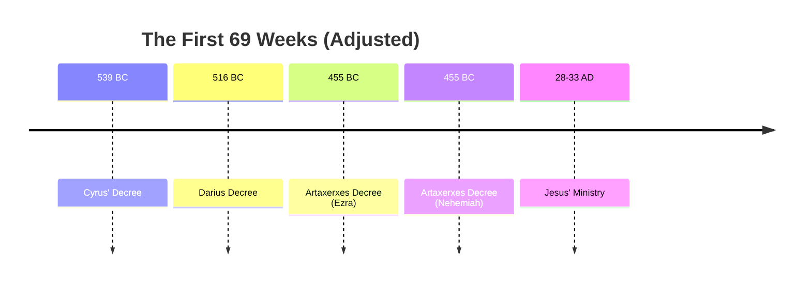

### The Accuracy and Inspiration of Scripture

- Even from a critical scholarly perspective, one must acknowledge that certain texts were written decades before Jesus was born
    - The fact that these writings were accurate down to the year is seen as a miraculous testimony to the inspiration of Scripture
- **[Cautionary Note]** Avoid attempting to be "super hyper-accurate" with specific dates
    - Drawing too fine a line regarding exact timing can lead to dangerous theological ground

### Series Conclusion: Daniel Chapter 9

- This is the fourth session in a series focusing on the prophecies in the latter half of the book of Daniel
    - It is a "party bonus session" designed to round out the study of Daniel chapter 9

### Chronology and Timing of the 70 Weeks

- The focus shifts from analyzing the language and meaning of the 70 weeks prophecy to its specific chronology and timing
    - Previous sessions focused on "soaking in" and extracting meaning from the text of the last four verses
    - This session aims to address the dating of the first through 69th weeks

### Historical Context for the 70 Weeks Prophecy

- To accurately identify the time periods mentioned in the prophecy, it is necessary to utilize historical context
    - This involves looking at extra-biblical (outside the Bible) historical sources
- **[Methodology]** Preference is given to contemporaneous sources
    - These are sources written during the same time period as the historical events they describe, providing the most reliable basis for understanding the chronology

### Purpose and Commencement of the 70 Weeks

[00:03:06](https://www.youtube.com/watch?v=RsHKrWkXHNc&list=PLU8vICW5zFGo&index=4&t=186s)

- **[The Six Objectives]** According to Daniel 9:24, the 70 weeks are decreed to accomplish six specific things in Israel:
    - Finish the transgression
    - Make an end of sin
    - Make atonement for iniquity
    - Bring in everlasting righteousness
    - Seal up vision and prophecy
    - Anoint the most holy place
- **[The Starting Point]** The chronology (the "clock") begins with a specific event:
    - The issuing of a decree to restore and rebuild the city of Jerusalem
- **[The Timeline Breakdown]** From that decree until the arrival of "Messiah the Prince," the prophecy specifies a period of 69 weeks (comprised of seven weeks and sixty-two weeks)
    - During this time, Jerusalem will be rebuilt, including its plaza and moat, even amidst times of distress

### Detailed Breakdown of the 69-Week Timeline

- The total period leading to the Messiah is 69 weeks, which equates to 483 years (69 weeks $\times$ 7 years)
    - **[The First 7 Weeks]** After the initial decree, a period of 7 weeks (49 years) occurs
        - During this time, the city is rebuilt, including its "plaza and moat"
        - This refers to the infrastructure of the entire city of Jerusalem, not just the temple structure
    - **[The Remaining 62 Weeks]** The period continues through times of distress until the arrival of "Messiah the Prince"

### Linguistic Nuance: "Decree" vs. "Word"

- There is a distinction between the NASB translation and the original Hebrew text regarding the starting event
    - The NASB uses the word "decree"
    - The original Hebrew uses the word \*davar", which literally means "word"
    - Consequently, the passage can be read as being triggered "from the going forth of a word"

### Nuances of the Starting "Decree"

- **[Translation Context]** The use of "decree" in English translations (like the NASB) is often an inference made by translators based on the surrounding context
    - The original Hebrew word is \*davar", which literally means "word"
    - Translators may choose "decree" or "proclamation" to convey the official nature of the word being spread
- **[Historical Candidates]** Because the term "word" is less formal than a written legal decree, there is a historical window of approximately 200 years where several different proclamations from Persian kings could qualify as the starting point:
    - The Persian imperial period
    - The Babylonian empire
    - The rise of Alexander the Great (approximately 200 years later)

### Dating the 70 Weeks Prophecy

- **[Theological Perspectives]** There is a distinction in how the timeline is viewed:
    - **Futurist View**: The 70th week is considered a future event, meaning the prophecy is not yet fully completed
    - **Preterist View**: Some argue the entire 70-week prophecy was fulfilled in the first century through the life, death, and resurrection of Jesus
- **[Methodological Approach to Dating]** The goal is not to achieve hyper-accurate, day-by-day precision for the first 69 weeks
    - Some 19th-century methods attempted to calculate the exact number of days from a specific decree to an event in Jesus' ministry
    - Rather than seeking exact dates, it is more practical to identify a reasonable historical range for the prophetic years

### Methodology for Historical Dating

- **[The Goal of Overlap]** Rather than seeking hyper-accurate, day-by-day precision, the focus should be on finding a reasonable historical range
    - Look for overlap between the beginning and end years of the prophecy and specific historical events
    - The chosen events must fit the specific descriptive language used in the prophecy, rather than just picking any random event from history
- **[The Significance of Accuracy]** The ability of the text to be accurate down to the year is significant
    - The book was written hundreds of years (at least 500 years) before the events it describes
    - Even from a critical scholarly perspective, the text was written decades before the birth of Jesus
    - This level of year-by-year accuracy is considered a miraculous testimony to the inspiration of Scripture

### The Value of Prophetic Accuracy

- **[Avoiding Dogmatic Extremes]** While it is important to be accurate, drawing a line that is too fine or being overly dogmatic can lead to dangerous ground regarding historical truth.
- **[The Purpose of the Timeline]** God provided this prophecy to Daniel and the nation of Israel to allow them to know, with relative accuracy, the timing of key events:
    - The arrival of the Messiah, who is specifically named "Messiah the Prince" in this passage.
    - The event where the Messiah would be "cut off" and have nothing.
- **[Historical Context]** This prophecy was given more than 500 years before the fulfillment of the events it describes, serving as a long-term guide for Israel.

### The Responsibility of Recognizing the Visitation

- **[The Concept of Visitation]** Israel and Jerusalem bear the responsibility of knowing the timing of the Messiah's visitation (His first advent)
    - This refers to the period surrounding His first coming, which included His suffering, death, and resurrection
- **[Luke 19:44-45]** This passage illustrates the consequences of failing to recognize the time of visitation:

[00:10:55](https://www.youtube.com/watch?v=RsHKrWkXHNc&list=PLU8vICW5zFGo&index=4&t=655s)

    > For the days will come upon you, when your enemies will set up a barricade around you and surround you and hem you in on every side and tear you down to the ground, you and your children within you. And they will not leave one stone upon another in you, because you did not know the time of your visitation.

    - The speaker suggests this refers to both the historical destruction in 70 AD and a potentially future invasion
- **[Divine Crypticness vs. Accountability]** While God's descriptions of the Messiah's first coming are somewhat cryptic, they are not intentionally vague to the point of being unknowable
    - He provides enough information so that the people of God are "on the hook"
    - They are held accountable for failing to recognize the timing of the Messiah's arrival and His mission

### Candidates for the Starting Decree

- **[The Search for the 'Word']** To fulfill the requirement of knowing the timing of the visitation, the prophecy must be tied to a specific, identifiable historical event: the "going forth of a word."
- **[Persian Decrees]** Several Persian emperors (such as Darius the Great, Xerxes, and Artaxerxes) issued decrees regarding the restoration and rebuilding of Jerusalem, providing multiple candidates for the prophecy's starting point.

#### Candidate 1: Cyrus the Great

- **[Ezra 1:1-3]** One primary candidate is the proclamation made by Cyrus, king of Persia, in his first year (generally dated to 539 BC).
- **[The Proclamation]** The Lord stirred Cyrus's spirit to make a written proclamation throughout his kingdom to rebuild the house of the LORD in Jerusalem.

[00:12:35](https://www.youtube.com/watch?v=RsHKrWkXHNc&list=PLU8vICW5zFGo&index=4&t=755s)

#### Candidate 1: Cyrus the Great (Continued)

- **[Historical Context]** Following the overthrow of the Babylonian empire, Cyrus the Great initiated the end of the Jewish exile.
    - Tens of thousands of people began returning to Jerusalem.
    - Cyrus issued a written proclamation granting permission to rebuild the house of the LORD (the Temple) in Jerusalem.
- **[Timeline Alignment]** The date of this proclamation is approximately 539 BC.
    - Using the 483-year calculation ($69 \\text{ weeks} \\times 7 \\text{ years} = 483 \\text{ years}$), this date lands very close to the first century AD.
- **[Scope of the Decree]** A key distinction is that this proclamation specifically concerns the rebuilding of the **Temple** itself, rather than the rebuilding of the entire city of Jerusalem as described in Daniel 9.

#### Candidate 2: Darius the Great

- **[Ezra 6:1-8]** A second significant candidate is the decree issued by King Darius the Great.
- **[Historical Context]** After the initial returnees began rebuilding the Temple and laying its foundation, they encountered opposition from local inhabitants, which caused the work to stop for several decades.
- **[The Decree]** Darius issued a proclamation to ensure the work continued without interference.
    - He commanded governors (such as Tattenai and Shethar-bozenai) to "keep away" and let the Jews rebuild the house of God on its site.
    - He decreed that the costs for the rebuilding be paid in full and without delay from the royal revenue (the tribute of the province).
- **[Timeline]** This decree is dated to the 6th year of Darius, approximately 516 BC.

[00:15:08](https://www.youtube.com/watch?v=RsHKrWkXHNc&list=PLU8vICW5zFGo&index=4&t=908s)

### Impact of Darius the Great's Decree

- **[Financial Support]** The decree mandated that the costs for rebuilding the house of God be paid in full and without delay.
    - Funding was sourced directly from the royal revenue, specifically the tribute from the province "Beyond the River."
- **[Religious Restoration]** Because the finances were secured and the work was no longer obstructed, the Temple was completed quickly.
    - This allowed for the immediate resumption of full Levitical worship and the priesthood within the city.

#### Candidate 3: Artaxerxes I

- **[Ezra 7:8-15]** A third generation is introduced, involving the priest Ezra and the Persian king Artaxerxes I.
- **[Timeline]** Ezra arrived in Jerusalem in the fifth month, during the seventh year of King Artaxerxes, approximately 458 BC.
- **[The Decree]** The text provides a copy of the letter/decree issued by Artaxerxes to Ezra.
    - It allows anyone of the people of Israel, their priests, or Levites who freely offers to go to Jerusalem to do so.
    - The king and his seven counselors are authorized to make inquiries about Judah and Jerusalem according to the Law of God.
    - The decree also includes the provision of silver and gold offered by the king and his counselors for the God of Israel in Jerusalem.

[00:17:54](https://www.youtube.com/watch?v=RsHKrWkXHNc&list=PLU8vICW5zFGo&index=4&t=1074s)

### Historical Context of Artaxerxes I

- **[Generational Shift]** Artaxerxes ruled several decades after the era of Darius the Great.
    - This period involved the children and grandchildren of the original returnees.
    - These subsequent generations were noted to be struggling with following the Lord and obeying His word.
- **[Lineage]** Artaxerxes is identified as the grandson of Darius.
    - The speaker notes that Artaxerxes' father was likely the king who married Esther and was subsequently assassinated.

### Purpose and Timing of Artaxerxes' Decree

- **[Spiritual Focus]** Unlike previous decrees, this letter was primarily concerned with spiritual leadership rather than physical construction.
    - It provided official permission for Ezra and his group of priests and Levites to return to Jerusalem.
    - The goal was to teach and shepherd the people of God so they might return to the right worship of the Lord.
- **[Chronological Considerations]** The date of 458 BC is used as a primary candidate for the starting point, though its accuracy is subject to debate.
    - Some recent scholarship suggests the date may be off by a few years.
    - **[The Calculation Problem]** If the 483-year period is subtracted from 458 BC, the timeline lands in the first century.
        - This could potentially align the prophecy more closely with the timing of Jesus' ministry.

### Physical vs. Spiritual Rebuilding of Jerusalem

- **[The Spiritual Argument]** Some scholars argue that the "rebuilding of Jerusalem" in the prophecy refers to a spiritual rebuilding rather than a physical one.
- **[Rebuttal]** The speaker rejects this purely spiritual interpretation for the following reasons:
    - While spiritual renewal often accompanies physical rebuilding, the prophecy specifies physical urban infrastructure.
    - The text makes explicit reference to the reconstruction of:
        - Streets
        - Squares
        - Moats or plazas
    - These details describe the infrastructure of a city, which distinguishes the prophecy from the specific mission of Ezra, who was primarily focused on spiritual leadership and teaching.

### Nehemiah's Request and the Royal Decree

[00:22:07](https://www.youtube.com/watch?v=RsHKrWkXHNc&list=PLU8vICW5zFGo&index=4&t=1327s)

- **[The Request]** Nehemiah sought permission from King Artaxerxes to return to Jerusalem, the city of his fathers' graves, to rebuild it.
    - This occurred in the month of Nisan, in the twentieth year of Artaxerxes (approximately 445 BC).
- **[Logistical Provisions]** The decree was not just a verbal permission but involved formal written documentation to ensure the mission's success:
    - **Letters to Governors:** Written letters were required for the governors of the province "Beyond the River" to allow Nehemiah and his group safe passage through their territories.
    - **Resource Allocation:** A specific letter was to be given to Asaph, the keeper of the king's forest, to provide timber.
    - **Intended Uses for Timber:**
        - Beams for the gates of the fortress of the temple
        - Beams for the wall of the city
        - Beams for the house Nehemiah would occupy
- **[Outcome]** The king granted Nehemiah's requests, which the text attributes to the "good hand of my God" being upon him.

### Infrastructure and the Completion of Rebuilding

- **[Connecting Nehemiah to Daniel 9]** The specific infrastructure mentioned in Nehemiah's request directly correlates to the urban rebuilding described in the Daniel 9 prophecy.
- **[Key Structural Elements]** The rebuilding efforts focused on making Jerusalem a functional and defensible city:
    - **Defensive Structures:**
        - The walls of the city
        - The gates of the wall
        - The fortress of the temple (acting as a defense for the city)
    - **Habitation and Urban Life:**
        - Rebuilding places so that other Israelites could move into the city
        - Establishing residential infrastructure to ensure the city was habitable
- **[Timeline Implication]** This comprehensive reconstruction of walls, gates, and residential areas suggests that the completion of the city's infrastructure occurred approximately 50 years after the initial decree.

### Comparing Historical Starting Points for the 483-Year Timeline

To determine which decree best fits the prophecy, the 483-year period (7 weeks + 62 weeks) is applied to various Persian decrees:

[00:25:00](https://www.youtube.com/watch?v=RsHKrWkXHNc&list=PLU8vICW5zFGo&index=4&t=1500s)

| Persian King | Decree | Year Given | + 69 Weeks |
| --- | --- | --- | --- |
| Cyrus the Great | Rebuild Temple (Zerubbabel/Joshua) | 539 BC | 56 BC |
| Darius the Great | Complete Temple (Zerubbabel/Joshua) | 516 BC | 33 BC |
| Artaxerxes I | Levites Return (Ezra) | 458 BC? | 25 AD |
| Artaxerxes I | City Walls/Homes Rebuilt (Nehemiah) | 445 BC? | 38 AD |

- **[The Shift to the AD Era]** While the decrees of Cyrus and Darius result in end dates in the mid-to-late BC era, the decrees of Artaxerxes I move the timeline into the early decades of the first century AD (around the time of Jesus).

### Mathematical Validation of Artaxerxes I Decrees

To test the validity of the Artaxerxes I decrees as the starting point for the 483-year timeline (the 69 weeks of years), the speaker calculates the resulting dates:

- **Testing the Ezra Decree (Levites Return):**
    - Starting Year: 458 BC
    - Calculation: 458 BC + 403 years (the total duration of the 69 weeks)
    - Result: Approximately 45 BC (Note: The speaker's verbal calculation is slightly messy here, but the table shows 25 AD as the target result for 458 BC).
- **Testing the Nehemiah Decree (City Walls/Homes Rebuilt):**
    - Starting Year: 445 BC
    - Calculation: 445 BC + 403 years
    - Result: Approximately 38 AD
- **[Conclusion]**
    - These dates are the only ones that land in the "ballpark" of the first century AD.
    - This proximity to the era of Jesus supports the argument that these decrees are the most likely candidates for the "going forth of a word" mentioned in Daniel 9.

### Establishing the Messianic Timeline

- The 403-year period (the 69 weeks) must conclude within the historical window of Jesus' ministry
    - This is necessary because the prophecy spans from the "going forth of the word" until the appearance of the Messiah, the Prince
- **[Chronological Sources]** To map this timeline accurately, researchers look to historical and biblical sources that prioritize chronology
    - Luke is highlighted as a key source
        - As a physician, his writing style is considered more scientific
        - His approach to the narrative is believed to be more chronological than other Gospel writers

### Chronological Anchors in the Gospels

- **[Narrative Style]** Not all Gospels are written in strict chronological order
    - Some writers organize their accounts thematically around specific subjects
    - Luke and John are noted for being the most chronological in their presentation of events
- **[Luke as a Historical Resource]** Luke provides essential context for pegging the timing of Jesus' ministry
    - He identifies specific leaders in Judea, Syria, and the Roman Empire
    - These markers allow for the anchoring of biblical events to the broader historical timeline

#### Luke 3:1: A Key Chronological Marker

[00:29:14](https://www.youtube.com/watch?v=RsHKrWkXHNc&list=PLU8vICW5zFGo&index=4&t=1754s)

Luke 3:1 serves as a vital anchor for the beginning of John the Baptist's ministry:

> "In the fifteenth year of the reign of Tiberius Caesar, Pontius Pilate being governor of Judea...the word of God came to John the son of Zechariah in the wilderness."

- This verse provides two specific political markers:
    - The 15th year of Tiberius Caesar's reign
    - The governorship of Pontius Pilate in Judea

### Historical Anchors for Jesus' Ministry

- **[The Role of Pontius Pilate]** Pilate's governorship provides a consistent historical framework for the era
    - He was governor during the start of John the Baptist's ministry
    - He remained governor throughout Jesus' ministry, eventually authorizing the crucifixion
- **[Corroborating Historical Sources]** The timeline is supported by multiple contemporary and near-contemporary records
    - All four Gospels and other historical texts confirm Pilate's role
    - The Roman historian Tacitus, writing about a generation after the apostles, provides further attestation

### Refining the Tiberius Caesar Timeline

- **[Re-evaluating the Start of Tiberius's Reign]** The calculation of the messianic timeline depends heavily on when Tiberius Caesar's reign is considered to have begun
    - Standard models often use 14 AD, when he became the sole emperor of Rome
    - However, a more accurate reckoning may be when he became co-regent with his adopted father, Augustus
    - This co-regency likely began around 11 AD, near the time of Jesus's birth
- **[Impact on Ministry Timelines]** Adjusting the start date of Tiberius's reign shifts the estimated windows for key figures:
    - **John the Baptist's ministry**: If starting 15 years after the co-regency begins, this would land around 26-29 AD
    - **Jesus's ministry**: Likely began roughly six months to a year after John the Baptist, placing the start date approximately between 29 AD and 30 AD

### Roman Co-regency and Timeline Implications

- **[The Concept of Co-regency]** An heir would rule alongside the reigning emperor
    - This served to create a smooth transition of power from one reign to the next
    - It ensured the preservation of the emperor's legacy
    - It allowed the successor to be trained as a student of the current ruler, providing opportunities to learn the complexities of leadership
- **[Impact on Historical Dating]** Most historians lean towards using the start of a sole reign for calculations
    - This is because Roman records, such as coinage, documents, and inscriptions, typically do not recognize the beginning of an emperor's reign from the start of a co-regency
    - However, accounting for a co-regency period shifts the chronological windows
    - For example, using a co-regency model for Tiberius Caesar shifts the estimated start of Jesus's ministry to approximately 26-28 AD, rather than the later dates associated with a 14 AD start point

### Standardizing the Chronological Reckoning

- **[The Rule of Sole Reign]** In the ancient world, the numbering of a king or emperor's reign typically began upon their ascension to the throne as the sole ruler
    - While co-regencies (like Tiberius and Augustus) existed for several years, there is little evidence that Romans considered the co-regency as the official start of the reign
    - This distinction is important because historians and contemporary writers (like Luke) would likely have understood reigns according to this common standard
- **[Refined Ministry Timeline]** Applying the sole-reign standard to Tiberius Caesar provides a more historically consistent window for Jesus's ministry:
    - **Tiberius's 15th year**: Calculated as approximately 28-29 AD
    - **Start of Jesus's ministry**: Likely falls within the 29-30 AD window

### Duration of Jesus's Ministry

- The length of Jesus's ministry is estimated to be between three and four years
    - This estimation is supported by the chronological descriptions found in the Gospel of John, which details three separate [events/seasons]...

### Estimating the Duration of Jesus's Ministry

- **[Passover as a Chronological Marker]** The number of Passover feasts attended by Jesus helps estimate the length of His ministry
    - The Gospel of John explicitly mentions three Passover feasts:
        - John 2:13
        - John 6:4
        - John 12:1
    - There is a possibility of a fourth Passover mentioned in the Synoptic Gospels (Matthew, Mark, and Luke)
- **[Estimated Timeline]** Based on these records, Jesus's ministry most likely lasted between three and four years

### Gospel Perspectives on the Crucifixion Timing

- **[The Johannine Account]** In John 19, Jesus is described as being crucified on the day of preparation for the Passover
- **[Perceived Conflict]** This appears to conflict with the Synoptic Gospels (Matthew, Mark, and Luke)
    - The Synoptics imply Jesus shared a Passover meal with His disciples, which would traditionally occur on the night of the Passover
    - John presents the crucifixion occurring one day earlier
    - This is not necessarily a contradiction but a difference in how the timing is framed or recorded

### The Timing of the Last Supper and Crucifixion

- **[The Nature of the Last Supper]** While the meal with His disciples has hallmarks of a Passover meal, it is never explicitly described as one in the Gospels
    - Characteristics present: reclining at the table, singing a hymn, and consuming bread and wine
    - Key detail missing: there is no mention of a lamb being eaten
- **[Chronological Alignment]** The timing of the meal and the crucifixion suggests a specific sequence:
    - **The Meal**: Likely a Passover-like meal held on the night before the actual Passover (the 14th of Nisan)
    - **The Reason**: On the actual day of preparation (the 15th of Nisan), Passover lambs would not be slaughtered until nightfall
    - **The Crucifixion**: By being crucified on the afternoon of the 15th of Nisan, Jesus' death occurred at the exact same time the Passover lambs were being slaughtered in the temple complex
- **[Theological Significance]** This alignment serves as a powerful symbolic connection:
    - As the Passover lambs were being prepared for the meal, Jesus (the Lamb of God) was being slaughtered on the cross

### The Significance of the Double Sabbath

- **[Definition]** A "high Sabbath" or "double Sabbath" occurs when a regular weekly Sabbath falls on the same day as a Jewish holy day
    - Most Jewish holy days are observed with Sabbath-like restrictions
    - When these two overlap, it creates a double Sabbath
- **[The Crucifixion Timing]** According to John, the Passover that year fell on a Sabbath
    - This implies the day of the crucifixion was a Friday
    - The Sabbath period would run from sundown on Friday to sundown on Saturday
- **[Practical Implication]** This timing explains the urgency seen in the Gospel narratives
    - The Jewish leaders were in a rush to conduct the trial and arrest of Jesus before the Sabbath restrictions began

### The Passion Week Timeline

- **[The Sequence of Events]** Following the passion calendar, the timeline of Jesus' final days unfolds as follows:
    - **Thursday Night**: The Last Supper is held, followed by Jesus being arrested later that night
    - **Friday Morning**: Jesus undergoes trial
    - **Friday (Daytime)**: Crucifixion occurs, with Jesus hanging on the cross for at least six hours
    - **Friday Evening**: Jesus is dead, taken down from the cross, and buried before the beginning of the Sabbath
- **[Contextual Constraints]** This tight schedule is driven by two major religious markers:
    - **The Sabbath**: The need to complete the burial before the Sabbath begins
    - **The Passover**: The timing coincides with the seven-day period of the Passover festival

### Jesus as the First Fruits of Resurrection

- **[The Feast of First Fruits]** Occurs on the day immediately following the Sabbath during the Passover week
    - It is the day when men bring a sheaf (an omer) of barley to the temple
    - The high priest waves this sheaf before the Lord as a wave offering
- **[The Chronological Alignment]** If Jesus was crucified on Friday and the Sabbath was Saturday, His resurrection occurred on Sunday
    - This makes Sunday the Feast of First Fruits
    - **[Theological Connection]** Just as the high priest waves the sheaf of barley, Jesus rises from the dead on the day of first fruits, serving as the first fruits of the resurrection

### Astronomical Reconstruction of Ancient Dates

- Astronomers can use mathematical models to reconstruct moon phases and calendar dates from the ancient world
    - This allows for cross-referencing historical accounts with precise astronomical events
- **[Calculating the Crucifixion Date]** During the governorship of Pontius Pilate, there are several potential years, though some are ruled out by chronology
        - One possibility is April 7, 30 AD (depending on the calculated start of Tiberius's reign)
        - The most likely date identified is **April 3, 33 AD**
                - This date corresponds to the 14th day, the Day of Preparation before the Passover

### Astronomical Evidence for the 33 AD Date

- **[The Lunar Eclipse]** On the sunset of April 3, 33 AD (the day the Jewish people prepared to pass over), a lunar eclipse occurred
    - This happened likely just minutes or a few hours after Jesus was taken down from the cross
    - The moon rose over Jerusalem in eclipse, appearing mostly red or dark due to the alignment of the sun, earth, and moon
- **[Chronological Preference]** This astronomical event provides a strong basis for favoring the 33 AD date over other possibilities
    - While 30 AD is a possibility, it lacks this specific astronomical corroboration
    - 34 AD is considered likely too late

### Reconciling the Prophetic Timeline

- **[The Goal]** To place the period of Jesus's ministry (estimated between 28 AD and 33 AD) accurately within the historical framework of the 'First 69 Weeks'
- **[The Challenge]** Achieving exact year-for-year accuracy is difficult because historical dates for Persian decrees can vary by months or even a year

[00:44:58](https://www.youtube.com/watch?v=RsHKrWkXHNc&list=PLU8vICW5zFGo&index=4&t=2698s)

- **[Timeline Overview]** The timeline spans from the Cyrus Decree (539 BC) to 38 AD
    - **Cyrus' Decree**: 539 BC to 56 BC
    - **Darius Decree**: 516 BC to 33 BC
    - **Artaxerxes Decree (Ezra)**: 458 BC to 25 AD
    - **Artaxerxes Decree (Nehemiah)**: 445 BC to 38 AD
    - **Jesus' Ministry**: 28–33 AD
- **[Mathematical Tension]** Using the 483-year prophetic period creates alignment issues depending on which decree is used as the starting point
    - For example, subtracting 483 years from Nehemiah's decree (445 BC) results in a date in the late 30s AD, which falls outside the expected window of Jesus's ministry (the red dot on the timeline)

### The Prophetic Year Method

- **[The Search for Precision]** The speaker aims for a more accurate chronological alignment than just being "close enough"
    - Ideally, the 69th week should land within approximately one year of the beginning of Jesus's ministry
- **[Methodology]** A popular method for calculating the first 69 weeks is known as the "prophetic year"
    - This method is widely used in modern evangelical Christianity, particularly among dispensationalists
    - **[Historical Origin]** The modern version of this calculation was popularized by Sir Robert Anderson in his 1882 book, *The Coming Prince*

### Sir Robert Anderson's Calculation Method

- **[The Scholar]** Sir Robert Anderson was a scholar who sought to calculate the exact years of the 70th-week prophecy
- **[Calendar Distinction]** His method relies on a distinction between lunar and solar calendars
    - **Lunar Calendars**: Based on the cycles of the moon; used by many ancient civilizations (Chinese, Mesoamerican, etc.) for religious or civil purposes
    - **Solar Calendars**: Based on the sun; these factor in extra days (such as leap days every four years) to maintain alignment with the solar year
- **[The Method]** Unlike standard approaches that might use a 365-day lunar year, Anderson's calculations utilize the solar year to achieve higher mathematical precision

### The Israelite Lunar Calendar

- **[Seasonal Alignment]** Ancient calendars required mechanisms to ensure months remained synchronized with the seasons and astronomical cycles
- **[Lunar Cycle Mechanics]** The system was based on a lunar cycle averaging between 29 and 30 days (from new moon to full moon and back to no moon)
- **[The 19-Year Cycle]** To prevent seasonal drift, a specific intercalation method was used:
    - The entire lunar cycle operated on a 19-year period
    - Seven leap months (each approximately 30 days) were added throughout these 19 years
    - **[Purpose]** This "funky" addition kept the lunar calendar in alignment with the solar year and the seasons

### Biblical Feast Days and Agricultural Cycles

- **[Dual Significance]** Biblical feasts serve two primary purposes:
    - **Historical**: Commemorating events like the Exodus and the giving of the Torah
    - **Agricultural**: Aligning with the natural cycles of the land (e.g., spring and fall feasts)
- **The Sabbatical Year (Shmita)**
    - The land is farmed for six years
    - The seventh year is a Sabbath for the land, meaning it is left fallow
- **The Jubilee Cycle**
    - Following seven cycles of seven years (49 years total), a Jubilee year occurs
    - **[Social/Economic Reset]** The Jubilee functioned as a total reset for the community:
        - Indentured servants were released from their servitude
        - Land was returned to the original tribes and clans to which it belonged
        - Economic and social standing was restored to its original state

### Connection Between Feasts and Agriculture

- **[Agricultural Anchoring]** Biblical holy days are pinned to specific agricultural events and seasonal cycles
- **[Spring Feasts]** Tied to the wheat harvest
- **[Fall Feasts]** Tied to the fruit harvest
    - Includes crops such as pomegranates, dates, and grapes
    - Associated with the production of wine and oil
    - Occurs before the arrival of the latter rains

### The Feast of Ingathering (Sukkot)

- **[Definition]** Also known as the feast of ingathering, it celebrates the collection of all fruits.
- **[Botanical Connection]** The feast is celebrated using plants native to Israel:
    - **Etrog**: A specific type of citrus fruit
    - **Lulof**: A branch from a date palm tree

### Prophetic Timeframes and Calendars

- **[The 1,290 Day Period]** In the book of Daniel, specific time periods are mentioned, such as 1,290 days.
- **[Calendar Discrepancies]** These numbers create a mathematical puzzle when trying to align them with solar years:
    - 1,290 days is not exactly three and a half years according to a solar calendar
    - **[Potential Solution]** The timing may be calculated based on a 30-day monthly lunar calendar, which would change the interpretation of the duration.

### Anderson's Prophetic Day Calculation

- **[The 360-Day Year]** Instead of using a standard lunar year, Anderson's calculation relies on a 360-day year
- **[The Calculation Process]**
    - He calculated the exact number of days from the decree allowing Nehemiah to rebuild the walls of Jerusalem
    - He projected 170,000 days forward based on the 69-week prophetic timeline
- **[The Result]**
    - The calculation lands exactly six days before Passover in 33 AD

### Limitations of the 360-Day Calculation Model

- **[The Popular View]** Many commentaries and study Bibles suggest that Anderson's method is "super accurate" because it aligns the 69 weeks with the 360-day prophetic cycles and the timing of Jesus's ministry in Jerusalem.
- **[The Lunar Discrepancy]** A major flaw in assuming a standard 30-day lunar month is that a true lunar cycle is actually an average of 29.5 days.
    - **[Cumulative Error]** While a 0.5-day difference seems negligible in the short term, it creates a massive gap over long durations:
        - In a single year, a 30-day assumption results in a 354-day year (6 days short of a 360-day year).
        - Over a 403-year period, these small discrepancies can result in being off by several years.

### Historical Validity of the Prophetic Year

- **[The Core Problem]** While Anderson's theory successfully lands within the period of Jesus's ministry (targeting AD 30 or 33), it lacks historical and textual support:
    - There is no evidence that the Hebrews ever used a 360-day "prophetic year" for their reckoning.
    - No biblical text instructs the use of such a year for prophetic fulfillment.
- **[The Lunisolar Reality]** The Hebrew calendar was actually a lunisolar system:
    - It relied on lunar cycles but was adjusted to stay aligned with the solar seasons.
    - **[Why alignment mattered]** This was necessary to ensure that holy days, as described in Leviticus, consistently coincided with the correct seasonal harvests.

### Logical and Practical Failures of the 360-Day Model

- **[Solar Year Discrepancy]** The actual solar year is approximately 365.25 days
    - Using a 360-day model creates a significant gap every year
    - **[Cumulative Error]** This discrepancy grows rapidly over time:
            - In just one year, the calendar would be off by roughly 5 days
            - Over a 10-year period, the error accumulates to approximately 110 days
- **[Theory vs. Reality]** While the 360-day model might theoretically land within the general timeframe of Jesus's ministry, it fails as a logical method for dating history or the world
    - There is no historical or textual evidence that the Hebrews ever used such a year for their reckoning
    - The model is a popular interpretation but lacks practical validity when compared to the Bible as a historical document

### Resolving Chronological Discrepancies

- **[The Conundrum]** If neither the lunisolar year nor the 360-day prophetic year provides a precise fit for the timeline, two primary possibilities remain:
    - The timeline is simply off by a few years.
    - The historical dates used for the reigns of Persian kings might be inaccurate.
- **[Historical Uncertainties]** The speaker notes that certain dates in the timeline are not absolute:
    - Partial marks were used for specific decrees, such as the one allowing Ezra and the Levites to return to the land.
    - The date for Nehemiah's return to rebuild the wall is also subject to these historical considerations.
- **[Nehemiah's Timeline Example]**
    - Nehemiah received letters to rebuild the wall in the 20th year of Artaxerxes' reign.
    - **[Calculation]** If the target year is 445, subtracting the 20 years of Artaxerxes' reign points to a date of 465.

### The Babylonian King's List and Chronological Verification

- **[Method of Verification]** To determine when a reign (like Artaxerxes' in 465) began, historians rely on king's lists created by the late Babylonians
- **[Scope of the List]** The list provides a continuous record spanning several centuries:
    - Starts with Nabalpolaus (the father of Nabopolassar, founder of the Neo-Babylonian Empire)
    - Continues through the Neo-Babylonian Empire and its vassal kings under Persian rule
    - Extends approximately 250 to 300 years forward to the era of Alexander the Great
- **[Reckoning System]** The list does not use modern BC/AD dating
    - It uses a calendar based on the fixed date of Nabalpolaus' reign
    - **[Celestial Anchors]** Dates are often established by describing reigns in relation to specific celestial events

### Scholarly Basis and Limitations of Chronology

- **[Academic Foundation]** The arguments presented are based on original research and peer-reviewed academic sources rather than casual commentary
    - Key resource mentioned: *The Chronology of the Old Testament: Return to the Basics* by Floyd Nelson Jones
- **[Limitations of the Babylonian King's List]** While useful for establishing timelines, the list has specific gaps that can affect accuracy:
    - **Co-regencies**: It does not include periods where a king and his heir ruled simultaneously
    - **Usurpers**: It does not account for individuals who seized the throne temporarily before being overthrown

### Impact of Historical Variables on Timelines

- **[Chronological Shifts]** Certain historical events can either compress or elongate a timeline:
    - **Co-regencies**: When a king and his heir rule simultaneously for several years.
    - **Usurpers**: When an individual seizes the throne temporarily before being overthrown and the original dynasty is restored.
- **[Cumulative Error]** Because these events can occur across multiple kings over several centuries, the total timeline can be off by quite a few years.

### Ptolemy's Canon and the Accepted Timeline

- **[Origin of the Date]** The general accepted timeframe for the beginning of Artaxerxes' reign (around 465 or 455) was popularized by Ptolemy.
    - **Who was Ptolemy?** A Greek mathematician and polymath from the second century.
    - **[Ptolemy's Canon]** A historical work that functioned as a king's list.
- **[Methodology]** Ptolemy's list was constructed by drawing upon Babylonian kings and other available historical records that existed 1,800 years ago but are no longer accessible today.

### Discrepancies in Artaxerxes' Reign Timeline

- **[The Ptolemy Bias]** The standard timeframe for Artaxerxes' reign is heavily influenced by Ptolemy's Canon and the Babylonian king's list, which are often given more weight than other sources.
- **[Contemporary Counter-Evidence]** There are historians who lived within a generation of these events—effectively contemporaries—who provide different dates:
    - These accounts describe Artaxerxes being on the throne for specific events that occurred *before* 465 BC.
    - One such account involves an Athenian/Greek man visiting Artaxerxes, with dates potentially placing the event around 471, 473, or 478 BC.
    - **[Historical Context]** At this time, the Persian Empire was still in control, even as the Greek world was on the rise (similar to the era depicted in the movie *300*).

### Additional Evidence for Artaxerxes' Timeline

- **[Alternative Chronological Markers]** Beyond contemporary historians, other systems can be used to pin down the timing of a reign:
    - **Olympiads**: Historical records often note that kings reigned during specific Olympiads (cycles of four-year athletic competitions in Greece).
    - **Astrological Records**: Specific astronomical events recorded on tablets can provide precise dates for the deaths or successions of monarchs.
- **[The Death of Xerxes]** A Babylonian astrological tablet provides a concrete anchor for the timeline:
    - The tablet records that Xerxes (the father of Artaxerxes) died between two lunar eclipses (one full and one partial).
    - This event is dated to 475 BC.
    - **[Implication]** Because Xerxes died in 475 BC, Artaxerxes would have been on the throne by the 470s BC, several years earlier than the dates suggested by the Babylonian king's list used in standard chronologies.

### Recalculating the 69 Weeks Timeline

- **[Adjusting Artaxerxes' Reign]** Based on the earlier evidence regarding Xerxes' death in 475 BC, Artaxerxes likely began his reign in 475-474 BC rather than 465 BC.
    - This represents a shift of roughly 9 to 10 years earlier than the standard chronology.
- **[Impact on the 69 Weeks]** This adjustment directly affects the calculated end of the 69 weeks:
        - The previous end date (based on the Nehemiah decree) was 38 AD, which was considered too late for Jesus' ministry.
        - Subtracting the 9-10 year discrepancy from 38 AD results in an end date of approximately **28 or 29 AD**.
- **[Chronological Alignment]** This new timeframe (28-29 AD) aligns closely with the historical beginning of Jesus' ministry and the appearance of John the Baptist.

### Validation of the Refined Chronology

- **[Accuracy achieved]** By using historical sources from the same generation as the events, the timeline can be pinpointed to within approximately one year of the beginning of the first week and the end of the 69th week.
- **[Model stability]** This precision does not require "fancy reworking" of the year length; the 365-day year remains a viable and accurate model for this calculation.
- **[Theological implication]** The ability to align these dates so closely with the beginning of Jesus' ministry serves as a testimony to:
    - The accuracy of the Word of God
    - The inspiration of Scripture
    - The historical reality that Jesus' generation could have known the "time of His visitation" and were held responsible for missing it.

### The 70th Week

- The focus shifts to determining the timing and nature of the final 70th week.