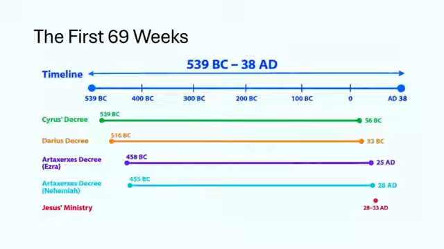
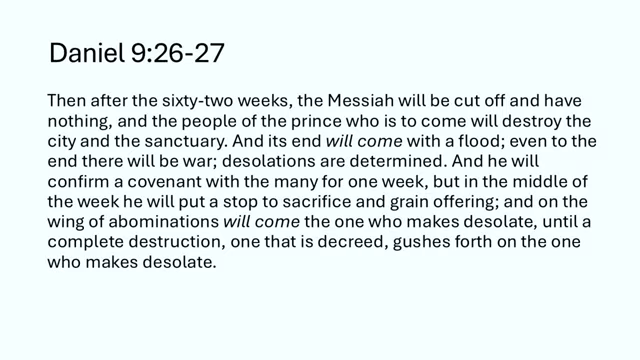
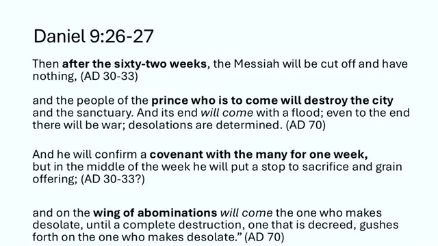
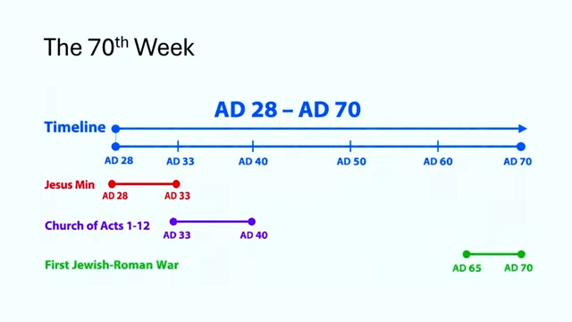
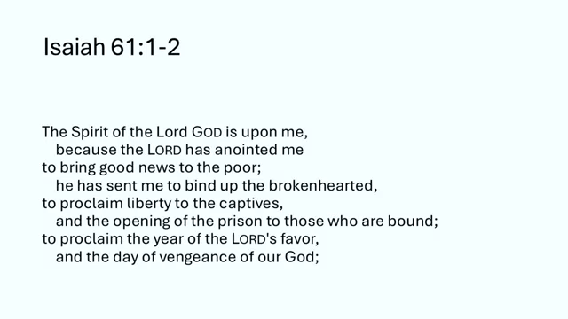

# ದಾನಿಯೇಲನ 70 ವಾರಗಳು (Daniel's 70 Weeks) – ಭಾಗ 5
## 70ನೇ ವಾರ ಮೊದಲ ಶತಮಾನದಲ್ಲೇ ಮುಗಿದುಹೋಯ್ತಾ? ಪ್ರೀಟೆರಿಸ್ಟ್ ವಾದಗಳ ಪರೀಕ್ಷೆ ಮತ್ತೆ ಪ್ರವಾದನೆಯ ಟೆಲಿಸ್ಕೋಪ್

---

## ಪೀಠಿಕೆ: ದಾನಿಯೇಲ 9ರ ಕೊನೆಯ ಸೆಷನ್

ಇದು ದಾನಿಯೇಲ 9ರ 70 ವಾರಗಳ ಭವಿಷ್ಯವಾಣಿಯ (prophecy — ಮುಂದೆ ಏನಾಗುತ್ತೆ ಅಂತ ದೇವರು ಮೊದಲೇ ಹೇಳಿದ ಮಾತು) ಕ್ರೊನಾಲಜಿ (chronology — ಘಟನೆಗಳ ಕಾಲಕ್ರಮ, ಯಾವುದು ಯಾವಾಗ ಅನ್ನೋ ಲೆಕ್ಕ) ಬಗ್ಗೆ ನಮ್ಮ ಬೋನಸ್ ಅಧ್ಯಯನದ ಎರಡನೇ ಭಾಗ. ನಿಮಗೆ ಮೊದಲೇ ಹೇಳ್ತೀನಿ, ದಾನಿಯೇಲ 9ರ ಮೇಲಿನ ಕೊನೆಯ ಸೆಷನ್ ಇದೇ. ಇದನ್ನ ಕೇಳಿ ನಿಮಗೆ ಖುಷಿ ಆಗಿರಬಹುದು, ಬೇಜಾರೂ ಆಗಿರಬಹುದು, ಇಲ್ಲಾ ಎರಡೂ ಸ್ವಲ್ಪ ಸ್ವಲ್ಪ ಆಗಿರಬಹುದು. ಯಾವ ಭಾವನೆ ಇದ್ರೂ ಪರವಾಗಿಲ್ಲ, ಎಲ್ಲವೂ ಸರಿಯೇ.

ನನಗಂತೂ ಖುಷಿ. ದಾನಿಯೇಲ 9ರ ಈ ಸರಣಿಯನ್ನ ಕೊನೆಗೂ ಮುಗಿಸ್ತಿದ್ದೀನಿ. ಯಾಕಂದ್ರೆ ಇದಾದ ಮೇಲೆ ದಾನಿಯೇಲ ಪುಸ್ತಕದ ಕೊನೆಯ ಮೂರು ಅಧ್ಯಾಯಗಳ ಪ್ರಯಾಣ ಶುರು ಮಾಡ್ತೀವಿ. ಅಧ್ಯಾಯ 10, 11 ಮತ್ತೆ 12. ಮೊದಲೇ ಹೇಳಿದ ಹಾಗೆ ಇವು ಮೂರೂ ಸೇರಿ ಒಂದೇ ನಿರಂತರ ಭವಿಷ್ಯವಾಣಿ. ಅದರ ಕೇಂದ್ರ ವಿಷಯ ಉತ್ತರದ ರಾಜರು ಮತ್ತೆ ದಕ್ಷಿಣದ ರಾಜರ ಬಗ್ಗೆ ಇರೋ ಭವಿಷ್ಯವಾಣಿಗಳು.

ಈ ವಿಷಯ ನನಗೆ ತುಂಬಾ ಹತ್ತಿರದ್ದು. ಉತ್ತರ ಮತ್ತೆ ದಕ್ಷಿಣದ ರಾಜರ ಬಗ್ಗೆ ಬೇಕಾದಷ್ಟು ಸಮಯ ಕೊಟ್ಟು ಸಂಶೋಧನೆ ಮಾಡಿದ್ದೀನಿ, ಇತಿಹಾಸದ ದೃಷ್ಟಿಯಿಂದಲೂ, ಪ್ರವಾದನೆಯ ದೃಷ್ಟಿಯಿಂದಲೂ, ಅಂತ್ಯಕಾಲದ ದೃಷ್ಟಿಯಿಂದಲೂ (eschatology — ಲೋಕದ ಕೊನೆಯ ಕಾಲದ ಬಗ್ಗೆ ಅಧ್ಯಯನ). ಆ ಭಾಗದ ಬಗ್ಗೆ ನಿಮ್ಮ ಜೊತೆ ಕೂತು ಒಂದೊಂದನ್ನೂ ಬಿಡಿಸಿ ನೋಡೋಕೆ ನಾನು ಕಾಯ್ತಿದ್ದೀನಿ. ಅದು ಅಧ್ಯಾಯ 12ರಲ್ಲಿ ಕೊನೆಗೊಳ್ಳುತ್ತೆ, ಅಲ್ಲಿ ಯಾಕೋಬನ ಸಂಕಟದ ಕಾಲ (the time of Jacob's trouble — ಇಸ್ರಾಯೇಲಿಗೆ ಬರೋ ಮಹಾ ಸಂಕಟ) ಇದೆ, ಸತ್ತವರ ಪುನರುತ್ಥಾನ ಇದೆ, ಇಂಥ ಅದ್ಭುತ ಅಂತಿಮ ಘಟನೆಗಳು ದಾನಿಯೇಲ ಪುಸ್ತಕದ ಕೊನೆಯಲ್ಲೇ ಇವೆ.

ಆದ್ರೆ ಅದಕ್ಕೆ ಮೊದಲು ಇವತ್ತಿನ ಕೆಲಸ ಮುಗಿಸೋಣ. ದಾನಿಯೇಲನ 70ನೇ ವಾರದ ಐತಿಹಾಸಿಕ ಸಮಯದ ಬಗ್ಗೆ ಮಾತಾಡೋದನ್ನ ಮುಗಿಸ್ತೀವಿ. ಜೊತೆಗೆ ಅಂತ್ಯಕಾಲದ ಸಮಯದ ಬಗ್ಗೆಯೂ ಸ್ವಲ್ಪ ನೋಡ್ತೀವಿ. ಆದ್ರೆ ದಿನಾಂಕ ನಿಗದಿ ಮಾಡೋ ಕೆಲಸ ಮಾಡೋದಿಲ್ಲ. ಕನಿಷ್ಠ ಕೊನೆಯ ಭಾಗಕ್ಕೆ ಅಲ್ಲ. ಇತಿಹಾಸದ ಭಾಗಕ್ಕೆ ಮಾತ್ರ ತಾರೀಖುಗಳನ್ನ ಹೇಳ್ತೀವಿ.

---

## ಮೊದಲ 69 ವಾರಗಳ ಒಂದು ಸಣ್ಣ ಪುನರಾವಲೋಕನ

ಹಿಂದಿನ ಸೆಷನ್ ನೋಡಿದ್ರೆ ನಿಮಗೆ ನೆನಪಿರುತ್ತೆ. 70 ವಾರಗಳ ಭವಿಷ್ಯವಾಣಿಯ 1ರಿಂದ 69ನೇ ವಾರಗಳನ್ನ ನಾವು ಹಾದುಹೋದ್ವಿ. 70 ವಾರಗಳನ್ನ ಶುರು ಮಾಡೋ ಆಜ್ಞೆಯನ್ನ ಸುಮಾರು 12 ತಿಂಗಳಿನ ಒಳಗಿನ ನಿಖರತೆಗೆ ಗುರುತಿಸಿದ್ವಿ. ಆ ಆಜ್ಞೆ ಯೆರೂಸಲೇಮ್ ಪಟ್ಟಣವನ್ನ ಬೀದಿ ಮತ್ತೆ ಕಂದಕದ ಜೊತೆ ಕಟ್ಟೋ ಬಗ್ಗೆ. ಏಳು ವಾರಗಳು, ಅಂದ್ರೆ 49 ವರ್ಷ, ಪಟ್ಟಣ ಪೂರ್ತಿ ಕಟ್ಟಲ್ಪಡೋವರೆಗೆ. ಆ ಆಜ್ಞೆಯ ಆರಂಭದಿಂದ ದಾನಿಯೇಲ 9ರಲ್ಲಿ ವರ್ಣಿಸಿರೋ "ಮೆಶ್ಶಾಯ ರಾಜಕುಮಾರ" ಬರೋವರೆಗೆ 483 ವರ್ಷ.

ಗೇಬ್ರಿಯೇಲ ದೇವದೂತ ಯಾವ ಆಜ್ಞೆಯ ಬಗ್ಗೆ ಹೇಳ್ತಿರಬಹುದು ಅನ್ನೋದಕ್ಕೆ ಹಲವು ಆಯ್ಕೆಗಳ ಬಗ್ಗೆ ಮಾತಾಡಿದ್ವಿ. ಕೊನೆಗೆ ಗಟ್ಟಿಯಾಗಿ ನಿಂತಿದ್ದು ಪರ್ಷಿಯನ್ ರಾಜ ಅರ್ತಷಸ್ತನಿಂದ ಹೊರಟ ಮಾತು, ಅಂದ್ರೆ ನೆಹೆಮೀಯ ನದಿಯಾಚೆಯ ಎಲ್ಲ ರಾಜ್ಯಪಾಲರಿಗೂ, ಯೂದಾಯದಲ್ಲೂ ತಗೊಂಡು ಹೋದ ಪತ್ರಗಳು, ಗೋಡೆಯ ಪುನರ್‌ನಿರ್ಮಾಣಕ್ಕಾಗಿ. ಅದೇ ಯೆರೂಸಲೇಮ್ ಪಟ್ಟಣದ ಪುನರ್‌ನಿರ್ಮಾಣ ಮತ್ತೆ ಪುನರ್ವಸತಿಯನ್ನ ಮುಂದಿನ ದಶಕಗಳಲ್ಲಿ ಶುರು ಮಾಡಿದ್ದು. ಹಾಗಾಗಿ ಯೇಸುವಿನ ಕಾಲದ ಮೊದಲ ಶತಮಾನದ ಹೊತ್ತಿಗೆ ಪಟ್ಟಣದಲ್ಲಿ ಚೆನ್ನಾಗಿ ಜನವಸತಿ ಇತ್ತು. ಅದು ಆ ಆಜ್ಞೆಯ ನಂತರ ಹೆಚ್ಚುಕಡಿಮೆ 483 ವರ್ಷ, ಅಂದ್ರೆ ಸುಮಾರು ಕ್ರಿ.ಶ. 28ರ ಹತ್ತಿರ ಬರುತ್ತೆ. ಇದೆಲ್ಲ ನಾವು ಹಿಂದಿನ ಸೆಷನ್‌ನಲ್ಲಿ ಮಾತಾಡಿದ್ವಿ. ಪರ್ಷಿಯನ್ ರಾಜರ ಕಾಲರೇಖೆಯನ್ನ ಸ್ವಲ್ಪ ಮರುಹೊಂದಿಸಬೇಕಾಗಬಹುದು ಅನ್ನೋದನ್ನೂ ಹೇಳಿದ್ವಿ.

ನೀವು ಆ ಸೆಷನ್ ನೋಡಿಲ್ಲ ಅಂದ್ರೆ ಅದರಲ್ಲಿ ಇದೆಲ್ಲ ಇದೆ. ಅಲ್ಲಿ ಶೈಕ್ಷಣಿಕ ಮೂಲಗಳ ಕೆಲವು ಲಿಂಕ್‌ಗಳನ್ನೂ ಕೊಟ್ಟಿದ್ದೀನಿ, ನೀವೇ ಸ್ವಂತ ಸಂಶೋಧನೆ ಮಾಡೋಕೆ. ಅದನ್ನ ಈಗ ಮತ್ತೆ ಹೇಳೋದಿಲ್ಲ. ಆದ್ರೆ 70 ವಾರಗಳ ಭವಿಷ್ಯವಾಣಿಯಲ್ಲಿ ನಾವು ಎಲ್ಲಿದ್ದೀವಿ ಅಂತ ಹಿಡಿದುಕೊಳ್ಳೋಕೆ ಇಷ್ಟು ಹೇಳಿದೆ. ನಾವು ಬಂದು ನಿಂತಿದ್ದು ಯೇಸುವಿನ ಶಿಲುಬೆಗೇರಿಸುವಿಕೆ ಮತ್ತೆ ಪುನರುತ್ಥಾನದ ಹತ್ತಿರ. ಅದು ಬಹುಶಃ ಕ್ರಿ.ಶ. 30ರಲ್ಲಿ ನಡೆದಿರಬೇಕು, ಇಲ್ಲಾ ಕ್ರಿ.ಶ. 33ರಲ್ಲಿ. ಆ ವರ್ಷಗಳಲ್ಲಿ ಒಂದು ಅತ್ಯಂತ ಸಂಭಾವ್ಯ, ಇನ್ನೊಂದು ಎರಡನೇ ಅತ್ಯುತ್ತಮ ಆಯ್ಕೆ. ಈ ಲೆಕ್ಕದಲ್ಲಿ ಮುಂದೆ ಉಳಿದಿರೋದು ಇನ್ನೊಂದೇ ವಾರ. ಅಂದ್ರೆ 490 ವರ್ಷ ಪೂರ್ತಿ ಮಾಡೋ 70ನೇ ವಾರ.

---

## 70ನೇ ವಾರದ ಬಗ್ಗೆ ಬೇರೆ ಬೇರೆ ನೋಟಗಳು

ಹಿಂದಿನ ಸೆಷನ್‌ನಲ್ಲಿ ಒಂದು ಮಾತು ಹೇಳಿದ್ದೆ, ಈ ಸರಣಿಯಲ್ಲಿ ಮತ್ತೆ ಮತ್ತೆ ಹೇಳ್ತಾ ಬಂದಿರೋ ಮಾತು. ನಾವು ಫ್ಯೂಚರಿಸ್ಟ್ (Futurist — ಭವಿಷ್ಯವಾಣಿಯ ಮುಖ್ಯ ಭಾಗ ಇನ್ನೂ ಮುಂದೆ ನೆರವೇರುತ್ತೆ ಅನ್ನೋರು) ಪ್ರಿಮಿಲೆನಿಯಲಿಸ್ಟ್‌ಗಳು (Premillennialists — ಕ್ರಿಸ್ತ ಮರಳಿ ಬಂದ ಮೇಲೆ ಅಕ್ಷರಶಃ ಸಾವಿರ ವರ್ಷದ ಆಳ್ವಿಕೆ ಇದೆ ಅನ್ನೋರು). ನಮ್ಮ ಆಮಿಲೆನಿಯಲ್ (Amillennial — ಆ ಸಾವಿರ ವರ್ಷ ಸಾಂಕೇತಿಕ ಅಂತ ನಂಬೋರು) ಮತ್ತೆ ಪೋಸ್ಟ್‌ಮಿಲೆನಿಯಲ್ (Post-millennial — ಕ್ರಿಸ್ತ ಮರಳೋದು ಸಾವಿರ ವರ್ಷದ ಶಾಂತಿ ಯುಗದ ನಂತರ ಅಂತ ನಂಬೋರು) ಸಹೋದರ ಸಹೋದರಿಯರು ಬೇರೆ ನಿಲುವು ಇಟ್ಟುಕೊಂಡಿದ್ದಾರೆ. ಅವರು ಸಾಮಾನ್ಯವಾಗಿ ಒಂದೇ ತರ ನಂಬ್ತಾರೆ, ಅದರಲ್ಲೂ 70 ವಾರಗಳ ಬಗ್ಗೆ.

ಅವರು 70ನೇ ವಾರವನ್ನ ಹೇಗೆ ನೋಡ್ತಾರೆ ಅನ್ನೋದನ್ನ ಅರ್ಥ ಮಾಡ್ಕೊಳ್ಳೋಕೆ ಈ ಸೆಷನ್‌ನಲ್ಲಿ ಸ್ವಲ್ಪ ಸಮಯ ಕೊಡ್ತೀನಿ. ಅವರ ನೋಟ ತರ್ಕಬದ್ಧ, ಅರ್ಥ ಆಗುವಂಥದ್ದು. ಅದನ್ನ ಅವರು ಒಪ್ಕೊಂಡಿರೋದಕ್ಕೆ ಕಾರಣಗಳಿವೆ. ಅದಕ್ಕೇ ಚರ್ಚ್ ಇತಿಹಾಸದುದ್ದಕ್ಕೂ ಸಭೆಯ ಅನೇಕ ಪಂಗಡಗಳು ಅದನ್ನ ಸ್ವೀಕರಿಸಿವೆ. ನಾವು ಫ್ಯೂಚರಿಸ್ಟ್ ಪ್ರಿಮಿಲೆನಿಯಲಿಸ್ಟ್‌ಗಳಂತೂ 70ನೇ ವಾರ ಇನ್ನೂ ಭವಿಷ್ಯದಲ್ಲಿದೆ ಅಂತಲೇ ನೋಡ್ತೀವಿ. ವಚನ 25, 26, 27ರ ಭಾಷೆಯನ್ನ ಅಗೆದು ನೋಡಿದಾಗ ಎರಡನೇ ಮತ್ತೆ ಮೂರನೇ ಸೆಷನ್‌ಗಳಲ್ಲಿ ಇದನ್ನ ಸಾಕಷ್ಟು ಮಾತಾಡಿದ್ದೀವಿ. ಆ ಭಾಷೆಯ ವಿವರವನ್ನ ಇವತ್ತು ಮತ್ತೆ ಹೇಳೋಕೆ ನನ್ನಿಂದ ಆಗೋದಿಲ್ಲ. ನೀವು ಆ ಸೆಷನ್‌ಗಳನ್ನ ನೋಡಿಲ್ಲ ಅಂದ್ರೆ ಹಿಂದೆ ಹೋಗಿ ನೋಡಿ. ಇವತ್ತು ನಾನು ಮಾಡೋದು, ಇಂದಿನ ಸಭೆಯ ಬೇರೆ ಬೇರೆ ಭಾಗಗಳು ದಾನಿಯೇಲನ 70ನೇ ವಾರವನ್ನ ಹೇಗೆ ನೋಡ್ತವೆ ಅನ್ನೋದನ್ನ ಹೇಳೋದು ಮಾತ್ರ.

---

## ಮೊದಲ 69 ವಾರಗಳ ಕಾಲರೇಖೆ

ಸರಿ, ನಾನು ಈ ಹಿಂದೆ ರಚಿಸಿದ ಕಾಲರೇಖೆಗೆ ಮತ್ತೆ ಹೋಗೋಣ. ನಾವು ಎಲ್ಲಿದ್ದೀವಿ ಅಂತ ಒಮ್ಮೆ ಬೇಗ ನೋಡಿಬಿಡೋಣ. ಈ ಕಾಲರೇಖೆ ಕ್ರಿ.ಪೂ. 539ರಿಂದ ಶುರುವಾಗುತ್ತೆ. ಅದು ಮಹಾನ್ ಕೋರೆಷ್‌ನ ಆಜ್ಞೆ ಮತ್ತೆ ಗಡೀಪಾರಾಗಿದ್ದವರ (exiles — ಬಲವಂತವಾಗಿ ತಮ್ಮ ದೇಶದಿಂದ ಹೊರಗೆ ಇದ್ದವರು) ಮೊದಲ ಮರಳುವಿಕೆ. ಯೇಸು ಹುಟ್ಟೋದಕ್ಕೆ ಸುಮಾರು 540 ವರ್ಷ ಮೊದಲು. ಅದಕ್ಕೆ ಕೆಲವು ವರ್ಷ ಹಿಡಿಯುತ್ತೆ. ಈ ಪ್ರತಿಯೊಂದು ಆಜ್ಞೆಗೂ ನಾವು 483 ವರ್ಷ ಕೂಡಿಸಿದ್ವಿ, ಅಂದ್ರೆ 69 ವರ್ಷ-ವಾರಗಳು.

ಆಮೇಲೆ ಮಹಾನ್ ದರ್ಯಾವೆಷ, ಮತ್ತೆ ಅರ್ತಷಸ್ತನ ಎರಡು ಆಜ್ಞೆಗಳು. ಆ ಎರಡು ಅರ್ತಷಸ್ತನ ಆಜ್ಞೆಗಳೇ ಅತ್ಯುತ್ತಮ ಆಯ್ಕೆಗಳು, ಯಾಕಂದ್ರೆ ಅವು ಯೇಸುವಿನ ಸೇವೆಯ ಎರಡೂ ಕಡೆ ಬಂದು ಬೀಳ್ತವೆ. ನಮಗೆ ಸಿಕ್ಕಿರೋ ಅತ್ಯುತ್ತಮ ಸಮಕಾಲೀನ ಮೂಲಗಳ ಸಾಕ್ಷ್ಯ ಪ್ರಕಾರ, ಮೊದಲ ಶತಮಾನದ ಮೊದಲ ದಶಕಗಳಲ್ಲಿ ಯೇಸುವಿನ ಸೇವೆ ಬಹುಶಃ ಸ್ನಾನಿಕ ಯೋಹಾನನ ಸೇವೆಯ ತಕ್ಷಣ ನಂತರ, ಸುಮಾರು ಕ್ರಿ.ಶ. 28 ಅಥವಾ 29ರ ಹೊತ್ತಿಗೆ ಶುರುವಾಗಿ, ಹೆಚ್ಚಾಗಿ ಕ್ರಿ.ಶ. 33ರ ಸುಮಾರಿಗೆ ಮುಗಿದಿರಬೇಕು.

---

## ದಾನಿಯೇಲ 9:26-27 ಮತ್ತೆ ಓದೋಣ

ಹಾಗಾದ್ರೆ ಇಲ್ಲಿಂದ ಎಲ್ಲಿಗೆ ಹೋಗೋದು? ನಾನು ದಾನಿಯೇಲ 9ರ 26 ಮತ್ತೆ 27ನೇ ವಚನಗಳನ್ನ ಮತ್ತೆ ಓದ್ತೀನಿ. ಅವು 70ನೇ ವಾರಕ್ಕೆ ನಡೆಸುತ್ತವೆ. ಆ ವಚನಗಳ ಭಾಷೆಯ ಪರಿಚಯ ಮತ್ತೆ ಮಾಡ್ಕೊಳ್ಳೋಕೆ. ಆಮೇಲೆ ನಮ್ಮ ಪೋಸ್ಟ್‌ಮಿಲೆನಿಯಲ್ ಸಹೋದರ ಸಹೋದರಿಯರು 70ನೇ ವಾರವನ್ನ ಹೇಗೆ ವ್ಯಾಖ್ಯಾನಿಸ್ತಾರೆ ಅಂತ ಮಾತಾಡ್ತೀವಿ. ವಚನಗಳ ಭಾಷೆ ನೋಡಿದಾಗ ನಾವು ಯಾಕೆ ಒಪ್ಪೋದಿಲ್ಲ ಅಂತ ಸಂಕ್ಷಿಪ್ತವಾಗಿ ಮತ್ತೆ ಹೇಳ್ತೀನಿ. ಅವರು ಕಾಲರೇಖೆಯನ್ನ ಹೇಗೆ ಹೊಂದಿಸ್ತಾರೆ, ಅಂದ್ರೆ 70ನೇ ವಾರವನ್ನ ಮೊದಲ ಶತಮಾನದ ಐತಿಹಾಸಿಕ ಕಾಲರೇಖೆಯ ಮೇಲೆ ಹೇಗೆ ಕೂರಿಸ್ತಾರೆ ಅಂತಲೂ ನೋಡ್ತೀವಿ.

ದಾನಿಯೇಲ 9, ವಚನ 26 ಮತ್ತೆ 27: "ಅರವತ್ತೆರಡು ವಾರಗಳ ನಂತರ…" ಅದು ಅಸಲಿಗೆ 69 ವಾರಗಳು, ಯಾಕಂದ್ರೆ ಆರಂಭದಲ್ಲಿ ಏಳು ವಾರ ಇತ್ತಲ್ಲ, ಅಂದ್ರೆ ಆ ಕಾಲಾವಧಿಯ ನಂತರ ಒಟ್ಟು 483 ವರ್ಷ. "…ಮೆಶ್ಶಾಯ, ಮಾಶೀಯಾಕ್ ನಾಗೀದ್ (Mashiach Nagid — ಮೆಶ್ಶಾಯ ರಾಜಕುಮಾರ), ಕಡಿದುಹಾಕಲ್ಪಡ್ತಾನೆ, ಅವನಿಗೆ ಏನೂ ಇರೋದಿಲ್ಲ. ಬರಲಿರುವ ರಾಜಕುಮಾರನ ಜನ ಪಟ್ಟಣವನ್ನೂ ಪವಿತ್ರಸ್ಥಾನವನ್ನೂ ನಾಶ ಮಾಡ್ತಾರೆ. ಅದರ ಅಂತ್ಯ ಪ್ರವಾಹದ ಹಾಗೆ ಬರುತ್ತೆ. ಕೊನೆಯವರೆಗೂ ಯುದ್ಧ ಇರುತ್ತೆ. ಹಾಳುಗೆಡುವಿಕೆಗಳು ನಿರ್ಣಯವಾಗಿವೆ. ಅವನು" — ಅಂದ್ರೆ ಬರಲಿರುವ ರಾಜಕುಮಾರ — "ಒಂದು ವಾರಕ್ಕೆ ಅನೇಕರ ಜೊತೆ ಒಡಂಬಡಿಕೆಯನ್ನ ದೃಢಪಡಿಸ್ತಾನೆ. ಆದ್ರೆ ವಾರದ ಮಧ್ಯದಲ್ಲಿ ಯಜ್ಞವನ್ನೂ ಮಹಾ ಅರ್ಪಣೆಯನ್ನೂ ನಿಲ್ಲಿಸ್ತಾನೆ. ಅಸಹ್ಯಗಳ ರೆಕ್ಕೆಯ ಮೇಲೆ ಹಾಳುಮಾಡುವವನು ಬರ್ತಾನೆ, ನಿರ್ಣಯವಾದ ಸಂಪೂರ್ಣ ನಾಶ ಹಾಳುಮಾಡುವವನ ಮೇಲೆ ಸುರಿಯಲ್ಪಡೋವರೆಗೂ."

---

## ದಾನಿಯೇಲ 9:25-27ರಲ್ಲಿರೋ ಮೆಶ್ಶಾಯ ವ್ಯಕ್ತಿ

ಹೆಚ್ಚುಕಡಿಮೆ ಎಲ್ಲರೂ ಒಪ್ಪೋ ವಿಷಯ ಏನು ಅಂದ್ರೆ, ವಚನ 25ರಲ್ಲಿರೋ ಮಾಶೀಯಾಕ್ ನಾಗೀದ್ ಯೇಸು. ಅಲ್ಲಿ ಇಬ್ಬರು ಮೆಶ್ಶಾಯರಿರಬಹುದು ಅಂತಲೂ ಮಾತಾಡಿದ್ವಿ: ಒಬ್ಬ ಏಳು ವಾರಗಳ ನಂತರ, ಇನ್ನೊಬ್ಬ 62 ವಾರಗಳ ನಂತರ. ಇದನ್ನೇ ಆಧುನಿಕ ಯೆಹೂದಿ ಧರ್ಮ ಕಲಿಸುತ್ತೆ. ಉದಾಹರಣೆಗೆ ESV ಭಾಷಾಂತರದಲ್ಲಿ ವಚನ ಭಾಷಾಂತರ ಆಗಿರೋದೂ ಹಾಗೆಯೇ. ESV ಹೀಬ್ರೂ ಶಾಸ್ತ್ರಗಳ ಯೆಹೂದಿ ಭಾಷಾಂತರವಾದ JPS (Jewish Publication Society) ಅನ್ನ ಅನುಸರಿಸುತ್ತೆ.

ಆದ್ರೆ ಕ್ರೈಸ್ತರೆಲ್ಲರೂ ಒಪ್ಪೋ ಸಂಗತಿ ಇದು: 69 ವಾರಗಳಲ್ಲಿ ಬರೋ "ಮೆಶ್ಶಾಯ ರಾಜಕುಮಾರ" ಯೇಸು, ಮತ್ತೆ ಯೆಶಾಯ 53ರಲ್ಲಿ ಓದಿದ ಹಾಗೆ ಕಡಿದುಹಾಕಲ್ಪಟ್ಟು ಏನೂ ಇಲ್ಲದವನಾಗೋನು ಆತನೇ. ಅಲ್ಲೂ ಅದೇ ತರದ ಭಾಷೆ ಇದೆ. ಹಾಗಾಗಿ ಕ್ರೈಸ್ತರ ನಡುವೆ ಇದರ ಬಗ್ಗೆ ಹೆಚ್ಚುಕಡಿಮೆ ಸಾರ್ವತ್ರಿಕ ಒಮ್ಮತ ಇದೆ.

ಭಿನ್ನಾಭಿಪ್ರಾಯ ಎಲ್ಲಿದೆ? ಇದನ್ನ ಮತ್ತೆ ಸಂಕ್ಷಿಪ್ತವಾಗಿ ಹೇಳ್ತೀನಿ. ಮೊದಲ ಮತ್ತೆ ಎರಡನೇ ಸೆಷನ್‌ಗಳಲ್ಲಿ ಇದರ ಬಗ್ಗೆ ಮಾತಾಡಿದ್ವಿ. ಪ್ರಶ್ನೆ ಇದು: "ಬರಲಿರುವ ರಾಜಕುಮಾರ" ಯಾರು? ಅವನು ಹಿಂದಿನ ವಚನದ ಮೆಶ್ಶಾಯ ರಾಜಕುಮಾರನೇ ಆಗಿರಬೇಕಾ, ಅಥವಾ ಬೇರೆ ರಾಜಕುಮಾರನಾ?

ದಾನಿಯೇಲನ ವಿಶಾಲ ಸಂದರ್ಭ ಓದಿದಾಗ, ಈ ಅಧ್ಯಾಯಕ್ಕಿಂತ ಮೊದಲಿನ ಭವಿಷ್ಯವಾಣಿ ಅಧ್ಯಾಯ 8, ಮತ್ತೆ ಇದರ ನಂತರದ್ದು ಅಧ್ಯಾಯ 11 ಮತ್ತೆ 12. ಅಲ್ಲಿ ಬೇರೆ ಬೇರೆ ಹೆಸರುಗಳಲ್ಲಿ ಒಬ್ಬ ವ್ಯಕ್ತಿಯನ್ನ ಓದ್ತೀವಿ. ಚಿಕ್ಕ ಕೊಂಬು (little horn) ಅಂತಲೂ, ಉತ್ತರದ ರಾಜ (king of the north) ಅಂತಲೂ ಕರೆದಿದ್ದಾರೆ. ಆದ್ರೆ ಮಾಡೋದು ಒಂದೇ ಕೆಲಸ: ದೇವಾಲಯ ಬೆಟ್ಟದ ಮೇಲೆ ದಿನನಿತ್ಯದ ಯಜ್ಞಕ್ಕೆ ಅಂತ್ಯ ಹಾಡೋದು, ದೇವಾಲಯವನ್ನ ಅಪವಿತ್ರ ಮಾಡೋದು, ಯೂದಾಯ ದೇಶದಾದ್ಯಂತ ಹಾಳುಗೆಡುವಿಕೆ ತರೋ ಅಸಹ್ಯವನ್ನ ಸ್ಥಾಪಿಸೋದು.

---

## ಇಬ್ಬರು ರಾಜಕುಮಾರರ ಕಥೆ

ಹಾಗಾಗಿ ಈ ಬರಲಿರುವ ರಾಜಕುಮಾರ ಯೇಸು ಆಗಿರೋಕೆ ಸಾಧ್ಯ ಇಲ್ಲ ಅಂತ ನಮಗೆ ಗೊತ್ತು. ಯೇಸು ಈ ಕೆಲಸಗಳನ್ನ ಮಾಡೋದಿಲ್ಲ. ಇಲ್ಲಿ ಇಬ್ಬರು ರಾಜಕುಮಾರರ ಕಥೆ ಇದೆ. ಒಬ್ಬ ಮೆಶ್ಶಾಯ ವ್ಯಕ್ತಿ, ಇನ್ನೊಬ್ಬ ಮೆಶ್ಶಾಯ-ವಿರೋಧಿ, ಅಂದ್ರೆ ಕ್ರಿಸ್ತನ ವಿರುದ್ಧ ನಿಲ್ಲೋ (anti-christic) ವ್ಯಕ್ತಿ. ಇಬ್ಬರೂ ಪರಸ್ಪರ ನೇರ ವಿರುದ್ಧವಾದ ಕೆಲಸ ಮಾಡ್ತಾರೆ. ಯೆರೂಸಲೇಮ್ ಪಟ್ಟಣವನ್ನೂ ದೇವಾಲಯವನ್ನೂ ನಾಶ ಮಾಡೋಕೆ ಬರೋರು ಆ ಕ್ರಿಸ್ತ-ವಿರೋಧಿ ವ್ಯಕ್ತಿಯ ಜನ.

ಜೋಸೀಫಸ್ (Josephus) ಮತ್ತೆ ಬೇರೆ ಪ್ರಾಚೀನ ಮೂಲಗಳಲ್ಲಿ ಓದಿದ್ವಿ. ಯೆರೂಸಲೇಮಿನ ಮೇಲೆ ದಾಳಿ ಮಾಡಿದ ರೋಮನ್ ಸೈನ್ಯಕ್ಕೆ ನೇಮಕ ಮಾಡಿಕೊಂಡವರಲ್ಲಿ ಬಹುತೇಕ ಜನ, 80 ರಿಂದ 90 ಪರ್ಸೆಂಟ್, ಮಧ್ಯಪ್ರಾಚ್ಯ ರಾಷ್ಟ್ರಗಳ ಪ್ರಾಂತೀಯರು. ಅವರು ಮಧ್ಯಪ್ರಾಚ್ಯದ ಪುರುಷರು. ಅವರು ತಮ್ಮ ರೋಮನ್ ದಂಡನಾಯಕ ಟೈಟಸ್‌ನ ಆದೇಶಗಳ ವಿರುದ್ಧವಾಗಿ ದೇವಾಲಯವನ್ನ ನಾಶ ಮಾಡಿದ್ರು.

### ಪ್ರೀಟೆರಿಸ್ಟ್‌ಗಳ ವಾದ

ಆದ್ರೆ ಆ ಸೆಷನ್‌ಗಳಲ್ಲಿ ಒಂದರಲ್ಲಿ ಹೇಳಿದ ಹಾಗೆ, ಅನೇಕ ಪ್ರೀಟೆರಿಸ್ಟ್‌ಗಳು (Preterists — ಭವಿಷ್ಯವಾಣಿ ಈಗಾಗಲೇ ಹಿಂದೆಯೇ ನೆರವೇರಿ ಹೋಗಿದೆ ಅನ್ನೋರು) ಮತ್ತೆ ಪೋಸ್ಟ್‌ಮಿಲೆನಿಯಲ್‌ಗಳು ಏನು ನಂಬ್ತಾರೆ ಅಂದ್ರೆ, ಆ "ಬರಲಿರುವ ರಾಜಕುಮಾರ" ಹಿಂದಿನ ವಚನದ ಮೆಶ್ಶಾಯ ರಾಜಕುಮಾರನನ್ನೇ ಸೂಚಿಸುತ್ತೆ ಅಂತ. ಅವನೇ ಪಟ್ಟಣವನ್ನೂ ದೇವಾಲಯವನ್ನೂ ಪರೋಕ್ಷವಾಗಿ, ರೋಮನ್ ಸೈನ್ಯದ ಮೂಲಕ, ತನ್ನ ಸ್ವಂತ ಜನರಾದ ಯೆಹೂದಿ ಜನರ ಮೇಲೆ ತೀರ್ಪಾಗಿ ನಾಶ ಮಾಡಿದ. ಯಾಕೆ? ಅವರು ಅವನನ್ನ ಮೆಶ್ಶಾಯನಾಗಿ ಸ್ವೀಕರಿಸೋಕೆ ನಿರಾಕರಿಸಿದ್ದಕ್ಕೆ.

ಆ ವಚನದ ಭಾಷೆ ಇಲ್ಲಿ ಯಾಕೆ ಕೆಲಸ ಮಾಡೋದಿಲ್ಲ ಅಂತ ನಾವು ಹೇಳಿದ್ವಿ. ಹಾಗೆ ನಂಬಿದ್ರೆ ನೀವು ವಚನದೊಳಗೆ ಇಲ್ಲದ್ದನ್ನ ಓದಿ ತುರುಕ್ತಿದ್ದೀರಿ. ದೇವಾಲಯವನ್ನ ನಾಶ ಮಾಡಿದವರು ಯಾರೋ ಅವರೇ ನಾಶ ಮಾಡಿದವರು. ಇಲ್ಲಿ ಪರೋಕ್ಷವಾಗಿ ಅಲ್ಲ, ನೇರವಾಗಿ ಮಾಡಿದವರ ಬಗ್ಗೆ ಮಾತಾಡ್ತಿದ್ದೀವಿ. ವಚನದ ಭಾಷೆ ಆ ಕೃತ್ಯವನ್ನ ನೇರವಾಗಿ ಮಾಡಿದವರಿಗೆ ಅನ್ವಯಿಸುತ್ತೆ, ಅದರ ಹಿಂದಿರೋ ದೈವಿಕ ಶಕ್ತಿಗೆ ಅಂತ ಅಗತ್ಯವಾಗಿ ಅಲ್ಲ.

---

## ಮೆಶ್ಶಾಯ ದೃಢಪಡಿಸೋ ಒಡಂಬಡಿಕೆ

"ಅವನು ಒಂದು ವಾರಕ್ಕೆ ಅನೇಕರ ಜೊತೆ ಒಡಂಬಡಿಕೆಯನ್ನ ದೃಢಪಡಿಸ್ತಾನೆ." ಯೇಸುವೇ ಬರಲಿರುವ ರಾಜಕುಮಾರ ಅಂತಾದ್ರೆ, ಅವನು ಒಂದು ವಾರಕ್ಕೆ ದೃಢಪಡಿಸೋ ಈ ಒಡಂಬಡಿಕೆ ಯಾವುದರ ಬಗ್ಗೆ? ದೇವರು ಅಬ್ರಹಾಮ, ಇಸಾಕ ಮತ್ತೆ ಯಾಕೋಬನ ಜೊತೆ ಮಾಡಿದ ಒಡಂಬಡಿಕೆ, ಎಲ್ಲ ಯೆಹೂದಿ ಜನರ ಜೊತೆ ಮತ್ತೆ ಭೂಮಿಯ ಎಲ್ಲ ರಾಷ್ಟ್ರಗಳ ಜೊತೆ ಮಾಡಿದ ಒಡಂಬಡಿಕೆ. ತನ್ನ ಮರಣ ಮತ್ತೆ ಪುನರುತ್ಥಾನದ ಮೂಲಕ ಅವನು ಆ ಒಡಂಬಡಿಕೆಯನ್ನ ದೃಢಪಡಿಸ್ತಿದ್ದಾನೆ. ಅಂದ್ರೆ ತನ್ನ ಮರಣ ಮತ್ತೆ ಪುನರುತ್ಥಾನದಿಂದ ಹೊಸ ಒಡಂಬಡಿಕೆಯ ಶಾಶ್ವತ ಒಡಂಬಡಿಕೆಯನ್ನ ದೃಢಪಡಿಸ್ತಿದ್ದಾನೆ.

"ಮತ್ತೆ ಆ ವಾರದ ಮಧ್ಯದಲ್ಲಿ ಅವನು ಯಜ್ಞಕ್ಕೂ ಧಾನ್ಯಾರ್ಪಣೆಗೂ ಅಂತ್ಯ ಹಾಡ್ತಾನೆ." ಇಲ್ಲಿಂದ ವಿಷಯ ಸ್ವಲ್ಪ ಅಂಟು ಅಂಟಾಗುತ್ತೆ.

---

## ವಚನಗಳನ್ನ ವಾಕ್ಯಖಂಡಗಳಾಗಿ ಒಡೆದು ನೋಡೋದು

ಮೊದಲು ಈ ವಚನಗಳನ್ನ ಮತ್ತೆ ಓದ್ತೀನಿ. ಆಮೇಲೆ ವಚನಗಳ ವಾಕ್ಯಗಳ ಭಾಗಗಳನ್ನ, ಅಂದ್ರೆ ವಾಕ್ಯಖಂಡಗಳನ್ನ (clauses) ಮತ್ತೆ ಕೃದಂತಗಳನ್ನ (participles — ಕ್ರಿಯಾಪದದಿಂದ ಬಂದ ವಿಶೇಷಣ ರೂಪ), ಒಂದೊಂದಾಗಿ ಬೇರೆ ಮಾಡಿ ನೋಡ್ತೀನಿ. ಆ ವ್ಯಾಖ್ಯಾನದಲ್ಲಿ ಏನಾಗ್ತಿದೆ ಅಂತ ನಿಮಗೇ ಕಾಣುತ್ತೆ.

ಯೇಸುವೇ ಬರಲಿರುವ ರಾಜಕುಮಾರ, ಮೆಶ್ಶಾಯ-ವಿರೋಧಿ ವ್ಯಕ್ತಿ ಅಲ್ಲ ಅಂತ ಹೇಳೋದು ದಾನಿಯೇಲನ ಬೇರೆ ಭವಿಷ್ಯವಾಣಿಗಳ ಸುತ್ತಲಿನ ಸಂದರ್ಭಕ್ಕೆ ಹೊಂದೋದಿಲ್ಲ, ಅಷ್ಟೇ ಅಲ್ಲ. ಈ ಭವಿಷ್ಯವಾಣಿಯೊಳಗೇ ಅದನ್ನ ಜೋಡಿಸೋದೂ ನಿಜವಾಗಿಯೂ ಕಷ್ಟ. ಯಾಕಂದ್ರೆ ಇತಿಹಾಸದ ಕಾಲರೇಖೆಯಲ್ಲಿ ನೀವು ಹಿಂದೆ ಮುಂದೆ ಜಿಗೀತಾ ಇರಬೇಕಾಗುತ್ತೆ.

ಉದಾಹರಣೆಗೆ ಹೀಗೆ ನೋಡಿ. "ಅರವತ್ತೆರಡು ವಾರಗಳ ನಂತರ ಮೆಶ್ಶಾಯ ಕಡಿದುಹಾಕಲ್ಪಟ್ಟು ಏನೂ ಇಲ್ಲದವನಾಗ್ತಾನೆ." ಯೇಸುವನ್ನ ಕ್ರಿ.ಶ. 30ರಲ್ಲೋ 33ರಲ್ಲೋ ಶಿಲುಬೆಗೇರಿಸಲಾಯ್ತು ಅಂತ ನಾವೆಲ್ಲ ಒಪ್ಪುತ್ತೀವಿ. ಆ ಹೆಚ್ಚುಕಡಿಮೆ ಕಾಲಾವಧಿಯೇ ಅದು. ಇದು ಯೇಸು ಕ್ರಿಸ್ತನ ಶಿಲುಬೆಗೇರಿಸುವಿಕೆಯ ಉಲ್ಲೇಖ ಅಂತ ಎಲ್ಲರೂ ಒಪ್ಪುತ್ತಾರೆ.

"ಬರಲಿರುವ ರಾಜಕುಮಾರನ ಜನ ಪಟ್ಟಣವನ್ನೂ ಪವಿತ್ರಸ್ಥಾನವನ್ನೂ ನಾಶ ಮಾಡ್ತಾರೆ. ಅದರ ಅಂತ್ಯ ಪ್ರವಾಹದ ಹಾಗೆ ಬರುತ್ತೆ, ಕೊನೆಯವರೆಗೂ ಯುದ್ಧ ಇರುತ್ತೆ, ಹಾಳುಗೆಡುವಿಕೆಗಳು ನಿರ್ಣಯವಾಗಿವೆ." ಬರಲಿರುವ ರಾಜಕುಮಾರ ಯೆರೂಸಲೇಮ್ ಪಟ್ಟಣವನ್ನೂ ಪವಿತ್ರಸ್ಥಾನವನ್ನೂ, ಅಂದ್ರೆ ದೇವಾಲಯವನ್ನ, ನಾಶ ಮಾಡೋದು ಕ್ರಿ.ಶ. 70ರ ಬಗ್ಗೆ ಅಂತ ನಾವೆಲ್ಲ ಒಪ್ಪುತ್ತೀವಿ.

"ಮತ್ತೆ ಅವನು", ಅಂದ್ರೆ ಬರಲಿರುವ ರಾಜಕುಮಾರ, "ಒಂದು ವಾರಕ್ಕೆ ಅನೇಕರ ಜೊತೆ ಒಡಂಬಡಿಕೆಯನ್ನ ದೃಢಪಡಿಸ್ತಾನೆ. ಆದ್ರೆ ವಾರದ ಮಧ್ಯದಲ್ಲಿ ಯಜ್ಞವನ್ನೂ ಧಾನ್ಯಾರ್ಪಣೆಯನ್ನೂ ನಿಲ್ಲಿಸ್ತಾನೆ." ಒಂದು ನಿಮಿಷ ನಿಲ್ಲಿ. ಯೇಸು ಬರಲಿರುವ ರಾಜಕುಮಾರ ಆಗಬೇಕಂದ್ರೆ, ಈಗ ನಾವು ಮತ್ತೆ ಕ್ರಿ.ಶ. 30ರಿಂದ 33ಕ್ಕೆ ಹಿಂದಕ್ಕೆ ಹೋಗ್ತಿದ್ದೀವಿ, ಮುಂದಕ್ಕೆ ಅಲ್ಲ.

"ಅಸಹ್ಯಗಳ ರೆಕ್ಕೆಯ ಮೇಲೆ ಹಾಳುಮಾಡುವವನು ಬರ್ತಾನೆ, ನಿರ್ಣಯವಾದ ಸಂಪೂರ್ಣ ನಾಶ ಹಾಳುಮಾಡುವವನ ಮೇಲೆ ಚಿಮ್ಮಿ ಸುರಿಯೋವರೆಗೂ." ಇಲ್ಲಿ ನಾವು ಮತ್ತೆ ಕ್ರಿ.ಶ. 70ರ ಬಗ್ಗೆ ಮಾತಾಡ್ತಿದ್ದೀವಿ, ಇಲ್ಲಾ ಇನ್ನೂ ಭವಿಷ್ಯದಲ್ಲಿರೋ 70ನೇ ವಾರದ ಬಗ್ಗೆ.

### ಫ್ಯೂಚರಿಸ್ಟ್‌ಗಳು ಇದನ್ನ ಹೇಗೆ ಓದ್ತಾರೆ

ಹೆಚ್ಚಿನ ಫ್ಯೂಚರಿಸ್ಟ್‌ಗಳು ಇದರ ಪ್ರಗತಿಯನ್ನ ಮುಂದಕ್ಕೆ ಚಲಿಸೋ ಕಾಲರೇಖೆಯಲ್ಲಿ ಓದ್ತಾರೆ. ಮೊದಲು 69 ವಾರಗಳ ಅಂತ್ಯ, ಮೆಶ್ಶಾಯನ ಕಡಿದುಹಾಕುವಿಕೆ. ಆಮೇಲೆ, ಅದಾದ ಸುಮಾರು ನಾಲ್ಕು ದಶಕದ ನಂತರ, ಬರಲಿರುವ ರಾಜಕುಮಾರನ ಜನ ಪವಿತ್ರಸ್ಥಾನವನ್ನ ನಾಶ ಮಾಡ್ತಾರೆ. ಆಮೇಲೆ ಆ ಬರಲಿರುವ ರಾಜಕುಮಾರ ಯಾವುದೋ ಒಂದು ಹಂತದಲ್ಲಿ ಬಂದು, ಒಂದು ವಾರಕ್ಕೆ ಅನೇಕರ ಜೊತೆ ಒಡಂಬಡಿಕೆಯನ್ನ ದೃಢಪಡಿಸ್ತಾನೆ ಅಥವಾ ಬಲಪಡಿಸ್ತಾನೆ. ಇದರ ಬಗ್ಗೆ ಹಿಂದಿನ ಸೆಷನ್‌ನಲ್ಲಿ ಮಾತಾಡಿದ್ವಿ. ಮತ್ತೆ ಅಸಹ್ಯಗಳ ರೆಕ್ಕೆಯ ಮೇಲೆ, ಹಾಳುಗೆಡುವಿಕೆ ತರೋ ಅಸಹ್ಯವನ್ನ ಸ್ಥಾಪಿಸ್ತಾನೆ. ಹಾಗಾಗಿ ಕಾಲರೇಖೆಯಲ್ಲಿ ಮುಂದಕ್ಕೆ ಸಾಗೋ ಪ್ರಗತಿ ಇದೆ.

ಆದ್ರೆ ಯೇಸುವೇ ಬರಲಿರುವ ರಾಜಕುಮಾರ ಅಂತಾದ್ರೆ ಏನಾಗುತ್ತೆ ನೋಡಿ. ಅವನು ಕಡಿದುಹಾಕಲ್ಪಟ್ಟ, ಅಂದ್ರೆ ಶಿಲುಬೆಗೇರಿಸುವಿಕೆ. ಆಮೇಲೆ ಅವನು ಬಂದು ಒಂದು ವಾರಕ್ಕೆ ಅನೇಕರ ಜೊತೆ ಒಡಂಬಡಿಕೆ ಮಾಡ್ತಾನೆ, ಅದೂ ಶಿಲುಬೆಗೇರಿಸುವಿಕೆ. ಆದ್ರೆ ಅಲ್ಲೇ ಅಸಹ್ಯ ಸ್ಥಾಪಿಸೋದೂ ಇದೆ. ಹಾಗಾಗಿ ಯೇಸುವಿನ ಶಿಲುಬೆಗೇರಿಸುವಿಕೆ ಮತ್ತೆ ಯೆರೂಸಲೇಮಿನ ನಾಶದ ನಡುವಿನ ಆ ಸುಮಾರು 40 ವರ್ಷದ ಅವಧಿಯಲ್ಲಿ ಹಲವು ಸಲ ಹಿಂದೆ ಮುಂದೆ ಜಿಗಿತಾ ಇರ್ತೀವಿ.

ಅದು ನನಗೆ ಸ್ವಲ್ಪ ಜಾಸ್ತಿಯಾಯ್ತು, ತುಂಬಾ ಕಸರತ್ತು (gymnastics). ನಿಮಗೆ ಗೊತ್ತಿಲ್ಲ, ಬಹುಶಃ ನಿಮಗೆ ಅದು ಅರ್ಥ ಆಗಬಹುದು. ಆದ್ರೆ ಪಠ್ಯದ ಸಹಜ, ನೇರ ಓದಿನಲ್ಲಿ ಯೇಸು ಬರಲಿರುವ ರಾಜಕುಮಾರ ಆಗೋದು ಎಕ್ಸಿಜೀಸಿಸ್‌ನ (exegesis — ವಚನದಲ್ಲಿ ಏನಿದೆಯೋ ಅದನ್ನೇ ಹೊರತೆಗೆದು ಅರ್ಥ ಮಾಡ್ಕೊಳ್ಳೋದು) ದೃಷ್ಟಿಯಿಂದ ಅರ್ಥವೇ ಆಗೋದಿಲ್ಲ. ಪಠ್ಯದ ಹರಿವಿನಲ್ಲೂ ಅದು ನಿಜವಾಗಿ ಅರ್ಥ ಕೊಡೋದಿಲ್ಲ.

---

## ಒಂದು ವಾದಕ್ಕಾಗಿ ಒಪ್ಪಿಕೊಂಡು ನೋಡೋಣ

ಆದ್ರೂ ವಾದಕ್ಕಾಗಿ ಯೇಸುವೇ ಬರಲಿರುವ ರಾಜಕುಮಾರ ಅಂತ ಇಟ್ಕೊಳ್ಳೋಣ. ಆಗ ಅವನ ಸೇವೆ ಶುರುವಾದ ಮೂರೂವರೆ ವರ್ಷದ ನಂತರ ಅವನು ಕಡಿದುಹಾಕಲ್ಪಟ್ಟು ಏನೂ ಇಲ್ಲದವನಾದ ಅನ್ನೋದು ಹೊಂದುತ್ತೆ. ಹಾಗಾದ್ರೆ ನಾವು ಏಳು ವರ್ಷದ 70ನೇ ವಾರದ ಬಗ್ಗೆ ಮಾತಾಡ್ತಿದ್ದೀವಿ, ಮತ್ತೆ ಆ ವಾರದ ಮಧ್ಯದಲ್ಲಿ, ಅಂದ್ರೆ ಮೂರೂವರೆ ವರ್ಷದಲ್ಲಿ, ಅವನು ಯಜ್ಞಕ್ಕೂ ಅರ್ಪಣೆಗೂ ಅಂತ್ಯ ಹಾಡ್ತಾನೆ. ಯೇಸುವಿನ ಸೇವೆ ಹೆಚ್ಚುಕಡಿಮೆ ಮೂರೂವರೆ ವರ್ಷ ಆಗಿತ್ತು, ಇದನ್ನ ಹಿಂದಿನ ಸೆಷನ್‌ನಲ್ಲಿ ಮಾತಾಡಿದ್ವಿ. ಸಮಯದ ದೃಷ್ಟಿಯಿಂದ ಅದು ಹೊಂದುತ್ತೆ.

ಆದ್ರೆ ವಚನದ ಭಾಷೆ, ಯೇಸುವಿನ ಶಿಲುಬೆಗೇರಿಸುವಿಕೆ ಮತ್ತೆ ಪುನರುತ್ಥಾನದಲ್ಲಿ ಆದ ಘಟನೆಗಳ ಜೊತೆ ಹೊಂದೋದಿಲ್ಲ. ಸುವಾರ್ತೆಗಳಿಂದ ಹೆಚ್ಚಾಗಿ ಎತ್ತಿ ತೋರಿಸೋ ಉದಾಹರಣೆ ದೇವಾಲಯದ ತೆರೆ ಹರಿದದ್ದು. ನನ್ನ ಸಹೋದರ ಸಹೋದರಿಯರು, ಅದು ಆತ ಯಜ್ಞಕ್ಕೆ ಅಂತ್ಯ ಹಾಡ್ತಿದ್ದಾನೆ ಅಂತ ಹೇಳ್ತಾರೆ. ಆದ್ರೆ ಯೆರೂಸಲೇಮಿನ ದೇವಾಲಯದಲ್ಲಿ ಯಜ್ಞ ವ್ಯವಸ್ಥೆ ಅಲ್ಲಿಗೆ ಮುಗಿಯಲಿಲ್ಲ ಅನ್ನೋದು ಸ್ಪಷ್ಟ. ರೋಮನ್ ಸೈನ್ಯ ಕ್ರಿ.ಶ. 70ರಲ್ಲಿ ದೇವಾಲಯ ನಾಶ ಮಾಡೋವರೆಗೂ ಇನ್ನೂ 40 ವರ್ಷ ಅದು ಮುಂದುವರಿಯಿತು.

ಅಷ್ಟೇ ಅಲ್ಲ, ಕೊನೆಯ ಮೂರೂವರೆ ವರ್ಷವನ್ನ ಏನು ಮಾಡ್ತೀರಿ? ಇಡೀ ಭವಿಷ್ಯವಾಣಿ ಇಸ್ರಾಯೇಲಿನಲ್ಲಿ ಆ ಆರು ವಿಷಯಗಳನ್ನ ಸಾಧಿಸೋ ಬಗ್ಗೆ ಅಂತಾದ್ರೆ: ದ್ರೋಹಕ್ಕೆ ಅಂತ್ಯ ಹಾಕೋದು, ಶಾಶ್ವತ ನೀತಿಯನ್ನ ತರೋದು, ದರ್ಶನ ಮತ್ತೆ ಪ್ರವಾದನೆಗೆ ಮುದ್ರೆ ಹಾಕೋದು.

---

## ಇಸ್ರಾಯೇಲಿಗೆ ಸಮಯ ಮುಗಿದುಹೋಯ್ತಾ?

ಆ ವಿಷಯಗಳು ಇಸ್ರಾಯೇಲಿನಲ್ಲಿ ಸಾಧಿಸಲ್ಪಡಬೇಕು. ಕನಿಷ್ಠ ಅವನ್ನ ಸಾಧಿಸೋಕೆ ಇಸ್ರಾಯೇಲಿಗೆ ಕೊಟ್ಟ ಸಮಯ ಅದು, ಇದು ಷರತ್ತುಬದ್ಧ (conditional) ಅಂತ ನೀವು ನಂಬಿದ್ರೆ. ಅಂದ್ರೆ "ನಿಮಗೆ ಇಷ್ಟು ಸಮಯ ಇದೆ, ಅದರ ನಂತರ ನಾವು ಅನ್ಯಜನರ ಕಡೆಗೆ ಹೋಗ್ತೀವಿ" ಅಂತ. ಹಾಗಿದ್ರೆ ಕೊನೆಯ ಮೂರೂವರೆ ವರ್ಷವನ್ನ ಏನು ಮಾಡ್ತೀರಿ? ಇಸ್ರಾಯೇಲಿನ ಸಮಯ ಎಲ್ಲಿ ಮುಗಿಯುತ್ತೆ? ಯೇಸುವಿನ ಸೇವೆಯ ಸುಮಾರು ಮೂರೂವರೆ ವರ್ಷದ ನಂತರ, ದೇವರು ಇಸ್ರಾಯೇಲಿನ ಜೊತೆ ಮುಗಿಸಿದ ಅಂತ ಸೂಚಿಸೋ ಯಾವುದಾದ್ರೂ ಘಟನೆ ನಡೀತಾ?

ಎರಡು ಘಟನೆಗಳನ್ನ ಹೆಚ್ಚಾಗಿ ತೋರಿಸ್ತಾರೆ. ಒಂದು ಅಪೊಸ್ತಲರ ಕೃತ್ಯಗಳು 7 ಮತ್ತೆ 8ರಲ್ಲಿ ಸ್ತೇಫನನನ್ನ ಕಲ್ಲೆಸೆದು ಕೊಂದದ್ದು, ಮತ್ತೆ ಅದಾದ ಮೇಲೆ ಯೆರೂಸಲೇಮಿನಲ್ಲಿ ವಿಶ್ವಾಸಿಗಳ ವಿರುದ್ಧ ಭುಗಿಲೆದ್ದ ಹಿಂಸೆ. ತಾರ್ಸದ ಸೌಲನ (ಆಮೇಲೆ ಅಪೊಸ್ತಲ ಪೌಲನಾದವನು) ನೇತೃತ್ವದಲ್ಲಿ ನಡೆದ ಹಿಂಸೆ. ಸ್ತೇಫನನನ್ನ ಕಲ್ಲೆಸೆದ ಸಾಂಪ್ರದಾಯಿಕ ತಾರೀಖು ಕ್ರಿ.ಶ. 36, ಅದು ಈ ಕಾಲದೊಳಗೆ ಹೆಚ್ಚುಕಡಿಮೆ ಹೊಂದುತ್ತೆ. ಇದು ನಿಜವಾಗಿಯೂ ನಿಖರ ಅಂತ ನಮಗೆ ಖಚಿತವಿಲ್ಲ. ಆದ್ರೆ ಅದು ಸಾಂಪ್ರದಾಯಿಕ ತಾರೀಖು, ಮತ್ತೆ ಅನೇಕ ಇತಿಹಾಸಕಾರರು ಅದನ್ನ ಒಪ್ಪುತ್ತಾರೆ. ಯಾಕೆ ಅಂದ್ರೆ, ಹಿಂದಿನ ಸೆಷನ್‌ನಲ್ಲಿ ನೆನಪಿಸ್ಕೊಂಡ್ರೆ,

ಅದು ಪೊಂತ್ಯ ಪಿಲಾತ ಯೂದಾಯದ ರಾಜ್ಯಪಾಲನಾಗಿದ್ದ ಕೊನೆಯ ವರ್ಷ. ಒಂದು ಘಟನೆಯ ನಂತರ ಅವನು ರಾಜೀನಾಮೆ ಕೊಡೋಕೆ ಒತ್ತಾಯಿಸಲ್ಪಟ್ಟ, ಮತ್ತೊಂದು ಹತ್ಯಾಕಾಂಡ. ಯೂದಾಯದಲ್ಲಿ ಅವನ ಒಂದು ದಶಕದ ಅಧಿಕಾರದುದ್ದಕ್ಕೂ ಅವನ ಮೇಲೆ ಹಲವು ಹತ್ಯಾಕಾಂಡಗಳ ಆರೋಪ ಇತ್ತು. ಆದ್ರೆ ಗೆರಿಜ್ಜೀಮ್ ಬೆಟ್ಟದ ಬಳಿ ಸಮಾರ್ಯದವರ ಮೇಲೆ ನಡೆಸಿದ ಹತ್ಯಾಕಾಂಡವೇ ಕೊನೆಗೆ ಅವನ ವಜಾಕ್ಕೆ ಕಾರಣ ಆಯ್ತು. ಅದು ಅದೇ ವರ್ಷ ನಡೀತು. ಕೆಲವರು ಅದನ್ನ ಬೇರೆ ಘಟನೆ ಅಂತ ನೋಡಿ, ಆ ಸಮಯದಲ್ಲಿ ಯೂದಾಯದೊಳಗಿನ ಕಲಹದ ಜೊತೆ ಜೋಡಿಸ್ತಾರೆ. ಆ ಕಲಹದ ಕೆಲವು ಪರಿಣಾಮ ಯೆರೂಸಲೇಮಿನ ಕ್ರೈಸ್ತರ ಮೇಲೂ ಬಿದ್ದಿರಬೇಕು. ಯಾಕಂದ್ರೆ ಅವರು ಆಗ ಪಟ್ಟಣದಲ್ಲಿ ವೇಗವಾಗಿ ಬೆಳೀತಾ ವೃದ್ಧಿಯಾಗ್ತಿದ್ದರು.

ಹಾಗಾಗಿ ಅದು ಸರಿಯಾದ ವರ್ಷ ಅಂತ ಇಟ್ಕೊಳ್ಳೋಣ. ಸ್ತೇಫನನನ್ನ ಯೇಸುವಿನ ಮರಣ ಮತ್ತೆ ಪುನರುತ್ಥಾನದ ಸುಮಾರು ಮೂರು ವರ್ಷದ ನಂತರ ಕಲ್ಲೆಸೆದರು, ಅಂದ್ರೆ ಕ್ರಿ.ಶ. 33ರಿಂದ ಹೊರಟರೆ ಮೂರೂವರೆ ವರ್ಷದ ನಂತರ ಕ್ರಿ.ಶ. 36. ಇದರಲ್ಲಿರೋ ಸಮಸ್ಯೆ ಏನು ಗೊತ್ತಾ? ಅದೇ ಸಮಯದಲ್ಲಿ ದೇವರು ಇಸ್ರಾಯೇಲಿನ ಜೊತೆ, ಯೆಹೂದಿ ಜನರ ಜೊತೆ ಮುಗಿಸಿದ ಅಂತಾದ್ರೆ,

---

## ಅಪೊಸ್ತಲರು "ಮೆಮೋ" ಓದಲೇ ಇಲ್ವಾ?

ಯೆರೂಸಲೇಮಿನ ಸಭೆ, ಅಪೊಸ್ತಲ ಪೌಲ ಮತ್ತೆ ಉಳಿದ ಎಲ್ಲ ಅಪೊಸ್ತಲರು ಯೂದಾಯದಲ್ಲೂ, ಯೆಹೂದಿ ಚದುರಿಕೆಯಲ್ಲೂ (diaspora — ತಮ್ಮ ದೇಶದ ಹೊರಗೆ ರೋಮನ್ ಲೋಕದ ಉದ್ದಕ್ಕೂ ಚದುರಿ ಬದುಕಿದ್ದ ಯೆಹೂದಿಗಳು) ಯೆಹೂದಿ ಜನರಿಗೆ ಸುವಾರ್ತೆ ಸಾರೋದನ್ನ ಮುಂದುವರಿಸಿದ್ರು ಅಲ್ವಾ? ಅವರಿಗೆ ಮೆಮೋ ಬಂದೇ ಇರಲಿಲ್ಲ ಅಂತ ಕಾಣುತ್ತೆ.

ಅಪೊಸ್ತಲರ ಕೃತ್ಯಗಳ ಪುಸ್ತಕದುದ್ದಕ್ಕೂ ಓದಿ ನೋಡಿ. ಪೌಲ ಮತ್ತೆ ಬಾರ್ನಬ, ಅಥವಾ ಪೌಲ ಮತ್ತೆ ಸೀಲ, ರೋಮನ್ ಲೋಕದ ತಮ್ಮ ಪ್ರಯಾಣಗಳಲ್ಲಿ ಇದ್ದಾಗ, ಅದು ಇಂದಿನ ಟರ್ಕಿ ಆಗಿರಲಿ, ಸೈಪ್ರಸ್ ಆಗಿರಲಿ, ಇಂದಿನ ಗ್ರೀಸ್, ಮ್ಯಾಸಿಡೋನಿಯ ಆಗಿರಲಿ, ಪ್ರತಿ ಊರಿಗೆ ಹೋದಾಗ ಅವರು ಮೊದಲು ಹೋಗೋ ಜಾಗ ಯಾವುದು? ಸಭಾಮಂದಿರಕ್ಕೆ (synagogue — ಯೆಹೂದಿಗಳ ಪ್ರಾರ್ಥನಾ ಮತ್ತೆ ಬೋಧನಾ ಸ್ಥಳ). ಕೆಲವೊಮ್ಮೆ ಸತತವಾಗಿ ಹಲವು ವಾರ ಶಬ್ಬತ್ (Shabbat — ಸಬ್ಬತ್ ದಿನ) ಆರಾಧನೆಗೆ ಹೋಗ್ತಿದ್ರು. ಆ ಸಭಾಮಂದಿರದಿಂದ ಅನೇಕ ಯೆಹೂದಿಗಳನ್ನ ಯೇಸುವಿನ ಮೇಲಿನ ನಂಬಿಕೆಗೆ ನಡೆಸಿದ ಮೇಲೆ, ಹೆಚ್ಚಾಗಿ ಅಸೂಯೆ ಪಟ್ಟ ನಾಯಕರಿಂದ ಅವರನ್ನ ಹೊರಹಾಕಿದ ಮೇಲೆ, ಬಹಿಷ್ಕಾರ (excommunication) ಮಾಡಿದ ಮೇಲೆ ಮಾತ್ರ, ಆಗ ಮಾತ್ರ ಅವರು ಹೊರಗೆ ಹೋಗಿ ಅನ್ಯಜನರಿಗೆ ಸಾರ್ತಿದ್ರು.

ಪೌಲ ರೋಮಾ 1ರಲ್ಲಿ ಬರೆದ ಹಾಗೆ, ಸುವಾರ್ತೆ ಮೊದಲು ಯೆಹೂದ್ಯನಿಗೆ, ಆಮೇಲೆ ಅನ್ಯಜನರಿಗೆ.

### ಪೌಲ ರೋಮನ್ನರಿಗೆ ಬರೆದ ಕಾಲ

ಹಾಗಿದ್ರೆ ಸುವಾರ್ತೆ ಯಾಕೆ ಇನ್ನೂ "ಯೆಹೂದ್ಯನಿಗೆ ಮೊದಲು"? ಪೌಲ ರೋಮನ್ನರಿಗೆ ಬರೆದದ್ದು ಸುಮಾರು ಕ್ರಿ.ಶ. 50 ರಿಂದ 60ರ ಹೊತ್ತಿಗೆ. ಅಂದ್ರೆ ಸ್ತೇಫನನನ್ನ ಕಲ್ಲೆಸೆದ ಒಂದೆರಡು ದಶಕದ ನಂತರ. ದೇವರು ಇಸ್ರಾಯೇಲಿನ ಜೊತೆ ಮುಗಿಸಿ ಅನ್ಯಜನರ ಕಡೆಗೆ ಹೋಗಿದ್ದರೆ, ಆ ಹೊತ್ತಿಗೆ 70 ವಾರಗಳು ಮುಗಿದಿದ್ದರೆ, ಪೌಲ ಸಭಾಮಂದಿರಕ್ಕೆ ಹೋಗೋ ತೊಂದರೆ ಯಾಕೆ ತಗೊಳ್ತಿದ್ದ? ಅದನ್ನ ತನ್ನ ಮೊದಲ ಆದ್ಯತೆ ಮಾಡೋದಂತೂ ದೂರ, ಸುವಾರ್ತೆ ಅವರಿಗೇ ಮೊದಲು ಹೋಗಬೇಕು ಅಂತ ಹೇಳೋದು ಹೇಗೆ? ಅದು ಅರ್ಥ ಆಗೋದಿಲ್ಲ.

### ಕೊರ್ನೇಲ್ಯನ ಮನೆ

ಇನ್ನು ಕೆಲವರು ಬೇರೆ ಘಟನೆ ತೋರಿಸ್ತಾರೆ. ಪೇತ್ರ ಕೊರ್ನೇಲ್ಯನ ಮನೆಗೆ ಹೋಗಿ ಅಲ್ಲಿ ಸುವಾರ್ತೆ ಸಾರಿದಾಗ ಅಂತ. ಕೊರ್ನೇಲ್ಯ ರೋಮನ್ ಶತಾಧಿಪತಿ (centurion — ನೂರು ಸೈನಿಕರ ಮೇಲಧಿಕಾರಿ). ಅವನ ಮನೆ ಬಹುಶಃ ಬಹುತೇಕ ಅನ್ಯಜನರದ್ದು. ಅವರು ಇಸ್ರಾಯೇಲಿನ ದೇವರನ್ನ ಆರಾಧಿಸ್ತಿದ್ದ ದೇವರ ಭಯಭಕ್ತರು (God-fearers), ಆದ್ರೆ ಯೆಹೂದಿಗಳಲ್ಲ, ಯೆಹೂದಿ ಧರ್ಮಕ್ಕೆ ಪರಿವರ್ತನೆಯೂ ಆಗಿರಲಿಲ್ಲ. ಪೇತ್ರ ಸಾರ್ತಿದ್ದಾಗಲೇ ಪವಿತ್ರಾತ್ಮ ಅವರ ಮೇಲೆ ಇಳಿದುಬಂದ.

ಅಪೊಸ್ತಲರ ಕೃತ್ಯಗಳಲ್ಲಿ ಆ ಕಾಲದಲ್ಲಿ, ಅಧ್ಯಾಯ 8ರಲ್ಲಿ ಸಮಾರ್ಯದವರು ಸುವಾರ್ತೆ ಕೇಳಿ ಸ್ವೀಕರಿಸೋಕೆ ಶುರು ಮಾಡಿದಾಗಿನಿಂದ, ಅಧ್ಯಾಯ 12ರವರೆಗೆ ಮುಂದೆ ಹೋದ್ರೆ, ಸುವಾರ್ತೆ ಯೂದಾಯದ ಆಚೆಗೆ ಹೋಗೋಕೆ ಶುರುವಾಗೋದನ್ನ ನಾವು ನೋಡ್ತೀವಿ. ಕೊರ್ನೇಲ್ಯನ ಕುಟುಂಬದ, ಅವನ ಮನೆತನದ ಪರಿವರ್ತನೆಯನ್ನ ತೋರಿಸಿ, "ನೋಡಿ, ಅದೇ 70ನೇ ವಾರದ ಅಂತ್ಯ" ಅಂತ ಹೇಳ್ತಾರೆ. ಆದ್ರೆ ಸಮಯ ಅದಕ್ಕೆ ಸರಿಯಾಗಿ ಹೊಂದೋದಿಲ್ಲ. ಯಾಕಂದ್ರೆ ಅದು ನಡೆದದ್ದು ಸುಮಾರು ಕ್ರಿ.ಶ. 40ರಲ್ಲಿ ಅಂತ ನಂಬಲಾಗಿದೆ.

ಅದರ ಮಧ್ಯೆ ಅಪೊಸ್ತಲರ ಕೃತ್ಯಗಳನ್ನ ಓದ್ತಾ ಹೋದ್ರೆ ಏನು ಬರುತ್ತೆ? ತಾರ್ಸದ ಸೌಲನ ಹಿಂಸೆ, ಆಮೇಲೆ ದಮಸ್ಕದ ದಾರಿಯಲ್ಲಿ ಅವನ ಪರಿವರ್ತನೆ. ಆಮೇಲೆ ಗಲಾತ್ಯ ಪತ್ರದಿಂದ ನಮಗೆ ಗೊತ್ತು, ಅವನು ಅರೇಬಿಯದಲ್ಲಿ ಮೂರು ವರ್ಷ ಕಳೆದ, ಆಮೇಲೆ ದಮಸ್ಕಕ್ಕೆ ಮರಳಿ, ಆಮೇಲೆ ಯೆರೂಸಲೇಮಿಗೆ ಹೋದ. ಆಮೇಲೆ ಕೊರ್ನೇಲ್ಯನ ಘಟನೆ. ಹಾಗಾಗಿ ಇದೆಲ್ಲ ಮೂರು ವರ್ಷದಲ್ಲಿ ನಡೀಲಿಲ್ಲ. ಅದು ಕನಿಷ್ಠ ಐದರಿಂದ ಆರು ವರ್ಷ. ಮೂರೂವರೆ ವರ್ಷ ಅಲ್ಲ. ಹಾಗಾಗಿ ಸಮಯ ಹೊಂದೋದಿಲ್ಲ.

### ಅನ್ಯಜನರ ಕಡೆಗೆ ಹೋದ್ರೂ ಯೆಹೂದಿಗಳನ್ನ ಬಿಡಲಿಲ್ಲ

ಜೊತೆಗೆ, ಸ್ತೇಫನನ ಕಲ್ಲೆಸೆತದ ವಿಷಯದಲ್ಲಿ ಹೇಳಿದ ಅದೇ ಮಾತು ಇಲ್ಲೂ ಹೇಳ್ತೀನಿ. ಸುವಾರ್ತೆ ಯೂದಾಯದ ಗಡಿಯ ಆಚೆ ಅನ್ಯಜನರ ಕಡೆಗೆ ಹೋಗೋಕೆ ಶುರುವಾದಾಗಲೂ, ಅಪೊಸ್ತಲರ ಕೃತ್ಯಗಳು 15ರ ಯೆರೂಸಲೇಮಿನ ಸಭೆಯ ನಂತರ ಅನ್ಯಜನರು ಯೇಸುವನ್ನ ಹಿಂಬಾಲಿಸೋಕೆ, ಆತನನ್ನ ಮೆಶ್ಶಾಯನಾಗಿ ಸ್ವೀಕರಿಸೋಕೆ ಯೆಹೂದಿಗಳಾಗಬೇಕಿಲ್ಲ ಅಂತ ಸ್ಪಷ್ಟವಾದಾಗಲೂ, ದೇವರು ಇಸ್ರಾಯೇಲಿನ ಜೊತೆ ಮುಗಿಸಿದ ಅಂತ ಯಾವ ಸೂಚನೆಯೂ ಇಲ್ಲ. ಪೌಲ ನಂತರ ರೋಮನ್ನರಿಗೆ ಬರೆದ ಪತ್ರದ 9ರಿಂದ 11ನೇ ಅಧ್ಯಾಯಗಳಲ್ಲಿ ಇದನ್ನ ಅತ್ಯಂತ ಸ್ಪಷ್ಟವಾಗಿ ಹೇಳ್ತಾನೆ.

ಹಾಗಿದ್ದೂ, ಆಚರಣೆಯಲ್ಲೂ, ಬೋಧನೆಯಲ್ಲೂ ಎಲ್ಲ ಅಪೊಸ್ತಲರು ಸ್ಪಷ್ಟವಾಗಿ ಹೇಳಿದ್ದಾರೆ: ದೇವರು ಇಸ್ರಾಯೇಲಿನ ಮೂಲಕ ಮತ್ತೆ ಇಸ್ರಾಯೇಲಿನಲ್ಲಿ ಇನ್ನೂ ಕೆಲಸ ಮಾಡ್ತಿದ್ದಾನೆ, ದೇವರು ಯೆಹೂದಿ ಜನರನ್ನ ಕೈಬಿಟ್ಟಿಲ್ಲ, ಅವರನ್ನ ಯಾವ ರೀತಿಯಲ್ಲೂ ಕೆಳ ಆದ್ಯತೆಗೆ ತಳ್ಳಿಲ್ಲ. ಕನಿಷ್ಠ ಕ್ರಿ.ಶ. 70ರ ಮೊದಲು ಅಂತ ಹೇಳಬಹುದು. ಕ್ರಿ.ಶ. 70ರ ನಂತರ ಹಾಗೆ ಮಾಡಿದನಾ ಇಲ್ವಾ ಅನ್ನೋದು ಬೇರೆಯೇ ಚರ್ಚೆ. ಆದ್ರೆ ಈಗ ನಾವು ಮಾಡೋಕೆ ಹೊರಟಿರೋದು, ಆ ವಾರದ ಕೊನೆಯ ಅರ್ಧವನ್ನ ಯೇಸುವಿನ ಸೇವೆಯ ಕೊನೆಗೆ ಹೊಂದಿಸೋದು, ಮತ್ತೆ ಅದು ಹೊಂದೋದೇ ಇಲ್ಲ. ಯೆಹೂದಿ ಜನರಿಗೆ ಸುವಾರ್ತೆ ಹೋಗಬೇಕು ಅನ್ನೋ ವಿಷಯದಲ್ಲಿ ದೇವರ ಕಾಳಜಿ ಕಡಿಮೆ ಆಗಿದೆ ಅನ್ನೋ ಯಾವ ಸೂಚನೆಯೂ ಇಲ್ಲ.

ಅಪೊಸ್ತಲರ ಕೃತ್ಯಗಳ ಪುಸ್ತಕದ ಕೊನೆಯಲ್ಲೂ ಕೂಡ, ಪೌಲ ಸೆರೆಯಲ್ಲಿದ್ದಾಗ, ಮನೆಯ ಬಂಧನದಲ್ಲಿದ್ದಾಗ, ಪಟ್ಟಣದ ಯೆಹೂದಿ ಹಿರಿಯರನ್ನ ತನ್ನ ಬಳಿ ಕರೆಸಿ ಅವರಿಗೆ ಸುವಾರ್ತೆ ವಿವರಿಸ್ತಿದ್ದ. ಅಪೊಸ್ತಲರ ಕೃತ್ಯಗಳ ಪುಸ್ತಕದ ಕೊನೆಯಲ್ಲೂ, ವರ್ಷಗಳ ನಂತರ ಅವನು ತೀರಿಕೊಂಡ ದಿನದವರೆಗೂ, ಅವನು ಸುವಾರ್ತೆಯನ್ನ ಯೆಹೂದ್ಯನಿಗೆ ಮೊದಲು ತಗೊಂಡು ಹೋಗ್ತಿದ್ದ.

---

## ಬೇರೆ ವ್ಯಾಖ್ಯಾನಗಳು

### ಕ್ರಿ.ಶ. 34ರ ಗಡುವು

ಹಾಗಾಗಿ 70ನೇ ವಾರ ಸುಮಾರು ಕ್ರಿ.ಶ. 34ರಲ್ಲಿ ಮುಗಿಯಿತು ಅನ್ನೋ ಕಲ್ಪನೆಗೆ ಅಪೊಸ್ತಲರ ಕೃತ್ಯಗಳ ಪುಸ್ತಕದ ಕಥನದಲ್ಲಿ ಆಗಲೀ, ಅಪೊಸ್ತಲರು ಅಥವಾ ಯಾಕೋಬ ಅಥವಾ ಬೇರೆಯವರು ಬರೆದ ಯಾವ ಪತ್ರದಲ್ಲಾಗಲೀ ಅಂಥ ಗಡುವನ್ನ, ದೇವರ ಯೋಜನೆಯಲ್ಲಿ ಅಂಥ ಬದಲಾವಣೆಯನ್ನ, ಉದ್ದೇಶದಲ್ಲಿ ಅಂಥ ತಿರುವನ್ನ ಸೂಚಿಸೋ ಏನೂ ಇಲ್ಲ.

### ಪೋಸ್ಟ್‌ಮಿಲೆನಿಯಲ್ ಮತ್ತೆ ಇತರ ನೋಟಗಳು

ಅದಕ್ಕೇ ಬೇರೆಯವರು, ಹೆಚ್ಚಾಗಿ ಸುಧಾರಿತ (Reformed) ಪೋಸ್ಟ್‌ಮಿಲೆನಿಯಲ್ ಪಂಗಡದವರು, ಆದ್ರೆ ಕೆಲವು ಆಮಿಲೆನಿಯಲ್ ನಂಬಿಕೆಯವರೂ, ಬೈಬಲ್ ಪ್ರವಾದನೆಯ ಬಹುತೇಕ ಭಾಗ, ಎಲ್ಲವೂ ಅಲ್ಲದಿದ್ದರೂ, ಮೊದಲ ಶತಮಾನದಲ್ಲೇ ನೆರವೇರಿತು ಅಂತ ನಂಬ್ತಾರೆ. ಅವರಲ್ಲಿ ಕೆಲವರು ಹೇಳ್ತಾರೆ, ಕೊನೆಯ ಮೂರೂವರೆ ವರ್ಷ ಯೇಸುವಿನ ಸೇವೆಯ ಮೊದಲ ಮೂರೂವರೆ ವರ್ಷದಿಂದ ಬೇರ್ಪಟ್ಟಿದ್ದು ಅಂತ. ಯೇಸು ಸೇವೆಯನ್ನ ಮುಂದುವರಿಸದಿದ್ದರೂ, ತನ್ನ ಮರಣ ಮತ್ತೆ ಪುನರುತ್ಥಾನದ ಮೂಲಕ ಹೇಗೋ ಯಜ್ಞ ಮತ್ತೆ ಅರ್ಪಣೆಗೆ ಅಂತ್ಯ ತರ್ತಾನೆ ಅನ್ನೋದು ಅವರ ವಾದ. ಅಂದ್ರೆ ಕೊನೆಯ ಮೂರೂವರೆ ವರ್ಷ ಮೊದಲ ಯೆಹೂದಿ-ರೋಮನ್ ಯುದ್ಧ.

### ಕ್ರಿ.ಶ. 66-70ರ ಯೆಹೂದಿ-ರೋಮನ್ ಯುದ್ಧ

ಕ್ರಿ.ಶ. 66 ರಿಂದ ಕ್ರಿ.ಶ. 70ರ ನಡುವೆ ನಡೆದ ಮೊದಲ ಯೆಹೂದಿ-ರೋಮನ್ ಯುದ್ಧ. ಅಲ್ಲಿ ನಿಮಗೆ ಮೂರು ವರ್ಷ ಸಿಗುತ್ತೆ. ಒಂದು ಕಡೆ ಯೇಸುವಿನ ಮೂರು ವರ್ಷದ ಸೇವೆ, ಇನ್ನೊಂದು ಕಡೆ ರೋಮ್ ಯುದ್ಧದಲ್ಲಿದ್ದ ಮೂರು ವರ್ಷ. ಹೌದು, 66 ರಿಂದ 70, ಅರ್ಥ ಆಗುತ್ತೆ, ಸಮಯ ಹೊಂದುತ್ತೆ.

ಈಗ ಮೊದಲನೆಯದಾಗಿ, ನೀವು ಅದನ್ನ ನಂಬಿದ್ರೆ ಒಂದು ಅಂತರ (gap) ಇದೆ ಅಂತ ಒಪ್ಪಿಕೊಳ್ಳಬೇಕು. ಯೇಸುವಿನ ಕೊನೆಯಲ್ಲಿ ಮೂರು ವರ್ಷ ಇಡೋ ಈ ಪ್ರೀಟೆರಿಸ್ಟ್‌ಗಳಿಗೆ ಅದು ದೊಡ್ಡ ವಿಷಯ. ಯಾಕಂದ್ರೆ ಅವರು ಹೇಳೋದು, 70ನೇ ವಾರದ ಭವಿಷ್ಯವಾಣಿಯ ಕಥನದಲ್ಲಿ ಅಂತರವೇ ಇಲ್ಲ. 69 ಮತ್ತೆ 70ರ ನಡುವೆ ಅಂತರ ಇರಬೇಕು ಅನ್ನೋ ಯಾವ ಸೂಚನೆಯೂ ಇಲ್ಲ ಅಂತ. ಆದ್ರೆ ನಾವು ಹೇಳ್ತೀವಿ, ಅಸಲಿಗೆ 69 ಮತ್ತೆ 70ರ ನಡುವೆ ಒಂದು ದೊಡ್ಡ ಘಟನೆ ನಡೆಯುತ್ತೆ. ಆ ಎರಡು ವಚನಗಳಲ್ಲಿ 69 ಮತ್ತೆ 70ರ ನಡುವೆ ಬಹಳಷ್ಟು ಭಾಷೆ ಇದೆ. ಹಾಗಾಗಿ ಖಂಡಿತ ಅಂತರ ಇರಬಹುದು. ಆದ್ರೆ 70ನೇ ವಾರದ ಕೊನೆಯ ಮೂರೂವರೆ ವರ್ಷ ಕ್ರಿ.ಶ. 66 ರಿಂದ 70 ಅಂತ ನಂಬೋರು ಕೂಡ ಅಂತರ ಇದೆ ಅಂತ ಒಪ್ಪಿಕೊಳ್ಳಬೇಕು.

ಆ ಅಂತರ 40 ವರ್ಷ ಅಥವಾ 2,000 ವರ್ಷ. ಅದು ಹಾಗೇ ಅಂತ ನಾವೆಲ್ಲ ಒಪ್ಪಿಕೊಳ್ಳಲೇಬೇಕು. ಆ ಅಂತರ ಇಡೀ 70ನೇ ವಾರಕ್ಕೆ ಅಂತ ನೀವು ಅಂದ್ಕೊಳ್ಳಿ, ಇಲ್ಲಾ ಅದರ ಕೊನೆಯ ಅರ್ಧಕ್ಕೆ ಮಾತ್ರ ಅಂತ ಅಂದ್ಕೊಳ್ಳಿ, ಎರಡರಲ್ಲೂ ಅದನ್ನ ಒಪ್ಪಿಕೊಳ್ಳಲೇಬೇಕು.

---

## ಕ್ರಿ.ಶ. 28 ರಿಂದ ಕ್ರಿ.ಶ. 70ರವರೆಗಿನ ಕಾಲರೇಖೆ

ಇಲ್ಲಿ ಇನ್ನೊಂದು ಕಾಲರೇಖೆ ಇದೆ. ಇದನ್ನ ತಯಾರಿಸೋಕೂ ನನಗೆ ಸಹಾಯ ಸಿಕ್ತು. ಇದು ಕ್ರಿ.ಶ. 28ರಿಂದ ಶುರುವಾಗುತ್ತೆ. ಹಿಂದಿನ ಸೆಷನ್‌ನಲ್ಲಿ ನಾವು ನಿರ್ಧರಿಸಿದ ಹಾಗೆ ಇದು ಸ್ನಾನಿಕ ಯೋಹಾನನ ಸೇವೆ ಶುರುವಾದ ಅತ್ಯಂತ ಸಂಭಾವ್ಯ ವರ್ಷ, ಕ್ರಿ.ಶ. 28 ಅಥವಾ 29. ಅಲ್ಲಿಂದ ಮುಂದೆ ಕ್ರಿ.ಶ. 70ರವರೆಗೆ, ಅಂದ್ರೆ ಸುಮಾರು 42 ವರ್ಷದ ನಂತರ ಯೆರೂಸಲೇಮ್ ಮತ್ತೆ ದೇವಾಲಯದ ನಾಶದವರೆಗೆ.

ಇಲ್ಲಿ ಯೇಸುವಿನ ಸೇವೆ ಕೆಂಪು ಬಣ್ಣದಲ್ಲಿದೆ. ಅದು ನಿಜವಾಗಿ ಯೇಸುವನ್ನ ಮತ್ತೆ ಆತನ ಸೇವೆಯನ್ನ ಮುನ್ಸೂಚಿಸಿದ ಸ್ನಾನಿಕ ಯೋಹಾನನ ಸೇವೆಯಿಂದ ಶುರು. ಆಮೇಲೆ ಅಪೊಸ್ತಲರ ಕೃತ್ಯಗಳು 1ರಿಂದ 12ರ ಸಭೆ, ಸ್ವಾಭಾವಿಕವಾಗಿ ಯೇಸುವಿನ ಆರೋಹಣ (ascension — ಸ್ವರ್ಗಕ್ಕೆ ಏರಿ ಹೋಗೋದು) ಮತ್ತೆ ಪಂಚಾಶತ್ತಮದಿಂದ (Pentecost — ಪವಿತ್ರಾತ್ಮ ಸುರಿಯಲ್ಪಟ್ಟ ದಿನ) ಶುರು. ಅದು ಕ್ರಿ.ಶ. 40ರವರೆಗೆ ಮುಂದುವರಿಯುತ್ತೆ. ಆಗಲೇ ಕೊರ್ನೇಲ್ಯನ ಮನೆತನ ನೀರಿನಿಂದಲೂ ಆತ್ಮದಿಂದಲೂ ದೀಕ್ಷಾಸ್ನಾನ ಪಡೆದದ್ದು ಅಂತ ನಾವು ನಂಬ್ತೀವಿ. ಆಮೇಲೆ ಕ್ರಿ.ಶ. 40ರಿಂದ ಯೆಹೂದಿ-ರೋಮನ್ ಯುದ್ಧ ಪೂರ್ತಿಯಾಗಿ ಬೇರೆ ತಲೆಮಾರಿನಲ್ಲಿ ಬರೋವರೆಗೆ ಸುಮಾರು 25 ವರ್ಷದ, ಅಂದ್ರೆ ಕಾಲು ಶತಮಾನದ ಅಂತರ ಕಾಣುತ್ತೆ. ಆ ಹೊತ್ತಿಗೆ ನಮ್ಮಲ್ಲಿ ಹೆಚ್ಚಿನವರು ಸತ್ತೇ ಹೋಗಿರ್ತಿದ್ವಿ.

ಇಲ್ಲಿ ನಾವು ಮೊದಲ ಶತಮಾನದ ಕಾಲದ ಬಗ್ಗೆ ಮಾತಾಡ್ತಿದ್ದೀವಿ. ಆದ್ರೆ ನಮ್ಮ ಫ್ಯೂಚರಿಸ್ಟ್ ನೋಟದಲ್ಲಿ ಅಂತರ 40 ವರ್ಷ ಅಥವಾ 2,000 ವರ್ಷ ಅಂತ. ಈ ಅಂತರ ಒಂದು ಸಮಸ್ಯೆ ಅಂತ ಹೇಳೋದು, ಇಂಥ ಅಂತರಗಳನ್ನ ಬೇರೆ ಪ್ರವಾದನೆಯ ಬರಹಗಳಲ್ಲಿ ನೋಡೋ ಸಂಖ್ಯೆಯನ್ನ ಗಮನಿಸಿದಾಗ ಅಷ್ಟು ದೊಡ್ಡ ಸಮಸ್ಯೆ ಅಲ್ಲ.

---

## ಪ್ರವಾದನೆಯ ಕುಗ್ಗಿಸುವಿಕೆ (Prophetic Foreshortening)

ಇದಕ್ಕೆ "ಪ್ರವಾದನೆಯ ಟೆಲಿಸ್ಕೋಪ್" (prophetic telescope) ಅಂತಲೂ ಕರೀತಾರೆ. ಇದರ ಕಲ್ಪನೆ ಏನು? ಪ್ರವಾದನೆಯ ಕಾಲರೇಖೆಯಲ್ಲಿರೋ ಘಟನೆಗಳ ನಡುವೆ ಹಲವು ಶತಮಾನಗಳ, ಸಹಸ್ರಮಾನಗಳ ಅಂತರ ಇರಬಹುದು. ಆದ್ರೂ ಅವನ್ನ ಒಟ್ಟಿಗೇ ಒತ್ತಿ ಹಿಡಿದಿರುತ್ತಾರೆ. ಇದು ಹೆಚ್ಚಾಗಿ ಯೇಸುವಿನ ಎರಡು ಬರುವಿಕೆಗಳ ಸುತ್ತ ಇರುತ್ತೆ.

ಇದಕ್ಕೆ ತುಂಬಾ ಪ್ರಸಿದ್ಧ ಉದಾಹರಣೆಗಳಲ್ಲಿ ಯೆಶಾಯ 9ನೇ ಅಧ್ಯಾಯ ಒಂದು: "ನಮಗೆ ಒಂದು ಮಗು ಹುಟ್ಟಿದೆ, ನಮಗೆ ಒಬ್ಬ ಮಗನನ್ನ ಕೊಡಲಾಗಿದೆ." ಅದು ಯೇಸುವಿನ ಮೊದಲ ಬರುವಿಕೆ. ಮತ್ತೆ ಆಳ್ವಿಕೆ ಅವನ ಹೆಗಲ ಮೇಲೆ ಇರುತ್ತೆ, ಆಳ್ವಿಕೆ ಮತ್ತೆ ಶಾಂತಿಯ ಹೆಚ್ಚುವಿಕೆ ಇರುತ್ತೆ, ಅದು ಯೇಸು ಮರಳಿ ಬರೋದು. ಈ ಎರಡು ವಿಷಯಗಳು ಒಂದೇ ಭವಿಷ್ಯವಾಣಿಯಲ್ಲಿ ಪಕ್ಕ ಪಕ್ಕ ಬಂದಿವೆ.

### ಯೆಶಾಯ 61

ಇದಕ್ಕಿಂತ ಇನ್ನೂ ಸ್ಪಷ್ಟವಾದ ಉದಾಹರಣೆ ಯೆಶಾಯ 61. ಇದು ಯೇಸು ನಜರೇತಿನ ಸಭಾಮಂದಿರದಲ್ಲಿ ಲೂಕ 4ರಲ್ಲಿ ತನ್ನ ಬಗ್ಗೆಯೇ ಓದಿ, "ಇವತ್ತು ಇದು ನೆರವೇರಿತು" ಅಂತ ಹೇಳಿದ ವಚನಗಳು. ಅದು ಹೀಗೆ: "ಕರ್ತನ ಆತ್ಮ ನನ್ನ ಮೇಲೆ ಇದೆ, ಯಾಕಂದ್ರೆ ಕರ್ತನು ನನ್ನನ್ನ ಅಭಿಷೇಕಿಸಿದ್ದಾನೆ, ಬಡವರಿಗೆ ಸುವಾರ್ತೆ ತರೋಕೆ. ಮುರಿದ ಹೃದಯದವರನ್ನ ಕಟ್ಟೋಕೆ, ಸೆರೆಯಾಳುಗಳಿಗೆ ಸ್ವಾತಂತ್ರ್ಯ ಸಾರೋಕೆ, ಬಂಧಿತರಿಗೆ ಸೆರೆಮನೆ ತೆರೆಯೋಕೆ ನನ್ನನ್ನ ಕಳಿಸಿದ್ದಾನೆ. ಕರ್ತನ ದಯೆಯ ವರ್ಷವನ್ನ ಸಾರೋಕೆ…" ಯೇಸು ಅಲ್ಲಿಗೇ ನಿಲ್ಲಿಸಿದ. ಹೌದು, ವಾಕ್ಯ ಅಲ್ಲಿ ಮುಗಿಯೋದೂ ಇಲ್ಲ. ಸಂಯೋಜಕ ಪದ ಇನ್ನೂ ಇದೆ: "…ಮತ್ತೆ ನಮ್ಮ ದೇವರ ಪ್ರತೀಕಾರದ ದಿನವನ್ನ."

ನೋಡಿ, ಒಂದೇ ವಾಕ್ಯದೊಳಗೆ ಎರಡು ಬೇರೆ ಘಟನೆಗಳು "ಮತ್ತೆ" ಅನ್ನೋ ಸಂಯೋಜಕ ಪದದಿಂದ ಜೋಡಿಕೊಂಡಿವೆ. ಆದ್ರೆ ಅವು 2,000 ವರ್ಷದ ಅಂತರದಲ್ಲಿ ನಡೀತಿವೆ. ಕರ್ತನ ದಯೆಯನ್ನ ಸಾರೋದು, ಅದನ್ನ ಯೇಸು 2,000 ವರ್ಷದ ಹಿಂದೆ ಮಾಡ್ತಿದ್ದ. ಮತ್ತೆ ದೇವರ ಪ್ರತೀಕಾರದ ದಿನ, ಅದು ಇನ್ನೂ ಆಗಿಲ್ಲ. ಕನಿಷ್ಠ ಕ್ರಿ.ಶ. 70ರಲ್ಲಿ ಆಯ್ತು ಅಂತ ನೀವು ನಂಬಿದ್ರೂ, ಕನಿಷ್ಠ ಇನ್ನೂ ನಾಲ್ಕು ದಶಕದ ಅಂತರವಂತೂ ಇದ್ದೇ ಇದೆ.

### ಪ್ರವಾದನಾ ಟೆಲಿಸ್ಕೋಪಿಂಗ್ ತತ್ವ

ಹಾಗಾಗಿ ಪ್ರವಾದಿಗಳಲ್ಲಿ ಬೇರೆ ಬೇರೆ ಕಡೆ ಇದನ್ನ ನೋಡ್ತೀವಿ. ಪಠ್ಯದಲ್ಲಿ ಇಲ್ಲದ ಏನನ್ನೋ ಅದರೊಳಗೆ ಬಲವಂತವಾಗಿ ತುರುಕೋದು ಅಲ್ಲ ಇದು. ಇದು ಒಂದು ಪ್ರವಾದನಾ ತತ್ವವನ್ನ ಗುರುತಿಸೋದು. ಪವಿತ್ರಾತ್ಮ ಕೊಟ್ಟ ದರ್ಶನದ ಮೂಲಕ ಪ್ರವಾದಿಗಳು ಇತಿಹಾಸದ ಕಾಲರೇಖೆಯನ್ನ ಕೆಳಗೆ ನೋಡೋಕೆ ಸಾಧ್ಯವಿತ್ತು. ಮತ್ತೆ ಕೆಲವೊಮ್ಮೆ ಅವರು ಘಟನೆಗಳನ್ನ ವಾಸ್ತವಕ್ಕಿಂತ ಎಷ್ಟೋ ಹತ್ತಿರ ಹತ್ತಿರ ಟೆಲಿಸ್ಕೋಪ್ ಮಾಡಿ ನೋಡ್ತಿದ್ದರು.

ಅದು ರಾತ್ರಿ ಆಕಾಶದ ನಕ್ಷತ್ರಗಳನ್ನ ನೋಡೋ ಹಾಗೆ. ಅವು ಒಂದಕ್ಕೊಂದು ತುಂಬಾ ಹತ್ತಿರ ಇರೋ ಹಾಗೆ ಕಾಣುತ್ತೆ. ಆದ್ರೆ ಹೆಚ್ಚು ಬಲವಾದ ವರ್ಧನೆಯಲ್ಲಿ (magnification) ನೋಡಿದಷ್ಟೂ ಅವು ವಾಸ್ತವದಲ್ಲಿ ಎಷ್ಟು ದೂರದಲ್ಲಿವೆ ಅಂತ ಗೊತ್ತಾಗುತ್ತೆ. ನೀವು ನಿಜವಾಗಿ ಅವುಗಳ ಹತ್ತಿರ ಹೋದ್ರೆ, ಅವು ಲಕ್ಷಾಂತರ ಬೆಳಕಿನ ವರ್ಷ ದೂರದಲ್ಲಿವೆ ಅಂತ ಗೊತ್ತಾಗುತ್ತೆ. ಪ್ರವಾದಿಗಳ ವಿಷಯದಲ್ಲೂ, ಕರ್ತನು ಅವರಿಗೆ ಕೊಟ್ಟ ಪ್ರವಾದನೆಯ ದರ್ಶನದ ವಿಷಯದಲ್ಲೂ ಅದೇ ತತ್ವ. ಹಾಗಾಗಿ ಇದು ಅಸಾಮಾನ್ಯ ಅಲ್ಲ. ಇದು ಪಠ್ಯವನ್ನ ಕಷ್ಟಪಟ್ಟು ಒಳಗೆ ತುರುಕೋದು ಅಲ್ಲ. ಪ್ರವಾದಿಗಳು ಮಾತಾಡಿದ ರೀತಿಯನ್ನ ಗುರುತಿಸೋದು ಅಷ್ಟೇ.

---

## ಸಮಾರೋಪ

ಸರಿ, ಇವತ್ತಿಗೆ ಇಷ್ಟು ಸಾಕು. ಈ ಐದು ಸೆಷನ್‌ಗಳಲ್ಲಿ ದಾನಿಯೇಲ 9ನ್ನ ನಿಮ್ಮ ಜೊತೆ ಓದೋದು ನನಗೆ ಗೌರವ ಮತ್ತೆ ಸಂತೋಷದ ವಿಷಯವಾಗಿತ್ತು. ಈ ದೀರ್ಘ ಅಧ್ಯಯನದಲ್ಲಿ ಹಲವು ರೀತಿಗಳಲ್ಲಿ ನಿಮ್ಮ ತೃಪ್ತಿಗೆ ತಕ್ಕ ಹಾಗೆ ವಿಷಯ ಹೇಳಿದ್ದೇನೆ ಅಂತ ನಂಬ್ತೀನಿ.

ಸಮಯ ಮೀರಿದ್ದರಿಂದ ಇನ್ನೊಂದು ಬೋನಸ್ ಸೆಷನ್ ಬೇಕಾಗುತ್ತೆ. ಅದು ಹೆಚ್ಚಿನವುಗಳಿಗಿಂತ ಚಿಕ್ಕದಾಗಿರಬಹುದು. ಅದರಲ್ಲಿ 70ನೇ ವಾರವನ್ನ ಹೇಗೆ ಲೆಕ್ಕ ಹಾಕೋದು ಅಂತ ಮಾತಾಡ್ತೀವಿ. ಇದೆಲ್ಲ ನಿಮಗೆ ಅತಿಯಾದ ಮಾಹಿತಿಯ ಪ್ರವಾಹ ಆಗಿರಬಹುದು. ನೀವು ಇದನ್ನ ಮತ್ತೊಮ್ಮೆ ನೋಡಬೇಕಾಗಬಹುದು, ಇಲ್ಲಾ ಐದು ನಿಮಿಷ ನನ್ನನ್ನ ಬಂದ್ ಮಾಡಿ ಯೋಚನೆ ಮಾಡಬೇಕಾಗಬಹುದು.

ಈ ಎಲ್ಲದರ ಸಾರ ಇದು. ದೇವರ ವಾಕ್ಯ ನಮಗೆ ತಿಳಿದುಕೊಳ್ಳೋಷ್ಟು ನಿಖರವಾಗಿದೆ ಅಂತ ನಾವು ನಂಬಬಹುದು. ದೇವರು ಇತಿಹಾಸದುದ್ದಕ್ಕೂ, ವರ್ಷದ ಲೆಕ್ಕದವರೆಗೂ, ಘಟನೆಗಳನ್ನ ನಿರ್ದೇಶಿಸ್ತಾನೆ. ಆತನು ಒಂದು ಭವಿಷ್ಯವಾಣಿ ಕೊಟ್ಟಾಗ, ಅದನ್ನ ಕೊಟ್ಟ ಹಾಗೇ ಅಕ್ಷರಶಃ ನೆರವೇರಿಸ್ತಾನೆ ಅಂತ ನಾವು ನಂಬಬಹುದು.

ಬನ್ನಿ ಕರ್ತನಾದ ಯೇಸುವೇ. ಮಾರನಾಥ (Maranatha — "ನಮ್ಮ ಕರ್ತನೇ, ಬನ್ನಿ" ಅನ್ನೋ ಪ್ರಾರ್ಥನೆ).
