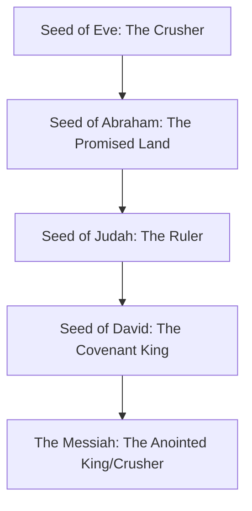

## Maranatha Global Bible Study

- This session serves as a preface or introduction to the forthcoming study on the book of Revelation
- The upcoming study will involve a deep dive into the book of Revelation and is expected to last for several months
- Previous study focus: The book of Daniel

### The Foundation: The Maranatha Cry

- The "Maranatha cry" serves as the essential foundation for approaching the book of Revelation
    - Revelation is described as the "crescendo of the entire story of redemption" and the "revealing of the Lord Jesus" at the end of the story
    - To look at the apocalypse rightly, one must have a clear understanding of this foundational message
- **[Context]** In the early church, "Maranatha" appeared to be a liturgical statement, going beyond simple praise like "hallelujah"

### The Meaning of Maranatha

- It is an Aramaic phrase that carries a creedal element
- The statement encapsulates two distinct temporal dimensions:
    - The Lord has come
    - The Lord is coming
- **[Significance]** This dual meaning represents the profound culmination of God's revelation throughout the scriptures concerning the Messiah

### Messianic Prophecy

- There is a profound thread of messianic prophecy that runs throughout the entire Bible
- This thread consists of various prophecies concerning Jesus that weave through the scriptures

### Genesis 3:15: The Proto-Evangelion

- Identified as the "proto-evangelion" or the first gospel
    - This occurs at the very beginning of the Bible's story of redemption, immediately following the Fall
    - The Fall introduced death, corruption, and toil (e.g., the pains of childbirth and labor) into the human experience
- **The Prophetic Declaration**
    - Following the Fall, the Lord makes a profound declaration to the serpent regarding a conflict between descendants
    - There is promised enmity between:
        - The serpent's seed (descendants)
        - The woman's seed (descendants)
    - Within this plural line of descendants, there is a promise of one ultimate, singular seed
    - **[The Outcome]** While the serpent will merely strike or bruise the heel of this descendant, the singular seed will crush the serpent's head

### Implications of the Proto-Evangelion

- The declaration in Genesis 3:15 carries inherent promises that go beyond a simple victory in conflict
    - It implies the eventual undoing of the effects of the Fall and the curse
    - It carries the expectation of the restoration of Eden
- **[The Goal]** The ultimate purpose is not just defeating a figure, but the total restoration of God's original design

### The Expanding Messianic Thread

- The prophetic "vein" found in Genesis continues to expand and connect with other biblical promises
- **Connecting the Seeds**
    - The seed of Eve (the one who crushes the serpent) is later identified as the seed of Abraham
    - This connection links the promise of the Redeemer to the promise of the land
- **The Promise of Dominion**
    - Because the Messiah is promised to possess the land, it is inferred that He will also rule over it
    - To possess the land is to take dominion and rule over it

### The Convergence of the Crusher and the King

- The messianic line continues to expand and multiply through specific tribal and royal lineages
- **The Tribe of Judah**
    - Genesis 49 contains statements identifying the ruler over Israel as coming from the line of Judah
- **The Davidic Covenant**
    - In 2 Samuel 7, the Lord declares a covenant where a descendant will come from the line of David
- **The King of Israel**
    - The identity of the "crushing one" becomes explicitly intertwined with the role of the King of Israel
    - This connection is reinforced by Balaam's prophecy in Numbers 24 regarding the seed of the king
- **The Emergence of the term "Messiah"**
    - In Psalm 2, the figure is first referred to as the *Mashiach* (the Anointed One)
    - This is the linguistic origin of the term "Messiah"

### A Second Prophetic Thread

- Beyond the familiar messianic prophecies concerning human descendants, there is another distinct prophetic tradition in the biblical narrative
- **The Two Prophetic Veins**
    - **The Human Line**: Promises regarding a human descendant (e.g., the seed of Eve, Abraham, and David)
        - This figure must be human to be considered the "child" of the people
    - **The Divine Line**: Promises that God Himself (Yahweh) will come from heaven to save Israel
- **[The Tension]** These two traditions can appear to be at odds because one focuses on a human mediator while the other focuses on direct divine intervention
- **Foundational Text**
    - Deuteronomy 33 (the blessing of Moses) serves as the foundational prophecy for this second line of divine promise

### The Second Prophetic Thread

- While the first thread concerns the human descendant (the Messiah), a second, distinct prophetic vein exists within the biblical narrative
- **[The Core Motif]** This tradition centers on the idea of Yahweh, God Almighty, coming down from heaven to save Israel
- **Deuteronomy 33: The Foundation**
    - Just as Genesis 3:15 is the foundation for the Messianic prophecies regarding a human descendant
    - Deuteronomy 33 serves as the foundational text for this second line of prophecy concerning God's own descent
    - This line is characterized by themes and motifs depicting God coming from heaven to intervene in human history

### Motifs of the Second Prophetic Thread

- **The Descent of Yahweh**
    - This tradition depicts God Almighty coming down from heaven to intervene in human history
    - **Key Imagery from Deuteronomy 33:**
        - He comes from heaven on the clouds
        - He is accompanied by myriads of holy angels
        - Fire shoots out from His hands
    - **Purpose of the Descent:**
        - To save Israel and His people
        - To judge Israel's enemies
        - To execute vengeance against the wicked and the ungodly
- **The God of Jeshurun**
    - Deuteronomy 33:27 describes a unique God: "There is none like the God of Jeshurun"
    - *Jeshurun* is a name for Israel, meaning "the upright one"
    - A defining characteristic of Yahweh is that He "rides across the heavens" and "comes on the clouds to save you"
- **The Convergence of the Two Threads**
    - While these two prophetic veins (the human Messiah and the descending God) appear distinct, they eventually meet
    - **Daniel 7:** This is the point where these two perfect prophetic traditions finally and forever enter together

### The Convergence in Daniel 7

- The two prophetic veins (human descendant and descending God) are inseparably intertwined in the book of Daniel
- **Daniel 7: The Merging of Threads**
    - **The Figure of the 'Son of Man':**
        - Appears in human/anthropomorphic form, aligning with the first thread (the Messiah, the seed of Eve, Abraham, and David)
        - However, he is described as "coming on the clouds"
    - **[Why this matters]** Coming on the clouds is a motif reserved for Yahweh alone
    - **The Result of the Convergence:**
        - The one in human form is also Yahweh, God Almighty
        - He is given dominion and authority over all
        - The people of God are placed under His authority
- **Implications for the Messiah's Identity**
    - This convergence reveals that the Messiah is not just a human descendant, but is also Yahweh himself
    - **The Two Comings of the Messiah:**
        - This provides a preliminary understanding that the Messiah must have two distinct comings:

            1. A first coming where he is born in an actual human sense
            2. A later coming where he returns from heaven to save His people as Yahweh, God Almighty

### Motifs of the Messiah's Descent

- **Visual Characteristics of Yahweh's Arrival:**
    - Appearing in human form
    - Fire shooting out from His hands
    - Marching in a great royal procession before His people
- **Connection to the Exodus:**
    - The motif of fire and clouds reflects the theophany during the Exodus
    - **[The Exodus Prelude]** God led His people with a pillar of cloud and fire, which served as a "faint, perfect prelude" to the actual, literal return of the Messiah

### Applying Revelation to Current Events

- The biblical patterns of God's sovereignty and judgment are applicable to any people at any time in history
- **The Context of Uncertainty:**
    - The speaker notes the current atmosphere in the United States following the recent American election
    - Emphasizes that while the "natural" view may look uncertain, the study of these prophetic truths provides a different perspective

### The Limitation of Human Kingdoms

- **The Uncertainty of Politics:**
    - Regardless of political outcomes or legal disputes in the United States, the speaker notes that the nation is entering a "very dark season."
- **[The Danger of Misplaced Hope]** Placing hope in the "kingdoms of man" leads to ultimate disappointment and dissolution.
    - Human political structures are temporary and cannot satisfy deep spiritual longings.
- **The Ultimate Source of Hope:**
    - Only the coming kingdom of the Messiah can fulfill human yearnings.
    - **[A Balanced Approach]** This does not preclude contending for righteousness or seeking godly, humble servant leaders in society, but it requires recognizing that they are not the final solution.

### The Call to Eternal Hope

- Regardless of geographic location or political climate, Christians are called to anchor their faith in what is eternal and unshakable
- **[The Priority of the Eternal]** This serves as a necessary counterweight to the shifting and temporary nature of human circumstances

### The Timelessness of the Maranatha Cry

- Although the Aramaic phrase *Maranatha* was formally articulated by the Church in the first century, the sentiment behind it is ancient
- **The Longing of the Holy Remnant:**
    - The "Maranatha cry" (the yearning "Come, Lord!") has existed among God's people since the very beginning
    - It traces back to the earliest promises, such as the declaration to Eve regarding the seed who would crush the head of the serpent
    - This cry represents a consistent, historical yearning for God to fulfill His promises and intervene in human history

### The Book of Habakkuk

- A three-chapter prophecy that serves as a profound embodiment of the Maranatha cry
- **[Historical Context]**
    - Habakkuk lived approximately 100 years after the prophet Isaiah
    - His ministry took place shortly before the fall of the southern kingdom of Judah to the Babylonians
- **The Prophet's Cry**
    - In Habakkuk chapter 1, the prophet issues an oracle crying out for revival in Israel
    - This cry is not arbitrary; it is grounded in the expectations found within God's promises and the scriptures

### Expectations of the Davidic Covenant

- The Jewish people's expectations were rooted in God's specific promises to King David
    - They believed a descendant of David would rule on his throne forever
    - Because of this covenant, there was a widespread expectation that the kingdom of David would never fall

### The Sinaitic Covenant: Blessings and Chastisements

- Found in the Torah (Moses), this covenant outlines the conditional relationship between God and His people
- **The Blessings of Obedience:**
    - Prosperity in agriculture (blessed crops)
    - Security and peace with neighbors
    - Stability and life within the land
    - Healthy social relationships
    - An intact, functional relationship with God
- **The Chastisements (Curses) of Disobedience:**
    - Failure of crops
    - Problems with wild beasts
    - [Note: The speaker's explanation of specific curses is cut off]

### The Chastisements of the Covenant

- Disobedience leads to severe social and national consequences:
    - Conflict with neighbors
    - Increasing numbers of hostile families
    - Foreign invasion
    - Mass casualties and being scattered among the Gentiles in exile
- **[The Promise of the Remnant]** Despite these heavy judgments, God's faithfulness to the covenant with Abraham, Isaac, and Jacob ensures a return:
    - Even in exile, the people will remember God
    - God will bring back a remnant, even if only a few are left
- **The Gap in the Davidic Throne**
    - Disobedience serves as an indicator that there will be a significant period in history where no one rules on the throne of David

### The Danger of Selective Prophecy

- There is a tendency to focus only on the prophecies that provide comfort or benefit
    - For example, many might focus on the Davidic Covenant (the promise that a descendant will always rule)
    - However, this often leads to overlooking or minimizing the 'chastisements' (the warnings of judgment) that are equally part of the covenant
- **[The Importance of Balance]** Both the promises and the warnings are relevant to understanding God's relationship with His people

### Habakkuk: The Intercessor's Cry

- Habakkuk observes that his nation is backsliding
- He acts as an intercessor, crying out to God for revival and help in the midst of national turmoil
- **Habakkuk's Lament:**
    - "How long, O Lord, will I call for help and you will not hear?"
    - "I cry out, 'Violence!' but you do not save me."
- This cry reflects a desperate plea for God to intervene in a society marked by violence and instability

### The Nature of Habakkuk's Lament

- Habakkuk expresses a deep sense of grief over the moral decay he witnesses
    - "Why do you make me see iniquity and cause me to look on wickedness?"
    - He describes a world that is difficult to witness, marked by a pervasive lack of righteousness
- **The Breakdown of Society:**
    - Destruction and violence are omnipresent
    - Strife and contention are rising
    - **The Collapse of Order:**
        - The law is ignored
        - Justice is never upheld
        - The wicked surround the righteous, leading to perverted justice
- **[A Universal Experience]** This sense of social instability and the failure of legal and moral systems is a recurring theme that resonates across different eras and political perspectives.

### God's Unexpected Response to Habakkuk

- While humans expect God to respond to cries for revival with immediate spiritual restoration, His response can be jarring and unexpected
- **The Divine Proclamation (Habakkuk 1:5):**
    - God tells Habakkuk to observe and be astonished
    - He declares He is about to do something in Habakkuk's day that would be unbelievable if told
- **The Instrument of Judgment: The Babylonians (Chaldeans):**
    - God announces He is raising up the Chaldeans to act upon the nation
    - **Characteristics of the Babylonian forces:**
        - They are a fierce and pestilential people
        - They march throughout the earth to seize dwellings that are not theirs
        - They are dreaded and feared
        - Their sense of justice and rightness originates from themselves rather than God
        - Their cavalry is exceptionally fast: "swifter than leopards and keener than wolves"
        - Their horsemen arrive from afar, like an eagle swooping down to devour prey

### The Nature of the Babylonian Invasion

- The Chaldean forces are described as a violent and unstoppable horde:
    - They move forward to collect captives "like sand"
    - They mock kings and laugh at rulers
    - They treat every fortress as something to be turned into rubble
    - They sweep through territories "like the wind"
- **[Accountability]** Despite being used by God, the Babylonians are not exempt from judgment; they will be held guilty and held to account for their actions, as their strength is their own god.

### The Purpose of Divine Chastisement

- God uses the Babylonians as a "rod of chastisement"
    - This means the invasion is a tool for discipline rather than a sentence of perpetual ruin
    - The goal is to bring judgment and correction to the nation
- **The End of the Rod:**
    - Once the purpose of the chastisement is fulfilled, God will "break that rod over me"
    - This signifies that the period of judgment is temporary and has a specific divine objective

### The Goal of Divine Chastisement

- **[Purpose]** Chastisement is never intended for perpetual ruin
    - It is specifically for restoration and redemption
- **The Necessity of Redemption:**
    - Any narrative that does not conclude with redemption is inconsistent with God's character
    - For Israel, God has declared He will save His people and they will possess the land
    - To believe God would reject His people would be a misunderstanding of His nature and His promises (referencing Paul's arguments in Romans 11)

### Habakkuk 2:14

- The speaker begins to introduce a pivotal statement in chapter 2, verse 14, which serves as a resolution to the chaos described in the previous chapter.

### Habakkuk 2:14: The Knowledge of God's Glory

- A central statement providing God's rationale for the coming judgment:
    - "the earth will be filled with the knowledge of the glory of the Lord as the waters cover the sea"
- **[The Current State vs. The Final Goal]**
    - Currently, darkness covers the earth (as described in Isaiah 60)
    - This darkness is a necessary, albeit painful, stage in the process
    - The narrative is only true if it concludes with the world being filled with the knowledge of His glory

### Habakkuk Chapter 3

- The speaker introduces chapter 3, which consists of the prayer of Habakkuk.

### Habakkuk 3 as a Liturgical Song

- Chapter 3 is structured as a liturgical song
    - It was intended to be sung in synagogues or among the congregation
    - This provides a community element where people would sing together for a specific purpose
- **Musical Terminology in the Text:**
    - **Shigionoth:** Mentioned in Habakkuk 3:1; while its exact meaning is unknown, it appears to be a specific musical term or type of song
    - **Selah:** Found in verses 9 and 13; often interpreted as a musical interlude or a pause to allow singers and listeners to ponder the weight of the words
    - **Instrumentation:** The text concludes by noting the song was "for the choir director on stringed instruments," indicating it was a composed musical piece designed for performance

### Habakkuk's Plea for Mercy

- Habakkuk cries out to God with a sense of fear and urgency
    - He asks God to "revive your work in the midst of the years"
    - This is a plea to make God's work visible and known even during times of judgment
- **[The Plea for Mercy]**
    - Habakkuk asks God to "remember mercy" in the midst of His wrath
    - He appeals to God's character as being "merciful and compassionate" to generations

### The Prophecy of God's Coming

- The text describes God coming from the south (T-man)
- **[Grammatical Nuance]**
    - The Hebrew uses the perfect verbal tense
    - While many translations use the past tense ("God came"), it can legitimately be read as a future prophecy ("God will come")
- **[Connection to Jesus]**
    - The speaker views this as a future prophecy regarding the return of Jesus
    - This language reflects the motifs found in Deuteronomy 33 regarding God coming from the south

### The Splendor of God's Coming

- The text describes the Holy One coming from Mount Paran
    - Located on the border of modern-day Jordan and northwest Saudi Arabia
    - Points down towards Sinai
- **[The Radiance of God]**
    - As God comes, His splendor covers the heavens
    - The earth is filled with His praise
    - His radiance is described as being like sunlight
- **[The Irony of the South]**
    - There is a poetic quirk in the description of light shining from the south
    - While the sun typically rises in the east and sets in the west, this divine light shines forth over the southern mountains
- **[New Testament Connection]**
    - This imagery provides a basis for the New Testament teaching on the return of Jesus
    - It aligns with the idea that when the Son of Man returns, He comes in the glory of His Father, radiating like lightning or light rising from the east

### The Radiance and Power of God's Coming

- **[The Splendor of God]**
    - The splendor of His arrival covers the heavens
    - The earth is filled with His praise
    - His radiance is described as being like sunlight
- **[The Rays of His Hands]**
    - The text describes rays flashing from His hands
    - This imagery suggests a "hiding of His power"
        - It is as though the veil of human flesh cannot contain the glory of God Almighty
        - The glory of God bursts forward, radiating out from His hands
- **[The Procession of Judgment]**
    - As God marches forward from the south, He is accompanied by judgment
    - Pestilence goes before Him
    - Plague follows in His wake

### The Final Exodus

- The imagery of God's coming serves as a faint shadow of the "ultimate exodus"
    - This is the "greater exodus" where the Messiah (Jesus) marches forward from the south
    - He leads His people, yet His arrival is marked by the pouring out of plagues and pestilence

### The Divine Warrior and the Survey of the Earth

- The text notes that He "stood and he surveyed the earth"
    - This occurs in the midst of the intense imagery of plagues, pestilence, lightning, and fire
- **[Connection to Psalm 110]**
    - This moment is reminiscent of the classic messianic prophecy in Psalm 110
    - It depicts the Lord as a divine warrior who:
        - Sits at the right hand of God until His enemies are made a footstool
        - Crushes kings on the day of His wrath
        - Shatters kings on the day of His wrath
        - Leaves corpses throughout the earth
- **[The Pause in Judgment]**
    - After this intense display of power, the text says He "will stop and drink from the brook"
    - The speaker notes this as a moment of pause following the display of divine wrath

### The Collapse of Nations and Empires

- **[Symbolism of Mountains]**
    - The text describes "ancient hills collapsed" and "perpetual mountains were shattered"
    - In biblical poetry, mountains serve as a motif for kingdoms and nations
    - The collapsing of mountains signifies the falling of empires under divine judgment
- **[The Trembling of Regions]**
    - Verse 7 describes the "tents of Kushan in distress" and the "tent curtains of the land of the Midian" trembling
    - This is linked to the geography of the biblical narrative:
        - Mount Sinai is located in the land of Midian (northwest Saudi Arabia)
        - The trembling reflects the reaction of the people in that region as God approaches from the south

### The Greater Exodus and the Establishment of Order

- **[The Reiteration of the Exodus]**
    - The Messiah acts as a "greater Moses" carrying out a "greater Exodus"
    - There is a suggestion that Jesus may split the Red Sea again upon His return
- **[Theological Significance of the Sea]**
    - The parting of the waters reflects the original act of creation
    - It mirrors God separating the waters above from the waters below and light from darkness
    - This act brings order to the *tohu wa-bohu* (the wild, waste, and primordial chaos)
- **[Final Establishment of Order]**
    - Just as God established order at creation and during the original Exodus, Jesus' return will be the "once and for all" final establishment of God's order
    - This signifies the end of Satan's ability to introduce chaos and disorder
    - This transition leads toward the ultimate reality of the new heavens and the new earth (Revelation 21)

### Biblical Evidence for a Reiteration of the Exodus

- **[The Lord's Chariots of Salvation]**
    - Several verses infer the possibility of Jesus splitting the Red Sea again through imagery of His wrath against the waters:
        - "Did the Lord rage against the rivers? Was your anger against the rivers? Or your wrath against the sea?"
        - The "sea" or "yam" (ocean) is addressed as the recipient of His riding on "chariots of salvation"
    - This is noted as the first instance in the Bible where the Lord is portrayed riding on horses, a motif later reflected in the Book of Revelation
- **[The Surrender of the Deep]**
    - The imagery in Habakkuk depicts the natural elements reacting to the divine presence:
        - The bow is emptied, and the rods of chastisement are sworn
        - The mountains quake and the earth is cleaved with rivers
        - The "deep" (the ocean) utters its voice and lifts its hands on high
    - **[The Symbolism of the Ocean's Gesture]**
        - The description of the ocean lifting its hands is interpreted as a poetic way of saying the sea "surrenders" to God's sovereignty
        - This mirrors the original parting of the Red Sea, reinforcing the theme of a final, decisive act of divine power

### Anthropomorphic Imagery in Habakkuk 3

- **[God's March of Indignation]**
    - The text describes the sun and moon standing in their places, yielding to the radiance of God's gleaming sphere and the light of His arrows
    - God is depicted in anthropomorphic form, marching through the earth with legs in indignation
    - **[The Trampling of Nations]**
        - In His anger, He treads upon the nations
        - This imagery of "treading" creates a narrative arc:
            - It begins with the "crushing one" in Genesis 3:15
            - It continues through the language of the Lord God trampling nations in Habakkuk
            - It concludes in Revelation with the imagery of treading the winepress
- **[The Purpose of Divine Action]**
    - This march is not merely for destruction, but for the salvation of God's people and His anointed ones
    - **[Striking the House of Evil]**
        - God's action is directed at striking the head of the "house of evil"
        - This is interpreted as the destruction of the Antichrist (Satan's human puppet)
        - The prophecy includes laying the enemy open "from thigh to neck" (or "from pale to neck")

### The Ultimate Victory of the Messiah

- **[The Righteous vs. The Wicked]**
    - The motifs in Habakkuk 3 allude to the ultimate victory of the Messiah over the Antichrist and the 'wicked seed'
    - Behind the Antichrist and the wicked seed stands Satan, who will ultimately be cast into the lake of fire alongside them
- **[Trampling the Sea]**
    - The text describes the Lord trampling the sea with His horses on the surge of many waters
    - **[Red Sea Parallels]**
        - This imagery serves as a potential indicator that the Lord may once again part the Red Sea upon His return

### The Structure of Habakkuk 3: A Liturgical Song

- Habakkuk 3 functions as a powerful liturgical song that encapsulates the 'Maranatha cry'
- **[The Narrative Arc of the Cry]**
    - The book begins with a desperate plea for mercy: "Lord, have mercy on my nation"
    - This is met with God's announcement of judgment via the Babylonians
    - The song concludes by framing this movement from lament to the anticipation of divine intervention

### The Tension of Delayed Redemption

- **[Immediate Expectation vs. Imminent Judgment]**
    - Habakkuk's expectation was that the Messiah (the crushing one/King of Israel) would arrive at any moment
    - God's response was a redirection: He would use the Babylonians to destroy and exile the nation
- **[The Temporal Gap]**
    - While God promises that the knowledge of Him will eventually cover the earth, there is a significant delay
    - In Habakkuk's time, this meant a minimum of 70 years (the duration of the exile), effectively pushing the ultimate fulfillment into the distant future
- **[The Vision of the Return]**
    - To address the prophet's yearning, God provides a vision that serves as one of the most dramatic depictions of Jesus' return in Scripture
    - This vision bridges the gap between the immediate reality of judgment and the ultimate reality of redemption

### The Response of the Righteous

- **[Habakkuk's Physical Reaction]**
    - Upon hearing the Lord's word, Habakkuk experiences a profound physical response: his inward parts tremble and his lips quiver
    - He describes a sense of decay entering his bones, illustrating the overwhelming weight of the divine revelation
- **[The Necessity of Waiting]**
    - Habakkuk concludes that he must wait patiently and quietly for the "day of distress" to come upon the invaders
    - **[Definition of the Righteous]**
        - Throughout the Old Testament, the righteous are defined by their ability to wait and patiently endure
        - They are those who fix their eyes on the coming day of redemption (the vision of God's return)
- **[Living by the Maranatha Plumb Line]**
    - To live according to the Maranatha principle is to exist in a state of yearning and groaning for God's intervention while waiting for its fulfillment

### Maintaining Faith in the Absence of Fruit

- **[The Metaphor of the Non-Blossoming Fig Tree]**
    - Habakkuk describes a state where "the fig tree should not blossom" and "there was no fruit on the vines"
    - **[Symbolism]** This is a political metaphor for the total loss of hope and the collapse of national stability
- **[The Crisis of the Exile]**
    - The Babylonian invasion created a moment where it might have seemed reasonable to abandon faith entirely
    - **[The Conflict with the Davidic Covenant]**
        - From a narrow perspective, the exile seemed to contradict the promise that a descendant of David would sit on the throne forever
        - However, the full biblical testimony includes the Sinaitic covenant's warnings: God made it clear that disobedience would result in a significant gap before ultimate redemption
- **[The Temptation of Atheism]**
    - In the wake of the exile, when all natural signs of God's blessing (like fruitfulness) had vanished, many were tempted to give up hope and abandon their faith

### Habakkuk's Radical Rejoicing

- **[Faith Amidst Total Collapse]**
    - Habakkuk describes a scenario of absolute scarcity and national ruin:
        - The olive yield fails
        - Fields produce no food
        - The flock is cut off from the fold
        - There is no cattle in the stalls
    - **[The Decision to Exalt]**
        - Despite the "natural" reality of a nation falling apart and the world "melting down," Habakkuk makes a deliberate choice:
        - "Nevertheless I will exalt in the Lord. I will rejoice in the God of my salvation."
- **[Strength for the Journey]**
    - God is described as the source of strength that enables endurance in dark times
    - **[The Imagery of the Deer]**
        - God makes Habakkuk's feet "like pine feet" (or the feet of the deer)
        - This allows him to "walk in high places" and "tread on high places"
        - **[Symbolism]** This represents the ability to maintain spiritual stability and perspective even when the surrounding terrain is treacherous and unstable
- **[The Victory of the Crushing One]**
    - The ultimate end of this faithful waiting is participation in divine victory
    - **[Treading on Enemies]**
        - A day is coming when the faithful will "tread upon the backs of our enemies"
        - This is because God is the "Crushing One"
    - **[Shared Identity]**
        - There is a profound connection between the Messiah and His people: when He is revealed, those who have waited will be revealed with Him
        - This echoes the New Testament promise in Paul's writings regarding God crushing Satan under the feet of the believers

### Participation in Divine Justice

- **[Shared Victory]**
    - The Messiah does not act alone; His people will participate with Him in the day of justice and judgment against His enemies
    - This victory includes the presence of His holy angels

### The Context of the Exiles

- **[The Broken Line]**
    - Scholars suggest Habakkuk's song was a congregational piece used during the Babylonian exile
    - The invasion resulted in the death of the final king (a great-great-grandson of David), which appeared to break the Davidic line
- **[The Crisis of Broken Promises]**
    - To the exiles, it seemed as though all biblical promises had come to nothing: the vines withered, the trees bore no fruit, and the promised kingdom was gone
- **[Communal Gathering in Exile]**
    - Because formal synagogues did not yet exist, the exiles maintained their faith by gathering together by the rivers in the center of town

### Communal Hope in Exile

- **[Gathering in Babylon]**
    - In the absence of synagogues, exiles would gather by the rivers of Babylon
    - They would sing together, including the song found in Habakkuk
- **[Fixing Eyes on the Divine Warrior]**
    - Even when redemption seemed far off or in an unforeseeable future, the song directed their focus toward the return of the Messiah
    - They looked for the "Crushing One" who would:
        - Crush the head of the house of the wicked
        - Lay the wicked open "from thigh to neck"
- **[The Purpose of the Song]**
    - The song acted as a way to maintain faith by looking past immediate circumstances to the ultimate, certain victory of God

### The Maranatha Cry in Practice

- **[Maintaining Hope in Darkness]**
    - The 'Maranatha cry' is an active choice to fix one's eyes on the return of Jesus despite dark or collapsing circumstances
    - This perspective provides strength to wait patiently, even when the waiting is painful
    - **[The Promise of Strength]**
        - As a result of this hope, the Lord provides strength, described as making one's "feet like the feet of the deer"
- **[The Royal Procession]**
    - The return of Jesus is depicted as a royal procession proceeding from the south
    - This arrival is characterized by:
        - The outpouring of God's wrath, including plague, pestilence, and lightning shooting from His hands
        - The crushing of enemies (referencing Isaiah 63)
    - **[A Celebration of Joy]**
        - The event is not just one of judgment, but of intense worship and celebration
        - According to Psalm 68, musicians and singers precede Him, with women playing timbrels
        - This divine arrival causes sadness and sighing to be overwhelmed by gladness, joy, and rejoicing