### Introduction to Revelation

- The upcoming study will include introductions to the book of Revelation by Dalton and the speaker
- This study follows the tradition of faithful men of God who kept their eyes fixed on that day:
    - Habakkuk
    - Daniel
    - Ezekiel
    - David

### Maranatha Global Bible Study

- This is the fourth session of the study
- The current focus is on laying the foundation for the book of Revelation
    - The study is conducted by Dalton Thomas and the speaker

### Accessing Study Materials

- Sessions can be viewed on YouTube, the Praise the Lord Network, or various other platforms
- The Frontier Alliance International app provides access to:
    - These Bible study sessions
    - Podcasts, TV shows, movies, and films
    - Sermons, notes, and books

### Laying the Groundwork

- The study is still in the preliminary stages
    - The sessions are currently focused on laying the groundwork rather than jumping directly into the text of Revelation
- **New Session Focus**: Discussing the place of the book of Revelation within its overarching framework

### Jewish Cruciform Apocalypticism

- An essential framework for understanding the book of Revelation
    - The speaker intends to "tease it out and unpack it" throughout the study
- **[Importance]** Much of the modern church lacks familiarity with this concept or the basic Jewish worldview required to interpret the text accurately

### Unpacking Jewish Cruciform Apocalypticism

To understand this concept, it is broken down into three distinct components:

- The Jewish element
- The apocalyptic component
- The cruciform aspect

### The Jewish Worldview

[00:02:57](https://www.youtube.com/watch?v=9Vnw5nK8BxA&list=PLZ_QEG0Ojk80glLb-z4weGRpvDa6bygeq&index=2&t=177s)

- Also referred to as a Biblical or Hebraic worldview
- This framework defines how the Bible understands:
    - The nature of time and the unfolding of history
    - The totality of all things and creation

### Competing Worldviews

- Within the Christian community, two primary worldviews often compete against one another:
    - **Biblical (Hebraic) worldview**: The framework necessary for rightly understanding the Bible and Revelation
    - **Greek (Philosophical) worldview**: A pagan-rooted framework that has significantly infiltrated the Christian mindset
- **[The Problem]** Because of this infiltration, it is essential to break away from Greek philosophical influences to interpret the text accurately

### The Greek Worldview

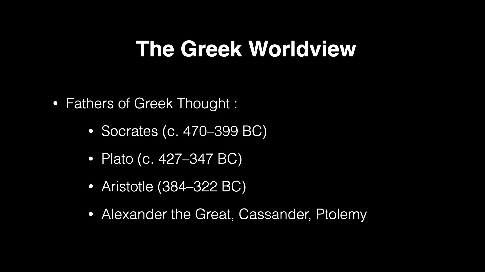
[00:05:12](https://www.youtube.com/watch?v=9Vnw5nK8BxA&list=PLZ_QEG0Ojk80glLb-z4weGRpvDa6bygeq&index=2&t=312s)

- **Fathers of Greek Thought**:
    - Socrates (c. 470–399 BC)
        - Viewed as the father of the Greek philosophical worldview
    - Plato (c. 427–347 BC)
        - A student of Socrates
    - Aristotle (384–322 BC)
    - Other influential figures:
        - Alexander the Great
        - Cassander
        - Ptolemy
- **The Spread of Hellenism**
    - Alexander the Great was a student of Greek philosophy
    - As he conquered the Middle East, sweeping out of Macedonia and Greece, he brought the influence of Greek thought with him
    - This expansion is known as the project of Hellenism

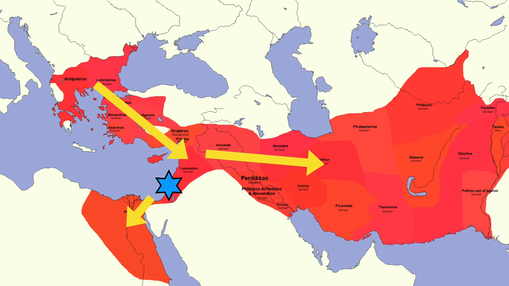
[00:05:57](https://www.youtube.com/watch?v=9Vnw5nK8BxA&list=PLZ_QEG0Ojk80glLb-z4weGRpvDa6bygeq&index=2&t=357s)

### The Imperialistic Nature of Hellenism

- Hellenism was more than just military conquest
    - It was an imperialistic project to spread Hellenistic culture and philosophy
- **[Geographic Reach]** The influence spread extensively across the Middle East
    - Significant influence was felt in Egypt
    - The reach extended through the Middle East and into regions like Iran

### Lasting Cultural Impact

- The historical expansion of Greek thought has long-term consequences
    - For example, Platonic philosophy remains highly popular in Iran today because of this historical influence
- **[The Tension in Israel]** Israel's position is historically significant because it sits at the crossroads of these competing influences:
        - The Hebrews attempting to live according to the Biblical worldview
        - The imperialistic imposition of the Greek worldview

### Socrates and the "Daimonion"

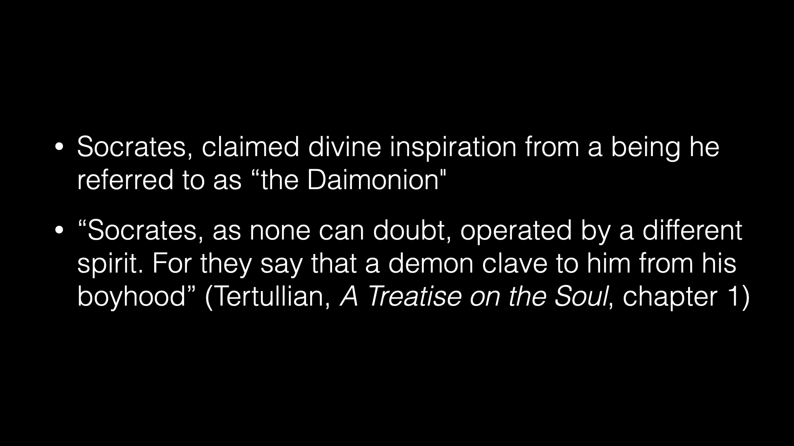
[00:07:54](https://www.youtube.com/watch?v=9Vnw5nK8BxA&list=PLZ_QEG0Ojk80glLb-z4weGRpvDa6bygeq&index=2&t=474s)

- **The Daimonion**:
    - Socrates claimed to receive divine inspiration from a being he referred to as "the Daimonion"
    - The term comes from the Greek word *daimonion*
    - He viewed this not as an evil spirit, but as a semi-god or an intermediary spirit
- **Early Church Perspective**:
    - Early Christian writers identified this connection as being influenced by a different spirit
    - As noted by Tertullian in *A Treatise on the Soul*:

        > "Socrates, as none can doubt, operated by a different spirit. For they say that a demon clave to him from his boyhood" (Tertullian, *A Treatise on the Soul*, chapter 1)

### False Religious Leaders

- The speaker suggests that figures who lead vast religious or ideological movements may be influenced by demonic forces
    - He cites Socrates as an example of a leader influenced by a demon

### The Greek / Platonic (Dualistic) Worldview

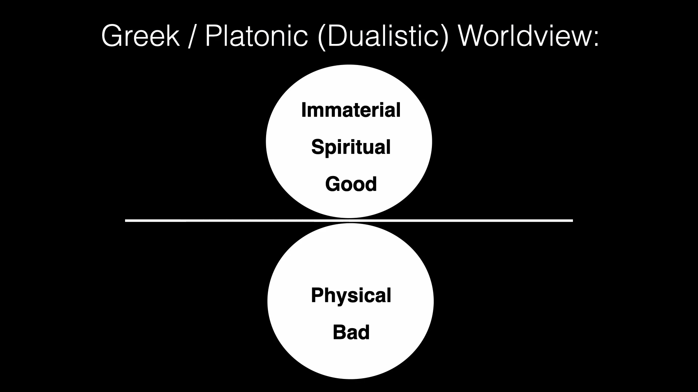
[00:09:44](https://www.youtube.com/watch?v=9Vnw5nK8BxA&list=PLZ_QEG0Ojk80glLb-z4weGRpvDa6bygeq&index=2&t=584s)

- This worldview is characterized by **dualism**
- It divides existence into two opposing realms:
    - **Immaterial**: The spiritual realm, which is viewed as inherently "Good"
    - **Physical**: The material realm, which is viewed as inherently "Bad"

### The Goal of the Dualistic Worldview

- **[The Two Realms]** The worldview creates a harsh distinction between two opposing spheres:
    - **Immaterial (Spiritual)**:
        - Viewed as the perfect realm
        - The place where spirits and ghosts dwell
    - **Physical (Material)**:
        - Viewed as inferior and "lower"
        - Characterized by corruption, sinfulness, and brokenness
- **[The Ultimate Objective]** Life's goal is to "escape the shell"
    - This means becoming detached from the physical realm
    - The aim is to reach the spiritual realm to attain perfection

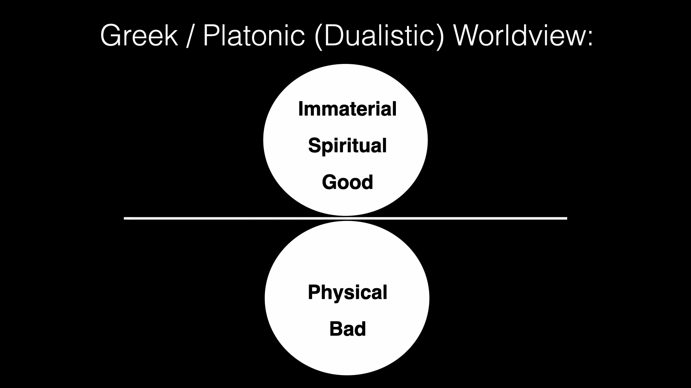
[00:10:11](https://www.youtube.com/watch?v=9Vnw5nK8BxA&list=PLZ_QEG0Ojk80glLb-z4weGRpvDa6bygeq&index=2&t=611s)

### The Greek Understanding of Time

- **Cyclical Nature**:
    - Unlike a linear view with a starting point and a culmination, the Greek mindset sees history as an endless spiral
    - It is characterized by repetition rather than progression toward a specific destination
- **Lack of Teleology**:
    - There is no significant beginning or end to the cycle
    - While technology might advance, the overall movement of history can reverse because it lacks a fixed purpose or goal

### Extreme Applications of the Dualistic Worldview

- **[The UFO Cult Example]** The speaker describes a cult in California that embraced a radical form of Greek philosophy:
    - They believed the physical world was a "shell" to be escaped
    - They viewed a passing comet as a sign of a "mothership" waiting to receive them
    - This belief led to mass suicide as a means of escaping their physical bodies
- **[Detachment from the Physical]** To further embrace the idea that the material realm is "bad," members practiced extreme forms of asceticism:
    - Men emasculated themselves to remove physical distractions
    - They lived as monastics to minimize contact with the material world
- **[The Teleological Conclusion]** The ultimate logical end of this worldview is the belief that one must kill the physical body to finally reach the perfection of the spiritual realm

### The Early Church and the Hellenistic Influence

- **[The Pastoral Challenge]** The Apostles faced a significant task in discipling Gentiles:
    - They had to teach a biblical (Hebraic) worldview to people deeply immersed in Greek thought
    - This required contending with the widespread influence of Greek philosophy in the Mediterranean world
- **[Geographic Hotspots]** The tension between these two worldviews was particularly intense in certain regions:
    - Alexandria, Egypt, served as a major intellectual center and a "hotspot" for the influence of Greek philosophy on early Christianity
- **[Historical Context]** While the early church lived under Roman rule, the cultural and philosophical legacy of Alexander the Great (Hellenism) continued to shape the religious and intellectual landscape of the Middle East.

### The Challenge of Syncretism

- **[The Gnostic Movement]** An early attempt to mix biblical teachings with Greek philosophical concepts:
    - This resulted in an extreme worldview that sought to blend the two systems rather than maintaining biblical purity
- **[Regional Influence]** Alexandria, Egypt, served as a major center for this type of Hellenistic indoctrination, where both Jews and early Christians faced the pressure to syncretize their faith with Greek thought

### Paul's Warning Against Greek Philosophy

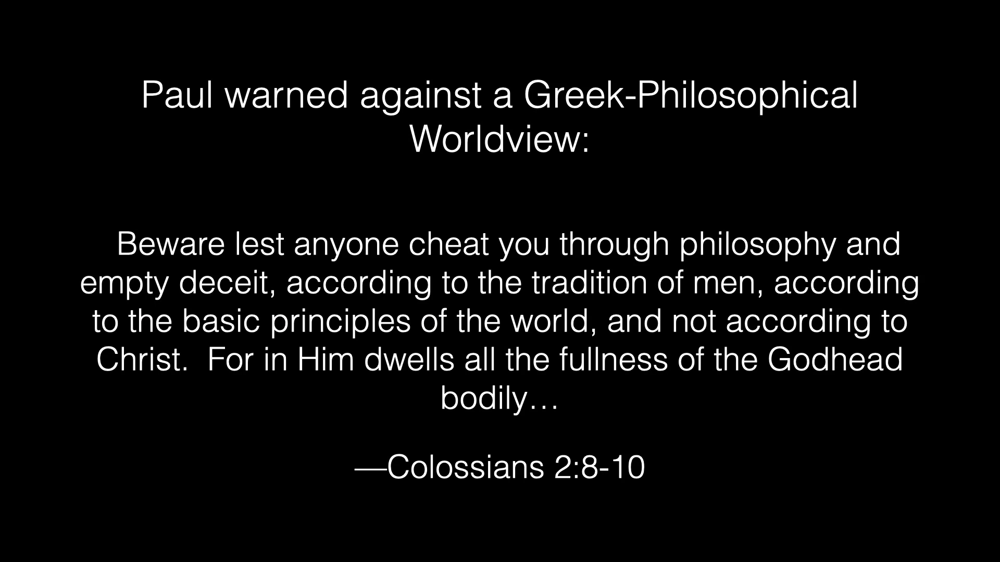
[00:15:38](https://www.youtube.com/watch?v=9Vnw5nK8BxA&list=PLZ_QEG0Ojk80glLb-z4weGRpvDa6bygeq&index=2&t=938s)

- **[The Warning]** Paul the Apostle explicitly warned the early church to be on guard against the prevailing pagan influences of the time:
    - He characterized Greek philosophy as "empty deceit"
    - He noted it was based on the "tradition of men" and the "basic principles of this world" rather than on God or Christ
- **[The Theological Counter-Argument]** To combat this philosophical infiltration, Paul emphasized the sufficiency and nature of Christ:
    - He stated that "in Him dwells all the fullness of the Godhead bodily"
    - This serves as a direct rebuttal to the Greek idea that the physical/bodily realm is inherently inferior or separate from the divine

### The Conflict of the Incarnation

- **[The Greek Rejection of Flesh]** The Greek philosophical goal is the opposite of the Christian gospel:
    - Instead of God becoming human, the Greek goal is for humans to escape the flesh to become pure spirit
    - To the Greek mind, the idea of the divine taking on flesh is "anathema" (fundamentally opposed/cursed)
- **[The Biblical Rebuttal]** Paul's emphasis on the fullness of God dwelling in Christ "bodily" serves as a direct refutation of this system, asserting that God chose to enter and inhabit the physical realm

### The Hebrew / Biblical Worldview

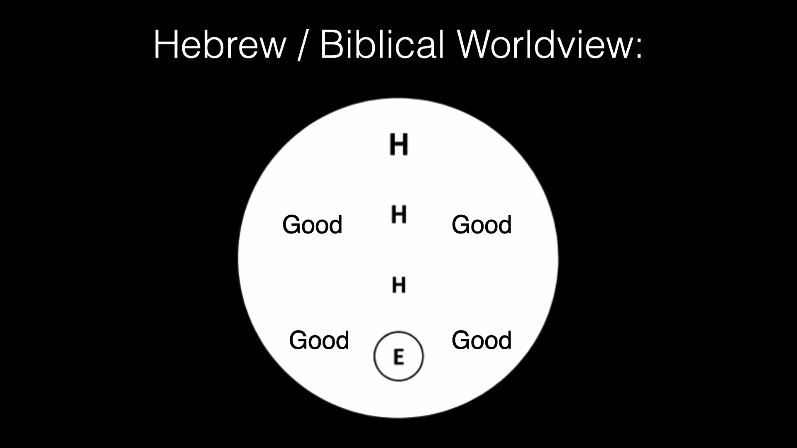
[00:17:20](https://www.youtube.com/watch?v=9Vnw5nK8BxA&list=PLZ_QEG0Ojk80glLb-z4weGRpvDa6bygeq&index=2&t=1040s)

- **[The Act of Creation]** Based on the biblical account of "In the beginning":
    - God created the heavens and the earth
    - **The Heavens:** Refers to the plural heavens, encompassing the sky, outer space, and the spiritual realm (the place where God dwells)
    - **The Earth:** The physical realm created by God
- **[The Nature of Creation]** Unlike the dualistic Greek view that separates the spiritual (good) from the physical (bad/inferior), the Hebrew worldview maintains that what God created was "all good"

### The Corruption of the Gospel through Greek Philosophy

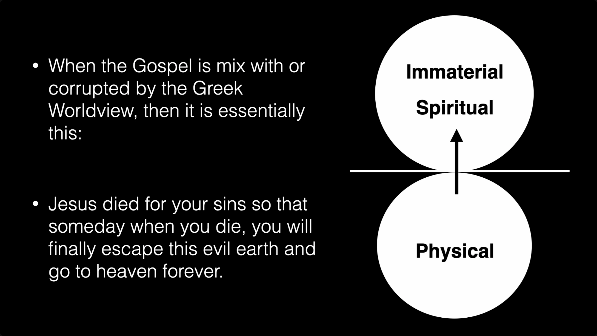
[00:17:47](https://www.youtube.com/watch?v=9Vnw5nK8BxA&list=PLZ_QEG0Ojk80glLb-z4weGRpvDa6bygeq&index=2&t=1067s)

- **[The Result of Syncretism]** When the Gospel is mixed with or corrupted by the Greek philosophical worldview, the focus of faith shifts:
    - The goal becomes: "Jesus died for your sins so that someday when you die, you will finally escape this evil earth and go to heaven forever"
    - This perspective views the physical realm (the earth) as "evil" or something to be escaped
- **[The Misconception of the Christian Goal]** This mixture creates a distorted version of Christianity often characterized by the question, "Are you going to heaven?"
    - This reduces the Gospel to a mere escape mechanism from the physical world
    - It fails to capture the true biblical goal, which is not just about escaping the earth, but about the restoration of all things within God's good creation

### The Biblical Hope: Restoration vs. Escape

- **[The True Goal]** The end goal for a believer is not to become a disembodied spirit or ghost in heaven
    - The biblical hope is the **restoration of all things**
    - This includes the redemption of our bodies and the resurrection of the dead
- **[The Nature of Redemption]** Redemption is not about escaping the physical "shell"
    - Instead, God's plan is to heal, restore, and renew the earth to its original state, as it was in the Garden of Eden

### The Scope of Corruption and Redemption

- **[Universal Corruption]** Corruption is not limited to the physical world; it has permeated both realms:
    - **The Earthly Realm:** The physical world is corrupted
    - **The Heavenly Realm:** The spiritual realm is also corrupt, inhabited by wicked principalities and where Satan dwells to accuse believers
- **[The Divine Plan]** God's plan of redemption is to purify and purge both the heavenly and earthly realms

### The Groaning of Creation and the Redemption of the Body

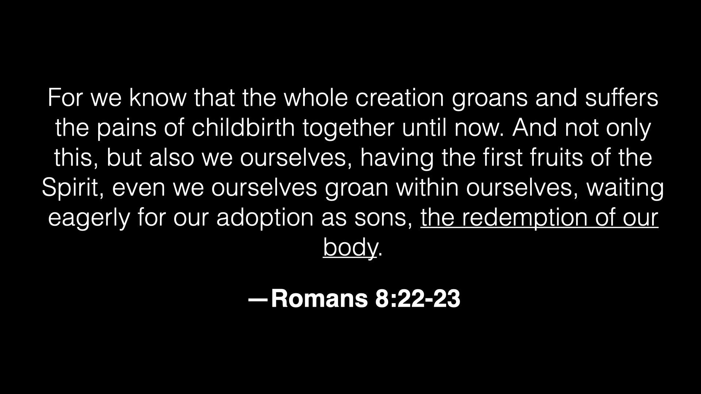
[00:20:06](https://www.youtube.com/watch?v=9Vnw5nK8BxA&list=PLZ_QEG0Ojk80glLb-z4weGRpvDa6bygeq&index=2&t=1206s)

- **[The Groaning of All Creation]** According to Romans 8:22, the entire creation (both heavens and earth) is in a state of suffering and groaning
    - This is described as the "pains of childbirth"
    - It represents an ongoing yearning and waiting for the restoration of all things
- **[The Groaning of Believers]** Even those with the "first fruits of the Spirit" (the Holy Spirit within them) experience this groaning
    - This internal groaning is an eager waiting for our "adoption as sons"
    - It is a precursor to the ultimate "redemption of our body"
- **[The Totality of Redemption]** The Gospel is not merely about saving a soul to send it to heaven
    - The ultimate goal is the redemption of the whole person: both our spirits and our bodies
    - **[Clarification on Death]** While a believer's spirit would be alive with the Lord immediately upon death, even those in heaven are awaiting the specific moment of total restoration

### The Union of Spirit and Body

- **[The Day of the Lord]** The ultimate moment of restoration occurs during the return of Jesus
    - At this time, our spirits will be united with our redeemed, restored, immortal, and eternal bodies

### The Biblical View of Time and History

- **[God's Faithfulness to Creation]** Because God is faithful to His creation, His plan is to redeem, restore, and heal the entire cosmos
    - This includes both the heavens and the earth being brought under His headship
- **[Linear vs. Cyclical Time]** The biblical worldview follows a linear progression, whereas the Greek philosophical worldview is cyclical
    - **Greek View:** Time is seen as spiraling or moving in endless circles without a definitive direction or goal
    - **Biblical View:** History has a distinct starting point and a purposeful direction

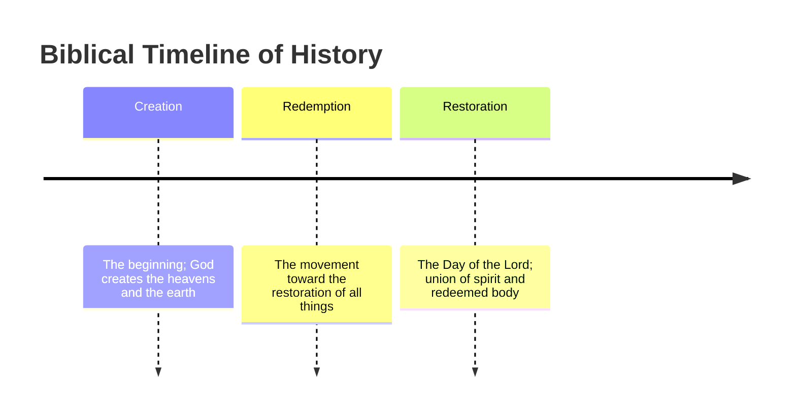

### The Purposeful Progression of Biblical History

- **[Linearity with Patterns]** While history moves toward a specific destination, it is not a simple straight line
    - It can be described as "spiraling" toward the goal
    - Certain events in Israel's history repeat or serve to foreshadow future realities
- **[The Ultimate Destination]** History is moving toward a specified period known as the "age to come"
    - This coincides with the return of Jesus and the establishment of His kingdom (the Day of the Lord)

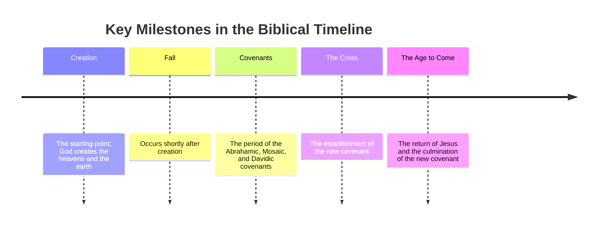

### The New Jerusalem and the Dwelling of God

- **[Heaven Coming to Earth]** Contrary to the idea of humans escaping to a distant heaven, Revelation 21 describes the heavenly city descending to the earth
    - This signifies that heaven and earth will be united under God's headship
- **[The Tabernacle of God]** The ultimate fulfillment of God's plan is His direct presence among His people
    - As stated in Revelation 21:3: "Behold, the dwelling of God is now among men; He will dwell with them, and they shall be His people."
    - This represents the culmination of the entire biblical narrative: the Creator choosing to live with His creation.

### The Restoration of All Things

- **[God's Goal: Presence on Earth]** God's plan is not for humans to escape to a distant heaven, but for Him to dwell among His people as neighbors
    - This is a literal, physical reality: His dwelling is with men on the earth
    - This presence brings an end to death, mourning, crying, and pain
- **[The Promise of Renewal]** The ultimate destination of history is the restoration of the entire created order
    - As stated in Revelation: "Behold, I am making all things new."

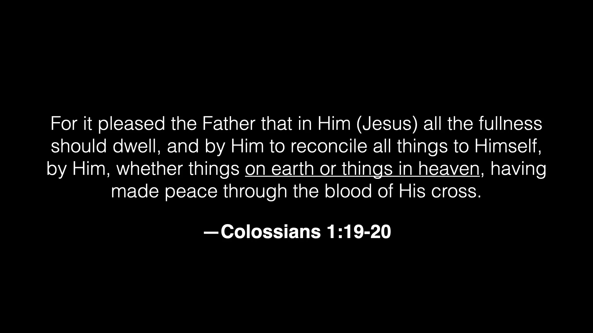
[00:25:45](https://www.youtube.com/watch?v=9Vnw5nK8BxA&list=PLZ_QEG0Ojk80glLb-z4weGRpvDa6bygeq&index=2&t=1545s)

- **[Reconciliation through the Cross]** The mechanism for this total restoration is the work of Jesus Christ
    - According to Colossians 1:19-20, the fullness of the Godhead dwells in Jesus
    - Through His blood at the cross, He reconciles all things to Himself
    - This reconciliation is universal, covering "whether things on earth or things in heaven"

> Everything on the earth and in heaven will be healed and reconciled because of the cross.

### The Universal Scope of Restoration

- **[The Purpose of the Cross]** The work of the cross was not merely for the salvation of individual souls, but to restore the entirety of God's creation
    - This includes all things both in heaven and on earth
- **[Gathering All Things in Christ]** The ultimate aim is the unification of all creation under Christ
    - As stated in Ephesians 1:10: "That in the dispensation of the fullness of times He might gather together in one all things in Christ, both which are in heaven, and which are on earth: even in Him."

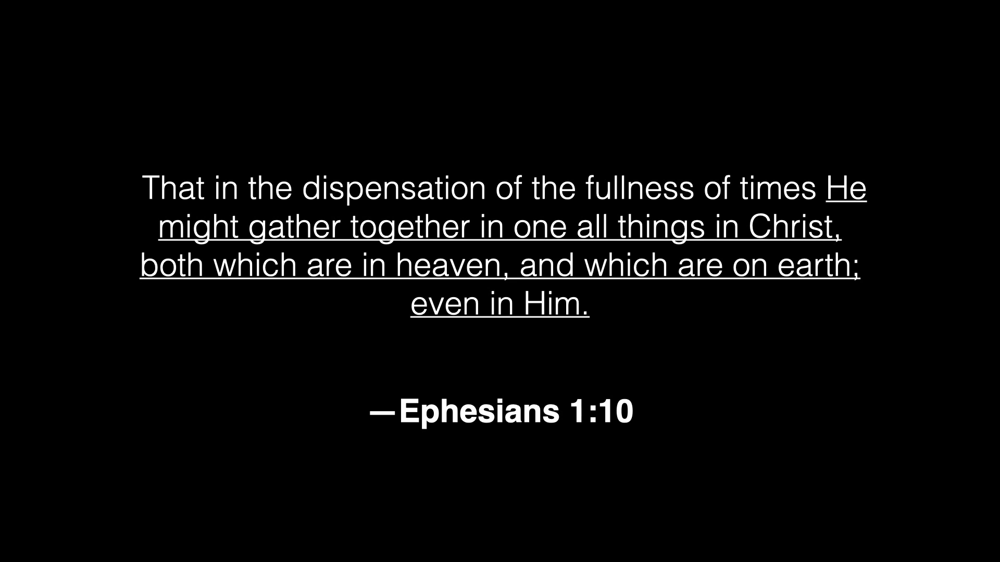
[00:26:26](https://www.youtube.com/watch?v=9Vnw5nK8BxA&list=PLZ_QEG0Ojk80glLb-z4weGRpvDa6bygeq&index=2&t=1586s)

- **[The Period of Restoration]** Biblical prophecy points toward a specific era where God's promises are fulfilled
    - Acts 3:19-21 describes a call to repentance that precedes the "period of restoration of all things"
    - This restoration is the fulfillment of what God spoke through His holy prophets from ancient times

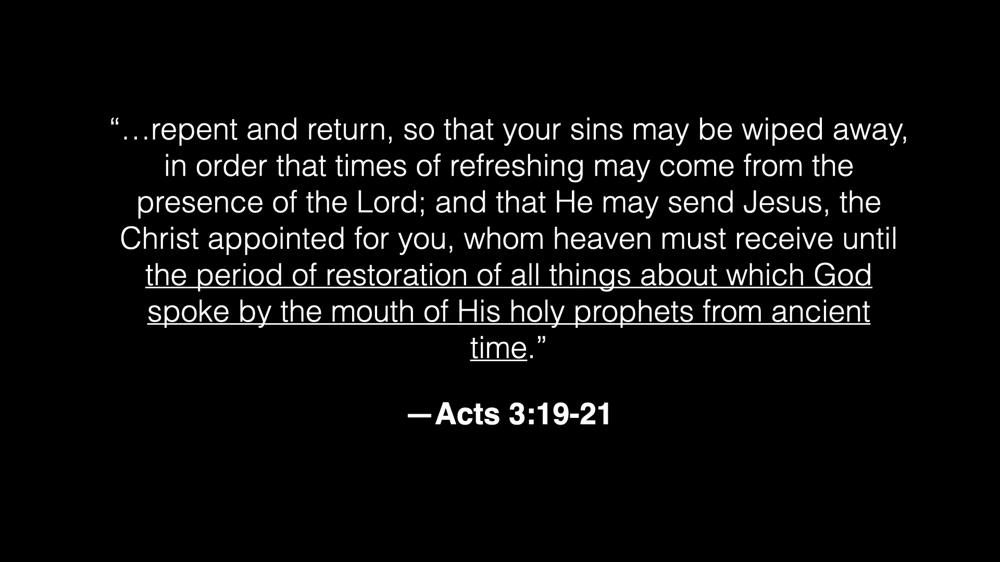
[00:26:46](https://www.youtube.com/watch?v=9Vnw5nK8BxA&list=PLZ_QEG0Ojk80glLb-z4weGRpvDa6bygeq&index=2&t=1606s)

### The Biblical Timeline Framework

- **[The Totality of Creation]** The biblical timeline begins with the creation of the heavens and the earth
    - The "heavens and the earth" represent the totality of everything God has made
    - This defines the entire scope of the created order that is subject to restoration

### The Biblical Concept of Time

- **[Two Primary Ages]** The Bible defines time through two distinct periods
    - This age
    - The age to come
- **[The Decisive Divider]** These two ages are separated by a single, decisive event: the return of Jesus

### Understanding Apocalypticism

- **[Definition]** Apocalypticism is a technical, academic term that refers to two things:
    - A specific type of literature popular during the first-century Second Temple Jewish period
    - A specific way of viewing and interpreting history

### Characteristics of the Two Ages

- **[This Age]** The current period, spanning from the Fall until the return of Jesus
    - Defined by corruption and futility
    - Characterized by sin and death
    - Includes the struggle of physical life (e.g., painful childbirth, toil for food)
    - Features unjust governing principalities and spiritual corruption
- **[The Age to Come]** The period following the return of Jesus and the establishment of His kingdom
    - Defined by the healing, restoration, and redemption of all things
    - Marked by the reestablishment of the throne of David on earth
- **[The Millennium]** A transitional phase
    - Serves as the bridge between 'This Age' and the ultimate eternal state
    - Acts as the transition from the current world into the new heavens and the new earth

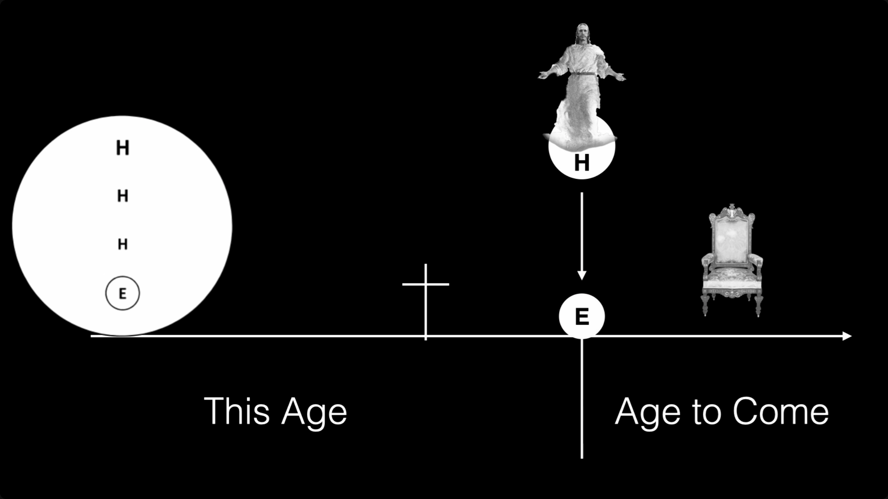
[00:29:41](https://www.youtube.com/watch?v=9Vnw5nK8BxA&list=PLZ_QEG0Ojk80glLb-z4weGRpvDa6bygeq&index=2&t=1781s)

### Revelation and the Day of the Lord

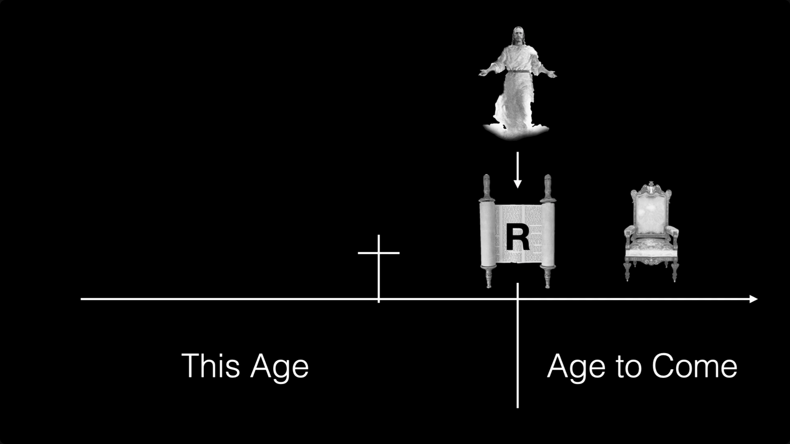
[00:30:22](https://www.youtube.com/watch?v=9Vnw5nK8BxA&list=PLZ_QEG0Ojk80glLb-z4weGRpvDa6bygeq&index=2&t=1822s)

- **[The Decisive Event]** The return of Jesus is the pinnacle of all biblical hope and expectation
    - It serves as the dividing line between the two ages
- **[Scope of Revelation]** Within a Jewish apocalyptic worldview, the Book of Revelation focuses on the events surrounding this return:
    - The seven years leading up to the return of Jesus
    - The return itself
    - The establishment of the millennial kingdom following the return

### The Scope and Interpretation of Revelation

- **[A Blessing for All]** While the book focuses on specific future events, it is not exclusively for those living in that final period
    - It is a book of benefit and blessing for every believer today
- **[The Primary Chronology]** The core focus of the book is the timing of events surrounding the return of Jesus
    - This distinguishes it from other interpretive lenses:
        - **Idealistic Interpretation:** Viewing the book as a broad commentary on church history (not the primary focus)
        - **Spiritual Interpretation:** Viewing the book as purely metaphorical (not the primary focus)
    - **The Correct Framework:** It should be understood through a pre-millennial, Jewish apocalyptic framework
        - This means focusing on the transitionary period: the culmination of history moving from 'this age' into the 'age to come'

### Defining Cruciform

- **[Definition]** The term "cruciform" refers to something that is patterned after or shaped like the cross

### The Cruciform Lifestyle

- **[Definition]** To be cruciform is to be patterned after or shaped like the cross
- **[The Pattern of History]** Just as history is divided into 'this age' and 'the age to come,' the Christian experience follows a specific progression:
    - **Suffering before Glory:** The current age for followers of Jesus is defined by an embrace of the cross
    - **Emulating Jesus:** Believers are called to imitate the pattern left by Jesus through suffering, death, martyrdom, and laying down one's life
    - **The Ultimate Goal:** This pattern of suffering is the precursor to inheriting glory after His return

### The Ultimate Witness of the Church

- **[The Final Opportunity]** The culmination of history provides the church with a final, grand opportunity to bear witness
    - This involves being martyr witnesses who lay down their lives
    - The purpose is to demonstrate the mercy of God to largely unrepentant sinners

### The Constantinian Model vs. Biblical Cruciform

- **[The Constantinian Model]** A distorted view where the cross is used as a tool for political and worldly conquest
    - This model suggests that Jesus died for our victory in a worldly or political sense (e.g., conquering political opponents)
    - **Historical Context:** Named after Constantine, who allegedly saw a vision of the cross with the words "by this sign, do conquer"
        - He used the symbol on the shields of his armies to attack pagans
    - **The Problem:** This approach is fundamentally perverse because it uses the symbol of sacrifice to justify killing and power-seeking
- **[The Biblical Model]** The true way to follow Jesus is to embrace the cross through sacrificial living, not through political dominance

### The Pattern of Suffering and Glory

- **[The Motivation of the Cross]** Jesus embraced suffering, torture, and death not as a defeat, but as a way to love His enemies
    - He died for those who were His enemies to transform them into His children
- **[The Necessity of Suffering]** Following Jesus means imitating His pattern of sacrificial living
    - This is not a one-time event but a principle that has been true throughout church history
    - There is an expected "crescendo" or ultimate time of trial that the church will face

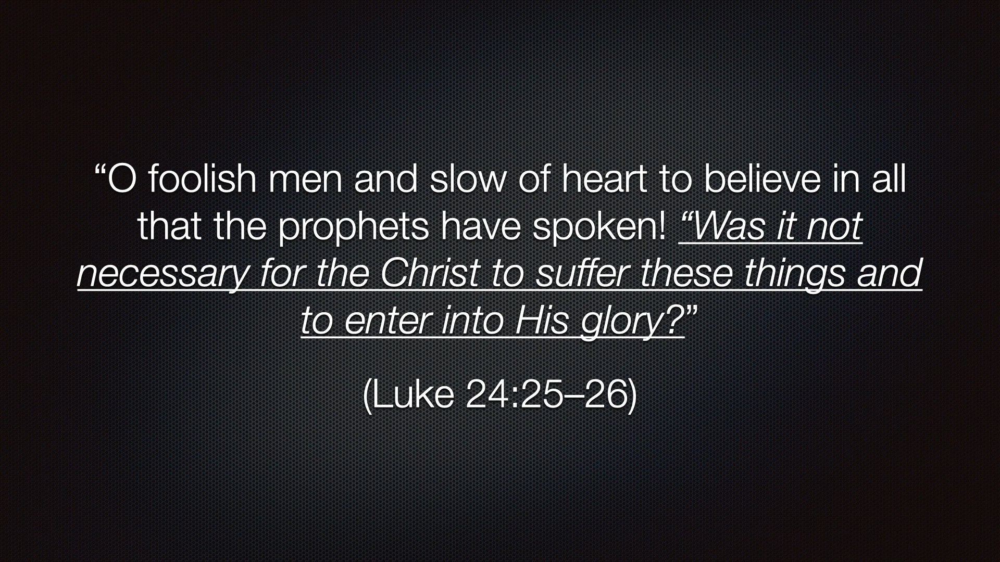
[00:35:57](https://www.youtube.com/watch?v=9Vnw5nK8BxA&list=PLZ_QEG0Ojk80glLb-z4weGRpvDa6bygeq&index=2&t=2157s)

- **[The Prophetic Pattern]** As seen in Luke 24:25-26, suffering is a prerequisite for glory:
    - Jesus rebukes those who are "slow of heart to believe" in what the prophets had already established
    - The core truth is that it was necessary for the Christ to suffer before entering His glory

> "O foolish men and slow of heart to believe in all that the prophets have spoken! 'Was it not necessary for the Christ to suffer these things and to enter into His glory?'" (Luke 24:25-26)

### The Purpose of Trials and the Revelation of Christ

- **[The Role of Trials]** Temporary grief and various trials serve a specific purpose for the believer
    - These trials test the genuineness of faith
    - Faith is described as being more precious than gold, which perishes despite being tested by fire
- **[The Timing of Glory]** The ultimate result of a tested faith is not immediate, but occurs at a specific moment
    - Praise, honor, and glory are realized at the *apocalypsis* (the revelation) of Jesus Christ
    - This is the moment when the true testing of faith is proven and results in the salvation of souls

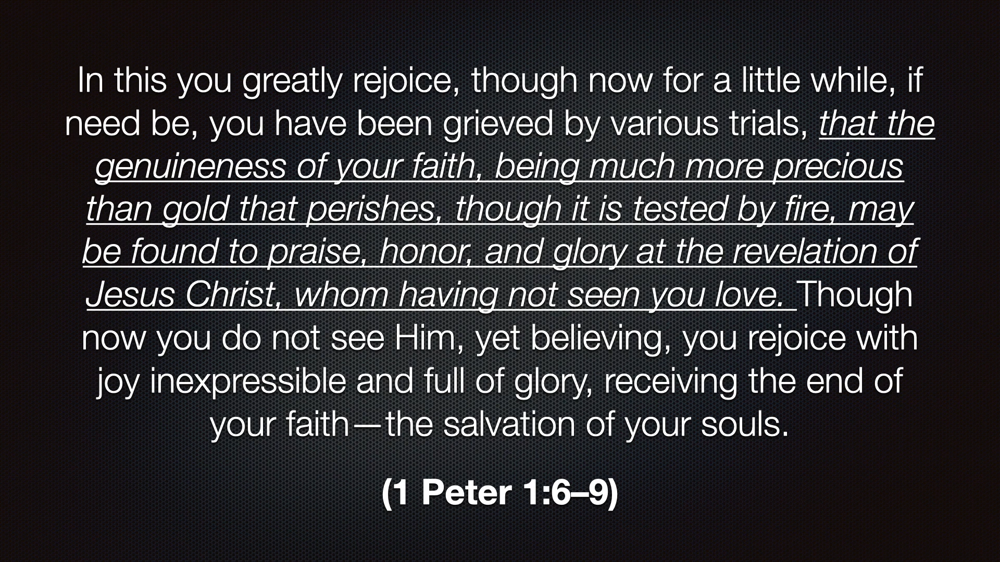
[00:36:44](https://www.youtube.com/watch?v=9Vnw5nK8BxA&list=PLZ_QEG0Ojk80glLb-z4weGRpvDa6bygeq&index=2&t=2204s)

> "In this you greatly rejoice, though now for a little while, if need be, you have been grieved by various trials, that the genuineness of your faith, being much more precious than gold that perishes, though it is tested by fire, may be found to praise, honor, and glory at the revelation of Jesus Christ, whom having not seen you love. Though now you do not see Him, yet believing, you rejoice with joy inexpressible and full of glory, receiving the end of your faith—the salvation of your souls." (1 Peter 1:6-9)

### Following the Example of Christ

- **[The Call to Suffering]** Believers are specifically called to a life of suffering, following the pattern set by Jesus
    - 1 Peter 2:21-24 establishes that Christ suffered as an example for believers to follow in His steps
    - This is a specific purpose for those who believe in Him

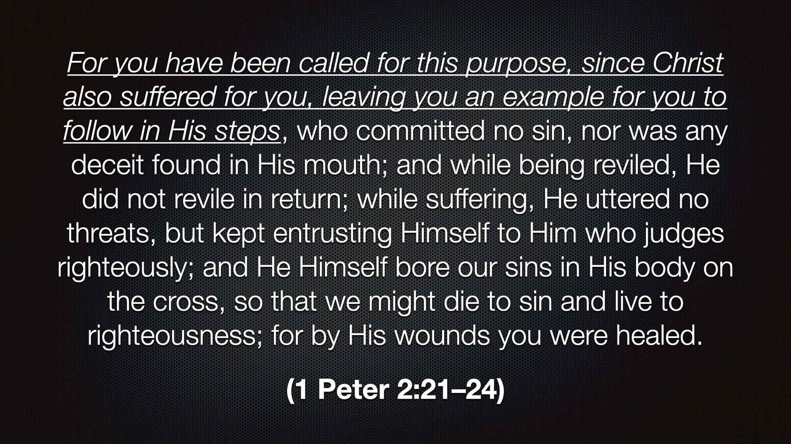
[00:37:58](https://www.youtube.com/watch?v=9Vnw5nK8BxA&list=PLZ_QEG0Ojk80glLb-z4weGRpvDa6bygeq&index=2&t=2278s)

> "For you have been called for this purpose, since Christ also suffered for you, leaving you an example for you to follow in His steps, who committed no sin, nor was any deceit found in His mouth; and while being reviled, He did not revile in return; while suffering, He uttered no threats, but kept entrusting Himself to Him who judges righteously; and He Himself bore our sins in His body on the cross, so that we might die to sin and live to righteousness; for by His wounds you were healed." (1 Peter 2:21-24)

- **[The Nature of the Christian Mission]** The goal of the church is not worldly dominance
    - Christians are not called to "conquer the world by the cross"
    - Instead, the calling is to lay down one's life and preach the gospel
    - This mission extends even to enemies and "wicked, reprobate sinners"

### Christ's Model of Endurance

- **[Christ's Response to Suffering]** Jesus modeled a specific way of handling persecution:
    - He committed no sin and had no deceit
    - He did not revile back when being reviled
    - He uttered no threats while suffering
    - He remained focused by entrusting Himself to the righteous Judge

### The Revelation of Christ through the Church

- **[What Creation is Waiting For]** While the completion of the Great Commission (preaching the gospel to all nations) is a necessary component before the end comes, there is a deeper purpose at the heart of Revelation
- **[The Dual Revelation]** The book is not only about the revelation of Jesus Himself, but also about the revelation of Him through His church
    - The church acts as a witness to His character
    - Believers model who He is to the world

### The Fifth Seal and the Fullness of Martyrs

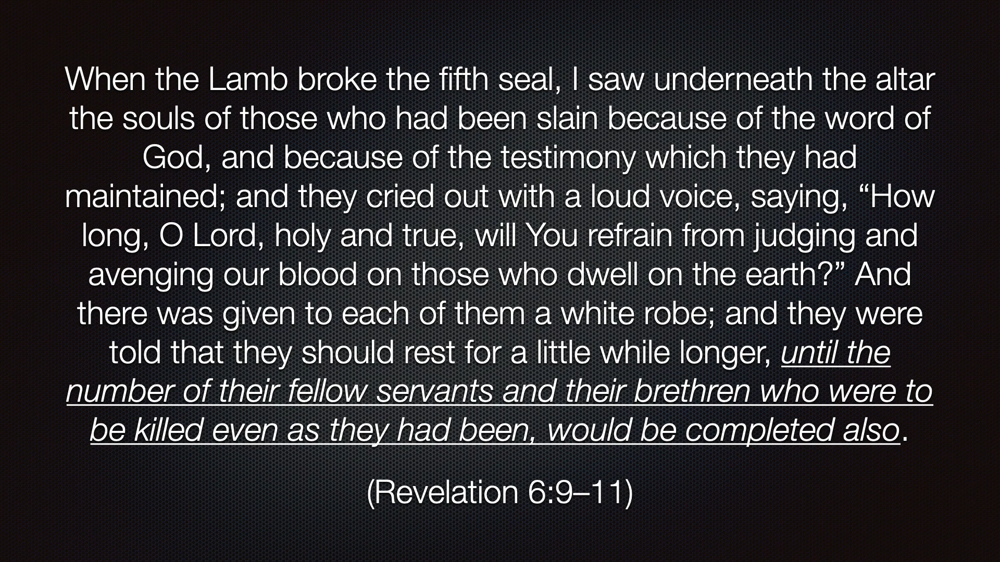
[00:40:08](https://www.youtube.com/watch?v=9Vnw5nK8BxA&list=PLZ_QEG0Ojk80glLb-z4weGRpvDa6bygeq&index=2&t=2408s)

> "When the Lamb broke the fifth seal, I saw underneath the altar the souls of those who had been slain because of the word of God, and because of the testimony which they had maintained; and they cried out with a loud voice, saying, 'How long, O Lord, holy and true, will You refrain from judging and avenging our blood on those who dwell on the earth?' And there was given to each of them a white robe; and they were told that they should rest for a little while longer, until the number of their fellow servants and their brethren who were to be killed even as they had been, would be completed also." (Revelation 6:9–11)

- **[The Reason for Martyrdom]** Believers are slain because of:
    - The word of God
    - The testimony they have maintained and held firm to
- **[The Waiting Period]** The slain are given white robes and told to rest
    - They must wait "just a little while longer"
    - This wait continues until the "number of their fellow servants and their brethren" who are to be killed is completed
- **[The Culmination of the Church]** The Book of Revelation points to a final period of tribulation and a specific culmination:
    - This period involves the church filling up the "full number of martyrs"
    - This is achieved by embracing a **cruciform message**
        - A cross-centered message
        - A message modeled after the cross
        - Imitating the Master, who embraced the cross for the joy set before Him

### Revelation as the Biblical Capstone

- **[The Necessity of Context]** To interpret Revelation correctly, one must integrate all three pillars of the framework:
        - Jewish
        - Apocalyptic
        - Cruciform
    - Missing any single element results in a misinterpretation of the book
- **[The Capstone of History]** Within the Jewish understanding of unfolding history, Revelation is the culmination
        - It is the "capstone" of the entire biblical testimony
        - Everything in the Bible moves toward this specific book
- **[Historical Reception]** Despite its importance, the book has faced historical resistance
        - Some Reformers, including Martin Luther, were hesitant to include it in the canon due to its complexity
        - This historical confusion can manifest in the modern church as skepticism regarding its divine authority