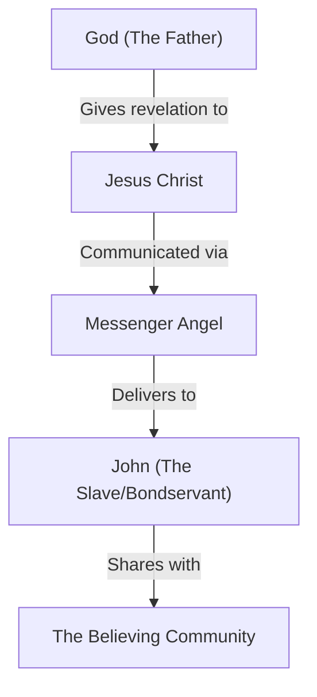

## Introduction to the Exposition of Revelation

- Commencement of the formal exposition of the Book of Revelation
    - Part of the Maranatha Global Bible Study (Session 6)

### Change in Study Approach

- The original study schedule is being adjusted
    - Rather than moving strictly forward, the speaker will revisit some of the initial verses of Revelation chapter 1
    - This is intended to supplement the work Dalton Thomas has already begun in the first chapter

### Purpose of the Revised Approach

- Aiming to complement rather than contradict Dalton Thomas
    - The goal is to provide "additional nuggets" of insight
    - It is acknowledged that a single session cannot exhaustively cover every detail within even a few verses
- Building on existing context
    - The speaker notes that Dalton's previous session was highly effective at contextualizing the entire book of Revelation and providing necessary perspective

### The Personal Context of John's Revelation

- The revelation was given to John the Beloved in a vastly different stage of life than his time in Galilee
    - It has been many years since the events in Galilee
    - John is now much older
- The setting is the Isle of Patmos
- **[Why this matters]** This personal history prevents the book from being viewed as merely a "dry theological apocalyptic book"
    - It is a revelation shaped by John's long-standing relationship with Christ, whom he once described as the friend he laid on his chest

### Emotional and Biblical Context of Revelation

- **[The Emotional Tone]** The book is underscored by an underlying theme of "lovesick yearning"
    - This is expressed through a "groan" or the "Maranatha cry"
- **[Biblical Lineage]** Revelation is thoroughly an Old Testament book
    - It functions as a "crescendo" or the culmination of the Old Testament narrative

### Revelation as an Old Testament Crescendo

- The book functions as the culmination or "crescendo" of the entire Bible
    - It is not a standalone text but is built upon the foundation of the Old Testament
- **[Method of Study]** Understanding Revelation requires identifying its deep connections to earlier scripture
    - The text is saturated with:
        - Themes
        - Passages
        - Citations
        - Allusions
        - Echoes
- **[The Importance of Perspective]** A proper reading requires a first-century Jewish lens
    - One must ask: "How would a first-century Jew, specifically John, have understood these things in light of the Old Testament?"

### Interpreting Through a First-Century Jewish Lens

- John was a thoroughly Old Testament-literate Jew
    - His familiarity with the scriptures would have shaped the ideas and concepts he expressed
    - **[Study Method]** To understand the text, one must identify the specific Old Testament ideas that would have been present in the mind of a first-century Jew like John
- Scholarly and Theological Context
    - Studying the book involves navigating various controversies and discussions raised by commentators and scholars
    - These theological issues arise naturally when wrestling with the complexities of the passages

### Analysis of Revelation 1:1-3

- **[Study Methodology]** The text will be unpacked in small, manageable segments
    - The first segment covers verses 1 through 3
    - The second segment covers verses 4 through 7
    - Each phrase and verse will be teased out and analyzed individually
- **Revelation 1:1 Breakdown**
    - "The revelation of Jesus Christ"
    - "Which God gave him to show his bondservants, the things which must soon take place"
    - "And he sent and communicated it by his angel to his bondservant, John"
    - "Who testified to the word of God and to the testimony of Jesus Christ, even though he was a servant"

#### The Meaning of Revelation

- The opening phrase, "The revelation of Jesus Christ," centers on the concept of revealing
    - In Greek, the word for revelation is `apocalypsis` (the root of the English word "apocalypse")
    - **[Core Concept]** The book is fundamentally about the unveiling or the revealing of Jesus Christ

### The Culmination of Redemption

- The "revelation of Jesus Christ" signifies the ultimate goal of the biblical narrative
    - It represents the full revelation of Jesus coming from heaven
    - It is the culmination of the entire story of redemption
    - **[Core Event]** The book centers on the return and coming of Jesus

### The Concept of Apocalypsis

- In the Hebrew context, revelation involves:
    - The drawing out of information
    - The expanding of understanding
    - The opening up of things that were previously hidden
- **[Understanding Mysteries]** In this context, a 'mystery' is not something inherently unsolvable or enigmatic
    - It refers to something that was simply veiled or not yet fully brought into the light
    - The purpose of revelation is to unpack these mysteries so they are available to the believing community

### The Technical Sense of Revelation

- **[Core Definition]** While the book involves the appearing and return of Jesus, in a technical sense, it is the opening up of things that were previously partially veiled
    - These truths were not entirely unknown, but they were not fully visible
    - At the culmination of the book, these mysteries are brought into the full light of day
    - **[Goal]** The purpose is to move from partial concealment to complete understanding for all believers

### The Chain of Revelation

- The revelation follows a specific downward transmission from God to the human recipient
    - **God the Father**: The ultimate source who gives the revelation to Jesus Christ
    - **Jesus Christ**: The recipient and subject of the revelation concerning His own return
    - **Messenger Angel**: The intermediary through whom Jesus communicates the message
    - **John**: The human recipient who receives the message from the angel
- **[John's Role]** John describes himself as a "slave" (bondservant) whose purpose is simply to share what he has seen and heard
- **[The Content]** The message being shared is defined by two pillars:
    - The Word of God
    - The testimony of Jesus Christ

### Biblical Literary Forms

- The Bible contains various types of literature, each with its own characteristics
- **Epistolary**: Material written in the form of letters (epistles)
- **Prophetic Literature**: Books where a messenger conveys a specific word from the Lord (e.g., "The Lord said to me...")
- **Apocalyptic Works**: A specific category of literature (the speaker begins to define this in the next segment)

### Apocalyptic Works

- Defined by a heavy use of mystical and symbolic imagery
    - Examples include visions of beasts with multiple heads or horns, and figures like a harlot
- **[Key Feature]** An angel typically appears to explain and unpack the meaning of the symbols
- **[Historical Context]** There was an "explosion" of this type of literature during the intertestamental period and within Second Temple Judaism

### Revelation as Prophecy

- Although the book is apocalyptic in style, it may not have fit the specific category that modern scholars assign to apocalyptic literature in the first century
- **[Biblical Identity]** From a biblical perspective, the book refers to itself as prophecy
    - This is evidenced by the blessings promised to those who engage with it (e.g., "blessed are those who...")

### Revelation as Amplified Prophecy

- The book views apocalyptic literature as "amplified prophecy"
    - It can be thought of as "prophecy on steroids"
    - It goes beyond simple verbal messages to include extensive symbolism to convey God's word
- **[Old Testament Precedents]** Apocalyptic elements are not new to the biblical canon
    - The book of Isaiah contains apocalyptic themes
    - The book of Daniel is explicitly an apocalyptic book

### The Multi-faceted Nature of Revelation

- From a biblical perspective, the book functions as multiple literary forms simultaneously
    - It is both an epistle (a letter) and a prophecy
- **[The Neglect of the Epistle Aspect]** Because it is so often categorized strictly as apocalyptic, many pastors and teachers overlook its identity as an epistle, leading to it being neglected in modern teaching

### Challenges in Teaching Revelation

- Many modern pastors and teachers tend to avoid the book
    - They often view it as being exclusively about "crazy stuff" like beasts, harlots, locusts, and the mark of the beast
    - This perception of the book being overly difficult or overwhelming leads to its neglect in the modern church

### The Practical and Pastoral Nature of Revelation

- The book is not merely an apocalyptic collection of "crazy prophecy"
- **[Key Identity]** It functions as a pastoral book, much like the epistles written by the Apostle Paul or the letters of John
- **[The Purpose of Engagement]** It contains highly practical and applicational information
    - The text explicitly blesses those who read, hear, and heed the words of the prophecy
    - The goal is for the reader to apply the things written in it to their lives

### The Pastoral and Applicational Value of Revelation

- **[Epistolary Character]** Because it is an epistle, it provides "simple ground reality application" for Christians today
- **[Initial Impressions]** For many, the first encounter with the book can be overwhelming or scary due to the intense imagery
    - Examples include the ocean turning to blood and widespread death across the world
- **[Overcoming Fear]** Many people approach the book with a sense of dread, imagining "hell on earth" scenarios
    - This includes mental images of intense destruction, such as exploding lava or widespread locusts
- **[The Promise of Blessing]** Despite the intense imagery, the text provides a foundational promise for the reader
    - It states that "blessed is he who reads and those who hear the words of the prophecy and heeds them"
    - This shifts the focus from mere fear of the imagery to the importance of active engagement and obedience

### Blessing During the Great Tribulation

- **[An Alternative Perspective]** While the Book of Revelation describes a period of intense difficulty known as the Great Tribulation, it is not solely a narrative of destruction
    - It is possible to experience blessing even during these difficult times
- **[The Condition for Blessing]** The promise of blessing is tied to active engagement with the text
    - One can be blessed during this season if they read and heed the words of the prophecy

### The Reality of Global Difficulty

- **[A Tangible Reality]** The events described in Revelation will involve intense, real-world difficulties and widespread suffering
    - This is not just a collection of abstract or fantastical concepts; it involves human tragedy
- **[Historical Parallel]** The speaker compares the potential scale of the last days to the decade-long conflict in Syria
    - This includes millions of deaths, families being displaced, and entire cities being reduced to rubble
    - The implication is that the "last days" will manifest as profound, widespread human suffering on a global scale

### Spiritual Resilience During Tribulation

- **[Maintaining Faith Amidst Persecution]** The final three and a half years of the Antichrist's persecution do not strip away the ability to experience spiritual life
    - Christians can continue to meet together
    - People can continue to encourage one another
    - Prayer and worship remain vital and possible activities throughout this period
- **[The Persistence of Blessing]** The promise of blessing remains accessible even in the midst of profound global difficulty

### Key Temporal Statements in Revelation

- **[Sense of Urgency]** The text contains two specific declarations regarding the timing of the prophetic events:
    - "the things which must soon take place"
    - "for the time is near"
- **[Interpretive Tension]** These statements are considered controversial because they raise significant questions about how to interpret the timeline of the end times from a modern perspective.

### Interpretive Frameworks for Revelation's Timing

- **[The Interpretive Challenge]** Because statements like "the time is near" are controversial, commentators generally use one of three primary interpretive lenses to understand them.
- **Preterism**
    - Believes that the events described in Revelation were largely fulfilled in the past
    - Specifically focused on the historical events surrounding the fall of Jerusalem in 70 AD
    - Viewed as a commentary on the end of the Torah, the end of the Old Covenant, and the end of Israel
- **[Etymology]** The term "preterism" is derived from a word meaning "history" or "past"
    - This reflects the core belief that the events described in the text have already occurred
- **[Preterist Assumptions]** For this view to hold, certain historical premises must be accepted:
    - The timing statements in Revelation (e.g., "the time is near") must be understood as referring to the era surrounding the fall of Jerusalem in 70 AD
    - Consequently, proponents must believe the book was written shortly before these 1st-century events

### Scholarly Support for the Latter Date

- **[Research on Dating]** There is academic work supporting the view that Revelation was written later than the 70 AD period:
    - Pastor Mark Hitchcock wrote a PhD thesis specifically on the latter date of the book
    - This perspective has been a subject of formal debate, such as Hitchcock's debate with Hank Hanegraaff at a pre-tribulational research conference

### Historicism

- **[Core Belief]** Believes that the book of Revelation is basically unfolding throughout history
- **[Continuous Process]** Unlike the preterist view, which sees fulfillment as a completed past event, historicists see the prophecy as a continuous process

### Futurist Interpretation

- **[Core Belief]** Believes that the Book of Revelation is primarily focused on and concerned with the final period of history
    - Specifically, the final seven years before the end
- **[Contrast with Historicism]** While historicism sees prophecy unfolding across many ages of church history, futurism concentrates on this specific, upcoming seven-year window

### The Jesus-Centric Nature of Revelation

- The book is ultimately focused on two primary episodes in human history:
    - The events surrounding the first coming of Jesus
    - The events surrounding the second coming of Jesus
- **[Theological Implication]** A futurist perspective inherently rejects replacement theology

### Critiques of the Preterist View

- **[The Nature of Fulfillment]** From a preterist perspective, the "culmination of redemption" and the fulfillment of Jewish prophetic expectations are tied to the destruction of Jerusalem
    - The speaker argues this is a perverse view because it defines the fulfillment of God's promises through destruction rather than the establishment of the throne of David in Jerusalem
- **[Analogy of Perversion]** To illustrate the perceived flaw in this logic, the speaker compares it to suggesting that Jewish hope and expectation were fulfilled by the occurrence of the Holocaust

### The Futurist View of Fulfillment

- **[Core Distinction]** Unlike the preterist view, futurists believe that true prophetic fulfillment remains unfulfilled until the Son of David is established on the throne in Jerusalem
- **[Critique of Preterism]** The speaker argues that defining the "culmination of redemption" through the destruction of Jerusalem is a perverse perspective
    - He compares this logic to suggesting that a people's greatest hopes and dreams were fulfilled through their own murder and destruction

### Futurist Interpretations of Timing

- **[Urgency and Certainty]** One way futurists understand statements like "the things which must shortly take place" is by shifting the focus away from literal timing
    - These phrases are viewed as conveying the **urgency** of the message
    - They also emphasize the **certainty** of the events that have been revealed to John

### The Prophetic Imperative of Urgency

- **[Purpose of Temporal Language]** Phrases like "the things which must shortly take place" are intended to communicate two key things:
    - **Urgency**: Encouraging believers to live with a constant sense of readiness
    - **Certainty**: Emphasizing that these events are absolutely guaranteed to happen
- **[Biblical Consistency]** This emphasis on urgency is not unique to Revelation; it is a consistent theme found throughout biblical testimony, including the teachings of Jesus and John the Baptist.

### Biblical Consistency of Urgency

- **[Pattern of Prophecy]** The emphasis on living with urgency is consistent with the entire biblical testimony, including the words of Jesus and John the Baptist
    - Old Testament prophets like Isaiah, Zephaniah, Ezekiel, and Joel used similar language to prepare people for the "day of the Lord"
- **[The Nature of the 'Day of the Lord']** This prophetic theme is characterized by a call to repentance and a sense of impending judgment
    - It often involves calls to "weep, wail, mourn, [and] repent"
    - It is described as a time of gloom and doom for the nations
- **[Ultimate Fulfillment]** While the warnings are severe, the "day of the Lord" ultimately refers to:
    - The return of Jesus
    - The establishment of His kingdom
    - The judgment of both the living and the dead

### Preliminary Days of the Lord

- Throughout history, there have been various "preliminary days of the Lord"
    - These serve as punctuated episodes of prophetic foreshadowing
    - They act as previews of the ultimate judgment to come
- **[The Ultimate Event]** Despite these historical episodes, the ultimate Day of the Lord is still in the future
- **[Historical Context]** Even though prophets throughout history claimed the day was "near," the final fulfillment has not yet occurred

### The Timing of Jesus' Ministry

- Jesus used similar timing language approximately 2,000 years ago
    - He proclaimed, "Repent for the kingdom of God is at hand"
- This creates a pattern where timing statements are often interpreted by Christians in relation to the immediacy of spiritual reality or the arrival of the kingdom.

### Evangelical Interpretations of Jesus' Timing

- **[Common View]** Many modern evangelical commentaries interpret "the kingdom of God is at hand" as a matter of proximity or spiritual access
    - The idea is that we have entered a new era where the kingdom is all around us and available to everyone
- **[The Omission of Repentance]** This interpretation often ignores the critical command that preceded the statement
    - Jesus did not just say the kingdom is near; He said, "Repent, for the kingdom of God is at hand"
    - Omitting the call to repent changes the meaning from a call to immediate action to a mere description of spiritual availability

### Characteristics of Prophetic Timing

- **[Urgency and Certainty]** Timing statements in Revelation are meant to drive a specific response in the believer
    - They present judgment as an inevitable reality that is "barreling down"
    - They function as a prophetic imperative, demanding immediate readiness
- **[Imminency]** The language used suggests that events are not just upcoming, but are characterized by:
    - **Speed**: The idea that things will happen "soon" or "quickly"
    - **Suddenness**: The warning that events can come upon people unexpectedly at any time

### Immediate Application in the Seven Churches

- From a futurist perspective, the letters to the seven churches in Revelation 1 and 2 possess dual relevance
    - They have a primary future fulfillment
    - They also had a tremendous degree of immediate application for the original recipients
- **[Historical Context]** The churches in Revelation were facing current persecutions and challenges that were actively breaking out during that era.
- **[Dual Fulfillment]** The messages to the seven churches in Revelation 1 and 2 exhibit a degree of overlap between historical and future fulfillment
    - They had immediate application for the first-century churches facing contemporary persecution
    - They also serve as a prophetic pattern for those living at the end of the age, who may face similar personal challenges
- **[Bridging Perspectives]** This view acknowledges elements of the historicist perspective while remaining fundamentally futurist
    - Some events began to unfold in the first century
    - These events ultimately culminate in the present day or the near future
- **[Core Communication]** Regardless of the specific timing, these prophetic statements are intended to convey three specific qualities:
    - **Certainty**: The events are guaranteed to happen
    - **Urgency**: They demand a present response
    - **Suddenness**: They will occur unexpectedly

### Addressing Linguistic Objections to Prophetic Timing

- **[Preterist Objection]** A common critique from the preterist perspective is that the language of "soon" or "shortly" in Revelation violates standard linguistic norms if the events do not occur within a few years.
- **[Biblical Precedent]** This type of language is actually common within the New Testament itself
    - For example, Paul the Apostle uses similar phrasing in Romans 16:20
        - "The God of peace will soon crush Satan under your feet"

### Defending the Use of Biblical Timing Examples

- **[The Theological Dilemma]** Using verses like Romans 16:20 to justify the language in Revelation presents a choice for those who disagree:
    - One could argue that Paul used the word "soon" incorrectly
    - However, this requires a "liberal approach" to the Bible
    - It would mean accepting that an inspired, infallible author communicated wrong thinking into the text
- **[The Alternative]** Accepting these linguistic patterns allows for a consistent view of Scripture without undermining its authority.

### The Meaning of "Soon" as Certainty

- **[Alternative Interpretation]** Rather than a chronological error, "will soon" can be understood as a statement of absolute certainty
    - It communicates that the event is "as good as done"
    - It conveys a sense of divine inevitability regarding the ultimate crushing of Satan
- **[Communicative Function]** The phrase serves to instill specific spiritual qualities in the believer:
    - **Certainty**: Knowing the outcome is guaranteed
    - **Urgency**: A call to immediate action or readiness
    - **Trust and Rest**: The ability to rely on the certainty of the Messiah's victory

### The Inevitability of God's Victory

- **[Analogy of Certainty]** The phrase "will soon" functions like an inevitable outcome
    - The speaker compares this to the perceived inevitability of a sports team's victory (e.g., the Kansas City Chiefs)
    - It conveys that the victory is "as good as done"
- **[Believer's Participation]** Those who belong to God are not just observers but will actively participate in the ultimate crushing of Satan by the Messiah.

### Revelation as an Epistle

- **[Epistolary Structure]** The book follows a classic epistolary formula, meaning it is written in the style of a formal letter
    - This is evidenced by the opening greeting: "John to the seven churches that are in Asia, grace and peace to you"
- **[Comparison to Paul]** This opening is characteristic of the New Testament's epistolary style, much like the beginning of Paul's pastoral epistles
- **[Purpose]** The book is not merely a collection of mysteries or a puzzle to be decoded, but a communicated message to specific churches.

### The Practical Nature of Revelation

- **[The Riddle Fallacy]** There is a common, almost carnal desire to treat the book as a riddle or a puzzle that needs to be decoded
- **[Multiple Genres]** While the book contains specific elements, it is not defined by them alone:
    - It is an **apocalypse**
    - It is a **prophecy**
    - It is an **epistle** (a letter)
- **[Practical Application]** Because of its epistolary nature, the book is highly practical
    - The messages were intended for direct application to the seven churches in the first century

### The Authorship of the Epistle

- **[Divine Senders]** The text identifies the sources of this epistle as:
    - Him who is, and was, and who is to come
    - The seven spirits who are before his throne
    - Jesus Christ, characterized as:
        - The faithful witness
        - The firstborn of the dead
        - The ruler of the kings of the earth

### Trinitarian Identity of the Senders

- **[The Trinitarian Formula]** The identification of the senders constitutes a clear Trinitarian formula, explicitly involving the three persons of the Godhead:
    - **The Father**: "him who is and was and is to come"
    - **The Holy Spirit**: "the seven spirits who are before his throne"
    - **The Son (Jesus Christ)**: "the faithful witness, the firstborn from the dead, the ruler of the kings of the earth"

### The Meaning of Eternal Pre-existence

- **[Divine Nature]** The description of God as "him who is and was and is to come" communicates His eternal nature
    - **Eternal Pre-existence**: God (and Jesus Christ) was never created and did not begin to exist at a specific point in time
    - This means He has always existed, both in the past and into the future
- **[Biblical Basis]** This concept of eternal existence is rooted in other scriptures, such as God's revelation to Moses in Exodus, where He identifies Himself as "I AM."

### Jesus' Identification as Yahweh

- **[The 'I AM' Claim]** In John 8:58, Jesus uses the phrase "Before Abraham was, I am" to identify Himself as Yahweh
    - This is not merely a statement about His age or longevity
    - It is a direct claim to the divine identity of the God of Israel
- **[Connection to Sinai]** By claiming this identity, Jesus is identifying Himself as the God who:
    - Made the covenant with Israel
    - Revealed Himself to Moses in blazing fire on Mount Sinai
    - Is the "bridegroom" who entered into a covenant relationship with His people
- **[The Reaction of Blasphemy]** The weight of this claim is evidenced by the reaction of His listeners, who attempted to stone Him for blasphemy, recognizing that He was claiming to be God Almighty.

### The Return of the Son vs. the Father

- **[The Identity of the 'Coming One']** The one who is coming is specifically the Son, who is described as:
    - God Almighty in the flesh
    - The glory of Yahweh revealed to humanity
- **[The Nature of God's Return]** Scriptural focus is not on the return of the Father, but on the return of the Son
    - The Son is the "express revelation" of the Father
    - Through the Son, the Father's presence is realized
- **[The Ultimate Conclusion]** The culmination of history involves the summation of all things where God dwells with man
    - This occurs in the eternal Jerusalem
    - Because God is present there, there is no longer a need for a physical temple

### The Necessity of the Doctrine of the Son

- **[Refuting the "Mystery" Polemic]** Critics (such as those from an Islamic perspective) often claim the Trinity is a confusing mystery that makes God incomprehensible
    - The speaker argues this is a rhetorical tactic to dismiss the complexity of the biblical worldview
- **[The Logic of a Loving God]** A truly great and almighty God must possess certain attributes that necessitate the Son:
    - **Transcendence**: God is massive, almighty, and separate from creation
    - **Love**: For God to be truly loving, He must be self-sharing and self-revealing
    - **The Role of the Son**: Without the doctrine of the Son, a transcendent God remains hidden and cannot effectively reveal Himself to mankind
- **[Revelation as Descent]** The very concept of "revelation" implies that the transcendent, almighty God must "lower" Himself to be known by His creation.

### The Mechanism of Revelation

- **[The Purpose of Veiling]** Revelation is the process of the transcendent, almighty God "lowering" Himself so that lowly mankind can perceive and know Him
- **[The Role of the Son]** Because God is loving, He sets forth His heart and His "express essence" into the earth in the form of the Son
- **[The Trinitarian Connection]** The identity of the one who "is and who has come" follows a Trinitarian formula involving the Father and the Son

### The Identity of the One Who is to Come

- **[The Coming Messiah]** Within the biblical context of the opening of Revelation, the "one who is to come" specifically refers to the Son
    - This identifies the Messiah/Jesus returning in glory as the coming Judge

### The Seven Spirits

- The speaker introduces the unusual mention of the "seven spirits who are before this throne" as a topic for further exploration.
- **[One Spirit, Diverse Manifestation]** The mention of "seven spirits" is not a technical way of saying there are seven distinct persons of the Holy Spirit
    - There is only one Spirit
    - The number seven describes the diverse ways in which the one Spirit is revealed and works throughout the earth
- **[Old Testament Origins]** The concept of the seven spirits originates from two specific Old Testament passages:
    - Zechariah 4:1-2 (concerning the lampstand)
    - Isaiah 11

### Old Testament Roots of the Seven Spirits

- **[Zechariah 4 and the Menorah]** The imagery of the seven spirits is linked to the vision of the golden lampstand (menorah) in Zechariah 4:1-2
    - The lampstand is described as being all gold with a bowl on top and seven lamps/spouts
    - **[The Symbolism of Grace]** This imagery alludes to the "spirit of grace"
        - It represents the way the Spirit enables people to accomplish what the Lord desires, such as the rebuilding of the temple
- **[Isaiah 11 and the Messianic Promise]** The concept also connects to the prophecy in Isaiah 11 regarding the lineage of David
    - The text speaks of a "shoot" springing from the "stem of Jesse"
    - **[The Tension of Failed Dynasties]** There is a historical tension between these promises of an eternal kingdom and the actual fall of Israel's dynasties (the Northern Kingdom and the Davidic line) shortly after the promises were made.

### The Shoot from the Stem of Jesse

- **[The 'Volunteer' Analogy]** The imagery of a "shoot" from a "stem" or "root" is compared to a "volunteer" in landscaping—a plant that appears to grow from a seemingly dead stump
- **[Pre-existence and Arrival]** This analogy highlights a dual truth about Jesus:
    - He is pre-existent to Jesse and David (the root)
    - He also comes after them (the shoot)

### The Seven Facets of the Spirit

- The speaker lists the seven terms used to describe the different facets of the one Holy Spirit, rooted in Old Testament descriptions:

    1. The Spirit of the Lord
    2. The Spirit of wisdom
    3. The Spirit of understanding
    4. The Spirit of counsel
    5. The Spirit of strength
    6. The Spirit of the knowledge of the Lord
    7. The Spirit of the Lord

- **[Unity in Diversity]** Despite these seven descriptors, it remains fundamentally one Spirit

### Jesus as the Faithful Martyr

- **[The Meaning of Witness]** In the description of Jesus as the "faithful witness" (Revelation 1):
    - The Greek word for witness is *martus*
    - This is the root of the word "martyr"
- **[The Pattern of Faithfulness]** Jesus is characterized as the "faithful martyr" because he was faithful unto death, not loving his life, setting the pattern for what followers are called to emulate.

### Jesus as the Firstborn from the Dead

- **[The Prototype of Resurrection]** Jesus is described as the "firstborn from the dead" and the "first fruits"
    - This signifies that He has proven death is defeated
    - His resurrection serves as the guarantee for the eventual rescue and resurrection of the righteous
- **[Physicality of the Resurrection]** The speaker emphasizes that Jesus' resurrection was not merely a spiritual or ghostly phenomenon, but a physical reality (flesh and bone)

### The Authority of the King of Kings

- **[Dominion over Earthly Powers]** Beyond His role as a martyr, Jesus is identified as the "ruler of the kings of the earth"
- **[Inheritance of All Thrones]** He is destined to inherit all dominions and thrones, establishing Him as the ultimate King of kings

### Redemption through Blood

- **[Release from Sin]** The speaker introduces the concept of Jesus loving His people and releasing them from their sins through His blood

### The Power of Divine Forgiveness

- **[The Magnitude of Forgiveness]** The shedding of Jesus' blood provides a release from sin that is disproportionately powerful compared to the scale of human guilt
    - Even the most 'guilty' individuals can be fully covered
    - The speaker uses the analogy of a nuclear explosion to describe the impact of divine forgiveness
        - Just as a nuclear explosion is an overwhelming release of power that cannot be contained
            - The power of the "Author of Life" is so immense that no sin can withstand it
            - Human sin is described as "puny" and "pathetic" when compared to the "nuclear explosion of divine forgiveness"
- **[The Struggle to Accept Forgiveness]** Believers often struggle to believe they are truly set free
    - People often fail to forgive themselves because they believe their sins are too large to be overcome
    - The speaker argues that thinking one's sin can stand against the blood of Christ is an unthinkable error

### The Argument from Design

- **[Observing Intent]** The speaker notes that design and intent can be observed in the natural world
    - For example, every aspect of a tree exhibits purpose and design
- **[Complexity vs. Illusion]** He critiques the "blind watchmaker" argument used by evolutionists
    - He suggests that what is often perceived as complexity without design is actually an illusion
- **[The Nature of Machines]** Using machines as an analogy, he argues that complex systems do not happen by chance
    - Machines do not create themselves
    - Just as a mousetrap or a watch with intricate internal gadgets requires a creator, the complexity of the world implies a designer

### From Design to Character

- **[The Next Logical Step]** Once an intelligent designer is established, the next question is about His character: Is He good?
    - The speaker argues that an all-powerful, intelligent creator must also be good
- **[The Argument from Faithfulness]** God's goodness is demonstrated through His faithfulness to what He has created
    - Using the example of King David, the speaker notes the promise that the righteous will not see corruption or be left to rot in the ground forever
    - This implies that if God took the time to create humanity and the world, He is faithful to preserve and care for them
- **[The Root of Belief]** The speaker's personal faith is not just a collection of arguments, but is rooted in two fundamental convictions:
    - That God created humanity
    - That God loves humanity

### The Gospel as a Love Story

- **[Grace vs. Effort]** The gospel is fundamentally different from other religious systems
    - Most religions focus on trying to earn God's favor or achieving enlightenment through human effort
    - The gospel is based on grace: being freed from sin so that humans are free to love God in return
- **[The Character of Jesus]** The foundation of this story is the character of Jesus, who is defined by His love for humanity

### The Identity of Believers: Priests and Ambassadors

- **[Biblical Roots]** This calling is rooted in the Old Testament Exodus story and the covenant made with Israel
    - God designated Israel to be a "peculiar people" and a "kingdom of priests"
- **[The Role of a Priest]** In this context, being a priest means acting as a representative
    - Believers serve as ambassadors between God the Father and the world
    - They represent God's character to those who do not know Him
- **[Spiritual Lineage]** This identity extends beyond physical descent
    - Even if not ethnically Jewish, believers are considered spiritual children of Abraham through faith

### The Priestly and Ambassadorial Role

- **[The Triple Function]** The calling of believers involves three key elements:
    - **Priestly element**: Acting as a mediator
    - **Representative element**: Standing in for others
    - **Ambassadorial element**: Serving as official representatives

### The Visible Return of Jesus

- **[The Prophetic Description]** The return of Jesus is characterized by universal visibility and mourning:
    - "Behold, he's coming with clouds and every eye will see him even those who pierced him and all the tribes of the earth will mourn over him"
- **[Old Testament Allusions]** This description is a combination of multiple prophetic passages. In the Gospels (Matthew, Mark, and Luke), Jesus consistently points back to two specific texts whenever He discusses His return:
    - Daniel 7
    - Zechariah 12

### Intertestamental Influences and the Canon

- **[The Use of Enoch]** The description of Jesus coming with "myriads of his angels" to execute vengeance is reflected in Jude 14-15
    - This passage quotes from 1 Enoch
    - 1 Enoch is non-canonical material, but it was a very important intertestamental and first-century document
    - Jesus and the Apostles would have been very familiar with it
- **[Authority of Scripture]** While the New Testament draws concepts from intertestamental works, a distinction must be made regarding authority
    - We must be careful with non-canonical texts, as they may contain elements that are not true
    - The canon of Scripture is the ultimate authority because it is the fulfillment of Christ's promise to guide believers into all truth
    - While books like 1 Enoch are fascinating for historical study, they are not the Word of God in the same way the canonical Bible is

### Foundations of the "Coming One"

- **[The Foundational Text]** The concept of the Lord coming on the clouds is rooted in Deuteronomy 33:
    - This passage contains the final words and blessings of Moses before his death.
    - It serves as a primary source for the imagery of the Lord's arrival throughout the Old Testament.

### Linguistic Nuance in Deuteronomy 33

- **[The Hebrew Perfect Tense]** In the phrase describing the Lord coming from Sinai, the Hebrew uses the perfect tense:
    - While many translations render this in the past tense ("the Lord came from Sinai"), the perfect tense is more versatile.
    - The timing of the perfect tense can represent:
        - Past tense
        - Present tense
        - Ongoing tense
        - Future tense

### Prophetic Interpretation of Deuteronomy 33

- **[Translating the Perfect Tense]** While English translations often use the past tense ("the Lord came") due to the Hebrew perfect tense, this can be interpreted prophetically
    - The perfect tense can represent past, present, ongoing, or future actions
    - In a prophetic context, it is more accurate to translate it as "the Lord will come"
- **[New Testament Fulfillment]** This prophetic reading is supported by how the New Testament interprets these Old Testament themes
    - The later prophets and the New Testament treat these events as future arrivals
    - For example, Jude's description of the Lord coming with "myriads of his angels" to execute vengeance is understood by Christian commentary as the return of Jesus
- **[Themes of Divine Judgment]** The return of the Lord is consistently associated with the theme of rendering to each one according to their deeds, expressed through various biblical motifs:
    - To judge
    - To punish the wicked
    - To save the righteous

### The Royal Procession of God

- **[The Divine Procession]** Biblical imagery often depicts the Lord's arrival as a royal procession, a theme found in Psalm 68:
    - The procession of God entering His sanctuary involves:
        - Singers going before Him
        - Maidens playing timbrels and tambourines behind Him
    - This imagery establishes the Messiah's return as a formal, majestic procession
- **[Geographic Markers of the Coming]** Scripture uses specific locations to describe the direction and nature of God's arrival:
    - Coming from Sinai (as seen in Deuteronomy 33)
    - Coming from heaven
    - Marching from the south (Edom/Bazan)
    - Coming from Teman and the Holy One from Mount Paran
- **[Connection to Revelation]** This pattern of movement and the imagery of the Lord coming on the clouds finds its ultimate expression in the Book of Revelation, tracing its roots back to the foundational language in Deuteronomy 33.

### New Testament Application of Sinai Imagery

- **[The Presence of Holy Ones]** Deuteronomy 33 describes the Lord coming from the midst of "10,000 holy ones" (angels)
    - The New Testament consistently applies this concept of a divine, angelic arrival to the return of Jesus
- **[The Glory of the Father]** The "shining forth" described in the Old Testament serves as a template for the glory Jesus will manifest upon His return
    - In Matthew 16:27, Jesus describes His return in the "glory of the Father"
    - This glory is characterized by the same splendor seen in the Old Testament: shining forth like the sun from the south
- **[Isaiah 63 and Divine Splendor]** The character of this return is further detailed in Isaiah 63, depicting a figure who:
    - Rides in splendor
    - Strides in greatness and strength
    - Speaks in righteousness and is "mighty to save"
- **[Prophetic Continuity]** The Book of Revelation is the culmination of these themes, but it relies on a long history of Old Testament passages that have already established the imagery of God's glorious arrival.

### The Identity of the Coming One

- **[Jesus as God's Glory]** The descriptions of a mighty coming from the south and shining forth are portrayals of Jesus, who is the express glory of God in human flesh
    - He is depicted with hands and feet, marching before His people
- **[The Uniqueness of God]** Deuteronomy 33:26 establishes the incomparable nature of God:
    - "There is none like God, the one who rides on the heavens to your aid and saves you on clouds and his majesty" (CSB)
- **[Contrast with Paganism]** The biblical imagery of God riding on the clouds serves as a distinction from pagan deities:
    - For example, the Canaanite god Baal was believed to be a storm god associated with clouds
    - The biblical account asserts the true God's sovereignty over these elements

### Yahweh as the True Cloud Rider

- **[Action vs. Myth]** The speaker contrasts the biblical God with pagan deities like Baal
    - Baal was viewed as a storm god associated with clouds, but his power was purely mythological
    - Yahweh is described as the "cloud rider" because His presence is grounded in historical action
        - In the Exodus, He led the people through the desert via a pillar of cloud for 40 years
- **[The Sovereignty of Yahweh]** The association with clouds serves as a marker of His unique identity
    - He alone is the true God who rides upon the clouds to save His people

### The Vision of the Ancient of Days

- **[Daniel 7 Imagery]** The concept of God's glorious presence is expanded in the book of Daniel
    - The "Ancient of Days" (representing the Father) is described as being attended by myriads of beings
    - His throne is characterized by intense, active power: "fires pouring forth from his throne"

### The Son of Man and Eternal Dominion

- **[Connection to Daniel 7]** The imagery of Jesus coming on the clouds in Revelation alludes to the anthropomorphic vision in Daniel 7
    - This depicts the divine warrior and creator choosing to return in human form
    - This concept of the Creator taking on human form (incarnation) was laid out in the Old Testament long before the New Testament was written
- **[Fulfillment of Prophecy]** Jesus is the only one who fulfills the specific details of the Daniel 7 vision:
    - He is presented before the Ancient of Days
    - He is given dominion, a kingdom, and glory
    - His kingdom is characterized by its permanence:
        - It is an everlasting dominion that will never pass away
        - It is a kingdom that will never be destroyed
    - His rule extends over all peoples, nations, and men of every language
- **[The Universal King]** Jesus' authority reaches the highest levels of earthly power, encompassing even the rulers and kings of the earth

### Zechariah 12 and the Jerusalem Focus

- **[Geographic Specificity]** While some interpret biblical themes through a broad tribal lens, the Old Testament passages alluded to in the Gospels and Revelation are often deeply geographically centered
    - These passages focus on Jerusalem as the epicenter of divine action
- **[Zechariah 12:9-13]** A critical passage describing God's judgment and the subsequent response of His people:
        - God declares His intent to destroy all nations that come against Jerusalem
        - He will pour out a "spirit of grace and supplication" upon the house of David and the inhabitants of Jerusalem
        - This leads to a profound, communal response of repentance:
                - The people will look upon Him and mourn
                - This mourning is described as being like the weeping for an "only son"
                - It is characterized by "bitter weeping"

### The Suffering Servant in Zechariah

- **[Connection to Isaiah]** Zechariah builds upon the 'servant songs' of Isaiah, where God is described as a figure who would be crushed for iniquities
    - The divine warrior is not just a conqueror, but also a suffering servant
    - This figure is fully human, born as the seed of Eve, Abraham, and David
- **[The Pierced One]** There is a profound intersection between the servant's earthly suffering and His divine return:
    - The figure will return from heaven
    - Upon His return, the people will look upon "the one Yahweh that they pierced"

### The Communal Mourning in Jerusalem

- **[Scope of Repentance]** The mourning described in Zechariah 12 is not a general or vague feeling, but a deep, localized event:
    - It is compared to the mourning of Hadramon in the plain of Megiddo
    - The mourning is intensely personal and communal, affecting "every family by itself"
    - This includes specific lineages such as:
        - The house of David
        - The house of Nathan
        - The house of Levi

### The Jewish Character of Jesus' Return

- **[Recognition through Jewish Context]** The return of Jesus is not a generic event; it possesses a fundamentally Jewish character that will enable His people to recognize Him
    - This is distinct from modern Christian iconography or cultural representations
    - The return is deeply tied to the specific Jewish themes and geographic focus found in the Old Testament
- **[Future Fulfillment vs. 70 AD]** The speaker challenges the interpretation that these prophecies were fulfilled during the destruction of Jerusalem in 70 AD
    - The specific return of Jesus that leads to the repentance of all Israel has not yet occurred
    - This event is characterized as a future occurrence
- **[Secondary Reference in Zechariah]** Zechariah provides additional context through secondary references to these themes, such as in Zechariah 9...