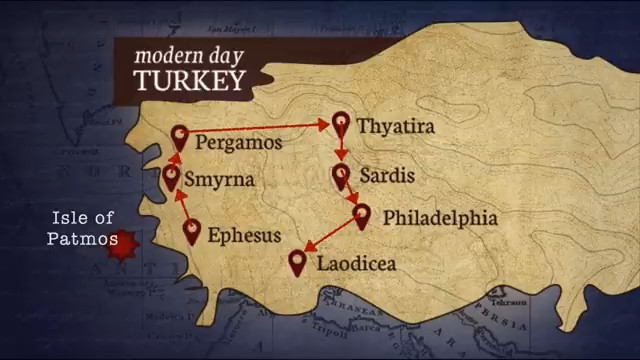

## The Book of Revelation

- Part of the Maranatha Global Bible Study
- Provided by Frontier Alliance International

### Revelation Chapters 1-3

- These chapters contain the messages from the Son of God to the seven churches
    - They are frequently referred to simply as the "letters to the seven churches"
- **[Purpose]** Chapters 1, 2, and 3 serve to introduce the book of Revelation
- Chapter 1 features John the Beloved

### John's Vision of Jesus

- The Apostle John experienced his vision toward the end of his life
    - This period was marked by his deep longing for his friend and teacher, Jesus of Galilee
- **[The Nature of the Vision]** John saw Jesus in His full glory
    - He saw Jesus in a resurrected and glorified body
    - The vision allowed him to see through the "veil" of physical flesh to the reality beyond

### The Identity of Jesus in Chapter 1

- The descriptions used in the first chapter identify Jesus as having a dual nature:
    - He is the resurrected Jesus
    - He is also God Almighty (Yahweh, the Son Yahweh)

### Prophetic Messages to the Seven Churches

- Chapters 2 and 3 consist of specific prophetic messages
    - These messages are directed toward seven specific churches
    - These churches were contemporary to the time when John received his vision

### Structure of the Seven Letters

- Each of the seven letters follows a consistent five-component structure
- **[First Component]** An introductory statement directed to the "angel of the church"
    - This is applied to each specific recipient, such as the angel of the church in Ephesus or Smyrna

### Components of the Seven Letters

- **[Second Component]** A specific identification statement regarding the Son of Man
    - Each of the seven letters contains a unique description of the Son of Man
    - These descriptions serve as a direct reference to the vision John experienced in chapter 1
    - This identifies the specific character who is delivering the message to each church

### The Core of the Seven Letters

- There is a direct connection between the identity of Jesus revealed in chapter 1 and the content of the seven letters
- **[The Heart of the Matter]** Each letter serves as a specific pastoral message from the Lord to an individual church
    - These messages comprise the essential content of the prophetic letters
    - The communication includes various forms of direct address, such as:
        - Rebukes
        - Corações (hearts/intentions)
        - Praises
        - Affirmations
        - Encouragements
        - Exhortations

### Tone of the Seven Letters

- The Lord's evaluations of the churches lean heavily toward the negative
    - While there are some encouraging statements, the majority of the content is critical
    - This session will bypass a detailed analysis of these specific messages to focus on the verse-by-verse study, with a return to the content of the letters in a later session

### Final Components of the Seven Letters

- After the pastoral message (the core of the letters), there are two final components
    - These components serve to universalize the specific messages sent to the individual churches
    - While the order of these two components can be inverted in some letters, most follow the same general form

### Universalization of the Seven Letters

- The pastoral messages are "tailor-made"
    - They address specific churches with their own unique characteristics, sins, struggles, and successes
- **[Universal Application]** The final components of each letter serve to universalize the message
    - These components ensure the message is applicable not just to the original recipients, but to the universal church throughout history

### The Focus of the Apocalypse

- The main emphasis of the book is the final seven-year period before the return of Jesus
- **[Prophetic Foundation]** This specific timeline was established previously in the Old Testament
    - Specifically in Daniel 9 regarding the "70 weeks"

### Biblical Intertextuality

- Biblical authors and prophets were deeply familiar with one another's writings
    - They did not write in isolation but actively studied the words of those who came before them
- **[Example: Daniel and Jeremiah]**
    - In Daniel chapter 9, Daniel is shown studying the words of the prophet Jeremiah
    - This demonstrates how prophetic understanding is built upon a foundation of previous scriptural revelation

### The Connection Between Daniel and John

- Both figures received deep, transformative revelations through angelic messengers
    - In Daniel 9, Daniel's study of Jeremiah leads to an angelic explanation of the "70 weeks"
    - Similarly, the Apostle John receives a revelation from God via an angel
- **[Posture of the Messenger]** Both Daniel and John maintain a stance of humility
    - John refers to himself merely as a "servant" or "slave" in the process of receiving and sharing the divine word

### Audience of Revelation

- The book has a dual-layered audience
    - **[Specific Audience]** It is primarily directed at those living through the final seven-year period, specifically the latter half of that timeframe
    - **[Universal Audience]** Beyond that specific historical context, the message is intended for the Universal Church and anyone willing to listen

### Triple Relevance of the Seven Messages

- Each of the seven prophetic messages carries a three-fold emphasis
- **[Historical Context]** They were originally addressed to specific churches at the end of the first century and the beginning of the second century
- **[Universal Application]** They remain relevant to the church throughout all of history
- **[Eschatological Focus]** They are specifically relevant to the church that will be living during the final seven-year period

### Promises to the Overcomers

- Each of the seven prophetic letters concludes with a specific promise of closure
    - These promises are explicitly directed toward those who "overcome" or "win"
- **[Structural Significance]** This element is not just local to the individual letters
    - It is a critical component found in chapters 2 and 3
    - It serves as a consistent theme throughout the entire Book of Revelation

### Geography of the Seven Churches

[00:08:16](https://www.youtube.com/watch?v=zPxFhcW60Po&list=PLZ_QEG0Ojk80glLb-z4weGRpvDa6bygeq&index=6&t=496s)

- A map of modern-day Turkey is used to locate the historical sites of the seven churches
- The Isle of Patmos is identified as a key location on the map

### Historical and Geographical Context

- In the time of John, the region where the churches were located was known as Anatolia or Asia Minor
- The seven churches mentioned in the text are named after seven prominent cities from the Roman era in this region
- **[Location of the Revelation]** The Isle of Patmos is the island where John was stationed when he received the vision concerning the coming of Jesus

### Geographical Order of the Seven Letters

- The order of the seven letters follows a circular path through the region
    - This route aligns with the various Roman roads present at the time
    - The sequence begins with Ephesus
- **[Interpretive Approach]** Many studies of Revelation 2 and 3 focus on the unique historical and cultural dynamics of each city
    - This helps address the specific issues each individual church was likely dealing with

### Scope of the Study of the Seven Churches

- The study will not perform an exhaustive, multi-month deep dive into the specific history and culture of each individual church
- **[Primary Objective]** The focus is on extracting key statements from chapters 2 and 3 to understand their application and relevance today

### The Strategic Importance of Turkey

- Turkey occupies an incredibly strategic position at the apex of several major regions
    - It sits at the intersection of Europe, Asia, Russia, and Africa
- **[Biblical Context]** While Jerusalem is considered the "navel of the earth" from a biblical perspective, Turkey's location makes it a key strategic piece of property in the global landscape

### Primary Interpretive Views of the Seven Letters

- There are three main perspectives used to interpret the seven letters
- **[The Historicist View]** This position holds that the Book of Revelation describes the unfolding of history from the time of the first century through to the end of the age

### Characteristics of Historicist Interpretation

- This perspective maintains that the Book of Revelation describes the unfolding of history through the lens of the church
    - Historicist commentators often look at the specific locations or contexts mentioned in the text and interpret them as symbols for specific periods of church history
    - Rather than focusing on a single moment in time, this view sees the prophecies as unfolding sequentially across the entire timeline of the church

### Comparison of Interpretive Views

- **[Historicist View]** posits that the seven churches represent seven distinct periods of church history
- **[Futurist View]** maintains that the Book of Revelation focuses primarily on the final seven-year period before the return of Jesus
    - The speaker notes that some futurists may overlap with historicist perspectives in certain aspects

### Hybrid Interpretive Models

- Some interpreters use a combination of views rather than adhering strictly to one
    - **[Hybrid Model]** They apply the historicist perspective exclusively to chapters 2 and 3 (interpreting the seven churches as periods of church history)
    - The remainder of the Book of Revelation is then interpreted using a futurist lens
- The speaker notes that this is an interesting model but expresses disagreement with it as the primary way to view the text

### The Preterist View

- The speaker begins to introduce the preterist perspective (details to follow)
- This perspective holds that the Book of Revelation was written well before the fall of Jerusalem in 70 AD
- It interprets the text as primarily describing events that have already taken place in history
    - From this viewpoint, the book is seen as a record of history rather than a roadmap for the future
    - While one can derive lessons for the church today from these historical accounts, the preterist view argues the text lacks a specific, direct application for current events

### Historicist Example: The Church in Ephesus

- Under the historicist view, the individual letters are seen as representing broader historical eras
    - For example, the first letter is addressed to Ephesus
    - In this view, Ephesus represents the church at the end of the apostolic era
        - This was a transitional period when the apostles were dying
        - The church still possessed zeal but was starting to lose its "first love"
    - The prophetic declarations made to the church in Ephesus are thus interpreted as describing the state of the universal church during that specific historical stage

### Historicist Mapping of the Seven Churches

- The historicist view maps each church to a specific era of church history
    - **Ephesus**: Represents the Apostolic era
    - **Smyrna**: Represents the era of Roman persecution
        - This period began with Trajan in the 90s AD
        - It continued through the reign of Constantine (313 AD)
    - **Pergamon**: Represents the era following the period of Roman persecution

### Historical Implications of Constantinianism

- The conversion of Christianity under Constantine led to the church becoming intertwined with the political system
    - This union is viewed by some commentators as a form of theological and moral compromise
    - In extreme interpretations, this integration is described as apostasy
- During the Middle Ages, this influence resulted in a church heavily immersed in heretical teachings and moral compromise

### Historicist View of the Reformation Era

- During the period of the Reformation, the historicist interpretation often describes a divided state of the church
    - Many commentators viewed the majority of the church as being in a state of spiritual death or compromise
    - However, some were identified as having "not contaminated their garments," representing a faithful remnant
- **[Contextual Note]** This specific distinction is often characteristic of a Protestant interpretive lens

### Historicist Mapping: Philadelphia and Laodicea

- **Philadelphia**: Represents the era of missionary expansion
    - This period is often associated with the work of William Carey, beginning in 1792
    - It continues through to the contemporary period
- **Laodicea**: Represents the modern church
    - Also frequently referred to as the "church of the last days"
    - Depending on the specific historicist view, this may represent the current era or the era of the "morning dawn"

### Challenges of the Historicist Interpretation

- Applying the historicist model to specific eras of church history can be problematic due to inconsistencies in the historical record
    - It is difficult to point to a single, universal state of the church for any given period
    - One can find examples that contradict the expected pattern of an era
        - For instance, during a period that is theoretically categorized as being in a state of widespread heresy or spiritual death, there are still "bright lights" of intense devotion to the Lord

### Critiques of the Historicist Interpretation

- The view is fundamentally a theory rather than a direct teaching of the text
    - The Book of Revelation does not state that there are seven distinct historical periods of the church
    - Mapping these periods is an interpretive attempt to find patterns that aren't explicitly laid out in the scripture

### Futurist Focus on the Final Seven Years

- The Book of Revelation is heavily focused on the final seven-year period of history
    - This period includes the final three and a half years of intense, great persecution
    - This era immediately precedes the return of Jesus

### Universal Application of the Seven Churches

- The seven letters possess a dual nature
    - **Historical Specificity**: They contain instructions specifically for the seven historical churches in Asia Minor during the time of the Apostle John
    - **Universal Application**: The messages are applicable to all believers throughout history
- This dual nature allows the text to be both a record of specific historical contexts and a source of eternal guidance

### The Universal Call to Listen

- The messages in the seven letters possess a universal dimension that transcends their original historical context
    - While the letters contained specific instructions for the churches in Asia Minor during the time of the Apostle John, the Lord addresses anyone who is paying attention
- This universal application is signaled by a recurring phrase used at the end of the letters
    - "He who has an ear, let him hear what the Spirit says to the churches"
    - This phrase appears at the conclusion of the first four letters (Revelation 2:7, 29) and in chapter 3 (Revelation 3:6, 13, 22)

### The Identity of the Angels in the Seven Letters

- Each of the seven letters in Revelation begins with a formal declaration to a specific recipient
    - The phrasing typically follows the pattern: "To the angel of the church in [Location]"
    - Examples include the angel of the church in Ephesus and the angel of the church in Smyrna
- The true identity of these "angels" is a subject of debate, with approximately four or five primary interpretive views existing among commentators

### Interpretive Views on the Identity of the Angels

- **Celestial Guardians**: A literal interpretation suggesting that real, supernatural angelic beings serve as celestial guardians for each specific church
- **Human Messengers**: An even more literal interpretation where the 'angels' are understood as human messengers or representatives within the churches, acting much like postal carriers

### Additional Interpretive Views on the Angels

- **Human Messengers**: An interpretation where the 'angels' are understood as human messengers or representatives within the churches, acting much like postal carriers
    - This view is based on the New Testament Greek word *angelos*, which essentially means "messenger"
    - However, this is often viewed as a theory rather than a view firmly grounded in the text
- **Church Representatives**: A view suggesting the 'angels' are specific leaders or representatives of the local congregations

### Personification View of the Angels

- The 'angels' are understood as a personification of the churches themselves
    - Under this view, the term does not refer to a real angel or even a specific real person
    - Instead, it serves as a symbolic representation of the entire church community
    - This could be embodied by a figure like a bishop or a pastor representing the congregation

### Uncertainty in Interpretive Views

- Commentators often struggle to maintain a firm position on the identity of the 'angels'
    - This is because there is no absolute certainty regarding whether they are celestial messengers, human leaders, or personifications
    - Many scholars use various forms of argumentation to navigate this ambiguity without committing to a single, definitive view

### Biblical Understanding of Angels

- Dr. Michael Heiser has contributed significantly to the study of biblical angels, specifically through his recent book, *Angels*
    - His work aims to restore actual biblical teaching and understanding of the concept
- **[Popular vs. Biblical View]** There is a significant gap between common perceptions and scriptural reality
    - The popular, "crystal" conception of angels is that they simply exist in heaven alongside God
    - This simplified view lacks the depth found in true biblical teaching

### Diversity of Celestial Beings

- **The inaccuracy of the "catch-all" view**
    - Many Christians mistakenly believe that any celestial being other than God is an angel
    - From a biblical perspective, this is not precise; there are many different types of celestial beings
- **Various orders of celestial beings**
    - **Elohim**: Beings referred to as the "divine council" of the Lord
        - While the term *Elohim* is used, the speaker clarifies they are not true gods
    - **Other hierarchies**: The Bible describes various other specific orders, such as:
        - Principalities
        - Seraphim

### The Complexity of the Term 'Angel'

- Biblical usage of the term encompasses a wide variety of beings and identities
- **[The Angel of the Lord]** In the Old Testament, specifically during the Exodus, the Lord is referred to as an angel
    - Example: "Behold, I am sending an angel before you... for my name is in him"
    - This indicates that the 'Angel of the Lord' is not merely a separate creature, but a way in which God himself is identified or manifests

### Human Messengers as 'Angels'

- The term 'angel' can be used as a functional designation for a messenger
    - In this sense, the term refers to the role being performed rather than the nature of the being
    - This means humans can be referred to as 'angels' when they are acting as messengers
- **[Theological Implications]** Using this functional definition changes the interpretation of the seven letters
    - If the 'angels' are human leaders (such as bishops), the message of the letters takes on a different character than if they were literal celestial beings

### Logical Implications of the Personification View

- **[The Chain of Communication Problem]** If the 'angels' addressed in the letters are human leaders (e.g., bishops), the transmission of the message becomes unnecessarily complex
    - The process described in Revelation 1:1 would follow this chain:

        1. God $\rightarrow$ His Angel
        2. Angel $\rightarrow$ John (the servant)
        3. John $\rightarrow$ The 'Angel' (human leader/bishop)
        4. Human leader $\rightarrow$ The Church

    - **[The Critique]** This creates a convoluted process: why would God give a revelation to an angel, only for it to be passed to John, then to a human leader, before finally reaching the congregation?
- **[A More Coherent Communication Chain]** Interpreting the 'angels' as human leaders (bishops or pastors) provides a clearer logical flow for the messages in Revelation
    - The process functions as a relay:

        1. The Lord provides the revelation to the Apostle John
        2. John transmits the message to the church leaders (the 'angels')
        3. The leaders then share the message with their respective churches

    - This model makes the purpose of the letters more practical and understandable than the idea of celestial beings communicating directly to specific local congregations

### Declarations of Identification in the Seven Letters

- Each of the seven letters contains a specific component: a declaration of identification
    - This serves to identify the speaker (the Son of Man) to the specific church
- **[Example: Ephesus]** The identification is often tied to specific visual imagery
    - The speaker identifies himself as the one who "holds the seven stars in his hand"
    - He is also described as the one "walking between the seven gold candles" (lampstands)

### The Prophetic Nature of the Seven Letters

- **[Beyond Pastoral Epistles]** While the seven letters share the form of an epistle (similar to Paul's pastoral letters to churches), they possess a deeper dimension
    - They are not merely personal or administrative correspondence from John
    - They function as a direct prophetic message from the Son of Man
- **[The Source of the Message]** The authority of these letters is rooted in the identity of the speaker, described through specific imagery:
    - The one who holds the seven stars in his right hand
    - The one who walks among the seven lampstands

### The "Son of Man" Imagery

- The description of the figure in Revelation is a direct linguistic link to the Old Testament
    - Specifically, the phrase "one like a son of man" is taken directly from Daniel 7
- **[Contextual Significance]** This connection helps establish the identity of the speaker as the one who walks among the golden lampstands

### Messianic Prophecy in Genesis

- The thread of messianic prophecy begins at the very start of Scripture in the Book of Genesis
- **[The First Prophecy]** The Lord establishes an enmity between the serpent and the woman
    - This includes a promise that the woman's seed will crush the serpent's head
- **[Early Identification]** The Messiah is presented through these early prophetic markers
    - This occurs long before the specific names "Jesus" or "Messiah" are ever used
    - The text introduces the figure through a mysterious, singular personal pronoun

### The Progression of Messianic Prophecy

- **[The Foundation]** Messianic prophecy begins in Genesis with the promise of the "seed" who will crush the serpent's head
- **[A Developing Thread]** From this starting point, the identity of the Messiah is progressively refined through different lineages across the entire Bible
    - **Genesis**: The Messiah is identified as the seed of Abraham
    - **Samuel**: The Messiah is identified as the descendant of David

### The Unfolding Messianic Identity

- **[The Anointed One]** The term 'Messiah' itself refers to the 'anointed one'
    - This identity is explicitly tied to specific prophetic descriptions, such as those found in Psalm 110
- **[The Judge of Nations]** Prophecy characterizes the Messiah as a figure of power and judgment
    - He is described as the one who will crush kings during the day of His wrath
- **[Christological Foundation]** Studying the identity of Jesus is not a series of isolated facts but a continuous study of messianic prophecy
    - A robust Christology is deeply rooted in tracing these prophetic threads from the beginning of Scripture to its end

### The Importance of Tracing Prophetic Threads

- **[The Risk of Incomplete Study]** Skipping the connections between various prophetic passages results in losing a massive part of the biblical narrative
    - Many studies fail to follow the thread as it scales through the entire Scripture
- **[The Desert Prophecies]** There is a category of critical prophecies that are often overlooked
    - These are rooted in the final words of Moses (Deuteronomy 32)
    - **[The Core Vision]** These passages provide a foundational view of Yahweh as the Almighty God

### Anthropomorphic Depictions of Yahweh

- **[Divine Procession]** Scripture often portrays Yahweh in human-like, active forms during significant movements
    - He is described as coming from heaven on the clouds, accompanied by myriads of holy angels and lightning
    - In passages like Habakkuk 3 and Isaiah 63, He is depicted in an anthropomorphic form
    - Isaiah describes Him as marching before His people through the desert
- **[Preparing the Way]** This divine movement is tied to the concept of a royal procession
    - Isaiah 35 and 40 speak of preparing a road through the desert for this specific procession

### The Messianic Paradox

- **[The Dual Nature of Prophecy]** Tracing the messianic thread through the Bible reveals a fundamental tension or paradox
    - On one hand, prophecy describes a human figure who is born of a woman and belongs to specific lineages
    - On the other hand, the figure is identified as Yahweh, the Almighty God, descending from heaven to save Israel
- **[The Human Element]** Despite His divine status, the Messiah is characterized by His humanity
    - He is described as the 'crusher of the skull' and the 'anointed one'
    - He remains a human being, part of the earthly lineage established in Scripture

### The Convergence of Messianic Identities

- **[The Central Tension]** There is a fundamental question of how to reconcile two seemingly different prophetic threads:
    - One thread describes a human being, born of a woman, who is the 'crusher of the skull' and the 'anointed one'
    - The other thread describes Yahweh descending from heaven on the clouds, in the form of a man, accompanied by myriads of holy angels
- **[The Intertwining of Threads]** These two identities are not separate; they begin to merge in specific prophetic passages:
    - **Habakkuk 3 and Isaiah 63**: In these texts, the Yahweh who comes from heaven is revealed in a way that bridges the gap between divine descent and human-like action
    - **Daniel 7**: This serves as a critical point where these two identities—the divine and the human—become explicitly linked

### The Intersection of the Two Comings

- **[The Emergence of Dual Comings]** The distinction between Jesus' first coming and His second coming becomes clearly visible through the study of messianic prophecy across the Old Testament
- **[The Role of Daniel 7]** Daniel 7 acts as the critical point where these two aspects are permanently joined
    - In this vision, the figure described as the "Son of Man" serves as the bridge where the two comings intertwine

### The Anthropomorphic Form of the Son of Man

- **[The Bridge in Daniel 7]** The vision of the 'Son of Man' is where the two distinct comings of Jesus are permanently intertwined
    - It reconciles the Messiah as a human born of a woman (the incarnation)
    - It reconciles the Messiah as the divine figure coming on the clouds
- **[Human Characteristics]** The figure is described in an anthropomorphic way, meaning He takes on a recognizable human shape
    - He is depicted with a head, a torso, two arms, and two legs
- **[Divine Attributes]** Despite this human form, the figure maintains the characteristics of Yahweh in the Old Testament
    - He is described as coming "upon the clouds," a specific historical pattern used to describe God's movement and presence

### The Divine Attribute of Riding the Clouds

- **[The Cloud Connection]** In the Old Testament, riding upon the clouds is a unique characteristic reserved for Yahweh
    - Deuteronomy 33:26 describes Him as coming from the heights and riding on the clouds to help and save
- **[Connecting Daniel 7]** This attribute serves as a theological bridge in the vision of the Son of Man
    - While the figure has an anthropomorphic (human) form, His action of riding on the clouds identifies Him as Yahweh
- **[Linguistic Note]** The portion of Daniel containing this vision is written in Aramaic, rather than Hebrew

### Aramaic Terminology in Daniel 7

- **[Linguistic Distinction]** Because the vision in Daniel 7 is written in Aramaic, the term for "Son of Man" differs from the standard Hebrew expression
    - Aramaic: `Bar Nasha`
    - Hebrew: `Ben-Adam` (meaning "Son of Adam")
- **[The Authority of the Son of Man]** The figure described as the Son of Man in Daniel 7 is not merely a human, but one granted immense cosmic authority
    - He is given dominion
    - He is given authority
    - He is given power
    - He is given a kingdom that encompasses all peoples of the earth

### The Identity of the Son of Man

- **[The Convergence of Identities]** The two prophetic visions—the one born of a woman and the one descending from heaven in anthropomorphic form—are revealed to be a single identity
    - This demonstrates that the human Messiah and the divine Yahweh are one
- **[Jesus' Self-Identification]** The title 'Son of Man' is not just a prophetic description but a primary way Jesus identifies Himself
    - Throughout His ministry, Jesus uses this specific term to refer to Himself more often than any other title

### The Messianic Implication of 'Son of Man'

- **[The Sanhedrin Interrogation]** When Jesus used the term `Bar Nasha`, it was a clear messianic claim that the religious authorities immediately recognized
    - During His interrogation, the Sanhedrin's response to His claims was to label Him a blasphemer
- **[Linguistic Context]** Jesus likely used the Aramaic term `Bar Nasha` to refer to Himself, which carried the heavy weight of the Daniel 7 prophecy
- **[The Accusation of Blasphemy]** To anyone literate in the Old Testament and familiar with its prophecies, Jesus' use of `Bar Nasha` was an undeniable claim to be the figure from Daniel 7
    - By claiming this identity, Jesus was effectively claiming to be Yahweh, the Almighty God
    - This is why the Sanhedrin responded to His claims by declaring, "You are a blasphemer"

### The Dual Nature of the Son of Man

- **[The Human Experience]** As the man from Galilee born in Bethlehem, Jesus possessed a fully functional human sensory experience
    - He could hear the physical sounds of humanity, such as a heartbeat or a stomach rumbling
    - He experienced the physical reality of blood pulsing through veins and arteries
- **[The Divine Perception]** There is a state where the "veil of His flesh" is opened, revealing the true nature of the Son of Man
    - In this state, His perception transcends mere human biology
    - He hears and perceives reality as the divine figure described in prophecy

### The Theological Weight of Jesus' Titles

- **[Beyond Human Labels]** The specific terms used to describe Jesus in the Bible serve as declarations of His true nature
    - These titles indicate He is not simply a prophet, a carpenter, or merely a creation of God
- **[Affirming the Trinity]** Using these biblical terms is essential for maintaining a proper understanding of Christ's divinity
    - To refer to Him only as a "child of a woman" risks denying the Trinity of Christ
    - Proper biblical literacy requires recognizing that these titles communicate His identity as part of the Triune God

### The Identity of the Almighty God

- **[Beyond Galilee]** The declarations in Scripture reveal a glory and splendor that transcend His human origins
    - He is not merely a man from Galilee, but the Almighty God
- **[The Divine Presence in Ephesus]** In the address to the Church of Ephesus, His identity is revealed through specific, powerful imagery
    - He is identified as the one who holds the seven stars in His right hand
    - He is the one who walks among the seven golden lampstands
    - These symbols serve to identify His authority and presence within the Church

### The Paradox of Redemption through Blood

- **[The Theme of Victory]** There is an incredible paradox in the concept of winning the world through blood
- **[Addressing the Human Condition]** This theme speaks to the internal struggle many face with shame and guilt
    - It raises the question of whether there is a blood powerful enough to truly address and heal these deep emotional and spiritual wounds

### The Alpha and Omega as Fundamental Reality

- **[The Indivisible Nature]** Christ is declared as the "first and the last, the Alpha and the Omega," a reference to Him being the one who was dead and is now alive.
- **[The Atomic Analogy]** To illustrate this concept, the speaker compares the nature of the Alpha and Omega to an atom:
    - Scientists once viewed the atom as the fundamental, indivisible building block of the universe
    - Just as the atom represents a foundational unit that cannot be split without changing its nature, the identity of the Alpha and Omega is an absolute, fundamental reality

### The Cosmic Paradox of the Author of Life

- **[The Nuclear Analogy]** To illustrate the magnitude of Christ's death, the speaker compares it to the splitting of an atom:
    - When an atom is divided, it results in a nuclear explosion that vaporizes everything in its path
    - Similarly, the idea of the Author of Life experiencing death is a spiritual and cosmic equivalent to such a massive release of energy
- **[A Rupture in Reality]** The death of the Source of Life creates a fundamental contradiction in the universe:
    - It is described as a phenomenon that "rips a hole in the space-time continuum"
    - It is presented as an impossibility: the very essence of life itself undergoing death

### The Nuclear Explosion of Forgiveness

- **[The Intentional Paradox]** The death of the Author of Life was not an accident of nature, but a divine allowance:
    - The Lord allowed the incarnation and subsequent death so that humanity could be forgiven
- **[The Scale of Forgiveness]** This impossible event results in what the speaker calls a "nuclear explosion of forgiveness"
    - This is described as an overwhelming, tsunami-like force of grace
    - It is powerful enough to encompass even "pathetic and rebel" human lives, placing them within the magnitude of divine forgiveness

### The Two Swords

- **[A Beautiful Declaration]** In verse 12, a significant description of Christ is presented:
    - He is identified as the one who possesses "the two swords"
- **[The Basis of Authority]** The speaker intends to use the scriptures to examine the foundation and meaning behind this specific imagery.

### Divine Attributes and Titles in Revelation

- **[Descriptive Imagery]** The speaker identifies several key descriptions of Christ's nature and authority found in the text:
    - **Verse 15**: He is referred to as the Son of God, with "eyes like the fire" and "feet like bronze"
    - **Verse 1**: He possesses the "seven spirits of God" and the "seven stars"
    - **Verse 7**: He is identified as the "Holy" and the "True"
    - **Authority over Access**: He holds the "key of David," which grants Him the unique power to open and not shut

### The Faithful and True Witness

- **[Verse 14 Identity]** Christ is given further specific descriptors in this verse:
    - He is identified as the "faithful and true witness"
    - In the Greek of the New Testament, the term used for witness is *martys*
    - He is also described as the "beginning of God's creation"

### The Song of Moses

- **[Prophetic Foundation]** To understand the imagery of the "two-edged sword," one must look to Old Testament prophetic passages:
    - Deuteronomy 33 is noted as a fundamental prophetic passage containing the last words of Moses
    - Deuteronomy 32, known as the "Song of Moses," is also a critical prophetic declaration likely given near the end of his life

### The Prophetic Content of Deuteronomy 32

- **[Content and Purpose]** This chapter serves as a divine reprimand to Israel, presented as a prophetic song given to Moses:
    - It encompasses the entire narrative arc of the nation, including:
        - The history of Israel
        - Their eventual punishment
        - The anguish of Jacob
        - Their ultimate restoration

### The Context of Final Judgment

- **[A Primary Reference]** The imagery of the Lord wielding a shining sword is established as a fundamental scriptural reference:
    - It serves as a primary declaration of His authority during the final, conclusive judgment at the end of time.
    - This connects the prophetic weight of the "two-edged sword" directly to the ultimate resolution of history.

### Literal Imagery in the Song of Moses

- **[Beyond Poetry]** Although the language used in the Song of Moses is poetic, it contains literal references to divine judgment:
    - The Lord declares He will "sharpen His shining sword"
    - This serves as a primary scriptural reference for the Lord wielding a weapon in the context of the final judgment at the end of the age
- **[Divine Vengeance]** The text describes specific actions of retribution:
    - Vengeance against adversaries
    - Retribution against those who hate Him
    - Arrows that are "drunk with blood"

### The Blessing of Moses

- **[Prophetic Transition]** Following the imagery found in the Song of Moses, the study moves to Deuteronomy 33, which contains the blessing of Moses.

### The Character of God in the Blessing of Moses

- **[Divine Uniqueness]** The text emphasizes that there is no one comparable to the God of Israel:
    - This uniqueness is a central theme in the concluding portion of the blessing (verses 26-29).
- **[Majesty and Help]** God is described through active, majestic imagery:
    - He is portrayed as riding through the heavens to bring help to His people.
    - He appears in majesty, riding upon the clouds to provide aid.
- **[Eternal Security]** The blessing provides a sense of stability through God's nature:
    - The eternal God serves as a dwelling place or refuge.
    - His eternal arms are beneath His people, providing support and protection.
    - He expels the enemy from before His people, ensuring that Israel may dwell in safety.

### The Era of Redemption and Blessing

- **[The Result of Vengeance]** Following the execution of vengeance upon enemies, a period of restoration is described:
    - The land is characterized as a source of plenty, specifically a land of cereal and new wine
    - This era is marked by the Lord returning from the heavens on the clouds to save His people
- **[The Unique Status of Israel]** The text emphasizes the special relationship between God and His people:
    - Israel is described as a people personally saved by the Lord
    - The Lord is identified through two primary roles:
        - The shield of their help
        - The sword of His majesty

### Linguistic Segues to Revelation

- **[Connecting the Testaments]** The Book of Revelation uses specific language that acts as a bridge from the Old Testament, particularly the Song of Moses:
    - The description of enemies being overcome and the subsequent era of redemption mirrors the themes in Deuteronomy 32.
    - The imagery of the Lord sending His sword to the earth in the context of redemption is a direct linguistic continuation of the Old Testament's prophetic language.

### Isaiah 27 and the Punishment of Leviathan

- **[Messianic Timing]** The phrase "in that day" (naquele dia) is a recurring messianic identifier:
    - It is used to refer to a specific, future era or the final period that leads into the coming age.
- **[The Defeat of the Serpent]** Isaiah 27:1 describes a divine judgment against chaos and evil:
    - The Lord is said to punish Leviathan, described as the "fugitive serpent" (a reference to the serpent in the Garden).
    - This judgment is carried out with a "fierce, great, and powerful sword."

### The Prophetic Foundation of Isaiah

- **[Connecting the Prophets]** The prophetic writings of Isaiah are not isolated; they are built upon the foundational themes established by Moses:
    - Isaiah draws from the theological and prophetic groundwork of Deuteronomy 32 and 33.
- **[Judgment on the Serpent]** Building on the imagery of the 'Day of the Lord,' the judgment involves the defeat of the twisted serpent (Leviathan):
    - The Lord will kill the dragon that lives in the sea.
    - This judgment is executed with a "fierce and mighty sword."

### The Conclusion of Isaiah 66

- **[Divine Vengeance]** The book of Isaiah concludes with a powerful depiction of judgment:
    - The Lord's sword is described as descending from heaven to execute judgment upon Edom.
    - Edom is identified as the people whom the Lord has devoted to destruction and as His enemies.
- **[Sacrificial Imagery]** The text employs language reminiscent of sacrifice:
    - The sword of the Lord is described as being "bathed in blood."

### The Old Testament Backstory for Revelation

- **[Deuteronomy 33: The Lord's Return]** The description of God's coming in Deuteronomy 33 provides the theological foundation for the imagery in Revelation:
    - The Lord will come from heaven, from Sinai, and from the south.
    - He arrives in fire, with chariots like a whirlwind.
    - He renders His anger with fury and His rebuke with flames of fire.
    - **[The Method of Judgment]** The Lord executes judgment through two primary means: fire and His sword, resulting in many being slain.
- **[The Identity of the Sword-Wielder]** The "double-edged sword" in Revelation is not a new concept but a reference to the Yahweh/God Almighty of the Old Testament:
    - Throughout Isaiah and Deuteronomy, the Lord is depicted as the one who executes the enemies of Israel with His sword.
    - **[Christological Claim]** For those who understand this Old Testament context, the imagery in Revelation is a clear claim by the Son of Man (Jesus) to be the same one whose glory Isaiah witnessed and whom Moses described.

### The Sword of the Mouth and Divine Authority

- **[The Warning to the Churches]** In Revelation, Christ issues a serious warning to the churches to repent:
    - He states that if they do not, He is coming quickly and will make war against them with the "sword of my mouth."
    - This characterizes Christ's return not just as a rescue, but as a moment of intense accountability where He can become an enemy to unrepentant believers.
- **[Judgment and Rule]** The imagery of the sword transitions from a warning to a tool of global judgment in Revelation 19:
    - A sharp sword comes from His mouth to strike down the nations.
    - Following this judgment, He will rule the nations with a "rod of iron."

### Promises to Those Who Overcome

- **[Universal Theme]** A recurring pattern exists throughout the letters in Revelation, where each message concludes with a specific promise to those who overcome:
    - **[Access to Paradise]** The promise of eating from the tree of life, which is located in the paradise of God.
    - **[Authority to Rule]** The promise of ruling with a rod of iron, mirroring the authority Jesus received from His Father.
    - **[Persistence]** The call to guard His works until the end to receive these rewards.