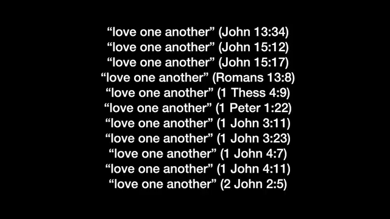
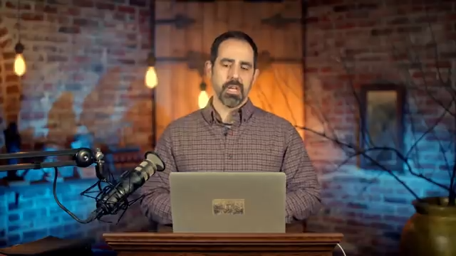

### Maranatha Global Bible Study: Revelation

- Session 10
- Focus: Continuing the study of Revelation chapters 2 and 3
    - This follows the previous session where work on these chapters began

### The Seven Letters to the Seven Churches

- These messages (often called the seven letters to the seven churches) are primarily relevant to the specific churches located in Asia Minor
    - The churches are named after the seven cities where they were situated

### Universalization of the Seven Letters

- The letters were originally seven pastoral letters from Jesus to specific churches in modern-day Turkey at the close of the first century/beginning of the second century
    - This provided the primary application: addressing specific cultures, situations, and difficulties of those time and place
- **[Universal Application]** Every letter concludes with the statement: "to he who has an ear to hear, let him hear what the Spirit says to the seven churches"
    - This phrase serves to universalize the messages, meaning all seven letters carry relevance and application for all people throughout history

### The Primary Focus of Revelation

- The book is centered on the revelation of Jesus Christ and His coming at the end of the current age
- **[The Great Transition]** The return of Jesus is the definitive event that separates the current age from the age to come
    - This transition moves from the current age into the millennium
    - The millennium ultimately transitions into the new heavens and the new earth (the eternal state)
- The book is principally concerned with the seven years leading up to the return of Jesus

### Applications of the Seven Letters

- The letters possess three distinct levels of relevance:
    - **Historical Application**: Addressing the specific churches and cultures in Asia Minor at the close of the first century
    - **Universal Application**: Relevant to all people and churches throughout history
    - **Eschatological Application**: A specific and special application for those alive during the final period of history (the final seven years)
- **[Note on Timing]** While the exact timing of these final events is unknown, many current global events suggest a rapid movement in that direction

### Errors in Interpreting the Seven Letters

- **[The Error of Phariseeism]** This occurs when there is a high level of zeal for correct doctrine and right practice, but it lacks a balance with love
    - The Lord may praise the zeal and the correctness of the doctrine, but the absence of love makes it an error
    - This is described as a common trap that is easily fallen into
- **The Church in Ephesus**
    - This is the first of the seven churches addressed in Revelation (Chapter 2:2-4)
    - It is characterized as a "father church" or a leading church among the others

### The Church in Ephesus

- **[Characteristics of the Church]** The Lord commends Ephesus for several key traits:
    - Their deeds and toil
    - Their perseverance
    - Their intolerance of evil men
- **[Testing Authority]** A defining feature of the Ephesian church was their ability to identify and test false spiritual leaders:
    - They put to the test those who claimed to be apostles but were not
    - Jesus confirmed their findings, stating they were indeed false
- **[Modern Application]** The speaker notes that this issue persists today, with individuals presenting themselves as apostles within various movements (including the New Apostolic Reformation) who do not hold true apostolic authority.

### False Prophecy and Accountability

- **[Modern Example]** The speaker notes an "avalanche of false prophecies" within the US church regarding the recent presidential election
    - Some claimed specific outcomes (e.g., that Donald Trump would win and serve a full four-year term) that did not manifest
- **[The Importance of Repentance]** A positive sign in these situations is when individuals take ownership of their errors
    - Repenting and apologizing for false prophecy is a necessary step for those who have spoken incorrectly

### Proliferation of False Prophecy

- **[The Influence of Post-Millennialism]** Certain authors and pastors are vocal advocates for post-millennialism and "triumphant kingdom" teachings
    - This brand of teaching is particularly prevalent within the charismatic church
- **[Nonsensical Claims]** The lack of proper theological structure leads to extreme and unfounded spiritual claims:
    - For example, some claim specific political figures will serve certain terms based on prophecy
    - Others attempt to spiritualize political outcomes (e.g., claiming a leader is ruling "from heaven")
- **[Lack of Structure]** There is a significant deficiency in proper theological structure and accountability within "freewheeling" independent Protestantism in the USA and globally

### The Ephesian Church: Perseverance and Loss of Love

- **[The Problem of Hyper-Independence]** In many modern movements, there is no hierarchy or structure of accountability
    - Leaders often function as "hyper-independent entrepreneurs"
    - Because of this lack of structure, when leaders sin, there are very few people to hold them accountable
- **[The Ephesian Commendation]** Jesus acknowledges the strengths of the Ephesian church:
    - **Perseverance:** They have endured difficulties and persecution for His name's sake
    - **Endurance:** They have not grown weary despite challenges
- **[The Ephesian Rebuke]** Despite their strengths, they received a serious warning:
    - "I have this against you, that you have left your first love"
    - There is significant theological debate regarding whether this "first love" refers to their devotion to God or their love for one another

### The Imperative of Love

- **[The Link Between Doctrine and Love]** Zeal for God is insufficient if it lacks proper love for brothers, sisters, and mankind in general
    - Without love, correct doctrine can slide into Phariseeism
- **[The Importance of Repetition]** When God or the biblical authors repeat a command multiple times, it serves as a signal to pay close attention
- **[The Command to "Love One Another"]** This is one of the most consistently repeated statements throughout the New Testament:

[00:11:33](https://www.youtube.com/watch?v=CmFA83N8yzk&list=PLZ_QEG0Ojk80glLb-z4weGRpvDa6bygeq&index=7&t=693s)

    - **Jesus:**
        - John 13:34
        - John 15:12
        - John 15:17
    - **Paul the Apostle:**
        - Romans 13:8
        - 1 Thessalonians 4:9
    - **Peter:**
        - 1 Peter 1:22
    - **John the Apostle:**
        - 1 John 3:11
        - 1 John 3:23
        - 1 John 4:7
        - 1 John 4:11
        - 2 John 1:5
- **[The Urgency of Love]** Jesus' instruction to love one another is not a suggestion to be added to correct doctrine, but a vital, urgent command
    - Failing to maintain this love is a "present danger" for the church
- **[The Example of Righteous Gentiles]** The concept of sacrificial love is exemplified by the "righteous Gentiles"
    - These were non-Jews who risked or laid down their lives to save others during the Holocaust
    - This serves as a profound illustration of the depth of commitment and love required in extreme circumstances
- **[Diversity Among the Righteous Gentiles]** The group of non-Jews who risked their lives to save others during the Holocaust was diverse and not limited to famous figures
    - Beyond well-known individuals like Corrie ten Boom or Oskar Schindler, many others made tremendous sacrifices
    - This group included Muslims, Bosnians, and Turks who acted to save fellow humans despite differences in religion or ethnicity
- **[Contrast with Modern Political Framing]** The speaker notes a discrepancy between historical examples of sacrificial love and modern political attitudes
    - In some conservative church circles, the Muslim refugee crisis is often framed in purely negative, hyper-politicized terms
    - This contrasts with the reality of individuals from those same backgrounds performing acts of extreme sacrificial love

### The Failure of the Church During the Holocaust

- While certain individuals like the Ten Boom family served as "shining lights" through their courage
    - The vast majority of the Christian churches failed miserably during this period
- This failure serves as a sobering historical reminder of the gap between doctrine and action

### Challenging Modern Political Responses

- The speaker poses a challenge to modern Christians regarding the refugee crisis
    - Some hold a "party line" that immigration should be opposed because of a perceived need to protect Christian heritage in Europe
    - This view is often rooted in a sense of identity: "I'm Christian... my descendants are largely from Europe... therefore Europe is Christian history"
- **[The Core Question]** Is the response to the marginalized driven by political preservation or by the biblical mandate to care for the outcast?
    - The command to love requires laying down lives for the "terrified, the marginalized, the desperate, and the poor"
    - This is contrasted with the example of Muslims who risked their families' lives and safety to save Jews

### Premillennialism and the Future of Israel

- The importance of premillennialism lies in the belief that God will literally fulfill His promises to the Jewish people
    - God is prophesied to restore the kingdom to Israel
    - Jesus will rule and reign from Zion (Jerusalem) over the nations
- **[Theological Implications]** Embracing this doctrine should theoretically lead to treating Jewish people with proper respect
    - This is because of their ongoing "special calling" and election by God
    - Even if the majority of Jewish people today do not follow Jesus, their unique status in God's plan remains
- **[The Prophesied Revival]** According to the Apostle Paul, a future revival is promised for the totality of the nation
    - This involves those who survive the final period of tribulation (often referred to as "Jacob's trouble")
    - When Jesus returns, these survivors will be saved

### The Dangers of Supersessionism

- **[The Core Issue]** Incorrect doctrine regarding the Jewish people can lead to systemic mistreatment
    - The speaker emphasizes that embracing correct doctrine is vital to ensure they are treated rightly
- **Supersessionism (Replacement Theology)**
    - The belief that the Christian Church has superseded (replaced) the Jewish people in God's plan
    - This often involves claims that:
        - The Jews have been permanently rejected by God
        - Their kingdom has been taken away
        - They have been judged for rejecting Jesus
    - The speaker refers to this as the "deadly logic of replacement theology"

### The Relationship Between Doctrine and Action

- **[The Doctrine-Action Gap]** Embracing correct doctrine (such as the "Maranatha" message regarding the last days) provides no guarantee of righteous behavior
    - Correct doctrine can sometimes even lead to pride
- **[The Necessity of Love]** For doctrine to be meaningful, it must be undergirded by a genuine love for both God and people
    - In times of crisis (e.g., refugee crises), people's actions frequently do not align with their stated doctrines
    - Without this foundation of love, even the most accurate theology can become largely irrelevant in the face of human suffering

### The Danger of Critical Ministries

- **[The 'Hunter' Mentality]** Some modern ministries operate primarily as "hunters"
    - Their main function is to find and criticize other ministries
    - While sometimes driven by a desire for truth, this often leads to corruption
- **[Un-Christlike Behavior]** This critical approach frequently results in behavior that is fundamentally unloving
    - It can manifest as being incredibly rude or acting like a "jerk"
    - The speaker emphasizes that this is a spiritual danger for all believers, as theological knowledge can easily be used to justify unloving conduct

### The Error of Balaam and the Nicolaitans

- **[The Connection]** The error of Balaam and the Nicolaitans are essentially linked together
- **[Theological Root]** These errors are summarized as being the error of Gnosticism

### The Conflict of Worldviews

- **[Hellenistic vs. Hebraic]** The early church faced a significant clash between two opposing mindsets:
    - **Greek Philosophical Worldview (Hellenistic):** Often held by Gentile converts who had adopted biblical faith but retained their previous philosophical frameworks.
    - **Biblical Philosophy (Hebraic):** The foundational mindset of the biblical text.
- **[Characteristics of the Greek Worldview]** A defining feature of Greek thought is a dualistic hierarchy of reality:
    - The physical/earthly realm is viewed as inferior and "bad."
    - The spiritual/immaterial realm is viewed as superior.
    - **Goal of Spirituality:** To escape the "shell" of the physical, carnal body to ascend to levels of enlightenment in the afterlife.

### The Biblical Worldview vs. Dualism

- **[The Biblical (Hebraic) View of Creation]** Unlike the Greek view that sees the physical as inferior, the biblical worldview asserts the inherent goodness of the material world
    - In the beginning, God created the physical and material realms, and He declared them "good"
- **[The Impact of the Fall]** While creation was originally good, multiple falls (the Garden, the rebellion of angels, the fall of Satan) have cumulatively corrupted all of creation
    - This corruption exists in both the spiritual realm (fallen principalities) and the physical realm (the curse on the earth)
- **[The Promise of Redemption]** The biblical perspective is not one of escape, but of restoration
    - In the fullness of time, Christ will redeem all things in heaven and on earth
    - This includes the resurrection of bodies and the renewal of the planet and the restoration of Eden

### Licentiousness and the Gnostic Influence

- **[The Core Issue]** The errors of Balaam and the Nicolaitans represented two different ways of addressing a specific problem within the early church: the endorsement of licentiousness.
- **[The Gnostic Connection]** This behavior is the opposite of Phariseeism; rather than being overly legalistic, it is characterized by a lack of moral restraint.
    - This mindset is rooted in various forms of Gnosticism.
    - It stems from the belief that the spirit is saved and born again (e.g., being "seated in heavenly places"), making the physical body irrelevant.
- **[The 'Shell' Concept]** Because the physical body is viewed as a temporary "shell" or "empty hole" that will eventually be discarded, proponents argue that what one does in the body does not matter.
    - **[Result]** This leads to a form of "sloppy grace," where spiritual status is used as a license for immoral conduct.

### Modern Manifestations of Gnostic Error

- **[The Nicolaitan Connection]** The hatred for the deeds of the Nicolaitans mentioned in Revelation is a rejection of the Gnostic doctrine that was prevalent in the first century
- **[Overly Realized Eschatology]** This modern iteration of Gnostic thought emphasizes invisible spiritual realities to the point of neglecting the material world
    - It often manifests as a belief that believers are already fully seated in heaven in a spiritual sense, regardless of their earthly reality
    - This mindset can lead to a lack of holiness and a sense of moral license
- **[Associated Movements]** Several modern theological trends are identified as carrying threads of this "overly realized" perspective:
    - Dominionism and Postmillennialism
    - The Prosperity Gospel movement
    - The Hyper-healing movement

### The Tension Between Current Access and Future Fullness

- **[The Reality of Current Access]** Through the work of Christ on the cross, believers have access to spiritual blessings in the present
    - This access is contingent upon standing according to His word
- **[The Distinction of Timing]** There is a crucial difference between what is available now and what will be fully realized later
    - **Current State:** Access to the spiritual realities of Christ's victory
    - **Future State:** The full, physical manifestation of these blessings at the resurrection
- **[The Danger of Misapplied Doctrine]** Attempting to force the "now" onto every physical circumstance leads to theological errors
    - **Prosperity Doctrine:** The claim that because believers inherit all things, they must be wealthy in the material sense
    - **Hyper-Healing Claims:** The claim that because "by His stripes we are healed" (past tense), believers should be perfectly healthy at all times
- **[Theological Nuance]** While the Lord does perform healings in the present, there is no biblical guarantee or promise of immediate physical healing for every believer
    - Emphasizing the "now" to an extreme can lead to bad doctrine regarding health, prosperity, and movements like hyper-grace

### The Danger of Denying Sinful Reality

- **[The Trap of Spiritual Identity]** There is a tendency to use one's identity in Christ to deny current sinful patterns
    - For example, someone might experience anger or lust but claim, "That's not who I am; I am holy and perfect because of what the Bible says about me"
    - This approach uses metaphysical truth to mask a failure to address actual behavior
- **[The Minimization of Repentance]** This mindset often leads to a significant reduction in the importance of repentance
    - By focusing only on a "perfect" spiritual status, one essentially agrees with the idea that they are no longer a sinner, which bypasses the need for genuine repentance
- **[The Disconnect from Reality]** The speaker compares this to a person with a broken leg, where the bone is visibly sticking out of the skin
    - The individual might claim, "I am healed in Jesus' name," which may be metaphysically true according to Scripture
    - However, ignoring the physical reality (the bone sticking out) is a failure to live in the reality of the moment
    - This same disconnect is a characteristic of the "hyper-grace" movement

### The Influence of Gnosticism on Modern Theology

- **[The Prevalence of Gnosticism]** The speaker argues that Gnostic-like thinking is not just a historical relic but is incredibly popular and even dominant in much of modern evangelicalism
    - It manifests specifically through "overly realized eschatology"
    - This involves treating spiritual realities (like healing or holiness) as if they are fully realized in the present, regardless of physical or moral reality
- **[The Role of Proper Eschatology]** Having a correct understanding of end-times events (eschatology) is vital for maintaining theological balance
    - It helps distinguish between our "present condition" (the reality of our current state) and what we "will be" (our future state)
    - Without this distinction, teaching becomes "metaphysical Gnosticism," where believers are taught to ignore their current earthly reality in favor of a perceived spiritual status
- **[The Error of Balaam]** The speaker introduces the specific teaching of Balaam as a concern addressed to the church in Pergamum in Revelation 1:14-15

### The Connection Between Balaam and the Nicolaitans

- **[Equating Errors]** In the church program, Jesus equates the error of Balaam with the error of the Nicolaitans
    - This connection serves to define exactly what the error of the Nicolaitans is
- **[The Core of the Error: Gnosticism]** The teaching of the Nicolaitans is rooted in Gnosticism
    - This is the belief that because one is spiritually saved on the inside, what they do with their physical body does not matter
    - This mindset views the physical body as something that will eventually be discarded, making acts of immorality seem inconsequential to one's spiritual standing

### The Extremes of Modern Religious Practice

- **[The Permissive Extreme]** There is a tendency to minimize the impact of sin if it is socially or culturally common within a church setting
    - This mindset suggests that behaviors like swearing or drunkenness are "fine" as long as they are handled in a certain way
    - This mirrors the Gnostic error by devaluing the physical/moral reality of one's actions in favor of a perceived spiritual safety
- **[The Legalistic Extreme]** Conversely, some have moved toward an increasingly legalistic approach to avoid sin
    - Instead of following the biblical principle (e.g., "do not get drunk"), legalism creates "fences" around the rule
    - An example of this is avoiding wine altogether to ensure one never touches the sin of drunkenness, which mimics the Pharisaic tendency to add human regulations to divine commands

### The Necessity of Pastoral Wisdom

- **[Avoiding the Middle Ground of Indifference]** The speaker warns against an attitude in the church that dismisses significant moral issues as unimportant
    - Jesus rebukes this attitude, suggesting that a lack of concern for holiness is a serious spiritual issue
- **[The Danger of Rigid Legalism]** While avoiding permissiveness, one must also avoid becoming a "rigid Pharisee"
    - Being hyper-legalistic can have negative consequences, particularly when applying rules to children or those under guidance
- **[Applying Realism and Wisdom]** Effective guidance requires being realistic about the differences in various behaviors and substances
    - Instead of applying blanket prohibitions, wisdom involves having frank, realistic conversations about the distinctions between different levels of impact (e.g., the difference between certain substances versus more destructive drugs)
    - The goal is to provide practical guidance that is grounded in reality rather than just arbitrary rules

### The Historical Origins of the Nicolaitans

- **[The Source of the Error]** The error associated with the Nicolaitans is linked to a specific individual, Nicholas
    - Nicholas was one of the seven deacons chosen in Acts 6
    - These deacons were prayed over and had hands laid on them by the Apostles
    - Despite this foundation, Nicholas became an apostate
- **[Historical Evidence]** The early church father Irenaeus provides testimony regarding this group
    - In his work *Against Heresies*, Irenaeus identifies the Nicolaitans as a significant group

[00:34:55](https://www.youtube.com/watch?v=CmFA83N8yzk&list=PLZ_QEG0Ojk80glLb-z4weGRpvDa6bygeq&index=7&t=2095s)

### Gentile Arrogance and Ignorance

- **[Defining the Error]** This is characterized as a form of anti-Semitism involving two components: arrogance and ignorance
    - While general ignorance is often unavoidable, the Apostles warn against being ignorant of Israel's special calling and election
- **[The Spiritual Danger]** Being dismissive or arrogant toward the "natural branches" carries severe consequences
    - According to Romans 11, those who are arrogant toward them are in danger of being cut off themselves
    - The speaker notes this error is increasingly visible in modern contexts, such as online discussions and YouTube comments

### The Context of Biblical Rebuke

- **[Internal vs. External Rebuke]** Scripture contains incredibly harsh statements directed at Israel, but these are fundamentally "in-house" rebukes
    - These statements come from a place of familial love, similar to a father speaking to his children
    - Examples include the words of the prophets, John the Baptist, and Jesus
- **[The Song of Moses]** Deuteronomy 32 serves as a primary example of this dynamic
    - It is a harsh rebuke of Israel, yet it is delivered by Moses within the context of his profound love for his people
- **[The Danger of Appropriation]** A significant error occurs when Gentiles take these harsh terms and apply them to Israel
    - This appropriation often misses the crucial context of God's ongoing special calling, love, and affection for Israel
    - This misunderstanding fuels modern anti-Semitic conspiracy theories and doctrines

### Modern Anti-Semitic Conspiracy Theories

- **[The 'Noahide Laws Panic']** A prevalent theory often found on platforms like YouTube
    - It claims that Orthodox Jews are attempting to enforce Noahide laws upon the entire world
    - This is framed as a satanic or demonic conspiracy to enslave Gentiles through Jewish law
- **[Misuse of the Talmud]** Conspiracy theories often rely on the selective or incorrect use of Talmudic literature
    - Proponents often pull specific passages out of context to suggest that Jews hold malicious views toward Gentiles
    - These claims frequently allege that Jews view Gentiles as "evil" or compare them to "dogs and pigs"
    - Such interpretations demonstrate a fundamental lack of understanding regarding how Talmudic literature is actually written and structured

### Misunderstandings of Talmudic Literature

- **[Decontextualized Debates]** A common error in anti-Semitic rhetoric is pulling specific quotes from the Talmud without context
    - The Talmud records complex conversations and debates between rabbis
    - A single statement might be a rabbi playing "devil's advocate" rather than a declaration of universal Jewish belief
- **[The 'Synagogue of Satan' Label]** This term is frequently misapplied in online spaces, such as YouTube comments
    - It is often used to target modern Orthodox Jews or any synagogue that does not believe in Jesus

### The Khazarian Hypothesis

- **[The Claim]** A conspiracy theory suggesting that modern Jews are not the "real" Jews, but are instead descendants of Khazars (an ancient kingdom in Turkey)
- **[Refutation]** This claim has been widely debunked through both scientific/genetic evidence and biblical analysis

### Identity and the Land of Israel

- **[The Hebrew Israelite Claim]** Some movements argue that Gentiles are actually the true lost tribes of Israel because they have been called to the Torah
    - This view often labels the people currently living in the land of Israel as "fake Israel"
- **[Biblical Counter-Argument]** Scripture identifies the physical inhabitants of the land as Israel
    - When prophets speak of the Antichrist and his armies invading the land, God refers to those being attacked as "my people Israel"
    - This indicates that the people living in Judea and around Jerusalem are the biblical Israel referenced in prophecy

### The Synagogue of Satan and the Church of Smyrna

- **[Connection to Smyrna]** The speaker begins to explore the relationship between the "synagogue of Satan" and the historical church in Smyrna
- **[Condition of the Saints]** Reference is made to the specific circumstances of the believers in Smyrna
    - They are described as experiencing tribulation and poverty
    - Despite these physical circumstances, they are described as being "rich" in a spiritual sense

### The Identity of the Synagogue of Satan

- **[Biblical Reference]** Revelation 3:9 describes a group that "says they are Jews and are not," identifying them as a "synagogue of Satan"
    - This is addressed specifically to the church in Philadelphia
    - The text claims they lie about their identity and promises that they will eventually bow down at the feet of the believers, acknowledging God's love for them
- **[Historical Context]** The term may stem from political and religious tensions in the first-century Roman Empire
    - There was significant friction between traditional Jews and those who followed Jesus but still attended synagogues
- **[The Curse of Menem]** A specific ritual used to target believers
    - It was a curse directed at followers of Jesus
    - The curse was part of the weekly *siddur* (ritual/prayer book)

### Cultural Pressures in the Roman Empire

- **[Religious Rituals]** Participation in Roman culture often necessitated engagement with temple rituals
    - These rituals frequently included acts of immorality, such as with temple prostitutes
    - They also required making sacrifices to idols
- **[Economic Obligations]** The empire demanded acknowledgment of Caesar's authority through financial means
    - Paying taxes to Caesar was often coupled with a temple sacrifice as a form of acknowledgment
    - This created a direct conflict for early Christians who could not participate in these pagan-linked rituals

### Synagogue Involvement and Legal Exemptions

- **[Legal Protections]** Under Roman law, membership in an established, accepted religion provided certain exemptions
    - Being part of Judaism allowed individuals to avoid participating in pagan sacrifices and associated immoral rituals
    - This provided a legal way for Gentiles to bypass obligations that were religiously or morally problematic for them
- **[Gentile Participation]** Many Gentiles joined synagogues specifically to leverage these legal protections against pagan temple rituals
- **[Proselyte Synagogues]** The emergence of groups that were not ethnically Jewish but claimed the identity
    - These proselytes would form their own synagogues
    - While they claimed to be Jews, they were essentially separate entities operating under that label

### The Historical Context of the Synagogue of Satan

- **[Persecution of the Early Church]** The term likely refers to specific groups within the synagogue system that were hostile to the messianic movement
    - These groups may have been Gentile-led or proselyte-led synagogues
    - Their actions were directed at persecuting the early Christian churches
- **[Distinction from Judaism]** The use of this term is a specific rebuke, not a universal condemnation
    - It does not mean that every Jewish person is part of the 'synagogue of Satan'
    - The term is often misapplied in modern contexts to fuel anti-Semitic rhetoric

### Modern Manifestations of Anti-Semitism

- **[Warning Against Spiritual Arrogance]** Paul's warnings against being arrogant toward the "natural branches" that were cut off
    - Gentile believers (the "wild branches" grafted in) must not look down on or mock others, as they themselves are at risk of being cut off
- **[Influence of Fringe Movements]** Certain elements within modern congregations and the Hebrew Roots movement have begun borrowing ideas from the Black Israelite movement
    - The speaker characterizes this movement as a cult, drawing parallels to the Nation of Islam
    - This influence contributes to an increase in anti-Semitic sentiment within these religious circles
- **[Historical Continuity]** This tension and hostility toward Jewish people is not new; it was a significant problem in the first-century church as well

### Revelation 3:10 and the Hour of Testing

- **[The Promise to Philadelphia]** The verse states: "Because you have kept the word of my perseverance, I will keep you from the hour of testing, that hour which is about to come upon the whole world and test those who dwell on the earth."
- **[Interpretations of the 'Hour of Testing']** How this verse is understood often depends on an individual's eschatological stance:
    - **Pre-tribulationalism**
        - Uses this verse as a primary proof text for the pre-tribulational rapture
        - Argues that the church will be raptured prior to the seven-year tribulation period
- **[Eschatological Perspectives on the Rapture]** Different views on when the rapture occurs:
    - **Pre-wrath and Post-tribulationalism**
        - The speaker suggests these views may interpret Revelation 3:10 more accurately than pre-tribulationalism
    - **The Speaker's Position**
        - Holds a hybrid perspective between pre-wrath and post-trib
        - Believes both traditional views contain correct elements, but neither is fully accurate
- **[Challenging Pre-tribulationalism]**
    - The speaker intends to use Jesus' words in **John 17** to debunk the pre-tribulational understanding of the promise in Revelation 3:10

### Jesus' Prayer in John 17 and the Nature of Preservation

- **[The Context of John 17]** Jesus prays for his followers, noting that the world hates them because they are not of it
- **[Preservation vs. Removal]** The speaker highlights a critical distinction in Jesus' prayer:
    - Jesus does not ask the Father to "take them out of the world"
    - Instead, he asks to "keep them from the evil one"
    - **[The Implication]** This suggests that believers are meant to be preserved *while* living in the world (the "backyard" of the evil one), rather than being physically removed from it
- **[Critique of Mid-Acts Dispensationalism]**
    - The speaker argues that mid-acts dispensationalists misinterpret this portion of the Gospel
    - They often claim this specific promise or portion of the Gospel is not intended for Christians today, but the prayer explicitly includes "those also who believe in me"

### Preservation Through Trials

- **[Reinterpreting Revelation 3:10]** The promise is not a guarantee of a pre-tribulational rapture (physical removal from the earth)
    - Instead, it is a promise of preservation *from* the hour of trial
    - This is consistent with the historical application to the church in Philadelphia in the first century, which faced intense persecution but was not raptured
    - This mirrors the principle in John 17, where Jesus prays for believers to be kept from the evil one rather than taken out of the world
- **The Goshen Principle**
    - A concept held by post-tribulationalists to describe divine distinction during judgment
    - Just as God made a distinction between Goshen and the rest of Egypt during the plagues, He preserves His people in the midst of the judgment rather than removing them from the environment
    - **[The Core Idea]** Preservation occurs *within* the context of the trial, not by avoiding the trial altogether

### Post-Tribulational vs. Pre-Wrath Perspectives

- **[Post-Tribulational View]** Emphasizes the Goshen Principle:
    - Believers will face intense hardship and "horrible stuff" in the last days
    - The focus is on being kept and preserved *through* the trial rather than being removed from the world
    - The goal of preservation is that believers "won't be lost"
- **[Pre-Wrath View]** Emphasizes a distinction between two types of divine action:
    - **Persecution of Satan (Tribulation):** The period of intense difficulty and trials that believers undergo
    - **Wrath of God (Orge):** The actual judgment of God
    - Pre-wrath proponents argue that believers will be raptured *before* the wrath of God is poured out, but they also agree with the Goshen Principle regarding preservation during the tribulation phase
- **[The Common Ground]** Regardless of the specific classification (pre-wrath, post-tribulation, etc.), the underlying reality is that believers will face active tribulation and difficulties in this world

### The Ultimate State of Believers

- Believers will stand before God in a state of being just, faithful, holy, righteous, and true
- **[The Transformation]** Current sorrows and signs of suffering will flee away
    - They will be replaced by indescribable gladness and joy
    - Believers will look upon God with their own eyes