## Introduction to Revelation

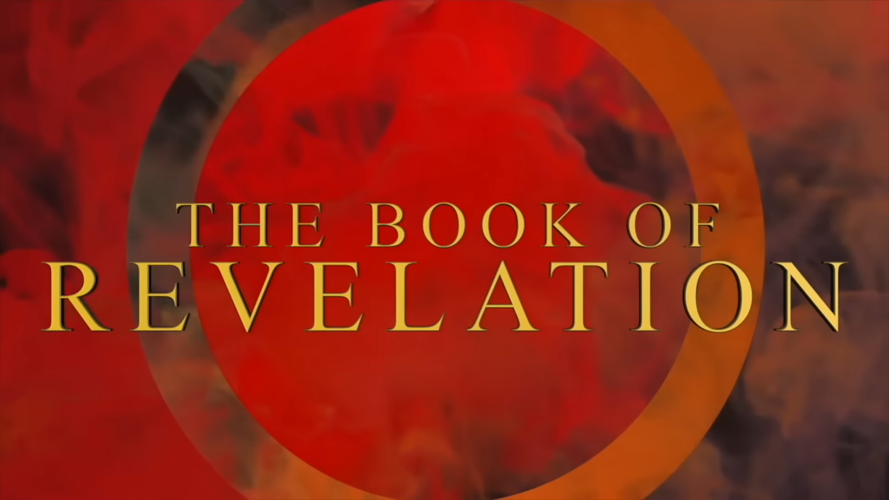
[00:00:25](https://www.youtube.com/watch?v=7err9VIiwO8&list=PLaPig5gEoOs3anPohVf8FuFpA8kdP5TC6&index=2&t=25s)

- The book is classified as an "apocalyptic" book
    - In this context, apocalyptic means prophetic

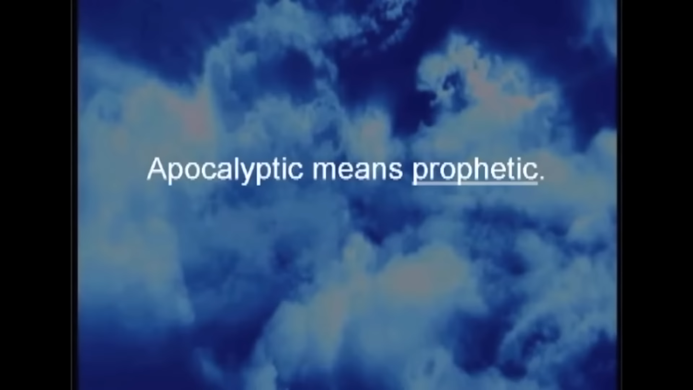
[00:01:17](https://www.youtube.com/watch?v=7err9VIiwO8&list=PLaPig5gEoOs3anPohVf8FuFpA8kdP5TC6&index=2&t=77s)

### Apocalyptic as End-Times Prophecy

- Specifically refers to revelations or prophecies concerning end-of-the-world events
    - Revelation describes what occurs:
        - Right before Jesus returns
        - When Jesus returns
        - After Jesus returns

### The Tribulation and Battles

- Contrary to the common belief in a single battle (Armageddon), there are actually two battles during the tribulation
- One battle is expected to occur at the beginning of the tribulation
    - This involves nuclear war
    - The speaker suggests Iran will instigate this using weapons of mass destruction to attack Israel

### Methods of Interpreting Revelation

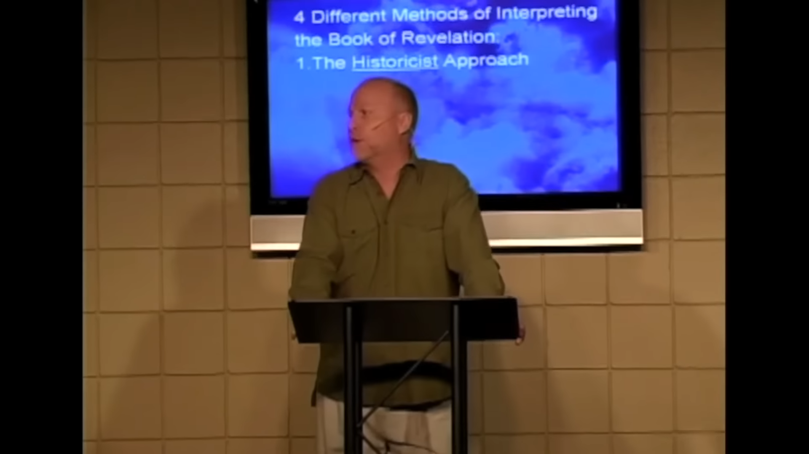
[00:03:22](https://www.youtube.com/watch?v=7err9VIiwO8&list=PLaPig5gEoOs3anPohVf8FuFpA8kdP5TC6&index=2&t=202s)

- Theologians are divided into four major schools of thought regarding how to interpret the book

#### The Historicist Approach

- Views the book as a pre-written record of the course of history
    - Covers the timeline from the time of the apostles to the end of the world
    - Believes God revealed the entire church age in advance through symbolic visions
- **[Examples of Historicist interpretation]**
    - The breaking of the seven seals (Chapters 6 and 7): interpreted as the barbarian invasions that sacked the western Roman Empire
    - The scorpions/locusts from the bottomless pit (Chapter 9): interpreted as the Arab hordes that attacked the eastern Roman Empire

### The Historicist Approach in Context

- Historically, this was the predominant view among most Protestants
    - Scholars from hundreds of years ago, such as John Calvin, utilized this approach in their commentaries
- **[Modern Status]** Most Protestants do not hold this view today
    - An exception is the Seventh-day Adventist church, which still maintains this view through their own specific teachings (e.g., Revelation Seminars)

### The Preterist Approach

- Believes that the prophecies in Revelation were fulfilled shortly after the book was written
    - Views the "great tribulation" not as a future event, but as a series of historical events
    - Specifically, these events are thought to have occurred approximately 40 years after the death, burial, and resurrection of Jesus
- **[Key Fulfillment]** Chapters 4 through 19 are interpreted as symbolic descriptions of the destruction of Jerusalem and the Temple in 70 AD

### The Spiritual Approach

- Also known as the **allegorical approach** or the **idealist approach**
- This view is still common within many evangelical churches
- **[Core Belief]** Prophecy is not intended to predict specific future historical events
    - Instead, it is meant to teach spiritual lessons regarding the eternal conflict between good and evil
    - Because it focuses on spiritual truths, it is considered applicable at any time in history

### The Spiritual Approach in Practice

- **[Example]** The beast from the sea in Revelation 13
    - An idealist does not see this as a specific future Antichrist
    - Instead, it is a symbol for any oppressing political power throughout history (e.g., Hitler or Stalin)
    - The focus is on the allegorical nature of the text rather than predicting a specific event at a specific time

### The Futurist Approach

- Held by the majority of modern evangelical scholars
- **[Core Belief]** John was predicting events that will occur in the future
    - Specifically, events occurring right before and after the return of Jesus
- **[Methodology]** Believers in this approach interpret Revelation literally
    - While the book uses symbolism, the symbols are meant to represent real, future events
    - The use of symbolism is explained as a way to describe things that are otherwise incomprehensible to the audience (e.g., describing a nuclear explosion to someone living 2,000 years ago)

### Futurist Symbolism and Literalism

- **[The Purpose of Symbolism]** Symbolism is used because the original audience lacked the vocabulary to describe future events
    - For example, an ancient person witnessing a nuclear explosion would have to use terms like "clouds" or "fire" because they had no concept of atomic energy
    - Similarly, biblical authors use ancient imagery (chariots, bows, javelins) to describe things like airplanes, helicopters, and tanks
    - **[Core Principle]** In this view, the symbols are not mere metaphors; they represent literal, physical events that will occur
- **[Examples of Literal Futurist Interpretations]**
    - **The Second Trumpet**: Believers interpret this as a literal event where a third of the sea turns to blood, resulting in the death of a third of sea creatures and the sinking of a third of ships
    - **The Seventh Bowl (or Vial)**: Interpreted as a literal occurrence where hailstones fall, with each stone weighing approximately 100 pounds

### Series Roadmap

- The study will follow a chronological timeline of end-times events:
    - Events occurring immediately before the return of Christ
    - Events occurring at the moment of Christ's return
    - Events occurring during the 1,000-year reign on earth

### Foundations of the Futurist Perspective

- **[Personal Conviction]** The commitment to the Futurist view and literal interpretation is based on personal study of the Word of God, rather than just academic training or previous eschatology classes.
- The goal is to demonstrate why a literal interpretation is the most consistent way to understand the book's prophetic nature.

### The Case for Literal Interpretation

- **[Historical Precedent]** The primary argument for interpreting Revelation literally is that biblical history shows a consistent pattern of literal fulfillment in other prophecies
    - All prophecies concerning the first coming of Jesus Christ were fulfilled exactly as predicted
- **[Examples of Literal Messianic Fulfillment]**
    - **Birth from a Virgin**: Predicted by Isaiah; fulfilled in Matthew 1:22-23
    - **Birthplace in Bethlehem**: Prophesied by Micah; fulfilled in Matthew 2:3-6
    - **Residency in Egypt**: Predicted by Hosea; fulfilled in Matthew 2:15
    - **Entry into Jerusalem**: Prophesied to occur on a donkey; fulfilled by Jesus on the exact day predicted

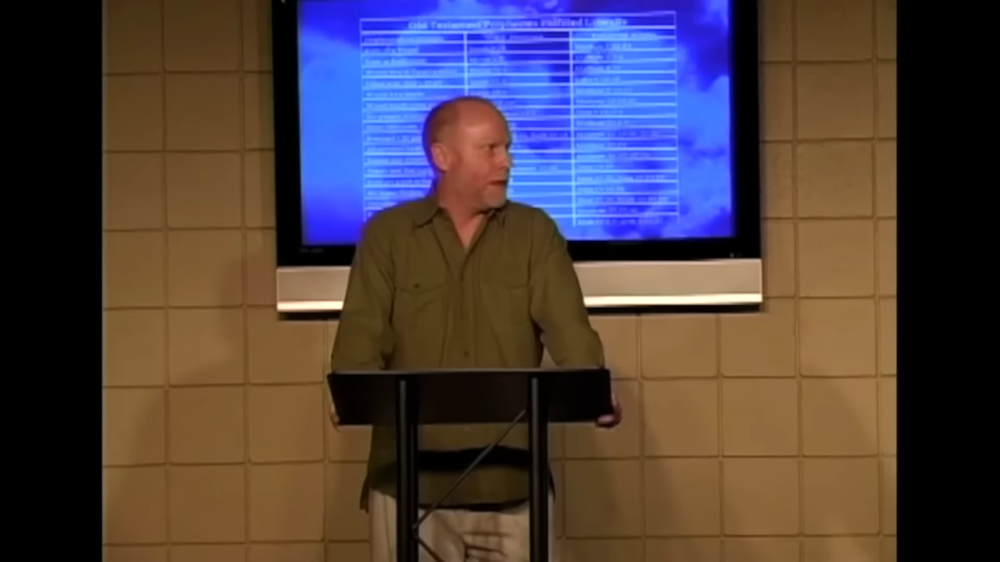
[00:12:26](https://www.youtube.com/watch?v=7err9VIiwO8&list=PLaPig5gEoOs3anPohVf8FuFpA8kdP5TC6&index=2&t=746s)

### Additional Fulfilled Messianic Prophecies

- **[Passion and Crucifixion]** Beyond his birth and early life, Jesus' suffering and death followed specific prophetic details:
    - **Abandoned by disciples**: Foretold and fulfilled
    - **Beaten and treated cruelly**: Foretold and fulfilled
    - **Pierced hands and feet**: Foretold and fulfilled
    - **Soldiers gambling for garments**: Foretold and fulfilled
    - **No bones broken**: Foretold and fulfilled
    - **Crucified between two days**: Foretold and fulfilled
- **[The Significance of Crucifixion]**
    - At the time these were prophesied, crucifixion was not the standard Jewish method of capital punishment (stoning was)
    - The fact that Jesus was crucified—a method not even commonly heard of by the Jews at the time—underscores the literal, precise fulfillment of the prophecy

### The Expectation of the Second Coming

- **[The Logical Conclusion]** If all prophecies concerning Christ's first coming were fulfilled literally, the prophecies regarding his second coming should be viewed with the same literal expectation
- **[Physical Return]**
    - **Matthew 24:30**: "...you will see the Son of Man coming on the clouds of the sky"
    - This is interpreted as a physical, literal return to earth rather than a purely spiritual or symbolic event

### Biblical Support for a Literal Return

- **[The Manner of Return]** The way Jesus left heaven is the way He will return
    - **Acts 1:11**: "...someday he will return from heaven in the same way you saw him go!"
    - This refers to the literal, physical ascension of Jesus into the clouds witnessed by the disciples

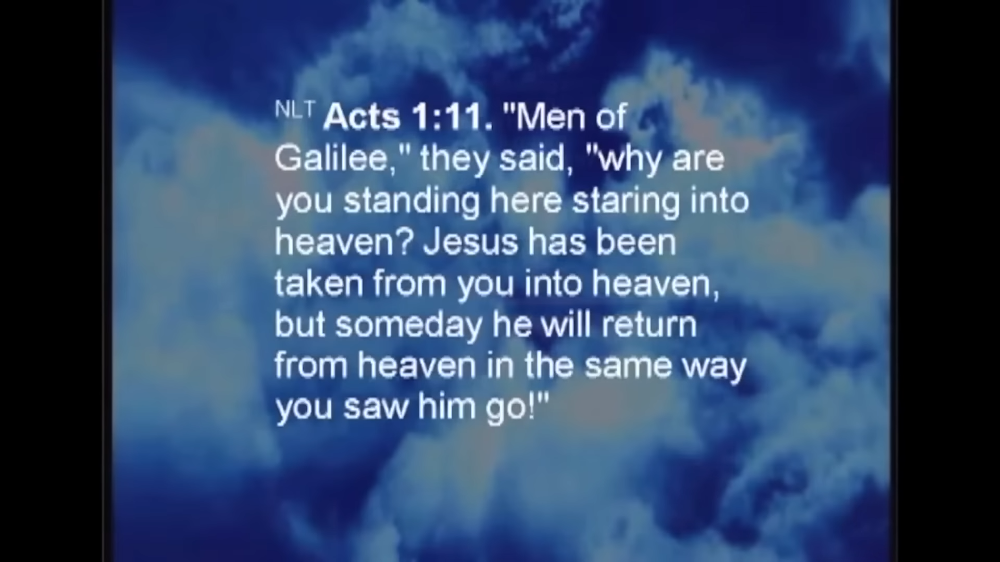
[00:14:54](https://www.youtube.com/watch?v=7err9VIiwO8&list=PLaPig5gEoOs3anPohVf8FuFpA8kdP5TC6&index=2&t=894s)

- **[The Expectation of His Coming]** Believers are looking for a physical event
    - **1 Thessalonians 1:10**: Describes believers "looking forward to the coming of God's Son from heaven"

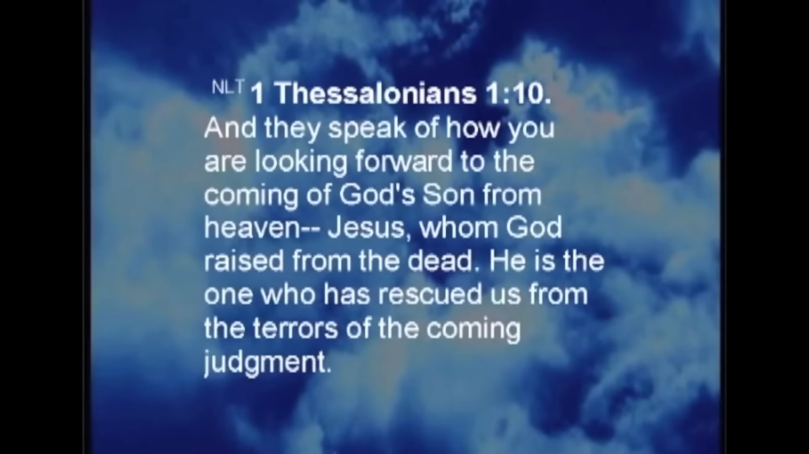
[00:15:28](https://www.youtube.com/watch?v=7err9VIiwO8&list=PLaPig5gEoOs3anPohVf8FuFpA8kdP5TC6&index=2&t=928s)

- **[The Specifics of the Event]** The return is described with high level of detail
    - **1 Thessalonians 4:16-17**:
        - The Lord will descend from heaven with a "commanding shout," the "voice of the archangel," and the "trumpet call of God"
        - The dead in Christ will rise first
        - Living believers will be "caught up in the clouds to meet the Lord in the air"

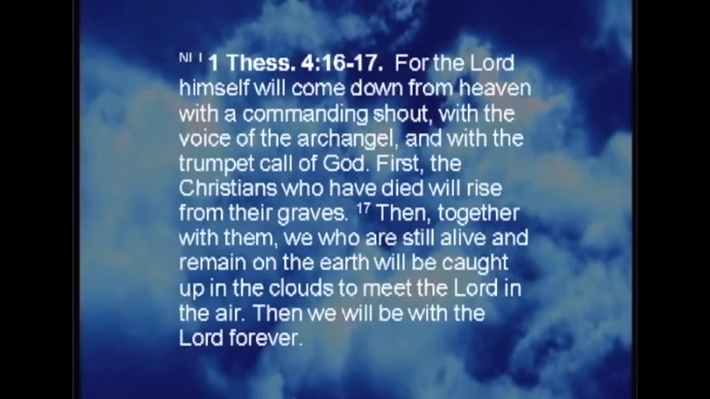
[00:16:06](https://www.youtube.com/watch?v=7err9VIiwO8&list=PLaPig5gEoOs3anPohVf8FuFpA8kdP5TC6&index=2&t=966s)

- **[Conclusion on Interpretation]** These passages suggest that Jesus' return is not merely a spiritual or allegorical concept, but a literal and visible event.

### Refuting the Spiritual Approach

- **[The Spiritual Argument]** Proponents of the spiritual approach believe Jesus' return is not a physical event, but a mystical one
    - They suggest He "returns" by living in the hearts of disciples
- **[The Counter-Argument]** While the Holy Spirit does reside in believers (as the temple of the Holy Spirit), this is not what Jesus meant by His return
    - Jesus' promise was to return to Earth in the same physical manner that He left it

### Timeline of Pre-Second Coming Events

- The Book of Revelation details specific events that will occur before Christ's physical return
- **[The 70 Weeks]** A significant period of time mentioned in prophecy
    - The term "week" in this context refers to a period of sevens
    - This includes a seven-year period (often associated with the Tribulation)

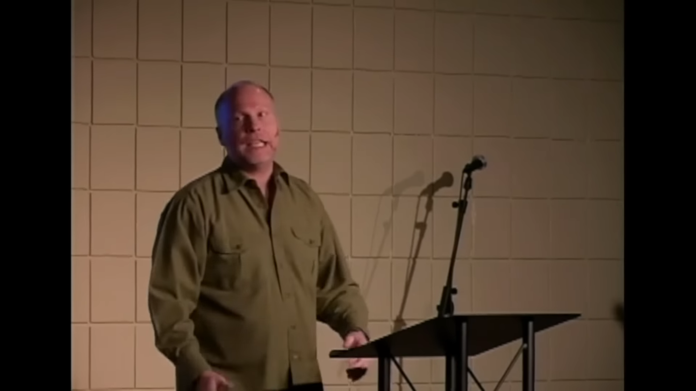
[00:16:24](https://www.youtube.com/watch?v=7err9VIiwO8&list=PLaPig5gEoOs3anPohVf8FuFpA8kdP5TC6&index=2&t=984s)

### Events of the Seven-Year Tribulation

- During the seven-year period of tribulation, several key prophetic events will occur in sequence:
    - The Four Horsemen of the Apocalypse
    - The Seven Seals
    - The Seven Trumpets
    - The Seven Vials
    - The Battle of Armageddon

### Study Resources

- A large handout (designed like a banner) is provided to allow students to map and take notes alongside the progression of these events.

### The Authority of God's Word

- **[The Divine Characteristic]** A primary reason for a futurist, literal interpretation is the nature of God's ability to predict the future
    - Unlike any other being (including angels), God can declare what will happen before it occurs
    - He can predict events down to the smallest, most minute details
- **[The Reliability of Prophecy]** Because God is sovereign, His plans are guaranteed to be fulfilled exactly as stated

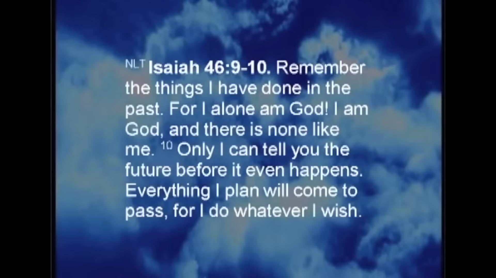
[00:19:32](https://www.youtube.com/watch?v=7err9VIiwO8&list=PLaPig5gEoOs3anPohVf8FuFpA8kdP5TC6&index=2&t=1172s)

> **Isaiah 46:9-10 (NLT)**
> Remember the things I have done in the past. For I alone am God! I am God, and there is none like me. Only I can tell you the future before it even happens. Everything I plan will come to pass, for I do whatever I wish.

- **[Prophetic Accuracy and Criticism]** The extreme precision of biblical prophecy is often a point of contention
    - Critics argue that certain prophecies (like those in the book of Daniel) are too accurate to have been written before the events occurred
    - This leads some liberal scholars to claim these books were written *after* the fact (vaticinium ex eventu) rather than as true predictions

### The Purpose of Prophetic Revelation

- **[God as a Friend]** God shares His knowledge of the future with humanity because He considers us His friends
    - He "lets people in on secrets"
    - This revelation is contained within the Bible
- **[Reliability of the Word]** Because these events are revealed by God, they are guaranteed to happen exactly as He has stated

### The Big Picture of Revelation

- The central theme of the entire book is the return of Jesus Christ

> **John 14:3 (NIV)**
> "And if I go and prepare a place for you, I will come back and take you to be with me, that you also may be where I am."

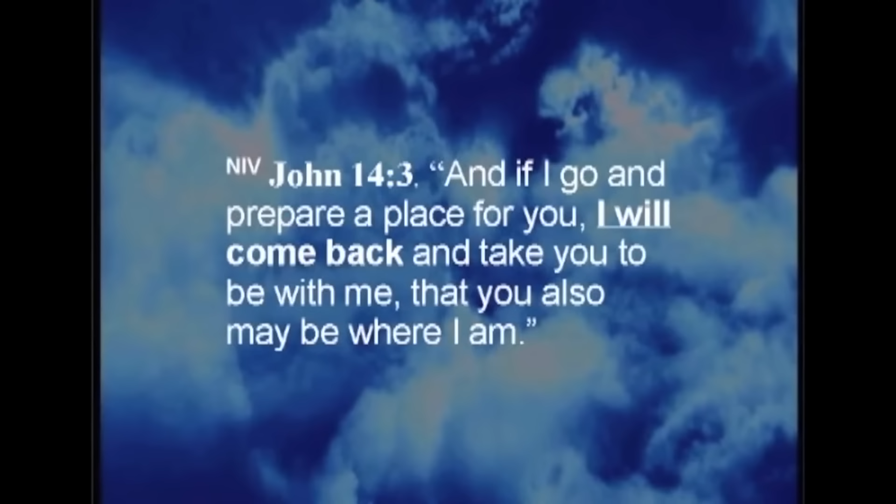
[00:22:11](https://www.youtube.com/watch?v=7err9VIiwO8&list=PLaPig5gEoOs3anPohVf8FuFpA8kdP5TC6&index=2&t=1331s)

### The Two-Phase Fulfillment of Messianic Prophecy

- **[The Core Premise]** All prophecy in Revelation revolves around the fact that Jesus is returning
- **[The Two Comings]** Jesus's mission involves two distinct stages to fulfill all Messianic prophecies
    - **First Coming:** Fulfilled the prophecies regarding a suffering and humble Messiah
    - **Second Coming:** Will fulfill the remaining prophecies regarding a powerful Messiah

#### The Suffering Messiah (First Coming)

- Characterized by being a humble, meek servant of God who bears the sins of humanity
- **[Key Scriptural Basis]** Isaiah 53:1-12
    - Prophesied that the Messiah would be chastised for our peace
    - Predicted that He would bear our sins and be raised from the dead

### The Two Aspects of the Messiah

- **[The Prophetic Tension]** Old Testament prophecies describe two seemingly contradictory roles for the Messiah
    - **The Suffering Messiah:** A humble servant who bears sin (described in Isaiah 53)
    - **The Victorious Messiah:** A powerful king who conquers enemies and rules the world (found in Zechariah, Jeremiah, and Ezekiel)
- **[Resolving the Conflict]** Some first-century rabbis believed these required two separate Messiahs
    - The biblical solution is that these are **two appearances of the same Messiah**
    - Even the original disciples initially struggled to grasp this, expecting the conquest to happen immediately after the resurrection

### The Disciples' Expectation in Acts

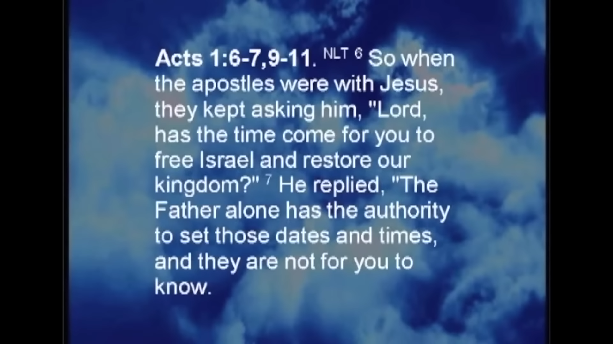
[00:25:15](https://www.youtube.com/watch?v=7err9VIiwO8&list=PLaPig5gEoOs3anPohVf8FuFpA8kdP5TC6&index=2&t=1515s)

- **[The Question]** In Acts 1, the apostles were still focused on a nationalistic, immediate restoration
- **[The Timing]** The text uses the present tense regarding the apostles' questioning, implying a period of continual inquiry about the timing of the kingdom

### The Apostles' Questioning in Acts

- **[The Inquiry]** The apostles were in a state of continual questioning, asking Jesus about the timing of His mission
    - "Lord, has the time come for you to free Israel and restore our kingdom?"
- **[The Nature of the Question]** Their focus was on the fulfillment of the Messiah's role as a conqueror and ruler
    - They expected Jesus to conquer enemies and rule the world immediately
- **[Jesus's Response]** Jesus did not deny their expectation of a kingdom, but he redirected their focus from timing to authority
    - He stated that the Father alone has the authority to set the dates and times
    - He did not "set them straight" regarding the type of kingdom, implying that what they were expecting *would* eventually happen, just not on their timeline

### The Promise of Return

- **[The Ascension]** Jesus was physically taken up into a cloud while the apostles watched
- **[The Angelic Declaration]** Two men in white robes provided a specific promise regarding His return
    - "Jesus has been taken from you into heaven, but someday he will return from heaven in the same way you saw him go!"
- **[The Implication]** The physical manner of His departure (ascending into heaven) serves as the template for His physical return

### The Great Blessed Hope

- The early church lived in continual expectation of the "great blessed hope"
- This expectation was centered on the return of Christ
- **[Personal Conviction]** The speaker believes his own generation is the one that will witness this return

### Global Trends and Prophetic Setup

- **[The Current Climate]** Global instability and political shifts are seen as part of a divine setup
    - Current events are moving toward a specific end-state as God has foretold
- **[The Trade-off of Liberty]** A pattern is emerging where people sacrifice freedoms and liberties in exchange for perceived safety
    - Increased terrorism and security concerns drive this shift
- **[The Rise of a False Peace]** This environment creates a vacuum for a specific type of leader
    - A man will emerge who promises peace to a world seeking security
    - People will follow this leader as a result of the global circumstances being established

### The Dual Role of the Messiah

- **[Two-Phase Fulfillment]** Jesus fulfilled only a part of the Messianic prophecies during His first coming
    - The remaining portion will be fulfilled during His second coming
- **[The Focus of Revelation]** The book primarily deals with the events surrounding the second coming
    - It presents Jesus from the perspective of the **conquering king**
- **[Contrasting Aspects of Christ]** While Jesus remains the loving Messiah, Revelation highlights a different side of His character

| Aspect | Description |
| --- | --- |
| Loving Messiah | The one who died for us, our high priest, and the one through whom we approach the throne of grace |
| Conquering King | The one who returns to judge the world |

### Worship in Heaven

- The book depicts scenes of the saints, the 144,000, and the 12 elders before the throne room in heaven
- **[Songs of Redemption]** Each group will sing a different song
    - The specific song they sing is determined by their individual redemption

### The Conquering King's Rule

- **[For the Unbelieving]** To those who have not received Jesus Christ, His return is characterized by His role as the conquering king
    - He will rule the world with a "rod of iron"
    - The focus of the book is primarily on this aspect of His return to conquer His enemies

### Study Approach and Structure

- **[Goal: The Big Picture]** The series aims to cover approximately one chapter per night
    - This pace is intended to prevent getting lost in minor details and to keep the overarching prophetic narrative in view
- **[Non-Linear Narrative]** The events in Revelation may not always appear in a strict chronological order
    - This is due to the Jewish literary style, which differs from the linear progression common in Western writing
    - Readers must be prepared for sequences that may seem out of order when viewed through a Western lens

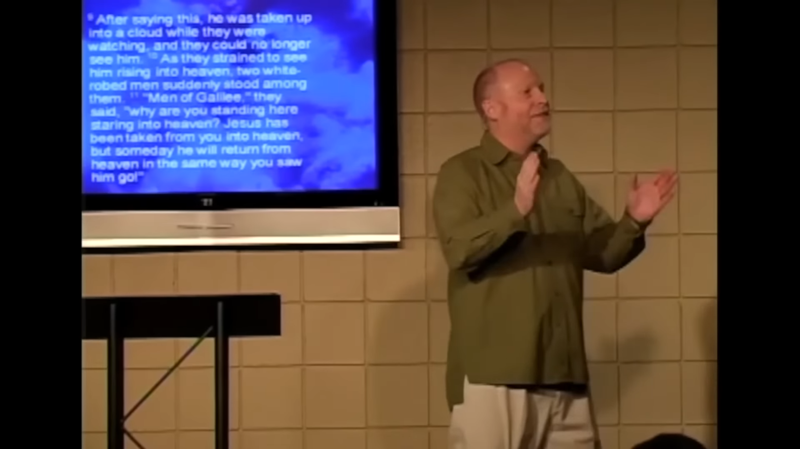
[00:31:03](https://www.youtube.com/watch?v=7err9VIiwO8&list=PLaPig5gEoOs3anPohVf8FuFpA8kdP5TC6&index=2&t=1863s)

### Non-Linear Structure and Interludes

- **[Jewish Literary Style]** Unlike Western writing, which typically follows a strict chronological order, the Book of Revelation utilizes a different structure
- **[Parenthetical Interludes]** The book is generally chronological but contains "interludes"
    - These are chapters or sections that act as parenthetical diversions
    - **[Purpose]** They provide essential details or context that do not fit within the immediate timeline of the preceding events
    - **[Timing]** These details might actually belong to a time before or during the events currently being described
- **[Warning]** Attempting to force these interludes into a strictly linear timeline can lead to confusion

### Starting the Verse-by-Verse Study

- **[Current Context]** The study of Revelation is highly relevant because we are currently living in the "last days"
    - While the exact timing is unknown, the events described are set up to occur at any moment
- **[Study Method]** The approach will be a systematic, verse-by-verse examination of the book, starting with Revelation 1:1

### The Inaccuracy of Common Headings

- **[Critique of KJV Heading]** The King James Version uses the heading "The Revelation of St. John the Divine"
    - This is considered inaccurate because the book is not primarily about John himself
    - **[True Focus]** The book is a record of the visions John received while on the island of Patmos, as commanded by God

### The True Subject of Revelation

- **[Focus of the Book]** Despite common headings, the book is not about John; it is a revelation of Jesus Christ
    - The book reveals very little about John's personal life beyond his location on Patmos and his role as the recipient of the vision
- **[Thematic Progression of Jesus in Revelation]** The book follows the unfolding glory and roles of Christ through different stages:

| Chapters | Focus of the Revelation of Jesus |
| --- | --- |
| 1 | Jesus in his glorified body in heaven |
| 2–3 | Jesus's relationship to his church |
| 4–5 | Jesus receiving glory, honor, and power due to his redemptive work on the cross |
| 6–18 | Jesus as the judge of the world |
| 19–21 | Jesus's future reign as King of kings and Lord of lords during the millennium |
| 22 | Jesus reigning for all eternity in the new heaven and the new earth |

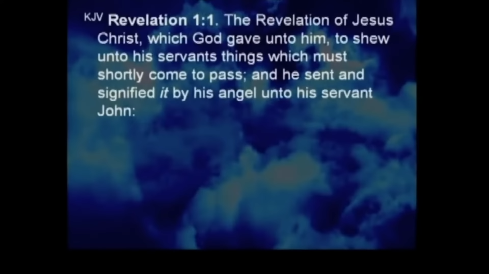
[00:35:43](https://www.youtube.com/watch?v=7err9VIiwO8&list=PLaPig5gEoOs3anPohVf8FuFpA8kdP5TC6&index=2&t=2143s)

### Etymology and Purpose of Revelation

- **[The Meaning of Revelation]** The word is a translation of the Greek word *apocalypsis*
    - It means to reveal, to unveil, or to disclose the truth
    - **[Addressing Skepticism]** This definition refutes the idea that the book is too symbolic to understand; if the purpose is to "take the wraps off" things that were previously hidden, then the book is intended to be understood

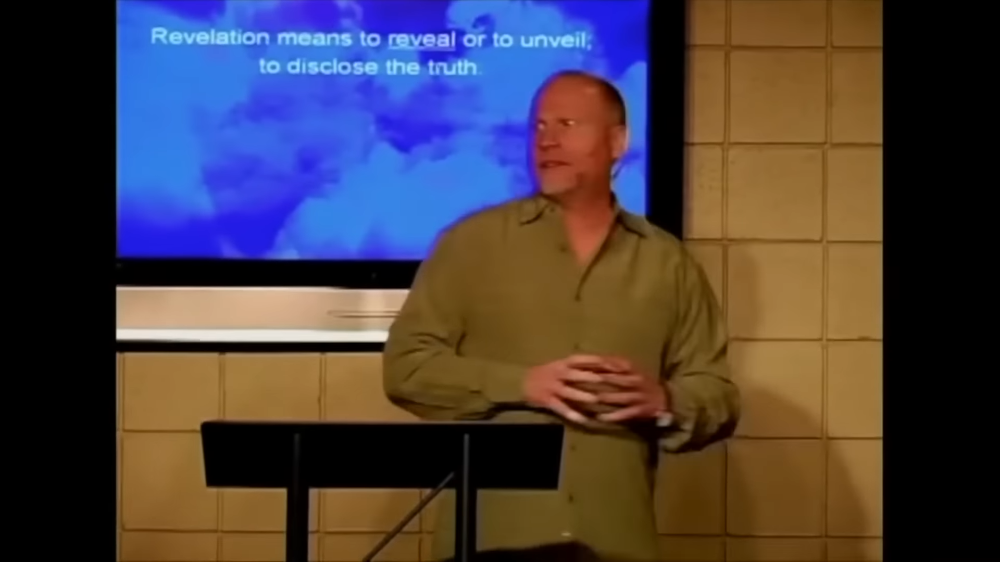
[00:36:26](https://www.youtube.com/watch?v=7err9VIiwO8&list=PLaPig5gEoOs3anPohVf8FuFpA8kdP5TC6&index=2&t=2186s)

- **[The Book's Objective]** To disclose two primary things:

    1. The specific events that will occur during the last days
    2. The specific role Jesus Christ will play throughout those events

### Analysis of Revelation 1:1

> "The revelation of Jesus Christ, which God gave unto him, to shew unto his servants things which must shortly come to pass; and he sent and signified it by his angel unto his servant John:"

- **[The Source]** God gave this revelation to Jesus
- **[The Recipients]** It is intended for "his servants"
- **[The Timeline]** It concerns things that "must shortly come to pass"

### Analysis of Revelation 1:1 (Continued)

- **[The Servants]** The recipients of the revelation are identified as God's servants
    - In the Greek, this is *doulos*, meaning a bondservant or a slave
    - This aligns with how Paul frequently classifies believers in his epistles
- **[The Significance of 'Shortly']** The word "shortly" is a critical descriptor of the timing of these events
    - It is translated from the Greek word *tachos*
    - *Tachos* means "soon" or "imminent"
    - **[Imminence and the Domino Effect]** Imminence means an event could occur at any moment
    - According to William Newell, *tachos* implies that once the sequence of action begins, the events will happen rapidly
    - This creates a "domino effect": once the first event (such as the opening of the first seal) occurs, all other events will quickly follow

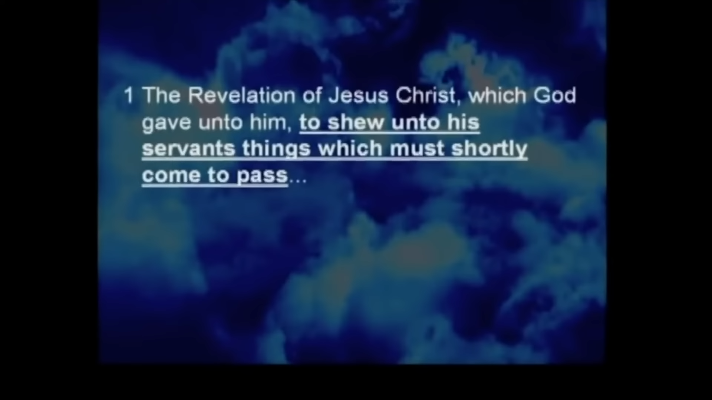
[00:37:29](https://www.youtube.com/watch?v=7err9VIiwO8&list=PLaPig5gEoOs3anPohVf8FuFpA8kdP5TC6&index=2&t=2249s)

### The Chronological Flow of Revelation

- The book outlines a sequence of events designed by God to occur in order
    - Events begin to occur one after another
    - This sequence leads up to the return of Jesus Christ seven years later
- **[The Scope of the Study]** The book provides a perspective through the eyes of John on:
    - The seven-year period known as the Great Tribulation
    - The events that follow the return of Jesus Christ

### The Importance of the Foundational Chapters (1-5)

- While many focus on the events starting in chapter 6, the first five chapters are essential
- **[Why they matter]** Without understanding the nature and identity of Jesus established in chapters 1-5, it is impossible to truly appreciate or interpret the events that follow
- The goal of the study is not merely to observe what happens, but to make meaningful life applications from the text

### The Blessing of Revelation 1:3

- There is a special blessing promised to those who engage with this book
- **[The Promise]** Revelation 1:3 states:

  > "Blessed is he that readeth, and they that hear the words of this prophecy, and keep those things which are written therein: for the time is at hand."

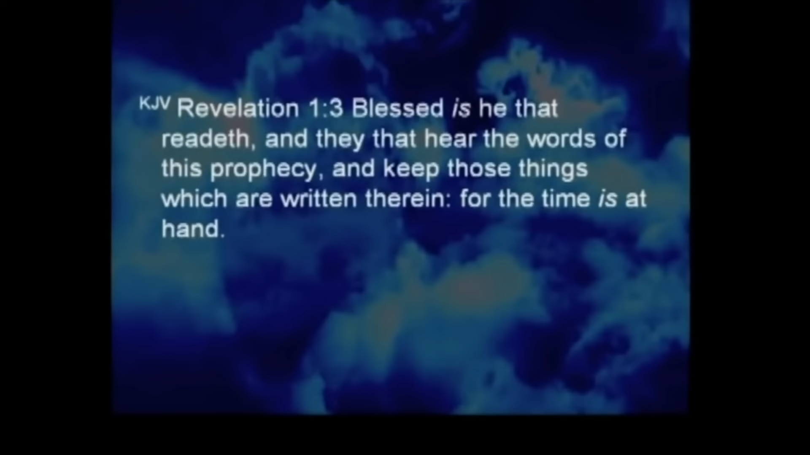
[00:40:50](https://www.youtube.com/watch?v=7err9VIiwO8&list=PLaPig5gEoOs3anPohVf8FuFpA8kdP5TC6&index=2&t=2450s)

- **[Requirements for the Blessing]** Receiving the blessing requires more than passive consumption
    - It is not enough to simply read the book
    - It is not enough to simply hear someone else reading it
    - **[The Missing Element]** One must also "keep those things which are written therein"
        - Without application (keeping the words), the reader does not qualify for the blessing
        - Reading without understanding or application does not result in feeling blessed

### The Meaning of "Keep" in Revelation 1:3

- To receive the blessing, one must "keep those things which are written therein"
- **[Etymology]** The word "keep" comes from the Greek word *tereo*
    - In the context of the Old Testament Law, *tereo* can mean "to do" (obeying the law)
    - However, in the context of Revelation, it carries a different nuance
- **[The True Meaning]** In this context, "keep" means to **give heed to**
    - This implies paying close attention to the prophecies
    - **[The Challenge]** Giving heed is difficult because it requires understanding
        - You cannot truly heed or pay attention to something you do not understand

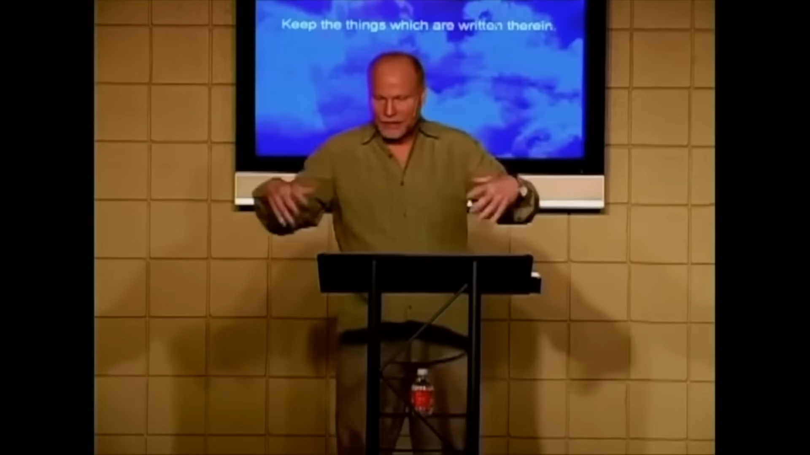
[00:42:16](https://www.youtube.com/watch?v=7err9VIiwO8&list=PLaPig5gEoOs3anPohVf8FuFpA8kdP5TC6&index=2&t=2536s)

- The verse makes a distinction in how people interact with the text:
    - "Blessed is he (singular) that readeth it"
    - "...and they (plural) that hear these words"

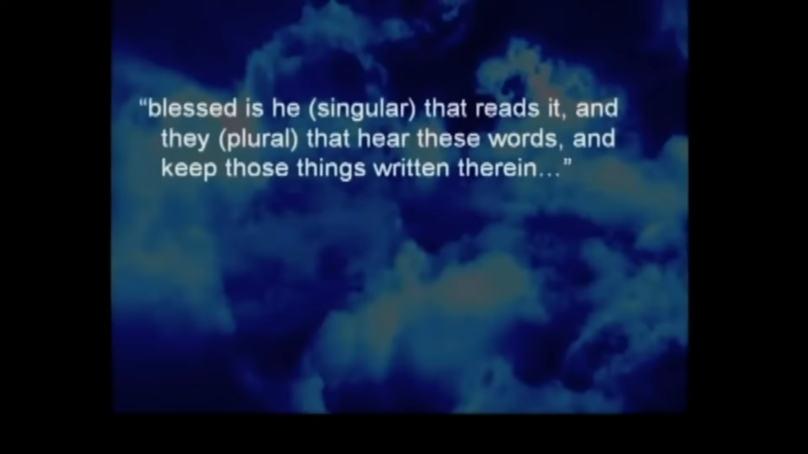
[00:43:23](https://www.youtube.com/watch?v=7err9VIiwO8&list=PLaPig5gEoOs3anPohVf8FuFpA8kdP5TC6&index=2&t=2603s)

- **[The Dynamic of Reading and Hearing]** John's phrasing suggests a specific interaction:
    - "Blessed is he (singular) that readeth it"
        - This implies one person, such as a pastor, reading the text aloud
    - "...and they (plural) that hear these words"
        - This refers to the congregation or group listening to the reading
    - **[The Role of Teaching]** The purpose of the hearing is for the reader to teach the listeners so they can understand the text and subsequently "give heed" to it


[00:43:29](https://www.youtube.com/watch?v=7err9VIiwO8&list=PLaPig5gEoOs3anPohVf8FuFpA8kdP5TC6&index=2&t=2609s)

- **[The Goal of the Study]** The objective is not merely to learn "cool things" or historical facts
    - The primary goal is to gain a **revelation of Jesus Christ** and His nature
    - **[Why this matters]** Understanding who Jesus is allows for immediate application
        - Many view Jesus's kingship as a future event
        - However, if one has a true revelation of Him, they recognize He is *already* "King of kings and Lord of lords"
        - This realization is what enables a believer to apply His truth to their life right now

### The Meaning of Being Blessed

- **[The Promised Blessing]** Giving heed to the written prophecies results in being "blessed"
- **[Etymology]** The word is translated from the Greek word *makarios*
    - While often simplified to "blessed" or "happy"
    - **[The Deeper Meaning]** Technically, *makarios* means a **privileged recipient of divine favor**
- **[Defining Divine Favor]** To have favor means being treated differently than everyone else


[00:46:25](https://www.youtube.com/watch?v=7err9VIiwO8&list=PLaPig5gEoOs3anPohVf8FuFpA8kdP5TC6&index=2&t=2785s)

### The Impact of Divine Favor

- **[The Nature of Favor]** Having divine favor doesn't mean God loves us more or less
    - It simply means we are excelling in His "classroom of life"
- **[The Source of Favor]** This special treatment stems from having a true revelation of who Jesus really is
    - Because this revelation makes a tangible impact on a believer's life, God views them as His "prized pupils"

### Revelation 1:4 Salutation

- **[The Recipients]** The book was written to seven specific churches located in Asia
- **[The Customary Greeting]** John uses the standard greeting of the time: "Grace be unto you, and peace"
- **[The Source of Grace and Peace]** These come from:
    - Him which is, and which was, and which is to come
    - The seven Spirits which are before His throne

### The Relationship Between Grace and Peace

- **[The "Siamese Twins" of the New Testament]** Grace and peace are almost always presented together in apostolic greetings
    - They are conceptually joined; where one is present, the other typically follows
- **[The Significance of the Order]** Grace is always mentioned before peace
    - **[Why this order matters]** You cannot experience peace with God without first experiencing His grace
    - In this context, grace represents the foundational act of salvation

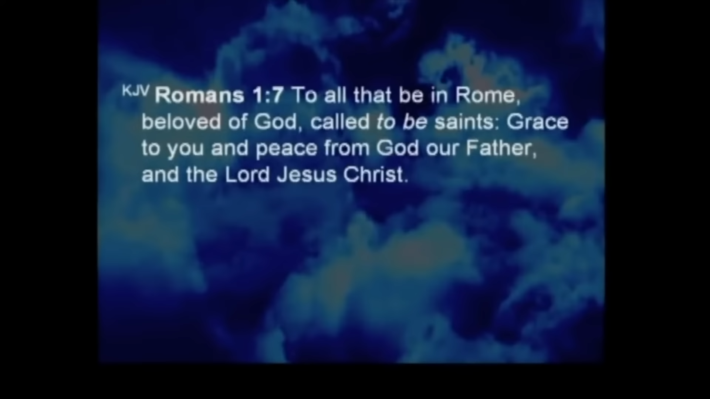
[00:48:36](https://www.youtube.com/watch?v=7err9VIiwO8&list=PLaPig5gEoOs3anPohVf8FuFpA8kdP5TC6&index=2&t=2916s)

- **[Common Apostolic Greetings]** This pattern is consistent across various New Testament authors:
        - **Paul (to the Romans):** "Grace to you and peace from God our Father..."
        - **Paul (to the Corinthians):** "Grace be unto you and peace from God our Father..."
        - **Peter and others:** The greeting is a standard customary opening for epistles written by servants of God.

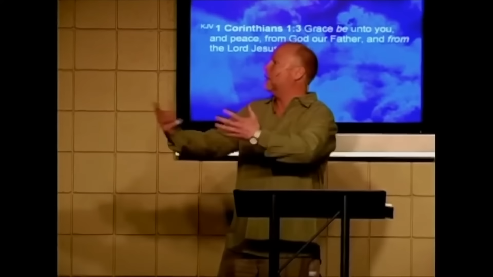
[00:48:56](https://www.youtube.com/watch?v=7err9VIiwO8&list=PLaPig5gEoOs3anPohVf8FuFpA8kdP5TC6&index=2&t=2936s)

### Revelation 1:4 Salutation Details

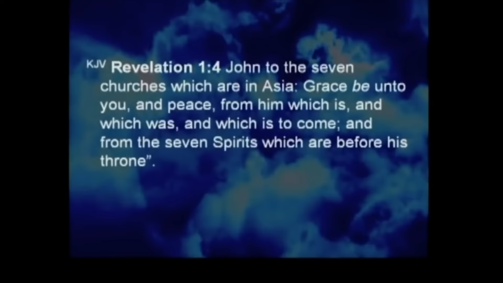
[00:49:23](https://www.youtube.com/watch?v=7err9VIiwO8&list=PLaPig5gEoOs3anPohVf8FuFpA8kdP5TC6&index=2&t=2963s)

- **[The Recipients]** John writes specifically to the seven churches located in Asia
- **[The Source of Grace and Peace]** They are derived from:
        - Him which is, and which was, and which is to come
        - The seven Spirits which are before His throne

### The Depth of Salvation

- **[Beyond Heaven]** Salvation is more than just the destination of going to heaven
- **[The Meaning of Wholeness]** The Greek terms used for salvation imply a process of being made whole or complete:
    - `sozo` (verb): to save
    - `soterios` (noun): to make whole or complete
- **[The Timeline of Completion]** Our salvation is not fully completed in this life
    - **[Why?]** It will only be finalized when we transition from our current mortal bodies into glorified, immortal bodies
- **[The Role of Grace]** Grace provides what is needed to make a person whole, regardless of where they are lacking
- **[The Result of Grace]** Once a person experiences God's grace, they are reconciled to Him and are no longer an enemy or at enmity with Him

### The Divine Source of Grace and Peace

- **[The Source]** The grace and peace described in Revelation 1:4 originate from all three persons of the Godhead:
    - "Him which is, and which was, and which is to come"
    - "The seven Spirits which are before His throne"

### The Eternal and Self-Existent God

- **[The Purpose of the Description]** The specific language used in Revelation 1:4 is intended to reveal the characters within the divine drama to His servants
    - It is not enough to simply say "from God"
    - The text aims to reveal who God, Jesus, and the Holy Spirit are
- **[The Meaning of the Phrase]** The description "Him which is, and which was, and which is to come" defines God's nature:
    - **Eternal:** He has always existed and will always exist
    - **Self-Existent:** He is the giver of all life and owes His existence to no one
- **[Contrast with Creation]** Unlike humans, who owe their existence to parents and can be traced back through a lineage to Adam and Eve, God exists independently
    - Humans are created; God is the Creator

### The Seven Spirits and the Holy Spirit

- **[The Meaning of 'Seven Spirits']** The reference to the "seven spirits which are before His throne" signifies the personality of the Holy Spirit
    - It represents the Spirit's completeness, fullness, and perfection
- **[Old Testament Connection]** Much of the symbolism in Revelation is not new; it is rooted in the Old Testament prophets (e.g., Isaiah, Jeremiah, Ezekiel, Zechariah, Haggai)
- **[The Seven Attributes in Isaiah 11:1-2]** The specific characteristics of the Spirit are found in the prophecy regarding the "shoot" or "branch" from the stump of David's family:

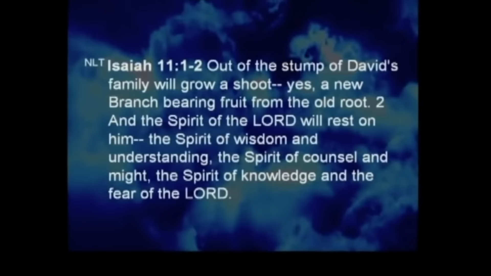
[00:53:00](https://www.youtube.com/watch?v=7err9VIiwO8&list=PLaPig5gEoOs3anPohVf8FuFpA8kdP5TC6&index=2&t=3180s)

    - The Spirit of the LORD rests upon Him in seven forms:

        1. The Spirit of wisdom
        2. The Spirit of understanding
        3. The Spirit of counsel
        4. The Spirit of might
        5. The Spirit of knowledge
        6. The Spirit of the fear of the LORD
        7. (The Spirit of the LORD itself, as the source of these attributes)

### The Identity of Jesus Christ in Revelation 1:5

- **[The Source of Grace and Peace]** Verse 5 establishes that these blessings also come directly from Jesus Christ
- **[Titles of Jesus]** The text provides a series of descriptions to define His nature and authority:
    - The faithful witness
    - The first begotten of the dead
    - The prince of the kings of the earth
    - The one who loved us and washed us from our sins in His own blood
- **[The Faithful Witness]** Jesus is called the faithful witness because of His role in revelation:
    - He was faithful in providing humanity with a clear revelation of who God is and what God is like
    - This is supported by Hebrews 1:3, which describes the Son as the radiance of God's glory and the exact representation of His being

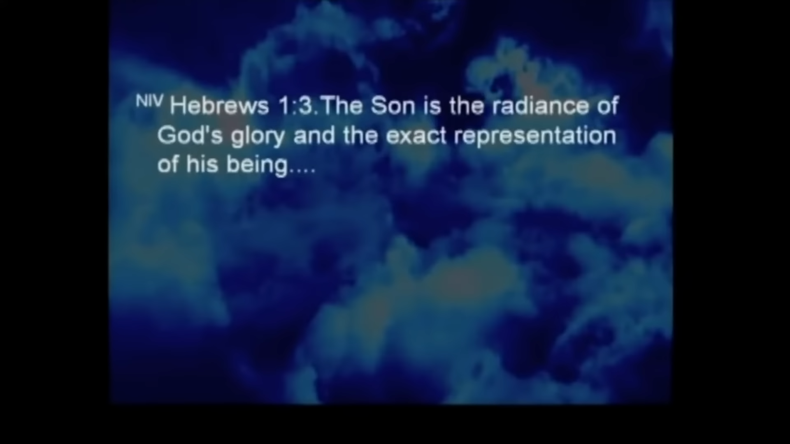
[00:55:27](https://www.youtube.com/watch?v=7err9VIiwO8&list=PLaPig5gEoOs3anPohVf8FuFpA8kdP5TC6&index=2&t=3327s)

### The Exact Representation of God

- **[The Meaning of 'Exact Representation']** In Hebrews 1:3, the phrase "exact representation" (NIV) is crucial for understanding Jesus's relationship to the Father
    - It comes from the Greek word *charakter*
    - *Charakter* refers to the exact image or exact likeness of a person

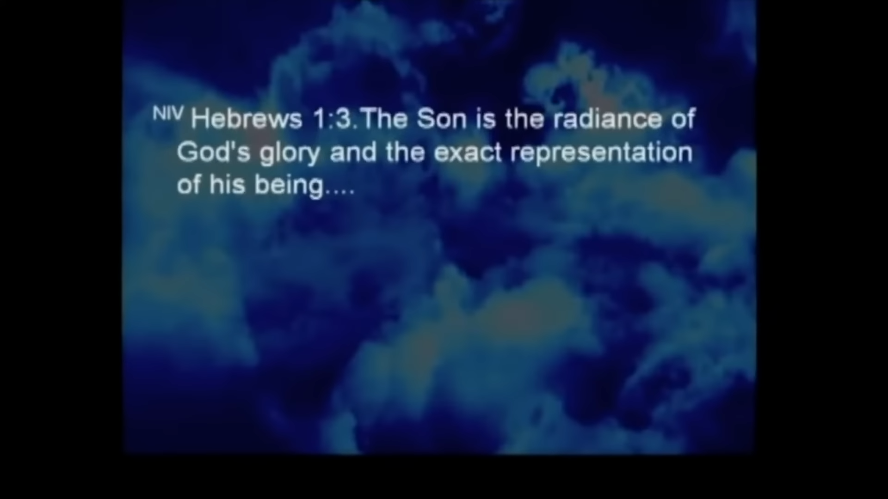
[00:55:30](https://www.youtube.com/watch?v=7err9VIiwO8&list=PLaPig5gEoOs3anPohVf8FuFpA8kdP5TC6&index=2&t=3330s)

- **[Jesus as the Likeness of God]** Because Jesus possesses the *charakter* of God, He is the definitive way to know God's nature
    - He doesn't just bear the image of God (as all humans do), but embodies His actual character and characteristics
    - To see what God is like in every way, one must look at Jesus

### Jesus as the Revelation of the Father

- **[The One Exception]** While Jesus possesses the exact character and characteristics of God, there is one distinction:
    - Jesus inhabited a physical body
    - God is spirit
- **[Seeing the Father through Jesus]** The connection between the Son and the Father is absolute
    - When Philip asked to see the Father, Jesus responded that anyone who has seen Him has seen the Father
    - This highlights that Jesus is the visible manifestation of the invisible God

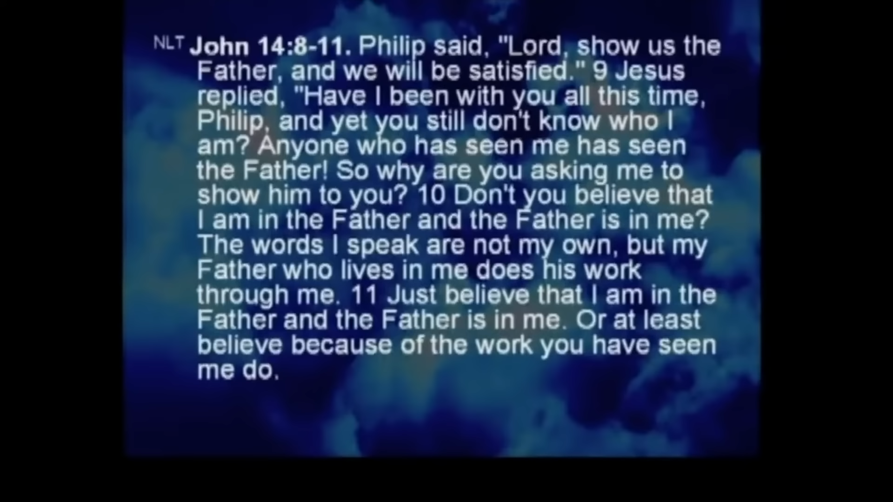
[00:57:30](https://www.youtube.com/watch?v=7err9VIiwO8&list=PLaPig5gEoOs3anPohVf8FuFpA8kdP5TC6&index=2&t=3450s)

```text
John 14:8-11. Philip said, "Lord, show us the Father, and we will be satisfied." 9 Jesus replied, "Have I been with you all this time, Philip, and yet you still don't know who I am? Anyone who has seen me has seen the Father! So why are you asking me to show him to you? 10 Don't you believe that I am in the Father and the Father is in me? The words I speak are not my own, but my Father who lives in me does his work through me. 11 Just believe that I am in the Father and the Father is in me. Or at least believe because of the work you have seen me do."
```

- **[The Central Figure of Revelation]** The Book of Revelation should be viewed through a specific lens:
    - It is not merely a timeline of future events
    - It is primarily a revelation of Jesus Christ
    - The goal of understanding the prophetic events is to gain a deeper revelation of who Jesus is

### The Oneness of the Father and the Son

- **[Inseparable Unity]** Jesus describes a profound connection where the Father and Son exist within one another
    - "Don't you believe that I am in the Father and the Father is in me?"
    - Jesus's words are not His own, but are the words of the Father living in Him
    - The Father's work is performed through Jesus

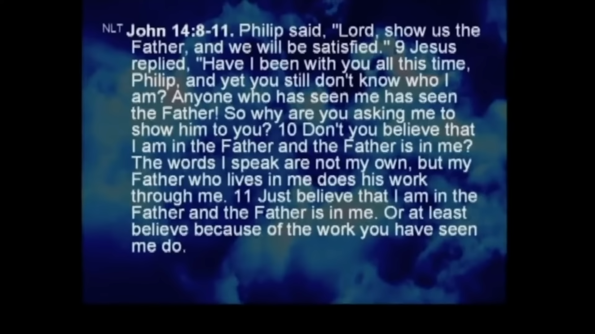
[00:58:51](https://www.youtube.com/watch?v=7err9VIiwO8&list=PLaPig5gEoOs3anPohVf8FuFpA8kdP5TC6&index=2&t=3531s)

- **[The Son's Dependency on the Father]** Jesus does not act independently; His life is a perfect reflection of the Father's activity
    - According to John 5:19, the Son can do nothing by Himself
    - He only does what He sees the Father doing
    - Whatever the Father does, the Son also does

### Jesus as a Faithful Witness

- **[Defining a Faithful Witness]** Jesus came to the world to serve as a witness to God's character
    - A true witness demonstrates what someone is actually like through their actions
    - Jesus is a "faithful witness" because He did everything the Father commanded and said
    - If He had only spoken about God without acting in accordance with God's will, He would not have been a faithful witness

```text
John 5:19. So Jesus explained, "I tell you the truth, the Son of God, or the Son, can do nothing by himself. He does only what he sees the Father doing. Whatever the Father does, the Son also does."
```

### Jesus as a Faithful Witness (Continued)

- **[Faithful Unto Death]** Jesus's role as a witness extended to His ultimate sacrifice and humility
    - According to Philippians 2:6-8, although He was God, He did not cling to His equality with God
    - He surrendered His divine privileges to take the humble position of a slave
    - He was born as a human being and humbled Himself in obedience to God
    - His faithfulness was completed by dying a criminal's death on the cross

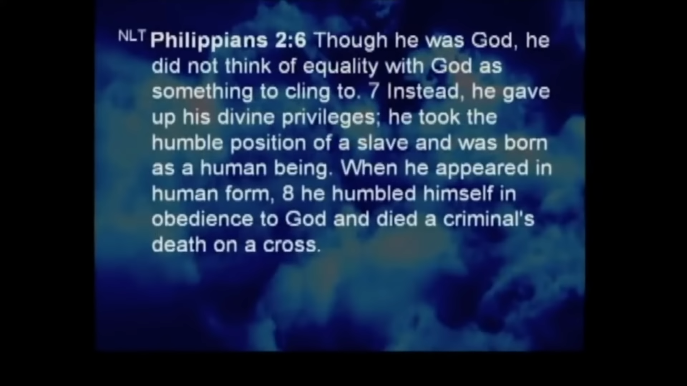
[01:00:13](https://www.youtube.com/watch?v=7err9VIiwO8&list=PLaPig5gEoOs3anPohVf8FuFpA8kdP5TC6&index=2&t=3613s)

### Practical Application: Being Christ-like

- **[The Meaning of Christian]** The term "Christian" implies being "Christ-like"
    - It is not enough to merely hear or read the Word; one must give heed to it and follow His example
    - Being a Christian means acting in a way that reflects the character of Christ
- **[The Weight of Witness]** Because Christians claim to be like Christ, others observe their behavior closely
    - When a person identifies as a Christian, people watch to see if their actions match their words
    - Failing to act in accordance with Christ's character undermines one's ability to be a faithful witness

### Jesus as the First Begotten of the Dead

- **[Definition]** In Revelation 1:5, Jesus is referred to as the "first begotten of the dead"
    - This means He was the first person to be raised from the dead and given an immortal, glorified body
- **[Distinction from other resurrections]** Being the "first begotten" does not mean He was the very first person to be raised from the dead, but rather the first to receive a permanent, glorified state
    - **Example: Lazarus**
        - Lazarus was raised from the dead in the New Testament before Jesus's resurrection
        - However, Lazarus was not the "first begotten of the dead" because he possessed a mortal body and eventually died again
    - **Jesus's Resurrection**
        - Unlike Lazarus, Jesus was raised into an immortal, glorified body
        - This new state is characterized by a physical presence that is not bound by normal physical constraints (e.g., appearing suddenly in a room without entering through doors or windows)

### The Nature of the Glorified Body

- **[Physical Transcendence]** Jesus's resurrected body operates differently than a mortal body
    - Mortal bodies are bound by physical movement; to get from point A to point B, one must physically walk the distance
    - An immortal, glorified body can bypass these constraints, such as appearing suddenly in a room without entering through doors or windows

### Linguistic Nuances of "Dead" in Revelation 1:5

- The Greek language uses two distinct words to describe death/the dead:
    - **Necros**
        - Often refers to spiritual death
        - This is the root of the word "necromancer" (one who communicates with the dead)
    - **Thanatos**
        - [Details to follow in next chunk]

### Distinction Between Necros and Thanatos

The Greek language differentiates between types of death, a distinction that is vital for interpreting biblical prophecy:

- **Necros**
    - Refers to spiritual death
    - Relates to the state of the spirit or soul
    - This is the root of the word "necromancer" (one who communicates with the spirits of the dead)
- **Thanatos**
    - Refers to physical death

#### Application in Revelation 20:12-14

In the context of the Great White Throne Judgment, these terms are used to describe different aspects of death:

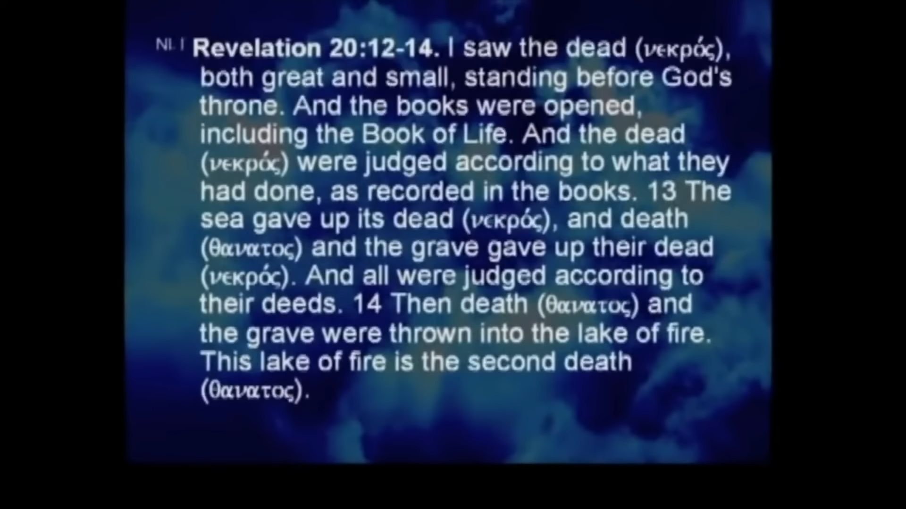
[01:05:23](https://www.youtube.com/watch?v=7err9VIiwO8&list=PLaPig5gEoOs3anPohVf8FuFpA8kdP5TC6&index=2&t=3923s)

- **The Dead standing before the throne (nekros)**
    - The text specifies that John saw the *nekros* (the spiritually dead)
    - This refers to the spirits of both the great and the small being judged according to their deeds
- **The Second Death (thanatos)**
    - The passage concludes with death (*thanatos*) and the grave being thrown into the lake of fire
    - This represents the final, physical death/separation

### Detailed Analysis of Revelation 20:12-14

The interaction between spiritual and physical death is clearly delineated through the specific Greek terms used in this passage:

- **The Release of the Dead**
    - The sea gives up its dead (\*nekros")
    - The grave gives up their dead (\*nekros")
    - This indicates that the spirits (the spiritually dead) are being brought forth for judgment
- **The Role of Physical Death**
    - The text states that "death" (\*thanatos") and the grave are thrown into the lake of fire
    - This distinction shows that while the *nekros* (spirits) are judged, *thanatos* (physical death) itself is consumed in the final judgment
- **The Second Death**
    - The lake of fire is explicitly identified as the "second death" (\*thanatos")
    - This is the final destination for physical death and the grave

### The State of the Spirit After Death

- Upon physical death, the human spirit does not stay in the grave
    - The spirit goes to one of two places (either with God or in hell)
    - In this state, the spirit retains the ability to feel, see, and experience reality
- **[Implication]** This capacity for experience is why hell is described as a terrifying place

### The Sequence of Judgment and the Lake of Fire

- The process of final judgment involves a transition from the state of separation to final punishment:

    1. **Separation**: Those who do not know Jesus enter hell (a state of separation from God)
    2. **Judgment**: Death and hell "give up" the spiritually dead (*nekros*) for judgment
    3. **Finality**: Those judged are then thrown into the lake of fire

- The lake of fire is not the initial resting place of the spirit, but the final destination after judgment

### Accountability and Degrees of Judgment

- Based on parables in the Book of Luke, there are different degrees of judgment/hell
    - Responsibility is tied to knowledge: "To whom much is given, much is required"
    - The most severe judgment is reserved for those who knew the Lord's will but chose not to follow it

### Spiritual Death Defined

- Spiritual death (*nekros*) is defined as separation from God
    - This was first demonstrated when Adam and Eve sinned
        - Although they did not die physically at that exact moment, they died spiritually because they were separated from God and banned from the Garden of Eden
- **[Demonic Reaction]** The presence of spiritually alive people is jarring to demonic spirits
    - Since the Fall, demonic spirits have not encountered a spiritually alive person
    - This explains why demonic spirits in the New Testament react with fear and recognition when encountering Jesus

### Analysis of Revelation 1:5

- The verse identifies Jesus as the "first begotten of the dead"
    - A key question is whether this refers to *nekros* (spiritual death/the dead) or *thanatos* (physical death)
- The term "first begotten of the dead" in Revelation 1:5 refers to **spiritual death** (*nekros*), not physical death (*thanatos*)
    - Lazarus is an example of someone resurrected from physical death, but he was not the "first begotten" because he remained spiritually dead
- **[The Crucifixion and Spiritual Death]** Jesus experienced spiritual death during His crucifixion
    - While on the cross, Jesus cried out, "My God, my God, why hast thou forsaken me?"
    - This was the moment He was "made our sin," resulting in a literal separation from God
    - This experience of spiritual separation was far more terrifying to Him than the prospect of physical death

### The Necessity of Jesus's Spiritual Death

- **[Why spiritual death was required]** To truly pay for human sin, Jesus had to experience the actual consequence of sin: separation from God
    - If Jesus had only experienced physical death (*thanatos*) and then immediately gone to heaven, the debt for sin would not have been fully settled
    - Because sin results in being separated from God, Jesus had to be "made our sin"
        - This resulted in Him experiencing spiritual death (*nekros*)
        - This explains the biblical concept of Jesus descending before He ascended

### The Legal Basis for Jesus's Resurrection

- God was able to legally resurrect Jesus because of His perfect obedience to God's will
    - According to Leviticus 18:5, "the man which doeth these things shall live by them"
        - In this context, "these things" refers to the Law/God's will
    - Because Jesus was a faithful witness who remained obedient even unto death
        - God looked upon a soul that had never sinned
        - This perfect record allowed God to legally raise Him from the dead, making Him the first begotten of the spiritually dead

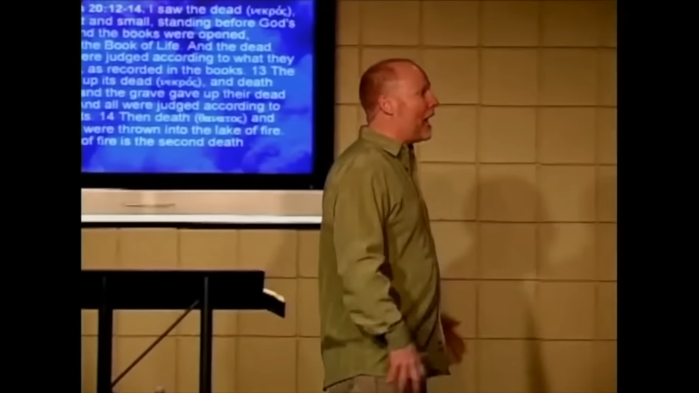
[01:12:04](https://www.youtube.com/watch?v=7err9VIiwO8&list=PLaPig5gEoOs3anPohVf8FuFpA8kdP5TC6&index=2&t=4324s)

### Jesus: The First to be Reconciled

- Jesus is the first person in history to undergo the complete cycle of spiritual death and subsequent spiritual life
    - He experienced true separation from God (*nekros*)
    - He was then resurrected and reconciled to God, becoming spiritually alive again
- **[Revelation 1:5]** Jesus is also identified as the "ruler over the kings of the earth"

### Application of Revelation 1:3

- **[How to 'keep' the Word]** To receive the promised blessing, one must not only read or hear the text but "keep" it
    - Keeping the Word requires recognizing the true identity of Jesus
    - It requires understanding the reason for His death: He died for humanity
    - For those who have not yet received Him, this realization is the path to salvation

### Jesus as Ruler Over the Kings of the Earth

- **[Correction of translation]** The KJV phrase "prince of the kings of the earth" is considered a poor translation
    - The original Greek word is `archon`
    - `archon` means "ruler" or "ruler over all"
    - Therefore, Jesus is the supreme ruler over all the kings of the earth

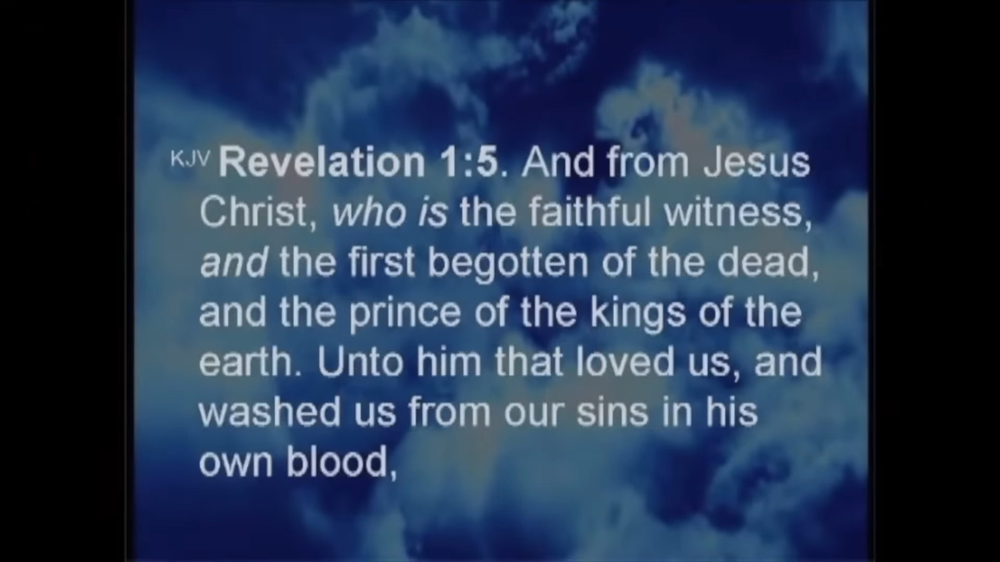
[01:15:09](https://www.youtube.com/watch?v=7err9VIiwO8&list=PLaPig5gEoOs3anPohVf8FuFpA8kdP5TC6&index=2&t=4509s)

- **[The Two Comings of Christ]** There is a fundamental difference in purpose between His first and second appearances:
    - **First Coming**: Focused on redemption
        - His purpose was to save humanity from sin
        - He did not come to establish His earthly kingdom at this time
    - **Second Coming**: Focused on establishing His kingdom
        - He will establish His kingdom here on earth
        - He will rule as the King of kings and Lord of lords
        - He will rule with a "rod of iron"

| Aspect | First Coming | Second Coming |
| --- | --- | --- |
| Primary Purpose | To redeem and save from sin | To establish His kingdom |
| Scope of Rule | Spiritual/Redemptive | Earthly/Universal rule over kings |

### Spontaneous Praise and the Cleansing Power of Christ

- As John receives the revelation of Jesus, he breaks into spontaneous worship (noted by his use of "Amen")
- **[Revelation 1:5-6]** The text describes the work of Christ as follows:
    - He loved us
    - He washed us from our sins in His own blood
    - He made us kings and priests unto God and His Father
- **[The Symbolism of Blood]** The phrase "washed us... in his own blood" is not meant to be taken as a literal physical washing
    - Blood in this context represents Jesus Christ's sacrificial death
    - It is through the reality of His death that believers are cleansed from sin

### The Old Testament Foundation of Blood and Purification

- **[The Necessity of an OT Perspective]** To understand the New Testament concept of being "washed in the blood," one must first understand the Old Testament mentality regarding blood.
- **Leviticus 17:11** establishes the fundamental connection between blood and life:
    - "The life of the body is in its blood."
    - "I have given you the blood on the altar to purify you, making you right with the Lord."
    - It is the blood given in exchange for a life that makes purification possible.

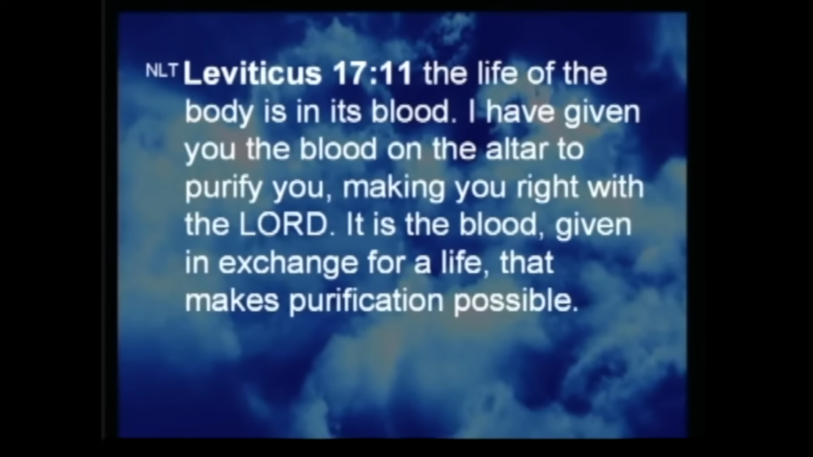
[01:18:25](https://www.youtube.com/watch?v=7err9VIiwO8&list=PLaPig5gEoOs3anPohVf8FuFpA8kdP5TC6&index=2&t=4705s)

- **[The Symbolism of Blood]**
    - **Blood = Life**: Because the life of the body is in the blood, blood serves as a representation of life itself.
    - **Blood as a Substitute**: When blood is poured out on an altar, it represents a life being taken.
- **[The Logic of Divine Justice]**
    - The penalty for sin is death.
    - Because God is a just God, sin must be punished; He cannot simply forgive without addressing the penalty.
    - Therefore, a life must be given in exchange to make purification possible.

### Kings and Priests in Revelation 1:6

- **[The Dual Identity]** Beyond being washed from sin, believers are given two distinct roles:
    - **Priests**: Their primary purpose is to serve God.
    - **Kings**: They will rule alongside Christ on the earth during the millennium.
- **[The Basis of Authority]** The extent of what a believer rules over is determined by their faithfulness during their earthly life.
    - **Key questions for stewardship**:
        - Did they use their gifts, talents, and abilities to serve and glorify God?
        - Were they good stewards of what they were given?
        - Did they put the word of God into practice?

### The Parable of the Talents (Matthew 25:20-28)

- **[The Principle of Reward]** Jesus taught that faithful use of resources leads to increased responsibility and shared joy.

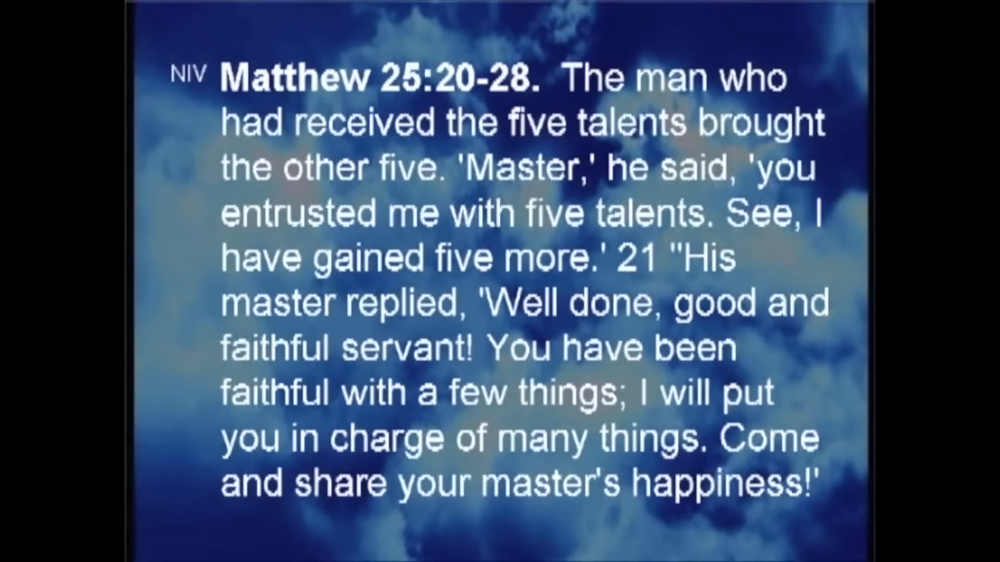
[01:20:41](https://www.youtube.com/watch?v=7err9VIiwO8&list=PLaPig5gEoOs3anPohVf8FuFpA8kdP5TC6&index=2&t=4841s)

- **[The Master's Response]** When a servant demonstrated faithfulness by doubling their talents, the master responded:
    - "Well done, good and faithful servant!"
    - "You have been faithful with a few things; I will put you in charge of many things."
    - "Come and share your master's happiness!"

### The Parable of the Talents (Continued)

- **[The Faithful Servant with Two Talents]**
    - Similar to the servant with five talents, this servant also doubled his portion.
    - The master's response was identical: "Well done, good and faithful servant! You have been faithful with a few things; I will put you in charge of many things. Come and share your master's happiness!"

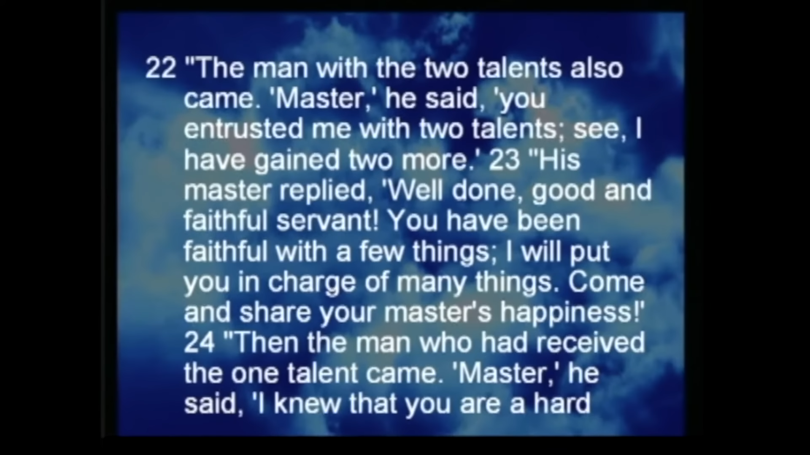
[01:21:33](https://www.youtube.com/watch?v=7err9VIiwO8&list=PLaPig5gEoOs3anPohVf8FuFpA8kdP5TC6&index=2&t=4893s)

- **[The Unfaithful Servant with One Talent]**
    - This servant hid his talent in the ground out of fear, claiming he knew the master was a "hard man."
    - **[The Master's Rebuke]** The master called him a "wicked, lazy servant."
    - **[Why the harsh rebuke?]**
        - God has invested in every person by giving them gifts, talents, and abilities.
        - Because it is an investment, God expects a return.
        - Failing to use these gifts to serve God and glorify Him is viewed as both wickedness and laziness.
        - The servant's failure was not just inaction, but a lack of even the simplest effort (such as depositing the money with a banker to earn interest).

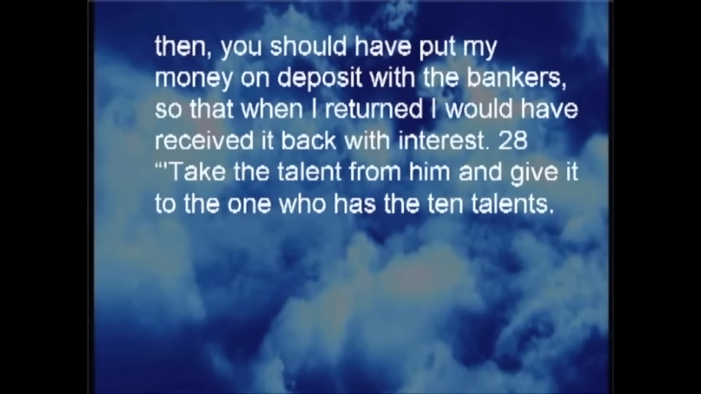
[01:22:31](https://www.youtube.com/watch?v=7err9VIiwO8&list=PLaPig5gEoOs3anPohVf8FuFpA8kdP5TC6&index=2&t=4951s)

### Spontaneous Praise and Eternal Dominion

- **[John's Response]** Overwhelmed by the work and nature of Jesus, John breaks into spontaneous worship at the end of verse 6:
    - "To him be glory and dominion forever and ever."
- **[The Meaning of "Amen"]**
    - John follows this praise with "Amen."
    - **[Why use it?]** In this context, it serves to reinforce or emphasize the preceding statement.
    - It signifies that Jesus's glory and dominion are absolute and will last for all eternity.

### The Central Theme: The Return of Christ

- **[Revelation 1:7]** This verse introduces the foundational theme of the entire book:
    - "Behold, he cometh with clouds; and every eye shall see him, and they also which pierced him: and all kindreds of the earth shall wail because of him. Even so, Amen."
- **[The Core Message]** The fundamental truth of Revelation is that Jesus Christ is coming back.

### The Three Aspects of Christ's Return

According to Revelation 1:7, the return of Jesus Christ involves three specific occurrences:

1. **"Every eye shall see him"**

    - This will be a supernatural event in the skies.
    - **[Global Visibility]** It will be so powerful and unmistakable that it will be felt/noticed by everyone, regardless of where they are on Earth.
    - **[The Role of Media]** During events like the Battle of Armageddon, where nations gather against Israel, modern media (TV, satellite, cameras) will likely capture the spectacle, making the event visible to the entire world through technology.

2. **Israel will repent and be converted**

    - This involves the recognition by "those who pierced him."

3. **All kindreds of the earth shall wail because of him**

### Israel's Repentance and Conversion

- **[The Meaning of "those who pierced him"]** This phrase is a specific reference to Israel, as they were the ones responsible for the crucifixion of Jesus Christ.
    - This is presented as a biblical fact rather than an anti-Semitic sentiment.
    - **[Shift in Divine Focus]** Following the end of the Church Age (the Rapture), God's focus will shift back to the Jews, His chosen people, to fulfill the promises made to Abraham.

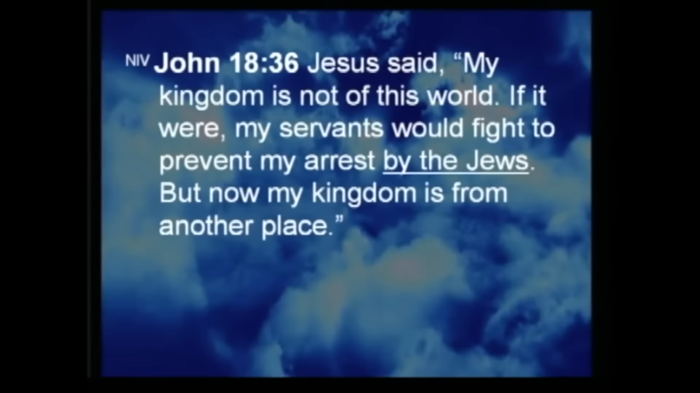
[01:26:22](https://www.youtube.com/watch?v=7err9VIiwO8&list=PLaPig5gEoOs3anPohVf8FuFpA8kdP5TC6&index=2&t=5182s)

- **[The Biblical Evidence for Israel's Role]**
    - **John 18:36:** Jesus states, "My kingdom is not of this world. If it were, my servants would fight to prevent my arrest by the Jews."
        - This indicates that the Jewish authorities were the ones actively seeking to arrest Him.
    - **John 18:38:** Pilate asks, "What is truth?" and subsequently tells the Jews, "I find no basis for a charge against him."
        - This suggests that while the Romans were the executing power, the impetus for the death sentence came from the Jewish leadership.

### The Loss of the Scepter and the Crucifixion

- **[The Loss of Judicial Authority]** The phrase "the scepter has been taken away from Israel" means the Jewish people no longer possessed the right to rule or enforce the Mosaic law's death penalty.
    - Because they could no longer legally execute capital punishment, they had to bring Jesus before the Roman government (Pilate).
- **[The Role of Pilate]**
    - Pilate found no legal basis for a charge against Jesus ("I find no basis for a charge against him").
    - Despite this, the crowd chose to release Barabbas instead of Jesus, fulfilling the desire to see Him crucified.
- **[Divine Sovereignty]** While the Jewish leaders were responsible for the act, their actions were working in accordance with God's ultimate plan for Jesus.

### Zechariah 13:6: A Messianic Prophecy

- This verse serves as prophetic evidence of the Jewish role in the crucifixion.

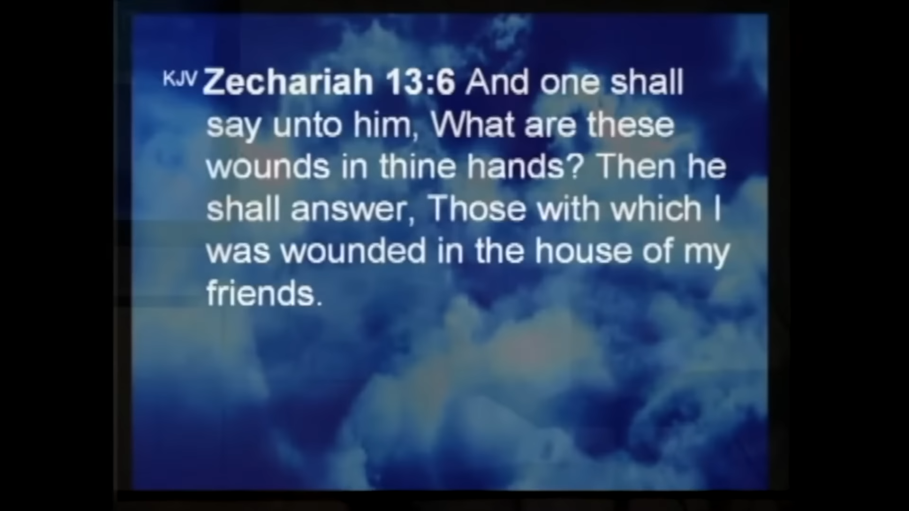
[01:28:26](https://www.youtube.com/watch?v=7err9VIiwO8&list=PLaPig5gEoOs3anPohVf8FuFpA8kdP5TC6&index=2&t=5306s)

> "And one shall say unto him, What are these wounds in thine hands? Then he shall answer, Those with which I was wounded in the house of my friends."

- **[The Identity of 'Him']** In this prophecy, "him" refers to Jesus, the Messiah.

### Messianic Prophecy of Rejection

- **[Zechariah 13:6]** This verse serves as a Messianic prophecy confirming the Jewish people's responsibility for the crucifixion.

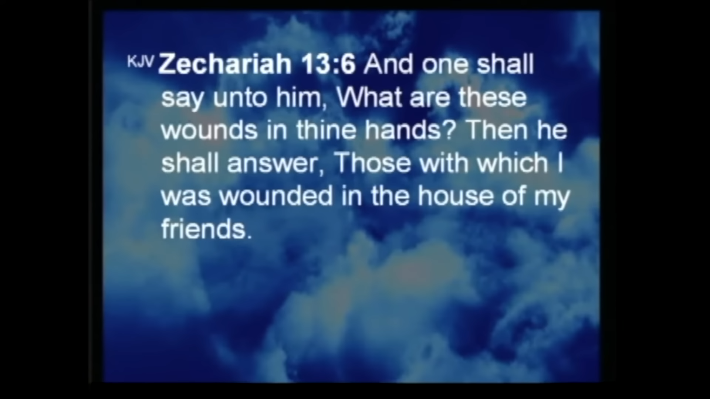
[01:28:36](https://www.youtube.com/watch?v=7err9VIiwO8&list=PLaPig5gEoOs3anPohVf8FuFpA8kdP5TC6&index=2&t=5316s)

    - "And one shall say unto him, What are these wounds in thine hands? Then he shall answer, Those with which I was wounded in the house of my friends."
    - This highlights that Jesus was rejected by His own people.
- **[The Nature of Israel's Conversion]**
    - **[Visual Requirement]** Just as Thomas required physical proof to believe, Israel's eventual belief is tied to a visible encounter.
    - **[The Moment of Realization]** When Jesus returns, the recognition of Him as the Messiah will lead to profound grief and wailing among the nations as they realize the consequences of their rejection.

### The Battle of Armageddon

- **[Biblical Connection]** Revelation 1:7 is a quotation of Zechariah 12:9-11.
- **[The Context of Christ's Return]**
    - Jesus will appear during the Battle of Armageddon.
    - At this time, various nations will converge against Israel, appearing as though they will destroy them.
    - **[The Divine Intervention]** Jesus returns at this critical moment, and His intervention begins simply by speaking the word.

### The Connection to Zechariah 12:9-11

- **[The Timing]** Revelation 1:7 quotes from Zechariah 12:9-11, specifically referencing the period of the Battle of Armageddon.
- **[Divine Intervention]** During the conflict, God will intervene not just through power, but through a spiritual outpouring:
    - He will set out to destroy the nations attacking Jerusalem.
    - He will pour out a "spirit of grace and supplication" upon the house of David and the inhabitants of Jerusalem.

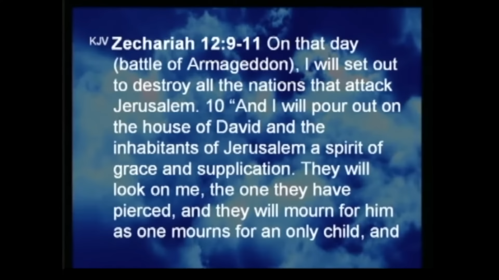
[01:30:23](https://www.youtube.com/watch?v=7err9VIiwO8&list=PLaPig5gEoOs3anPohVf8FuFpA8kdP5TC6&index=2&t=5423s)

- **[The Moment of Recognition]** This outpouring leads to a profound spiritual realization for Israel:
    - They will "look on me, the one they have pierced."
    - This recognition leads to intense, national mourning, described as mourning for an only child or a firstborn son.
- **[The Nature of their Grief]** The mourning is a reaction to the realization that they rejected the very God they thought they were serving.
- **[The Result: Repentance]** This intense grief and recognition of the pierced Messiah is the catalyst for the repentance of Israel, as noted in Revelation 13:1.

### The Cleansing of Israel

- **[The Fountain of Cleansing]** Zechariah 13:1 describes a fountain being opened to the house of David and the inhabitants of Jerusalem to cleanse them from sin and impurity.
    - This occurs "on that day," referring to the Battle of Armageddon/the return of Christ.
    - **[The Identity of the Fountain]** The fountain is the "spirit of grace and supplication" mentioned in the preceding chapter (Zechariah 12:10).

> "On that day (battle of Armageddon), a fountain will be opened to the house of David and the inhabitants of Jerusalem, to cleanse them from sin and impurity."

- **[The Result of the Outpouring]** Through this spirit of grace, Israel will repent, be saved, and God's covenantal promises to Abraham will be fulfilled.

### The Mystery of Israel's Salvation

- **[Paul's Revelation]** In Romans 11, the Apostle Paul explains the current spiritual state of Israel as a mystery.
    - He notes that some of the people of Israel have "hard hearts."
    - This hardness is temporary and lasts only until the "full number of Gentiles comes to Christ."

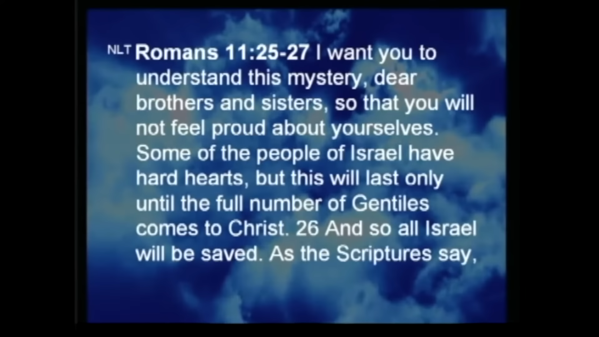
[01:32:46](https://www.youtube.com/watch?v=7err9VIiwO8&list=PLaPig5gEoOs3anPohVf8FuFpA8kdP5TC6&index=2&t=5566s)

> "I want you to understand this mystery, dear brothers and sisters, so that you will not feel proud about yourselves. Some of the people of Israel have hard hearts, but this will last only until the full number of Gentiles comes to Christ. And so all Israel will be saved."

### The Timing and Mechanism of National Salvation

- **[The Milestone of Completion]** The current state of spiritual hardness is a finite period that concludes only when the "full number of Gentiles" has come to Christ.
- **[The Moment of Recognition]** Upon the return of Jesus Christ, the nation will experience a sudden, profound shift:
    - They will recognize Him for who He truly is: the Messiah and the Son of God.
    - This recognition is facilitated by the "spirit of grace and supplication" moving upon them.
- **[The Fulfillment of the Covenant]** This spiritual awakening fulfills God's covenantal promise to take away their sins and turn them from ungodliness, resulting in the salvation of all Israel.

### The Fullness of the Gentiles

- A key clause in Romans 11:25
    - Referred to as the "fullness of the Gentiles" in the KJV and NASB
- **[Crucial Distinction]** Do not confuse the "fullness of the Gentiles" with the "time of the Gentiles"
    - The "fullness of the Gentiles" refers to the total number of Gentiles who become believers and are integrated into the church
    - The "time of the Gentiles" refers to a specific chronological period

### The Composition and Timeline of the Church

- **[Two Classes of People]** In a biblical context, there are only two types of people:
    - Jews
    - Gentiles (anyone who is not a Jew, regardless of nationality)
- **[The Gentile-Majority Church]** Because the Jewish people as a whole have rejected Jesus, the Church is generally composed of Gentiles.
- **[The Timeline of the Fullness of the Gentiles]**
    - **Start:** Began on the day of Pentecost.
    - **End:** Concludes at the Rapture.

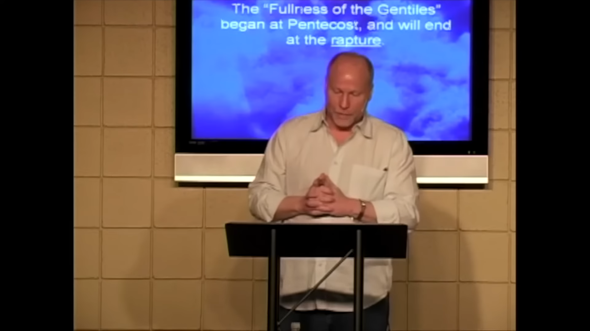
[01:37:03](https://www.youtube.com/watch?v=7err9VIiwO8&list=PLaPig5gEoOs3anPohVf8FuFpA8kdP5TC6&index=2&t=5823s)

- **[The Rapture and the Tribulation]**
    - The end of the 'fullness of the Gentiles' coincides with the Rapture.
    - Following the Rapture, the Tribulation period begins.
    - **Note on Eschatology:** While the speaker is presenting a pre-tribulation Rapture perspective (the Rapture occurring before the Tribulation starts), he acknowledges that other views exist, such as the mid-tribulation view.

### The Timing of the Fullness of the Gentiles

- **[Definition]** The "fullness of the Gentiles" is the period during which Gentiles have the opportunity to enter the church.
- **[The End Point]** This period concludes when the very last person who will accept Christ through their own free will is saved.
- **[The Trigger]** Once this last person is saved, the rapture will take place.

> "The fullness of the Gentiles is when the last person... is saved. At that point, the rapture is going to take place."

- **[Divine Patience]** This concept provides context for God's perceived delay in returning.
    - God is not being "slack" or slow in fulfilling His promises.
    - Instead, He is exercising "longsuffering" (patience).
    - **[Purpose of the Delay]** The delay exists because He is "not willing that any should perish, but that all should come to repentance."

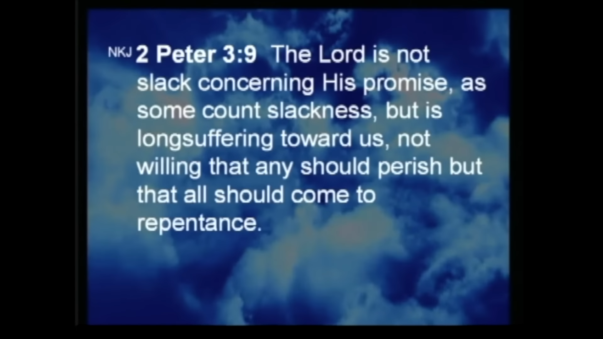
[01:38:45](https://www.youtube.com/watch?v=7err9VIiwO8&list=PLaPig5gEoOs3anPohVf8FuFpA8kdP5TC6&index=2&t=5925s)

> "The Lord is not slack concerning His promise, as some count slackness, but is longsuffering toward us, not willing that any should perish but that all should come to repentance."

- **[Receptivity]** While the Jewish people have largely remained hard-hearted toward the Messiah, the Gentiles remain the receptive group through whom this fullness is realized.

### The End of the Church Age

- **[The Trigger for the Rapture]** The Rapture occurs when the last person who is going to accept Christ of their own free will is saved
    - This event marks the end of the "fullness of the Gentiles"
- **[Shift in Divine Focus]** Once the Rapture takes place, the focus of God's work shifts:
    - **Before Rapture:** The focus is on the Church (the Gentile-majority body of believers)
    - **After Rapture:** The focus shifts back to the Jewish people

### Salvation During the Tribulation

- While the Church is removed, salvation is still possible for individuals during the Tribulation period
- **[The 144,000]** The Bible indicates that 144,000 people will be saved during this time
    - These individuals are described as being "sealed"
    - This sealing is a specific act of God, similar to being sealed by the Holy Spirit

### Post-Rapture Shift in Divine Focus

- **[The Change in Emphasis]** Once the Rapture occurs and the Church is removed, God's focus shifts from the Gentiles back to the Jewish people
    - During the Church Age, God's love and blessings are poured out upon the Church (the Gentiles)
    - During the Tribulation, the "blinders" are removed from Israel
- **[Salvation During the Tribulation]**
    - The 144,000 Jews mentioned in Revelation 7 will be saved and serve as witnesses for Christ
    - **[Important Distinction]** This does *not* mean all of Israel is saved at this point
    - National repentance and the salvation of all Israel is reserved for the return of Christ, as prophesied in Zechariah 12:9-13:1 and Romans 11:25-27

### The Time of the Gentiles

- A concept distinct from the "fullness of the Gentiles"
    - While the "fullness" refers to the number of Gentiles saved, the "time" refers to a different chronological period
    - This concept is discussed in the book of Daniel and throughout the teachings of Jesus.

### The Time of the Gentiles

- A Jewish phrase denoting a period of Gentile domination over the Jewish people
- **[Timeline]**
    - **Begins:** 605 BC with the Babylonian captivity (a result of Israel's disobedience)
    - **Ends:** Upon the return of Christ (at the end of the Tribulation, not the Rapture)
- **[Nature of Domination]**
    - During this time, the Jewish nation is subject to Gentile rule
    - The speaker notes that modern Israeli sovereignty is influenced by Gentile powers (specifically mentioning America) as an illustration of this ongoing period of domination.

### Conceptualizing the "Time of the Gentiles"

- The speaker uses the analogy of a "birth month" to explain the concept of a designated time
    - In his family, a birthday is stretched into a month-long celebration (e.g., "Macy time" or "Micah time")
    - This helps illustrate how a specific period can be characterized by or dedicated to a particular subject
- **[Application to Scripture]** This same logic applies to the "Time of the Gentiles"
    - It refers to a specific era defined by the presence and domination of Gentile nations

### The Purpose and Fulfillment of the Time of the Gentiles

- The current state of Gentile domination was not the original design for Israel
    - Had Israel accepted the Messiah and kept God at the center, they would have been a "shining light to all the world"
    - Instead, their rejection led to this era of domination
- **[Scriptural Basis]** Luke 21:24 describes the mechanics of this period:

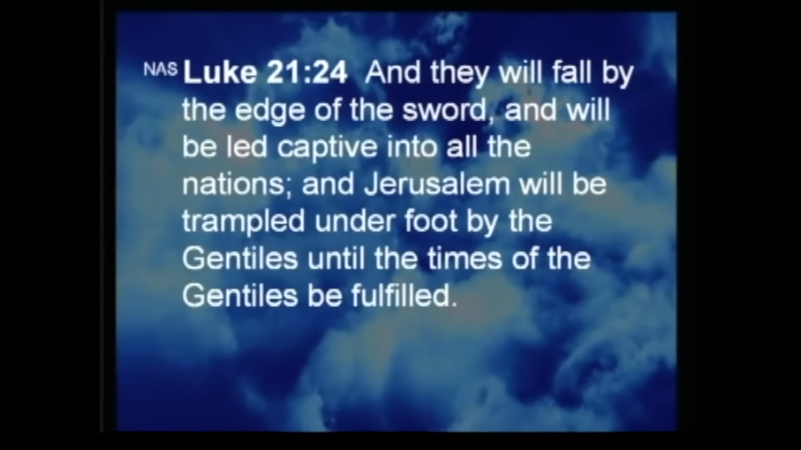
[01:45:39](https://www.youtube.com/watch?v=7err9VIiwO8&list=PLaPig5gEoOs3anPohVf8FuFpA8kdP5TC6&index=2&t=6339s)

> "And they will fall by the edge of the sword, and will be led captive into all the nations; and Jerusalem will be trampled under foot by the Gentiles until the times of the Gentiles be fulfilled."

### The Holy Ground and the Temple

- There is a significant tension regarding the location of the Temple and the current presence of the Dome of the Rock
    - From a Jewish perspective, the holy ground is being desecrated by "heathen" presence
    - However, they currently lack the agency to change this status
- **[Future Rebuilding]** The speaker notes a prophetic expectation regarding the Antichrist:
    - The Antichrist is expected to broker a peace treaty that allows for the rebuilding of the Temple
    - According to Ezekiel, the Dome of the Rock may still exist, separated from the rebuilt Temple by a wall.

### The Conclusion of the Time of the Gentiles

- **[End Point]** The period of Gentile domination ends when Jesus returns
    - At His return, the authority shifts from Gentile nations to Christ
    - He will rule as the "King of kings and Lord of lords"
- **[Nature of Christ's Rule]**
    - He will exercise absolute authority and power (dominion) forever
    - He will rule with a "rod of iron," meaning all nations must answer to Him
- **[Distinction Summary]**
    - **Fullness of the Gentiles:** The specific number of Gentiles saved before the Rapture
    - **Time of the Gentiles:** The era of Gentile domination that ends at Christ's return

### The Three Aspects of Christ's Return

- The speaker begins to outline the three specific components of Christ's return mentioned in Revelation 1:7:

    1. "Every eye shall see him"

### The Third Aspect of Christ's Return: Universal Mourning

- All nations, not just Israel, will mourn over Him
    - This is a global recognition that Jesus Christ is the Messiah and the Lord
    - Nations will grieve because they rejected Him as their Messiah
- **[The Result]** This recognition leads to total submission:
    - Every knee will bow
    - Every tongue will confess that Jesus is Lord

### The Universality of Christ's Lordship

- **[Scriptural Basis]** Philippians 2:9-11 describes the scope of this submission:

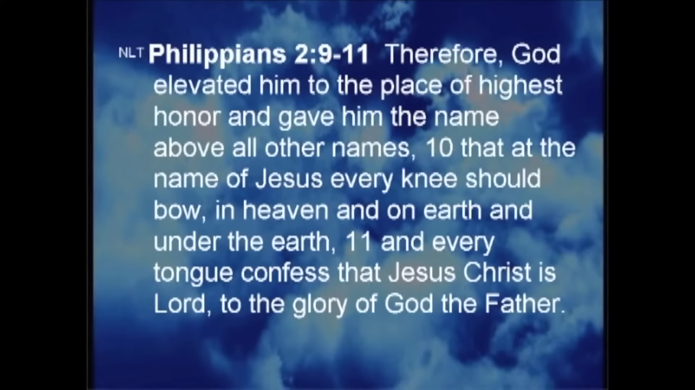
[01:48:52](https://www.youtube.com/watch?v=7err9VIiwO8&list=PLaPig5gEoOs3anPohVf8FuFpA8kdP5TC6&index=2&t=6532s)

> "Therefore, God elevated him to the place of highest honor and gave him the name above all other names, 10 that at the name of Jesus every knee should bow, in heaven and on earth and under the earth, 11 and every tongue confess that Jesus Christ is Lord, to the glory of God the Father."

- The scope covers three distinct realms:
    - **In Heaven**: Those who are currently saved and will be raptured will gladly bow and confess Him as Lord.
    - **On Earth**: Those present on earth during His return will wail and grieve if they are not destroyed.
    - **Under the Earth**: The acknowledgment extends to all realms of existence.

### The Universal Recognition of Christ

- **[The Three Realms]** Based on Philippians 2:9-11, the confession that Jesus is Lord will occur in three distinct areas:
    - **In Heaven:** Those currently saved (who will be raptured) will gladly bow and confess Him as Lord.
    - **On Earth:** Those present during His return will likely react with grief, wailing, or mourning because they rejected Him.
    - **Under the Earth:** The damned will be forced to bow and confess Him as Lord during the Great Day of Judgment.

### The Distinction Between Hell and the Lake of Fire

- **[Hell as a Holding Place]**
    - For a non-believer, the spirit goes to hell immediately upon death.
    - However, hell is not the final destination; it serves as a temporary holding place until the Great Day of Judgment.
- **[The Lake of Fire]**
    - This is the final, eternal state for those whose names are not written in the Book of Life.
    - It is the destination following the Great Day of Judgment.
- **[Degrees of Punishment]**
    - Based on parables in the book of Luke, hell is described as having different levels or degrees.
    - These degrees are determined by an individual's knowledge of Jesus Christ and the extent to which they rejected Him.

### The Completion of the Fullness of the Gentiles

- The Rapture is tied to the "fullness" of the Gentiles
    - "Fullness" means completion or a specific, finished number
    - The Rapture occurs once every person intended to be saved through their own free will has been included
- **[Theological Reasoning]** The delay in the Rapture is not due to God being slow, but due to His desire for all to be saved before the window closes

### Alpha and Omega

- **[Scriptural Basis]** Revelation 1:8:

> "I am Alpha and Omega, the beginning and the ending, saith the Lord, which is, and which was, and which is to come, the Almighty."

- **[Symbolism]** Alpha ($\alpha$) and Omega ($\omega$) are the first and last letters of the Greek alphabet
    - This signifies that God encompasses everything from start to finish
    - He is the beginning and the end of all things
- **The Greek Alphabet Reference:**
    - Alpha, Beta, Gamma, Delta, Epsilon, Zeta, Eta, Theta, Iota, Kappa, Lambda, Mu, Nu, Xi, Omicron, Pi, Rho, Sigma, Tau, Upsilon, Phi, Chi, Psi, Omega

### Christ as the Alpha and Omega

- **[The Figure of Speech]** While Alpha and Omega are the first and last letters of the Greek alphabet, they are used here as a figure of speech to summarize all existence.
    - It represents the beginning, the end, and everything in between.
    - **[Analogy]** Similar to the modern expression "knowing something from A to Z," it implies complete and total knowledge or presence.
- **[Implications of the Title]**
    - Christ is eternal, just like the Father.
    - He was present in the beginning with God.

### Christ as the Visible Image of God

- **[The Nature of Christ]** Jesus is the visible manifestation of the invisible God
    - If one wants to know what God is like, they should look at Jesus
- **[Pre-existence and Supremacy]** Christ existed before anything else was brought into being
    - He existed before the earth and before the angels
    - He is supreme over all of creation

#### The Agency of Creation

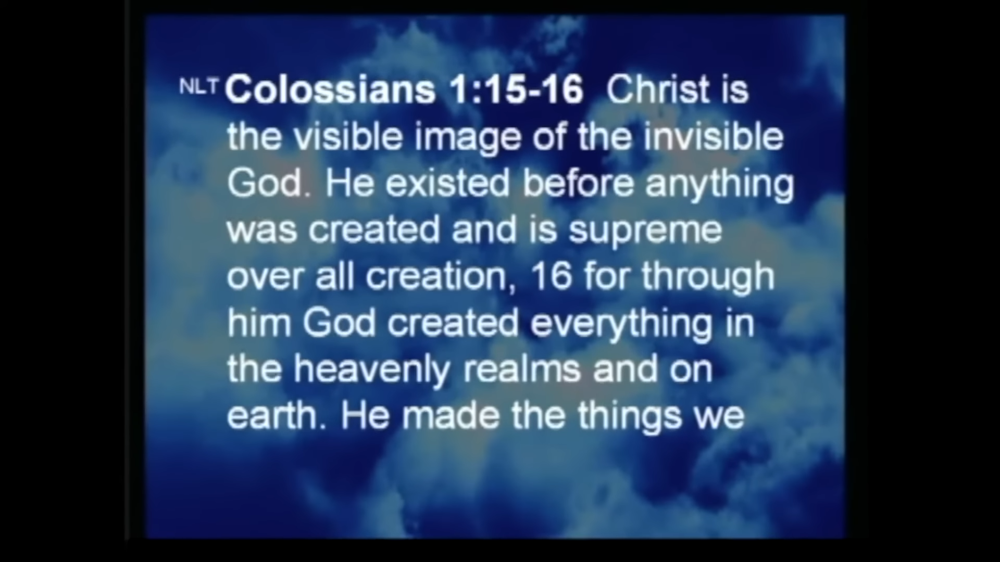
[01:54:15](https://www.youtube.com/watch?v=7err9VIiwO8&list=PLaPig5gEoOs3anPohVf8FuFpA8kdP5TC6&index=2&t=6855s)

- **[Scriptural Basis]** Colossians 1:15-16:

    > "Christ is the visible image of the invisible God. He existed before anything was created and is supreme over all creation, 16 for through him God created everything in the heavenly realms and on earth. He made the things we..."

- **[The Scope of Creation]** Everything was created through Him and for Him
    - This includes the visible world
    - It also includes the unseen world (things that cannot be seen even with a microscope)
    - Examples of the unseen: thrones, kingdoms, rulers, and authorities

#### Christ's Current Exaltation

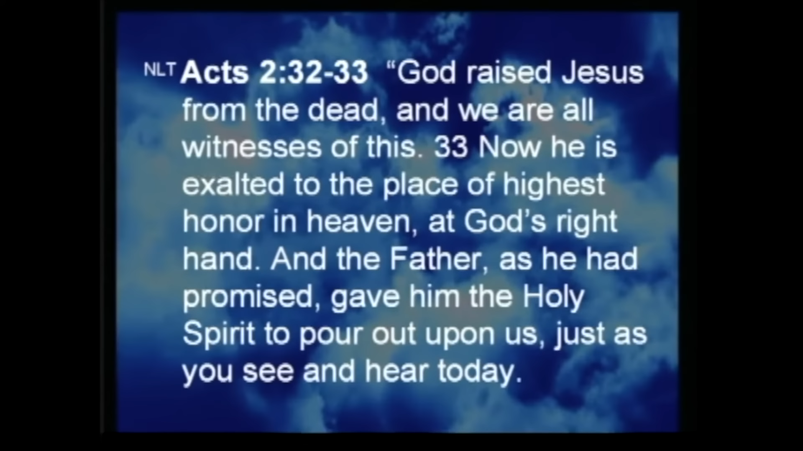
[01:55:23](https://www.youtube.com/watch?v=7err9VIiwO8&list=PLaPig5gEoOs3anPohVf8FuFpA8kdP5TC6&index=2&t=6923s)

- **[The Present State of Christ]** He is currently the "everything in between"—alive and seated at the right hand of the Father
- **[Scriptural Basis]** Acts 2:32-33:

    > "God raised Jesus from the dead, and we are all witnesses of this. 33 Now he is exalted to the place of highest honor in heaven, at God's right hand. And the Father, as he had promised, gave him the Holy Spirit to pour out upon us, just as you see and hear today."

- **[The Result of Exaltation]** Because of His exaltation, the Father has poured out the Holy Spirit upon believers

### The Lord Almighty

- **[The End and Consummation]**
    - As the Alpha and Omega, Christ is currently seated at the right hand of God.
    - He is the one who will consummate the end of the world and bring believers into eternity (as detailed in Revelation 21).
- **[Defining 'Almighty']**
    - The term is a translation of the Greek word *pantokratōr*.
    - **[Etymology]** It is a compound word:
        - *pan-* : meaning "all"
        - *kratos* : meaning "strength," "power," or "might"
    - **[Theological Distinction]** While humans often use "almighty" colloquially to describe someone powerful, the term is technically only applicable to God, as it signifies possessing *all* power and *all* strength.

### The Power of Christ's Word

- **[Symbolism of the Sword]** John uses the imagery of a sharp two-edged sword coming from Christ's mouth
    - This symbolizes that His word has dual functions: it can **create** and it can **destroy**
- **[Absolute Authority]** Christ's power is not comparable to human technology or warfare
    - While humanity develops advanced weaponry (like the Patriot missile or advanced warfare systems), Christ's authority is immediate
    - He does not need a battle; He simply speaks, and the outcome is finalized

### Revelation 1:9: John on Patmos

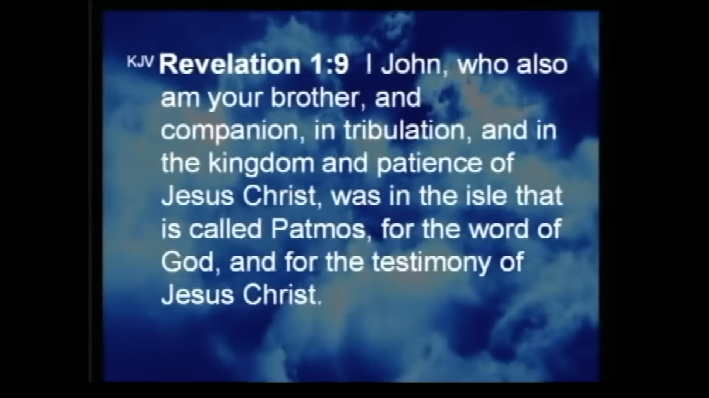
[01:58:23](https://www.youtube.com/watch?v=7err9VIiwO8&list=PLaPig5gEoOs3anPohVf8FuFpA8kdP5TC6&index=2&t=7103s)

- **[Scriptural Basis]** KJV Revelation 1:9:

    > "I John, who also am your brother, and companion, in tribulation, and in the kingdom and patience of Jesus Christ, was in the isle that is called Patmos, for the word of God, and for the testimony of Jesus Christ."

- **[John's Identity and Context]**
    - He identifies as a brother and companion to the believers
    - He shares in their tribulation, as well as in the kingdom and patience of Jesus Christ
    - He was physically located on the island of Patmos when he received this revelation

### The Setting of Revelation: The Island of Patmos

- **[Geographic Context]** Patmos is a small, rocky, and barren island located in the Aegean Sea.
    - It is situated approximately 50 miles from Ephesus and 37 miles from Miletus.

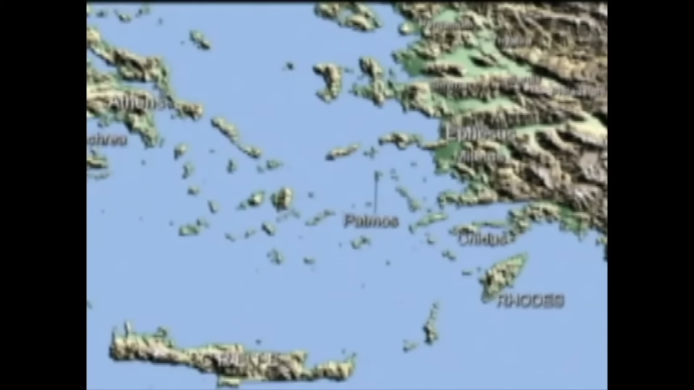
[01:59:19](https://www.youtube.com/watch?v=7err9VIiwO8&list=PLaPig5gEoOs3anPohVf8FuFpA8kdP5TC6&index=2&t=7159s)

- **[The 'Alcatraz' of the Ancient World]** Patmos served as a penal colony.
    - **[Imprisonment Conditions]** It was virtually impossible to escape once sentenced there.
    - **[Reason for Isolation]** While there are neighboring islands, the sea currents run from north to south.
    - **[The Danger]** Any attempt to swim to nearby islands would result in the currents carrying the swimmer out into the open Mediterranean Sea.

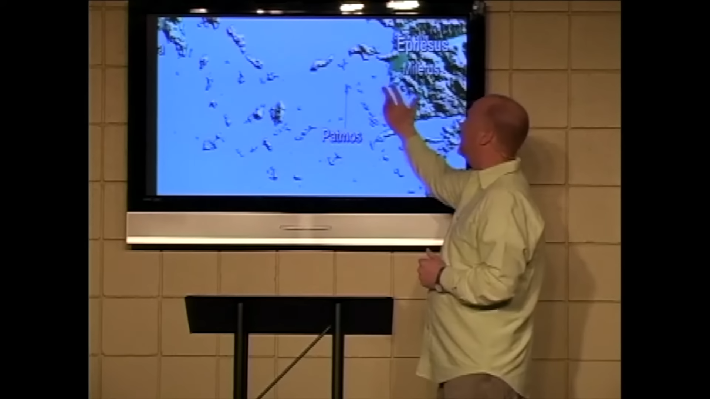
[02:00:01](https://www.youtube.com/watch?v=7err9VIiwO8&list=PLaPig5gEoOs3anPohVf8FuFpA8kdP5TC6&index=2&t=7201s)

### Life as a Prisoner on Patmos

- **[Harsh Living Conditions]** The island was rocky and barren, meaning there were no trees to build rafts for escape.
    - Prisoners were often forced to work in the mines until death.
- **[The 'Slave Barrel']** According to Herbert Lockyer, prisoners were often chained to "slave barrels."
    - This was essentially a wheelbarrow.
    - Prisoners slept, worked, and even used the restroom with the barrel, never being released from it unless granted amnesty or a pardon.

### John's Context in Revelation

- **[Age and Timing]**
    - Most scholars believe the Book of Revelation was written around **95 AD**.
    - At this time, John was nearly **90 years old**.
- **[A Companion in Tribulation]** Despite being an elderly man imprisoned and forced into mining labor, John used his situation to encourage others, identifying himself as a "brother and companion in tribulation."

### The Meaning of Tribulation

- **[Etymology of Thlipsis]** John uses the Greek word *thlipsis* to describe his state of "tribulation."
    - **[Original Usage]** In the ancient world, this word described a specific form of torture: tying a person's hands and feet behind their back and slowly lowering a boulder onto them.
    - **[The Effect]** This was not a sudden impact, but a slow process that crushed the ribcage and internal organs, eventually forcing all air out of the body.
    - **[Modern Idiom]** This concept of being slowly crushed is the origin of the English phrase "between a rock and a hard place."
- **[Evolution of Meaning]** Over time, the term evolved from describing physical torture to representing any form of intense affliction, suffering, or hardship.

### John's Life and Amnesty

- **[A Companion in Suffering]** When John calls himself a "companion in tribulation," he is speaking from the reality of being nearly 90 years old and forced to work in the mines of Patmos.
- **[Historical Timeline]**
    - **[Imprisonment]** John was imprisoned on Patmos during the reign of the Roman emperor Domitian.
    - **[Amnesty]** According to the historian Irenaeus, John was granted amnesty by the Emperor Nerva around AD 96.
    - **[Final Years]** Following his release, he was able to spend his remaining years in the city of Ephesus, though tradition suggests his health was so poor that he had to be carried through the streets.

### John's Ministry in Ephesus

- After receiving amnesty, John spent his final years in Ephesus.
- **[Legacy of Storytelling]** Due to his failing health, he was often carried through the streets to share his experiences.
    - He would tell stories of his early days with Jesus and his time in ministry.
    - He would conclude his teachings with the exhortation: "I beg you to love others as Christ also loved you."

### Revelation 1:10: Being "In the Spirit"

- **[Scriptural Basis]** KJV Revelation 1:10:

    > "I was in the Spirit on the Lord's day, and heard behind me a great voice, as of a trumpet,"

- **[Defining "In the Spirit"]** This refers to a state of being in an "open-eyed trance."
    - This was a method used by Old Testament prophets to receive direct communication from God.
- **[The Criteria of a True Prophet]**
    - A true prophet is defined by the fulfillment of their word.
    - According to Old Testament law (e.g., regarding false prophets), if a prophecy does not come to pass, the individual is not a true prophet of God.
    - Therefore, a true prophet's words have power and life, meaning they inevitably come to pass.

### The Prophet Balaam and the Open-Eyed Trance

- **[The Example of Balaam]** Balaam is used to illustrate how a prophet functions during divine revelation.
    - Despite being offered riches to curse Israel, Balaam clarified that he could only speak what God put in his mouth.
    - The scripture notes that his "eyes open," signifying he was in a state of conscious revelation.
- **[Defining the Open-Eyed Trance]** This is the mechanism by which Old Testament prophets received the "vision of the Almighty."
    - It allows the prophet to see and hear God's words while remaining awake.
    - This state ensures the words are not merely human imagination but are divinely imparted.
- **[Scriptural Evidence]**
    - Numbers 24:4:

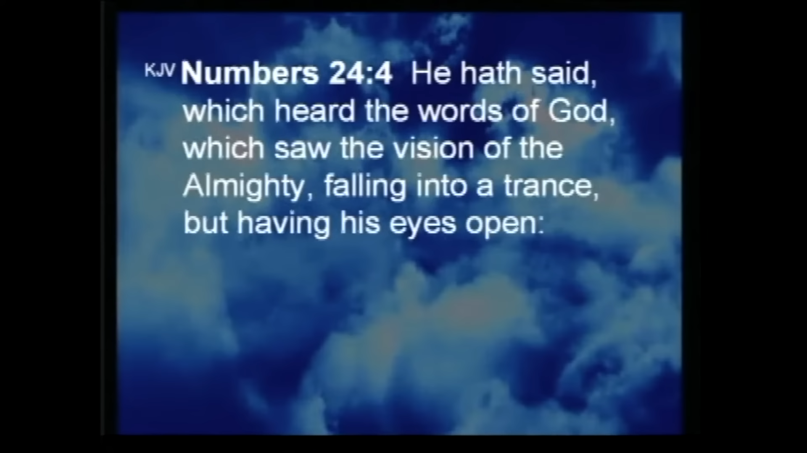
[02:05:29](https://www.youtube.com/watch?v=7err9VIiwO8&list=PLaPig5gEoOs3anPohVf8FuFpA8kdP5TC6&index=2&t=7529s)

    > "He hath said, which heard the words of God, which saw the vision of the Almighty, falling into a trance, but having his eyes open:"

    - Numbers 24:16:

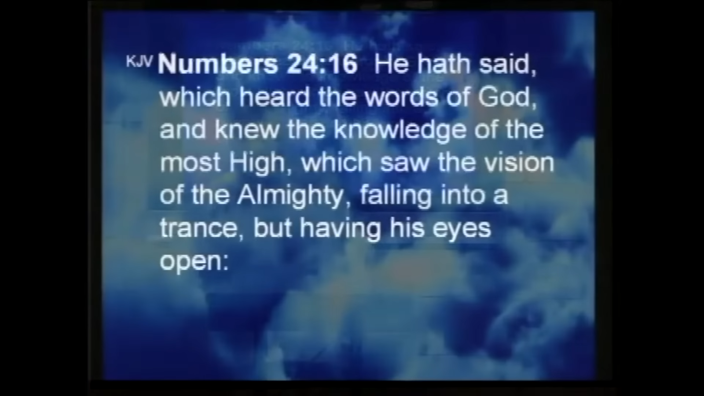
[02:05:49](https://www.youtube.com/watch?v=7err9VIiwO8&list=PLaPig5gEoOs3anPohVf8FuFpA8kdP5TC6&index=2&t=7549s)

    > "He hath said, which heard the words of God, and knew the knowledge of the most High, which saw the vision of the Almighty, falling into a trance, but having his eyes open:"

- **[The Result of True Prophecy]** Because these prophets were in this trance, their words had life and power, meaning their prophecies would inevitably come to pass rather than "falling to the ground."

### The Divine Necessity of Prophetic Accuracy

- **[The Weight of Prophecy]** Because a true prophet's words are divinely inspired, they possess inherent power and must inevitably come to pass.
- **[The Case of Elijah]** The speaker uses Elijah to illustrate the high stakes of prophetic ministry:
    - If a prophet's word fails to manifest, they are not a true prophet of God.
    - To uphold the integrity of His word, God must ensure that what a true prophet speaks actually occurs.

### Ecstasy in the New Testament

- **[Continuity of Experience]** The phenomenon of being "in the Spirit" (the open-eyed trance) is not exclusive to the Old Testament.
- **[New Testament Examples]** Figures such as Peter and Paul also experienced these states.
    - In the Greek text, these experiences are referred to as "ecstasies."
    - These states allowed them to enter a trance-like condition to receive direct visions from God.
- **[Scriptural Reference]** Acts 10:9-16 (the experience of Peter) is cited as a primary example of this phenomenon.

### New Testament Examples of Trances

- **[Peter's Experience]** Peter experienced a vision while praying on a flat roof.
    - Acts 10:9-16:


[02:07:42](https://www.youtube.com/watch?v=7err9VIiwO8&list=PLaPig5gEoOs3anPohVf8FuFpA8kdP5TC6&index=2&t=7662s)

    > "The next day as Cornelius's messengers were nearing the town, Peter went up on the flat roof to pray. It was about noon, 10 and he was hungry. But while a meal was being prepared, he fell into a trance. 11 He saw the sky open, and something like a large sheet was let down by its four corners. 12 In the sheet were all sorts of animals, reptiles, and birds. 13 Then a voice said to him, 'Get up, Peter; kill and eat them.' 14 'No, Lord,' Peter declared. 'I have never eaten anything that our Jewish laws have declared impure and unclean.' 15 But the voice spoke again: 'Do not call something unclean if God has made it clean.'"

    - This vision involved a sheet of various animals and a divine command to eat, which challenged Peter's understanding of Jewish purity laws.
- **[Paul's Experience]** Paul underwent a similar phenomenon while praying in the temple.
    - Acts 22:17-18:


[02:09:04](https://www.youtube.com/watch?v=7err9VIiwO8&list=PLaPig5gEoOs3anPohVf8FuFpA8kdP5TC6&index=2&t=7744s)

    > "After I returned to Jerusalem, I was praying in the temple and fell into a trance. 18 I saw a vision of Jesus saying to me, 'Hurry! Leave Jerusalem, for the people here won't accept your testimony about me.'"

### The Greek Origin: *Extasis*

- **[Linguistic Connection]** The word "trance" in these accounts is translated from the Greek word *extasis*.
    - This is the root of the English word "ecstasy."
- **[Defining&#32;*Extasis*]** While modern English uses "ecstasy" to mean intense joy or delight, in the biblical Greek context, it has a specific technical meaning:
    - It refers to being in a trance-like state.
    - Specifically, it is an "open-eyed trance" used to see a vision.

### The Meaning of "The Lord's Day"

- **[Clarifying the Terminology]** In Revelation 1:10, the phrase "on the Lord's day" is often misinterpreted by commentators.
    - Many commentators suggest this refers to Sunday.
    - However, in the context of John's vision, it does not refer to any day of the week.
- **[Temporal Transportation]** Being "in the Spirit on the Lord's day" means John was transported in time to experience a specific prophetic era.
- **[Defining the "Day of the Lord"]**
    - The "day of the Lord" refers to the **day of judgment**.
    - It is the period when God intervenes directly in the world to execute judgment.
    - While the Old Testament occasionally refers to God judging specific nations as a "day of the Lord," in a broader prophetic sense, it refers to the **end times** and the **Tribulation period**.


[02:09:30](https://www.youtube.com/watch?v=7err9VIiwO8&list=PLaPig5gEoOs3anPohVf8FuFpA8kdP5TC6&index=2&t=7770s)

### Defining the "Day of the Lord"

- John's statement that he was "in the spirit on the Lord's day" refers to being transported in time to witness the end times.
- There are two ways to define this term:
    - **Broad Sense**: Refers to the end times/Tribulation period, characterized by the outpouring of God's wrath and judgment upon the world.
    - **Narrow Sense**: Refers specifically to the Second Coming of Christ.
        - This includes the Battle of Armageddon on the Mount of Olives.
        - It includes the subsequent judgment (the Great White Throne).
- **[John's Perspective]** Because John was in an "open-eyed trance," he was able to see the future as if it were a documentary, witnessing events like the Tribulation, Armageddon, and the establishment of the Messianic kingdom before they actually occurred in linear time.

### The Challenge of Describing the Vision

- **[The Context of John's Era]** In the first century, warfare was limited to what was visible and known:
    - The fastest transport was a horse.
    - Weapons included lances, archers, shields, and helmets.
    - Even armor was a weapon, as it facilitated the forward march of soldiers.
    - Footwear (sandals) often featured two-inch metal spikes used to kill enemies by stepping on them.
- **[The Concept of 'Technological Shock']** John had to describe events that were conceptually impossible for a first-century mind to grasp.
    - Imagine the difficulty of a person from the era of horses trying to describe:
        - Tanks firing cannons
        - The explosion of atomic bombs
        - The flight of helicopters and jets
- **[The Descriptive Burden]** Because the visions contained elements completely foreign to his world, John's task was to find a way to communicate these unprecedented, high-tech, and devastating realities to his audience.

### The Immediacy of John's Writing

- **[The Descriptive Challenge]** Much of the symbolism in Revelation is an attempt to describe 21st-century events using a first-century vocabulary and experience.
- **[Real-Time Recording]** According to Revelation 1:11, John was commanded to write what he *sees* (present tense), not what he *saw* (past tense).
    - This indicates he was writing the account as the vision was unfolding while he was in the spirit.
    - Unlike Old Testament prophets who might speak what happened in the moment, John's writing was a direct transcription of the Spirit's guidance during the trance.


[02:14:30](https://www.youtube.com/watch?v=7err9VIiwO8&list=PLaPig5gEoOs3anPohVf8FuFpA8kdP5TC6&index=2&t=8070s)

### The Command to Write Immediately

- In Revelation 1:11, John is commanded to "write in the book" what he sees.
- **[The Greek Grammar]** The command is not just a suggestion to record events later; the specific Greek construction indicates urgency and immediacy:
    - **Verb**: Derived from *grapho* (to write).
    - **Tense**: Aorist tense, signifying punctiliar action (an action occurring at a specific point in time).
    - **Mood**: Imperative mood, indicating a direct command.
- **[The Necessity of the Command]** God had to command John to write because his natural human tendency would have been to simply watch in astonishment.
    - Being in an "open-eyed trance" is like being transported into the events rather than watching a movie.
    - The intensity of the visions (the white horse, the red horse, atomic explosions, famine, and martyrdom) would naturally cause a person to become lost in the spectacle.
    - Without the specific command to write *as he saw*, John likely would have stopped everything just to witness the unfolding of the seals, trumpets, and judgments.

### The Seven Golden Candlesticks

- **[Clarifying the Vision]** In Revelation 1:12, John describes turning to "see the voice that spake with me."
    - This is a figure of speech; one cannot literally see a voice.
    - The voice is described as being like a trumpet—powerful and wonderful.
    - John's intent was to identify the speaker behind the sound.


[02:17:10](https://www.youtube.com/watch?v=7err9VIiwO8&list=PLaPig5gEoOs3anPohVf8FuFpA8kdP5TC6&index=2&t=8230s)

- **[The Symbolic Menorahs]** Upon turning, the first thing John sees is "seven golden candlesticks."
    - These are better understood as seven golden menorahs.
    - **[Symbolic Meaning]** According to Revelation 1:20, these seven golden menorahs represent the seven churches.
    - **[The Function of the Church]** The choice of a menorah is significant because:
        - The primary purpose of a menorah is to provide light.
        - This mirrors the intended function of the church in the world.

### The Seven Golden Menorahs

- **[The Vision]** Upon turning to see the voice, John sees seven golden candlesticks (menorahs).
    - While the text says he "turned to see the voice," this is a figure of speech; he was actually turning to identify the speaker.
- **[Symbolism of the Menorah]** The menorahs are symbolic of the seven churches (Revelation 1:20).
    - **[The Function of Light]** The primary purpose of a menorah is to provide light.
    - This mirrors the biblical mandate for the church to act as the "light of the world."


[02:18:36](https://www.youtube.com/watch?v=7err9VIiwO8&list=PLaPig5gEoOs3anPohVf8FuFpA8kdP5TC6&index=2&t=8316s)

- **[The Church as Light]** As taught in Matthew 5:14-16, the church's purpose is to shine brightly to show people the light of God's word and His character.
    - A city on a hill cannot be hidden.
    - A lamp is placed on a stand to give light to everyone in the house, not hidden under a bowl.
- **[The Consequence of Darkness]** If a church fails to shine with God's light, it faces divine removal.
    - In Revelation 2:5, Jesus warns the church of Ephesus that if they do not repent, He will "remove your lampstand from its place among the churches."


[02:19:37](https://www.youtube.com/watch?v=7err9VIiwO8&list=PLaPig5gEoOs3anPohVf8FuFpA8kdP5TC6&index=2&t=8377s)

### The Warning to the Church of Ephesus

- **[The Danger of Losing 'First Love']** Using the church of Ephesus as an example, the speaker notes the transition from a vibrant, apostolic church to one that performs religious actions without heart.
    - Performing religious duties (praying, reading the Bible) without the Word becoming "alive in the heart" is a sign of decline.
    - This is characterized by a loss of the initial fervor and passion for sharing Christ that often accompanies salvation.
- **[The Consequence of Spiritual Decline]**
    - **[The Command to Repent]** God calls for repentance and a return to the "works you did at first."
    - **[Removal of the Lampstand]** If a church fails to repent and keep its spiritual light shining, God will remove its lampstand from its place among the churches.


[02:20:24](https://www.youtube.com/watch?v=7err9VIiwO8&list=PLaPig5gEoOs3anPohVf8FuFpA8kdP5TC6&index=2&t=8424s)

- **[Application to the Individual]** While the messages are addressed to "the churches," they apply to individual believers because the believer *is* the church.
    - As noted in Revelation 1:3, blessing is promised to the one who "heeds all the things that are written therein."

### The Symbolism of Seven

- **[Meaning of the Number Seven]** The presence of seven golden menorahs is significant because the number seven denotes perfection or completion.

### The Complete Church and Its Mission

- **[The Scope of the Seven Churches]** The seven churches collectively represent the complete church of God.
- **[The Presence of Christ]** Jesus is positioned in the midst of these seven menorahs (churches).
- **[The Church's Mandate]** The purpose of the church is to illuminate Jesus so that people may know who He is.

### The Appearance of the Son of Man

- **[Revelation 1:13]** In the midst of the seven candlesticks, John sees one "likened to the Son of Man."
    - He is described as being clothed with a garment reaching down to the foot.
    - He is girded about the chest with a golden girdle.

### The Title "Son of Man"

- **[Linguistic Clarification]** The King James Version uses the term "paps," which refers to the chest.
    - The word "mastectomy" shares the same Greek root.
- **[The Meaning of "Son of Man"]** This is a title Jesus used to refer to Himself.


[02:23:20](https://www.youtube.com/watch?v=7err9VIiwO8&list=PLaPig5gEoOs3anPohVf8FuFpA8kdP5TC6&index=2&t=8600s)

    - As seen in Matthew 18:11: "For the Son of man is come to save that which was lost."
- **[Literal vs. Figurative Usage]** In Jewish culture, the term "son" was used in two distinct ways:
    - **Literal:** Denoting male offspring (e.g., being the biological son of a father).
    - **Figurative:** Used as a figure of speech to denote a person possessing a specific or peculiar quality.
    - Jesus used this figurative title to make people stop and think about His nature.

### Figurative Use of "Son" in Hebrew

- In Hebrew culture, "son" was often used as a figure of speech to describe someone possessing a specific or peculiar quality.
- **[Example: Son of Belial]**
    - Belial is not a literal person, but a term meaning wicked or worthless.
    - To be a "son of Belial" meant to possess the characteristics of wickedness.
    - This is illustrated in Judges 19:22:

        > "Now as they were making their hearts merry, behold, the men of the city, certain sons of Belial, beset the house round about..."


[02:25:18](https://www.youtube.com/watch?v=7err9VIiwO8&list=PLaPig5gEoOs3anPohVf8FuFpA8kdP5TC6&index=2&t=8718s)

- **[Application to Jesus]**
    - Jesus used the title "Son of Man" to call attention to the fact that He possessed the qualities and characteristics of a man.

### The Paradox of the "Son of Man"

- **[The Implication of the Title]** While using the title acknowledged His human characteristics, it simultaneously implied He was much more than just a man.
    - By calling Himself the "Son of Man," Jesus was pointing to a reality that transcended human nature.
- **[Evidence of Divinity]** The people walking with Jesus witnessed Him performing supernatural acts that no ordinary human could achieve:
    - Raising the dead
    - Healing all types of infirmities (e.g., restoring sight to the blind or new extremities to those with leprosy)
    - Walking on water
    - Turning water into wine
- **[The Conclusion]** These miracles signaled to His followers that He was not merely a man possessing human qualities, but was actually God.
- **[John's Recognition]**
    - In Revelation 1:13, when John sees the figure in the midst of the seven menorahs and describes Him as being "like the Son of Man," it conveys a sense of recognition of Jesus's true identity.

### The Glorified Christ vs. The Earthly Jesus

- **[The Difference in State]** When John sees Jesus in the midst of the seven menorahs, he is seeing a version of Jesus that is different from the one who walked the earth.
    - The Jesus on earth was in human form.
    - The Jesus in Revelation is in His **glorified body**.
- **[The Kenosis Doctrine]** This concept explains the transition between His divine nature and His earthly ministry.
    - **Definition:** The act of Jesus emptying Himself of His divine privileges to take on human form.
    - **Earthly Ministry:** While on earth, Jesus did not operate using His own deity, but rather walked in the power of the Holy Spirit.
        - He utilized every spiritual gift (knowledge, wisdom, healing) through the Holy Spirit.
    - **Glorified State:** In His current state, He has returned to being exactly who He was before the incarnation.

#### Philippians 2:6-7 (NLT)


[02:28:41](https://www.youtube.com/watch?v=7err9VIiwO8&list=PLaPig5gEoOs3anPohVf8FuFpA8kdP5TC6&index=2&t=8921s)

> "Though he was God, he did not think of equality with God as something to cling to. Instead, he gave up his divine privileges; he took the humble position of a slave and was born as a human being."

### The High Priest's Attire

- **[Symbolism of Clothing]** In Revelation 1:13, the figure in the midst of the candlesticks is clothed in a manner reminiscent of the Old Testament High Priest.
- **[The Heavenly Ministry]** This specific attire signifies His current role in heaven:
    - He is performing the ministry of intercession.
    - He acts as the High Priest for His people.

### The Legal Basis of Christ's Ministry

- **[Divine Justice]** Because God is just, all divine actions must follow His own legal rules.
    - For example, God could only legally raise Jesus from the dead because Jesus had never sinned.
- **[Fulfillment of the Law]** Jesus' ability to serve as our intercessor is based on His perfect adherence to the Law.
    - He fulfilled the law in its entirety, including the two greatest commandments:

        1. Loving God with all heart, soul, and mind.
        2. Loving your neighbor as yourself.

- **[Leviticus 18:5]** This principle is underscored by the requirement that those who do these things shall live by them.

### The Resurrection and the Law

- **[The Substitutionary Death]** Because Jesus loved humanity, He allowed Himself to become the bearer of sin and died in our place.
- **[The Legal Basis for Life]** When all sins are paid for, God observes that Jesus has never sinned.
    - According to **Leviticus 18:5**, "the man which do these things, who does the law, shall live by him."
    - Because Jesus fulfilled the law, God legally commands Him to live, resulting in His resurrection.

### The Requirement for the Eternal High Priest

- **[Divine Legality]** God operates strictly within His own legal and righteous frameworks.
- **[The Order of Melchizedek]** Jesus cannot simply enter heaven and perform the duties of the High Priest immediately; He must serve according to a specific legal order.
    - He must become a High Priest according to the order of Melchizedek to officially take on His heavenly duties.
- **[Forfeiture of Earthly Priesthood]** The earthly priesthood (represented by Aaron) was subject to defilement and disqualification.
    - For example, when Aaron's sons offered "strange incense" and died, it demonstrated the strictness of the law.
    - This historical precedent serves as a reminder that the earthly High Priest could not defile themselves or act outside of God's commands.

### The Eternal High Priest

- **[Permanent Priesthood]** Unlike earthly priests who eventually die and forfeit their position, Jesus's priesthood is eternal because He lives forever.
    - This permanence allows Him to "once and forever" save those who come to God through Him.
    - He uses His eternal life to continuously intercede with God on behalf of believers.
- **[Qualities of the High Priest]** According to **Hebrews 7:24-26**, Jesus is the ideal High Priest because He is:
    - Holy and blameless
    - Unstained by sin
    - Set apart from sinners
    - Given the highest place of honor in heaven


[02:32:12](https://www.youtube.com/watch?v=7err9VIiwO8&list=PLaPig5gEoOs3anPohVf8FuFpA8kdP5TC6&index=2&t=9132s)

### Jesus as Our Advocate

- **[The Role of an Advocate]** Because humans sin, they require a legal representative to plead their case.
    - Jesus acts as an "advocate," which functions like a lawyer in a legal setting.
- **[1 John 2:1]** This role is defined by the necessity of a righteous mediator:
    - The purpose of the teaching is so that believers will not sin.
    - However, if sin does occur, Jesus Christ—who is truly righteous—pleads our case before the Father.


[02:32:45](https://www.youtube.com/watch?v=7err9VIiwO8&list=PLaPig5gEoOs3anPohVf8FuFpA8kdP5TC6&index=2&t=9165s)

### How Jesus Pleads Our Case

- **[The Nature of Divine Justice]** Because God is perfectly just, He cannot simply overlook sin out of mercy; sin must be punished.
    - Jesus does not plead our case by pointing to our works or intentions (e.g., "He didn't really mean it").
    - Human works are described as "filthy rags" and are insufficient to satisfy God's justice.
- **[The Basis of Advocacy]** Instead of our works, Jesus points to His own perfect work to satisfy the legal requirement of justice.

### Jesus as our Surety

- **[The Concept of Surety]** According to **Hebrews 7:22**, Jesus serves as the "surety of a better covenant."
    - The Greek word for surety is *enguos*.
    - **[Definition]** A surety acts as a "cosigner."
        - A cosigner is someone who accepts legal responsibility for another person's debt when that person defaults on their obligation.


[02:34:11](https://www.youtube.com/watch?v=7err9VIiwO8&list=PLaPig5gEoOs3anPohVf8FuFpA8kdP5TC6&index=2&t=9251s)

### The Practical Application of Jesus as Surety

- **[Resolving the Debt]** When humans fail to fulfill their obligations under a covenant, Jesus intervenes as the surety:
    - He presents His own completed work to God.
    - He declares that the sin has already been paid for, effectively neutralizing the accusation of the devil.
- **[The Insufficiency of Human Works]** The speaker warns against the belief that salvation is earned through merit:
    - Human efforts and good works are described as "filthy rags."
    - Religious milestones—such as church membership or baptism—are insufficient for salvation if they are used as a substitute for faith.
- **[The Requirement for Salvation]** Because works cannot bridge the gap, the only way to heaven is through a personal connection to Christ:
    - One must receive Jesus Christ as their personal Lord and Savior.
    - This requires a personal revelation of who Jesus truly is.

### Contextual Review of Revelation 1

- **[The Visionary State]** As established in verse 10, John was in the Spirit on the Lord's Day.
    - This state is described as an "open-eyed trance."
    - In this condition, John saw visions of the events recorded in Revelation.
- **[The Divine Command]** While in this trance, John heard a voice commanding him to:
    - Write down everything he saw.
    - Compile it into a book.
    - Send the book to the seven churches.
- **[The Vision of Christ]** John turned to see the speaker and encountered Jesus standing among seven golden candlesticks (menorahs).
    - **[Key Distinction]** This is a revelation of Jesus as He exists now in heaven.
    - His appearance in this vision is fundamentally different from His previous earthly life.


[02:36:20](https://www.youtube.com/watch?v=7err9VIiwO8&list=PLaPig5gEoOs3anPohVf8FuFpA8kdP5TC6&index=2&t=9380s)

### The Appearance of the Glorified Christ

- **[Physical Description]** Because John's understanding was shaped by his first-century context, he describes the glorified Jesus using powerful imagery:
    - His head and hair were white like wool, as white as snow
    - His eyes were as a flame of fire
- **[Theological Significance]** This description is not merely aesthetic; it is a declaration of His divine nature.

### The Connection to the Ancient of Days


[02:38:19](https://www.youtube.com/watch?v=7err9VIiwO8&list=PLaPig5gEoOs3anPohVf8FuFpA8kdP5TC6&index=2&t=9499s)

- **[Daniel's Vision]** The description of Jesus in Revelation mirrors the description of God (the Ancient of Days) in Daniel 7:9:
    - **Clothing**: As white as snow
    - **Hair**: White like wool
    - **Throne**: Flaming with fire
- **[The Deity of Jesus]** The striking similarity between John's vision of Jesus and Daniel's vision of God serves to prove that Jesus is God, having existed with Him from the beginning.

### Symbolic Meaning of Christ's Appearance

- **[White Hair]** In Jewish culture, white hair (as opposed to gray) was a symbol of:
    - Dignity
    - The accumulated wisdom of years of experience
- **[Flaming Eyes]** This symbolizes Jesus' divine insight into the human soul
    - His eyes "burn into our very soul"
    - He possesses the ability to read not just actions, but thoughts, emotions, and motives
- **[The Divine Observer]** Unlike human observation which focuses on outward actions, God's insight is internal and absolute

### The Description in Revelation 1:15

- **[Feet]** Described as being "like unto fine brass, as if they burned in a furnace"
- **[Voice]** Described as "the sound of many waters"

### Symbolic Meaning of Christ's Feet

- **[The Symbolism of Feet]** In the ancient world, feet were used as a figure of speech to represent the direction of a person's life
    - Because we walk in the direction our feet are pointed, the feet symbolize the path or course a life is taking
    - Understanding these figures of speech is essential for correctly interpreting biblical descriptions


[02:42:00](https://www.youtube.com/watch?v=7err9VIiwO8&list=PLaPig5gEoOs3anPohVf8FuFpA8kdP5TC6&index=2&t=9720s)

- **[Example of Figurative Language]** Romans 3 uses this type of symbolism:
    - **Verse 11**: "There is none that understandeth, there is none that seeketh after God."
    - **Verse 15**: "Their feet are swift to shed blood."
    - In this context, "feet" refers to the actions or the sinful direction of the people described.

### Interpreting Figurative Language in Romans 3

- **[The Meaning of "Swift Feet"]** In Romans 3:15, the phrase "Their feet are swift to shed blood" is a figure of speech:
    - It does not refer to physical actions like kicking or scratching
    - It signifies a predisposition toward violence
    - It indicates that the direction of their lives is headed toward violence
- **[Cultural Context]** In the ancient world, saying someone's "feet are headed for destruction" meant their life path was leading them toward trouble or ruin.

### The Symbolic Path of Jesus

- **[The Direction of Christ's Life]** By describing Jesus' feet in Revelation 1:15, John implies the specific path Jesus walked during His earthly ministry:
    - His path was one of righteousness
    - His path was one of peace
- **[The Purpose of His Mission]** This aligns with the intent of His coming, as clarified in John 3:17:
    - **[John 3:17]** "God sent his Son into the world not to judge the world but to save the world through him."
    - His mission was focused on salvation rather than condemnation.


[02:43:31](https://www.youtube.com/watch?v=7err9VIiwO8&list=PLaPig5gEoOs3anPohVf8FuFpA8kdP5TC6&index=2&t=9811s)

### The Symbolism of Brass Feet

- **[The Purpose of Christ's Coming]** While Jesus came to save humanity from their sinful (adamic) nature, His current role includes judgment
    - He did not come merely to point out wrongs, but to provide salvation that humans could not achieve on their own
- **[The Meaning of "Brass Feet"]** In Revelation 1:15, the description of His feet as brass signifies judgment
    - **[Symbolism of Brass]** Brass is a symbol of judgment because of its relationship to the Old Testament Tabernacle
    - **[The Brazen Altar]** The altar used for sacrifices was made of brass because the material could withstand the intense heat of the fire
    - **[Fire as Judgment]** The fire on the altar symbolized God's judgment of sin


- **[The Process of Atonement]** The ritual of sacrifice involved a transfer of sin:
    - The person would lay hands on the animal and confess their sin
    - This act was a way of transferring the sin onto the animal for atonement
    - The animal would then be killed, and its blood poured upon the altar as part of the judgment process

### The Twofold Mission of Christ

- **[The First Coming: Salvation]** During His first appearance on earth, Jesus's mission was focused on salvation rather than condemnation
    - **[John 3:17]** "God sent his Son into the world not to judge the world but to save the world through him."
- **[The Second Coming: Judgment]** The description of brass feet signifies a change in direction for the Lord's mission
    - In His second coming, He returns to execute a righteous judgment upon the world

### The Mechanism of Atonement

- **[Defining "Atone"]** To atone means to become "at one" with Christ
- **[The Transfer of Judgment]** Through atonement, a legal and spiritual exchange occurs:
    - The believer's sins are laid upon Jesus
    - God's judgment is poured out upon Jesus instead of the believer
    - **[The Consequence of Rejection]** For those who do not receive Jesus Christ as Lord and Savior, the judgment of God will be poured out upon them personally
    - This judgment occurs either at the time of death or during the rapture while still on earth

### The Consequences of Unpreparedness

- **[The Risk of Being Left Behind]** Believing in Jesus as the Messiah or acknowledging His death and resurrection is not sufficient for salvation if one has not made personal preparation
    - Like the foolish virgins, those who have not received Him as their personal Lord and Savior may be caught unprepared when the rapture occurs
- **[Enduring the Tribulation]** Those who are left behind will be required to stay on earth and endure the seven-year period of judgment known as the Tribulation
    - While salvation may still be possible during this time, it involves enduring God's judgment on earth
    - This period includes the rise of the first martyrs, which believers may not be able to avoid


[02:48:02](https://www.youtube.com/watch?v=7err9VIiwO8&list=PLaPig5gEoOs3anPohVf8FuFpA8kdP5TC6&index=2&t=10082s)

### The Peril of the Mark of the Beast

- Taking the mark of the beast results in an inability to be saved
- This is compared to the parable of the foolish virgins, who were unprepared for the arrival of the bridegroom

### The Purpose of the Tribulation

- The seven-year duration of the Tribulation is not arbitrary; it serves a specific divine purpose
- **[The Role of Israel]** The period is designed to accomplish God's specific purpose for the nation of Israel

### A New Revelation of Jesus

- John's vision presents a significant shift in how Jesus is portrayed compared to His first coming
- **[The First Coming]** Jesus appeared as a kind, loving, and benevolent Messiah, despite His firm words to the Pharisees
- **[The Revelation of Christ]** In Revelation, the focus shifts to His role in judgment
    - His "brass feet" signify a life taking the direction of judgment
    - He returns to bring judgment upon a world that refused to repent

### The Appearance of the Glorified Christ (Revelation 1:16)

- **[The Seven Stars]** Held in His right hand
- **[The Two-Edged Sword]** Coming out of His mouth
- **[The Countenance]** Described as being "as the sun shineth in his strength"

### The Mystery of the Seven Stars and Candlesticks

- **[Defining a Mystery]** In a biblical context, a mystery is not a difficult problem to solve, but rather a truth that was previously hidden to prior generations and is now being revealed
- Revelation 1:20 reveals the identity of the symbols seen in the vision:
    - **The seven stars:** These are the angels of the seven churches
    - **The seven golden candlesticks:** These represent the seven churches themselves

### The Meaning of Angels


[02:50:56](https://www.youtube.com/watch?v=7err9VIiwO8&list=PLaPig5gEoOs3anPohVf8FuFpA8kdP5TC6&index=2&t=10256s)

- The Greek word for angels is $\text{\alpha\gamma\gamma\epsilon\lambda\text{o\text{s}}$ (\\textit{ang'-el-os})
    - It literally means a "messenger" or "one who brings a message"
    - This distinguishes the functional definition from common perceptions of angels as merely spiritual beings with wings and halos

### The Identity of the Seven Stars

- While "angel" often implies a spiritual being, in this context, the seven stars are human beings
    - Specifically, they are the ministers or pastors of the seven churches in Asia
- **[Determining Meaning]** To distinguish between a spiritual angel and a human messenger, one must examine the context of how the word is used in a specific passage

### Evidence for Human Ministers

- The messages sent to the seven churches are addressed directly to the "angel" of each individual church
    - Example: Revelation 2:1 addresses the "angel of the church of Ephesus"
    - Example: Revelation 2:8 addresses the "angel of the church in Smyrna"
    - Example: Revelation 2:12 addresses the "angel of the church in Pergamos"
- This pattern continues through the churches of Thyatira, Sardis, Philadelphia, and Laodicea

### Why the Angels are Human Messengers

- **[Practicality of Communication]** John's writings were intended for the churches to read and receive
    - If the 'angels' were purely spiritual beings, there would be no mechanism for the human congregation to receive the written message
    - The 'angel' serves as the human messenger (the pastor) who brings the message to the people during services

### The Significance of the "Stars" Metaphor

- The title "stars" for pastors is not about celebrity status, but is rooted in Old Testament prophecy
- **[Daniel 12:3 Connection]** Revelation is built upon the book of Daniel; understanding one helps clarify the other


[02:53:43](https://www.youtube.com/watch?v=7err9VIiwO8&list=PLaPig5gEoOs3anPohVf8FuFpA8kdP5TC6&index=2&t=10423s)

> "...those who lead many to righteousness will shine like the stars forever."

- This verse provides the biblical reasoning for why the ministers (the stars) are held in Christ's hand

### The Responsibility of Spiritual Leadership

- **[The Pastor's Role]** While witnessing is everyone's responsibility, the primary duty of leading many people to righteousness falls on the pastor
    - This connection is rooted in the principle that those who lead many to righteousness will shine like stars forever
- **[The Weight of Accountability]** Because pastors are the ones who regularly teach the Word of God to people seeking help and answers, they carry a greater burden of judgment
    - If a teacher fails to do a good job in guiding their flock, they will receive a greater condemnation
    - This is based on the principle that many teachers will receive greater condemnation


[02:54:15](https://www.youtube.com/watch?v=7err9VIiwO8&list=PLaPig5gEoOs3anPohVf8FuFpA8kdP5TC6&index=2&t=10455s)

### The Reward for Faithful Shepherds

- **[The Promise of 1 Peter 5:2-4]** Pastors who care for God's flock willingly and lead by example are promised a specific reward
    - They should not serve out of obligation or for personal gain
    - Instead, they should serve because they are eager to serve God
    - When the "Great Shepherd" appears, they will receive a "crown of never-ending glory and honor"


[02:55:52](https://www.youtube.com/watch?v=7err9VIiwO8&list=PLaPig5gEoOs3anPohVf8FuFpA8kdP5TC6&index=2&t=10552s)

### The Mechanics of Delivering the Revelation

- The structure of Revelation 1:3 indicates a specific flow of communication within the church:
    - **The Reader (Singular):** The pastor/messenger who reads and explains the message
    - **The Hearers (Plural):** The congregation who listens to the message
    - **The Keepers (Plural):** The people who hold onto and obey the things written therein

### The Sharp Two-Edged Sword

- Revelation 1:16 describes Jesus with a "sharp two-edged sword" coming out of His mouth.

### The Symbolism of the Two-Edged Sword

- **[The Nature of God's Word]** The description of a "sharp two-edged sword" is reinforced by Hebrews 4:12:


[02:57:24](https://www.youtube.com/watch?v=7err9VIiwO8&list=PLaPig5gEoOs3anPohVf8FuFpA8kdP5TC6&index=2&t=10644s)

  > "For the word of God is alive and powerful. It is sharper than the sharpest two-edged sword, cutting between soul and spirit, between joint and marrow. It exposes our innermost thoughts and desires."

- **[The Dual Power of the Spoken Word]** The sword of His mouth symbolizes that Christ's spoken word is a force that "cuts both ways":
    - **Creation:** Just as God spoke the world into existence in Genesis ("Let there be light"), His word has the power to create.
    - **Destruction:** His word also has the power to destroy; ultimately, it is Jesus' word that will be used to defeat the Antichrist and his armies.

### The Climax of Christ's Return

- The return of Jesus is not a conventional battle (e.g., involving missiles or physical combat) but a divine climax driven by His word
- **[The Power of the Spoken Word]** According to Revelation 19:15 and 21, the nations are defeated simply because Jesus speaks:
    - A sharp sword comes from His mouth to strike down the nations
    - He rules them with an iron rod
    - He releases the fierce wrath of God


[02:58:59](https://www.youtube.com/watch?v=7err9VIiwO8&list=PLaPig5gEoOs3anPohVf8FuFpA8kdP5TC6&index=2&t=10739s)

- The destruction of the opposing armies is absolute and immediate:
    - The entire army is killed by the sharp sword that comes from the mouth of the one riding the white horse
    - This results in a scene where vultures gorge themselves on the dead bodies


[02:59:47](https://www.youtube.com/watch?v=7err9VIiwO8&list=PLaPig5gEoOs3anPohVf8FuFpA8kdP5TC6&index=2&t=10787s)

### The Brilliance of His Countenance

- Revelation 1:16 describes Jesus' appearance as being of immense brilliance:


[03:00:28](https://www.youtube.com/watch?v=7err9VIiwO8&list=PLaPig5gEoOs3anPohVf8FuFpA8kdP5TC6&index=2&t=10828s)

> "...and his countenance was as the sun shineth in his strength."

- **[The Transfiguration Connection]** This blinding brilliance was previously glimpsed by Peter, James, and John during the Transfiguration on a high mountain:


[03:00:43](https://www.youtube.com/watch?v=7err9VIiwO8&list=PLaPig5gEoOs3anPohVf8FuFpA8kdP5TC6&index=2&t=10843s)

```text
NLT Matthew 17:1-2
Six days later Jesus took Peter and the two brothers, James and John, and led them up a high mountain to be alone. 2 As the men watched, Jesus' appearance was transformed so that his face shone like the sun, and his clothes became as white as light.
```

- The speaker notes the overwhelming nature of this light, comparing it to the sudden, blinding white light seen in science fiction films when a character's true form is revealed.

### John's Reaction to the Vision

- **[Paralysis by Fear]** Upon seeing Jesus, John's reaction was not one of joy, but of absolute terror:
    - He "fell at his feet as dead" (Revelation 1:17)
    - This implies he was so frightened that he was physically unable to move, similar to the experience of being paralyzed in a nightmare


[03:01:52](https://www.youtube.com/watch?v=7err9VIiwO8&list=PLaPig5gEoOs3anPohVf8FuFpA8kdP5TC6&index=2&t=10912s)

### The Reassurance of Christ

- **[Divine Comfort]** Jesus responded to John's terror by laying His right hand upon him and offering words of reassurance (Revelation 1:17-18):
    - "Fear not"
    - An assertion of His eternal nature: "I am the first, and I am the last. I am he that liveth, and was dead; and, behold, I am alive forevermore."
- **[Authority Over Death]** Jesus declares His supreme authority over the realms of the afterlife:
    - "I have the keys of hell and of death"

### Parallels in Divine Terror

- **[The Guards at the Tomb]** The paralysis John experienced mirrors the reaction of the Roman guards at the resurrection, as described in Matthew 28:


[03:03:14](https://www.youtube.com/watch?v=7err9VIiwO8&list=PLaPig5gEoOs3anPohVf8FuFpA8kdP5TC6&index=2&t=10994s)

```text
NIV Matthew 28:2-4
There was a violent earthquake, for an angel of the Lord came down from heaven and, going to the tomb, rolled back the stone and sat on it. 3 His appearance was like lightning, and his clothes were white as snow. 4 The guards...
```

- **[The Nature of Spiritual Beings]** When an angel descends to do God's will, they often appear as warriors or beings of immense power:
    - Their appearance can be like lightning
    - Their presence causes extreme fear in those encountering them, as they are clearly distinct from human beings
- **[The Purpose of the Rolled Stone]** While Jesus' resurrected body had the ability to pass through walls and did not physically require the stone to be moved, the angel rolled it away for a specific reason:
    - To provide visual evidence for the women and disciples
    - To ensure they could see the tomb was empty, thereby preventing the excuse that the disciples had stolen His body

### Evidence Against the Theft of Jesus' Body

- **[The Duty of the Guards]** In the Roman era, the responsibility of guarding a prisoner or a tomb was absolute:
    - If a guard lost an inmate or failed in their duty, they faced immediate execution
    - This is illustrated by the account of Paul's shipwreck, where guards considered killing all prisoners to ensure no one was "lost" on their watch
- **[The Guards' Reaction]** The account of the resurrection in Matthew 28 describes the guards' reaction to the angel:
    - They were not merely surprised; they were paralyzed by fear, similar to John's experience in Revelation
    - This overwhelming terror is a hallmark of encountering a spiritual being
- **[Proof of the Resurrection]** The guards' reaction provides historical evidence that the body was not stolen:
    - If the disciples had stolen the body, the guards would have been executed for their failure
    - The fact that the guards survived and reported what happened suggests they were incapacitated by a divine event rather than a human theft

### The Reason for Reassurance

- **[Connecting Fear and Comfort]** The command "Fear not" in Revelation 1:17 is inextricably linked to the declaration in verse 18:
    - Verse 17 describes the terror (falling as dead)
    - Verse 18 provides the reason why that terror can be overcome (His eternal life and authority)

### Fear in the Presence of God

- **[The Distinction of Fear]** The command "Fear not" is specifically addressed to Christians
    - For those who have not accepted Jesus Christ as Lord and Savior, being in the presence of God should be a source of intense fear
- **[Three Realizations in God's Presence]** Encountering God's glory and holiness causes three immediate psychological and spiritual shifts:
    - **Self-Awareness of Sin**: Seeing God's perfection makes one's own sinfulness immediately evident
    - **Awareness of Human Frailty**: Witnessing God's absolute power and magnificence highlights human weakness and insignificance
    - **Consciousness of Judgment**: One becomes acutely aware of the punishment they rightfully deserve
- **[The Great White Throne Judgment]** This sense of deserved punishment is a central theme in the book of Revelation
    - During the final judgment, the speaker suggests that no one will object to the punishment they receive because the reality of their condition will be undeniable

### No Excuses in God's Presence

- **[The Parable of the Rich Man]** The rich man in the parable does not argue or make excuses for his situation once he is in hell:
    - Unlike people in earthly prisons who often claim innocence or legal technicalities
    - The rich man does not say "I shouldn't be here"
- **[Reason for the Lack of Objection]** This silence occurs because being in God's presence makes one's sinfulness and the justice of their punishment immediately obvious

### Why Christians Need Not Fear

- **[Christ's Authority in Revelation 1:18]** The reason for the command "Fear not" is found in Jesus' own declaration:
    - "I am the living one. I died, but look -- I am alive forever and ever! And I hold the keys of death and hell."


[03:08:40](https://www.youtube.com/watch?v=7err9VIiwO8&list=PLaPig5gEoOs3anPohVf8FuFpA8kdP5TC6&index=2&t=11320s)

### Christ's Victory Over Fear

- **[The Two Greatest Fears]** Human beings are most deeply afraid of:
    - **Death**: The physical end of life
    - **Hell**: The spiritual consequence and punishment that follows death
- **[The Defeat of Fear]** According to Revelation 1:18, Jesus has defeated both of these fears
    - Because Christ has overcome death and hell, Christians do not need to fear dying or the judgment that follows


[03:09:04](https://www.youtube.com/watch?v=7err9VIiwO8&list=PLaPig5gEoOs3anPohVf8FuFpA8kdP5TC6&index=2&t=11344s)

### The Shift from Terror to Worship

- **[A Changed Reaction]** Removing the fear of punishment fundamentally changes how a believer responds to God's presence
    - Instead of being paralyzed by terror, the believer moves toward a posture of worship
- **[Heavenly Interludes]** The book of Revelation contains parenthetical "interludes" (such as in Revelation 4) that describe scenes in heaven
    - These scenes illustrate how people respond to God's presence through worship
    - **[Example: Revelation 4:10-11]** The twenty-four elders respond to the One sitting on the throne by:
        - Falling down and worshiping
        - Laying their crowns before the throne
        - Proclaiming, "You are worthy, O Lord..."


[03:10:05](https://www.youtube.com/watch?v=7err9VIiwO8&list=PLaPig5gEoOs3anPohVf8FuFpA8kdP5TC6&index=2&t=11405s)

### Worship as a Natural Response

- **[Motivation for Worship]** Being in God's presence naturally leads to worship, but for the believer, this is not motivated by fear
    - It is a response rooted in love and awe of who He is and His actions
- **[Example: Revelation 4:10-11]** The twenty-four elders demonstrate this posture by:
    - Falling down and worshiping the eternal One
    - Laying their crowns before the throne
    - Proclaiming His worthiness to receive glory, honor, and power because He created all things


[03:10:38](https://www.youtube.com/watch?v=7err9VIiwO8&list=PLaPig5gEoOs3anPohVf8FuFpA8kdP5TC6&index=2&t=11438s)

### The Necessity of the Incarnation

- **[The Problem of Death]** To defeat the power of death, Jesus had to experience it Himself
    - **[The Limitation of Divinity]** As God, Jesus could not die; death is a physical reality that requires a physical being
- **[The Kenosis Doctrine]** Based on Philippians 2, Jesus "emptied" Himself of His deity to take on human form
    - This allowed Him to become flesh and blood, making death possible
- **[Breaking the Power of the Devil]** By dying as a human, Jesus was able to break the power of the devil, who held the power of death
    - **[The Result]** This process sets free all who have lived their lives as slaves to the fear of dying


[03:11:31](https://www.youtube.com/watch?v=7err9VIiwO8&list=PLaPig5gEoOs3anPohVf8FuFpA8kdP5TC6&index=2&t=11491s)


### The Revelation of Jesus and the Fear of Death

- **[The Root of Fear]** Fear of dying often stems from a lack of revelation regarding who Jesus is and His completed work
    - Without this understanding, death remains a source of terror
- **[The Impact of Revelation]** Having a true revelation of Jesus removes the paralyzing fear of death
    - Death is no longer seen as a terrifying end, but as a "homecoming"
    - **[Example: The Apostle Paul]** Paul faced a "pickle"—the choice between staying to minister or dying to be with the Lord
        - His ability to weigh these options without being overcome by fear was a direct result of knowing Jesus


[03:12:05](https://www.youtube.com/watch?v=7err9VIiwO8&list=PLaPig5gEoOs3anPohVf8FuFpA8kdP5TC6&index=2&t=11525s)

### The Outline of Revelation

- **[Revelation 1:19]** This verse serves as the Lord's own outline for the entire book, categorized by three distinct tenses:
    - **Past Tense** ("the things which thou hast seen")
        - Corresponds to **Chapter 1**
    - **Present Tense** ("the things which are")
        - Corresponds to **Chapters 2 and 3**
        - Represents the current **Church Age**
    - **Future Tense** ("the things which shall be hereafter")
        - Corresponds to **Chapters 4 through 22**
        - Represents events occurring after the Church Age (e.g., the Tribulation, following the Rapture)


[03:13:47](https://www.youtube.com/watch?v=7err9VIiwO8&list=PLaPig5gEoOs3anPohVf8FuFpA8kdP5TC6&index=2&t=11627s)

### The Core Purpose of Revelation

- **[Not Just Prophecy]** If one views Revelation solely as a book of prophetic events, they miss its primary focus
    - The book is fundamentally about Jesus and who He is now
- **[The Necessity of Revelation]** Understanding the glorified Christ in Chapter 1 is essential because:
        - It establishes His current authority and state
        - It sets the stage for His return, as described in Revelation 1:7


[03:15:56](https://www.youtube.com/watch?v=7err9VIiwO8&list=PLaPig5gEoOs3anPohVf8FuFpA8kdP5TC6&index=2&t=11756s)

### Breakdown of the Three Tenses (Revelation 1:19)

- **[Things Thou Hast Seen]** (Past Tense)
        - **Chapter 1**
        - Focuses on the revelation of Jesus Christ (specifically Revelation 1:9-20)
        - Establishes that He is different now than during His first coming (e.g., He is standing in the midst of the churches)
- **[Things Which Are]** (Present Tense)
        - **Chapters 2 and 3**
        - Represents the current **Church Age**
        - Includes the messages to the seven churches


[03:16:31](https://www.youtube.com/watch?v=7err9VIiwO8&list=PLaPig5gEoOs3anPohVf8FuFpA8kdP5TC6&index=2&t=11791s)

| Category | Scripture Reference | Content/Focus |
| --- | --- | --- |
| Things Thou Hast Seen | Revelation 1:9-20 | Revelation of Jesus Christ |
| Things Which Are | Revelation 2-3 | The Seven Churches (Ephesus, Smyrna, Pergamos, Thyatira, Sardis, Philadelphia, Laodicea) |
| Things Which Shall Be | Revelation 4-22 | Future events (Tribulation, etc.) |

### Transition to the Tribulation

- **[The Rapture as a Turning Point]** The Rapture marks the end of the current Church Age and the beginning of the "things which shall be hereafter"
    - This period is characterized by the Tribulation
- **[The Four Horsemen]** The future period will feature specific figures/events:
    - **White Horseman**: Represents the Antichrist
    - **Red Horseman**: Represents subsequent judgments/events
    - **Black and Pale Horsemen**: Will be covered in future discussions

### The Seven Churches and the Future Timeline

- **[The Seven Churches]** Represent the entirety of the Church throughout history
    - Currently, we are living in the "things which are" (the Church Age)
- **[The Shift in Timeline]**
    - **Present**: The period of the seven churches
    - **Future**: The period following the Rapture, which begins the Tribulation (the "things which shall be hereafter")

| Period | Description | Key Content |
| --- | --- | --- |
| Things Which Are | The Seven Churches | The current Church Age |
| Interlude | Vision of Heaven / Rapture of the Church | The transition point |
| The Seven Seals | Things Which Shall Be Hereafter | The Tribulation (starting with the White Horseman) |

### The Dual Nature of Jesus Christ

- **[The Benevolent Messiah]** Jesus is the loving Savior who died for human sins
- **[The Righteous Judge]** For those who reject Him as Lord and Savior, He will act as a judge
    - The wrath of God is poured out upon those who reject Christ
    - In essence, the wrath that was due to humanity was poured out upon Him during His sacrifice
- **[The Urgency of Salvation]** Receiving Jesus Christ as Lord and Savior is the most critical decision in life
    - There are no "do-overs" or second chances after death
    - Life is presented as a single opportunity to make this choice