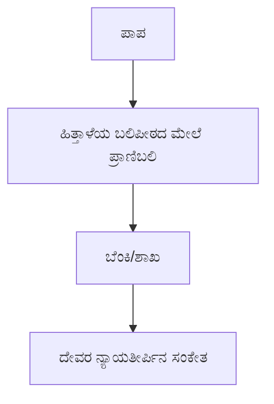
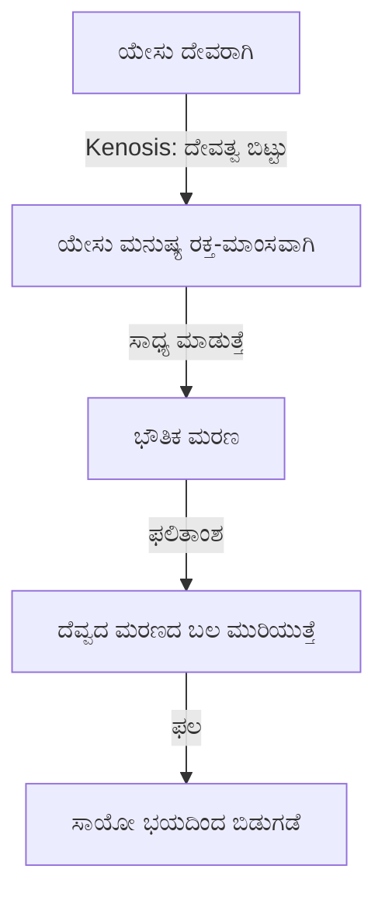

# Revelation ಅಧ್ಯಾಯ 1 — ಕನ್ನಡ ನೋಟ್ಸ್

> ಇದು Pastor Allen Nolan ಅವರ Revelation Chapter 1 verse-by-verse ಸ್ಟಡಿಯ ಸಂಪೂರ್ಣ ನೋಟ್ಸ್, ದಿನ ನಿತ್ಯ ಮಾತಾಡೋ ಕನ್ನಡದಲ್ಲಿ ಬರೆದಿದ್ದೀನಿ. Bible, Old Testament, New Testament, church ತರ ಇಂಗ್ಲಿಷ್ ಪದಗಳನ್ನ ಕನ್ನಡಿಗರು ಮಾತಾಡೋವಾಗ ಸಹಜವಾಗಿ ಬಳಸೋ ಹಾಗೇ ಇಟ್ಕೊಂಡಿದ್ದೀನಿ.

---

## 1. Revelation ಅಂದ್ರೆ ಏನು — Apocalyptic ಪುಸ್ತಕ

Revelation ಪುಸ್ತಕನ "apocalyptic" ಪುಸ್ತಕ ಅಂತ ಹೇಳ್ತಾರೆ. "Apocalyptic" ಅಂದ್ರೆ ಭಯಾನಕ, ಡಿಸಾಸ್ಟರ್ ಅಂತ ಅರ್ಥ ಅಲ್ಲ — ಇದ್ರ ನಿಜವಾದ ಅರ್ಥ "prophetic," ಅಂದ್ರೆ ಪ್ರವಾದನಾತ್ಮಕ. ಅಂದ್ರೆ ಈ ಪುಸ್ತಕ ಲೋಕದ ಅಂತ್ಯಕ್ಕೆ ಸಂಬಂಧಿಸಿದ ಪ್ರವಾದನೆಗಳ ಬಗ್ಗೆ ಹೇಳುತ್ತೆ:

- ಯೇಸು ಬರೋಕೆ ಮುಂಚೆ ಏನಾಗುತ್ತೆ
- ಯೇಸು ಬರೋವಾಗ ಏನಾಗುತ್ತೆ
- ಯೇಸು ಬಂದಾಮೇಲೆ ಏನಾಗುತ್ತೆ

ಇಲ್ಲಿ ಒಂದು ಪಾಯಿಂಟ್ ಹೇಳ್ಬೇಕು — ಜನ ಸಾಮಾನ್ಯವಾಗಿ ಅಂದುಕೊಳ್ಳೋ ಹಾಗೆ ಮಹಾಸಂಕಟ (Tribulation) ಕಾಲದಲ್ಲಿ ಒಂದೇ ಯುದ್ಧ (Armageddon) ಅಲ್ಲ, ನಿಜವಾಗಿ ಎರಡು ದೊಡ್ಡ ಯುದ್ಧಗಳು ನಡೀತಾವೆ. ಮೊದಲನೆಯದು ಮಹಾಸಂಕಟದ ಆರಂಭದಲ್ಲೇ ಆಗುತ್ತೆ — ಇದ್ರಲ್ಲಿ ನ್ಯೂಕ್ಲಿಯರ್ ಯುದ್ಧ ಇರುತ್ತೆ ಅಂತ ಪಾಸ್ಟರ್ ಹೇಳ್ತಾರೆ, ಇರಾನ್ ಇಸ್ರಾಯೇಲ್ ಮೇಲೆ mass destruction ಆಯುಧಗಳಿಂದ ದಾಳಿ ಮಾಡ್ಬಹುದು ಅಂತ ಅವರ ಊಹೆ. [ಪರಿಶೀಲಿಸಬೇಕು: ಇದು ಪಾಸ್ಟರ್‌ರ ಸ್ವಂತ ಊಹೆ, ಬೈಬಲ್‌ನಲ್ಲಿ ನೇರವಾಗಿ "ಇರಾನ್" ಅಂತ ಹೆಸರಿಸಿದ್ದಲ್ಲ.]

---

## 2. Revelation ಓದೋಕೆ ನಾಲ್ಕು ವಿಧಾನಗಳು

ಥಿಯಾಲಜಿಯನ್ಸ್ (ದೇವತಾಶಾಸ್ತ್ರಜ್ಞರು) ಈ ಪುಸ್ತಕನ ನಾಲ್ಕು ಬೇರೆ ಬೇರೆ ವಿಧಾನದಲ್ಲಿ ಓದ್ತಾರೆ:

| ವಿಧಾನ | ಮುಖ್ಯ ಐಡಿಯಾ |
| --- | --- |
| **Historicist** | Revelation ಪುಸ್ತಕ apostles ಕಾಲದಿಂದ ಲೋಕದ ಅಂತ್ಯದವರೆಗಿನ ಪೂರ್ತಿ ಚರಿತ್ರೆಯನ್ನ ಮೊದಲೇ ಬರೆದಿಟ್ಟಿದೆ ಅಂತ ನಂಬಿಕೆ. ಏಳು ಮುದ್ರೆಗಳನ್ನ ರೋಮನ್ ಸಾಮ್ರಾಜ್ಯದ ಮೇಲೆ ಆದ barbarian ದಾಳಿಗಳಿಗೆ, ಹೊಂಡದಿಂದ ಬಂದ ಮಿಡತೆಗಳನ್ನ Arab ದಾಳಿಗಳಿಗೆ ಹೋಲಿಸ್ತಾರೆ. John Calvin ಕೂಡ ಈ ವಿಧಾನ ಬಳಸ್ತಿದ್ರಂತೆ. ಇವತ್ತು ಇದನ್ನ ಬಹುಪಾಲು Protestant ಚರ್ಚ್‌ಗಳು ಹಿಡ್ಕೊಂಡಿಲ್ಲ, Seventh-day Adventist ಚರ್ಚ್ ಮಾತ್ರ ಈ ವಿಧಾನ ಇಟ್ಕೊಂಡಿದೆ. |
| **Preterist** | Revelation‌ನ ಪ್ರವಾದನೆಗಳು ಪುಸ್ತಕ ಬರೆದ ಸ್ವಲ್ಪ ಸಮಯದಲ್ಲೇ (ಯೇಸು ಸತ್ತು, ಹೂಣಲ್ಪಟ್ಟು, ಎದ್ದ ಸುಮಾರು 40 ವರ್ಷದ ಆಮೇಲೆ) ನೆರವೇರಿ ಮುಗಿದಿದೆ ಅಂತ ನಂಬಿಕೆ. ಅಧ್ಯಾಯ 4-19 ಅನ್ನ AD 70ರಲ್ಲಿ ಜೆರುಸಲೇಮ್ ಮತ್ತೆ ದೇವಾಲಯ ನಾಶ ಆಗಿದ್ದಕ್ಕೆ ಸಾಂಕೇತಿಕ ವಿವರಣೆ ಅಂತ ತಗೋತಾರೆ. |
| **Spiritual / Allegorical / Idealist** | Revelation ಭವಿಷ್ಯದ ಯಾವುದೇ ನಿರ್ದಿಷ್ಟ ಘಟನೆಯನ್ನ ಮುಂದಾಗಿ ಹೇಳಲ್ಲ, ಬದಲಾಗಿ ಒಳ್ಳೇದು-ಕೆಟ್ಟದ್ದರ ನಡುವಿನ ಶಾಶ್ವತ ಹೋರಾಟದ ಆತ್ಮಿಕ ಪಾಠ ಕಲಿಸುತ್ತೆ ಅಂತ ನಂಬಿಕೆ. ಉದಾಹರಣೆಗೆ, ಅಧ್ಯಾಯ 13ರ ಮೃಗ ಒಂದು ನಿರ್ದಿಷ್ಟ ಕ್ರಿಸ್ತವಿರೋಧಿ ಅಲ್ಲ, ಇತಿಹಾಸದಲ್ಲಿ ಜನ್ರನ್ನ ದಬ್ಬಾಳಿಕೆ ಮಾಡಿದ ಯಾವುದೇ ಅಧಿಕಾರಕ್ಕೆ (ಹಿಟ್ಲರ್, ಸ್ಟಾಲಿನ್) ಸಂಕೇತ ಅಂತ ನೋಡ್ತಾರೆ. ಇವತ್ತಿಗೂ ಅನೇಕ evangelical ಚರ್ಚ್‌ಗಳಲ್ಲಿ ಈ ವಿಧಾನ ಇದೆ. |
| **Futurist** | ಈಗಿನ ಬಹುಪಾಲು evangelical ಸ್ಕಾಲರ್‌ಗಳ ವಿಧಾನ. ಯೋಹಾನ ಭವಿಷ್ಯದಲ್ಲಿ, ಅಂದ್ರೆ ಯೇಸುವಿನ ಮರುಬರುವಿಕೆಗೆ ಹಿಂದೆ-ಮುಂದೆ ಆಗೋ ಘಟನೆಗಳ ಬಗ್ಗೆ ಬರೆದಿದ್ದಾರೆ ಅಂತ ನಂಬಿಕೆ. ಇದನ್ನ literal ಆಗಿ (ಅಂದ್ರೆ ಅಕ್ಷರಶಃ ಅರ್ಥದಲ್ಲಿ) ಓದ್ತಾರೆ — ಸಿಂಬಾಲಿಸಂ ಇದ್ರೂ, ಆ ಸಿಂಬಲ್ಸ್ ನಿಜವಾದ, ಭವಿಷ್ಯದ ಘಟನೆಗಳನ್ನೇ ಸೂಚಿಸುತ್ತೆ. |

ಈ ಸ್ಟಡಿ **Futurist** ವಿಧಾನವನ್ನ, ಅದೂ **literal** ಇಂಟರ್ಪ್ರಿಟೇಷನ್‌ನ ಆಧಾರವಾಗಿ ಇಟ್ಕೊಂಡಿದೆ.

### ಯಾಕೆ Symbolism ಇದ್ರೂ Literal?

ಪಾಸ್ಟರ್‌ರ ವಿವರಣೆ: ಯೋಹಾನ ಬದುಕಿದ್ದ ಆ ಕಾಲದ ಜನ್ರಿಗೆ future tech ಬಗ್ಗೆ ಹೇಳೋಕೆ ಪದಗಳೇ ಇರ್ಲಿಲ್ಲ. ಈಗ 2000 ವರ್ಷದ ಹಿಂದಿದ್ದ ಒಬ್ಬ ಮನುಷ್ಯ ಒಂದು ನ್ಯೂಕ್ಲಿಯರ್ ಬಾಂಬ್ ಸ್ಫೋಟ ನೋಡಿದ್ರೆ, ಅದನ್ನ "ಮೋಡ" ಅಥವಾ "ಬೆಂಕಿ" ಅಂತ ಮಾತ್ರ ಬಣ್ಣಿಸ್ಬೇಕಾಗುತ್ತೆ, ಯಾಕಂದ್ರೆ atomic energy ಅನ್ನೋ concept ಅವ್ರಿಗೆ ಗೊತ್ತೇ ಇಲ್ಲ. ಹಾಗೇ, ಬೈಬಲ್ ಬರೆದೋರು ರಥ, ಬಿಲ್ಲು, ಈಟಿ ತರ ಹಳೇ ಕಾಲದ ಪದಗಳನ್ನ ಬಳಸಿ ಇವತ್ತಿನ ಪ್ಲೇನ್, ಹೆಲಿಕಾಪ್ಟರ್, ಟ್ಯಾಂಕ್‌ಗಳ ಬಗ್ಗೆ ಬರೀಬಹುದು. ಈ ವಿಧಾನದ ಪ್ರಕಾರ ಈ ಸಿಂಬಲ್‌ಗಳು ಬರೀ ಮೆಟಫರ್ ಅಲ್ಲ, ಅವು ನಿಜವಾದ, ಭೌತಿಕ ಘಟನೆಗಳನ್ನೇ ಪ್ರತಿನಿಧಿಸುತ್ತೆ. ಉದಾಹರಣೆಗೆ, ಎರಡನೇ ತುತ್ತೂರಿ ಊದಿದಾಗ ಸಮುದ್ರದ ಮೂರನೇ ಒಂದು ಭಾಗ ನಿಜವಾಗಿಯೂ ರಕ್ತ ಆಗುತ್ತೆ, ಏಳನೇ ಬಟ್ಟಲಿನಲ್ಲಿ ಪ್ರತಿ ಆಲಿಕಲ್ಲು ಸುಮಾರು 100 ಪೌಂಡ್ ತೂಗುತ್ತೆ ಅಂತ ಈ ವಿಧಾನದಲ್ಲಿ ನಂಬ್ತಾರೆ.

---

## 3. ಯಾಕೆ Literal ಇಂಟರ್ಪ್ರಿಟೇಷನ್ ಸರಿ? — Messianic ಪ್ರವಾದನೆಗಳ ಸಾಕ್ಷ್ಯ

ಪಾಸ್ಟರ್‌ರ ಮುಖ್ಯ ವಾದ: ಯೇಸುವಿನ **ಮೊದಲ ಬರುವಿಕೆ**ಯ ಬಗ್ಗೆ ಇದ್ದ ಪ್ರವಾದನೆಗಳೆಲ್ಲಾ ಅಕ್ಷರಶಃ, literal ಆಗಿ ನೆರವೇರಿವೆ. ಹಾಗಾದ್ರೆ **ಎರಡನೇ ಬರುವಿಕೆ**ಯ ಬಗ್ಗೆ ಇರೋ ಪ್ರವಾದನೆಗಳನ್ನೂ ಅಷ್ಟೇ literal ಆಗಿ ನಿರೀಕ್ಷಿಸ್ಬೇಕು.

| ಪ್ರವಾದನೆ | OT ಮೂಲ | NT ನೆರವೇರಿಕೆ |
| --- | --- | --- |
| ಕನ್ಯೆಯಿಂದ ಜನ್ಮ | ಯೆಶಾಯ | ಮತ್ತಾಯ 1:22-23 |
| ಬೆತ್ಲೆಹೇಮ್‌ನಲ್ಲಿ ಜನ್ಮ | ಮೀಕ | ಮತ್ತಾಯ 2:3-6 |
| ಈಜಿಪ್ಟ್‌ನಲ್ಲಿ ವಾಸ | ಹೋಶೇಯ | ಮತ್ತಾಯ 2:15 |
| ಕತ್ತೆಮರಿ ಮೇಲೆ ಜೆರುಸಲೇಮ್ ಪ್ರವೇಶ | ಜೆಕರ್ಯ | ನಿರ್ದಿಷ್ಟ ದಿನದಂದೇ ನೆರವೇರಿತು |

ಇದಲ್ಲದೆ, ಯೇಸುವಿನ ಬಾಧೆ-ಶಿಲುಬೆಯ ಬಗ್ಗೆ ಈ ಎಲ್ಲಾ ಪ್ರವಾದನೆಗಳೂ literal ಆಗಿ ನೆರವೇರಿವೆ: ಶಿಷ್ಯರಿಂದ ಬಿಟ್ಟುಹೋಗೋದು, ಹೊಡೆತ-ಕ್ರೂರತೆ, ಕೈ-ಕಾಲು ಚುಚ್ಚೋದು, ಸೈನಿಕರು ಬಟ್ಟೆಗೆ ಚೀಟಿ ಹಾಕೋದು, ಒಂದೂ ಎಲುಬು ಮುರಿಯದೇ ಇರೋದು, ಇಬ್ಬರ ನಡುವೆ ಶಿಲುಬೆಗೆ ಹಾಕೋದು. ಇಲ್ಲಿ ಒಂದು ಮುಖ್ಯ ಪಾಯಿಂಟ್ — ಈ ಪ್ರವಾದನೆಗಳು ಬರೆದ ಕಾಲದಲ್ಲಿ ಯೆಹೂದ್ಯರ ಮರಣದಂಡನೆ ವಿಧಾನ ಕಲ್ಲೆಸೆತ (stoning), ಶಿಲುಬೆಗೇರಿಸೋದಲ್ಲ. ಆದ್ರೂ ನಿಖರವಾಗಿ ಶಿಲುಬೆಗೆ ಹಾಕಿದ್ದೇ ಆ ಪ್ರವಾದನೆಗಳ ನಿಖರತೆಯನ್ನ ಇನ್ನೂ ಜಾಸ್ತಿ ಗಟ್ಟಿ ಮಾಡುತ್ತೆ.

### ಎರಡನೇ ಬರುವಿಕೆಗೆ ಬೈಬಲ್ ಸಾಕ್ಷ್ಯ

- **ಮತ್ತಾಯ 24:30**: "...ಮನುಷ್ಯಕುಮಾರನು ಆಕಾಶದ ಮೋಡಗಳ ಮೇಲೆ ಬರೋದನ್ನ ನೀವು ನೋಡ್ತೀರಿ" — ಇದು ಭೌತಿಕ, literal ಆಗಿ ಭೂಮಿಗೆ ಹಿಂದಿರುಗೋದೇ ಹೊರತು ಬರೀ ಆತ್ಮಿಕ ಘಟನೆ ಅಲ್ಲ.
- **ಅಪೊಸ್ತಲರ ಕೃತ್ಯ 1:11**: "...ಒಂದಿನ ಆತ ಹೇಗೆ ಹೋದ್ನೋ ಹಾಗೇ ಪರಲೋಕದಿಂದ ಹಿಂದಿರುಗ್ತಾನೆ!" — ಶಿಷ್ಯರು ಕಣ್ಣಾರೆ ಕಂಡ ಭೌತಿಕ ಆರೋಹಣದ ಹಾಗೇ ಹಿಂದಿರುಗೋದು.
- **1 ಥೆಸಲೋನಿಕ 1:10**: ವಿಶ್ವಾಸಿಗಳು "ಪರಲೋಕದಿಂದ ದೇವರ ಮಗನ ಬರುವಿಕೆ"ಯನ್ನ ಎದುರು ನೋಡ್ತಿದ್ದಾರೆ.
- **1 ಥೆಸಲೋನಿಕ 4:16-17**: ಕರ್ತನು ಆರ್ಭಟದೊಂದಿಗೆ, ಪ್ರಧಾನದೇವದೂತನ ಶಬ್ದದೊಂದಿಗೆ, ದೇವರ ತುತ್ತೂರಿಯೊಂದಿಗೆ ಇಳಿದು ಬರ್ತಾನೆ; ಸತ್ತೋರು ಮೊದಲು ಎದ್ದೇಳ್ತಾರೆ; ಜೀವಂತರಾಗಿ ಇರೋರು ಮೋಡಗಳಲ್ಲಿ ಎತ್ತಲ್ಪಟ್ಟು ಗಾಳಿಯಲ್ಲಿ ಕರ್ತನನ್ನ ಎದುರುಗೊಳ್ತಾರೆ.

### "Spiritual Approach"ಗೆ ಪ್ರತಿವಾದ

ಕೆಲವರು ಯೇಸುವಿನ "ಬರುವಿಕೆ" ಅಂದ್ರೆ ಆತ ಶಿಷ್ಯರ ಹೃದಯದಲ್ಲಿ ಬದುಕ್ತಾನೆ ಅಂತ, ಇದು ಒಂದು mystical ಘಟನೆ ಅಂತ ಹೇಳ್ತಾರೆ. ಪವಿತ್ರಾತ್ಮ ವಿಶ್ವಾಸಿಗಳೊಳಗೆ ನೆಲೆಸಿದ್ದಾನೆ ಅನ್ನೋದು ನಿಜ (ನಾವೇ ಪವಿತ್ರಾತ್ಮನ ಆಲಯ), ಆದ್ರೆ ಯೇಸು ಹೇಳಿದ "ಬರುವಿಕೆ" ಅಂದ್ರೆ ಅದಲ್ಲ. ಆತ ಹೊರಟುಹೋದ ಅದೇ ಭೌತಿಕ ರೀತಿಯಲ್ಲಿ ಭೂಮಿಗೆ ಹಿಂದಿರುಗ್ತಾನೆ ಅಂತ ಆತನ ವಾಗ್ದಾನ.

---

## 4. ಏಳು ವರ್ಷದ ಮಹಾಸಂಕಟ — ಟೈಮ್‌ಲೈನ್ ಓವರ್‌ವ್ಯೂ

ಪ್ರವಾದನೆಯಲ್ಲಿ "70 ವಾರಗಳು" ಅನ್ನೋ ಒಂದು ಮುಖ್ಯ ಅವಧಿ ಇದೆ. "ವಾರ" ಅಂದ್ರೆ ಇಲ್ಲಿ ಏಳರ ಗುಂಪು ಅಂತ ಅರ್ಥ. ಇದ್ರಲ್ಲಿ ಏಳು ವರ್ಷದ ಒಂದು ಅವಧಿ (ಮಹಾಸಂಕಟ/Tribulation ಅಂತ ಕರೀತಾರೆ) ಸೇರಿದೆ. ಈ ಏಳು ವರ್ಷದಲ್ಲಿ ಈ ಘಟನೆಗಳು ಕ್ರಮವಾಗಿ ಆಗ್ತಾವೆ:

ಈ ಸ್ಟಡಿ ಪ್ರತಿ ರಾತ್ರಿ (ಪ್ರತಿ ಸೆಷನ್‌ನಲ್ಲಿ) ಸುಮಾರಾಗಿ ಒಂದು ಅಧ್ಯಾಯ ಕವರ್ ಮಾಡೋ ಗುರಿ ಇಟ್ಕೊಂಡಿದೆ, ಸಣ್ಣ ಸಣ್ಣ ಡೀಟೈಲ್‌ಗಳಲ್ಲಿ ಕಳೆದುಹೋಗದೆ, ದೊಡ್ಡ ಚಿತ್ರ (big picture) ಕಣ್ಣಲ್ಲಿ ಇಟ್ಕೊಂಡು.

### Revelation ಒಂದು Non-Linear ಪುಸ್ತಕ

ಪಾಶ್ಚಾತ್ಯ (Western) ಬರವಣಿಗೆ ಸಾಮಾನ್ಯವಾಗಿ straight line ಕ್ರಮದಲ್ಲಿ ಇರುತ್ತೆ. ಆದ್ರೆ Revelation ಒಂದು Jewish literary style ಬಳಸುತ್ತೆ — ಇದು ಹೆಚ್ಚಾಗಿ chronological ಆಗಿದ್ರೂ, ಮಧ್ಯೆ ಮಧ್ಯೆ "interludes" (ಬ್ರಾಕೆಟ್ ತರ ಇರೋ ಭಾಗಗಳು) ಬರುತ್ತೆ. ಈ interludes ಹಿಂದಿನ ಅಥವಾ ಪಕ್ಕದ ಕಾಲದ ಡೀಟೈಲ್ಸ್ ಕೊಡುತ್ತೆ, ಕ್ರಮವಾಗಿ ಮುಂದುವರಿಯೋ ಕಥೆಗೆ ನೇರ ಹೊಂದಿಕೊಳ್ಳಲ್ಲ. ಇದನ್ನ ಬಲವಂತವಾಗಿ ಒಂದೇ ಸಾಲಿನ ಟೈಮ್‌ಲೈನ್‌ಗೆ ಹೊಂದಿಸೋಕೆ ಹೋದ್ರೆ ಗೊಂದಲ ಆಗುತ್ತೆ.

---

## 5. ದೇವರ ಪ್ರವಾದನೆ ಯಾಕೆ ನಂಬಲರ್ಹ

ದೇವರಿಗೆ ಭವಿಷ್ಯ ಗೊತ್ತು ಮಾಡಿ ಹೇಳೋ ಶಕ್ತಿ ಇದೆ — ದೇವದೂತರಿಗೂ ಈ ಶಕ್ತಿ ಇಲ್ಲ. ದೇವರು ಸಾರ್ವಭೌಮ (sovereign) ಆಗಿರೋದ್ರಿಂದ, ಆತ ಹೇಳಿದ್ದೆಲ್ಲಾ ಹಾಗೇ ನೆರವೇರುತ್ತೆ ಅಂತ ಖಾತ್ರಿ.

**ಯೆಶಾಯ 46:9-10**

> ಹಿಂದಿನ ಕಾಲದ ವಿಷಯಗಳನ್ನ, ನಾನು ಮಾಡಿದ್ದನ್ನ ನೆನಪು ಮಾಡ್ಕೊಳ್ಳಿ. ದೇವರು ನಾನೊಬ್ಬನೇ! ನಾನೇ ದೇವರು, ನನ್ನ ಹಾಗೆ ಬೇರೆ ಯಾರೂ ಇಲ್ಲ. ಆಗೋಕೆ ಮುಂಚೇನೇ ಭವಿಷ್ಯವನ್ನ ಹೇಳೋಕೆ ನನಗೆ ಮಾತ್ರ ಆಗುತ್ತೆ. ನಾನು ಯೋಜಿಸಿದ್ದೆಲ್ಲಾ ನೆರವೇರುತ್ತೆ, ಯಾಕಂದ್ರೆ ನಾನು ಏನು ಬೇಕಾದ್ರೂ ಮಾಡ್ಬಲ್ಲೆ.

ಕೆಲವು liberal ಸ್ಕಾಲರ್‌ಗಳು ದಾನಿಯೇಲನ ಪುಸ್ತಕದಂಥ ಪ್ರವಾದನೆಗಳು ತುಂಬಾ ನಿಖರವಾಗಿವೆ ಅಂತ, ಇದನ್ನ ಘಟನೆ ಆಗಿ ಹೋದ ಮೇಲೇ ಬರೆದಿರ್ಬೇಕು (vaticinium ex eventu) ಅಂತ ವಾದ ಮಾಡ್ತಾರೆ. ಆದ್ರೆ ಬೈಬಲ್ ಪ್ರಕಾರ, ದೇವರು ನಮ್ಮನ್ನ ತನ್ನ ಸ್ನೇಹಿತರು ಅಂತ ಎಣಿಸಿ, ಭವಿಷ್ಯದ ರಹಸ್ಯಗಳನ್ನ ಹಂಚ್ಕೊಳ್ತಾನೆ, ಮತ್ತೆ ಇದನ್ನ ಆತ ಹೇಳಿದ ಹಾಗೇ ಖಚಿತವಾಗಿ ನೆರವೇರಿಸ್ತಾನೆ.

---

## 6. ದೊಡ್ಡ ಚಿತ್ರ — ಯೇಸುವಿನ ಎರಡು ಬರುವಿಕೆಗಳು

Revelation ಪುಸ್ತಕದ ಸೆಂಟ್ರಲ್ ಥೀಮ್ ಯೇಸುವಿನ ಮರುಬರುವಿಕೆ.

**ಯೋಹಾನ 14:3**

> "ನಾನು ಹೋಗಿ ನಿಮಗೆ ಸ್ಥಳ ಸಿದ್ಧ ಮಾಡಿದ ಮೇಲೆ, ತಿರುಗಿ ಬಂದು ನಿಮ್ಮನ್ನ ನನ್ನ ಬಳಿ ಸೇರಿಸ್ಕೊಳ್ತೀನಿ, ನಾನು ಎಲ್ಲಿದ್ದೀನೋ ಅಲ್ಲಿ ನೀವೂ ಇರ್ಬೇಕು ಅಂತ."

ಹಳೇ ಒಡಂಬಡಿಕೆಯ (Old Testament) ಎಲ್ಲಾ Messianic ಪ್ರವಾದನೆಗಳನ್ನ ನೆರವೇರಿಸೋಕೆ ಯೇಸುವಿಗೆ **ಎರಡು ಹಂತಗಳು** ಬೇಕು:

- **ಮೊದಲ ಬರುವಿಕೆ**: ಬಾಧೆ ಪಡೋ, ದೀನನಾದ Messiah ಬಗ್ಗೆ ಇರೋ ಪ್ರವಾದನೆಗಳನ್ನ ನೆರವೇರಿಸಿತು (ಯೆಶಾಯ 53:1-12 — ನಮ್ಮ ಸಮಾಧಾನಕ್ಕಾಗಿ ಶಿಕ್ಷೆ ಅನುಭವಿಸೋದು, ನಮ್ಮ ಪಾಪ ಹೊರೋದು, ಸತ್ತು ಎದ್ದೇಳೋದು)
- **ಎರಡನೇ ಬರುವಿಕೆ**: ಶಕ್ತಿಶಾಲಿ, ಜಯಶಾಲಿ Messiah ಬಗ್ಗೆ ಇರೋ ಬಾಕಿ ಪ್ರವಾದನೆಗಳನ್ನ (ಜೆಕರ್ಯ, ಯೆರೆಮೀಯ, ಯೆಹೆಜ್ಕೇಲ್‌ನಲ್ಲಿ ಇರೋ) ನೆರವೇರಿಸುತ್ತೆ

ಮೊದಲನೇ ಶತಮಾನದ ಕೆಲವು ರಬ್ಬಿಗಳು ಈ ಎರಡು ಪಾತ್ರಗಳಿಗೆ ಎರಡು ಬೇರೆ ಬೇರೆ Messiahಗಳೇ ಬೇಕು ಅಂತ ಅಂದ್ಕೊಂಡಿದ್ರಂತೆ. ಆದ್ರೆ ಬೈಬಲ್‌ನ ಉತ್ತರ ಇಷ್ಟೇ — ಇದು **ಒಬ್ಬನೇ Messiah‌ನ ಎರಡು ಬರುವಿಕೆಗಳು**. ಸ್ವತಃ ಶಿಷ್ಯರಿಗೂ ಮೊದಲು ಇದು ಅರ್ಥ ಆಗ್ಲಿಲ್ಲ, ಪುನರುತ್ಥಾನದ ಆಮೇಲೆ ತಕ್ಷಣ ಜಯ ಆಗುತ್ತೆ ಅಂತ ಅವ್ರ ನಿರೀಕ್ಷೆ ಇತ್ತು.

### ಅಪೊಸ್ತಲರ ಕೃತ್ಯ 1ರಲ್ಲಿ ಶಿಷ್ಯರ ನಿರೀಕ್ಷೆ

ಅಪೊಸ್ತಲರ ಕೃತ್ಯ 1ರಲ್ಲಿ, ಶಿಷ್ಯರು ಇನ್ನೂ ಇಸ್ರಾಯೇಲ್‌ನ ತಕ್ಷಣದ ರಾಜಕೀಯ ಪುನಃಸ್ಥಾಪನೆಯ ಬಗ್ಗೆ ಗಮನ ಇಟ್ಕೊಂಡಿದ್ರು. ಗ್ರೀಕ್‌ನಲ್ಲಿ ಈ ಪ್ರಶ್ನೆ present tense‌ನಲ್ಲಿ ಇದೆ — ಅಂದ್ರೆ ಇದ್ರ ಬಗ್ಗೆ ಅವರು ಪದೇ ಪದೇ ಕೇಳ್ತಾ ಇದ್ರು ಅಂತ ಅರ್ಥ. "ಕರ್ತನೇ, ಇಸ್ರಾಯೇಲ್‌ಗೆ ಸ್ವಾತಂತ್ರ ಕೊಟ್ಟು, ನಮ್ಮ ರಾಜ್ಯವನ್ನ ಪುನಃಸ್ಥಾಪಿಸೋ ಕಾಲ ಬಂತಾ?" ಅಂತ ಕೇಳಿದ್ರು. ಯೇಸು ಅವ್ರ ಈ ನಿರೀಕ್ಷೆಯನ್ನ ತಳ್ಳಿಹಾಕಲಿಲ್ಲ, ಆದ್ರೆ ಅವರ ಗಮನವನ್ನ "ಯಾವಾಗ" ಅನ್ನೋ ಪ್ರಶ್ನೆಯಿಂದ "ಅಧಿಕಾರ" ಕಡೆ ತಿರುಗಿಸಿದ — ಈ ಕಾಲ ಮತ್ತೆ ಸಮಯ ನಿಗದಿ ಮಾಡೋ ಅಧಿಕಾರ ತಂದೆಗೆ ಮಾತ್ರ ಇದೆ ಅಂತ ಹೇಳಿದ. ಅಂದ್ರೆ, ಅವರು ನಿರೀಕ್ಷಿಸಿದ್ದು ಆಗೋದೇ, ಆದ್ರೆ ಅವರ ಟೈಮ್‌ಲೈನ್‌ನಲ್ಲಿ ಅಲ್ಲ.

ಆಮೇಲೆ ಯೇಸು ಅವ್ರ ಕಣ್ಣ ಮುಂದೇನೇ ಭೌತಿಕವಾಗಿ ಮೋಡದಲ್ಲಿ ಮೇಲಕ್ಕೆ ಎತ್ತಲ್ಪಟ್ಟ. ಬಿಳೀ ಬಟ್ಟೆ ಹಾಕ್ಕೊಂಡಿದ್ದ ಇಬ್ಬರು ಪುರುಷರು ಸ್ಪಷ್ಟ ವಾಗ್ದಾನ ಕೊಟ್ರು: "ಆತ ಹೋಗಿದ್ದ ಹಾಗೇ, ಅದೇ ಭೌತಿಕ ರೀತಿಯಲ್ಲಿ ಹಿಂದಿರುಗ್ತಾನೆ." ಈ ಆರೋಹಣದ ಭೌತಿಕ ಸ್ವರೂಪವೇ ಆತನ ಭೌತಿಕ ಮರುಬರುವಿಕೆಗೆ ಮಾದರಿ.

### Great Blessed Hope

ಆರಂಭದ ಚರ್ಚ್ "great blessed hope" ಅಂತ ಹೇಳೋ ಈ ನಿರೀಕ್ಷೆಯಲ್ಲಿ, ಕ್ರಿಸ್ತನ ಮರುಬರುವಿಕೆಯ ಎದುರು ನೋಡ್ತಾ ಬದುಕಿದ್ರು. ಪಾಸ್ಟರ್ ತಮ್ಮ ಸ್ವಂತ ಪೀಳಿಗೆಯೇ ಈ ಬರುವಿಕೇನ ನೋಡೋ ಪೀಳಿಗೆ ಅಂತ ವೈಯಕ್ತಿಕ ಅಭಿಪ್ರಾಯ ಹೇಳ್ತಾರೆ.

ಪ್ರಪಂಚದ ಇಂದಿನ ಅಸ್ಥಿರತೆ, ರಾಜಕೀಯ ಬದಲಾವಣೆಗಳು — ಇವೆಲ್ಲಾ ದೇವರ "ಸೆಟಪ್"ನ ಭಾಗ ಅಂತ ಪಾಸ್ಟರ್‌ರ ಅಭಿಪ್ರಾಯ. ಭಯೋತ್ಪಾದನೆ, ಸೆಕ್ಯುರಿಟಿ ಕಳವಳಗಳಿಂದಾಗಿ ಜನ ತಮ್ಮ ಸ್ವಾತಂತ್ರ-ಸ್ವಾತಂತ್ರ್ಯಗಳನ್ನ ಬಿಟ್ಟುಕೊಟ್ಟು ಸುರಕ್ಷತೆಗಾಗಿ ಬದಲಾಯಿಸ್ಕೊಳ್ಳೋ ಪ್ಯಾಟರ್ನ್ ಕಾಣ್ತಿದೆ. ಇಂಥಾ ವಾತಾವರಣ ಒಬ್ಬ ನಿರ್ದಿಷ್ಟ ತರ ನಾಯಕ ಬರೋಕೆ ಒಂದು ಖಾಲಿ ಜಾಗ ಸೃಷ್ಟಿಸುತ್ತೆ — ಸುರಕ್ಷತೆ ಹುಡುಕ್ತಿರೋ ಪ್ರಪಂಚಕ್ಕೆ ಶಾಂತಿ ವಾಗ್ದಾನ ಮಾಡೋ ಒಬ್ಬ ಮನುಷ್ಯ ಎದ್ದೇಳ್ತಾನೆ.

### Loving Messiah vs. Conquering King

| ಅಂಶ | ವಿವರಣೆ |
| --- | --- |
| **Loving Messiah** | ನಮಗಾಗಿ ಸತ್ತೋನು, ನಮ್ಮ ಮಹಾಯಾಜಕ, ಕೃಪಾಸನಕ್ಕೆ ಹೋಗೋಕೆ ನಮಗೆ ದಾರಿ ಆಗಿರೋನು |
| **Conquering King** | ಪ್ರಪಂಚವನ್ನ ನ್ಯಾಯತೀರಿಸೋಕೆ ಹಿಂದಿರುಗ್ತಿರೋನು |

Revelation ಪುಸ್ತಕ ಯೇಸುವಿನ ಈ ಎರಡನೇ ಮುಖನ — ಜಯಶಾಲಿ ರಾಜನ ಮುಖ — ಎತ್ತಿ ತೋರಿಸುತ್ತೆ. ಸ್ವರ್ಗದಲ್ಲಿ ಪರಿಶುದ್ಧರು, 1,44,000, 24 ಹಿರಿಯರು ಸಿಂಹಾಸನದ ಮುಂದೆ ಇರೋ ದೃಶ್ಯಗಳೂ ಇದೆ — ಪ್ರತಿ ಗುಂಪೂ ತಮ್ಮ ವಿಶಿಷ್ಟ ವಿಮೋಚನೆಯ (redemption) ಅನುಭವಕ್ಕೆ ತಕ್ಕ ಹಾಗೆ ಬೇರೆ ಬೇರೆ ಹಾಡು ಹಾಡ್ತಾರೆ. ಯೇಸುವನ್ನ ಸ್ವೀಕರಿಸದೇ ಇರೋರಿಗೆ, ಆತನ ಮರುಬರುವಿಕೆ ಅಂದ್ರೆ "ಕಬ್ಬಿಣದ ಕೋಲಿನಿಂದ" (rod of iron) ಆಳೋ ಜಯಶಾಲಿ ರಾಜನ ಮುಖ.

---

## 7. Revelation ಪುಸ್ತಕದ ರಚನೆ — ಯೇಸುವಿನ ಪ್ರಗತಿ

Revelation ಬಗ್ಗೆ ಇರೋ ಸಾಮಾನ್ಯ ಶೀರ್ಷಿಕೆಗಳೇ ತಪ್ಪು — KJVಯಲ್ಲಿ "The Revelation of St. John the Divine" ಅಂತ ಇದೆ, ಆದ್ರೆ ಈ ಪುಸ್ತಕ ಮುಖ್ಯವಾಗಿ ಯೋಹಾನನ ಬಗ್ಗೆ ಅಲ್ಲ. ಇದು ಪತ್ಮೋಸ್ ದ್ವೀಪದಲ್ಲಿ ದೇವರ ಆಜ್ಞೆ ಪ್ರಕಾರ ಯೋಹಾನ ಪಡ್ಕೊಂಡ ದರ್ಶನಗಳ ದಾಖಲೆ. ಇದು ಯೋಹಾನನ ಬಗ್ಗೆ ಅಲ್ಲ, **ಯೇಸು ಕ್ರಿಸ್ತನ ಬಗ್ಗೆ ಇರೋ ಒಂದು Revelation**.

| ಅಧ್ಯಾಯಗಳು | ಯೇಸುವಿನ ಪ್ರಗತಿ |
| --- | --- |
| 1 | ಪರಲೋಕದಲ್ಲಿ ಮಹಿಮೆಯುಳ್ಳ (glorified) ಶರೀರದಲ್ಲಿ ಯೇಸು |
| 2-3 | ತನ್ನ ಚರ್ಚ್‌ಗಳ ಜೊತೆ ಯೇಸುವಿನ ಸಂಬಂಧ |
| 4-5 | ಶಿಲುಬೆಯ ಮೇಲಿನ ವಿಮೋಚನಾ ಕೆಲಸಕ್ಕಾಗಿ ಮಹಿಮೆ, ಗೌರವ, ಬಲ ಪಡ್ಕೊಳ್ಳೋ ಯೇಸು |
| 6-18 | ಪ್ರಪಂಚದ ನ್ಯಾಯಾಧೀಶನಾಗಿ ಯೇಸು |
| 19-21 | ಸಹಸ್ರಮಾನದಲ್ಲಿ (millennium) ರಾಜಾಧಿರಾಜ, ಕರ್ತರ ಕರ್ತನಾಗಿ ಯೇಸುವಿನ ಆಳ್ವಿಕೆ |
| 22 | ಹೊಸ ಪರಲೋಕ ಮತ್ತೆ ಹೊಸ ಭೂಮಿಯಲ್ಲಿ ಶಾಶ್ವತಕಾಲ ಆಳೋ ಯೇಸು |

---

## 8. "Revelation" ಪದದ ಅರ್ಥ ಮತ್ತೆ Revelation 1:1

"Revelation" ಅನ್ನೋ ಪದ ಗ್ರೀಕ್ *apocalypsis* ಪದದ ಅನುವಾದ — ಅರ್ಥ "ಮುಚ್ಚಿದ್ದನ್ನ ತೆಗೆದು ತೋರಿಸೋದು," ರಹಸ್ಯವನ್ನ ಬಹಿರಂಗ ಮಾಡೋದು. ಅಂದ್ರೆ ಈ ಪುಸ್ತಕ ಅರ್ಥ ಮಾಡ್ಕೊಳ್ಳೋಕೇ ಆಗಲ್ಲ ಅನ್ನೋ ಅಭಿಪ್ರಾಯ ತಪ್ಪು — ಮುಚ್ಚಿದ್ ಮುಸುಕು ತೆಗೆದು ತೋರಿಸೋದೇ ಇದ್ರ ಉದ್ದೇಶ ಆಗಿದ್ರೆ, ಇದನ್ನ ಅರ್ಥ ಮಾಡ್ಕೊಳ್ಳೋಕೇ ಬರೆದಿದ್ದಾರೆ ಅಂತ ಅರ್ಥ.

ಈ ಪುಸ್ತಕದ ಗುರಿ ಎರಡು ವಿಷಯಗಳನ್ನ ಬಹಿರಂಗ ಮಾಡೋದು:

1. ಕಡೇ ದಿನಗಳಲ್ಲಿ ಏನಾಗುತ್ತೆ ಅನ್ನೋ ನಿರ್ದಿಷ್ಟ ಘಟನೆಗಳು
2. ಆ ಘಟನೆಗಳಲ್ಲಿ ಯೇಸು ಕ್ರಿಸ್ತ ಯಾವ ಪಾತ್ರ ವಹಿಸ್ತಾನೆ ಅನ್ನೋದು

### Revelation 1:1 ವಿಶ್ಲೇಷಣೆ

> "ಯೇಸು ಕ್ರಿಸ್ತನ ಪ್ರಕಟಣೆ, ಬೇಗ ನಡೆಯಬೇಕಾದ ಸಂಗತಿಗಳನ್ನ ತನ್ನ ದಾಸರಿಗೆ ತೋರಿಸೋಕೆ ದೇವರು ಅವನಿಗೆ ಕೊಟ್ಟಿದ್ದು; ಆತ ತನ್ನ ದೂತನ ಮುಖಾಂತರ ಇದನ್ನ ತನ್ನ ದಾಸನಾದ ಯೋಹಾನನಿಗೆ ಕಳಿಸಿ ತಿಳಿಸಿದ."

- **ಮೂಲ**: ಈ ಪ್ರಕಟಣೆಯನ್ನ ದೇವರು ಯೇಸುವಿಗೆ ಕೊಟ್ಟ
- **ಯಾರಿಗೆ**: "ತನ್ನ ದಾಸರಿಗೆ" — ಗ್ರೀಕ್‌ನಲ್ಲಿ *doulos*, ಅಂದ್ರೆ bondservant/ಗುಲಾಮ. ಪೌಲ ಕೂಡ ವಿಶ್ವಾಸಿಗಳನ್ನ ಪದೇ ಪದೇ ಹೀಗೇ ಕರೀತಾರೆ.
- **ಸಮಯ**: "ಬೇಗ ನಡೆಯಬೇಕಾದ" — ಗ್ರೀಕ್ ಪದ *tachos*, ಅಂದ್ರೆ "ಬೇಗ" ಅಥವಾ "imminent" (ಯಾವ ಕ್ಷಣದಲ್ಲಿ ಬೇಕಾದ್ರೂ ಆಗ್ಬಹುದು). William Newell ಪ್ರಕಾರ, *tachos* ಅಂದ್ರೆ ಒಮ್ಮೆ ಈ ಘಟನೆಗಳ ಸರಣಿ ಶುರು ಆದ್ಮೇಲೆ, ಎಲ್ಲಾ ಬೇಗ ಬೇಗ ಆಗ್ತಾ ಹೋಗುತ್ತೆ ಅಂತ — ಒಂದು "ಡೊಮಿನೋ ಎಫೆಕ್ಟ್." ಮೊದಲ ಮುದ್ರೆ ತೆರೆದ ತಕ್ಷಣ, ಬಾಕಿ ಎಲ್ಲಾ ಘಟನೆಗಳೂ ಬೇಗ ಬೇಗ ಹಿಂಬಾಲಿಸ್ತಾವೆ.

### ಪುಸ್ತಕದ Chronological ಫ್ಲೋ

ಈ ಪುಸ್ತಕ ದೇವರು ಡಿಸೈನ್ ಮಾಡಿದ ಒಂದು ಕ್ರಮವನ್ನ ತೋರಿಸುತ್ತೆ — ಒಂದಾದ ಮೇಲೆ ಒಂದು ಘಟನೆ ಆಗ್ತಾ, ಕಡೆಗೆ ಏಳು ವರ್ಷದ ಆಮೇಲೆ ಯೇಸುವಿನ ಮರುಬರುವಿಕೆಗೆ ಮುಟ್ಟುತ್ತೆ. ಈ ಪುಸ್ತಕ ಯೋಹಾನನ ಕಣ್ಣಲ್ಲಿ ಮಹಾಸಂಕಟ ಮತ್ತೆ ಆಮೇಲೆ ಆಗೋ ಘಟನೆಗಳ view ಕೊಡುತ್ತೆ.

### ಅಧ್ಯಾಯ 1-5 ಯಾಕೆ ಮುಖ್ಯ

ಬಹಳ ಜನ ಅಧ್ಯಾಯ 6ರಿಂದ ಶುರು ಆಗೋ ಘಟನೆಗಳ ಮೇಲೆ ಮಾತ್ರ ಫೋಕಸ್ ಮಾಡ್ತಾರೆ, ಆದ್ರೆ ಮೊದಲ ಐದು ಅಧ್ಯಾಯಗಳೇ ಅಸಲಿ ಅಡಿಪಾಯ. ಅಧ್ಯಾಯ 1-5ರಲ್ಲಿ ಸ್ಥಾಪಿಸಿದ ಯೇಸುವಿನ ಗುರುತು ಅರ್ಥ ಆಗದೇ, ಅದಾದ ಮೇಲೆ ಆಗೋ ಘಟನೆಗಳನ್ನ ಸರಿಯಾಗಿ ಅರ್ಥ ಮಾಡ್ಕೊಳ್ಳೋಕೆ ಆಗಲ್ಲ. ಈ ಸ್ಟಡಿಯ ಗುರಿ ಬರೀ "ಏನಾಗುತ್ತೆ" ಅಂತ ನೋಡೋದಲ್ಲ, ಈ ಪಠ್ಯದಿಂದ ನಮ್ಮ ಜೀವನಕ್ಕೆ ಅರ್ಥಪೂರ್ಣ application ತೆಗೆದುಕೊಳ್ಳೋದು.

---

## 9. Revelation 1:3ರ ಆಶೀರ್ವಾದ

> "ಈ ಪ್ರವಾದನೆಯ ಮಾತುಗಳನ್ನ ಓದೋವ್ನು, ಕೇಳೋವ್ರು, ಮತ್ತೆ ಇದ್ರಲ್ಲಿ ಬರೆದಿರೋದನ್ನ ಕೈಕೊಳ್ಳೋವ್ರು ಧನ್ಯರು, ಯಾಕಂದ್ರೆ ಸಮಯ ಹತ್ತಿರ ಆಗಿದೆ."

ಈ ಆಶೀರ್ವಾದ ಪಡ್ಕೊಳ್ಳೋಕೆ, ಬರೀ passively ಕೇಳ್ಸ್ಕೊಂಡ್ರೆ ಸಾಲಲ್ಲ:

- ಬರೀ ಪುಸ್ತಕ ಓದಿದ್ರೆ ಸಾಲಲ್ಲ
- ಬರೀ ಇನ್ಯಾರೋ ಓದಿದ್ದನ್ನ ಕೇಳಿದ್ರೆ ಸಾಲಲ್ಲ
- ಬರೆದಿರೋದನ್ನ "ಕೈಕೊಳ್ಳೋದು" (keep) ಕೂಡ ಬೇಕು — ಇಲ್ಲಾಂದ್ರೆ ಆಶೀರ್ವಾದ ಸಿಗಲ್ಲ

### "Keep" ಅಂದ್ರೆ ಏನು?

ಗ್ರೀಕ್ ಪದ *tereo*. Old Testament ಕಾನೂನಿನ context‌ನಲ್ಲಿ ಇದ್ರ ಅರ್ಥ "ಪಾಲಿಸೋದು" (obeying). ಆದ್ರೆ Revelation‌ನ context‌ನಲ್ಲಿ ಇದ್ರ ಅರ್ಥ **ಗಮನ ಕೊಡೋದು** (give heed to). ಇದ್ರ ಅರ್ಥ ಪ್ರವಾದನೆಗಳ ಕಡೆ ಹತ್ತಿರದಿಂದ ಗಮನ ಕೊಡೋದು. ಇದು ಕಷ್ಟ, ಯಾಕಂದ್ರೆ ಅರ್ಥ ಆಗದೇ ಇರೋ ಯಾವುದ್ಕೂ ನೀವು ಗಮನ ಕೊಡೋಕೇ ಆಗಲ್ಲ.

ಈ ವಚನದಲ್ಲಿ ಒಂದು ವ್ಯತ್ಯಾಸ ಇದೆ: "ಓದೋವ್ನು" (singular, ಒಬ್ಬ ವ್ಯಕ್ತಿ) ಮತ್ತೆ "ಕೇಳೋವ್ರು" (plural, ಗುಂಪು). ಇದ್ರ ಅರ್ಥ — ಒಬ್ಬ ವ್ಯಕ್ತಿ (ಪಾಸ್ಟರ್ ತರ) ದೊಡ್ಡದಾಗಿ ಓದ್ತಾ ಇರ್ತಾರೆ, ಗುಂಪು (ಸಭೆ) ಕೇಳ್ತಾ ಇರುತ್ತೆ. ಓದೋ ಉದ್ದೇಶ, ಕೇಳೋರಿಗೆ ಅರ್ಥ ಆಗಿ, ಅವರು "ಗಮನ ಕೊಡೋ" ಹಾಗೆ ಕಲಿಸೋದು.

ಈ ಸ್ಟಡಿಯ ಗುರಿ ಬರೀ "ಕೂಲ್" ಆದ ವಿಷಯ ಅಥವಾ ಚರಿತ್ರೆಯ ಅಂಶ ಕಲಿಯೋದಲ್ಲ. ಮುಖ್ಯ ಗುರಿ ಯೇಸು ಕ್ರಿಸ್ತ ಮತ್ತೆ ಆತನ ಸ್ವಭಾವದ ಒಂದು **revelation** ಪಡ್ಕೊಳ್ಳೋದು. ಯೇಸುವಿನ ರಾಜತ್ವ ಭವಿಷ್ಯದ ಘಟನೆ ಅಂತ ಅನೇಕರು ಭಾವಿಸ್ತಾರೆ, ಆದ್ರೆ ನಿಜವಾದ revelation ಇದ್ರೆ ಆತ **ಈಗಾಗ್ಲೇ** "ರಾಜಾಧಿರಾಜ, ಕರ್ತರ ಕರ್ತ" ಅಂತ ಗೊತ್ತಾಗುತ್ತೆ. ಇದೇ ಈಗ ಆತನ ಸತ್ಯವನ್ನ ನಮ್ಮ ಜೀವನಕ್ಕೆ ಅನ್ವಯಿಸೋಕೆ ಅನುವು ಮಾಡಿಕೊಡುತ್ತೆ.

### *Makarios* — "Blessed" ಅಂದ್ರೆ ಏನು?

ಗ್ರೀಕ್ ಪದ *makarios*, ಸಾಮಾನ್ಯವಾಗಿ "blessed" ಅಥವಾ "happy" ಅಂತ ಸರಳೀಕರಿಸ್ತಾರೆ. ಆದ್ರೆ technical ಆಗಿ ಇದ್ರ ಅರ್ಥ — **ದೈವಿಕ ಅನುಗ್ರಹ ಪಡ್ಕೊಂಡ ವಿಶೇಷ ವ್ಯಕ್ತಿ**. ಅನುಗ್ರಹ ಇದೆ ಅಂದ್ರೆ, ಬೇರೆಯವ್ರಿಗಿಂತ ಬೇರೆ ರೀತಿಯಲ್ಲಿ ನಡಿಸಿಕೊಳ್ಳೋದು ಅಂತ ಅರ್ಥ. ಇದ್ರ ಅರ್ಥ ದೇವರು ನಮ್ಮನ್ನ ಕಡಿಮೆ-ಜಾಸ್ತಿ ಪ್ರೀತಿಸ್ತಾನೆ ಅಂತ ಅಲ್ಲ — ಇದ್ರ ಅರ್ಥ ಆತನ "classroom of life"ನಲ್ಲಿ ನಾವು excel ಆಗ್ತಿದ್ದೀವಿ ಅಂತ. ಯೇಸು ನಿಜವಾಗಿ ಯಾರು ಅನ್ನೋ revelation ಇರೋರ ಜೀವನದ ಮೇಲೆ ನಿಜವಾದ ಪ್ರಭಾವ ಬೀಳೋದ್ರಿಂದ, ದೇವರು ಅಂಥೋರನ್ನ ತನ್ನ "prized pupils" ಅಂತ ನೋಡ್ತಾನೆ.

---

## 10. Revelation 1:4 — ವಂದನೆ

ಈ ಪುಸ್ತಕ ಏಷ್ಯಾದಲ್ಲಿದ್ದ ಏಳು ನಿರ್ದಿಷ್ಟ ಚರ್ಚ್‌ಗಳಿಗೆ ಬರೆದಿದ್ದು. ಯೋಹಾನ ಆ ಕಾಲದ ಸಾಮಾನ್ಯ ವಂದನೆ ಬಳಸ್ತಾರೆ — "ಕೃಪೆಯೂ ಶಾಂತಿಯೂ ನಿಮಗಾಗಲಿ." ಇವು ಎಲ್ಲಿಂದ ಬರುತ್ತೆ?

- ಇರೋನೂ, ಇದ್ದೋನೂ, ಬರೋನೂ ಆದಾತನಿಂದ (ತಂದೆ)
- ಆತನ ಸಿಂಹಾಸನದ ಮುಂದೆ ಇರೋ ಏಳು ಆತ್ಮಗಳಿಂದ (ಪವಿತ್ರಾತ್ಮ)
- (ಮುಂದಿನ ವಚನದಲ್ಲಿ) ಯೇಸು ಕ್ರಿಸ್ತನಿಂದ

### ಕೃಪೆ ಮತ್ತು ಶಾಂತಿ — "Siamese Twins"

New Testament apostolic ವಂದನೆಗಳಲ್ಲಿ ಕೃಪೆ (grace) ಮತ್ತೆ ಶಾಂತಿ (peace) ಯಾವಾಗ್ಲೂ ಜೊತೆಯಾಗೇ ಬರುತ್ತೆ — ಒಂದಿದ್ರೆ ಇನ್ನೊಂದೂ ಹಿಂಬಾಲಿಸುತ್ತೆ. ಕೃಪೇನೇ ಮೊದಲು ಬರುತ್ತೆ, ಶಾಂತಿ ಆಮೇಲೆ — ಯಾಕಂದ್ರೆ ಮೊದಲು ದೇವರ ಕೃಪೆಯನ್ನ ಅನುಭವಿಸದೇ, ದೇವರ ಜೊತೆ ಶಾಂತಿ ಅನುಭವಿಸೋಕೆ ಆಗಲ್ಲ. ಇಲ್ಲಿ ಕೃಪೆ ಅಂದ್ರೆ ರಕ್ಷಣೆಯ ಮೂಲಭೂತ ಕೆಲಸ.

- ಪೌಲ (ರೋಮಾಪುರದವರಿಗೆ 1:7): "ನಮ್ಮ ತಂದೆಯಾದ ದೇವರಿಂದ... ನಿಮಗೆ ಕೃಪೆಯೂ ಶಾಂತಿಯೂ ಆಗಲಿ"
- ಪೌಲ (1 ಕೊರಿಂಥ 1:3): "ನಮ್ಮ ತಂದೆಯಾದ ದೇವರಿಂದ ಮತ್ತೆ ಕರ್ತನಾದ ಯೇಸು ಕ್ರಿಸ್ತನಿಂದ ನಿಮಗೆ ಕೃಪೆಯೂ ಶಾಂತಿಯೂ ಆಗಲಿ"

ಇದು ದೇವರ ದಾಸರು ಬರೆದ ಎಪಿಸಲ್‌ಗಳಲ್ಲಿ ಇರೋ ಒಂದು ಸ್ಟಾಂಡರ್ಡ್ ಓಪನಿಂಗ್ ಪ್ಯಾಟರ್ನ್.

### Salvation ಅಂದ್ರೆ ಬರೀ ಪರಲೋಕಕ್ಕೆ ಹೋಗೋದಲ್ಲ

Salvation (ರಕ್ಷಣೆ) ಬರೀ ಪರಲೋಕಕ್ಕೆ ಹೋಗೋ ಡೆಸ್ಟಿನೇಷನ್ ಅಲ್ಲ. ಗ್ರೀಕ್ ಪದಗಳು:

- `sozo` (verb): ರಕ್ಷಿಸೋದು
- `soterios` (noun): ಪೂರ್ತಿಯಾಗಿ, ಸಂಪೂರ್ಣವಾಗಿ ಮಾಡೋದು

ನಮ್ಮ ಸಾಲ್ವೇಷನ್ ಈ ಜೀವನದಲ್ಲೇ ಪೂರ್ತಿ ಆಗಲ್ಲ — ನಾವು ಈಗಿರೋ ಮರ್ತ್ಯ ಶರೀರದಿಂದ ಮಹಿಮೆಯುಳ್ಳ, ಅಮರ ಶರೀರಕ್ಕೆ ಬದಲಾಗೋವಾಗ ಮಾತ್ರ ಇದು ಪೂರ್ಣಗೊಳ್ಳುತ್ತೆ. ಕೃಪೆ ನಮಗೆ ಎಲ್ಲಿ ಕೊರತೆ ಇದ್ಯೋ ಅಲ್ಲಿ ಪೂರ್ತಿ ಮಾಡೋಕೆ ಬೇಕಾಗಿರೋದನ್ನ ಕೊಡುತ್ತೆ. ಒಬ್ಬ ವ್ಯಕ್ತಿ ದೇವರ ಕೃಪೆ ಅನುಭವಿಸಿದ ಕೂಡ್ಲೇ, ಅವ್ರು ದೇವರ ಜೊತೆ ಸಂಧಾನ ಆಗ್ತಾರೆ (reconciled), ಇನ್ಮೇಲೆ ದೇವರಿಗೆ ಶತ್ರು ಅಲ್ಲ.

### ದೇವರ ಶಾಶ್ವತ, ಸ್ವಯಂ-ಅಸ್ತಿತ್ವದ ಸ್ವಭಾವ

"ಇರೋನೂ, ಇದ್ದೋನೂ, ಬರೋನೂ" ಅನ್ನೋ ವಿವರಣೆ ದೇವರ ಸ್ವಭಾವವನ್ನ ವ್ಯಾಖ್ಯಾನಿಸುತ್ತೆ:

- **ಶಾಶ್ವತ**: ಯಾವಾಗ್ಲೂ ಇದ್ದಿದ್ದಾನೆ, ಯಾವಾಗ್ಲೂ ಇರ್ತಾನೆ
- **ಸ್ವಯಂ-ಅಸ್ತಿತ್ವ**: ಎಲ್ಲ ಜೀವದ ಕೊಡುಗಾರ, ಯಾರಿಗೂ ತನ್ನ ಅಸ್ತಿತ್ವಕ್ಕೆ ಋಣಿ ಅಲ್ಲ

ಮನುಷ್ಯರು ಅಪ್ಪ-ಅಮ್ಮಂದಿರಿಗೆ, ಕೊನೆಗೆ ಆದಾಂ-ಹವ್ವರವರೆಗೂ ವಂಶಾವಳಿಯಿಂದ ಋಣಿ. ಮನುಷ್ಯರು ಸೃಷ್ಟಿಸಲ್ಪಟ್ಟೋರು; ದೇವರು ಸೃಷ್ಟಿಕರ್ತ.

---

## 11. ಏಳು ಆತ್ಮಗಳು — ಪವಿತ್ರಾತ್ಮನ ಪೂರ್ಣತೆ

"ಏಳು ಆತ್ಮಗಳು" ಅನ್ನೋ ಈ ಉಲ್ಲೇಖ ಪವಿತ್ರಾತ್ಮನ ವ್ಯಕ್ತಿತ್ವವನ್ನ, ಆತನ ಸಂಪೂರ್ಣತೆ ಮತ್ತೆ ಪರಿಪೂರ್ಣತೆಯನ್ನ ಸೂಚಿಸುತ್ತೆ. Revelation‌ನಲ್ಲಿರೋ ಅನೇಕ ಸಿಂಬಲ್ಸ್ ಹೊಸದಲ್ಲ — ಇವು Old Testament ಪ್ರವಾದಿಗಳಲ್ಲಿ (ಯೆಶಾಯ, ಯೆರೆಮೀಯ, ಯೆಹೆಜ್ಕೇಲ್, ಜೆಕರ್ಯ, ಹಗ್ಗಾಯ) ಬೇರು ಬಿಟ್ಟಿವೆ.

**ಯೆಶಾಯ 11:1-2** ಪ್ರಕಾರ, ದಾವೀದನ ಬುಡ್ಡಲಿಂದ ಬರೋ "ಕೊಂಬೆ"ಯ ಮೇಲೆ ಕರ್ತನ ಆತ್ಮ ಏಳು ರೂಪಗಳಲ್ಲಿ ನೆಲೆಸುತ್ತೆ:

1. ಜ್ಞಾನದ ಆತ್ಮ
2. ವಿವೇಕದ ಆತ್ಮ
3. ಆಲೋಚನೆಯ ಆತ್ಮ
4. ಬಲದ ಆತ್ಮ
5. ತಿಳುವಳಿಕೆಯ ಆತ್ಮ
6. ಕರ್ತನ ಭಯದ ಆತ್ಮ
7. (ಕರ್ತನ ಆತ್ಮ ಸ್ವತಃ — ಈ ಎಲ್ಲಾ ಗುಣಗಳ ಮೂಲ)

---

## 12. Revelation 1:5 — ಯೇಸುವಿನ ಗುರುತು

5ನೇ ವಚನ ಪ್ರಕಾರ ಕೃಪೆ-ಶಾಂತಿ ಯೇಸು ಕ್ರಿಸ್ತನಿಂದಲೂ ಬರುತ್ತೆ. ಆತನ ಸ್ವಭಾವ, ಅಧಿಕಾರವನ್ನ ವ್ಯಾಖ್ಯಾನಿಸೋ ಟೈಟಲ್‌ಗಳು:

- ನಂಬಿಗಸ್ತ ಸಾಕ್ಷಿ (faithful witness)
- ಸತ್ತೋರಲ್ಲಿ ಮೊದಲು ಹುಟ್ಟಿದೋನು (first begotten of the dead)
- ಭೂಮಿಯ ಅರಸುಗಳ ಅಧಿಪತಿ (prince of the kings of the earth)
- ನಮ್ಮನ್ನ ಪ್ರೀತಿಸಿ, ತನ್ನ ಸ್ವಂತ ರಕ್ತದಿಂದ ನಮ್ಮ ಪಾಪ ತೊಳೆದೋನು

### ನಂಬಿಗಸ್ತ ಸಾಕ್ಷಿ (Faithful Witness)

ದೇವರು ಯಾರು, ದೇವರು ಹೇಗಿದ್ದಾನೆ ಅನ್ನೋದ್ರ ಬಗ್ಗೆ ಸ್ಪಷ್ಟ ಪ್ರಕಟಣೆ ಕೊಡೋದ್ರಲ್ಲಿ ಯೇಸು ನಂಬಿಗಸ್ತನಾಗಿದ್ದ. ಇದಕ್ಕೆ ಆಧಾರ **ಇಬ್ರಿಯ 1:3** — ಮಗ ದೇವರ ಮಹಿಮೆಯ ಪ್ರಕಾಶ, ಆತನ ಸ್ವಭಾವದ ನಿಖರ ಪ್ರತಿರೂಪ ಅಂತ ಹೇಳುತ್ತೆ.

**"ನಿಖರ ಪ್ರತಿರೂಪ" (Exact Representation)** — ಗ್ರೀಕ್‌ನಲ್ಲಿ *charakter*. ಇದ್ರ ಅರ್ಥ ಒಬ್ಬ ವ್ಯಕ್ತಿಯ ನಿಖರ ಚಿತ್ರ ಅಥವಾ ನಿಖರ ಹೋಲಿಕೆ. ಯೇಸುವಿಗೆ ದೇವರ *charakter* ಇರೋದ್ರಿಂದ, ದೇವರ ಸ್ವಭಾವ ಗೊತ್ತಾಗೋಕೆ ಆತನೇ ನಿರ್ಣಾಯಕ ದಾರಿ — ಎಲ್ಲಾ ಮನುಷ್ಯರ ಹಾಗೆ ಬರೀ ದೇವರ ಪ್ರತಿರೂಪ ಹೊತ್ಕೊಳ್ಳೋದಲ್ಲ, ಆತ ದೇವರ ನಿಜವಾದ ಸ್ವಭಾವ-ಗುಣಗಳನ್ನೇ ಹೊಂದಿದ್ದಾನೆ. ದೇವರ ಹಾಗೆ ಇರೋದು ಎಲ್ಲ ವಿಧಗಳಲ್ಲೂ ನೋಡ್ಬೇಕು ಅಂದ್ರೆ, ಯೇಸುವನ್ನೇ ನೋಡ್ಬೇಕು.

ಒಂದೇ ವ್ಯತ್ಯಾಸ — ಯೇಸುವಿಗೆ ಭೌತಿಕ ಶರೀರ ಇತ್ತು, ದೇವರು ಆತ್ಮ. ಫಿಲಿಪ್ಪ ತಂದೇನ ತೋರಿಸು ಅಂತ ಕೇಳಿದಾಗ, ಯೇಸು ಹೇಳಿದ್ದು: ನನ್ನನ್ನ ನೋಡಿದೋನು ತಂದೇನೇ ನೋಡಿದ್ದಾನೆ.

**ಯೋಹಾನ 14:8-11**

> ಫಿಲಿಪ್ಪ ಹೇಳಿದ, "ಕರ್ತನೇ, ತಂದೇನ ನಮಗೆ ತೋರಿಸು, ಅದು ಸಾಕು." ಯೇಸು ಹೇಳಿದ, "ಫಿಲಿಪ್ಪ, ಇಷ್ಟು ಕಾಲ ನಿಮ್ಮ ಜೊತೆ ಇದ್ರೂ ನೀನು ನನ್ನ ಗುರ್ತು ಹಿಡಿಲಿಲ್ವಾ? ನನ್ನನ್ನ ನೋಡಿದೋನು ತಂದೇನೇ ನೋಡಿದ್ದಾನೆ! ಹಾಗಾದ್ರೆ ತಂದೇನ ತೋರಿಸು ಅಂತ ಯಾಕೆ ಕೇಳ್ತಿದ್ದೀಯ? ನಾನು ತಂದೆಯಲ್ಲಿ, ತಂದೆ ನನ್ನಲ್ಲಿ ಇದ್ದೀನಿ ಅಂತ ನಂಬಲ್ವಾ? ನಾನು ಹೇಳೋ ಮಾತುಗಳು ನನ್ನ ಸ್ವಂತದ್ದಲ್ಲ, ನನ್ನಲ್ಲಿ ವಾಸ ಮಾಡೋ ತಂದೇನೇ ತನ್ನ ಕೆಲಸ ಮಾಡ್ತಿದ್ದಾನೆ. ನಾನು ತಂದೆಯಲ್ಲಿ, ತಂದೆ ನನ್ನಲ್ಲಿ ಇದ್ದೀನಿ ಅಂತ ನಂಬಿ. ಇಲ್ಲಾಂದ್ರೆ ನಾನು ಮಾಡಿದ ಕೆಲಸ ನೋಡಿಯಾದ್ರೂ ನಂಬಿ."

Revelation ಪುಸ್ತಕನ ಬರೀ ಭವಿಷ್ಯದ ಘಟನೆಗಳ ಟೈಮ್‌ಲೈನ್ ಅಂತ ನೋಡ್ಬಾರ್ದು — ಇದು ಮುಖ್ಯವಾಗಿ ಯೇಸು ಕ್ರಿಸ್ತನ ಒಂದು revelation. ಈ ಪ್ರವಾದನಾತ್ಮಕ ಘಟನೆಗಳನ್ನ ಅರ್ಥ ಮಾಡ್ಕೊಳ್ಳೋ ಗುರಿ, ಯೇಸು ಯಾರು ಅನ್ನೋದ್ರ ಬಗ್ಗೆ ಆಳವಾದ revelation ಪಡ್ಕೊಳ್ಳೋದೇ.

ತಂದೆ ಮತ್ತೆ ಮಗ ಒಬ್ಬರಲ್ಲೊಬ್ಬರು ಇರೋ ಈ ಆಳವಾದ ಏಕತೆಯನ್ನ ಯೇಸು ವಿವರಿಸ್ತಾರೆ — ಆತನ ಮಾತುಗಳು ಆತನ ಸ್ವಂತದ್ದಲ್ಲ, ತಂದೇನೇ ಆತನ ಮುಖಾಂತರ ಕೆಲಸ ಮಾಡ್ತಿದ್ದಾನೆ. **ಯೋಹಾನ 5:19** ಪ್ರಕಾರ, ಮಗ ತನ್ನಷ್ಟಕ್ಕೆ ತಾನೇ ಏನೂ ಮಾಡಲ್ಲ — ತಂದೆ ಏನು ಮಾಡ್ತಾನೋ ಅದನ್ನ ಮಾತ್ರ ನೋಡಿ ಮಾಡ್ತಾನೆ; ತಂದೆ ಏನು ಮಾಡ್ತಾನೋ, ಮಗನೂ ಅದನ್ನೇ ಮಾಡ್ತಾನೆ.

### ಕ್ರಿಸ್ತನ ಹಾಗಿರೋದು ಅಂದ್ರೆ ಏನು

ಯೇಸು ದೇವರ ಸ್ವಭಾವಕ್ಕೆ ಒಬ್ಬ ಸಾಕ್ಷಿಯಾಗಿ ಈ ಲೋಕಕ್ಕೆ ಬಂದ. ನಿಜವಾದ ಸಾಕ್ಷಿ ಅಂದ್ರೆ ಮಾತಿನಿಂದ ಅಲ್ಲ, ಕ್ರಿಯೆಗಳ ಮೂಲಕ ಒಬ್ಬ ವ್ಯಕ್ತಿ ನಿಜವಾಗಿ ಹೇಗಿದ್ದಾನೆ ಅಂತ ತೋರಿಸೋದು. ಯೇಸು "ನಂಬಿಗಸ್ತ ಸಾಕ್ಷಿ," ಯಾಕಂದ್ರೆ ತಂದೆ ಹೇಳಿದ್ದನ್ನ, ಆಜ್ಞಾಪಿಸಿದ್ದನ್ನ ಆತ ಎಲ್ಲಾ ಮಾಡಿದ. ಆತ ದೇವರ ಬಗ್ಗೆ ಬರೀ ಮಾತಾಡಿ, ಆ ಮಾತಿಗೆ ತಕ್ಕಂತೆ ನಡಿಕೊಳ್ದೇ ಹೋಗಿದ್ರೆ, ನಂಬಿಗಸ್ತ ಸಾಕ್ಷಿ ಆಗ್ತಿರ್ಲಿಲ್ಲ.

ಆತನ ಸಾಕ್ಷಿ ಮರಣದವರೆಗೂ ಮುಂದುವರೀತು. **ಫಿಲಿಪ್ಪಿಯವರಿಗೆ 2:6-8** ಪ್ರಕಾರ, ಆತ ದೇವರಾಗಿದ್ರೂ, ದೇವರ ಸಮಾನತೆಯನ್ನ ಗಟ್ಟಿಯಾಗಿ ಹಿಡ್ಕೊಳ್ಳಲಿಲ್ಲ — ತನ್ನ ದೈವಿಕ ಸವಲತ್ತುಗಳನ್ನ ಬಿಟ್ಟು, ಒಬ್ಬ ದಾಸನ ದೀನ ಸ್ಥಾನ ತೊಗೊಂಡ. ಮನುಷ್ಯನಾಗಿ ಹುಟ್ಟಿ, ದೇವರಿಗೆ ವಿಧೇಯನಾಗಿ ತನ್ನನ್ನೇ ದೀನಗೊಳಿಸ್ಕೊಂಡ. ಆತನ ನಂಬಿಗಸ್ತಿಕೆ ಪೂರ್ತಿ ಆಗಿದ್ದು ಒಬ್ಬ ಅಪರಾಧಿ ಹಾಗೆ ಶಿಲುಬೆಯಲ್ಲಿ ಸಾಯೋದ್ರ ಮೂಲಕ.

**"Christian" ಅಂದ್ರೆ "Christ-like"** — ಬರೀ ವಾಕ್ಯವನ್ನ ಕೇಳೋದು ಅಥವಾ ಓದೋದಷ್ಟೇ ಸಾಲಲ್ಲ, ಅದಕ್ಕೆ ಗಮನ ಕೊಟ್ಟು ಆತನ ಮಾದರಿ ಹಿಂಬಾಲಿಸ್ಬೇಕು. ಕ್ರೈಸ್ತ (Christian) ಆಗಿರೋದು ಅಂದ್ರೆ ಕ್ರಿಸ್ತನ ಗುಣ ಪ್ರತಿಬಿಂಬಿಸೋ ಹಾಗೆ ನಡ್ಕೋಳೋದು. ನಾವು Christian ಅಂತ ಹೇಳ್ಕೊಂಡಾಗ, ಜನ ನಮ್ಮ ಮಾತು-ಕೃತಿ ಹೊಂದಿಕೊಳ್ಳುತ್ತೋ ಅಂತ ಹತ್ತಿರದಿಂದ ಗಮನಿಸ್ತಾರೆ. ಕ್ರಿಸ್ತನ ಗುಣಕ್ಕೆ ತಕ್ಕ ಹಾಗೆ ನಡ್ಕೊಳ್ದೇ ಇದ್ರೆ, ನಾವು ನಂಬಿಗಸ್ತ ಸಾಕ್ಷಿ ಆಗೋಕೆ ಆಗಲ್ಲ.

---

## 13. "ಸತ್ತೋರಲ್ಲಿ ಮೊದಲು ಹುಟ್ಟಿದೋನು" — Nekros ಮತ್ತೆ Thanatos

ಗ್ರೀಕ್‌ನಲ್ಲಿ "ಸತ್ತ" ಅನ್ನೋದಕ್ಕೆ ಎರಡು ಬೇರೆ ಬೇರೆ ಪದಗಳಿವೆ, ಮತ್ತೆ ಈ ವ್ಯತ್ಯಾಸ ಪ್ರವಾದನೆ ಅರ್ಥ ಮಾಡ್ಕೊಳ್ಳೋಕೆ ತುಂಬಾ ಮುಖ್ಯ:

- **Necros (ನೆಕ್ರಾಸ್)**: ಆತ್ಮಿಕ ಮರಣ (spiritual death) — ಆತ್ಮ/ಪ್ರಾಣದ ಸ್ಥಿತಿಗೆ ಸಂಬಂಧಪಟ್ಟಿದ್ದು. "Necromancer" (ಸತ್ತೋರ ಆತ್ಮಗಳ ಜೊತೆ ಮಾತಾಡೋನು) ಅನ್ನೋ ಇಂಗ್ಲಿಷ್ ಪದಕ್ಕೆ ಇದೇ ಮೂಲ.
- **Thanatos (ಥಾನಟಾಸ್)**: ಭೌತಿಕ ಮರಣ (physical death)

### Revelation 20:12-14ರಲ್ಲಿ ಬಳಕೆ

ಮಹಾ ಶ್ವೇತ ಸಿಂಹಾಸನದ ನ್ಯಾಯತೀರ್ಪಿನಲ್ಲಿ (Great White Throne Judgment) ಈ ಎರಡೂ ಪದಗಳು ಬಳಕೆ ಆಗಿವೆ:

- ಸಿಂಹಾಸನದ ಮುಂದೆ ನಿಂತಿರೋ "ಸತ್ತೋರು" (*nekros*) — ಅಂದ್ರೆ ಆತ್ಮಿಕವಾಗಿ ಸತ್ತೋರ ಆತ್ಮಗಳು, ಚಿಕ್ಕೋರು-ದೊಡ್ಡೋರು ಎಲ್ಲಾ, ತಮ್ಮ ಕೃತ್ಯಗಳ ಪ್ರಕಾರ ನ್ಯಾಯತೀರ್ಪು ಪಡ್ಕೊಳ್ತಾರೆ
- ಸಮುದ್ರ ತನ್ನಲ್ಲಿದ್ದ *nekros*ನ ಒಪ್ಪಿಸುತ್ತೆ, ಸಮಾಧಿ ತನ್ನಲ್ಲಿದ್ದ *nekros*ನ ಒಪ್ಪಿಸುತ್ತೆ
- ಕಡೆಗೆ "ಮರಣ" (*thanatos*) ಮತ್ತೆ ಸಮಾಧಿ ಬೆಂಕಿಯ ಕೆರೆಗೆ ಹಾಕಲ್ಪಡುತ್ತೆ — ಇದನ್ನೇ "ಎರಡನೇ ಮರಣ" (second death, *thanatos*) ಅಂತ ಕರೀತಾರೆ

ಅಂದ್ರೆ *nekros* (ಆತ್ಮಗಳು) ನ್ಯಾಯತೀರ್ಪು ಪಡ್ಕೊಳ್ತಾರೆ, ಆದ್ರೆ *thanatos* (ಭೌತಿಕ ಮರಣ) ಸ್ವತಃ ಅಂತಿಮ ನ್ಯಾಯತೀರ್ಪಿನಲ್ಲಿ ನಾಶ ಆಗುತ್ತೆ.

### ಮರಣದ ಆಮೇಲೆ ಆತ್ಮ ಎಲ್ಲಿಗೆ ಹೋಗುತ್ತೆ?

ಭೌತಿಕ ಮರಣ ಆದ ಕೂಡ್ಲೇ, ಮನುಷ್ಯನ ಆತ್ಮ ಸಮಾಧಿಯಲ್ಲಿ ಉಳಿಯಲ್ಲ — ಅದು ಎರಡು ಜಾಗಗಳಲ್ಲಿ ಒಂದಕ್ಕೆ ಹೋಗುತ್ತೆ (ದೇವರ ಜೊತೆ ಅಥವಾ ನರಕದಲ್ಲಿ). ಆ ಸ್ಥಿತಿಯಲ್ಲಿ ಆತ್ಮಕ್ಕೆ feel ಮಾಡೋ, ನೋಡೋ, ಅನುಭವಿಸೋ ಸಾಮರ್ಥ್ಯ ಇರುತ್ತೆ. ಅದಕ್ಕೇ ನರಕ ಅಷ್ಟು ಭಯಾನಕ ಜಾಗ ಅಂತ ವರ್ಣಿಸಿದಾರೆ.

ಅಂತಿಮ ನ್ಯಾಯತೀರ್ಪಿನ ಕ್ರಮ:

1. **ಬೇರ್ಪಡುವಿಕೆ**: ಯೇಸುವನ್ನ ಅರಿಯದೋರು ನರಕಕ್ಕೆ ಹೋಗ್ತಾರೆ (ದೇವರಿಂದ ಬೇರ್ಪಟ್ಟಿರೋ ಸ್ಥಿತಿ)
2. **ನ್ಯಾಯತೀರ್ಪು**: ಮರಣ ಮತ್ತೆ ನರಕ ಆತ್ಮಿಕವಾಗಿ ಸತ್ತೋರನ್ನ (*nekros*) ನ್ಯಾಯತೀರ್ಪಿಗಾಗಿ ಒಪ್ಪಿಸ್ತಾರೆ
3. **ಅಂತಿಮ**: ನ್ಯಾಯತೀರ್ಪು ಪಡ್ಕೊಂಡೋರನ್ನ ಬೆಂಕಿಯ ಕೆರೆಗೆ ಹಾಕಲಾಗುತ್ತೆ

ಲೂಕ ಸುವಾರ್ತೆಯ ದೃಷ್ಟಾಂತಗಳ ಆಧಾರದ ಮೇಲೆ, ನ್ಯಾಯತೀರ್ಪಿನಲ್ಲಿ ಬೇರೆ ಬೇರೆ ಮಟ್ಟ/ಡಿಗ್ರಿ ಇರುತ್ತೆ. ಜ್ಞಾನದ ಪ್ರಮಾಣಕ್ಕೆ ತಕ್ಕ ಜವಾಬ್ದಾರಿ — "ಹೆಚ್ಚು ಕೊಟ್ಟೋರಿಗೆ ಹೆಚ್ಚು ಕೇಳ್ತಾರೆ." ಕರ್ತನ ಚಿತ್ತ ಗೊತ್ತಿದ್ರೂ ಅದನ್ನ ಪಾಲಿಸ್ದೇ ಇದ್ದೋರಿಗೆ ಅತೀ ಕಠಿಣ ನ್ಯಾಯತೀರ್ಪು.

### ಆತ್ಮಿಕ ಮರಣದ ವ್ಯಾಖ್ಯಾನ

ಆತ್ಮಿಕ ಮರಣ (*nekros*) ಅಂದ್ರೆ ದೇವರಿಂದ ಬೇರ್ಪಡೋದು. ಆದಾಂ-ಹವ್ವ ಪಾಪ ಮಾಡಿದಾಗ ಇದು ಮೊದಲ ಬಾರಿ ಆಯ್ತು — ಅವ್ರು ಆ ಕ್ಷಣದಲ್ಲಿ ಭೌತಿಕವಾಗಿ ಸಾಯಲಿಲ್ಲ, ಆದ್ರೆ ದೇವರಿಂದ ಬೇರ್ಪಟ್ಟು, ಏದೆನ್ ತೋಟದಿಂದ ಹೊರಗೆ ಹಾಕಲ್ಪಟ್ಟ ಕಾರಣ ಆತ್ಮಿಕವಾಗಿ ಸತ್ತೇ ಹೋದ್ರು. (ಆತ್ಮಿಕವಾಗಿ ಜೀವಂತ ಇರೋ ಜನ್ರ ಸಾನ್ನಿಧ್ಯ ದೆವ್ವದ ಆತ್ಮಗಳಿಗೆ ಬಹಳ ಬೆಚ್ಚಿಬೀಳಿಸೋ ವಿಷಯ, ಯಾಕಂದ್ರೆ ಪಾಪ ಬಿದ್ ಮೇಲೆ ಅಂಥ ವ್ಯಕ್ತಿಯನ್ನ ಅವ್ರು ಎಂದೂ ನೋಡಿರ್ಲಿಲ್ಲ — ಇದೇ New Testament‌ನಲ್ಲಿ ದೆವ್ವದ ಆತ್ಮಗಳು ಯೇಸುವನ್ನ ಕಂಡಾಗ ಹೆದ್ರಿ, ಗುರ್ತು ಹಿಡ್ದಿದ್ಕೆ ಕಾರಣ.)

### Revelation 1:5ರ "First Begotten of the Dead" — Nekros ಅಥವಾ Thanatos?

ಇದು **ಆತ್ಮಿಕ ಮರಣವನ್ನ (*nekros*)** ಸೂಚಿಸುತ್ತೆ, ಭೌತಿಕ ಮರಣ (*thanatos*) ಅಲ್ಲ. ಲಾಜರ್ ಭೌತಿಕ ಮರಣದಿಂದ ಎಬ್ಬಿಸಲ್ಪಟ್ಟ ಉದಾಹರಣೆ, ಆದ್ರೆ ಅವ್ರು "ಮೊದಲು ಹುಟ್ಟಿದೋರು" ಅಲ್ಲ, ಯಾಕಂದ್ರೆ ಅವ್ರ ಆತ್ಮ ಸತ್ತ ಸ್ಥಿತೀಲೇ ಉಳೀತು (ಅವ್ರು ಮತ್ತೆ ಸಾಯ್ಬೇಕಾಯ್ತು).

ಯೇಸು ಶಿಲುಬೆಯಲ್ಲಿ ಆತ್ಮಿಕ ಮರಣ ಅನುಭವಿಸಿದ. ಶಿಲುಬೆಯಲ್ಲಿ ಇದ್ದಾಗ ಆತ ಕೂಗಿ ಹೇಳಿದ, "ನನ್ನ ದೇವರೇ, ನನ್ನ ದೇವರೇ, ಯಾಕೆ ನನ್ನ ಕೈಬಿಟ್ಟೆ?" — ಇದೇ ಆತ "ನಮ್ಮ ಪಾಪವಾಗಿ ಮಾಡಲ್ಪಟ್ಟ" ಕ್ಷಣ, ದೇವರಿಂದ ಅಕ್ಷರಶಃ ಬೇರ್ಪಟ್ಟ ಕ್ಷಣ. ಈ ಆತ್ಮಿಕ ಬೇರ್ಪಡುವಿಕೆಯ ಅನುಭವ, ಭೌತಿಕ ಮರಣಕ್ಕಿಂತ ಆತನಿಗೆ ಎಷ್ಟೋ ಜಾಸ್ತಿ ಭಯಂಕರವಾಗಿತ್ತು.

**ಯಾಕೆ ಆತ್ಮಿಕ ಮರಣ ಬೇಕಾಗಿತ್ತು?** ಮಾನವ ಪಾಪಕ್ಕೆ ನಿಜವಾಗಿ ಬೆಲೆ ಕಟ್ಟೋಕೆ, ಯೇಸು ಪಾಪದ ನಿಜವಾದ ಪರಿಣಾಮ — ದೇವರಿಂದ ಬೇರ್ಪಡುವಿಕೆ — ಅನುಭವಿಸ್ಬೇಕಿತ್ತು. ಆತ ಬರೀ ಭೌತಿಕ ಮರಣ (*thanatos*) ಅನುಭವಿಸಿ, ತಕ್ಷಣ ಪರಲೋಕಕ್ಕೆ ಹೋಗಿದ್ರೆ, ಪಾಪದ ಸಾಲ ಪೂರ್ತಿ ತೀರಿಸಿದ ಹಾಗೆ ಆಗ್ತಿರ್ಲಿಲ್ಲ. ಪಾಪದ ಫಲ ದೇವರಿಂದ ಬೇರ್ಪಡುವಿಕೆಯಾಗಿರೋದ್ರಿಂದ, ಯೇಸು "ನಮ್ಮ ಪಾಪವಾಗಿ ಮಾಡಲ್ಪಡ್ಬೇಕಿತ್ತು" — ಇದ್ರಿಂದ ಆತ ಆತ್ಮಿಕ ಮರಣ (*nekros*) ಅನುಭವಿಸಿದ. ಇದೇ ಯೇಸು ಮೇಲಕ್ಕೆ ಏರೋ ಮುಂಚೆ ಕೆಳಗೆ ಇಳೀಬೇಕಾಗಿತ್ತು ಅನ್ನೋ ಬೈಬಲ್‌ನ ಪರಿಕಲ್ಪನೆಗೆ ವಿವರಣೆ.

### ಪುನರುತ್ಥಾನದ ಕಾನೂನು ಆಧಾರ

ದೇವರು ಯೇಸುವನ್ನ ಕಾನೂನುಬದ್ಧವಾಗಿ ಎಬ್ಬಿಸಿದ್ದು ಆತನ ಪರಿಪೂರ್ಣ ವಿಧೇಯತೆಯ ಕಾರಣದಿಂದ. **ಯಾಜಕಕಾಂಡ 18:5** ಪ್ರಕಾರ "ಇವುಗಳನ್ನ ಮಾಡೋ ಮನುಷ್ಯ ಅದ್ರಿಂದ ಜೀವಿಸ್ತಾನೆ" ("ಇವುಗಳು" ಅಂದ್ರೆ ಕಾನೂನು/ದೇವರ ಚಿತ್ತ). ಯೇಸು ಮರಣದವರೆಗೂ ವಿಧೇಯನಾಗಿ ಉಳಿದ ನಂಬಿಗಸ್ತ ಸಾಕ್ಷಿ ಆಗಿದ್ದರಿಂದ, ದೇವರು ಎಂದೂ ಪಾಪ ಮಾಡದ ಆತ್ಮವನ್ನ ನೋಡಿದ. ಈ ಪರಿಪೂರ್ಣ ದಾಖಲೆ ದೇವರಿಗೆ ಆತನನ್ನ ಸತ್ತೋರಲ್ಲಿಂದ, ಅದೂ ಆತ್ಮಿಕವಾಗಿ ಸತ್ತೋರಲ್ಲಿಂದ, ಕಾನೂನುಬದ್ಧವಾಗಿ ಎಬ್ಬಿಸೋಕೆ ಅನುಮತಿ ಕೊಟ್ಟಿತು — ಹೀಗೆ ಆತ "ಮೊದಲು ಹುಟ್ಟಿದೋನು" ಆದ.

ಯೇಸುವೇ ಮೊದಲ ವ್ಯಕ್ತಿ ಪೂರ್ತಿ ಸೈಕಲ್‌ನಲ್ಲಿ ಹೋಗಿ — ಆತ್ಮಿಕ ಮರಣ, ಆಮೇಲೆ ಮತ್ತೆ ಆತ್ಮಿಕ ಜೀವ — ಈ ಇಡೀ ಪ್ರಕ್ರಿಯೆ ಅನುಭವಿಸಿದ್ದು. ಆತ ದೇವರಿಂದ ನಿಜವಾದ ಬೇರ್ಪಡುವಿಕೆ (*nekros*) ಅನುಭವಿಸಿ, ಆಮೇಲೆ ಎದ್ದು, ದೇವರ ಜೊತೆ ಪುನಃ ಸಂಧಾನ ಆಗಿ, ಮತ್ತೆ ಆತ್ಮಿಕವಾಗಿ ಜೀವಂತ ಆದ.

### "Keep" ಮತ್ತೆ Revelation 1:3ಗೆ ಅನ್ವಯ

ಆಶೀರ್ವಾದ ಪಡ್ಕೊಳ್ಳೋಕೆ, ಓದೋದು-ಕೇಳೋದಷ್ಟೇ ಸಾಲಲ್ಲ, "ಕೈಕೊಳ್ಳೋದು" (keep) ಬೇಕು. ಇದಕ್ಕೆ ಯೇಸುವಿನ ನಿಜವಾದ ಗುರುತನ್ನ ಗುರುತಿಸೋದು ಬೇಕು — ಆತ ಯಾಕೆ ಸತ್ತ, ಮನುಷ್ಯಕುಲಕ್ಕಾಗಿ ಆತ ಸತ್ತ ಅಂತ ಅರ್ಥ ಮಾಡ್ಕೊಳ್ಳೋದು ಬೇಕು. ಇನ್ನೂ ಆತನ್ನ ಸ್ವೀಕರಿಸದೋರಿಗೆ, ಈ ಸತ್ಯ ಗ್ರಹಿಸೋದೇ ಸಾಲ್ವೇಷನ್‌ಗೆ ದಾರಿ.

---

## 14. ಭೂಮಿಯ ಅರಸುಗಳ ಅಧಿಪತಿ — ಎರಡು ಬರುವಿಕೆಗಳ ಉದ್ದೇಶ

KJVಯ "prince of the kings of the earth" ಅನ್ನೋ ಭಾಷಾಂತರ ಅಷ್ಟು ಸರಿಯಿಲ್ಲ. ಮೂಲ ಗ್ರೀಕ್ ಪದ `archon`, ಅರ್ಥ "ಅಧಿಪತಿ" ಅಥವಾ "ಎಲ್ಲರ ಮೇಲಿನ ಅಧಿಪತಿ." ಅಂದ್ರೆ ಯೇಸು ಭೂಮಿಯ ಎಲ್ಲಾ ಅರಸುಗಳ ಮೇಲಿನ ಸರ್ವೋಚ್ಚ ಅಧಿಪತಿ.

| ಅಂಶ | ಮೊದಲ ಬರುವಿಕೆ | ಎರಡನೇ ಬರುವಿಕೆ |
| --- | --- | --- |
| ಮುಖ್ಯ ಉದ್ದೇಶ | ಪಾಪದಿಂದ ವಿಮೋಚಿಸಿ, ರಕ್ಷಿಸೋದು | ಆತನ ರಾಜ್ಯ ಸ್ಥಾಪಿಸೋದು |
| ಆಳ್ವಿಕೆಯ ವ್ಯಾಪ್ತಿ | ಆತ್ಮಿಕ/ವಿಮೋಚನಾತ್ಮಕ | ಭೂಲೋಕದ/ಸಾರ್ವತ್ರಿಕ, ಎಲ್ಲಾ ಅರಸುಗಳ ಮೇಲೆ |

ಮೊದಲ ಬರುವಿಕೆಯಲ್ಲಿ ಆತ ತನ್ನ ಭೂಲೋಕ ರಾಜ್ಯ ಸ್ಥಾಪಿಸೋಕೆ ಬರಲಿಲ್ಲ. ಎರಡನೇ ಬರುವಿಕೆಯಲ್ಲಿ ಆತ ಇಲ್ಲೇ ಭೂಮಿಯ ಮೇಲೆ ತನ್ನ ರಾಜ್ಯ ಸ್ಥಾಪಿಸಿ, ರಾಜಾಧಿರಾಜ, ಕರ್ತರ ಕರ್ತನಾಗಿ, "ಕಬ್ಬಿಣದ ಕೋಲಿನಿಂದ" ಆಳ್ತಾನೆ.

---

## 15. ರಕ್ತದಲ್ಲಿ ತೊಳೆದದ್ದು, ಅರಸರು-ಯಾಜಕರು (Revelation 1:5-6)

ಈ revelation ಪಡ್ಕೊಂಡ ಯೋಹಾನ, ತಕ್ಷಣ ಸ್ವಯಂಪ್ರೇರಿತ ಆರಾಧನೆಗೆ ಇಳೀತಾರೆ ("Amen" ಅಂತ ಹೇಳೋ ಮುಖಾಂತರ ಇದನ್ನ ಗಮನಿಸ್ಬಹುದು). Revelation 1:5-6ರ ಪ್ರಕಾರ, ಕ್ರಿಸ್ತನ ಕೆಲಸ:

- ನಮ್ಮನ್ನ ಪ್ರೀತಿಸಿದ
- ತನ್ನ ಸ್ವಂತ ರಕ್ತದಿಂದ ನಮ್ಮ ಪಾಪ ತೊಳೆದ
- ನಮ್ಮನ್ನ ದೇವರಿಗೂ ತನ್ನ ತಂದೆಗೂ ಅರಸರನ್ನಾಗಿ, ಯಾಜಕರನ್ನಾಗಿ ಮಾಡಿದ

"ರಕ್ತದಿಂದ ತೊಳೆದ" ಅನ್ನೋದನ್ನ ಅಕ್ಷರಶಃ ಭೌತಿಕ ತೊಳೆತ ಅಂತ ತಗೋಬಾರ್ದು — ಇಲ್ಲಿ ರಕ್ತ ಅಂದ್ರೆ ಯೇಸುವಿನ ಬಲಿದಾನ ಮರಣದ ಪ್ರತಿನಿಧಿ. ಆತನ ಮರಣದ ವಾಸ್ತವದ ಮುಖಾಂತರವೇ ವಿಶ್ವಾಸಿಗಳು ಪಾಪದಿಂದ ಶುದ್ಧಿ ಹೊಂದ್ತಾರೆ.

### Old Testamentನ ಅಡಿಪಾಯ — ರಕ್ತ ಮತ್ತೆ ಶುದ್ಧೀಕರಣ

"ರಕ್ತದಲ್ಲಿ ತೊಳೆಯೋದು" ಅನ್ನೋ New Testament ಪರಿಕಲ್ಪನೆ ಅರ್ಥ ಆಗ್ಬೇಕು ಅಂದ್ರೆ, ಮೊದಲು Old Testament‌ನ ರಕ್ತ ಬಗೆಗಿನ ಮನೋಭಾವ ಅರ್ಥ ಆಗ್ಬೇಕು.

**ಯಾಜಕಕಾಂಡ 17:11**

> "ಶರೀರದ ಜೀವ ರಕ್ತದಲ್ಲಿ ಇದೆ. ನಿಮ್ಮನ್ನ ಶುದ್ಧಗೊಳಿಸೋಕೆ, ಕರ್ತನ ಮುಂದೆ ನಿಮ್ಮನ್ನ ಸರಿ ಮಾಡೋಕೆ ನಾನು ನಿಮಗೆ ಬಲಿಪೀಠದ ಮೇಲೆ ರಕ್ತ ಕೊಟ್ಟಿದ್ದೀನಿ."

- **ರಕ್ತ = ಜೀವ**: ಶರೀರದ ಜೀವ ರಕ್ತದಲ್ಲಿ ಇರೋದ್ರಿಂದ, ರಕ್ತ ಜೀವಕ್ಕೇ ಪ್ರತಿನಿಧಿ
- **ರಕ್ತ = ಬದಲಿ**: ಬಲಿಪೀಠದ ಮೇಲೆ ರಕ್ತ ಸುರಿದಾಗ, ಅದು ಒಂದು ಜೀವ ತೆಗ್ಕೊಂಡಿದ್ದನ್ನ ಪ್ರತಿನಿಧಿಸುತ್ತೆ
- **ದೈವಿಕ ನ್ಯಾಯದ ತರ್ಕ**: ಪಾಪದ ಶಿಕ್ಷೆ ಮರಣ; ದೇವರು ನ್ಯಾಯವಂತ ಆಗಿರೋದ್ರಿಂದ, ಪಾಪವನ್ನ ಶಿಕ್ಷಿಸದೇ ಬರೀ ಕ್ಷಮಿಸೋಕೆ ಆಗಲ್ಲ; ಹಾಗಾಗಿ ಶುದ್ಧೀಕರಣಕ್ಕೆ ಒಂದು ಜೀವ ಬದಲಾಗಿ ಕೊಡ್ಬೇಕು

### ಅರಸರು ಮತ್ತೆ ಯಾಜಕರು

ಪಾಪದಿಂದ ತೊಳೆಯಲ್ಪಟ್ಟಿದ್ದರ ಜೊತೆಗೆ, ವಿಶ್ವಾಸಿಗಳಿಗೆ ಎರಡು ಪಾತ್ರಗಳು:

- **ಯಾಜಕರು**: ದೇವರ ಸೇವೆ ಮಾಡೋದೇ ಇವ್ರ ಮುಖ್ಯ ಉದ್ದೇಶ
- **ಅರಸರು**: ಸಹಸ್ರಮಾನದಲ್ಲಿ (millennium) ಕ್ರಿಸ್ತನ ಜೊತೆ ಭೂಮಿಯ ಮೇಲೆ ಆಳ್ತಾರೆ

ಒಬ್ಬ ವಿಶ್ವಾಸಿ ಏನ್ನ ಆಳ್ತಾರೆ ಅನ್ನೋದು ಅವ್ರ ಭೂಲೋಕ ಜೀವನದ ನಂಬಿಗಸ್ತಿಕೆಯ ಮೇಲೆ ನಿಂತಿದೆ: ಅವ್ರ ಗಿಫ್ಟ್, ಟ್ಯಾಲೆಂಟ್, ಸಾಮರ್ಥ್ಯಗಳನ್ನ ದೇವರ ಸೇವೆಗೆ, ಗೌರವಕ್ಕೆ ಬಳಸಿದ್ರಾ? ಅವ್ರಿಗೆ ಕೊಟ್ಟಿದ್ದನ್ನ ಒಳ್ಳೇ ಸ್ಟುವರ್ಡ್ ಆಗಿ ಬಳಸಿದ್ರಾ? ದೇವರ ವಾಕ್ಯವನ್ನ ಕೃತಿಯಲ್ಲಿ ಇಳಿಸಿದ್ರಾ?

### ತಲಾಂತುಗಳ ಸಾಮ್ಯೆ (ಮತ್ತಾಯ 25:20-28)

ಒಳ್ಳೇ ಸಂಪನ್ಮೂಲ ಬಳಕೆ ಹೆಚ್ಚು ಜವಾಬ್ದಾರಿ ಮತ್ತೆ ಸಂತೋಷಕ್ಕೆ ಕಾರಣ ಆಗುತ್ತೆ ಅಂತ ಯೇಸು ಕಲಿಸಿದ್ರು:

- **5 ಮತ್ತೆ 2 ತಲಾಂತು ಪಡ್ಕೊಂಡ ಸೇವಕರು**: ಅದನ್ನ ದುಪ್ಪಟ್ಟು ಮಾಡಿದ್ರು. ಯಜಮಾನನ ಪ್ರತಿಕ್ರಿಯೆ: "ಭಲಾ, ಒಳ್ಳೇ ನಂಬಿಗಸ್ತ ಸೇವಕ! ಸ್ವಲ್ಪದ್ರಲ್ಲಿ ನಂಬಿಗಸ್ತನಾಗಿದ್ದೆ, ಈಗ ಹೆಚ್ಚಿನದ್ರಲ್ಲಿ ನಿನ್ನ ಅಧಿಕಾರಿ ಮಾಡ್ತೀನಿ! ಬಾ, ನಿನ್ನ ಯಜಮಾನನ ಸಂತೋಷದಲ್ಲಿ ಪಾಲ್ಗೊಳ್ಳು!"
- **1 ತಲಾಂತು ಪಡ್ಕೊಂಡ ಸೇವಕ**: ಭಯದಿಂದ ಅದನ್ನ ನೆಲದಲ್ಲಿ ಹೂಳಿಟ್ಟ, ಯಜಮಾನ "ಕಠಿಣ ಮನುಷ್ಯ" ಅಂತ ಹೇಳ್ಕೊಂಡ. ಯಜಮಾನ ಅವನ್ನ "ದುಷ್ಟ, ಸೋಮಾರಿ ಸೇವಕ" ಅಂತ ಗದರಿಸಿದ. ದೇವರು ಪ್ರತಿಯೊಬ್ಬರಿಗೂ ಗಿಫ್ಟ್-ಟ್ಯಾಲೆಂಟ್ ಹೂಡಿಕೆ ಮಾಡಿದ್ದಾನೆ, ಹೂಡಿಕೆ ಆಗಿರೋದ್ರಿಂದ ಆತ ರಿಟರ್ನ್ ನಿರೀಕ್ಷಿಸ್ತಾನೆ. ಅದನ್ನ ಬಳಸ್ದೇ ಇರೋದು ಸೋಮಾರಿತನ, ದುಷ್ಟತನ ಎರಡೂ ಅಂತ ಪರಿಗಣಿಸ್ತಾರೆ.

ಯೋಹಾನ ಆರನೇ ವಚನದ ಕೊನೆಯಲ್ಲಿ ಮತ್ತೆ ಆರಾಧನೆಗೆ ಇಳೀತಾರೆ: "ಆತನಿಗೆ ಮಹಿಮೆಯೂ ಅಧಿಪತ್ಯವೂ ಯುಗಯುಗಾಂತರಗಳಲ್ಲಿ ಇರಲಿ." "Amen" ಅಂತ ಇದನ್ನ ಗಟ್ಟಿಗೊಳಿಸ್ತಾರೆ — ಯೇಸುವಿನ ಮಹಿಮೆ, ಅಧಿಪತ್ಯ ಶಾಶ್ವತ ಅಂತ ಇದ್ರ ಅರ್ಥ.

---

## 16. Revelation 1:7 — "ಆತ ಮೋಡಗಳ ಜೊತೆ ಬರ್ತಾನೆ"

ಈ ವಚನ ಪೂರ್ತಿ ಪುಸ್ತಕದ ಕೇಂದ್ರ ಥೀಮ್ ಪರಿಚಯಿಸುತ್ತೆ:

> "ನೋಡಿ, ಆತ ಮೋಡಗಳ ಜೊತೆ ಬರ್ತಾನೆ; ಪ್ರತಿಯೊಂದು ಕಣ್ಣೂ ಆತನ ನೋಡುತ್ತೆ, ಆತನನ್ನ ಇರಿದೋರು ಕೂಡ; ಭೂಮಿಯ ಎಲ್ಲಾ ಕುಲಗಳೂ ಆತನ ಕಾರಣದಿಂದ ಗೋಳಾಡ್ತಾರೆ. ಹೌದು, ಆಮೆನ್."

ಮೂರು ವಿಷಯಗಳು ಇಲ್ಲಿ ಘಟಿಸುತ್ತೆ:

1. **"ಪ್ರತಿಯೊಂದು ಕಣ್ಣೂ ಆತನ ನೋಡುತ್ತೆ"** — ಆಕಾಶದಲ್ಲಿ ಒಂದು ಅತೀಂದ್ರಿಯ ಘಟನೆ, ಎಷ್ಟು ಬಲಶಾಲಿ-ಅಸ್ಪಷ್ಟವಲ್ಲ ಅಂದ್ರೆ ಭೂಮಿಯ ಎಲ್ಲೇ ಇದ್ರೂ ಎಲ್ಲರಿಗೂ ಗೊತ್ತಾಗುತ್ತೆ. ಆರ್ಮಗೆದ್ದೋನ್ ಯುದ್ಧದಂಥ ಘಟನೆಗಳ ಸಮಯದಲ್ಲಿ, TV-ಸ್ಯಾಟಲೈಟ್-ಕ್ಯಾಮೆರಾಗಳ ಮೂಲಕ ಇಡೀ ಪ್ರಪಂಚಕ್ಕೂ ಇದು ಕಾಣುತ್ತೆ.
2. **ಇಸ್ರಾಯೇಲ್ ಪಶ್ಚಾತ್ತಾಪಪಟ್ಟು ಮಾರ್ಪಾಡಾಗುತ್ತೆ** — "ಆತನನ್ನ ಇರಿದೋರು" ಅನ್ನೋ ಪದಗಳಿಂದ ಈ ಗುರುತಿಸುವಿಕೆ ಆಗುತ್ತೆ
3. **ಭೂಮಿಯ ಎಲ್ಲಾ ಕುಲಗಳೂ ಗೋಳಾಡ್ತಾರೆ**

### ಇಸ್ರಾಯೇಲ್‌ನ ಪಶ್ಚಾತ್ತಾಪ

"ಆತನನ್ನ ಇರಿದೋರು" ಅನ್ನೋದು ಇಸ್ರಾಯೇಲ್‌ಗೆ ನಿರ್ದಿಷ್ಟ ಉಲ್ಲೇಖ, ಯಾಕಂದ್ರೆ ಯೇಸುವಿನ ಶಿಲುಬೆಗೇರಿಕೆಗೆ ಅವ್ರೇ ಜವಾಬ್ದಾರರು. ಪಾಸ್ಟರ್ ಹೇಳೋ ಪ್ರಕಾರ, ಇದನ್ನ ಬೈಬಲ್‌ನ ಸತ್ಯ ಅಂತ ಹೇಳಿದ್ದೇ ಹೊರತು, anti-Semitic ಭಾವನೆ ಅಲ್ಲ. ಚರ್ಚ್ ಯುಗದ (Rapture) ಕೊನೆಯ ಆಮೇಲೆ, ದೇವರ ಗಮನ ಪುನಃ ಯೆಹೂದ್ಯರ ಕಡೆ ತಿರುಗುತ್ತೆ, ಅಬ್ರಹಾಮ‌ಗೆ ಮಾಡಿದ ವಾಗ್ದಾನಗಳನ್ನ ನೆರವೇರಿಸೋಕೆ.

**ಯೋಹಾನ 18:36**: "ನನ್ನ ರಾಜ್ಯ ಈ ಲೋಕದ್ದಲ್ಲ. ಹಾಗಿದ್ದಿದ್ರೆ, ಯೆಹೂದ್ಯರಿಂದ ನಾನು ಬಂಧಿಸಲ್ಪಡದ ಹಾಗೆ ನನ್ನ ಸೇವಕರು ಹೋರಾಡ್ತಿದ್ರು." — ಯೆಹೂದ್ಯ ಅಧಿಕಾರಿಗಳೇ ಆತನ್ನ ಬಂಧಿಸೋಕೆ ಸಕ್ರಿಯವಾಗಿ ಪ್ರಯತ್ನಿಸಿದ್ರು ಅಂತ ಇದ್ರ ಅರ್ಥ.

**ಯೋಹಾನ 18:38**: ಪಿಲಾತ "ಸತ್ಯ ಅಂದ್ರೇನು?" ಅಂತ ಕೇಳಿ, "ಈತನ ಮೇಲೆ ಯಾವ ಆಪಾದನೆಯೂ ಇಲ್ಲ" ಅಂತ ಯೆಹೂದ್ಯರಿಗೆ ಹೇಳಿದ — ರೋಮನ್ನರು ಮರಣದಂಡನೆ ಜಾರಿ ಮಾಡಿದ್ರೂ, ಇದನ್ನ ಪ್ರೇರೇಪಿಸಿದ್ದು ಯೆಹೂದ್ಯ ನಾಯಕತ್ವದಿಂದ.

**ರಾಜದಂಡ (scepter) ಕಳ್ಕೊಂಡಿದ್ದು**: ಯೆಹೂದ್ಯರಿಗೆ ಮೋಶೆಯ ಕಾನೂನಿನ ಮರಣದಂಡನೆ ಜಾರಿ ಮಾಡೋ ಹಕ್ಕು ಇನ್ಮೇಲೆ ಇರ್ಲಿಲ್ಲ. ಹಾಗಾಗಿ ಅವ್ರು ಯೇಸುನ್ನ ರೋಮನ್ ಸರ್ಕಾರದ (ಪಿಲಾತನ) ಮುಂದೆ ತಗೊಂಡ್ಹೋಗ್ಬೇಕಾಯ್ತು. ಪಿಲಾತ ಯಾವ ಕಾನೂನು ಆಧಾರವೂ ಕಾಣಲಿಲ್ಲ ಅಂತ ಹೇಳಿದ್ರೂ, ಜನಸಮೂಹ ಬರಬ್ಬನ್ನ ಬಿಡಿಸಿ, ಯೇಸುನ್ನ ಶಿಲುಬೆಗೇರಿಸಬೇಕು ಅಂತ ಕೇಳ್ಕೊಂಡ್ರು. ಇದೆಲ್ಲಾ ಯೆಹೂದ್ಯ ನಾಯಕರ ಜವಾಬ್ದಾರಿ ಆಗಿದ್ರೂ, ಇದು ಯೇಸುವಿಗಾಗಿ ಇದ್ದ ದೇವರ ಅಂತಿಮ ಯೋಜನೆಗೆ ಅನುಗುಣವಾಗಿ ನಡೀತು.

**ಜೆಕರ್ಯ 13:6** — "ಆಗ ಅವ್ರು ಆತನಿಗೆ ಕೇಳ್ತಾರೆ, ನಿನ್ನ ಕೈಯಲ್ಲಿ ಈ ಗಾಯಗಳೇನು? ಆಗ ಆತ ಹೇಳ್ತಾನೆ, ನನ್ನ ಸ್ನೇಹಿತರ ಮನೆಯಲ್ಲಿ ನನಗೆ ಆದ ಗಾಯಗಳು ಇವು." ಇದು ಯೇಸುವೇ "ಆತ" ಅಂತ ಹೇಳೋ ಮೆಸ್ಸೀಯ ಪ್ರವಾದನೆ, ಆತನ ಸ್ವಂತ ಜನ್ರಿಂದಲೇ ಆತ ತಿರಸ್ಕರಿಸಲ್ಪಟ್ಟ ಅಂತ ಎತ್ತಿ ತೋರಿಸುತ್ತೆ. ಥೋಮ ಭೌತಿಕ ಸಾಕ್ಷ್ಯ ಕೇಳಿದ ಹಾಗೇ, ಇಸ್ರಾಯೇಲ್‌ನ ಮಾರ್ಪಾಡೂ ಒಂದು ದೃಶ್ಯ ಎನ್‌ಕೌಂಟರ್‌ ಜೊತೆ ಜೋಡಿಸಲ್ಪಟ್ಟಿದೆ.

### ಆರ್ಮಗೆದ್ದೋನ್ ಯುದ್ಧ ಮತ್ತೆ ಜೆಕರ್ಯ 12:9-11

Revelation 1:7 **ಜೆಕರ್ಯ 12:9-11**ನ ಉಲ್ಲೇಖಿಸುತ್ತೆ, ಆರ್ಮಗೆದ್ದೋನ್ ಯುದ್ಧದ ಕಾಲದ ಬಗ್ಗೆ. ಅನೇಕ ದೇಶಗಳು ಇಸ್ರಾಯೇಲ್ ವಿರುದ್ಧ ಕೂಡ್ತಾರೆ, ಅವ್ರನ್ನ ನಾಶ ಮಾಡ್ತಾರೆ ಅನ್ನೋ ಹಾಗೆ ಕಾಣುತ್ತೆ. ಆ ಕ್ಷಣದಲ್ಲಿ ಯೇಸು ಹಿಂದಿರುಗ್ತಾನೆ, ಬರೀ ಮಾತಾಡೋ ಮೂಲಕ ಹಸ್ತಕ್ಷೇಪ ಮಾಡ್ತಾನೆ:

- ಜೆರುಸಲೇಮ್ ಮೇಲೆ ದಾಳಿ ಮಾಡ್ತಿರೋ ದೇಶಗಳನ್ನ ನಾಶ ಮಾಡ್ತಾನೆ
- ದಾವೀದನ ಮನೆತನ, ಜೆರುಸಲೇಮ್‌ನ ನಿವಾಸಿಗಳ ಮೇಲೆ "ಕೃಪೆ ಮತ್ತೆ ವಿಜ್ಞಾಪನೆಯ ಆತ್ಮ" ಸುರಿಸ್ತಾನೆ

ಈ ಆತ್ಮದ ಸುರಿಕೆ ಇಸ್ರಾಯೇಲ್‌ಗೆ ಆಳವಾದ ಆತ್ಮಿಕ ಅರಿವು ತರುತ್ತೆ: "ಅವ್ರು ಇರಿದ ನನ್ನನ್ನ ದೃಷ್ಟಿಸಿ ನೋಡ್ತಾರೆ" — ಇದ್ರಿಂದ ಒಬ್ಬನೇ ಮಗನಿಗಾಗಿ, ಚೊಚ್ಚಲ ಮಗನಿಗಾಗಿ ಗೋಳಾಡೋ ಹಾಗೆ ರಾಷ್ಟ್ರ ಮಟ್ಟದ ದುಃಖ ಉಂಟಾಗುತ್ತೆ — ತಾವು ಸೇವೆ ಮಾಡ್ತಿದ್ದೀವಿ ಅಂತ ಅಂದ್ಕೊಂಡ ದೇವರನ್ನೇ ತಿರಸ್ಕರಿಸಿದ್ವಲ್ಲ ಅನ್ನೋ ಅರಿವಿಂದ. ಈ ಆಳವಾದ ದುಃಖ-ಗುರುತಿಸುವಿಕೆಯೇ ಇಸ್ರಾಯೇಲ್‌ನ ಪಶ್ಚಾತ್ತಾಪಕ್ಕೆ ಕಾರಣ.

**ಜೆಕರ್ಯ 13:1**: "ಆ ದಿನ (ಆರ್ಮಗೆದ್ದೋನ್ ಯುದ್ಧ), ದಾವೀದನ ಮನೆತನಕ್ಕೂ ಜೆರುಸಲೇಮ್‌ನ ನಿವಾಸಿಗಳಿಗೂ ಪಾಪ-ಅಶುದ್ಧತೆಯಿಂದ ಶುದ್ಧಗೊಳಿಸೋಕೆ ಒಂದು ಚಿಲುಮೆ ತೆರೀಲ್ಪಡುತ್ತೆ." ಈ ಚಿಲುಮೆಯೇ ಮುಂಚಿನ ಅಧ್ಯಾಯದಲ್ಲಿ ಹೇಳಿದ "ಕೃಪೆ-ವಿಜ್ಞಾಪನೆಯ ಆತ್ಮ." ಈ ಆತ್ಮದ ಮುಖಾಂತರ ಇಸ್ರಾಯೇಲ್ ಪಶ್ಚಾತ್ತಾಪಪಟ್ಟು ರಕ್ಷಣೆ ಹೊಂದುತ್ತೆ, ಅಬ್ರಹಾಮ‌ಗೆ ಕೊಟ್ಟ ವಾಗ್ದಾನಗಳು ನೆರವೇರ್ತಾವೆ.

---

## 17. ಇಸ್ರಾಯೇಲ್‌ನ ರಕ್ಷಣೆಯ ರಹಸ್ಯ

**ರೋಮಾಪುರದವರಿಗೆ 11**ರಲ್ಲಿ, ಪೌಲ ಇಸ್ರಾಯೇಲ್‌ನ ಈಗಿನ ಆತ್ಮಿಕ ಸ್ಥಿತಿಯನ್ನ ಒಂದು "ರಹಸ್ಯ" ಅಂತ ವಿವರಿಸ್ತಾರೆ — ಇಸ್ರಾಯೇಲ್‌ನ ಕೆಲವು ಜನ್ರಿಗೆ "ಕಠಿಣ ಹೃದಯ" ಇದೆ. ಈ ಕಾಠಿಣ್ಯ ತಾತ್ಕಾಲಿಕ, "ಅನ್ಯಜನಾಂಗದವರ ಪೂರ್ಣಸಂಖ್ಯೆ ಬಂದುಸೇರೋ" ವರೆಗೆ ಮಾತ್ರ.

**ರೋಮಾಪುರದವರಿಗೆ 11:25-27**

> "ಪ್ರಿಯ ಸಹೋದರ ಸಹೋದರಿಯರೇ, ನೀವು ನಿಮ್ಮ ಬಗ್ಗೆ ಹೆಮ್ಮೆಪಡಬಾರ್ದು ಅಂತ ಈ ರಹಸ್ಯ ನಿಮಗೆ ಅರ್ಥ ಆಗ್ಬೇಕು ಅಂತ ನನ್ನ ಆಸೆ. ಇಸ್ರಾಯೇಲ್‌ನ ಕೆಲವರಿಗೆ ಕಠಿಣ ಹೃದಯ ಇದೆ, ಆದ್ರೆ ಅನ್ಯಜನಾಂಗದವರ ಪೂರ್ಣಸಂಖ್ಯೆ ಕ್ರಿಸ್ತನ ಬಳಿ ಬರೋವರೆಗೆ ಮಾತ್ರ ಇದು ಇರುತ್ತೆ. ಹಾಗಾಗಿ ಇಸ್ರಾಯೇಲ್ ಇಡೀ ರಕ್ಷಣೆ ಹೊಂದ್ತಾರೆ."

ಯೇಸುವಿನ ಮರುಬರುವಿಕೆಯ ಕ್ಷಣದಲ್ಲಿ, ಇಸ್ರಾಯೇಲ್ ಇದ್ದಕ್ಕಿದ್ದಂತೆ ಆಳವಾದ ಬದಲಾವಣೆ ಅನುಭವಿಸ್ತಾರೆ — ಆತ ನಿಜವಾಗ್ಲೂ ಯಾರು ಅಂತ (Messiah, ದೇವರ ಮಗ) ಗುರುತಿಸ್ತಾರೆ. ಈ ಗುರುತಿಸುವಿಕೆ "ಕೃಪೆ-ವಿಜ್ಞಾಪನೆ ಆತ್ಮ"ದ ಚಲನೆಯಿಂದ ಸಾಧ್ಯ ಆಗುತ್ತೆ. ಇದೇ ಅಬ್ರಹಾಮ‌ಗೆ ಕೊಟ್ಟ ಒಡಂಬಡಿಕೆಯ ವಾಗ್ದಾನ ನೆರವೇರಿಕೆ — ಪಾಪ ತೆಗೆದು, ಅಧರ್ಮದಿಂದ ತಿರುಗಿಸಿ, ಇಸ್ರಾಯೇಲ್ ಇಡೀ ರಕ್ಷಣೆ ಹೊಂದೋದು.

### "ಅನ್ಯಜನಾಂಗದವರ ಪೂರ್ಣಸಂಖ್ಯೆ" vs "ಅನ್ಯಜನಾಂಗದವರ ಕಾಲ"

ಈ ಎರಡನ್ನ ಗೊಂದಲ ಮಾಡ್ಕೋಬಾರ್ದು:

- **ಅನ್ಯಜನಾಂಗದವರ ಪೂರ್ಣಸಂಖ್ಯೆ (Fullness of the Gentiles)**: ಚರ್ಚ್‌ಗೆ ಸೇರೋ, ವಿಶ್ವಾಸಿ ಆಗೋ ಅನ್ಯಜನಾಂಗದ ಒಟ್ಟು ಸಂಖ್ಯೆ
- **ಅನ್ಯಜನಾಂಗದವರ ಕಾಲ (Time of the Gentiles)**: ಒಂದು ನಿರ್ದಿಷ್ಟ ಚಾರಿತ್ರಿಕ ಅವಧಿ

ಬೈಬಲ್‌ನ ದೃಷ್ಟಿಕೋನದಲ್ಲಿ ಜನ್ರಲ್ಲಿ ಎರಡೇ ವರ್ಗ — ಯೆಹೂದ್ಯರು ಮತ್ತೆ ಅನ್ಯಜನಾಂಗದವರು (ಯೆಹೂದ್ಯರಲ್ಲದ ಎಲ್ಲರೂ). ಯೆಹೂದ್ಯರು ಮೊತ್ತಮೊದಲಿಗೆ ಯೇಸುನ್ನ ತಿರಸ್ಕರಿಸಿದ್ರಿಂದ, ಚರ್ಚ್ ಬಹುಪಾಲು ಅನ್ಯಜನಾಂಗದವ್ರಿಂದ ಕೂಡಿದೆ.

| ಅನ್ಯಜನಾಂಗದ ಪೂರ್ಣಸಂಖ್ಯೆ | ಪ್ರಾರಂಭ | ಅಂತ್ಯ |
| --- | --- | --- |
| | ಪಂಚಾಶತ್ತಮ (Pentecost) ದಿನ | ಎತ್ತಲ್ಪಡುವಿಕೆ (Rapture) |

ಕೊನೆಯ ಒಬ್ಬ ವ್ಯಕ್ತಿ, ಸ್ವಂತ ಇಚ್ಛೆಯಿಂದ ಕ್ರಿಸ್ತನನ್ನ ಸ್ವೀಕರಿಸೋ ಆ ಕೊನೆಯ ವ್ಯಕ್ತಿ ರಕ್ಷಣೆ ಹೊಂದಿದ ಕೂಡ್ಲೇ "ಪೂರ್ಣಸಂಖ್ಯೆ" ಪೂರ್ತಿ ಆಗುತ್ತೆ, ಮತ್ತೆ ಎತ್ತಲ್ಪಡುವಿಕೆ ಆಗುತ್ತೆ. ದೇವರ ಈ "ತಡ" ಆತ ನಿಧಾನ ಅಂತ ಅಲ್ಲ — ಆತ "ದೀರ್ಘಶಾಂತಿ" ತೋರಿಸ್ತಿದ್ದಾನೆ, ಯಾಕಂದ್ರೆ ಯಾರೂ ನಾಶ ಆಗೋದು ಆತನಿಗೆ ಇಷ್ಟ ಇಲ್ಲ, ಎಲ್ಲರೂ ಪಶ್ಚಾತ್ತಾಪಕ್ಕೆ ಬರ್ಬೇಕು ಅಂತ ಆತನ ಆಸೆ.

**2 ಪೇತ್ರ 3:9**: "ಕೆಲವರು ಅಂದ್ಕೊಳ್ಳೋ ಹಾಗೆ ಕರ್ತನು ತನ್ನ ವಾಗ್ದಾನದ ಬಗ್ಗೆ ನಿಧಾನ ಅಲ್ಲ, ಆದ್ರೆ ನಮ್ಮ ಬಗ್ಗೆ ದೀರ್ಘಶಾಂತಿ ತೋರಿಸ್ತಾನೆ — ಯಾರೂ ನಾಶ ಆಗ್ಬಾರ್ದು, ಎಲ್ಲರೂ ಪಶ್ಚಾತ್ತಾಪಕ್ಕೆ ಬರ್ಬೇಕು ಅಂತ ಆತನ ಆಸೆ."

ಎತ್ತಲ್ಪಡುವಿಕೆ ಆದ ಮೇಲೆ, ದೇವರ ಫೋಕಸ್ ಬದಲಾಗುತ್ತೆ — ಎತ್ತಲ್ಪಡುವಿಕೆ ಮುಂಚೆ ಫೋಕಸ್ ಚರ್ಚ್ (ಅನ್ಯಜನಾಂಗ-ಬಹುಳ) ಮೇಲೆ, ಎತ್ತಲ್ಪಡುವಿಕೆಯ ಆಮೇಲೆ ಫೋಕಸ್ ಪುನಃ ಯೆಹೂದ್ಯರ ಮೇಲೆ. ಚರ್ಚ್ ಇಲ್ಲದಿದ್ರೂ, ಮಹಾಸಂಕಟದಲ್ಲಿ ಸಾಲ್ವೇಷನ್ ಸಾಧ್ಯ — **1,44,000** ಜನ ಸೀಲ್ ಹಾಕ್ಕೊಂಡು ರಕ್ಷಣೆ ಹೊಂದ್ತಾರೆ, ಕ್ರಿಸ್ತನ ಸಾಕ್ಷಿಗಳಾಗಿ ಸೇವೆ ಮಾಡ್ತಾರೆ (Revelation 7). ಇದು **ಇಸ್ರಾಯೇಲ್ ಇಡೀ ರಕ್ಷಣೆ** ಆಗಿದ್ದಲ್ಲ — ಆ ರಾಷ್ಟ್ರೀಯ ಪಶ್ಚಾತ್ತಾಪ, ಇಸ್ರಾಯೇಲ್ ಇಡೀ ರಕ್ಷಣೆ, ಯೇಸುವಿನ ಮರುಬರುವಿಕೆಗೆ ಮಾತ್ರ ಮೀಸಲು (ಜೆಕರ್ಯ 12:9-13:1, ರೋಮಾಪುರದವರಿಗೆ 11:25-27).

### "ಅನ್ಯಜನಾಂಗದವರ ಕಾಲ" (Time of the Gentiles)

ಇದು ಅನ್ಯಜನಾಂಗದ ಆಡಳಿತ ಯೆಹೂದ್ಯ ಜನಾಂಗದ ಮೇಲೆ ಇರೋ ಅವಧಿಯನ್ನ ಸೂಚಿಸೋ ಯೆಹೂದ್ಯ ಪದ:

- **ಶುರು**: 605 BCಯಲ್ಲಿ ಬ್ಯಾಬಿಲೋನಿಯನ್ ಬಂಧಿವಾಸ (ಇಸ್ರಾಯೇಲ್‌ನ ಅವಿಧೇಯತೆಯ ಫಲ)
- **ಅಂತ್ಯ**: ಕ್ರಿಸ್ತನ ಮರುಬರುವಿಕೆ (ಎತ್ತಲ್ಪಡುವಿಕೆ ಅಲ್ಲ, ಮಹಾಸಂಕಟದ ಕೊನೇಲ್ಲಿ)

ಈ ಅವಧಿಯಲ್ಲಿ ಯೆಹೂದ್ಯ ರಾಷ್ಟ್ರ ಅನ್ಯಜನಾಂಗದ ಆಡಳಿತಕ್ಕೆ ಒಳಪಟ್ಟಿದೆ. ಇಂದಿನ ಇಸ್ರಾಯೇಲ್‌ನ ಸಾರ್ವಭೌಮತ್ವ ಕೂಡ ಅನ್ಯಜನಾಂಗದ ಶಕ್ತಿಗಳಿಂದ (ಅಮೆರಿಕಾ ಅಂತ ಪಾಸ್ಟರ್ ಉದಾಹರಣೆ ಕೊಡ್ತಾರೆ) ಪ್ರಭಾವಿತ ಅಂತ ಇದ್ಕೆ ಒಂದು ಉದಾಹರಣೆ ಕೊಡ್ತಾರೆ. ಇಸ್ರಾಯೇಲ್ ಮೆಸ್ಸೀಯನ್ನ ಸ್ವೀಕರಿಸಿ, ದೇವರನ್ನ ಕೇಂದ್ರದಲ್ಲಿ ಇಟ್ಕೊಂಡಿದ್ರೆ, ಅವ್ರು ಇಡೀ ಪ್ರಪಂಚಕ್ಕೆ "ಪ್ರಕಾಶಿಸೋ ಬೆಳಕು" ಆಗ್ತಿದ್ರು. ಅವರ ತಿರಸ್ಕಾರ ಈ ಆಡಳಿತ ಅವಧಿಗೆ ದಾರಿ ಮಾಡ್ಕೊಟ್ಟಿತು.

**ಲೂಕ 21:24**: "ಅವ್ರು ಕತ್ತಿಯ ಅಲಗಿಗೆ ಬಲಿಯಾಗ್ತಾರೆ, ಎಲ್ಲಾ ದೇಶಗಳಿಗೂ ಸೆರೆಯಾಗಿ ಕರೆದ್ಕೊಂಡೋಗ್ತಾರೆ; ಅನ್ಯಜನಾಂಗದವರ ಕಾಲ ಪೂರ್ತಿ ಆಗೋವರೆಗೂ ಜೆರುಸಲೇಮ್ ಅನ್ಯಜನಾಂಗದವ್ರ ಕಾಲ್ಗೆ ತುಳಿಸಲ್ಪಡುತ್ತೆ."

### ದೇವಾಲಯ ಮತ್ತೆ Dome of the Rock

ಇವತ್ತಿನ ಪವಿತ್ರ ಸ್ಥಳದಲ್ಲಿ (Dome of the Rock ಇರೋ ಕಡೆ) ಯೆಹೂದ್ಯ ದೃಷ್ಟಿಕೋನದಿಂದ ಇದು "ಅನ್ಯ" ಸಾನ್ನಿಧ್ಯದಿಂದ ಅಪಾವಿತ್ರ ಆಗಿದೆ, ಆದ್ರೆ ಇದನ್ನ ಬದಲಾಯಿಸೋ ಅಧಿಕಾರ ಈಗ ಅವ್ರಿಗೆ ಇಲ್ಲ. ಕ್ರಿಸ್ತವಿರೋಧಿ ದೇವಾಲಯ ಮತ್ತೆ ಕಟ್ಟೋಕೆ ಅನುಮತಿ ಕೊಡೋ ಒಂದು ಶಾಂತಿ ಒಪ್ಪಂದ ಮಾಡ್ತಾನೆ ಅಂತ ನಿರೀಕ್ಷೆ. ಯೆಹೆಜ್ಕೇಲ್ ಪ್ರಕಾರ, Dome of the Rock ಇನ್ನೂ ಇರ್ಬಹುದು, ಹೊಸ ದೇವಾಲಯಕ್ಕೂ ಅದಕ್ಕೂ ನಡುವೆ ಗೋಡೆ ಇರ್ಬಹುದು.

### "ಅನ್ಯಜನಾಂಗದವರ ಕಾಲ"ದ ಅಂತ್ಯ

ಯೇಸು ಹಿಂದಿರುಗಿದಾಗ, ಅಧಿಕಾರ ಅನ್ಯಜನಾಂಗದ ದೇಶಗಳಿಂದ ಕ್ರಿಸ್ತನ ಕಡೆ ಬದಲಾಗುತ್ತೆ. ಆತ ರಾಜಾಧಿರಾಜ, ಕರ್ತರ ಕರ್ತನಾಗಿ ಶಾಶ್ವತವಾಗಿ ಸಂಪೂರ್ಣ ಅಧಿಕಾರ-ಬಲ ಚಲಾಯಿಸ್ತಾನೆ, "ಕಬ್ಬಿಣದ ಕೋಲಿನಿಂದ" ಆಳ್ತಾನೆ — ಎಲ್ಲಾ ದೇಶಗಳೂ ಆತನಿಗೆ ಉತ್ತರ ಕೊಡ್ಬೇಕು.

### ಎಲ್ಲಾ ಮೂಲೆಗಳಲ್ಲೂ ಅಡಿಬಾಗೋ ಮಂಡಿ

ಇಸ್ರಾಯೇಲ್ ಮಾತ್ರ ಅಲ್ಲ, ಎಲ್ಲಾ ದೇಶಗಳೂ ಆತನ ಬಗ್ಗೆ ಗೋಳಾಡ್ತಾವೆ — ಯೇಸುವೇ Messiah ಮತ್ತೆ Lord ಅನ್ನೋದ್ರ ಜಾಗತಿಕ ಗುರುತಿಸುವಿಕೆ ಆಗುತ್ತೆ, ಆತನ್ನ ಮೆಸ್ಸೀಯ ಅಂತ ತಿರಸ್ಕರಿಸಿದ್ದ ಕ್ಕಾಗಿ ದುಃಖಿಸ್ತಾರೆ. ಇದ್ರಿಂದ ಪೂರ್ತಿ ಅಧೀನ ಆಗುತ್ತೆ — ಪ್ರತಿ ಮಂಡಿಯೂ ಬಾಗುತ್ತೆ, ಪ್ರತಿ ನಾಲಿಗೆಯೂ ಯೇಸುವೇ ಕರ್ತನು ಅಂತ ಒಪ್ಪಿಕೊಳ್ಳುತ್ತೆ.

**ಫಿಲಿಪ್ಪಿಯವರಿಗೆ 2:9-11**

> "ಹಾಗಾಗಿ ದೇವರು ಆತನ್ನ ಅತ್ಯುನ್ನತ ಗೌರವದ ಸ್ಥಾನಕ್ಕೆ ಎತ್ತಿ, ಎಲ್ಲಾ ಹೆಸ್ರುಗಳಿಗಿಂತ ಮೇಲಾದ ಹೆಸ್ರನ್ನ ಆತನಿಗೆ ಕೊಟ್ಟ, ಇದ್ರಿಂದ ಯೇಸುವಿನ ಹೆಸ್ರಿನಲ್ಲಿ, ಪರಲೋಕದಲ್ಲಿ, ಭೂಲೋಕದಲ್ಲಿ, ಭೂಮಿಯ ಕೆಳಗೆ ಇರೋ ಪ್ರತಿ ಮಂಡಿಯೂ ಬಾಗ್ಬೇಕು, ಪ್ರತಿ ನಾಲಿಗೆಯೂ ಯೇಸು ಕ್ರಿಸ್ತನೇ ಕರ್ತನು ಅಂತ ಒಪ್ಪಿಕೊಳ್ಳೋಕೆ, ಇದ್ರಿಂದ ತಂದೆಯಾದ ದೇವರಿಗೆ ಮಹಿಮೆ ಸಲ್ಲುತ್ತೆ."

ಈ ಅಧೀನ ಮೂರು ಕ್ಷೇತ್ರಗಳಲ್ಲಿ ಆಗುತ್ತೆ:

- **ಪರಲೋಕದಲ್ಲಿ**: ಈಗಾಗ್ಲೇ ರಕ್ಷಣೆ ಹೊಂದಿ (ಎತ್ತಲ್ಪಡುವಿಕೆ ಆಗಿ) ಇರೋರು ಸಂತೋಷದಿಂದ ಬಾಗಿ, ಆತನ್ನ ಕರ್ತನು ಅಂತ ಒಪ್ಪಿಕೊಳ್ತಾರೆ
- **ಭೂಲೋಕದಲ್ಲಿ**: ಆತನ ಮರುಬರುವಿಕೆಯ ಸಮಯ ಭೂಮಿಯ ಮೇಲೆ ಇರೋರು (ನಾಶ ಆಗ್ದೇ ಇದ್ರೆ) ಗೋಳಾಡ್ತಾರೆ
- **ಭೂಮಿಯ ಕೆಳಗೆ**: ಮಹಾ ಶ್ವೇತ ಸಿಂಹಾಸನದ ನ್ಯಾಯತೀರ್ಪಿನಲ್ಲಿ ಶಿಕ್ಷೆಗೊಳಗಾದೋರೂ ಬಾಗಿ ಒಪ್ಪಿಕೊಳ್ಳ್ಬೇಕಾಗುತ್ತೆ

### ನರಕ ಮತ್ತೆ ಬೆಂಕಿಯ ಕೆರೆಯ ವ್ಯತ್ಯಾಸ

- **ನರಕ**: ಒಂದು ತಾತ್ಕಾಲಿಕ ಹಿಡ್ಕೊಳ್ಳೋ ಜಾಗ. ಅವಿಶ್ವಾಸಿಯ ಆತ್ಮ ಮರಣದ ಕೂಡ್ಲೇ ಇಲ್ಲಿಗೆ ಹೋಗುತ್ತೆ, ಆದ್ರೆ ಇದೇ ಅಂತಿಮ ಜಾಗ ಅಲ್ಲ — ಮಹಾ ನ್ಯಾಯತೀರ್ಪಿನ ದಿನದವರೆಗೂ ಇಲ್ಲೇ ಇರ್ತಾರೆ
- **ಬೆಂಕಿಯ ಕೆರೆ**: ಜೀವದ ಪುಸ್ತಕದಲ್ಲಿ ಹೆಸ್ರು ಇಲ್ಲದೋರಿಗೆ ಅಂತಿಮ, ಶಾಶ್ವತ ಸ್ಥಿತಿ — ಮಹಾ ನ್ಯಾಯತೀರ್ಪಿನ ಆಮೇಲೆ ಅಲ್ಲಿಗೆ ಹೋಗ್ತಾರೆ
- ಲೂಕ ಸುವಾರ್ತೆಯ ದೃಷ್ಟಾಂತಗಳ ಪ್ರಕಾರ, ನರಕದಲ್ಲೂ ಬೇರೆ ಬೇರೆ ಮಟ್ಟ-ಡಿಗ್ರಿಗಳಿವೆ, ಒಬ್ಬೊಬ್ಬರ ಜ್ಞಾನ ಮತ್ತೆ ತಿರಸ್ಕಾರದ ಪ್ರಮಾಣದ ಮೇಲೆ ಇದು ನಿಂತಿದೆ

---

## 18. Revelation 1:8 — Alpha ಮತ್ತೆ Omega, Almighty

**Revelation 1:8**

> "ನಾನೇ Alpha, ನಾನೇ Omega, ಆದಿಯೂ ಅಂತ್ಯವೂ, ಇರೋನೂ, ಇದ್ದೋನೂ, ಬರೋನೂ ಆದ ಕರ್ತನು, ಸರ್ವಶಕ್ತ."

Alpha (α) ಮತ್ತೆ Omega (ω) ಗ್ರೀಕ್ ಅಕ್ಷರಮಾಲೆಯ ಮೊದಲ ಮತ್ತೆ ಕೊನೆಯ ಅಕ್ಷರಗಳು. ಇದ್ರ ಅರ್ಥ — ದೇವರು ಶುರುವಿನಿಂದ ಕೊನೆಯವರೆಗೂ ಎಲ್ಲವನ್ನೂ ಆವರಿಸ್ಕೊಂಡಿದ್ದಾನೆ. ಇವತ್ತಿನ "A ಯಿಂದ Z ವರ್ಗೆ ಗೊತ್ತು" ಅನ್ನೋ ಮಾತಿನ ಹಾಗೆ, ಇದು ಸಂಪೂರ್ಣ ಜ್ಞಾನ, ಸಂಪೂರ್ಣ ಇರುವಿಕೆಯ ಸಂಕೇತ.

ಕ್ರಿಸ್ತ ತಂದೇನ ಹಾಗೇ ಶಾಶ್ವತ. ಆತ ಶುರುವಿನಲ್ಲಿ ದೇವರ ಜೊತೆನೇ ಇದ್ದ. ಯೇಸುವೇ ಅದೃಶ್ಯ ದೇವರ ದೃಶ್ಯ ಪ್ರತಿರೂಪ — ದೇವರು ಹೇಗಿದ್ದಾನೆ ಅಂತ ತಿಳ್ಕೊಬೇಕಾದ್ರೆ ಯೇಸುನ್ನೇ ನೋಡ್ಬೇಕು. ಕ್ರಿಸ್ತ ಬೇರೇನೂ ಸೃಷ್ಟಿಸೋ ಮುಂಚೇನೇ ಇದ್ದ — ಭೂಮಿಗಿಂತ, ದೇವದೂತರಿಗಿಂತ ಮುಂಚೆ, ಎಲ್ಲಾ ಸೃಷ್ಟಿಗಿಂತ ಮೇಲೆ.

**ಕೊಲೊಸ್ಸೆಯವರಿಗೆ 1:15-16**

> "ಕ್ರಿಸ್ತನೇ ಅದೃಶ್ಯ ದೇವರ ದೃಶ್ಯ ಪ್ರತಿಮೆ. ಯಾವುದನ್ನೂ ಸೃಷ್ಟಿಸೋ ಮುಂಚೇನೇ ಆತ ಇದ್ದ, ಪೂರ್ತಿ ಸೃಷ್ಟಿಗಿಂತ ಮೇಲೆ ಇದ್ದಾನೆ. ಆತನ ಮುಖಾಂತರ ದೇವರು ಪರಲೋಕ-ಭೂಲೋಕದಲ್ಲಿ ಎಲ್ಲವನ್ನೂ ಸೃಷ್ಟಿಸಿದ..."

ಸೃಷ್ಟಿಯ ವ್ಯಾಪ್ತಿಯಲ್ಲಿ ಕಣ್ಣಿಗೆ ಕಾಣೋ ಲೋಕ ಮಾತ್ರ ಅಲ್ಲ, ಕಣ್ಣಿಗೆ ಕಾಣದ ಲೋಕವೂ ಸೇರಿದೆ (ಮೈಕ್ರೋಸ್ಕೋಪ್ ಮೂಲಕ ಕೂಡ ಕಾಣದ) — ಸಿಂಹಾಸನಗಳು, ರಾಜ್ಯಗಳು, ಅಧಿಕಾರಿಗಳು, ಅಧಿಪತ್ಯಗಳು.

ಈಗ ಕ್ರಿಸ್ತ ಜೀವಂತವಾಗಿ, ತಂದೆಯ ಬಲಗಡೆ ಕೂತಿದ್ದಾನೆ.

**ಅಪೊಸ್ತಲರ ಕೃತ್ಯ 2:32-33**

> "ದೇವರು ಯೇಸುನ್ನ ಸತ್ತೋರಿಂದ ಎಬ್ಬಿಸಿದ, ನಾವೆಲ್ಲಾ ಇದ್ಕೆ ಸಾಕ್ಷಿಗಳು. ಈಗ ಆತ ಪರಲೋಕದಲ್ಲಿ, ದೇವರ ಬಲಗಡೆ, ಅತ್ಯುನ್ನತ ಗೌರವದ ಸ್ಥಾನಕ್ಕೆ ಎತ್ತಲ್ಪಟ್ಟಿದ್ದಾನೆ. ಮತ್ತೆ ತಂದೆ ವಾಗ್ದಾನ ಮಾಡಿದ ಹಾಗೇ, ನಾವೆಲ್ಲಾ ಇಂದು ನೋಡ್ತಾ-ಕೇಳ್ತಾ ಇರೋ ಹಾಗೆ, ಆತ ಪವಿತ್ರಾತ್ಮನ ನಮ್ಮ ಮೇಲೆ ಸುರಿಸಿದ."

### "ಸರ್ವಶಕ್ತ" (Almighty) — Pantokratōr

ಗ್ರೀಕ್‌ನಲ್ಲಿ *pantokratōr* — *pan-* (ಎಲ್ಲಾ) + *kratos* (ಬಲ, ಶಕ್ತಿ, ಅಧಿಕಾರ) ಅನ್ನೋ ಎರಡು ಪದಗಳ ಸಂಯೋಗ. ಮನುಷ್ಯರು "almighty" ಅನ್ನೋ ಪದನ ಬಲಶಾಲಿ ವ್ಯಕ್ತಿಗೆ ಬಳಸ್ಬಹುದು, ಆದ್ರೆ technical ಆಗಿ ಈ ಪದ ದೇವರಿಗೆ ಮಾತ್ರ ಅನ್ವಯ — ಯಾಕಂದ್ರೆ ಇದ್ರ ಅರ್ಥ **ಎಲ್ಲಾ** ಅಧಿಕಾರ, **ಎಲ್ಲಾ** ಬಲ ಹೊಂದಿರೋದು.

### ಕ್ರಿಸ್ತನ ಮಾತಿನ ಶಕ್ತಿ

ಯೋಹಾನ ಕ್ರಿಸ್ತನ ಬಾಯಿಂದ ಹೊರಗೆ ಬರೋ ಹದ-ಇಬ್ಬಾಯಿಯ ಖಡ್ಗದ ಚಿತ್ರಣ ಬಳಸ್ತಾರೆ — ಇದು ಆತನ ಮಾತಿಗೆ ಎರಡು ಕೆಲಸ ಇದೆ ಅಂತ ಸೂಚಿಸುತ್ತೆ: ಅದು **ಸೃಷ್ಟಿಸಬಹುದು**, ಅದು **ನಾಶ ಮಾಡ್ಬಹುದು**. ಕ್ರಿಸ್ತನ ಅಧಿಕಾರ ಮನುಷ್ಯರ ಟೆಕ್ನಾಲಜಿ ಅಥವಾ ಯುದ್ಧಕ್ಕೆ ಹೋಲಿಸೋಕಾಗಲ್ಲ — ಆತ ಯುದ್ಧ ಮಾಡಬೇಕಾಗಿಲ್ಲ, ಬರೀ ಮಾತಾಡ್ತಾನೆ, ಫಲಿತಾಂಶ ತಕ್ಷಣ ಆಗುತ್ತೆ.

---

## 19. Revelation 1:9 — ಪತ್ಮೋಸ್ ದ್ವೀಪದಲ್ಲಿ ಯೋಹಾನ

**Revelation 1:9**

> "ನಾನು ಯೋಹಾನ, ನಿಮ್ಮ ಸಹೋದರ, ಮಹಾಸಂಕಟದಲ್ಲಿ ನಿಮ್ಮ ಸಂಗಡಿಗ, ಯೇಸು ಕ್ರಿಸ್ತನ ರಾಜ್ಯ ಮತ್ತೆ ತಾಳ್ಮೆಯಲ್ಲಿ ಕೂಡ ಸಂಗಡಿಗ, ದೇವರ ವಾಕ್ಯಕ್ಕಾಗಿ ಮತ್ತೆ ಯೇಸು ಕ್ರಿಸ್ತನ ಸಾಕ್ಷಿಗಾಗಿ ಪತ್ಮೋಸ್ ಅನ್ನೋ ದ್ವೀಪದಲ್ಲಿ ಇದ್ದೆ."

ಯೋಹಾನ ತಮ್ಮನ್ನ ವಿಶ್ವಾಸಿಗಳ ಸಹೋದರ, ಸಂಗಡಿಗ ಅಂತ ಗುರುತಿಸ್ಕೊಳ್ತಾರೆ. ಈ ದರ್ಶನ ಪಡ್ಕೊಂಡಾಗ ಅವ್ರು ಭೌತಿಕವಾಗಿ ಪತ್ಮೋಸ್ ದ್ವೀಪದಲ್ಲಿ ಇದ್ರು.

### ಪತ್ಮೋಸ್ — ಪುರಾತನ ಕಾಲದ "ಅಲ್ಕಟ್ರಾಜ್"

ಪತ್ಮೋಸ್ ಈಜಿಯನ್ ಸಮುದ್ರದಲ್ಲಿರೋ ಒಂದು ಚಿಕ್ಕ, ಕಲ್ಲು-ಬಂಜರು ದ್ವೀಪ — ಎಫೆಸ್ಸದಿಂದ ಸುಮಾರು 50 ಮೈಲಿ, ಮಿಲೇಟಸ್‌ನಿಂದ ಸುಮಾರು 37 ಮೈಲಿ ದೂರ. ಇದು ಒಂದು ಪೀನಲ್ ಕಾಲೋನಿ ಆಗಿ ಬಳಕೆ ಆಗ್ತಿತ್ತು:

- ಒಮ್ಮೆ ಇಲ್ಲಿ ಶಿಕ್ಷೆಗೆ ಕಳ್ಸಿದ್ ಮೇಲೆ ತಪ್ಪಿಸ್ಕೊಳ್ಳೋಕೇ ಆಗ್ತಿರಲಿಲ್ಲ
- ಹತ್ರ ಬೇರೆ ದ್ವೀಪಗಳಿದ್ರೂ, ಸಮುದ್ರದ ಪ್ರವಾಹ ಉತ್ತರದಿಂದ ದಕ್ಷಿಣಕ್ಕೆ ಹರಿಯುತ್ತೆ
- ಹತ್ರದ ದ್ವೀಪಕ್ಕೆ ಈಜಿ ಹೋಗೋಕೆ ಪ್ರಯತ್ನಿಸಿದ್ರೆ, ಆ ಪ್ರವಾಹ ಅವ್ರನ್ನ ಬಯಲು ಮೆಡಿಟರೇನಿಯನ್‌ಗೇ ಎಳ್ಕೊಂಡೋಗ್ತಿತ್ತು
- ದ್ವೀಪ ಬಂಜರು ಆಗಿದ್ದ ಕಾರಣ, ಮರಗಳೇ ಇಲ್ಲ, ರಾಫ್ಟ್ ಕಟ್ಕೊಂಡು ತಪ್ಪಿಸ್ಕೊಳ್ಳೋಕೂ ಆಗ್ತಿರಲಿಲ್ಲ
- ಖೈದಿಗಳನ್ನ ಗಣಿಗಳಲ್ಲಿ ಸಾಯೋವರೆಗೂ ದುಡಿಸ್ಕೊಳ್ತಿದ್ರು
- Herbert Lockyer ಪ್ರಕಾರ, ಖೈದಿಗಳನ್ನ "slave barrel"ಗಳಿಗೆ (ಒಂದು ಗಾಲಿಬಂಡಿ ತರ) ಸಂಕೋಲೆ ಹಾಕಿ ಕಟ್ತಿದ್ರು — ಅದ್ರಲ್ಲೇ ಮಲಗೋದು, ಕೆಲಸ ಮಾಡೋದು, ಬಹಿರ್ದೆಸೆ ಕೂಡ. ಅಮ್ನೆಸ್ಟಿ ಸಿಗೋವರ್ಗೂ ಬಿಡ್ತಿದ್ದಿಲ್ಲ.

### ಯೋಹಾನನ ಕಾಲ-ಚರಿತ್ರೆ

ಬಹುಪಾಲು ಸ್ಕಾಲರ್‌ಗಳ ಪ್ರಕಾರ, Revelation ಪುಸ್ತಕ ಸುಮಾರು **AD 95**ರಲ್ಲಿ ಬರೆಯಲ್ಪಟ್ಟಿದೆ. ಆ ಕಾಲದಲ್ಲಿ ಯೋಹಾನ ಸುಮಾರು **90 ವರ್ಷ** ವಯಸ್ಸಿನ ಮುದುಕರಾಗಿದ್ರು. ಅಷ್ಟು ವಯಸ್ಸಾಗಿ, ಸೆರೆಮನೆಯಲ್ಲಿ ಗಣಿ ಕೆಲಸಕ್ಕೆ ದುಡಿಸ್ಕೊಳ್ಳೋ ಪರಿಸ್ಥಿತೀಲೂ, ಅವ್ರು ತಮ್ಮ ಪರಿಸ್ಥಿತೀನ ಬೇರೇರ್ನ ಪ್ರೋತ್ಸಾಹಿಸೋಕೆ ಬಳಸ್ಕೊಂಡ್ರು — ತಮ್ಮನ್ನ "ಮಹಾಸಂಕಟದಲ್ಲಿ ಸಹೋದರ-ಸಂಗಡಿಗ" ಅಂತ ಗುರುತಿಸ್ಕೊಂಡ್ರು.

### "Tribulation" ಅಂದ್ರೆ ಏನು — Thlipsis

ಯೋಹಾನ ಗ್ರೀಕ್ ಪದ *thlipsis* ಬಳಸ್ತಾರೆ "tribulation" (ಸಂಕಟ) ಅಂತ ಹೇಳೋಕೆ. ಪುರಾತನ ಕಾಲದಲ್ಲಿ ಈ ಪದ ಒಂದು ನಿರ್ದಿಷ್ಟ ಥರದ ಹಿಂಸೆಯ ವಿಧಾನವನ್ನ ವರ್ಣಿಸ್ತಿತ್ತು — ಒಬ್ಬ ವ್ಯಕ್ತಿಯ ಕೈ-ಕಾಲು ಕಟ್ಟಿ, ಹಿಂದೆ ಕಟ್ಟಿ, ಒಂದು ದೊಡ್ಡ ಬಂಡೆಯನ್ನ ನಿಧಾನವಾಗಿ ಅವ್ರ ಮೇಲೆ ಇಳಿಸೋದು. ಇದು ಒಂದೇ ಬಾರಿ ಹೊಡೆತ ಅಲ್ಲ, ನಿಧಾನವಾಗಿ ಪಕ್ಕೆಲುಬು ಮತ್ತೆ ಒಳಾಂಗಗಳನ್ನ ಪುಡಿ ಮಾಡಿ, ಕಡೆಗೆ ಶ್ವಾಸ ನಿಲ್ಲಿಸೋ ಪ್ರಕ್ರಿಯೆ. ಇಂಗ್ಲಿಷ್‌ನ "ಕಲ್ಲಿಗೂ ಕಠಿಣ ಜಾಗಕ್ಕೂ ನಡುವೆ ಸಿಕ್ಕಿಕೊಂಡಿದ್ದೀನಿ" (between a rock and a hard place) ಅನ್ನೋ idiom‌ಗೆ ಇದೇ ಮೂಲ. ಕಾಲಕ್ರಮೇಣ ಇದ್ರ ಅರ್ಥ ಭೌತಿಕ ಹಿಂಸೆಯಿಂದ, ಯಾವುದೇ ತೀವ್ರ ಸಂಕಟ/ಕಷ್ಟಕ್ಕೆ ವಿಸ್ತರಿಸ್ತು.

### ಯೋಹಾನ ಬಿಡುಗಡೆ ಮತ್ತೆ ಕೊನೆಯ ವರ್ಷಗಳು

- ಯೋಹಾನ **ಡೊಮಿಷಿಯನ್** ಚಕ್ರವರ್ತಿಯ ಕಾಲದಲ್ಲಿ ಪತ್ಮೋಸ್‌ನಲ್ಲಿ ಸೆರೆಯಾಳಾಗಿದ್ರು
- ಇತಿಹಾಸಕಾರ ಐರಿನಿಯಸ್ ಪ್ರಕಾರ, ಸುಮಾರು AD 96ರಲ್ಲಿ ಚಕ್ರವರ್ತಿ ನೆರ್ವಾ ಅವ್ರಿಗೆ ಅಮ್ನೆಸ್ಟಿ ಕೊಟ್ಟ
- ಬಿಡುಗಡೆಯ ಆಮೇಲೆ, ಅವ್ರು ಎಫೆಸ್ಸ ಪಟ್ಟಣದಲ್ಲಿ ಉಳಿದ ವರ್ಷಗಳನ್ನ ಕಳೀಬೇಕಾಗಿತ್ತು — ಆದ್ರೆ ಪಾರಂಪರಿಕ ಕಥೆಗಳ ಪ್ರಕಾರ ಅವ್ರ ಆರೋಗ್ಯ ಅಷ್ಟು ಹಾಳಾಗಿತ್ತು ಅಂದ್ರೆ ಅವ್ರನ್ನ ರಸ್ತೆಗಳಲ್ಲಿ ಹೊತ್ಕೊಂಡ್ಹೋಗ್ಬೇಕಿತ್ತು
- ಆ ಕಾಲದಲ್ಲಿ, ಅವ್ರು ಯೇಸುವಿನ ಜೊತೆ ಇದ್ದ ದಿನಗಳ ಕಥೆ ಹೇಳ್ತಿದ್ರು, ಕಡೇಲ್ಲಿ ಹೀಗೆ ಹೇಳ್ತಿದ್ರಂತೆ: "ಕ್ರಿಸ್ತ ನಿಮ್ಮನ್ನ ಪ್ರೀತಿಸಿದ ಹಾಗೇ, ಬೇರೆಯೋರನ್ನ ಪ್ರೀತಿಸಿ ಅಂತ ನಿಮ್ಮನ್ನ ಬೇಡ್ಕೊಳ್ತೀನಿ."

---

## 20. Revelation 1:10 — "ಆತ್ಮದಲ್ಲಿ" ಕರ್ತನ ದಿನದಲ್ಲಿ

**Revelation 1:10**

> "ಕರ್ತನ ದಿನದಲ್ಲಿ ನಾನು ಆತ್ಮದಲ್ಲಿದ್ದೆ, ನನ್ನ ಬೆನ್ನ ಹಿಂದೆ ತುತ್ತೂರಿ ತರ ಒಂದು ದೊಡ್ಡ ಶಬ್ದ ಕೇಳಿಸ್ತು."

"ಆತ್ಮದಲ್ಲಿ ಇದ್ದೆ" ಅಂದ್ರೆ ಒಂದು "ತೆರೆದ ಕಣ್ಣಿನ ಟ್ರಾನ್ಸ್" (open-eyed trance) ಸ್ಥಿತಿ. Old Testament ಪ್ರವಾದಿಗಳು ಈ ವಿಧಾನದ ಮುಖಾಂತರ ದೇವರಿಂದ ನೇರ ಸಂದೇಶ ಪಡ್ಕೊಳ್ತಿದ್ರು.

### ನಿಜವಾದ ಪ್ರವಾದಿಯ ಪರೀಕ್ಷೆ

Old Testament ಕಾನೂನಿನ ಪ್ರಕಾರ, ಒಂದು ಪ್ರವಾದನೆ ನೆರವೇರ್ದೇ ಇದ್ರೆ, ಆ ವ್ಯಕ್ತಿ ದೇವರ ನಿಜವಾದ ಪ್ರವಾದಿ ಅಲ್ಲ ಅಂತ ಅರ್ಥ. ಹಾಗಾಗಿ ಒಬ್ಬ ನಿಜವಾದ ಪ್ರವಾದಿಯ ಮಾತುಗಳಿಗೆ ಬಲ-ಜೀವ ಇರುತ್ತೆ, ಅವ್ರ ಮಾತು ಖಚಿತವಾಗಿ ನೆರವೇರುತ್ತೆ.

### ಬಾಲಾಮ ಮತ್ತೆ ತೆರೆದ ಕಣ್ಣಿನ ಟ್ರಾನ್ಸ್

ಬಾಲಾಮ‌ನ ಉದಾಹರಣೆ ಈ ವಿಧಾನವನ್ನ ಚೆನ್ನಾಗಿ ತೋರಿಸುತ್ತೆ — ಇಸ್ರಾಯೇಲ್‌ನ್ನ ಶಪಿಸೋಕೆ ಹಣದ ಆಸೆ ಕೊಟ್ಟಿದ್ರೂ, ದೇವರು ಬಾಲಾಮ‌ನ ಬಾಯಿಗೆ ಹಾಕಿದ್ ಮಾತನ್ನ ಮಾತ್ರ ಅವ್ರು ಹೇಳೋಕಾಗ್ತಿತ್ತು. ಅವ್ರ "ಕಣ್ಣುಗಳು ತೆರೆದಿದ್ವು" ಅಂತ ಸ್ಕ್ರಿಪ್ಚರ್ ಹೇಳುತ್ತೆ — ಇದು ಪ್ರಜ್ಞಾ ಪೂರ್ಣ ಪ್ರಕಟಣೆಯ ಸ್ಥಿತೀಲಿ ಇದ್ರು ಅಂತ ಸೂಚಿಸುತ್ತೆ.

**ಸಂಖ್ಯಾಕಾಂಡ 24:4**: "ದೇವರ ಮಾತು ಕೇಳಿದೋನು, ಸರ್ವಶಕ್ತನ ದರ್ಶನ ಕಂಡೋನು, ಟ್ರಾನ್ಸ್‌ಗೆ ಬಿದ್ರೂ, ಕಣ್ಣು ತೆರೆದಿದ್ಕೊಂಡಿದ್ದೋನು — ಆತ ಹೇಳ್ತಾನೆ:"

**ಸಂಖ್ಯಾಕಾಂಡ 24:16**: "ದೇವರ ಮಾತು ಕೇಳಿ, ಪರಾತ್ಪರನ ಜ್ಞಾನ ತಿಳ್ಕೊಂಡೋನು, ಸರ್ವಶಕ್ತನ ದರ್ಶನ ಕಂಡೋನು, ಟ್ರಾನ್ಸ್‌ಗೆ ಬಿದ್ರೂ, ಕಣ್ಣು ತೆರೆದಿದ್ಕೊಂಡಿದ್ದೋನು — ಆತ ಹೇಳ್ತಾನೆ:"

ಈ ಟ್ರಾನ್ಸ್‌ನ ಕಾರಣ, ಪ್ರವಾದಿಗಳ ಮಾತುಗಳಿಗೆ ಜೀವ-ಬಲ ಇರ್ತಿತ್ತು, ಅವ್ರ ಪ್ರವಾದನೆಗಳು ಖಚಿತವಾಗಿ ನೆರವೇರ್ತಿತ್ತು, "ನೆಲಕ್ಕೆ ಬಿದ್ ಹೋಗ್ಬೇಕಾಗಿರಲಿಲ್ಲ." ಎಲೀಯ ಪ್ರವಾದಿಯ ಉದಾಹರಣೆಯಿಂದ ಈ ಪ್ರವಾದನಾ ಸೇವೆಯ ಗಂಭೀರತೆ ಗೊತ್ತಾಗುತ್ತೆ — ಪ್ರವಾದಿಯ ಮಾತು ನೆರವೇರ್ದೇ ಇದ್ರೆ, ಅವ್ರು ನಿಜ ಪ್ರವಾದಿ ಅಲ್ಲ; ಹಾಗಾಗಿ ತನ್ನ ವಾಕ್ಯದ ಸಮಗ್ರತೆ ಕಾಪಾಡೋಕೆ, ದೇವರು ಇದನ್ನ ಖಚಿತ ಮಾಡ್ಬೇಕಾಗ್ತಿತ್ತು.

### New Testament‌ನಲ್ಲಿ Ecstasy

"ಆತ್ಮದಲ್ಲಿ ಇರೋದು" (ತೆರೆದ ಕಣ್ಣಿನ ಟ್ರಾನ್ಸ್) ಬರೀ Old Testament‌ಗೆ ಮಾತ್ರ ಸೀಮಿತ ಅಲ್ಲ. ಪೇತ್ರ ಮತ್ತೆ ಪೌಲ ಕೂಡ ಈ ಸ್ಥಿತಿ ಅನುಭವಿಸಿದ್ರು — ಗ್ರೀಕ್‌ನಲ್ಲಿ ಇದನ್ನ "ecstasies" ಅಂತ ಕರೀತಾರೆ (ಇಂಗ್ಲಿಷ್‌ನ "ecstasy" ಪದಕ್ಕೆ ಇದೇ ಮೂಲ — *extasis*). ಇವತ್ತಿನ ಇಂಗ್ಲಿಷ್‌ನಲ್ಲಿ "ecstasy" ಅಂದ್ರೆ ತೀವ್ರ ಆನಂದ ಅಂತ ಅರ್ಥ, ಆದ್ರೆ ಬೈಬಲ್‌ನ ಗ್ರೀಕ್‌ನಲ್ಲಿ ಇದ್ರ ಅರ್ಥ ಒಂದು ದರ್ಶನ ನೋಡೋಕೆ ಬೀಳೋ ಟ್ರಾನ್ಸ್-ಸ್ಥಿತಿ.

**ಪೇತ್ರನ ಅನುಭವ (ಅಪೊಸ್ತಲರ ಕೃತ್ಯ 10:9-16)**: ಮಧ್ಯಾಹ್ನ ಪ್ರಾರ್ಥಿಸ್ತಿದ್ದಾಗ ಹಸಿವಾಯ್ತು, ಟ್ರಾನ್ಸ್‌ಗೆ ಬಿದ್ರು, ಆಕಾಶ ತೆರಕ್ಕೊಂಡಿದ್ ಹಾಗೆ ಕಾಣ್ಸ್ತು, ಒಂದು ದೊಡ್ಡ ಬಟ್ಟೆ ನಾಲ್ಕು ಮೂಲೆಗಳಿಂದ ಇಳಿದಂಗೆ ಬಂತು, ಅದ್ರಲ್ಲಿ ಎಲ್ಲಾ ಥರ ಪ್ರಾಣಿ-ಪಕ್ಷಿಗಳು ಇದ್ವು. ಒಂದು ಧ್ವನಿ ಹೇಳ್ತು, "ಪೇತ್ರ, ಎದ್ದು ಇವುಗಳನ್ನ ಕಡಿದು ತಿನ್ನು." ಇದು ಪೇತ್ರನ ಯೆಹೂದ್ಯ ಶುದ್ಧತೆಯ ಕಾನೂನಿನ ತಿಳುವಳಿಕೇನ ಪ್ರಶ್ನಿಸ್ತು.

**ಪೌಲನ ಅನುಭವ (ಅಪೊಸ್ತಲರ ಕೃತ್ಯ 22:17-18)**: ಜೆರುಸಲೇಮ್‌ನ ದೇವಾಲಯದಲ್ಲಿ ಪ್ರಾರ್ಥಿಸ್ತಿದ್ದಾಗ ಟ್ರಾನ್ಸ್‌ಗೆ ಬಿದ್ರು, ಯೇಸುವಿನ ದರ್ಶನ ಕಂಡ್ರು: "ಬೇಗ ಜೆರುಸಲೇಮ್‌ನಿಂದ ಹೊರಟೋಗು, ಇಲ್ಲಿರೋ ಜನ್ರು ನನ್ನ ಬಗ್ಗೆ ನಿನ್ನ ಸಾಕ್ಷ್ಯ ಒಪ್ಪಿಕೊಳ್ಳಲ್ಲ."

### "ಕರ್ತನ ದಿನ" ಅಂದ್ರೆ ಏನು?

ಅನೇಕ ಕಾಮೆಂಟೇಟರ್‌ಗಳು ಇದನ್ನ "ಸಂಡೆ" (ಭಾನುವಾರ) ಅಂತ ತಗೋತಾರೆ, ಆದ್ರೆ ಇದ್ರ ಅರ್ಥ ವಾರದ ಯಾವುದೇ ದಿನ ಅಲ್ಲ. "ಆತ್ಮದಲ್ಲಿ ಕರ್ತನ ದಿನದಲ್ಲಿ ಇದ್ದೆ" ಅಂದ್ರೆ, ಯೋಹಾನ ಒಂದು ನಿರ್ದಿಷ್ಟ ಪ್ರವಾದನಾ ಯುಗಕ್ಕೆ ಕಾಲದಲ್ಲಿ ಕರ್ಕೊಂಡೋಗ್ಲಾಗಿತ್ತು.

- **ಅಗಲ ಅರ್ಥ (Broad Sense)**: ಕಡೇ ದಿನಗಳು/ಮಹಾಸಂಕಟದ ಕಾಲ, ದೇವರ ಕೋಪ-ನ್ಯಾಯತೀರ್ಪು ಸುರಿಕೆಯಾಗೋ ಕಾಲ
- **ಕಿರಿದಾದ ಅರ್ಥ (Narrow Sense)**: ಯೇಸುವಿನ ಎರಡನೇ ಬರುವಿಕೆ ಮಾತ್ರ — ಆಲಿವೆ ಬೆಟ್ಟದ ಮೇಲಿನ ಆರ್ಮಗೆದ್ದೋನ್ ಯುದ್ಧ, ಆಮೇಲೆ ಮಹಾ ಶ್ವೇತ ಸಿಂಹಾಸನ ನ್ಯಾಯತೀರ್ಪು

ಯೋಹಾನ "ತೆರೆದ ಕಣ್ಣಿನ ಟ್ರಾನ್ಸ್"ನಲ್ಲಿ ಇದ್ದಿದ್ರಿಂದ, ಅವ್ರು ಮಹಾಸಂಕಟ, ಆರ್ಮಗೆದ್ದೋನ್, ಮೆಸ್ಸೀಯ ರಾಜ್ಯ ಸ್ಥಾಪನೆ — ಇವೆಲ್ಲಾ ನಿಜ ಜೀವನದಲ್ಲಿ ಆಗೋ ಮುಂಚೇನೇ, ಒಂದು ಡಾಕ್ಯುಮೆಂಟರಿ ನೋಡೋ ಹಾಗೆ ನೋಡಿದ್ರು.

### Visionನ ವಿವರಿಸೋ ಸವಾಲು

ಮೊದಲ ಶತಮಾನದಲ್ಲಿ ಯುದ್ಧ ಅಂದ್ರೆ ಅವ್ರಿಗೆ ಕಾಣೋ, ಗೊತ್ತಿದ್ ವಸ್ತುಗಳಿಗೇ ಸೀಮಿತ: ಕುದುರೆಯೇ ಫಾಸ್ಟೆಸ್ಟ್ ಟ್ರಾನ್ಸ್‌ಪೋರ್ಟ್, ಈಟಿ-ಬಿಲ್ಲು-ಗುರಾಣಿ-ಹೆಲ್ಮೆಟ್ ಇದ್ ಆಯುಧಗಳು, ಚಪ್ಪಲಿಯಲ್ಲೂ ಮುಳ್ಳಿನಂಥ ಲೋಹ ಸಿಗಿಸಿ ಶತ್ರುಗಳ ಮೇಲೆ ಕಾಲಿಟ್ಟು ಕೊಲ್ಲೋಕೂ ಬಳಸ್ತಿದ್ರು. ಒಬ್ಬ ಮೊದಲ ಶತಮಾನದ ಮನಸ್ಸಿಗೆ ಅಸಾಧ್ಯವಾದ ವಿಷಯಗಳನ್ನ ಯೋಹಾನ ವಿವರಿಸ್ಬೇಕಾಗಿತ್ತು — ಟ್ಯಾಂಕ್‌ಗಳ ಕ್ಯಾನನ್, ಅಟಾಮಿಕ್ ಬಾಂಬ್ ಸ್ಫೋಟ, ಹೆಲಿಕಾಪ್ಟರ್-ಜೆಟ್‌ಗಳ ಹಾರಾಟ — ಇದನ್ನೆಲ್ಲಾ ಮೊದಲ ಶತಮಾನದ ಪದಗಳಲ್ಲಿ ಹೇಳೋ ಹೊಣೆಗಾರಿಕೆ ಅವ್ರ ಮೇಲೆ ಇತ್ತು.

### ಬರಿ ಅಂತ ಆಜ್ಞೆ — ತಕ್ಷಣ

Revelation 1:11ರ ಪ್ರಕಾರ, ಯೋಹಾನ ತಾನು "ನೋಡಿದ್ ಮೇಲೆ" (past tense) ಅಲ್ಲ, "ನೋಡ್ತಿರೋ" (present tense) ಅದನ್ನೇ ಬರೀಬೇಕು ಅಂತ ಆಜ್ಞೆ ಆಗಿತ್ತು — ಅಂದ್ರೆ ದರ್ಶನ ನಡೀತಿರೋವಾಗ್ಲೇ, ಅದೇ ಕ್ಷಣದಲ್ಲೇ ಬರಿಯೋಕೆ ಹೇಳಿದ್ದಾರೆ.

ಗ್ರೀಕ್ ಗ್ರಾಮರ್‌ನಲ್ಲಿ ಇದ್ರ verb *grapho* (ಬರಿ), ಈ ಆಜ್ಞೆ **aorist tense**ನಲ್ಲಿ (ಒಂದು ಕ್ಷಣದ ಕ್ರಿಯೆ) ಮತ್ತೆ **imperative mood**ನಲ್ಲಿ (ನೇರ ಆಜ್ಞೆ) ಇದೆ. ಯಾಕೆ ಈ ಆಜ್ಞೆ ಬೇಕಾಗಿತ್ತು? ಯೋಹಾನನ ಸಹಜ ಮನುಷ್ಯ ಪ್ರತಿಕ್ರಿಯೆ ಬರೀ ಆಶ್ಚರ್ಯದಿಂದ ನೋಡ್ತಾ ಇರೋದೇ ಆಗಿರ್ತಿತ್ತು. "ತೆರೆದ ಕಣ್ಣಿನ ಟ್ರಾನ್ಸ್"ನಲ್ಲಿ ಇರೋದು ಒಂದು ಸಿನಿಮಾ ನೋಡೋ ಹಾಗಲ್ಲ, ಆ ಘಟನೆಗಳ ಒಳಗೇ ಕರ್ಕೊಂಡೋದ ಹಾಗೆ. ಬಿಳಿ ಕುದುರೆ, ಕೆಂಪು ಕುದುರೆ, ಅಟಾಮಿಕ್ ಸ್ಫೋಟಗಳು, ಬರಗಾಲ, ಹುತಾತ್ಮತೆ — ಇಷ್ಟೆಲ್ಲಾ ತೀವ್ರ ದರ್ಶನ, ಯೋಹಾನನ್ನ ಬರೀ ಆ ದೃಶ್ಯ ನೋಡೋದ್ರಲ್ಲೇ ಕಳ್ಕೊಹೋಗೋ ಹಾಗೆ ಮಾಡ್ಬಹುದಿತ್ತು. "ನೋಡ್ತಾ ಇರೋ ಹಾಗೇ ಬರಿ" ಅನ್ನೋ ಆ ನಿರ್ದಿಷ್ಟ ಆಜ್ಞೆ ಇಲ್ದೇ ಇದ್ರೆ, ಯೋಹಾನ ಎಲ್ಲಾ ಬಿಟ್ಟು ಮುದ್ರೆ-ತುತ್ತೂರಿ-ನ್ಯಾಯತೀರ್ಪುಗಳ ದೃಶ್ಯ ನೋಡೋದ್ರಲ್ಲೇ ನಿಂತೋಗ್ತಿದ್ರು.

---

## 21. ಏಳು ಚಿನ್ನದ ದೀಪಸ್ತಂಭಗಳು — ಚರ್ಚ್‌ಗಳ ಸಂಕೇತ

**Revelation 1:12** ಪ್ರಕಾರ, ಯೋಹಾನ "ತನ್ ಜೊತೆ ಮಾತಾಡಿದ ಧ್ವನಿಯನ್ನ ನೋಡೋಕೆ" ತಿರುಗ್ತಾರೆ. ಇದು ಒಂದು ಫಿಗರ್ ಆಫ್ ಸ್ಪೀಚ್ — ಧ್ವನಿಯನ್ನ ಅಕ್ಷರಶಃ ನೋಡೋಕಾಗಲ್ಲ, ಆದ್ರೆ ಆ ಧ್ವನಿ ಆಡಿದೋರ್ನ ಗುರುತಿಸೋಕೆ ತಿರುಗಿದ್ರು. ಆ ಧ್ವನಿ ತುತ್ತೂರಿ ತರ, ಬಲಶಾಲಿ-ಅದ್ಭುತ ಆಗಿತ್ತು.

ತಿರುಗಿದಾಗ ಮೊದಲಿಗೆ ಕಂಡಿದ್ದು "ಏಳು ಚಿನ್ನದ ದೀಪಸ್ತಂಭಗಳು" — ಇವು ಏಳು ಚಿನ್ನದ ಮೆನೋರಾಗಳು ಅಂತ ಚೆನ್ನಾಗಿ ಅರ್ಥ ಆಗುತ್ತೆ. **Revelation 1:20** ಪ್ರಕಾರ, ಈ ಏಳು ಮೆನೋರಾಗಳು ಏಳು ಚರ್ಚ್‌ಗಳನ್ನ ಪ್ರತಿನಿಧಿಸುತ್ತೆ. ಮೆನೋರಾ ಆಯ್ಕೆ ಮಾಡಿದ್ ಕಾರಣ ಮುಖ್ಯ — ಮೆನೋರಾನ ಮುಖ್ಯ ಉದ್ದೇಶ ಬೆಳಕು ಕೊಡೋದು, ಇದೇ ಚರ್ಚ್‌ನ ಕೆಲಸನ ಪ್ರತಿಬಿಂಬಿಸುತ್ತೆ.

**ಮತ್ತಾಯ 5:14-16** ಪ್ರಕಾರ, ಚರ್ಚ್‌ನ ಕೆಲಸ "ಲೋಕದ ಬೆಳಕು" ಆಗಿರೋದು. ಬೆಟ್ಟದ ಮೇಲಿನ ಪಟ್ಟಣ ಮುಚ್ಚಿಡೋಕಾಗಲ್ಲ; ದೀಪ ಪಾತ್ರೆಯ ಕೆಳಗೆ ಮುಚ್ಚಿಡಲ್ಲ, ಮನೆಯಲ್ಲಿರೋ ಎಲ್ಲರಿಗೂ ಬೆಳಕು ಕೊಡೋಕೆ ಒಂದು ಸ್ಟಾಂಡ್ ಮೇಲೆ ಇಡ್ತಾರೆ.

### ಬೆಳಕು ಕೊಡ್ದೇ ಹೋದ್ರೆ ಪರಿಣಾಮ

ಚರ್ಚ್ ದೇವರ ಬೆಳಕನ್ನ ಪ್ರಕಾಶಿಸ್ದೇ ಹೋದ್ರೆ, ಅದನ್ನ ದೇವರು ತೆಗೆದುಹಾಕ್ಬಹುದು. **Revelation 2:5**ರಲ್ಲಿ, ಎಫೆಸ್ಸ ಚರ್ಚ್‌ಗೆ ಯೇಸು ಎಚ್ಚರಿಸ್ತಾರೆ — ಪಶ್ಚಾತ್ತಾಪ ಪಡ್ದೇ ಇದ್ರೆ, "ನಿನ್ನ ದೀಪಸ್ತಂಭವನ್ನ ಅದ್ರ ಸ್ಥಳದಿಂದ ತೆಗೆದುಹಾಕ್ತೀನಿ" ಅಂತ.

ಎಫೆಸ್ಸ ಚರ್ಚ್‌ನ ಉದಾಹರಣೆ ಬಳಸಿ, ಒಂದು ಚಟುವಟಿಕೆಯಿಂದ ಕೂಡಿದ, apostolic ಚರ್ಚ್ ಆಗಿದ್ದಿದ್ದು, ಹೃದಯ ಇಲ್ದೇ ಧಾರ್ಮಿಕ ಕ್ರಿಯೆಗಳನ್ನ ಮಾಡೋ ಚರ್ಚ್‌ಗೆ ಬದಲಾಗಿದ್ದನ್ನ ಗಮನಿಸ್ತಾರೆ. ಪ್ರಾರ್ಥನೆ, ಬೈಬಲ್ ಓದೋದು — ಆದ್ರೆ ವಾಕ್ಯ ಹೃದಯದಲ್ಲಿ "ಜೀವಂತ" ಆಗ್ದೇ ಇರೋ ಈ ಸ್ಥಿತಿ ಕುಸಿತದ ಸೂಚನೆ. ಇದ್ರ ಪರಿಣಾಮ — ಮೊದಲ ಪ್ರೀತಿ, ಕ್ರಿಸ್ತನ್ನ ಹಂಚ್ಕೊಳ್ಳೋ ಉಮೇದು ಕಳ್ಕೊಳ್ಳೋದು.

> **Revelation 2:5 (NLT)**: ಪಶ್ಚಾತ್ತಾಪ ಮತ್ತೆ "ಮೊದಲು ಮಾಡಿದ ಕೆಲಸಗಳ" ಕಡೆ ಹಿಂದಿರುಗೋ ಆಜ್ಞೆ, ಇಲ್ಲಾಂದ್ರೆ ದೀಪಸ್ತಂಭ ತೆಗೆದುಹಾಕೋ ಎಚ್ಚರಿಕೆ.

ಈ ಸಂದೇಶಗಳು "ಚರ್ಚ್‌ಗಳಿಗೆ" ಬರೆದಿದ್ರೂ, ಪ್ರತಿಯೊಬ್ಬ ವಿಶ್ವಾಸಿಗೂ ಅನ್ವಯ ಆಗುತ್ತೆ, ಯಾಕಂದ್ರೆ ವಿಶ್ವಾಸಿಯೇ ಚರ್ಚ್.

### ಏಳರ ಅರ್ಥ — ಪೂರ್ಣತೆ

ಏಳು ಮೆನೋರಾಗಳ ಇರುವಿಕೆ ಮುಖ್ಯ, ಯಾಕಂದ್ರೆ ಬೈಬಲ್‌ನಲ್ಲಿ ಏಳು ಅಂಕಿ ಪೂರ್ಣತೆ-ಸಂಪೂರ್ಣತೆಯನ್ನ ಸೂಚಿಸುತ್ತೆ. ಈ ಏಳು ಚರ್ಚ್‌ಗಳು ಒಟ್ಟಾಗಿ ದೇವರ ಪೂರ್ತಿ ಚರ್ಚ್‌ನ ಪ್ರತಿನಿಧಿಸುತ್ತೆ. ಯೇಸು ಈ ಏಳು ಮೆನೋರಾಗಳ ಮಧ್ಯೆ ನಿಂತಿದ್ದಾರೆ. ಚರ್ಚ್‌ನ ಉದ್ದೇಶ ಯೇಸುನ್ನ ಪ್ರಕಾಶಿಸಿ, ಜನ್ರಿಗೆ ಆತ ಯಾರು ಅಂತ ಗೊತ್ತಾಗೋ ಹಾಗೆ ಮಾಡೋದು.

---

## 22. Revelation 1:13 — ಮನುಷ್ಯಕುಮಾರ, Kenosis

ಏಳು ದೀಪಸ್ತಂಭಗಳ ಮಧ್ಯೆ, ಯೋಹಾನ "ಮನುಷ್ಯಕುಮಾರನ ಹಾಗೆ" ಇರೋ ಒಬ್ಬನ್ನ ನೋಡ್ತಾರೆ — ಪಾದದವರೆಗೂ ಇರೋ ವಸ್ತ್ರ ಹಾಕ್ಕೊಂಡು, ಎದೆಯ ಹತ್ರ ಚಿನ್ನದ ಪಟ್ಟಿ ಕಟ್ಕೊಂಡಿದ್ದ.

### "ಮನುಷ್ಯಕುಮಾರ" (Son of Man) ಅನ್ನೋ ಟೈಟಲ್

ಯೇಸು ಸ್ವತಃ ತನ್ನ ಬಗ್ಗೆ ಈ ಟೈಟಲ್ ಬಳಸ್ತಿದ್ರು (ಮತ್ತಾಯ 18:11: "ಮನುಷ್ಯಕುಮಾರ ಕಳೆದೋಗಿದ್ದನ್ನ ರಕ್ಷಿಸೋಕೆ ಬಂದ"). ಯೆಹೂದ್ಯ ಸಂಸ್ಕೃತೀಲ್ಲಿ "ಮಗ" (son) ಅನ್ನೋ ಪದ ಎರಡು ವಿಧದಲ್ಲಿ ಬಳಕೆ ಆಗ್ತಿತ್ತು:

- **ಅಕ್ಷರಶಃ**: ಗಂಡು ಮಗ (ಅಪ್ಪನ ಸ್ವಂತ ಮಗ)
- **ಸಾಂಕೇತಿಕ**: ಒಂದು ನಿರ್ದಿಷ್ಟ ಗುಣಲಕ್ಷಣ ಇರೋ ವ್ಯಕ್ತಿ ಅಂತ ಸೂಚಿಸೋ figure of speech

**"ಬೆಲಿಯಾಲ್‌ನ ಮಕ್ಕಳು" ಉದಾಹರಣೆ**: ಬೆಲಿಯಾಲ್ ಒಬ್ಬ ಅಕ್ಷರಶಃ ವ್ಯಕ್ತಿ ಅಲ್ಲ, ಆ ಪದಕ್ಕೆ ದುಷ್ಟ ಅಥವಾ ನಿರುಪಯುಕ್ತ ಅಂತ ಅರ್ಥ. "ಬೆಲಿಯಾಲ್‌ನ ಮಗ" ಅಂದ್ರೆ ದುಷ್ಟತನದ ಗುಣ ಇರೋ ವ್ಯಕ್ತಿ ಅಂತ ಅರ್ಥ.

**ನ್ಯಾಯಸ್ಥಾಪಕರು 19:22**: "...ಪಟ್ಟಣದ ಜನ, ಕೆಲವು ಬೆಲಿಯಾಲ್‌ನ ಮಕ್ಕಳು, ಮನೇನ ಸುತ್ತುವರ್ಕೊಂಡ್ರು..."

ಹಾಗೇ, ಯೇಸು "ಮನುಷ್ಯಕುಮಾರ" ಟೈಟಲ್ ಬಳಸಿ, ತಾನು ಮನುಷ್ಯನ ಗುಣ-ಲಕ್ಷಣ ಹೊಂದಿದ್ದೀನಿ ಅಂತ ಜನ್ರ ಗಮನ ಸೆಳೀತಿದ್ರು. ಆದ್ರೆ ಈ ಟೈಟಲ್ ಅದೇ ಸಮಯದಲ್ಲಿ ಆತ ಬರೀ ಮನುಷ್ಯಗಿಂತ ಎಷ್ಟೋ ಜಾಸ್ತಿ ಅಂತ ಕೂಡ ಸೂಚಿಸ್ತಿತ್ತು. ಯೇಸುವಿನ ಜೊತೆ ನಡೆದೋರು ಆತ ಮಾಡಿದ ಅತೀಂದ್ರಿಯ ಕೆಲಸಗಳನ್ನ ಕಣ್ಣಾರೆ ಕಂಡ್ರು — ಸತ್ತೋರ್ನ ಎಬ್ಬಿಸೋದು, ಎಲ್ಲಾ ಥರ ಅಸ್ವಸ್ಥತೆ ಗುಣ ಮಾಡೋದು (ಕುರುಡ್ರ ಕಣ್ಣು ಕೊಡೋದು, ಕುಷ್ಠರೋಗಿಗಳಿಗೆ ಹೊಸ ಅಂಗ ಕೊಡೋದು), ನೀರ ಮೇಲೆ ನಡೆಯೋದು, ನೀರ್ನ ದ್ರಾಕ್ಷಾರಸ ಆಗಿ ಮಾಡೋದು. ಈ ಅದ್ಭುತಗಳು ಆತ ಬರೀ ಮನುಷ್ಯ ಗುಣಲಕ್ಷಣ ಹೊಂದಿದ ಮನುಷ್ಯ ಅಲ್ಲ, ನಿಜವಾಗಿ ದೇವರೇ ಆಗಿದ್ದ ಅಂತ ಸೂಚಿಸ್ತಿತ್ವು. Revelation 1:13ರಲ್ಲಿ ಯೋಹಾನ ಆತ್ನ "ಮನುಷ್ಯಕುಮಾರನ ಹಾಗೆ" ಅಂತ ವಿವರಿಸ್ವಾಗ, ಇದು ಯೇಸುವಿನ ನಿಜವಾದ ಗುರುತಿನ ಗುರ್ತಿಸುವಿಕೆ.

### ಮಹಿಮೆಯುಳ್ಳ ಕ್ರಿಸ್ತ vs. ಭೂಲೋಕದ ಯೇಸು — Kenosis

ಯೋಹಾನ ಇಲ್ಲಿ ನೋಡ್ತಿರೋ ಯೇಸು, ಭೂಮಿಯಲ್ಲಿ ನಡೆದಾಡಿದ ಯೇಸುಗಿಂತ ಬೇರೆ ಸ್ಥಿತಿಯಲ್ಲಿ ಇದ್ದಾರೆ — ಭೂಮಿಯ ಮೇಲಿದ್ ಯೇಸು ಮನುಷ್ಯ ರೂಪದಲ್ಲಿ, Revelationನ ಯೇಸು **ಮಹಿಮೆಯುಳ್ಳ ಶರೀರ**ದಲ್ಲಿ.

**Kenosis** ಅನ್ನೋ doctrine ಈ ಬದಲಾವಣೇನ ವಿವರಿಸುತ್ತೆ:

- **ವ್ಯಾಖ್ಯೆ**: ಮನುಷ್ಯ ರೂಪ ತಗೊಳ್ಳೋಕೆ ಯೇಸು ತನ್ನ ದೈವಿಕ ಸವಲತ್ತುಗಳನ್ನ ಬಿಟ್ಟುಬಿಟ್ಟ
- **ಭೂಲೋಕ ಸೇವೆ**: ಭೂಮಿಯ ಮೇಲೆ ಇದ್ದಾಗ, ಆತ ತನ್ನ ಸ್ವಂತ ದೇವತ್ವ ಬಳಸ್ದೇ, ಪವಿತ್ರಾತ್ಮನ ಬಲದಲ್ಲೇ ನಡ್ಕೊಂಡ — ಜ್ಞಾನ, ವಿವೇಕ, ಸ್ವಸ್ಥತೆ ಸೇರಿ ಎಲ್ಲಾ ಆತ್ಮಿಕ ಗಿಫ್ಟ್‌ಗಳನ್ನೂ ಪವಿತ್ರಾತ್ಮನ ಮುಖಾಂತರವೇ ಬಳಸಿದ
- **ಮಹಿಮೆಯುಳ್ಳ ಸ್ಥಿತಿ**: ಈಗ ಆತ incarnationಗೆ ಮುಂಚೆ ಹೇಗಿದ್ರೋ ಹಾಗೇ ಹಿಂದಿರುಗಿದ್ದಾರೆ

**ಫಿಲಿಪ್ಪಿಯವರಿಗೆ 2:6-7 (NLT)**

> "ಆತ ದೇವರಾಗಿದ್ರೂ, ದೇವರ ಸಮಾನತೇನ ಗಟ್ಟಿಯಾಗಿ ಹಿಡ್ಕೊಳ್ಳೋ ವಸ್ತು ಅಂತ ಅನ್ಕೋಲಿಲ್ಲ. ಬದ್ಲಾಗಿ, ಆತ ತನ್ನ ದೈವಿಕ ಸವಲತ್ತುಗಳನ್ನ ಬಿಟ್ಟುಬಿಟ್ಟ; ಒಬ್ಬ ದಾಸನ ದೀನ ಸ್ಥಾನ ತೊಗೊಂಡ, ಮನುಷ್ಯನಾಗಿ ಹುಟ್ಟಿದ."

---

## 23. ಯೇಸು ನಮ್ಮ ಮಹಾಯಾಜಕ

Revelation 1:13ರ ಈ ಉಡುಪು Old Testament‌ನ ಮಹಾಯಾಜಕ (High Priest)ನ ಉಡುಪಿಗೆ ಹೋಲಿಸ್ಬಹುದು. ಈ ನಿರ್ದಿಷ್ಟ ಉಡುಪು ಈಗ ಪರಲೋಕದಲ್ಲಿ ಆತ ಮಾಡ್ತಿರೋ ಪಾತ್ರವನ್ನ ಸೂಚಿಸುತ್ತೆ — ಆತ ಮಧ್ಯಸ್ಥಿಕೆ (intercession) ಸೇವೆ ಮಾಡ್ತಾ, ತನ್ನ ಜನ್ರಿಗೆ ಮಹಾಯಾಜಕ ಆಗಿ ಕೆಲಸ ಮಾಡ್ತಿದ್ದಾರೆ.

### ಈ ಸೇವೆಯ ಕಾನೂನು ಆಧಾರ

ದೇವರು ನ್ಯಾಯವಂತ ಆಗಿರೋದ್ರಿಂದ, ಆತನ ಎಲ್ಲಾ ಕ್ರಿಯೆಗಳೂ ಆತನ ಸ್ವಂತ ಕಾನೂನು ನಿಯಮಗಳ ಪ್ರಕಾರ ಆಗ್ಬೇಕು. ಯೇಸು ಎಂದೂ ಪಾಪ ಮಾಡ್ದೇ ಇದ್ ಕಾರಣಕ್ಕೇ ದೇವರು ಆತ್ನ ಕಾನೂನುಬದ್ಧವಾಗಿ ಎಬ್ಬಿಸೋಕೆ ಆಗಿದ್ದು. ಆತ ಕಾನೂನನ್ನ ಪೂರ್ತಿಯಾಗಿ ನೆರವೇರಿಸಿದ — ಎರಡು ಅತಿ ಮುಖ್ಯ ಆಜ್ಞೆಗಳನ್ನೂ ಸೇರಿ:

1. ಹೃದಯ-ಆತ್ಮ-ಮನಸ್ಸಿನಿಂದ ದೇವರನ್ನ ಪ್ರೀತಿಸೋದು
2. ನಿಮ್ಮ ನೆರೆಯವ್ರನ್ನ ನಿಮ್ಮ ಹಾಗೆ ಪ್ರೀತಿಸೋದು

**ಯಾಜಕಕಾಂಡ 18:5**ರ ಪ್ರಕಾರ, ಕಾನೂನು ಪಾಲಿಸೋನು ಅದ್ರಿಂದ ಜೀವಿಸ್ತಾನೆ. ಎಲ್ಲಾ ಪಾಪ ತೀರಿಸಿದ ಮೇಲೆ, ದೇವರು ಯೇಸುನ್ನ ನೋಡ್ವಾಗ ಎಂದೂ ಪಾಪ ಮಾಡ್ದೇ ಇರೋ ಆತ್ಮ ಕಾಣುತ್ತೆ. ಆತ ಕಾನೂನನ್ನ ನೆರವೇರಿಸಿದ್ ಕಾರಣ, ದೇವರು ಕಾನೂನುಬದ್ಧವಾಗಿ ಆತ್ಗೆ ಜೀವ ಕೊಡ್ಬೇಕಾಗಿ ಆಜ್ಞಾಪಿಸ್ತಾನೆ, ಇದ್ರ ಫಲಿತಾಂಶ ಆತನ ಪುನರುತ್ಥಾನ.

### ಮೆಲ್ಕಿಜೆಡೆಕ್‌ನ ಕ್ರಮದ ಪ್ರಕಾರ

ದೇವರು ಆತನ ಸ್ವಂತ ಕಾನೂನು ಪ್ರಕಾರನೇ ಕೆಲಸ ಮಾಡ್ತಾನೆ. ಯೇಸು ಪರಲೋಕಕ್ಕೆ ಹೋಗಿ ಮಹಾಯಾಜಕನ ಕೆಲಸ ತಕ್ಷಣ ಮಾಡೋಕಾಗಲ್ಲ — ಆತ ಮೆಲ್ಕಿಜೆಡೆಕ್‌ನ ಕ್ರಮದ ಪ್ರಕಾರ ಮಹಾಯಾಜಕ ಆಗ್ಬೇಕು. ಭೂಲೋಕದ ಯಾಜಕತ್ವ (ಆರೋನ್‌ನ ಮುಖಾಂತರ) ಅಪಾವಿತ್ರ ಆಗೋ, ಅನರ್ಹ ಆಗೋ ಅಪಾಯ ಇತ್ತು — ಆರೋನ್‌ನ ಮಕ್ಕಳು "ಅಪರಿಚಿತ ಧೂಪ" (strange incense) ಕೊಟ್ಟು ಸತ್ತಿದ್ದೇ ಇದ್ಕೆ ಒಂದು ಚಾರಿತ್ರಿಕ ಉದಾಹರಣೆ, ಕಾನೂನಿನ ಕಠಿಣತೆ ತೋರಿಸುತ್ತೆ.

### ಶಾಶ್ವತ ಮಹಾಯಾಜಕ

ಭೂಲೋಕದ ಯಾಜಕರು ಕೊನೆಗೆ ಸಾಯ್ತಾರೆ, ಅವ್ರ ಸ್ಥಾನ ಕಳ್ಕೊಳ್ತಾರೆ. ಯೇಸುವಿನ ಯಾಜಕತ್ವ ಶಾಶ್ವತ, ಯಾಕಂದ್ರೆ ಆತ ಶಾಶ್ವತವಾಗಿ ಜೀವಂತ. ಇದ್ರಿಂದ ಆತ "ಒಮ್ಮೆ ಮಾಡಿ, ಶಾಶ್ವತವಾಗಿ" ತನ್ನ ಮೂಲಕ ದೇವರ ಬಳಿ ಬರೋರ್ನ ರಕ್ಷಿಸ್ಬಹುದು. ಆತ ತನ್ನ ಶಾಶ್ವತ ಜೀವ ಬಳಸಿ, ವಿಶ್ವಾಸಿಗಳ ಪರವಾಗಿ ದೇವರ ಬಳಿ ಸತತವಾಗಿ ಮಧ್ಯಸ್ಥಿಕೆ ಮಾಡ್ತಾರೆ.

**ಇಬ್ರಿಯ 7:24-26** ಪ್ರಕಾರ, ಯೇಸು ಆದರ್ಶ ಮಹಾಯಾಜಕ, ಯಾಕಂದ್ರೆ ಆತ ಪವಿತ್ರ, ನಿಷ್ಕಳಂಕ, ಪಾಪದಿಂದ ಮಲಿನ ಆಗ್ದೇ ಇರೋ, ಪಾಪಿಗಳಿಂದ ಬೇರ್ಪಟ್ಟಿರೋ, ಪರಲೋಕದಲ್ಲಿ ಅತ್ಯುನ್ನತ ಗೌರವದ ಸ್ಥಾನ ಪಡ್ಕೊಂಡಿರೋ ಯಾಜಕ.

### ಯೇಸು ನಮ್ಮ Advocate (ವಕೀಲ)

ಮನುಷ್ಯರು ಪಾಪ ಮಾಡ್ತಿರೋದ್ರಿಂದ, ಅವ್ರ ಪರ ವಾದ ಮಾಡೋ ಒಬ್ಬ ಕಾನೂನು ಪ್ರತಿನಿಧಿ ಬೇಕು. ಯೇಸು ಒಬ್ಬ "advocate" (ವಕೀಲ ತರ) ಆಗಿ ಕೆಲಸ ಮಾಡ್ತಾರೆ.

**1 ಯೋಹಾನ 2:1**ರ ಪ್ರಕಾರ, ಈ ಬೋಧನೆಯ ಉದ್ದೇಶ ವಿಶ್ವಾಸಿಗಳು ಪಾಪ ಮಾಡಬಾರ್ದು ಅಂತ, ಆದ್ರೆ ಪಾಪ ಆಗಿಬಿಟ್ರೆ, ನಿಜವಾಗ್ಲೂ ನೀತಿವಂತನಾದ ಯೇಸು ಕ್ರಿಸ್ತ ನಮ್ಮ ಪರ ವಾದ ಮಾಡ್ತಾರೆ.

**ಯೇಸು ಹೇಗೆ ನಮ್ಮ ಪರ ವಾದ ಮಾಡ್ತಾರೆ?** ದೇವರು ಪರಿಪೂರ್ಣ ನ್ಯಾಯವಂತ ಆಗಿರೋದ್ರಿಂದ, ಕೃಪೆಯಿಂದ ಬರೀ ಪಾಪ ಕಡೆಗಣಿಸೋಕೆ ಆಗಲ್ಲ — ಪಾಪಕ್ಕೆ ಶಿಕ್ಷೆ ಆಗ್ಲೇಬೇಕು. ಯೇಸು ನಮ್ಮ ಕೆಲಸ ಅಥವಾ ಉದ್ದೇಶ ("ಅವ್ರು ಹಾಗೆ ಮಾಡ್ಬೇಕು ಅಂತ ಅಂದ್ಕೊಂಡಿರ್ಲಿಲ್ಲ") ಅಂತ ಹೇಳಿ ವಾದ ಮಾಡಲ್ಲ. ಮನುಷ್ಯರ ಕೆಲಸ "ಕೊಳೆತ ಬಟ್ಟೆ" ತರ, ದೇವರ ನ್ಯಾಯ ತೃಪ್ತಿಪಡಿಸೋಕೆ ಸಾಲಲ್ಲ. ಯೇಸು ನಮ್ಮ ಕೆಲಸಕ್ಕೆ ಬದ್ಲಾಗಿ, ಆತನ ಸ್ವಂತ ಪರಿಪೂರ್ಣ ಕೆಲಸ ಕಡೆ ತೋರಿಸ್ತಾರೆ.

### ಯೇಸು ನಮ್ಮ Surety (ಕೋಸೈನರ್)

**ಇಬ್ರಿಯ 7:22**ರ ಪ್ರಕಾರ, ಯೇಸು "ಒಂದು ಉತ್ತಮ ಒಡಂಬಡಿಕೆಯ surety" (ಜಾಮೀನುದಾರ). ಗ್ರೀಕ್ ಪದ *enguos* — ಇದ್ರ ಅರ್ಥ "ಕೋಸೈನರ್" (co-signer). ಕೋಸೈನರ್ ಅಂದ್ರೆ, ಒಬ್ಬ ವ್ಯಕ್ತಿ ತನ್ನ ಸಾಲ ಕಟ್ಟಲ್ದೇ ಹೋದ್ರೆ, ಅದ್ಕೆ ಕಾನೂನು ಜವಾಬ್ದಾರಿ ತೊಗೊಳ್ಳೋ ಬೇರೊಬ್ಬ ವ್ಯಕ್ತಿ.

ಮನುಷ್ಯರು ಒಡಂಬಡಿಕೆಯ ಕೆಳಗಿನ ಜವಾಬ್ದಾರಿ ಪೂರ್ತಿ ಮಾಡ್ದೇ ಹೋದಾಗ, ಯೇಸು ಜಾಮೀನುದಾರನಾಗಿ ಬಂದು:

- ತನ್ನ ಸ್ವಂತ, ಪೂರ್ತಿ ಆಗಿ ಮುಗಿದ ಕೆಲಸ ದೇವರಿಗೆ ತೋರಿಸ್ತಾರೆ
- ಪಾಪ ಈಗಾಗಲೇ ತೀರಿಸಲ್ಪಟ್ಟಿದೆ ಅಂತ ಘೋಷಿಸಿ, ದೆವ್ವದ ಆಪಾದನೆಯನ್ನ ಪ್ರಭಾವಹೀನ ಮಾಡ್ತಾರೆ

ಮನುಷ್ಯ ಕೆಲಸ "ಕೊಳೆತ ಬಟ್ಟೆ" ತರ — ಚರ್ಚ್ ಮೆಂಬರ್‌ಶಿಪ್, ಬ್ಯಾಪ್ಟಿಸಮ್ ಅಂಥ ಧಾರ್ಮಿಕ ಮೈಲಿಗಲ್ಲುಗಳೂ, ನಂಬಿಕೆಗೆ ಬದಲಾಗಿ ಬಳಸಿದ್ರೆ, ಸಾಲ್ವೇಷನ್‌ಗೆ ಸಾಲಲ್ಲ. ಕೆಲಸದಿಂದ ಈ ಕಂದಕ ಮುಚ್ಚೋಕಾಗಲ್ಲ, ಪರಲೋಕಕ್ಕೆ ಇರೋ ಏಕಮಾತ್ರ ದಾರಿ ಕ್ರಿಸ್ತನ ಜೊತೆ ವೈಯಕ್ತಿಕ ಸಂಬಂಧ ಮಾತ್ರ — ಯೇಸು ಕ್ರಿಸ್ತನ್ನ ವೈಯಕ್ತಿಕ ಕರ್ತ ಮತ್ತೆ ರಕ್ಷಕ ಅಂತ ಸ್ವೀಕರಿಸ್ಬೇಕು, ಆತ ನಿಜವಾಗ್ಲೂ ಯಾರು ಅನ್ನೋ ವೈಯಕ್ತಿಕ revelation ಇರ್ಬೇಕು.

---

## 24. Revelation 1:14-15 — ಬಿಳೀ ಕೂದಲು, ಬೆಂಕಿಯ ಕಣ್ಣುಗಳು, ಹಿತ್ತಾಳೆಯ ಪಾದಗಳು

ಯೋಹಾನ ಮಹಿಮೆಯುಳ್ಳ ಯೇಸುಗೆ ಈ ಭೌತಿಕ ವಿವರಣೆ ಕೊಡ್ತಾರೆ (ಆತ ಮೊದಲ ಶತಮಾನದ ಪದಗಳಲ್ಲೇ ಬಣ್ಣಿಸ್ಬೇಕಾಗಿತ್ತು):

- ತಲೆ-ಕೂದಲು ಕುರಿಬಣ್ಣದ ಉಣ್ಣೆ, ಹಿಮದ ಹಾಗೆ ಬಿಳಿ
- ಕಣ್ಣುಗಳು ಬೆಂಕಿಯ ಜ್ವಾಲೆ ಹಾಗೆ

### ದಾನಿಯೇಲ 7:9ರ "Ancient of Days" ಜೊತೆ ಸಂಬಂಧ

ಈ ವಿವರಣೆ ದಾನಿಯೇಲ 7:9ರಲ್ಲಿ ದೇವರ (Ancient of Days) ಬಗ್ಗೆ ಇರೋ ವಿವರಣೆಗೆ ಹೋಲಿಕೆ ಇದೆ: ಬಟ್ಟೆ ಹಿಮದ ಹಾಗೆ ಬಿಳಿ, ಕೂದಲು ಉಣ್ಣೆ ಹಾಗೆ ಬಿಳಿ, ಸಿಂಹಾಸನ ಬೆಂಕಿಯ ಜ್ವಾಲೆ. ಯೋಹಾನನ ಯೇಸುವಿನ ದರ್ಶನ ಮತ್ತೆ ದಾನಿಯೇಲ‌ನ ದೇವರ ದರ್ಶನ ಇಷ್ಟು ಹೋಲಿಕೆ ಇರೋದೇ, ಯೇಸು ದೇವರು ಅಂತ, ಆತ ಶುರುವಿನಿಂದಲೇ ದೇವರ ಜೊತೆ ಇದ್ದ ಅಂತ ಸಾಬೀತು ಮಾಡುತ್ತೆ.

### ಸಾಂಕೇತಿಕ ಅರ್ಥ

- **ಬಿಳೀ ಕೂದಲು**: ಯೆಹೂದ್ಯ ಸಂಸ್ಕೃತಿಯಲ್ಲಿ (ಬೆಳ್ಳಿ/ಗ್ರೇ ಕೂದಲಲ್ಲ, ಬಿಳೀ ಕೂದಲು) ಗೌರವ, ವರ್ಷಗಳ ಅನುಭವದಿಂದ ಬಂದ ಜ್ಞಾನದ ಸಂಕೇತ
- **ಬೆಂಕಿಯ ಕಣ್ಣುಗಳು**: ಮನುಷ್ಯ ಆತ್ಮದ ಆಳಕ್ಕೆ ಇರೋ ಯೇಸುವಿನ ದೈವಿಕ ಒಳನೋಟ — ಆತನ ಕಣ್ಣುಗಳು "ನಮ್ಮ ಆತ್ಮದ ಆಳಕ್ಕೇ ಇಳಿಯುತ್ತೆ." ಆತ ಕ್ರಿಯೆಗಳ್ನ ಮಾತ್ರ ಅಲ್ಲ, ಆಲೋಚನೆ-ಭಾವನೆ-ಉದ್ದೇಶಗಳನ್ನೂ ಓದ್ಬಲ್ಲ. ಮನುಷ್ಯರ ಗಮನ ಹೊರಗಿನ ಕ್ರಿಯೆಗಳ ಮೇಲೆ, ದೇವರ ಒಳನೋಟ ಆಂತರಿಕ-ಸಂಪೂರ್ಣ

### ಹಿತ್ತಾಳೆಯ ಪಾದಗಳು — ನ್ಯಾಯತೀರ್ಪಿನ ಸಂಕೇತ

**ಪಾದಗಳ ಸಾಂಕೇತಿಕ ಅರ್ಥ**: ಪುರಾತನ ಕಾಲದಲ್ಲಿ "ಪಾದಗಳು" ಅಂದ್ರೆ ಒಬ್ಬ ವ್ಯಕ್ತಿ ಜೀವನ ಯಾವ ದಿಕ್ಕಿನಲ್ಲಿ ಸಾಗ್ತಿದೆ ಅಂತ ಸೂಚಿಸೋ ಫಿಗರ್ ಆಫ್ ಸ್ಪೀಚ್.

**ರೋಮಾಪುರದವರಿಗೆ 3:11, 15**: "ಅರ್ಥ ಮಾಡ್ಕೊಳ್ಳೋನು ಇಲ್ಲ, ದೇವರ್ನ ಹುಡುಕೋನು ಇಲ್ಲ." "ಅವ್ರ ಪಾದಗಳು ರಕ್ತ ಸುರ್ಸೋಕೆ ಬೇಗ." ಇಲ್ಲಿ "ಪಾದಗಳು" ಅಂದ್ರೆ ಅವ್ರ ಪಾಪದ ದಿಕ್ಕಿನ ಕ್ರಿಯೆಗಳನ್ನ ಸೂಚಿಸುತ್ತೆ, ಕಾಲಿನಿಂದ ಹೊಡೀಯೋ ಅಕ್ಷರಶಃ ಅರ್ಥ ಅಲ್ಲ.

Revelation 1:15ರಲ್ಲಿ ಯೇಸುವಿನ ಪಾದಗಳ ವಿವರಣೆ, ಆತ ಭೂಲೋಕ ಸೇವೆಯಲ್ಲಿ ನಡೆದ ದಿಕ್ಕನ್ನ ಸೂಚಿಸುತ್ತೆ — ನೀತಿ, ಶಾಂತಿಯ ಮಾರ್ಗ. ಇದು **ಯೋಹಾನ 3:17**ಗೆ ಹೊಂದಿಕೆ ಆಗುತ್ತೆ: "ದೇವರು ತನ್ನ ಮಗನ್ನ ಲೋಕಕ್ಕೆ ಕಳ್ಸಿದ್ದು ಲೋಕನ್ ನ್ಯಾಯತೀರ್ಸೋಕೆ ಅಲ್ಲ, ಆತನ ಮೂಲಕ ಲೋಕನ್ ರಕ್ಷಿಸೋಕೆ."

ಆದ್ರೆ "ಹಿತ್ತಾಳೆ"ಯ ಪಾದಗಳು ನ್ಯಾಯತೀರ್ಪಿನ ಸಂಕೇತ. ಹಿತ್ತಾಳೆ Old Testament‌ನ ಗುಡಾರ (Tabernacle) ಜೊತೆ ಸಂಬಂಧ ಹೊಂದಿದೆ — ಬಲಿ ಕೊಡೋ ಬಲಿಪೀಠ ಹಿತ್ತಾಳೆಯಿಂದ ಮಾಡಿದ್ ಕಾರಣ, ಅದ್ಕೆ ಬೆಂಕಿಯ ತೀವ್ರ ಶಾಖ ಸಹಿಸೋ ಸಾಮರ್ಥ್ಯ ಇತ್ತು. ಬಲಿಪೀಠದ ಮೇಲಿನ ಬೆಂಕಿ ದೇವರ ಪಾಪದ ನ್ಯಾಯತೀರ್ಪಿನ ಸಂಕೇತ.

ಬಲಿಯ ಆಚರಣೆಯಲ್ಲಿ ಒಂದು ವರ್ಗಾವಣೆ ಇರ್ತಿತ್ತು — ವ್ಯಕ್ತಿ ಪ್ರಾಣಿಯ ಮೇಲೆ ಕೈ ಇಟ್ಟು, ಪಾಪ ಒಪ್ಪಿಕೊಳ್ತಿದ್ರು, ಇದ್ರಿಂದ ಪಾಪ ಆ ಪ್ರಾಣಿಗೆ ವರ್ಗಾವಣೆ ಆಗಿ ಶುದ್ಧೀಕರಣ ಆಗ್ತಿತ್ತು. ಆಮೇಲೆ ಆ ಪ್ರಾಣಿನ್ ಕೊಂದು, ಅದ್ರ ರಕ್ತ ಬಲಿಪೀಠದ ಮೇಲೆ ಸುರಿಯೋ ಮೂಲಕ ನ್ಯಾಯತೀರ್ಪಿನ ಪ್ರಕ್ರಿಯೆ ಪೂರ್ತಿ ಆಗ್ತಿತ್ತು.

### ಕ್ರಿಸ್ತನ ಎರಡು ಹಂತದ ಮಿಷನ್

| | ಮೊದಲ ಬರುವಿಕೆ | ಎರಡನೇ ಬರುವಿಕೆ |
| --- | --- | --- |
| ಗಮನ | ಸಾಲ್ವೇಷನ್ (ಯೋಹಾನ 3:17) | ನ್ಯಾಯತೀರ್ಪು |

ಯೇಸು ಆದಾಮಿಕ್ ಸ್ವಭಾವದಿಂದ ಮನುಷ್ಯಕುಲನ್ ರಕ್ಷಿಸೋಕೆ ಬಂದ್ರೂ, ಆತನ ಈಗಿನ ಪಾತ್ರ ನ್ಯಾಯತೀರ್ಪನ್ನೂ ಸೇರಿದೆ — ಆತ ಬರೀ ತಪ್ಪುಗಳನ್ನ ಎತ್ತಿ ತೋರಿಸೋಕೆ ಅಲ್ಲ ಬಂದ್ದು, ಮನುಷ್ಯರಿಗೆ ಸ್ವಂತವಾಗಿ ಸಾಧ್ಯ ಆಗ್ದೇ ಇರೋ ಸಾಲ್ವೇಷನ್ ಕೊಡೋಕೆ ಬಂದ್ದು.

### ಅಟೋನ್‌ಮೆಂಟ್ (Atonement) ಅಂದ್ರೆ ಏನು?

"Atone" ಅಂದ್ರೆ ಕ್ರಿಸ್ತನ ಜೊತೆ "at-one" (ಒಂದೇ) ಆಗೋದು. ಈ ಅಟೋನ್‌ಮೆಂಟ್‌ನ ಮುಖಾಂತರ ಒಂದು ಕಾನೂನು-ಆತ್ಮಿಕ ವಿನಿಮಯ ಆಗುತ್ತೆ:

- ವಿಶ್ವಾಸಿಯ ಪಾಪಗಳನ್ನ ಯೇಸುವಿನ ಮೇಲೆ ಹಾಕ್ಲಾಗುತ್ತೆ
- ದೇವರ ನ್ಯಾಯತೀರ್ಪು ವಿಶ್ವಾಸಿಯ ಮೇಲೆ ಅಲ್ಲ, ಯೇಸುವಿನ ಮೇಲೆ ಸುರಿಸಲ್ಪಡುತ್ತೆ
- ಯೇಸುನ್ನ ಕರ್ತ-ರಕ್ಷಕ ಅಂತ ಸ್ವೀಕರಿಸ್ದೋರಿಗೆ, ದೇವರ ನ್ಯಾಯತೀರ್ಪು ಅವ್ರ ಮೇಲೇ ಸುರೀತದೆ — ಇದು ಅವ್ರ ಮರಣದ ಸಮಯದಲ್ಲಾಗ್ಬಹುದು, ಅಥವಾ ಅವ್ರು ಇನ್ನೂ ಭೂಮಿಯ ಮೇಲೆ ಇರೋವಾಗ ಎತ್ತಲ್ಪಡುವಿಕೆ ಆಗ್ದೇ ಹೋಗಿ ಬಿಟ್ಟೋಗೋವಾಗ ಕೂಡ ಆಗ್ಬಹುದು

### ಸಿದ್ಧವಿಲ್ಲದಿದ್ರೆ ಆಗೋ ಪರಿಣಾಮ

ಯೇಸುನ್ನ ಮೆಸ್ಸೀಯ ಅಂತ ನಂಬೋದು, ಆತ ಸತ್ತು-ಎದ್ ಅಂತ ಒಪ್ಕೊಳ್ಳೋದು ಸಾಲ್ವೇಷನ್‌ಗೆ ಸಾಲಲ್ಲ, ಆತನ್ ವೈಯಕ್ತಿಕವಾಗಿ ಸ್ವೀಕರಿಸ್ದೇ ಇದ್ರೆ. ಬುದ್ಧಿವಿಲ್ಲದ ಕನ್ಯೆಯರ ಹಾಗೆ, ಯೇಸುನ್ನ ಅವ್ರ ಸ್ವಂತ ಕರ್ತ-ರಕ್ಷಕ ಅಂತ ಸ್ವೀಕರಿಸ್ದೋರು ಎತ್ತಲ್ಪಡುವಿಕೆ ಆಗೋವಾಗ ಸಿದ್ಧವಿಲ್ದೇ ಹಿಡಿಬೀಳ್ಬಹುದು. ಹಿಂದೆ ಉಳಿದೋರು ಏಳು ವರ್ಷದ ಮಹಾಸಂಕಟದಲ್ಲಿ ಇರ್ಬೇಕಾಗುತ್ತೆ — ಆ ಕಾಲದಲ್ಲೂ ಸಾಲ್ವೇಷನ್ ಸಾಧ್ಯ ಇರ್ಬಹುದು, ಆದ್ರೆ ಅದಕ್ಕೆ ಭೂಮಿಯ ಮೇಲೆ ದೇವರ ನ್ಯಾಯತೀರ್ಪು ಸಹಿಸಿಕೊಳ್ಳೋದು ಬೇಕಾಗುತ್ತೆ, ಮೊದಲ ಹುತಾತ್ಮರ ಏಳಿಗೆ ಸೇರಿ. ಮೃಗದ ಗುರುತು ತೊಗೊಂಡ್ರೆ, ಸಾಲ್ವೇಷನ್ ಸಾಧ್ಯ ಆಗಲ್ಲ. ಏಳು ವರ್ಷದ ಮಹಾಸಂಕಟ ಬರೀ ಹೀಗೆ ಅಲ್ಲ — ಇಸ್ರಾಯೇಲ್‌ಗಾಗಿ ಇರೋ ದೇವರ ನಿರ್ದಿಷ್ಟ ಉದ್ದೇಶಕ್ಕೆ ಈ ಏಳು ವರ್ಷ ಮೀಸಲು.

### ಒಂದು ಹೊಸ ಯೇಸುವಿನ ಪ್ರಕಟಣೆ

ಯೋಹಾನನ ದರ್ಶನ ಯೇಸುನ್ ಬಗ್ಗೆ ಇರೋ ಚಿತ್ರಣದಲ್ಲಿ ಒಂದು ದೊಡ್ಡ ಬದಲಾವಣೆ ತೋರಿಸುತ್ತೆ. ಮೊದಲ ಬರುವಿಕೆಯಲ್ಲಿ, ಪರಿಸಾಯರ ಜೊತೆ ಕಠಿಣ ಮಾತಾಡಿದ್ರೂ, ಯೇಸು ದಯಾಪರ, ಪ್ರೀತಿಯ Messiah ಆಗಿ ಕಂಡ್ರು. Revelationನಲ್ಲಿ ಫೋಕಸ್ ಆತನ ನ್ಯಾಯತೀರ್ಪಿನ ಪಾತ್ರಕ್ಕೆ ಬದಲಾಗುತ್ತೆ — ಆತನ "ಹಿತ್ತಾಳೆಯ ಪಾದಗಳು" ಈಗ ನ್ಯಾಯತೀರ್ಪಿನ ದಿಕ್ಕಿಗೆ ಹೊರಟಿದೆ ಅಂತ ಸೂಚಿಸುತ್ತೆ. ಪಶ್ಚಾತ್ತಾಪ ಪಡ್ದೇ ಇರೋ ಪ್ರಪಂಚದ ಮೇಲೆ ನ್ಯಾಯತೀರ್ಪು ತರೋಕೇ ಆತ ಹಿಂದಿರುಗ್ತಾನೆ.

---

## 25. Revelation 1:16 — ಏಳು ನಕ್ಷತ್ರಗಳು, ಬಾಯಿಂದ ಖಡ್ಗ, ಸೂರ್ಯನ ಪ್ರಕಾಶ

- **ಏಳು ನಕ್ಷತ್ರಗಳು**: ಆತನ ಬಲಗೈಯಲ್ಲಿ
- **ಇಬ್ಬಾಯಿ ಖಡ್ಗ**: ಆತನ ಬಾಯಿಂದ ಹೊರಗೆ
- **ಮುಖ**: "ಸೂರ್ಯ ತನ್ನ ಬಲದಲ್ಲಿ ಪ್ರಕಾಶಿಸೋ ಹಾಗೆ"

### ಏಳು ನಕ್ಷತ್ರಗಳ ಮಿಸ್ಟರಿ

ಬೈಬಲ್‌ನ ಸಂದರ್ಭದಲ್ಲಿ "ಮಿಸ್ಟರಿ" ಅಂದ್ರೆ ಬಗೆಹರಿಸಲಾಗದ ಸಮಸ್ಯೆ ಅಲ್ಲ — ಹಿಂದಿನ ಪೀಳಿಗೆಗೆ ಮುಚ್ಚಿಟ್ಟಿದ್ ಒಂದು ಸತ್ಯ, ಈಗ ಅದನ್ ಬಹಿರಂಗ ಮಾಡ್ತಿದ್ದಾರೆ ಅಂತ ಅರ್ಥ. **Revelation 1:20** ಈ ಸಿಂಬಲ್‌ಗಳ ಗುರುತನ್ನ ಹೇಳುತ್ತೆ:

- **ಏಳು ನಕ್ಷತ್ರಗಳು**: ಏಳು ಚರ್ಚ್‌ಗಳ ದೂತರು (angels)
- **ಏಳು ಚಿನ್ನದ ದೀಪಸ್ತಂಭಗಳು**: ಆ ಏಳು ಚರ್ಚ್‌ಗಳೇ

### Angelos ಪದದ ಅರ್ಥ

ಗ್ರೀಕ್ ಪದ *angelos* — ಇದ್ರ ಅಕ್ಷರಶಃ ಅರ್ಥ "ಸಂದೇಶವಾಹಕ" (messenger). ಇದು ದೇವದೂತರನ್ನ ಬರೀ ಪವಿತ್ರ ರೆಕ್ಕೆ-ಹಾಲೋ ಇರೋ ಆತ್ಮಿಕ ಜೀವಿಗಳು ಅಂತ ಮಾತ್ರ ತಗೋಳೋ ಸಾಮಾನ್ಯ ಗ್ರಹಿಕೆಯಿಂದ ಈ functional ವ್ಯಾಖ್ಯೆ ಬೇರೆ ಆಗಿದೆ.

ಈ ಏಳು ನಕ್ಷತ್ರಗಳು — "angels" ಅಂದ್ರೂ — ಈ context‌ನಲ್ಲಿ **ಮನುಷ್ಯರು**: ಏಷ್ಯಾದ ಏಳು ಚರ್ಚ್‌ಗಳ ಪಾಸ್ಟರ್‌ಗಳು/ಸೇವಕರು. ಇದನ್ನ ಗೊತ್ತು ಮಾಡ್ಕೊಳ್ಳೋಕೆ, ಪದ ಬಳಕೆಯ context ನೋಡ್ಬೇಕು. ಏಳು ಚರ್ಚ್‌ಗಳಿಗೆ ಬರೆದ ಸಂದೇಶಗಳು ನೇರವಾಗಿ ಆ ಚರ್ಚ್‌ನ "ಏಂಜೆಲ್"ಗೆ ಬರೆದಿದೆ — Revelation 2:1 "ಎಫೆಸ್ಸ ಚರ್ಚ್‌ನ ಏಂಜೆಲ್," 2:8 "ಸ್ಮಿರ್ನಾ ಚರ್ಚ್‌ನ ಏಂಜೆಲ್," 2:12 "ಪೆರ್ಗಮೊಸ್ ಚರ್ಚ್‌ನ ಏಂಜೆಲ್," ಇದೇ ಪ್ಯಾಟರ್ನ್ ಥಿಯಾಟಿರಾ, ಸಾರ್ದಿಸ್, ಫಿಲಡೆಲ್ಫಿಯಾ, ಲವೊದಿಕೀಯ ಚರ್ಚ್‌ಗಳಿಗೂ ಮುಂದುವರೀತದೆ.

**ಯಾಕೆ ಮನುಷ್ಯ ಸಂದೇಶವಾಹಕ ಅಂತ?** ಯೋಹಾನನ ಬರಹ ಚರ್ಚ್‌ಗಳಿಗೆ ಓದೋಕೆ, ಪಡ್ಕೊಳ್ಳೋಕೆ ಆಗಿತ್ತು. "ಏಂಜೆಲ್‌"ಗಳು ಪೂರ್ತಿ ಆತ್ಮಿಕ ಜೀವಿಗಳಾಗಿದ್ದಿದ್ರೆ, ಈ ಬರವಣಿಗೆ ಜನ್ರಿಗೆ ಮುಟ್ಟೋಕೆ ಯಾವ ಮಾರ್ಗವೂ ಇರ್ತಿರ್ಲಿಲ್ಲ. "ಏಂಜೆಲ್" ಅಂದ್ರೆ ಇಲ್ಲಿ ಪಾಸ್ಟರ್ ಅಂತ ಮನುಷ್ಯ ಸಂದೇಶವಾಹಕ — ಸೇವೆ ಕಾಲದಲ್ಲಿ ಸಂದೇಶವನ್ನ ಜನ್ರಿಗೆ ತಗೊಂಡ್ಹೋಗೋ ವ್ಯಕ್ತಿ.

### "ನಕ್ಷತ್ರಗಳು" ಅನ್ನೋ ಟೈಟಲ್

ಪಾಸ್ಟರ್‌ಗಳಿಗೆ "ನಕ್ಷತ್ರಗಳು" ಅನ್ನೋ ಟೈಟಲ್ ಸೆಲೆಬ್ರಿಟಿ ಸ್ಟೇಟಸ್ ಬಗ್ಗೆ ಅಲ್ಲ — ಇದ್ರ ಬೇರು Old Testament ಪ್ರವಾದನೆಯಲ್ಲಿದೆ (Revelation ಪುಸ್ತಕ ದಾನಿಯೇಲ ಪುಸ್ತಕದ ಮೇಲೆ ಕಟ್ಟಿದ್ ಇರೋದ್ರಿಂದ, ಇವ್ ಎರಡನ್ ಜೊತೆಜೊತೇ ಓದಿದ್ರೆ ಪರಸ್ಪರ ಅರ್ಥ ಆಗುತ್ತೆ).

**ದಾನಿಯೇಲ 12:3**: "...ಅನೇಕರ್ನ ನೀತಿಗೆ ತಗೊಂಡ್ಹೋದೋರು ಶಾಶ್ವತವಾಗಿ ನಕ್ಷತ್ರಗಳ ಹಾಗೆ ಪ್ರಕಾಶಿಸ್ತಾರೆ."

ಇದ್ಕೆ ಕಾರಣ, ಪಾಸ್ಟರ್‌ಗಳ (ನಕ್ಷತ್ರಗಳ) ಕ್ರಿಸ್ತನ ಕೈಯಲ್ಲಿ ಇರೋದು. ಸಾಕ್ಷಿ ಹೇಳೋದು ಎಲ್ಲಾ ವಿಶ್ವಾಸಿಗಳ ಜವಾಬ್ದಾರಿಯಾಗಿದ್ರೂ, ಅನೇಕರ್ನ ನೀತಿಗೆ ತಗೊಂಡ್ಹೋಗೋ ಮುಖ್ಯ ಜವಾಬ್ದಾರಿ ಪಾಸ್ಟರ್‌ರ ಮೇಲೆ ಇದೆ. ಪಾಸ್ಟರ್‌ಗಳು ದೇವರ ವಾಕ್ಯವನ್ನ ಸಹಾಯ-ಉತ್ತರ ಹುಡುಕ್ತಿರೋ ಜನ್ರಿಗೆ ಪದೇ ಪದೇ ಕಲಿಸೋರಾಗಿರೋದ್ರಿಂದ, ಅವ್ರ ಮೇಲೆ ಜಾಸ್ತಿ ನ್ಯಾಯತೀರ್ಪಿನ ಭಾರ ಇದೆ — ಒಬ್ಬ ಬೋಧಕ ತನ್ ಕುರಿಮಂದೇನ ಸರಿಯಾಗಿ ಕಲಿಸ್ದೇ ಹೋದ್ರೆ, ಜಾಸ್ತಿ ಖಂಡನೆ ಬರುತ್ತೆ.

**1 ಪೇತ್ರ 5:2-4**ರ ಪ್ರಕಾರ, ಇಷ್ಟಪೂರ್ವಕವಾಗಿ, ಉದಾಹರಣೆಯಾಗಿ ದೇವರ ಕುರಿಮಂದೇನ ನೋಡ್ಕೊಳ್ಳೋ ಪಾಸ್ಟರ್‌ಗಳಿಗೆ ಒಂದು ವಿಶೇಷ ಬಹುಮಾನ ವಾಗ್ದಾನ ಇದೆ — ಕಡ್ಡಾಯ ಅಥವಾ ಸ್ವಂತ ಲಾಭಕ್ಕಾಗಿ ಅಲ್ಲ, ದೇವರ ಸೇವೆಗೆ ಹಂಬಲಿಸ್ತಾ ಸೇವೆ ಮಾಡಿದ್ರೆ, "ಮಹಾ ಕುರುಬ" ಪ್ರಕಟ ಆಗೋವಾಗ, "ಎಂದಿಗೂ ಮಾಸದ ಮಹಿಮೆ-ಗೌರವದ ಕಿರೀಟ" ಅವ್ರಿಗೆ ಸಿಗುತ್ತೆ.

### ಇಬ್ಬಾಯಿ ಖಡ್ಗ

**ಇಬ್ರಿಯ 4:12**ರ ಪ್ರಕಾರ: "ದೇವರ ವಾಕ್ಯ ಜೀವವುಳ್ಳದ್ದು, ಬಲವಾದದ್ದು. ಅದು ಹದ-ಇಬ್ಬಾಯಿ ಖಡ್ಗಕ್ಕಿಂತ ಹರಿತ, ಆತ್ಮ-ಪ್ರಾಣ, ಕೀಲು-ಮಜ್ಜೆಗಳ ಮಧ್ಯೆ ಕತ್ತರಿಸುತ್ತೆ. ಅದು ನಮ್ಮ ಆಂತರಿಕ ಆಲೋಚನೆ-ಆಸೆಗಳನ್ನ ಬಹಿರಂಗ ಮಾಡುತ್ತೆ."

ಈ ಖಡ್ಗ ಕ್ರಿಸ್ತನ ಮಾತು "ಎರಡೂ ಕಡೆ ಕತ್ತರಿಸುತ್ತೆ" ಅಂತ ಸೂಚಿಸುತ್ತೆ — ಸೃಷ್ಟಿಸೋ ಶಕ್ತಿ (ಜೆನೆಸಿಸ್‌ನಲ್ಲಿ "ಬೆಳಕಾಗಲಿ" ಅಂತ ಮಾತಾಡಿ ಲೋಕ ಸೃಷ್ಟಿಸಿದ ಹಾಗೆ), ಮತ್ತೆ ನಾಶಗೊಳಿಸೋ ಶಕ್ತಿ (ಕಡೆಗೆ ಕ್ರಿಸ್ತವಿರೋಧಿ-ಅವನ ಸೈನ್ಯವನ್ನ ಇದೇ ಮಾತಿನಿಂದ ಆತ ಸೋಲಿಸ್ತಾರೆ).

ಯೇಸುವಿನ ಮರುಬರುವಿಕೆ ಒಂದು ಸಾಮಾನ್ಯ ಯುದ್ಧ (ಮಿಸೈಲ್, ಭೌತಿಕ ಹೋರಾಟ) ಅಲ್ಲ — ಇದು ಆತನ ಮಾತಿನಿಂದ ಆಗೋ ಒಂದು ದೈವಿಕ ಅಂತಿಮ ಕ್ಷಣ. **Revelation 19:15, 21**ರ ಪ್ರಕಾರ, ಯೇಸು ಬರೀ ಮಾತಾಡಿದ ಕಾರಣಕ್ಕೇ ದೇಶಗಳು ಸೋಲ್ತಾವೆ — ಆತನ ಬಾಯಿಂದ ಹರಿತ ಖಡ್ಗ ಬಂದು ಅವ್ರನ್ ಹೊಡಿಸುತ್ತೆ, ಆತ ಕಬ್ಬಿಣದ ಕೋಲಿನಿಂದ ಅವ್ರನ್ ಆಳ್ತಾರೆ, ದೇವರ ಕೋಪ ಪೂರ್ತಿಯಾಗಿ ಸುರೀತದೆ. ಬಾಯಿಂದ ಹೊರಗೆ ಬಂದ ಆ ಖಡ್ಗದಿಂದ ಇಡೀ ಸೈನ್ಯ ಕೊಲ್ಲಲ್ಪಡುತ್ತೆ, ಹದ್ದುಗಳು ಬಂದು ಸತ್ತೋರ ಶರೀರಗಳ ಮೇಲೆ ಕುಕ್ಕಿ ತಿನ್ನೋ ದೃಶ್ಯ ಆಗುತ್ತೆ.

### ಸೂರ್ಯನ ಪ್ರಕಾಶ — Transfiguration ಜೊತೆ ಸಂಬಂಧ

ಈ ಹೊಳೆಯೋ ಪ್ರಕಾಶ ಪೇತ್ರ-ಯಾಕೋಬ-ಯೋಹಾನ ಹಿಂದೊಮ್ಮೆ **Transfiguration**‌ನಲ್ಲಿ ನೋಡಿದ್ ಅನುಭವ.

**ಮತ್ತಾಯ 17:1-2 (NLT)**: "ಆರು ದಿನದ ಮೇಲೆ, ಯೇಸು ಪೇತ್ರ, ಯಾಕೋಬ-ಯೋಹಾನ ಅನ್ನೋ ಇಬ್ಬರ ಅಣ್ಣ-ತಮ್ಮನ್ ಕರ್ಕೊಂಡು ಒಂದು ಎತ್ತರ ಬೆಟ್ಟಕ್ಕೆ ಹೋದ, ಒಬ್ಬೊಬ್ಬರೇ ಇರೋಕೆ. ಅವ್ರು ನೋಡ್ತಿದ್ದಾಗ, ಯೇಸುವಿನ ರೂಪ ಬದಲಾಯ್ತು, ಮುಖ ಸೂರ್ಯನ ಹಾಗೆ ಹೊಳೀತು, ಬಟ್ಟೆ ಬೆಳಕಿನ ಹಾಗೇ ಬಿಳಿ ಆಯ್ತು."

ಈ ಬೆಳಕಿನ ತೀವ್ರತೇನ, ಸೈಫೈ ಸಿನಿಮಾಗಳಲ್ಲಿ ಒಬ್ಬ ಪಾತ್ರ ತನ್ ನಿಜ ರೂಪ ಬಹಿರಂಗ ಮಾಡ್ವಾಗ ಕಾಣೋ ಒಂದೇ ಸಲ ಆಗೋ, ಕಣ್ ಕುರುಡಾಗಿಸೋ ಬೆಳಕಿಗೆ ಹೋಲಿಸ್ಬಹುದು.

---

## 26. Revelation 1:17-18 — "ಹೆದರ್ಬೇಡ," ಕೀಲಿಕೈ ಮರಣ-ನರಕದ ಮೇಲೆ

ಯೇಸುನ್ ನೋಡಿ, ಯೋಹಾನನ ಪ್ರತಿಕ್ರಿಯೆ ಸಂತೋಷ ಅಲ್ಲ, ಪೂರ್ತಿ ಭಯ — ಆತ "ಸತ್ತವನ ಹಾಗೆ ಆತನ ಪಾದಕ್ಕೆ ಬಿದ್ರು" (Revelation 1:17). ಇದ್ರ ಅರ್ಥ ಅವ್ರು ಎಷ್ಟು ಹೆದ್ರಿದ್ ಅಂದ್ರೆ ಅಸಲಿಗೆ ಅಲುಗಾಡೋಕೂ ಆಗ್ಲಿಲ್ಲ — ಕನಸಲ್ಲಿ ಪ್ಯಾರಲೈಜ್ ಆದ್ ಹಾಗೆ.

### ಕ್ರಿಸ್ತನ ಸಾಂತ್ವಾನ

ಯೇಸು ಯೋಹಾನನ ಭಯಕ್ಕೆ ಪ್ರತಿಕ್ರಿಯಿಸಿ, ಬಲಗೈ ಅವ್ರ ಮೇಲೆ ಇಟ್ಟು ಸಾಂತ್ವಾನ ಮಾತು ಹೇಳ್ತಾರೆ:

- "ಹೆದರ್ಬೇಡ"
- "ನಾನೇ ಮೊದಲಿನವ, ನಾನೇ ಕಡೆಯವ. ನಾನು ಸತ್ತೂ, ಈಗ ಜೀವಂತ ಇದ್ದೀನಿ — ನಾನು ಶಾಶ್ವತವಾಗಿ ಜೀವಂತ ಇದ್ದೀನಿ!"
- "ಮರಣ ಮತ್ತೆ ನರಕದ ಕೀಲಿಕೈಗಳು ನನ್ ಹತ್ರ ಇದಾವೆ"

### Matthew 28ರ ಕಾವಲುಗಾರರ ಜೊತೆ ಹೋಲಿಕೆ

ಯೋಹಾನ ಅನುಭವಿಸಿದ ಈ ಪ್ಯಾರಲಿಸಿಸ್, ಪುನರುತ್ಥಾನದ ಸಮಯ ರೋಮನ್ ಕಾವಲುಗಾರರ ಪ್ರತಿಕ್ರಿಯೆಗೆ ಹೋಲಿಕೆ ಇದೆ (ಮತ್ತಾಯ 28:2-4): "ಭೀಕರ ಭೂಕಂಪ ಆಯ್ತು, ಕರ್ತನ ದೂತ ಪರಲೋಕದಿಂದ ಇಳಿದ್ಬಂದು, ಸಮಾಧಿ ಹತ್ರ ಹೋಗಿ, ಕಲ್ಲನ್ ಪಕ್ಕಕ್ಕೆ ಉರ್ಳಿಸಿ ಅದ್ರ ಮೇಲೆ ಕೂತ. ಅವ್ನ ರೂಪ ಮಿಂಚಿನ ಹಾಗೆ, ಬಟ್ಟೆ ಹಿಮದ ಹಾಗೆ ಬಿಳಿ ಆಗಿತ್ತು. ಕಾವಲುಗಾರರು..."

ದೇವದೂತರು ಬಲಶಾಲಿ, ಯೋಧ ತರ ಕಾಣಿಸ್ಕೊಳ್ತಾರೆ — ಮಿಂಚಿನ ಹಾಗಿರೋ ರೂಪ, ಅವ್ರ ಸಾನ್ನಿಧ್ಯ ಮನುಷ್ಯರಿಗೆ ವಿಪರೀತ ಭಯ ಹುಟ್ಟಿಸುತ್ತೆ. ಯೇಸುವಿನ ಪುನರುತ್ಥಾನದ ಶರೀರ ಗೋಡೆ ಮೂಲಕ ಹೋಗೋ ಸಾಮರ್ಥ್ಯ ಹೊಂದಿದ್ರೂ, ಕಲ್ ಉರ್ಳಿಸಿದ್ದಕ್ಕೆ ಒಂದು ಕಾರಣ ಇತ್ತು — ಮಹಿಳೆಯರಿಗೆ, ಶಿಷ್ಯರಿಗೆ ಕಾಣೋ ಹಾಗೆ ಸಮಾಧಿ ಖಾಲಿ ಇದೆ ಅಂತ ಸಾಕ್ಷ್ಯ ಕೊಡೋಕೆ — ಶಿಷ್ಯರೇ ಶರೀರ ಕಳ್ಕೊಂಡ್ರು ಅನ್ನೋ ಆಕ್ಷೇಪಣೆಗೆ ಜಾಗ ಇಲ್ಲದ ಹಾಗೆ.

ರೋಮನ್ ಕಾಲದಲ್ಲಿ ಒಬ್ಬ ಖೈದಿ ಅಥವಾ ಸಮಾಧಿ ಕಾಯೋ ಕೆಲಸ ಫೇಲ್ ಆದ್ರೆ, ಕಾವಲುಗಾರರಿಗೆ ತಕ್ಷಣ ಮರಣದಂಡನೆ. ಆದ್ರೂ ಈ ಕಾವಲುಗಾರರು ಜೀವದಿಂದ ಉಳಿದು ವಿಷಯ ವರದಿ ಮಾಡಿದ್ರು ಅಂದ್ರೆ, ಅವ್ರನ್ ಮಾನವ ಕೃತ್ಯ ಅಲ್ಲ, ಒಂದು ದೈವಿಕ ಘಟನೆ ಪ್ಯಾರಲೈಜ್ ಮಾಡಿತ್ತು ಅಂತ ಸ್ಪಷ್ಟ.

### ದೇವರ ಸಾನ್ನಿಧ್ಯದಲ್ಲಿ ಭಯ

"ಹೆದರ್ಬೇಡ" ಅನ್ನೋ ಆಜ್ಞೆ ನಿರ್ದಿಷ್ಟವಾಗಿ ಕ್ರೈಸ್ತರಿಗೇ. ಯೇಸುನ್ ಕರ್ತ-ರಕ್ಷಕ ಅಂತ ಸ್ವೀಕರಿಸ್ದೋರಿಗೆ, ದೇವರ ಸಾನ್ನಿಧ್ಯ ಒಂದು ತೀವ್ರ ಭಯದ ಮೂಲ ಆಗ್ಬೇಕು. ದೇವರ ಮಹಿಮೆ-ಪವಿತ್ರತೆ ಎದುರಿಸ್ವಾಗ ಮೂರು ಅರಿವುಗಳು ಒಟ್ಟಿಗೆ ಬರುತ್ತೆ:

- **ಪಾಪದ ಅರಿವು**: ದೇವರ ಪರಿಪೂರ್ಣತೆ ನೋಡ್ವಾಗ, ಸ್ವಂತ ಪಾಪ ತಕ್ಷಣ ಕಾಣಿಸುತ್ತೆ
- **ದುರ್ಬಲತೆಯ ಅರಿವು**: ದೇವರ ಬಲ-ಮಹಿಮೆ ನೋಡ್ವಾಗ, ಮನುಷ್ಯ ಬಲಹೀನತೆ, ಕ್ಷುಲ್ಲಕತೆ ಗೊತ್ತಾಗುತ್ತೆ
- **ನ್ಯಾಯತೀರ್ಪಿನ ಅರಿವು**: ತಾನು ಅರ್ಹ ಆಗಿರೋ ಶಿಕ್ಷೆಯ ಬಗ್ಗೆ ತೀಕ್ಷ್ಣ ಅರಿವು ಮೂಡುತ್ತೆ

ಇದೇ ಮಹಾ ಶ್ವೇತ ಸಿಂಹಾಸನ ನ್ಯಾಯತೀರ್ಪಿನ ಕೇಂದ್ರ ಥೀಮ್ — ಆ ಅಂತಿಮ ದಿನದಲ್ಲಿ, ಯಾರೂ ತಮ್ಗೆ ಬಂದ ಶಿಕ್ಷೆಗೆ ಆಕ್ಷೇಪಣೆ ಮಾಡಲ್ಲ, ಯಾಕಂದ್ರೆ ಅವ್ರ ಪರಿಸ್ಥಿತಿ ಎಷ್ಟು ಸ್ಪಷ್ಟವಾಗಿ ಕಾಣುತ್ತೆ ಅಂದ್ರೆ ಬೇರೆ ಮಾತೇ ಬರಲ್ಲ. ಶ್ರೀಮಂತ ಮನುಷ್ಯನ ದೃಷ್ಟಾಂತದಲ್ಲಿ, ಆ ಶ್ರೀಮಂತ ನರಕದಲ್ಲಿ ಇದ್ ಮೇಲೆ ಯಾವ ಆಕ್ಷೇಪಣೆಯೂ ಮಾಡಲ್ಲ — "ನಾನಿಲ್ಲಿ ಇರ್ಬಾರ್ದು" ಅಂತೂ ಹೇಳಲ್ಲ.

### ಕ್ರೈಸ್ತರಿಗೆ ಭಯ ಬೇಕಾಗಿಲ್ಲ — ಯೇಸುವಿನ ಅಧಿಕಾರ

**Revelation 1:18 (NLT)**: "ನಾನೇ ಜೀವಂತ ಇರೋನು. ನಾನು ಸತ್ತೆ, ಆದ್ರೆ ನೋಡು — ನಾನು ಶಾಶ್ವತವಾಗಿ ಜೀವಂತ ಇದ್ದೀನಿ! ಮರಣ-ನರಕದ ಕೀಲಿಕೈ ನನ್ ಕೈಯಲ್ಲಿವೆ."

ಮನುಷ್ಯರು ಅತೀ ಹೆಚ್ಚು ಹೆದ್ರೋ ಎರಡು ವಿಷಯ:

- **ಮರಣ**: ಭೌತಿಕ ಜೀವನದ ಅಂತ್ಯ
- **ನರಕ**: ಮರಣದ ಆಮೇಲೆ ಬರೋ ಆತ್ಮಿಕ ಪರಿಣಾಮ-ಶಿಕ್ಷೆ

Revelation 1:18ರ ಪ್ರಕಾರ, ಯೇಸು ಈ ಎರಡೂ ಭಯಗಳನ್ ಜಯಿಸಿದ್ದಾರೆ. ಕ್ರಿಸ್ತ ಮರಣ-ನರಕ ಎರಡನ್ ಗೆದ್ದಿರೋದ್ರಿಂದ, ಕ್ರೈಸ್ತರಿಗೆ ಸಾಯೋ ಭಯ, ಅದಾದ್ ಮೇಲಿನ ನ್ಯಾಯತೀರ್ಪಿನ ಭಯ ಬೇಕಾಗಿಲ್ಲ.

### ಭಯದಿಂದ ಆರಾಧನೆಗೆ

ಶಿಕ್ಷೆಯ ಭಯ ತೆಗೆದಾಗ, ದೇವರ ಸಾನ್ನಿಧ್ಯಕ್ಕೆ ಒಬ್ಬ ವಿಶ್ವಾಸಿಯ ಪ್ರತಿಕ್ರಿಯೇನೇ ಮೂಲಭೂತವಾಗಿ ಬದಲಾಗುತ್ತೆ — ಭಯದಿಂದ ಪ್ಯಾರಲೈಜ್ ಆಗೋ ಬದಲು, ಆರಾಧನೆ ಕಡೆ ಹೊರಳ್ತಾರೆ. Revelation 4ರಂಥ interlude‌ಗಳಲ್ಲಿ, 24 ಹಿರಿಯರು ಸಿಂಹಾಸನದ ಮುಂದೆ ಬಿದ್ದು ಆರಾಧಿಸ್ತಾರೆ, ತಮ್ ಕಿರೀಟ ಇಟ್ಟು "ಕರ್ತನೇ, ನೀನೇ ಅರ್ಹ..." ಅಂತ ಘೋಷಿಸ್ತಾರೆ (Revelation 4:10-11) — ಇದು ಭಯದಿಂದ ಅಲ್ಲ, ಪ್ರೀತಿ-ಆಶ್ಚರ್ಯದಿಂದ ಹುಟ್ಟೋ ಆರಾಧನೆ.

### Incarnation ಯಾಕೆ ಅನಿವಾರ್ಯ

ಮರಣದ ಬಲ ಗೆಲ್ಲೋಕೆ, ಯೇಸು ಸ್ವತಃ ಅದನ್ ಅನುಭವಿಸ್ಬೇಕಾಗಿತ್ತು. ದೇವರಾಗಿ ಆತ ಸಾಯೋಕಾಗ್ತಿರ್ಲಿಲ್ಲ — ಮರಣ ಒಂದು ಭೌತಿಕ ವಾಸ್ತವ, ಅದ್ಕೆ ಒಂದು ಭೌತಿಕ ಶರೀರ ಬೇಕು. Kenosis doctrine ಪ್ರಕಾರ, ಫಿಲಿಪ್ಪಿಯವರಿಗೆ 2ರ ಆಧಾರದ ಮೇಲೆ, ಯೇಸು ತನ್ ದೇವತ್ವನ "ಬಿಟ್ಟು" ಮನುಷ್ಯ ರೂಪ ತಗೊಂಡ — ಇದ್ರಿಂದ ಆತ ರಕ್ತ-ಮಾಂಸ ಆಗೋಕೆ ಸಾಧ್ಯ ಆಯ್ತು, ಮರಣ ಸಾಧ್ಯ ಆಯ್ತು. ಮನುಷ್ಯನಾಗಿ ಸಾಯೋ ಮುಖಾಂತರ, ಯೇಸು ಮರಣದ ಮೇಲೆ ಅಧಿಕಾರ ಇಟ್ಕೊಂಡಿದ್ ದೆವ್ವದ ಬಲನ ಮುರಿದ — ಇದ್ರ ಫಲಿತಾಂಶ, ಜೀವನ ಪೂರ್ತಿ ಸಾಯೋ ಭಯದ ಗುಲಾಮರಾಗಿ ಬದುಕಿದೋರ್ನೆಲ್ಲಾ ಬಿಡುಗಡೆ ಮಾಡಿದ.

ಸಾಯೋ ಭಯ ಹುಟ್ಟೋದೇ, ಯೇಸು ಯಾರು, ಆತ ಮುಗಿಸಿದ ಕೆಲಸ ಏನು ಅನ್ನೋ revelation ಕೊರತೆಯಿಂದ. ಈ ತಿಳುವಳಿಕೆ ಇಲ್ದೇ ಹೋದ್ರೆ ಮರಣ ಒಂದು ಭಯಾನಕ ಅಂತ್ಯವಾಗೇ ಉಳಿಯುತ್ತೆ. ಯೇಸುವಿನ ನಿಜವಾದ revelation ಇದ್ರೆ, ಮರಣದ ಆ ಪ್ಯಾರಲೈಜಿಂಗ್ ಭಯ ಹೋಗುತ್ತೆ — ಮರಣ ಇನ್ ಮೇಲೆ ಒಂದು ಭಯಾನಕ ಅಂತ್ಯ ಅಲ್ಲ, ಒಂದು "ಮನೆಗೆ ಹಿಂದಿರುಗೋದು" ಆಗುತ್ತೆ. ಅಪೊಸ್ತಲ ಪೌಲ ಒಂದು "ಪಿಕಲ್"ನಲ್ಲಿ ಇದ್ರು — ಸೇವೆಗೆ ಉಳೀಬೇಕಾ, ಅಥವಾ ಸತ್ತು ಕರ್ತನ ಜೊತೆ ಇರ್ಬೇಕಾ ಅನ್ನೋ ಆಯ್ಕೆ. ಯೇಸುನ್ ಗೊತ್ತಿದ್ ಕಾರಣದಿಂದಲೇ, ಭಯಕ್ಕೆ ಒಳಗಾಗ್ದೇ ಅವ್ರು ಈ ಆಯ್ಕೆಗಳನ್ ತೂಗಿ ನೋಡೋಕೆ ಸಾಧ್ಯ ಆಯ್ತು.

---

## 27. Revelation 1:19 — ಪುಸ್ತಕದ ರೂಪರೇಖೆ

**Revelation 1:19** ಪೂರ್ತಿ ಪುಸ್ತಕಕ್ಕೆ ಕರ್ತನೇ ಕೊಟ್ಟ ಒಂದು ರೂಪರೇಖೆ — ಮೂರು ಬೇರೆ ಬೇರೆ ಕಾಲದ ಮೂಲಕ:

| Category | Scripture Reference | ಕಂಟೆಂಟ್/ಫೋಕಸ್ |
| --- | --- | --- |
| **ಕಳೆದ ಕಾಲ** ("ನೀನು ನೋಡಿದ್ ವಿಷಯಗಳು") | Revelation 1:9-20 | ಯೇಸು ಕ್ರಿಸ್ತನ Revelation — ಆತ ಮೊದಲ ಬರುವಿಕೆಗಿಂತ ಈಗ ಬೇರೆ ಅಂತ ಸ್ಥಾಪಿಸುತ್ತೆ (ಚರ್ಚ್‌ಗಳ ಮಧ್ಯೆ ನಿಂತಿದ್ದಾರೆ) |
| **ವರ್ತಮಾನ ಕಾಲ** ("ಇರೋ ವಿಷಯಗಳು") | Revelation 2-3 | ಈಗಿನ ಚರ್ಚ್ ಯುಗ — ಏಳು ಚರ್ಚ್‌ಗಳ ಸಂದೇಶಗಳು (ಎಫೆಸ್ಸ, ಸ್ಮಿರ್ನಾ, ಪೆರ್ಗಮೊಸ್, ಥಿಯಾಟಿರಾ, ಸಾರ್ದಿಸ್, ಫಿಲಡೆಲ್ಫಿಯಾ, ಲವೊದಿಕೀಯ) |
| **ಭವಿಷ್ಯ ಕಾಲ** ("ಇದಾದ್ ಮೇಲೆ ಆಗೋ ವಿಷಯಗಳು") | Revelation 4-22 | ಚರ್ಚ್ ಯುಗ ಆಗಿನ ಆಮೇಲೆ ಆಗೋ ಘಟನೆಗಳು — ಮಹಾಸಂಕಟ, ಎತ್ತಲ್ಪಡುವಿಕೆ, ಆಮೇಲಿನ ಘಟನೆಗಳು |

### Revelation ಬರೀ ಪ್ರವಾದನೆಯಲ್ಲ, ಯೇಸುವಿನ Revelation

ಈ ಪುಸ್ತಕನ ಬರೀ ಪ್ರವಾದನಾ ಘಟನೆಗಳ ಪುಸ್ತಕ ಅಂತ ಮಾತ್ರ ನೋಡಿದ್ರೆ, ಇದ್ರ ಮುಖ್ಯ ಗಮನ ಕಳ್ಕೊಂಡ ಹಾಗೆ ಆಗುತ್ತೆ. ಈ ಪುಸ್ತಕ ಮೂಲಭೂತವಾಗಿ ಯೇಸುವಿನ ಬಗ್ಗೆ, ಆತ ಈಗ ಯಾರು ಅನ್ನೋ ಬಗ್ಗೆ. ಅಧ್ಯಾಯ 1ರಲ್ಲಿ ಮಹಿಮೆಯುಳ್ಳ ಕ್ರಿಸ್ತನ್ ಅರ್ಥ ಮಾಡ್ಕೊಳ್ಳೋದು ಅನಿವಾರ್ಯ, ಯಾಕಂದ್ರೆ:

- ಇದು ಆತನ ಈಗಿನ ಅಧಿಕಾರ-ಸ್ಥಿತಿ ಸ್ಥಾಪಿಸುತ್ತೆ
- ಇದು Revelation 1:7ರಲ್ಲಿ ವಿವರಿಸಿದ ಆತನ ಮರುಬರುವಿಕೆಗೆ ಹಿನ್ನೆಲೆ ಸಿದ್ಧ ಮಾಡುತ್ತೆ

### ಮಹಾಸಂಕಟಕ್ಕೆ ಮುಂಬದಲಾವಣೆ

ಎತ್ತಲ್ಪಡುವಿಕೆಯೇ ಈಗಿನ ಚರ್ಚ್ ಯುಗ ಮುಗಿಸಿ, "ಇದಾದ್ ಮೇಲಿನ ವಿಷಯಗಳ" ಕಾಲ ಶುರು ಮಾಡೋ ತಿರುವಿನ ಕ್ಷಣ — ಇದೇ ಮಹಾಸಂಕಟ. ಭವಿಷ್ಯದ ಅವಧಿಯಲ್ಲಿ ನಾಲ್ಕು ಕುದುರೆಸವಾರ್‌ರ ಕಾಣಿಸ್ಕೊಳ್ತಾರೆ:

- **ಬಿಳೀ ಕುದುರೆ ಸವಾರ**: ಕ್ರಿಸ್ತವಿರೋಧಿಯ ಪ್ರತಿನಿಧಿ
- **ಕೆಂಪು ಕುದುರೆ ಸವಾರ**: ಹಿಂಬಾಲಿಸೋ ನ್ಯಾಯತೀರ್ಪು/ಘಟನೆಗಳ ಪ್ರತಿನಿಧಿ
- **ಕಪ್ಪು ಮತ್ತೆ ಬಿಳಿಚಿಕೊಂಡ (pale) ಕುದುರೆ ಸವಾರರು**: ಮುಂದಿನ ಸ್ಟಡಿಗಳಲ್ಲಿ ಕವರ್ ಆಗುತ್ತೆ

| ಅವಧಿ | ವಿವರಣೆ | ಮುಖ್ಯ ಕಂಟೆಂಟ್ |
| --- | --- | --- |
| ಇರೋ ವಿಷಯಗಳು | ಏಳು ಚರ್ಚ್‌ಗಳು | ಈಗಿನ ಚರ್ಚ್ ಯುಗ |
| Interlude | ಪರಲೋಕದ ದರ್ಶನ / ಚರ್ಚ್‌ನ ಎತ್ತಲ್ಪಡುವಿಕೆ | ತಿರುವಿನ ಕ್ಷಣ |
| ಏಳು ಮುದ್ರೆಗಳು | ಇದಾದ್ ಮೇಲಿನ ವಿಷಯಗಳು | ಮಹಾಸಂಕಟ, ಬಿಳೀ ಕುದುರೆ ಸವಾರ‌ನಿಂದ ಶುರು |

---

## 28. ಮುಕ್ತಾಯ — ಈ ಅಧ್ಯಾಯದ ಅಂತಿಮ ಸಂದೇಶ

ಯೇಸು ಕ್ರಿಸ್ತನ ಎರಡು ಮುಖಗಳಿವೆ:

- **ದಯಾಪರ Messiah**: ಮನುಷ್ಯರ ಪಾಪಕ್ಕಾಗಿ ಸತ್ತ ಪ್ರೀತಿಯ ರಕ್ಷಕ
- **ನೀತಿವಂತ ನ್ಯಾಯಾಧೀಶ**: ಆತ್ನ ಕರ್ತ-ರಕ್ಷಕ ಅಂತ ತಿರಸ್ಕರಿಸ್ದೋರಿಗೆ, ಆತ ಒಬ್ಬ ನ್ಯಾಯಾಧೀಶ ಆಗ್ತಾನೆ

ದೇವರ ಕೋಪ ಆತ್ನ ತಿರಸ್ಕರಿಸ್ದೋರ ಮೇಲೆ ಸುರೀತದೆ. ಅಸಲಿಗೆ, ಮನುಷ್ಯಕುಲಕ್ಕೆ ಇರ್ಬೇಕಾಗಿದ್ ಆ ಕೋಪ-ಶಿಕ್ಷೆ, ಆತ ಸ್ವಂತ ಬಲಿದಾನದ ಸಮಯ ಆತನ ಮೇಲೇ ಸುರಿಸ್ಕೊಂಡಿದ್ದ.

**ಇದ್ಕಿಂತ ಹೆಚ್ಚು ತುರ್ತಾದ ನಿರ್ಧಾರ ಬೇರೊಂದಿಲ್ಲ**: ಯೇಸು ಕ್ರಿಸ್ತನ್ ಕರ್ತ-ರಕ್ಷಕ ಅಂತ ಸ್ವೀಕರಿಸೋದು ಜೀವನದ ಅತೀ ಮುಖ್ಯ ನಿರ್ಧಾರ. ಮರಣದ ಆಮೇಲೆ "ಎರಡನೇ ಅವಕಾಶ" ಅಂತ ಇಲ್ಲ. ಈ ಜೀವನ, ಈ ನಿರ್ಧಾರ ಮಾಡೋಕೆ ಇರೋ ಒಂದೇ ಅವಕಾಶ.
