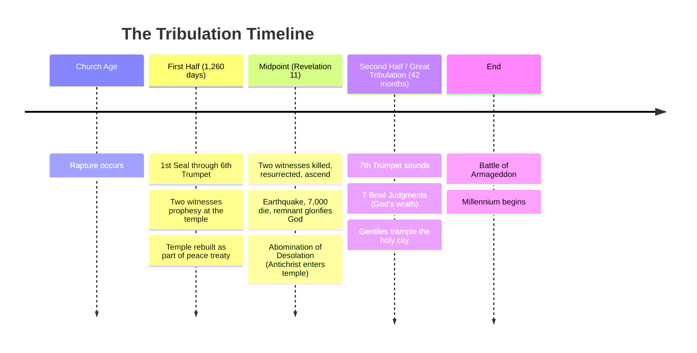
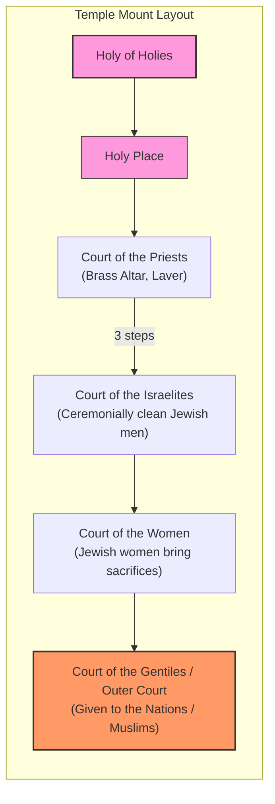
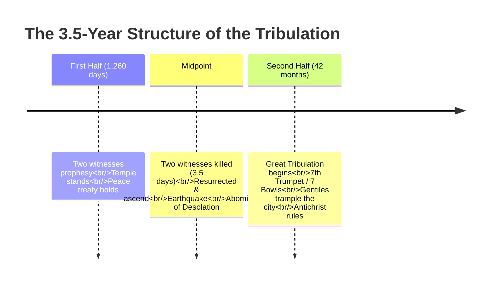
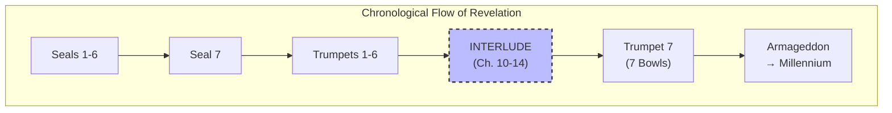
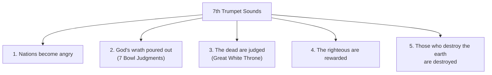

# Revelation Chapter 11: The Two Witnesses and the Temple

## 1. Overview

- Revelation 11 is an **interlude** between the 6th and 7th Trumpets (parenthetical information)
- Chapters 10–14 are interludes that interrupt the chronological flow to give additional information
- Key topics: The temple measurement, the two witnesses, the midpoint of the Tribulation
- The interlude prepares us for the second half of the tribulation and explains events of the first half

## 2. The Tribulation Timeline

## 3. The Temple Layout (Four Courtyards)

**Key insight**: The Dome of the Rock sits in the outer court (Court of the Gentiles). Archaeological evidence (Asher Kaufman) shows the Holy of Holies was \~100 yards **north** of the Dome of the Rock. The temple can be rebuilt on its original site without disturbing the Dome of the Rock — enabling both to coexist.

## 4. The 42 Months / 1260 Days Timeline

**Note**: 42 months = 1,260 days = 3.5 years. The numbers in this passage (2 witnesses, 42 months, 1,260 days, 3.5 days) are all literal, not symbolic.

## 5. Where the Interlude Fits

This interlude structure parallels the one between the 6th and 7th Seals (where the 144,000 Jews are sealed).

## 6. Five Things at the 7th Trumpet (Revelation 11:18)

The 7th Trumpet is not a single event — it begins a process that extends through the second half of the Tribulation, through the Millennium, and ends after the Great White Throne Judgment.

## 7. Key Verses (Revelation 11:1–19)

- **Verse 1–2**: John measures the temple; the outer court is given to the Nations for 42 months — this reveals the compromise allowing temple coexistence with the Dome of the Rock.
- **Verse 3–6**: Two witnesses prophesy for 1,260 days, clothed in sackcloth; they have power to shut the sky, turn water to blood, and strike the earth with plagues — identifying them as Moses and Elijah (who performed these exact signs).
- **Verse 7–10**: The Beast (demon-possessed Antichrist) kills them after their testimony is complete; the world rejoices over their dead bodies for 3.5 days, refusing them burial and sending gifts.
- **Verse 11–14**: God resurrects them; they ascend to heaven in a cloud (like Jesus' ascension); a great earthquake kills 7,000; the remnant of Jews **glorify God** — Israel as a nation is converted.
- **Verse 15–19**: The 7th Trumpet sounds; the Kingdom of God is proclaimed; the temple in heaven is opened revealing the Ark of the Covenant.

## 8. The Two Witnesses (Moses and Elijah)

| Attribute                        | Scriptural Evidence                                                                          |
| -------------------------------- | -------------------------------------------------------------------------------------------- |
| **Moses-like power**             | Turn water to blood, strike earth with plagues (Exodus 7–11)                                 |
| **Elijah-like power**            | Shut the sky from rain, call down fire (1 Kings 17:1; 2 Kings 1:10)                          |
| **Olive trees &amp; lampstands** | Reference to Zechariah 4 — supernaturally anointed to complete their work despite opposition |
| **Christian prophets**           | Verse 8 says "their Lord was crucified" — Jesus is their Lord                                |
| **Ministry location**            | At the temple in Jerusalem — explaining how the priestly sacrifices point to Jesus           |
| **Purpose**                      | To convert the nation of Israel (Romans 11:25–26)                                            |

## 9. Why the Temple Must Be Rebuilt

The temple is rebuilt not just to fulfill prophecy, but to **make the ministry of the two witnesses more effective**. The temple is the focal point of Judaism. The two witnesses stand at the temple and explain the spiritual significance of every priestly act — showing how the Law and the Prophets point to Jesus as the Messiah.

## 10. The Abomination of Desolation

- **When**: Midpoint of the Tribulation
- **What**: The Antichrist enters the temple, proclaims himself to be God, demands worship
- **Trigger**: The death and resurrection of the two witnesses emboldens the Beast to act
- **Result**: Jews flee Jerusalem; the city is trampled for 42 months; Great Tribulation begins
- **Prophets**: Daniel (9:27), Jesus (Matthew 24:15–21), and Paul (2 Thessalonians 2:3–4) all foretold it

## 11. Key Takeaways

1. The two witnesses are **literal** individuals (Moses and Elijah) — all numbers in the passage are literal
2. The temple **will** be rebuilt during the first half of the tribulation as part of a peace treaty with the Antichrist
3. The Outer Court compromise allows the Dome of the Rock and the Temple to coexist on the Temple Mount
4. Chapter 11 marks the **midpoint** of the Tribulation
5. The 7th Trumpet encompasses the entire second half + the Millennium (a process, not a single event)
6. Israel is converted as a nation through the ministry, death, resurrection, and ascension of the two witnesses
7. The Antichrist will be received as the 12th Imam by Shiites and as the Muslim Messiah by Sunnis

---

*Source:* [Revelation Chapter 1: Introduction to the Apocalypse](note:74457607-1075-4cd1-97a3-daf0c743daf2)