## In Defense of the Islamic Antichrist


[00:00:17](https://www.youtube.com/watch?v=77RC7hn37wA&list=PLj9bOvimh2NyU1STwZqO7ccG5wdfGID64&index=48&t=17s)

- A study series examining the Islamic nature of the Antichrist through biblical passages
    - The goal is to provide a defense against arguments claiming the Antichrist is not Islamic
    - The study will address difficult passages used by those who disagree

## The Importance of Studying Prophecy

- **[Why study prophecy?]** Because the Bible provides a clear mandate to record and understand future events
    - Revelation is considered one of the most prophetic books in the Bible

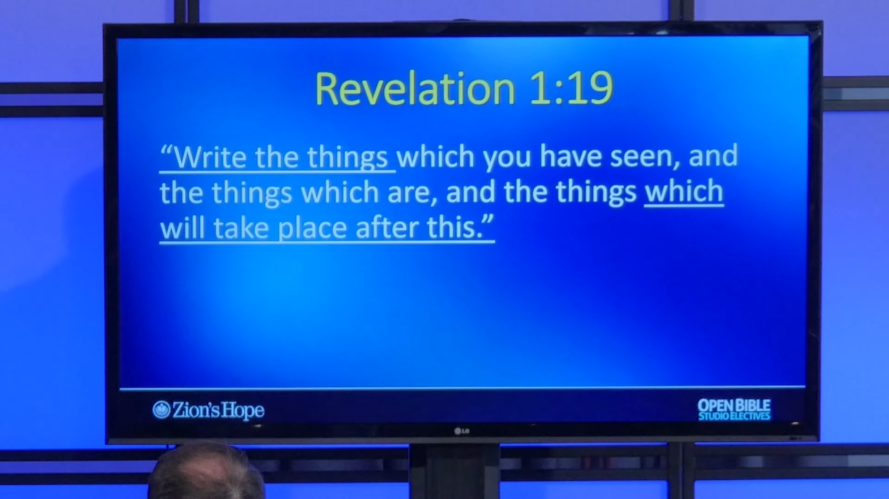
[00:02:06](https://www.youtube.com/watch?v=77RC7hn37wA&list=PLj9bOvimh2NyU1STwZqO7ccG5wdfGID64&index=48&t=126s)

    - Revelation 1:19: "Write the things which you have seen, and the things which are, and the things which will take place after this."
    - The command to "write" implies that written information is necessary for transmission and learning

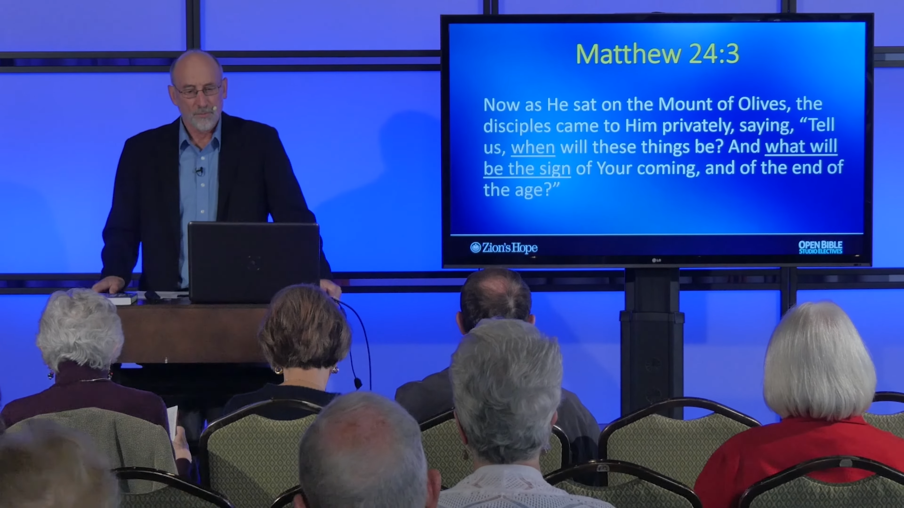
[00:02:33](https://www.youtube.com/watch?v=77RC7hn37wA&list=PLj9bOvimh2NyU1STwZqO7ccG5wdfGID64&index=48&t=153s)

    - Matthew 24:3: "Now as He sat on the Mount of Olives, the disciples came to Him privately, saying, 'Tell us, when will these things be? And what will be the sign of Your coming, and of the end of the age?'"
    - The disciples' private inquiry shows that knowing the signs of the end of the age is a significant and valid pursuit

### The Purpose of Prophetic Detail

- Christ provided specific details regarding the end times rather than simply telling the disciples to "preach the word"
    - This detail serves as a guide for what is to come
- **[Why study?]** To maintain spiritual security and steadfastness
    - Knowing what to expect beforehand prevents being shaken by the fulfillment of scripture
    - Without preparation, believers risk being led away by the errors of the wicked

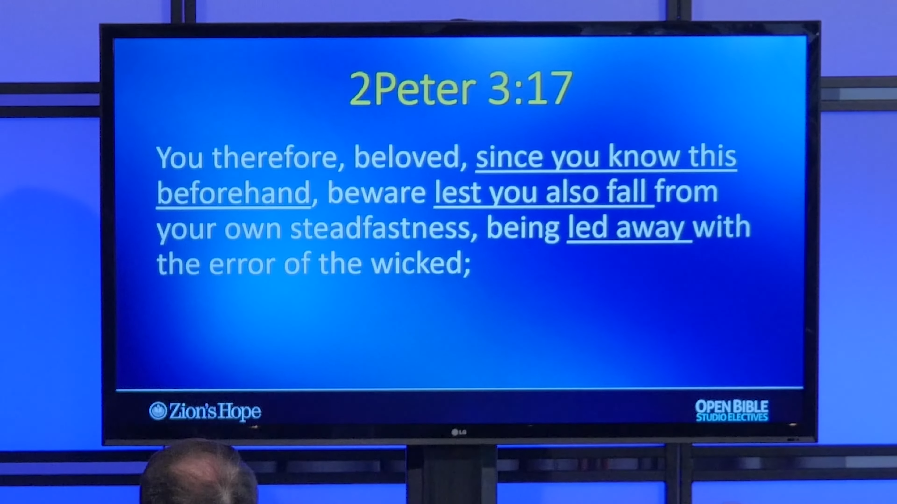
[00:03:26](https://www.youtube.com/watch?v=77RC7hn37wA&list=PLj9bOvimh2NyU1STwZqO7ccG5wdfGID64&index=48&t=206s)

> 2 Peter 3:17: "You therefore, beloved, since you know this beforehand, beware lest you also fall from your own steadfastness, being led away with the error of the wicked;"

### The Complexity of Identifying the Antichrist

- The Bible does not explicitly state that the Antichrist will be Islamic
    - If it were stated directly, there would be no need for deep study or discussion
    - The study aims to navigate these complexities through biblical evidence

### Methodology of Study

- The study involves weighing evidence by examining scriptures in light of potential identities for the Antichrist
    - The goal is to determine which identity best fits the biblical descriptions

### Biblical Context and Perspective

- The Bible is a Middle East-centered book
    - Israel is the "bullseye" or central focus of the biblical narrative
- **[Warning against bias]** It is easy to fall into a Western-centric view, particularly in America, where one might mistakenly believe everything revolves around the United States
    - To study Revelation accurately, one must keep the Middle Eastern context in mind

### Cyber Warfare and Global Connectivity

- Cyber warfare is one of the top five global concerns
- **[The scale of connectivity]** There are significantly more devices on the planet than people
    - As of 2017, there were 8.4 billion devices compared to 7.6 billion people
    - Projections suggest the number of devices will triple to approximately 20 billion within three years
- **[The danger to businesses]** Digital infrastructure is under constant threat
    - On average, businesses face 130 attacks per year from outside sources
    - These attacks aim to either breach security or plant malicious content
    - If an entity is on the internet, it has likely been attacked, even if the breach is not immediately visible

### Cyber Wildfires and Spiritual Warfare

- A "cyber wildfire" occurs when false information is intentionally planted on the internet and then rapidly spread by others
    - This is a deliberate activity used to disseminate misinformation globally
- **[Comparison of warfare types]** Digital threats are dangerous, but spiritual warfare is a much more significant and ancient threat
    - Unlike the relatively recent emergence of cyber warfare, spiritual warfare has been occurring throughout history
    - Just as many people ignore the nuances of cybersecurity, many also ignore the reality of spiritual warfare

## Spiritual Warfare in Revelation 12

- Revelation 12 serves as a primary text for understanding the spiritual aspect of warfare
- **[The Main Players]** The chapter identifies three central figures in the history of mankind:
    - The Woman: Represents the nation of Israel
    - The Child: Represents Jesus Christ
    - The Dragon: Represents Satan

### The Sign of the Woman

- Revelation 12:1 describes a "great sign" appearing in heaven
    - The woman is described as "clothed with the Sun, with the moon under her feet, and on her head a garland of twelve stars"
- **[Identity of the Woman]** While some interpret this figure as Mary, the biblical context points to the nation of Israel

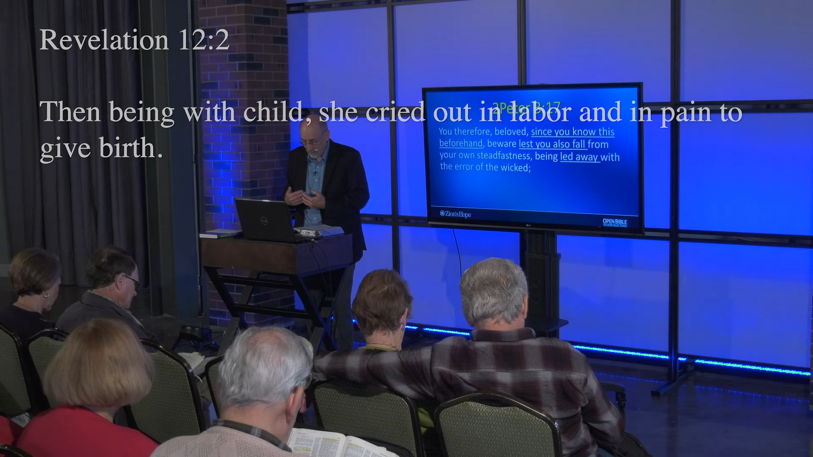
[00:10:03](https://www.youtube.com/watch?v=77RC7hn37wA&list=PLj9bOvimh2NyU1STwZqO7ccG5wdfGID64&index=48&t=603s)

- The passage continues to describe the woman being in labor, signifying the birth of Jesus Christ
    - This event marks the beginning of the prophetic sequence described in the chapter

### The Dragon in Revelation 12

- **[The identity of the dragon]** The dragon is identified as Satan
    - He is described as a "great fiery red dragon" in verse 3
- **[Symbolism of heads and horns]** The dragon has seven heads and ten horns
    - These are symbolic of the various nations Satan has used throughout history and will continue to use to do his bidding
    - The seven diadems (crowns) on his head further signify this authority
- **[The fall of the stars]** Verse 4 describes the dragon's tail sweeping a third of the stars from heaven to the earth
    - In this context, "stars" is frequently used to represent angels
    - This signifies that when Satan rose up against God, he gathered a massive number of demons and cast them to the earth
    - A "third of the stars" represents an enormous number of fallen angelic beings

### The Active Nature of Spiritual Warfare

- The spiritual world is active, not idle
    - Demons are actively tempting and orchestrating according to their father, Satan
- **[The Dragon's Intent]** Revelation 12 describes the dragon standing before the woman, ready to devour her child as soon as it is born

> Revelation 12:4: "His tail drew a third of the stars of heaven and threw them to the earth. And the dragon stood before the woman who was ready to give birth, to devour her child as soon as it was born."

- The movement of the stars (angels) to the earth is described as a "leading" or a "throwing down" of demonic beings

### Satan's Fall and Presence

- Jesus' observation of Satan's fall
    - In Luke 10:18, Christ says, "I saw Satan fall like lightning from heaven."
    - This likely refers to the time of creation when Satan rebelled and was cast out to the earth

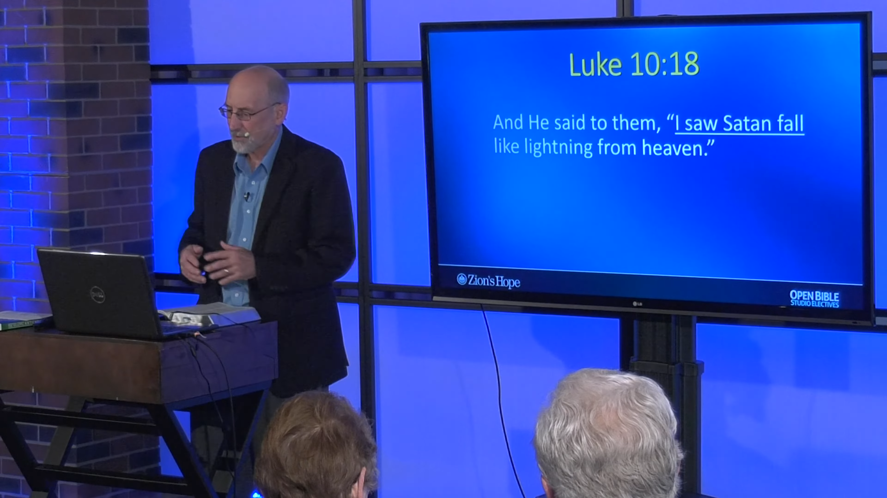
[00:12:43](https://www.youtube.com/watch?v=77RC7hn37wA&list=PLj9bOvimh2NyU1STwZqO7ccG5wdfGID64&index=48&t=763s)

> Luke 10:18: "And He said to them, 'I saw Satan fall like lightning from heaven.'"

- **[Evidence of early presence]** Satan's presence on earth is evidenced by his appearance in the Garden of Eden
    - He appeared in the form of a serpent to Adam and Eve
    - His demons were likely present and active even during that time

### The Origins of Spiritual Warfare

- **[The Serpent's Strategy]** In the Garden of Eden, the conflict began with the serpent using cunning to attack the foundation of God's relationship with humanity
    - Genesis 3:1 describes the serpent questioning God's word: "Has God indeed said, 'You shall not eat of every tree of the garden'?"
    - **[The Goal]** Satan's primary tactic is to discredit God's word and target God's own image—humanity

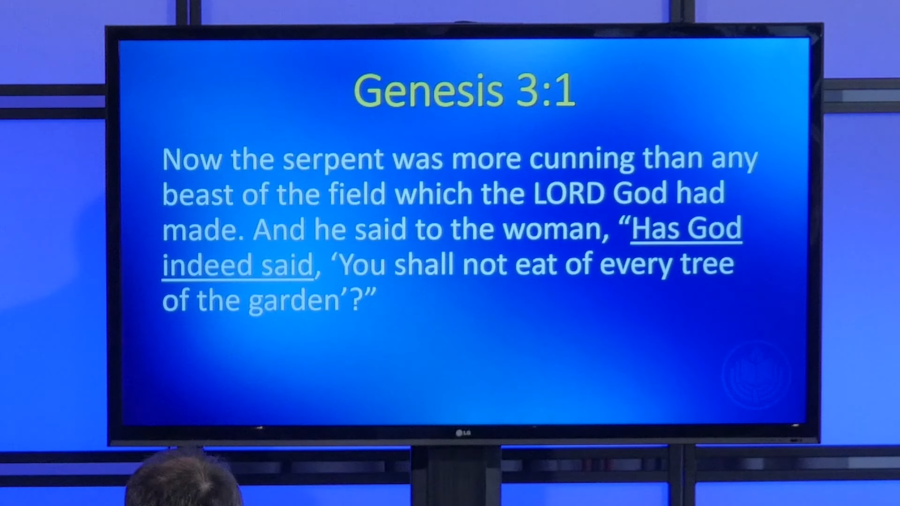
[00:13:36](https://www.youtube.com/watch?v=77RC7hn37wA&list=PLj9bOvimh2NyU1STwZqO7ccG5wdfGID64&index=48&t=816s)

- **[The Declaration of War]** The fall of Adam and Eve led to a divine judgment that formalized the ongoing conflict
    - Genesis 3:15 establishes a state of "enmity" (warfare/enemies) between the woman and the serpent, and between their respective seeds
    - This prophecy outlines the nature of the struggle: "He shall bruise your head, you shall bruise his heel"
    - **[The Continuity]** This war is not a past event but a continuous reality that has persisted from the Garden through history to the present day


[00:14:58](https://www.youtube.com/watch?v=77RC7hn37wA&list=PLj9bOvimh2NyU1STwZqO7ccG5wdfGID64&index=48&t=898s)

- **[Historical Progression]** The pattern of Satan using individuals to work against God's purposes is seen immediately following the Genesis narrative
    - For example, Satan utilized Cain to come against God

### Historical Patterns of Spiritual Warfare

- **[The Goal]** Satan's persistent objective has been to wipe out the 'seed' (the lineage through which God works)
- **[Early Attacks on the Seed]**
    - The Great Flood: An attack upon God and His people
    - The sons of God infiltrating the world
    - Nimrod and the Tower of Babel: Further tools used by Satan to oppose God's purposes

### The Conflict in Abraham's Lineage

- **[God's Promise to Abraham]** God called Abraham out of Ur to establish a great nation (Israel)

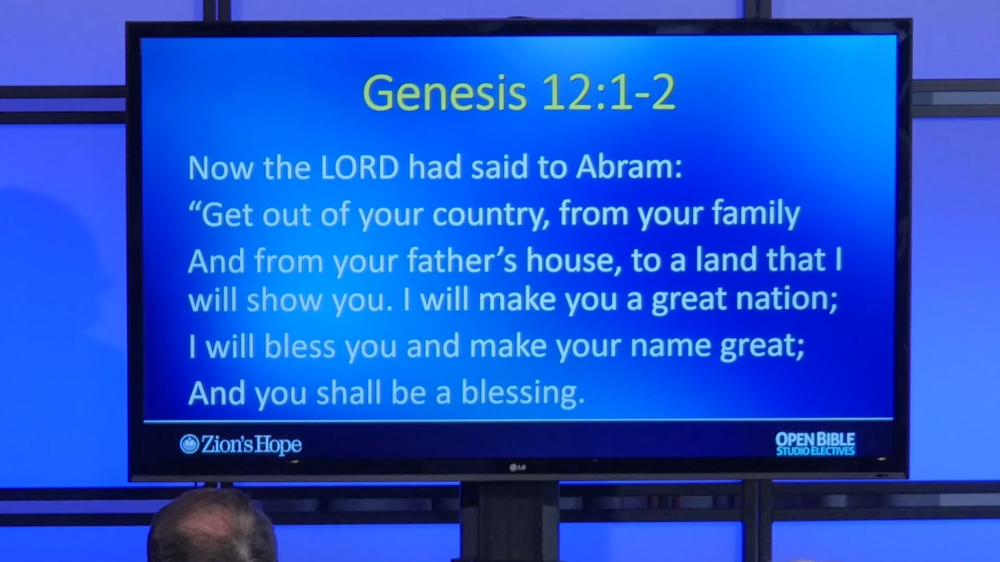
[00:15:33](https://www.youtube.com/watch?v=77RC7hn37wA&list=PLj9bOvimh2NyU1STwZqO7ccG5wdfGID64&index=48&t=933s)

> Genesis 12:1-2: "Now the LORD had said to Abram: 'Get out of your country, from your family And from your father's house, to a land that I will show you. I will make you a great nation; I will bless you and make your name great; And you shall be a blessing.'"

- **[Satanic Influence on the Promise]** Satan attempted to disrupt this divine plan by influencing Abraham's actions
    - This resulted in the birth of Ishmael, a warlike man who was at odds with Isaac
    - **[The Ongoing War]** This conflict between lineages continues through various figures:
        - Ishmael
        - Esau
        - Joseph's brothers
- **[National Conflict]** The warfare eventually expanded to the level of nations, seen when Egypt enslaved the nation of Israel

### National Powers in Spiritual Warfare

- Satan has historically utilized major nations to attack God's people and disrupt His plan of salvation:
    - Assyria: Captured the northern tribes of Israel around 722 BC
    - Babylonians: Rose to power around 600–586 BC, bringing the nation of Judah into exile
    - Medes and Persians
    - Greeks: Led by Alexander the Great and his four generals
    - Romans

### The Dragon's Attack in Revelation 12

- **[The Intent]** As described in Revelation 12:4, the dragon stood before the woman, ready to devour her child as soon as it was born

> Revelation 12:4: "His tail drew a third of the stars of heaven and threw them to the earth. And the dragon stood before the woman who was ready to give birth, to devour her Child as soon as it was born."

- **[The Historical Fulfillment]** Satan used King Herod to attempt to devour the promised child
    - Herod, inspired by Satan, planned to kill all male children in Bethlehem aged two years and under to prevent the birth of the Messiah

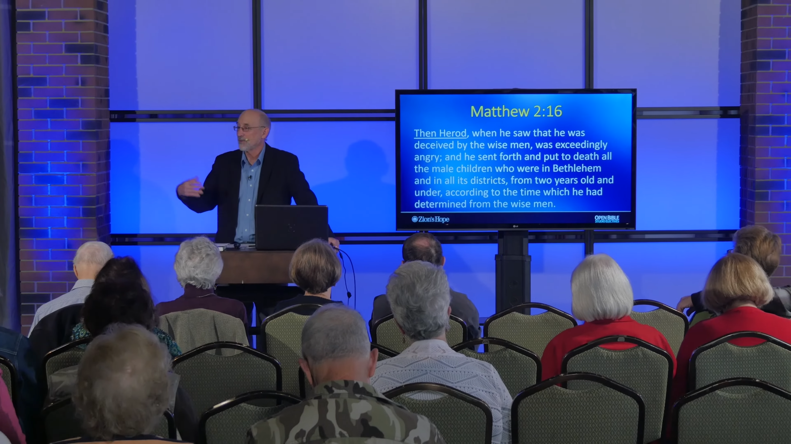
[00:17:45](https://www.youtube.com/watch?v=77RC7hn37wA&list=PLj9bOvimh2NyU1STwZqO7ccG5wdfGID64&index=48&t=1065s)

```markdown
Matthew 2:16
Then Herod, when he saw that he was deceived by the wise men, was exceedingly angry; and he sent forth and put to death all the male children in Bethlehem and in all its districts, from two years old and under, according to the time he had determined from the wise men.
```

### The Promised Child and the Ascension

- **[The Birth of Christ]** Revelation 12:5 describes the woman bearing a male child
    - This child is identified as Christ, who is destined to rule all nations with a rod of iron
- **[The Ascension]** The child being "caught up to God and his throne" represents the ascension of Christ into heaven
    - This is a period of waiting for His return, known as the Second Coming

### The Flight of the Woman

- **[The Wilderness Refuge]** Revelation 12:6 describes the woman fleeing into the wilderness to a place prepared by God
    - The woman represents the nation of Israel
    - **[Prophetic Meaning]** This flight likely symbolizes the nation of Israel fleeing from the Antichrist in the end times
- **[The Temporal Gap]** There is a significant period of time between Christ's ascension (verse 5) and the woman's flight (verse 6)
- **[Biblical Parallel]** This concept of fleeing during times of tribulation is echoed in Matthew 24:16:

> "then let those who are in Judea flee to the mountains."

### Timing of the Flight into the Wilderness

- **[The Trigger]** The flight occurs once the Antichrist rises, establishes himself in the temple, and declares war on the Jewish people and Christians
- **[The Duration]** Revelation 12:6 specifies a period of 1,260 days for the woman to be fed in a place prepared by God
    - This duration is equivalent to three and a half years
    - **[Prophetic Context]** This suggests the flight takes place during the last half of Daniel's 70th week

> Revelation 12:6: "Then the woman fled into the wilderness where she had a place prepared by God, that they should feed her there one thousand two hundred and sixty days."

### War in Heaven

- **[The Conflict]** Revelation 12:7 describes a cosmic battle occurring in heaven
- **[The Combatants]** The war is fought between Michael (and his angels) and the dragon (Satan, and his angels)

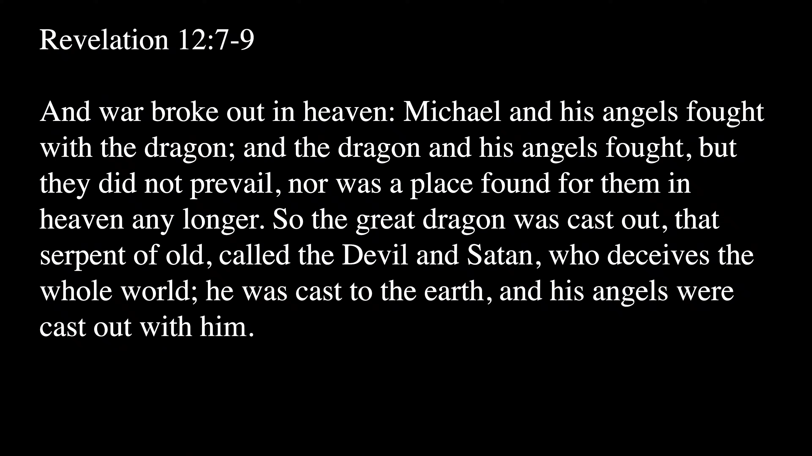
[00:20:54](https://www.youtube.com/watch?v=77RC7hn37wA&list=PLj9bOvimh2NyU1STwZqO7ccG5wdfGID64&index=48&t=1254s)

```markdown
Revelation 12:7-9
And war broke out in heaven: Michael and his angels fought with the dragon; and the dragon and his angels fought, but they did not prevail, nor was a place found for them in heaven any longer. So the great dragon was cast out, that serpent of old, called the Devil and Satan, who deceives the whole world; he was cast to the earth, and his angels were cast out with him.
```

### The Casting Out of the Dragon

- **[The Defeat]** The dragon and his angels failed to prevail in heaven and were not found a place there any longer
- **[The Expulsion]** The great dragon (the serpent of old, the Devil, and Satan) was cast out to the earth along with his angels
- **[Satan's Current Role]** Despite his fall, God has allowed Satan access to heaven to act as an accuser
    - He accuses believers before God day and night
    - Biblical examples include the account of Job and Joshua the high priest
- **[The Final Expulsion]** A definitive change will occur towards the end of the 70th week (the last week of time) when Satan will be cast out to the earth forever

### Victory in Heaven

- **[The Proclamation]** Revelation 12:10-11 describes a loud voice in heaven announcing the arrival of salvation, strength, the kingdom of God, and the power of His Christ
- **[The Defeat of the Accuser]** The accuser, who accused believers before God day and night, has been cast down
- **[How Believers Overcome]** The victory over the accuser is achieved through two means:
    - The blood of the Lamb
    - The word of their testimony
    - **[Commitment]** This victory includes those who "did not love their lives to the death"

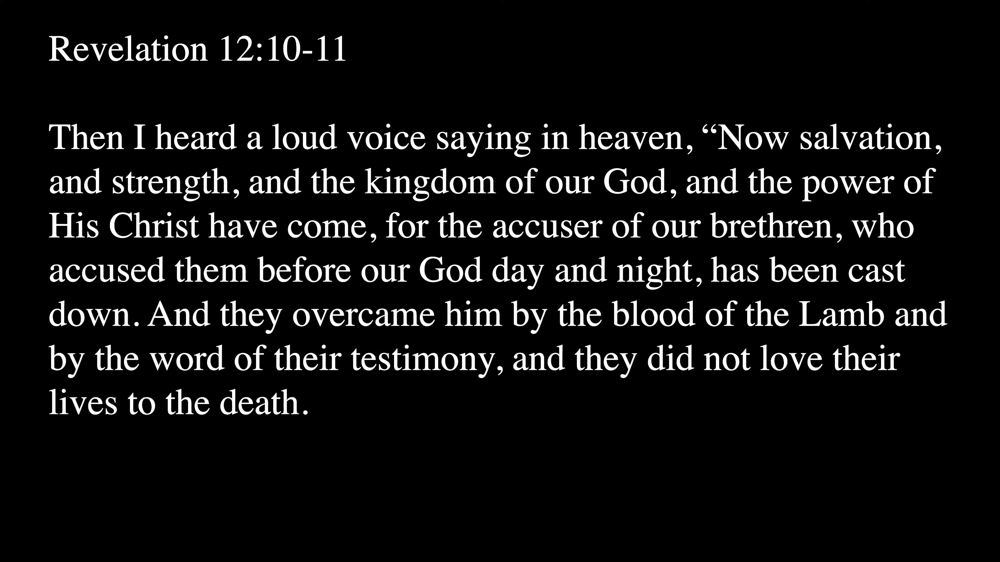
[00:22:17](https://www.youtube.com/watch?v=77RC7hn37wA&list=PLj9bOvimh2NyU1STwZqO7ccG5wdfGID64&index=48&t=1337s)

```markdown
Revelation 12:10-11
Then I heard a loud voice saying in heaven, "Now salvation, and strength, and the kingdom of our God, and the power of His Christ have come, for the accuser of our brethren, who accused them before our God day and night, has been cast down. And they overcame him by the blood of the Lamb and by the word of their testimony, and they did not love their lives to the death."
```

### The Consequences of Satan's Fall

- **[Satan's Wrath]** Because Satan knows he has a "short time" remaining, his descent to earth is characterized by great wrath
- **[Global Conflict]** This transition marks the beginning of a period of unprecedented warfare on earth
- **[Targeted Persecution]** Satan will wage war against two specific groups:
    - The nation of Israel
    - Christians (those who hold the name of Christ)

```markdown
Revelation 12:12
Therefore rejoice, O heavens, and you who dwell in them! Woe to the inhabitants of the earth and the sea! For the devil has come down to you, having great wrath, because he knows that he has a short time.
```

### Persecution of the Woman

- **[The Dragon's Reaction]** Upon seeing that he has been cast to the earth, the dragon immediately begins persecuting the woman (representing Israel) who gave birth to the male child
- **[The Dragon's Identity]** To understand the nature of this persecutor, one must recall the description of the dragon in Revelation 12:3:
    - A fiery red dragon
    - Possessing seven heads and ten horns

### Symbolism of the Heads and Horns

- **[The Seven Heads]** These represent seven major nation empires used by Satan throughout history
    - Identified empires include: Egypt, Assyria, Babylon, Mede-Persian, Greece, and Rome
    - The list concludes with "The Final Beast"
- **[The Ten Horns]** These represent kings over those nations, primarily focused on the final empire

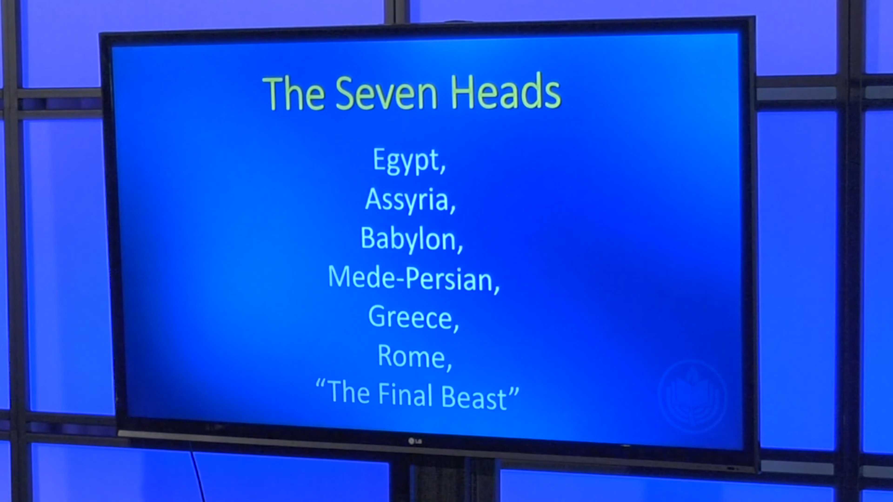
[00:25:20](https://www.youtube.com/watch?v=77RC7hn37wA&list=PLj9bOvimh2NyU1STwZqO7ccG5wdfGID64&index=48&t=1520s)

### The Beast and the Antichrist

- **[Connection to Satan]** The beast in Revelation 13:1 shares the same description as the dragon (seven heads and ten horns)
    - This "like father, like son" resemblance suggests the Antichrist will represent Satan's role on earth in a bodily form
- **[The Antichrist's Role]** He will rise up to battle against mankind, specifically targeting Jewish people and Christians

```markdown
Revelation 13:1
Then I stood on the sand of the sea. And I saw a beast rising up out of the sea, having seven heads and ten horns, and on his horns ten crowns, and on his heads a blasphemous name.
```

### Identifying the Final Beast

- **[The Search for the Final Beast]** While the first six empires in the list are widely recognized, the identity of the "Final Beast" is the primary subject of investigation
- **[The Islamic Hypothesis]** The speaker posits that the final empire will be an Islamic empire led by a Muslim leader
    - This is based on the view that Islam best represents Satan's power and his specific intent to attack Israel
    - The speaker notes that this parallels the way Christianity claims lineage through Abraham, suggesting a deceptive similarity
    - Historical connections are drawn to the claim of lineage through Ishmael and Muhammad

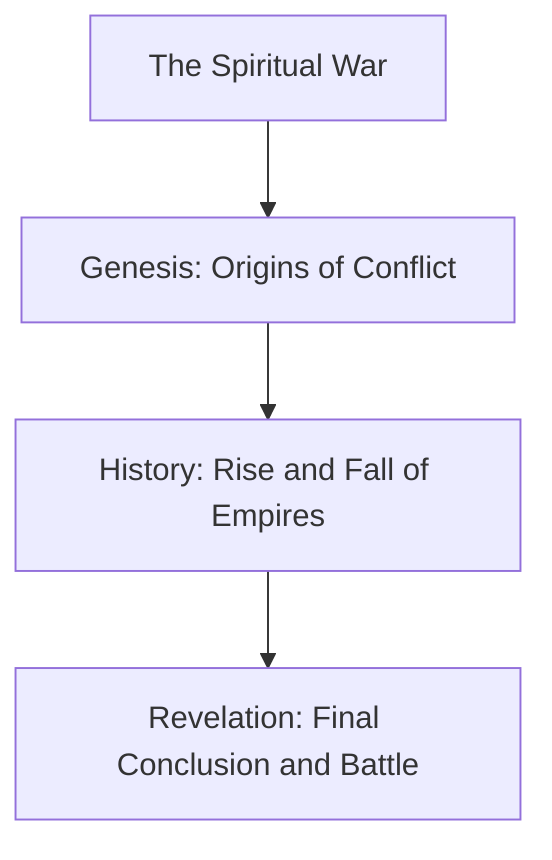

- **[Biblical Nomenclature]** Although the overarching conflict is consistent, different authors throughout the Bible use various names to describe the Antichrist

### Biblical Names for the Antichrist

- **[Contextual Nomenclature]** The use of different names across various books of the Bible is not due to the existence of multiple Antichrists, but rather different authors describing the same figure from their own perspective and context
- **[Titles by Biblical Source]**
    - **Daniel and Revelation**: "Beast" or "little horn"
    - **Daniel**: "Prince", "King of the North", or "Abomination of Desolation" (a term also repeated by Christ in Matthew 24)
    - **Ezekiel**: "Gog"
    - **Isaiah and Micah**: "Assyrian"
    - **2 Thessalonians**: "Man of lawlessness", "Man of sin", or "Son of Perdition"

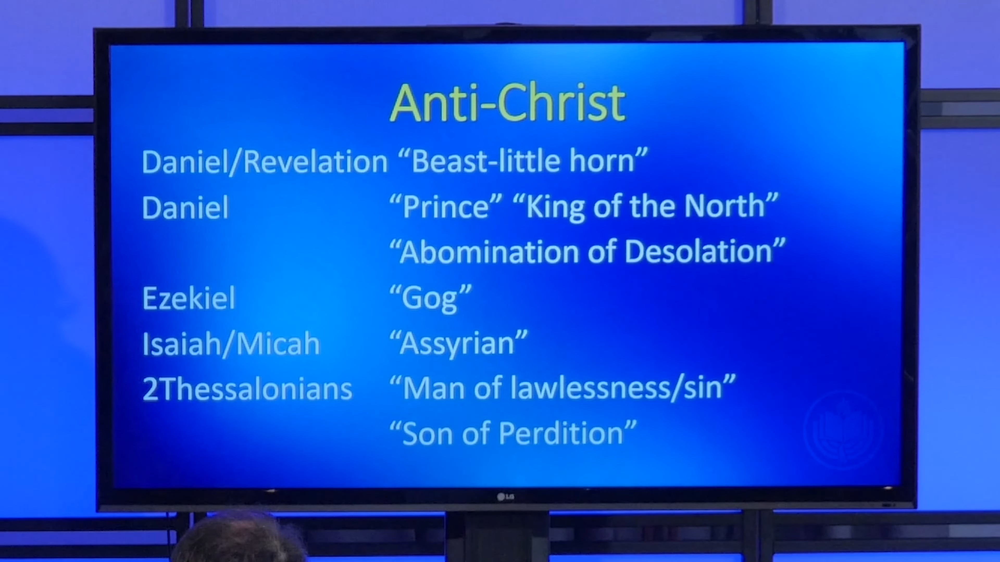
[00:27:16](https://www.youtube.com/watch?v=77RC7hn37wA&list=PLj9bOvimh2NyU1STwZqO7ccG5wdfGID64&index=48&t=1636s)

### The Papacy as a Candidate for the Antichrist

- **[Historical Context]** A long-standing viewpoint, dating back to the Middle Ages or possibly earlier, suggests the Antichrist could be the Pope or the Roman Catholic Church
    - This perspective gained momentum around 380 AD, following the legalization of Christianity by Constantine
- **[Common Criticisms]** Those who identify the Roman Catholic Church as a false system of worship often point to several factors:
    - Increased control over the Christian faith
    - Authority over the Bible
    - Practices such as indulgences and the worship of saints (including Mary)
    - Ideologies like purgatory
    - A salvation model based on "faith plus works"
- **[The Central Question]** While these criticisms are significant, the speaker poses the question of whether the Papacy is truly the *best* candidate for the Antichrist when weighed against the specific profiles found in prophecy

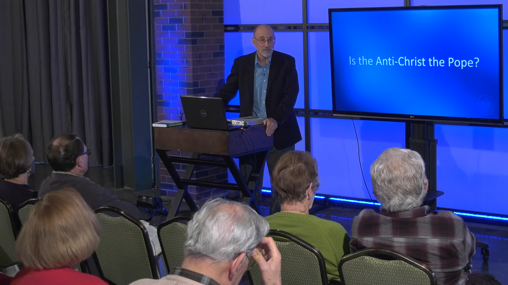
[00:29:54](https://www.youtube.com/watch?v=77RC7hn37wA&list=PLj9bOvimh2NyU1STwZqO7ccG5wdfGID64&index=48&t=1794s)

### Evaluating the Papacy as the Antichrist

- **[Historical Protestant View]** During the Reformation, many Reformers explicitly identified the Pope as the Antichrist
    - The **1646 Westminster Confession** stated that there is no head of the Church but Jesus Christ, and that the Pope of Rome is the "Antichrist, that man of sin, and son of perdition"

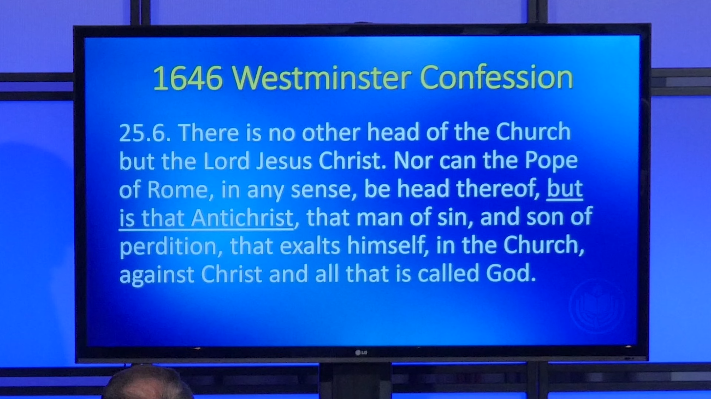
[00:30:22](https://www.youtube.com/watch?v=77RC7hn37wA&list=PLj9bOvimh2NyU1STwZqO7ccG5wdfGID64&index=48&t=1822s)

    - This specific identification was removed from the document in 1788, reflecting a shift in how Reformers viewed the Papacy
- **[Doctrine vs. Practice in Catholicism]** There is a tension between what the Catholic Church claims to believe and how it operates
    - **Stated Doctrine**: The Church's official website may claim a belief in "faith alone"
    - **Actual Practice**: The system functions as "Christ + Works = Salvation"
    - **[Why it matters]** The practice of sacraments acts as a required work to maintain or achieve salvation, creating a system of works rather than relying on faith alone

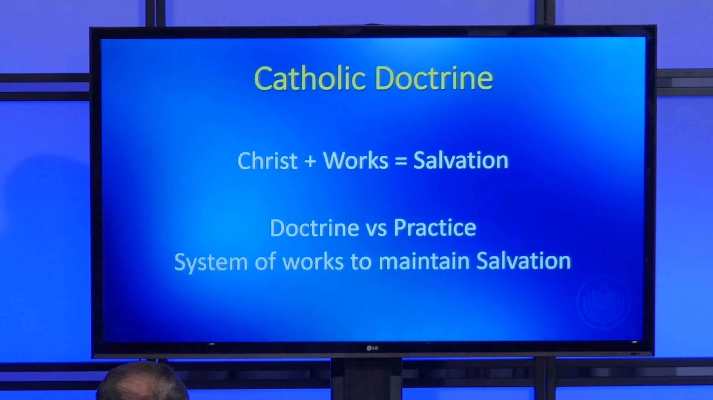
[00:31:05](https://www.youtube.com/watch?v=77RC7hn37wA&list=PLj9bOvimh2NyU1STwZqO7ccG5wdfGID64&index=48&t=1865s)

### Scriptural Arguments for the Papacy as Antichrist

- **[The 'Inside' Argument]** Some proponents of the Papal-Antichrist view rely on 1 John 2:18-19 to suggest the Antichrist must be someone who was once part of the Christian community.
    - **1 John 2:18-19**: "Little children, it is the last hour; and as you have heard that the Antichrist is coming, even now many antichrists have come, by which we know that it is the last hour. They went out from us, but they were not of us; for if they had been of us, they would have continued with us; but they went out that they might be made manifest, that none of them were of us."

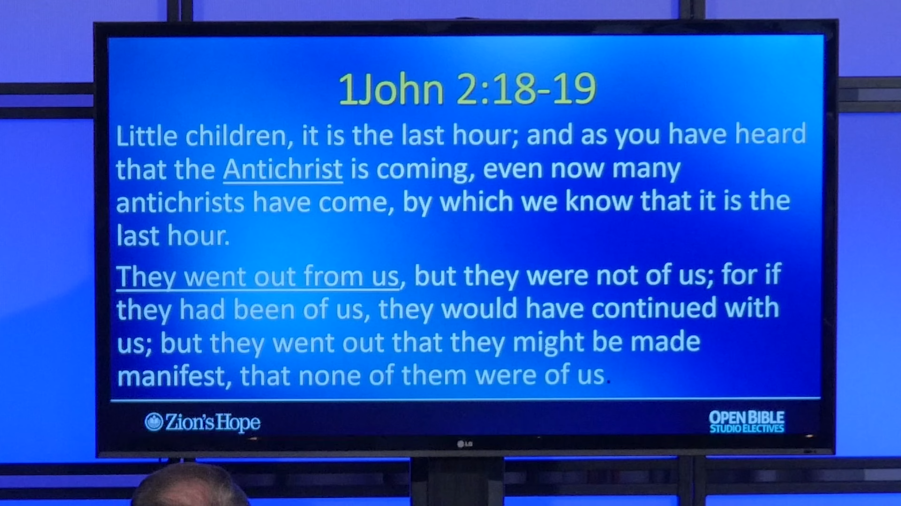
[00:32:12](https://www.youtube.com/watch?v=77RC7hn37wA&list=PLj9bOvimh2NyU1STwZqO7ccG5wdfGID64&index=48&t=1932s)

- **[Logical Critique]** The speaker challenges the deduction that the Antichrist must come from within Christianity.
    - **[The distinction]** The text mentions 'antichrists' (small a) who left the faith, but this does not logically necessitate that the singular, ultimate 'Antichrist' (capital A) must also be a former Christian.
    - **[Conclusion]** There is no scriptural requirement that the Antichrist must originate from a Christian background.

### Scriptural and Etymological Critiques of the Papacy

- **[The Lineage Argument]** While Christians, Jews, and Muslims all share a common genealogy through Abraham, this does not necessitate that the Antichrist must emerge from a Christian faith.
- **[The Denial of Christ]** 1 John 2:22 provides a specific definition of an antichrist that challenges the Papal-Antichrist view:
    - **1 John 2:22**: "Who is a liar but he who denies that Jesus is the Christ? He is antichrist who denies the Father and the Son."
    - **[Application]** While the Catholic Church may misrepresent certain doctrines, the speaker notes that there is no evidence of the Church actually denying the Father or the Son.
- **[Etymology of Antichristos]** The word "antichrist" carries a specific meaning regarding its relationship to Christ:

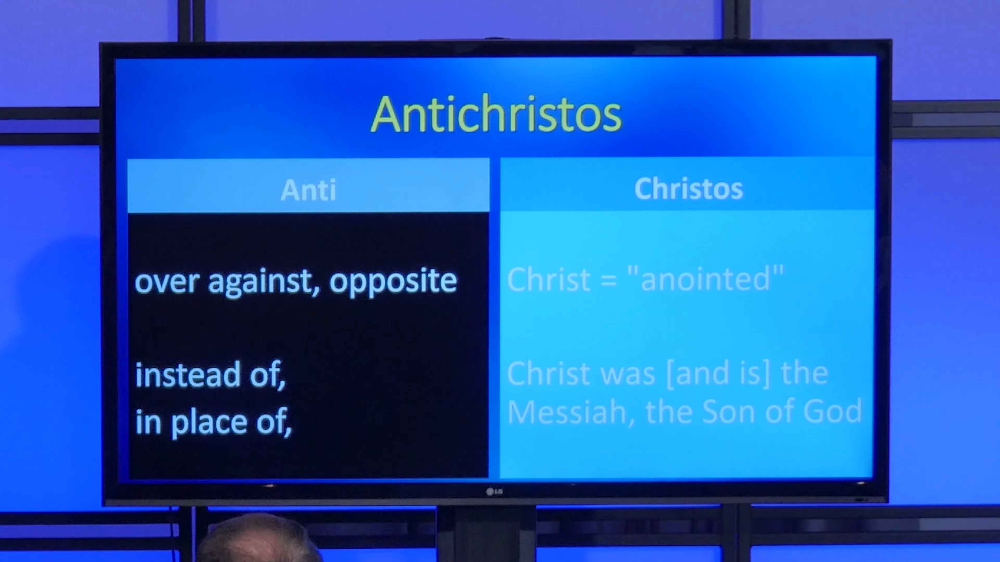
[00:34:30](https://www.youtube.com/watch?v=77RC7hn37wA&list=PLj9bOvimh2NyU1STwZqO7ccG5wdfGID64&index=48&t=2070s)

| Prefix: Anti | Root: Christos |
| --- | --- |
| over, against, opposite | Christ = "anointed" |
| instead of, in place of | Christ was [and is] the Messiah, the Son of God |

### Further Critiques of the Papal Candidate

- **[The "In Place Of" Argument]** The speaker argues the Pope does not fit the etymological definition of "antichristos":
    - To be the Antichrist, one would need to act "in place of" Christ.
    - The speaker sees no indication that the Pope would attempt to replace Christ in this manner.

### Characteristics of the Beast in Revelation 13

- The speaker examines Revelation 13:4-6 to contrast the characteristics of the Antichrist (the Beast) with the Pope:

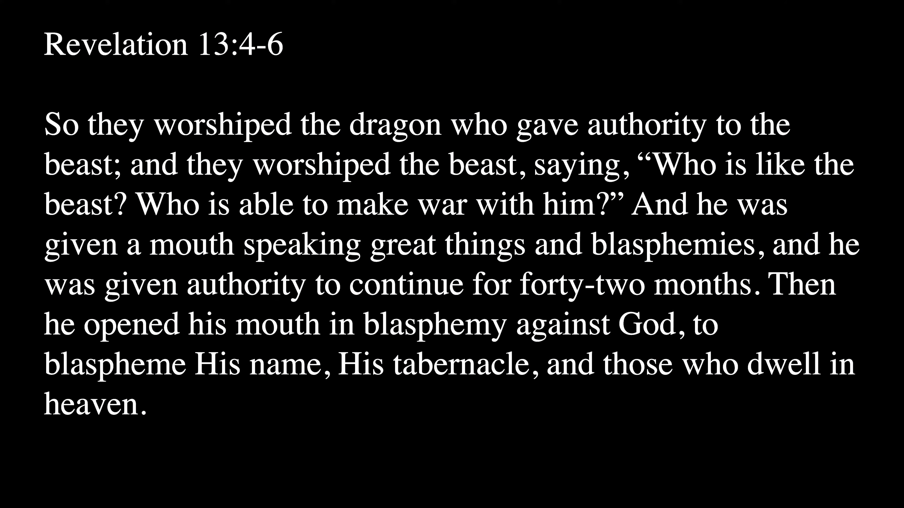
[00:35:05](https://www.youtube.com/watch?v=77RC7hn37wA&list=PLj9bOvimh2NyU1STwZqO7ccG5wdfGID64&index=48&t=2105s)

- **[Warlike Nature]** The Beast is described as someone people ask, "Who is like the beast? Who is able to make war with him?"
    - The speaker questions if the Pope would be a warlike figure capable of such combat.
- **[Blasphemy and Authority]** The Beast is given a mouth to speak "great things and blasphemies":
    - He is granted authority to blaspheme God, His name, His tabernacle, and those in heaven.
    - He is granted authority to "make war with the saints and to overcome them."
- **[Conclusion]** While the Pope may represent false doctrine, the speaker argues he does not fit the specific, aggressive, and blasphemous profile of the Beast described in this passage.

### Evaluating the 'Change Times and Law' Prophecy

- **Daniel 7:25** describes the characteristics of the Antichrist:
    - "He shall speak pompous words against the Most High, shall persecute the saints of the Most High, and shall intend to **change times and law**."
    - The saints are then given into his hand for "a time and times and half a time."

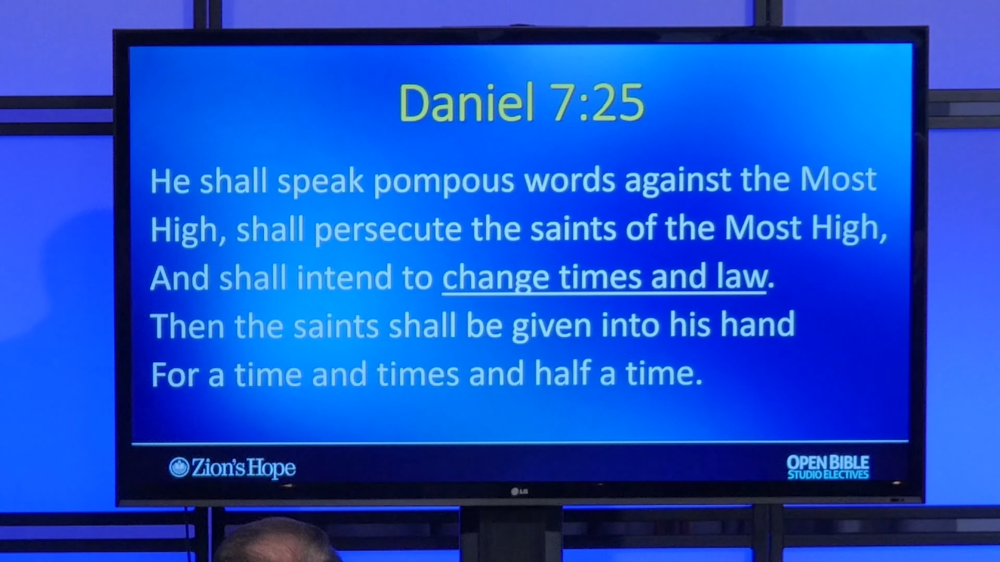
[00:36:12](https://www.youtube.com/watch?v=77RC7hn37wA&list=PLj9bOvimh2NyU1STwZqO7ccG5wdfGID64&index=48&t=2172s)

- **[The Comparison]** The speaker weighs whether the Pope or an Islamic leader better fits the description of changing "times and law":
        - **The Papacy**: The speaker questions what the Pope would actually change regarding "times," noting that the current Judeo-Christian calendar is already established.
        - **Islam**: Islam presents a more concrete fit for changing "times" through its own distinct systems.

### Islam as a Candidate for Changing Times and Law

- **[The Islamic Calendar]** Unlike the Judeo-Christian system, Islam utilizes a completely different calendar:
        - It began around 622 AD with Muhammad.
        - It is based on a 355-day year.

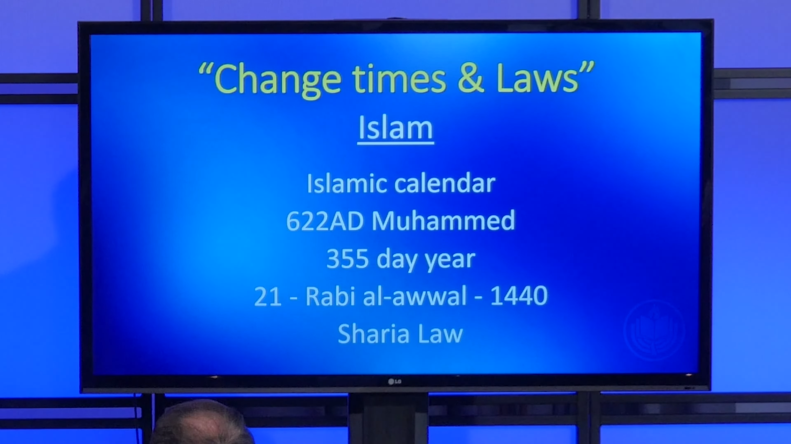
[00:37:18](https://www.youtube.com/watch?v=77RC7hn37wA&list=PLj9bOvimh2NyU1STwZqO7ccG5wdfGID64&index=48&t=2238s)

- **[Legal Framework]** In addition to changing the calendar (times), Islam is characterized by the implementation of **Sharia Law**.

### Conclusion of the Candidate Evaluation

- **[The Verdict]** When weighing the evidence of 'changing times and law',
    - The Pope does not offer a compelling fit for changing established 'times'.
    - An Islamic nature provides a much more concrete fit due to its distinct systems.
- **[Final Conclusion]** The speaker concludes that an Islamic profile best fits the prophetic description, effectively ruling out the Papacy as the primary candidate.

### Addressing Other Theories

- The speaker notes that while people frequently suggest various modern political figures (such as Donald Trump) as potential Antichrists, there is no scriptural evidence in his resources to support such claims.
- He emphasizes that while specific names are not provided by prophecy, the evidence points toward a specific direction: Islam.

### The Culmination of Spiritual Warfare

- The current era represents the final battle in a conflict spanning thousands of years
    - Satan has historically used various influences and 'pawns' to attempt to stop God's 'seed'
    - The focus has now shifted toward the active persecution of the saints and the nation of Israel
- **[The End Goal]** There will ultimately be a final meeting between God and Satan
- **[The Role of the Believer]** Monitoring the movements of nations is a way to observe God's spiritual plan unfolding

### Conclusion: The Nature of the Battle

- Believers are called to be "warriors for Christ"
- The conflict is not physical, but spiritual:
    - The battle is not against "flesh and blood"
    - The true enemies are "principalities and spirits"