## Islamic Eschatology

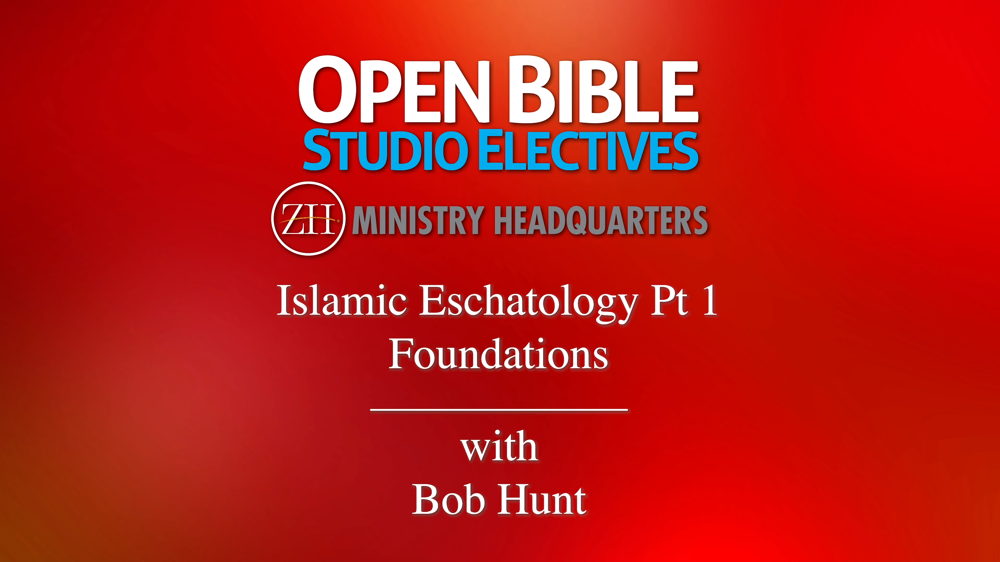
[00:00:03](https://www.youtube.com/watch?v=6lSlZahk0WU&t=3s)

- An introduction to the study of Islamic eschatology
    - The topic will be covered across multiple sessions to ensure a detailed and thorough exploration
- **The Foundation**
    - The study begins by establishing foundational considerations necessary for understanding the subject

### Comparative Study Approach

- The study aims to compare Islamic eschatology with biblical eschatology
    - This involves examining what Islam teaches about the end times versus what the Bible teaches
    - The goal is to see how these two perspectives interact within God's plan
- **[Purpose]** To develop awareness of how Islam may be utilized by Satan to achieve specific ends in the world

### Biblical Foundation: Revelation 13

- The study begins with Revelation 13:11
- Focus on the "second beast"
    - Also referred to as the "beast from the earth"
    - Also referred to as the "false prophet"
- **[Reasoning]** Studying the false prophet provides significant information about the first beast

### The Antichrist and the False Prophet

- The first beast, described in the first 10 verses of Revelation 13, is known as the Antichrist
- **[Relationship]** The false prophet (the second beast) serves as a way to understand the nature and actions of the first beast

### Understanding the Enemy's Tactics

- Although studying the Bible is the primary necessity, it is also helpful to understand how the enemy operates
- Recognizing Satan's ways and attacks helps in noticing them as they happen in the world
- **[Key Principle]** Studying the enemy's tactics is a vital part of spiritual awareness

#### Thomas Brooks on Spiritual Study

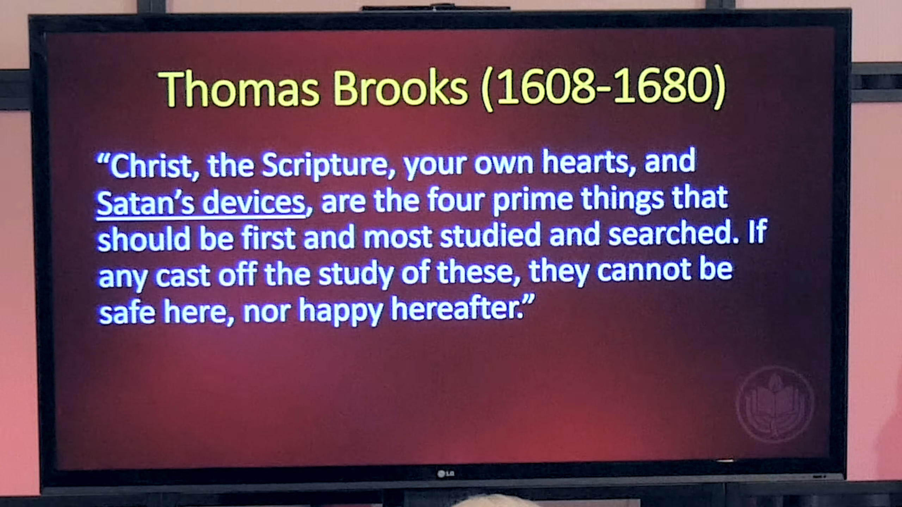
[00:04:19](https://www.youtube.com/watch?v=6lSlZahk0WU&t=259s)

- Thomas Brooks (1608–1680) was a Puritan writer from the Reformation era
- He identified four "prime things" that should be the first and most thoroughly studied:
    - Christ
    - The Scripture
    - Your own heart
    - Satan's devices
- **[Consequence]** Failing to study these four things leaves a person neither safe in this life nor happy in the next

### Expanding on the Four Prime Things

- While Christ and Scripture are universally agreed upon, the speaker highlights the need for deeper focus on the remaining two:
    - **Your own heart**: Many people live with unexamined hearts, making it necessary to constantly question one's spiritual condition.
    - **Satan's devices**: This refers to the specific methods and means the enemy uses to attack the world.
- **[The Speaker's Argument]** Islam is identified as one of Satan's devices
    - It is viewed as a false religion used by Satan to achieve his ends
    - It is described as mirroring God's holy word in the Bible for the purpose of deceiving people
    - **[Ultimate Goal]** To deceive the world into the worship of Satan himself

### The Role of False Religion

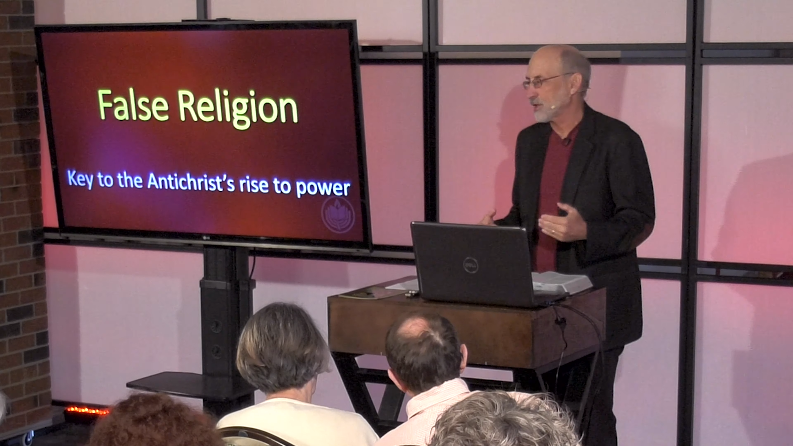
[00:05:46](https://www.youtube.com/watch?v=6lSlZahk0WU&t=346s)

- False religion will play an enormous and important role as the end times unfold
- **[Purpose]** It serves as a tool that Satan can use to deceive people
- **[Significance]** False religion is considered key to the Antichrist's rise to power

### Trends in Religious Identity

- Some argue that religion is currently in decline
- **[Evidence]** A Washington Post report (dated April 15, 2019) notes a shift in American religious identity:
    - For the first time, the "No Religion" category topped a survey of Americans
    - According to a political scientist's analysis, the non-religious edged out both Catholics and evangelicals in the long-running General Social Survey

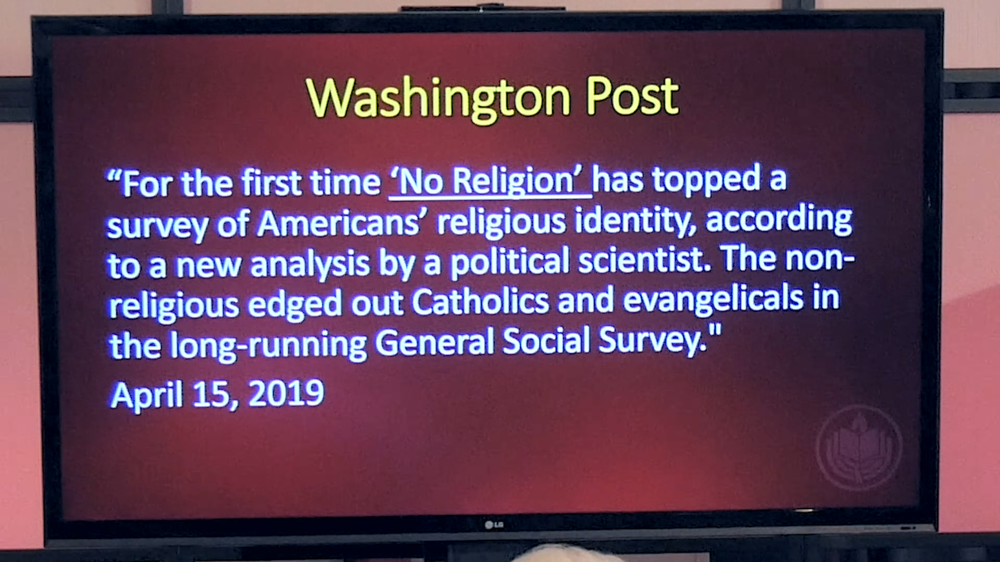
[00:06:42](https://www.youtube.com/watch?v=6lSlZahk0WU&t=402s)

### Global vs. American Religious Trends

- **[The Counter-Argument]** Some suggest that because the 'No Religion' category is rising in the US, false religion cannot be on the rise
    - **[The Rebuttal]** America is not the center of the world; US trends do not represent global reality
- **[Global Reality]** According to Pew Research Center data, the global religious population is projected to grow
    - Religious population projection: from 84% (2010) to 87% (2050)
    - **[Key Driver]** Muslims are rising the fastest globally, while the unaffiliated are shrinking as a share of the world's population

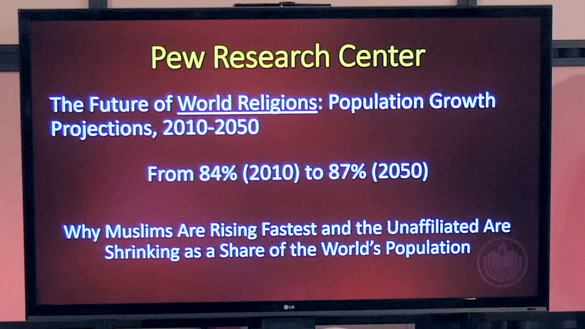
[00:07:44](https://www.youtube.com/watch?v=6lSlZahk0WU&t=464s)

### Islam's Projected Global Dominance

- **[Pew Research Projection]** Islam is estimated to become the number one religion in the world by 2050
- **[Eschatological Implication]** This rapid growth is presented as a primary mechanism for how false religion could exert massive global impact during the end times

### Biblical Foundations of False Religion

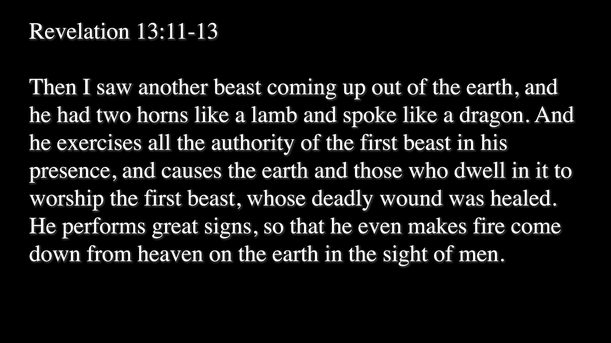
[00:09:11](https://www.youtube.com/watch?v=6lSlZahk0WU&t=551s)

- **Revelation 13:11-13** describes a second beast emerging from the earth
    - It has "two horns like a lamb" but "spoke like a dragon"
    - **[Symbolism]** The dragon represents Satan
- **[Authority]** This second beast exercises all the authority of the first beast (the Antichrist) in his presence
- **[The Goal]** The primary objective is to cause the earth and its inhabitants to worship the first beast
- **[Methods of Deception]** The beast performs "great signs" or miracles to deceive people
    - One specific sign mentioned is making fire come down from heaven in the sight of men

### The Deception of the Second Beast

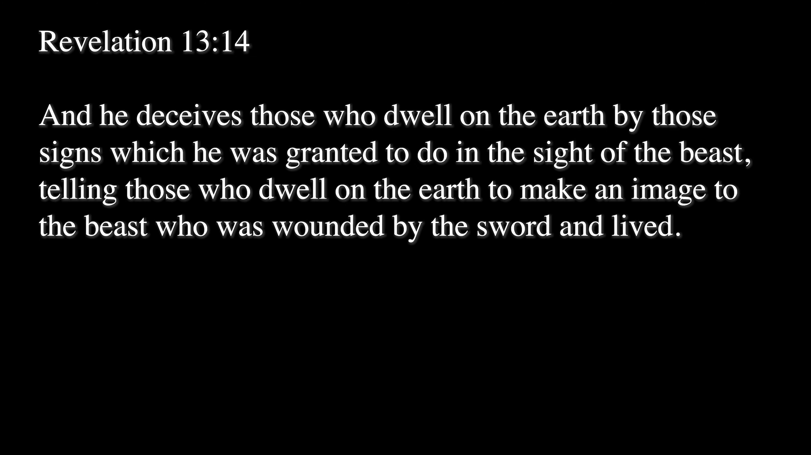
[00:09:58](https://www.youtube.com/watch?v=6lSlZahk0WU&t=598s)

- **[Mechanism of Deception]** The second beast uses granted signs to deceive those dwelling on the earth
- **[The Image of the Beast]** A key part of this deception is telling people to make an image of the beast who was wounded by the sword and lived
- **[Connection to Worship]** These actions are directly tied to the rising of false religion and the mandate for global worship of the Antichrist

### The Tension Between Islam and Biblical Prophecy

- **[The Conflict]** A potential theological contradiction exists between the rise of Islam and the biblical mandate for global worship of the Antichrist
    - Scripture states the world will be compelled to worship the first beast (the Antichrist)
    - Critics may argue Islam cannot be the religion of the end times because Muslims worship Allah
    - **[Speaker's Perspective]** The speaker characterizes the worship of Allah in this context as worship of a "non-god" or an idol in relation to the prophetic timeline

### The Shahada

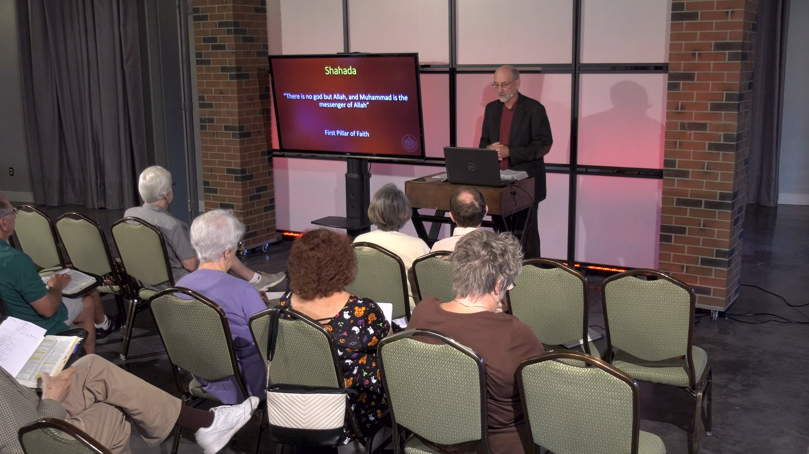
[00:11:15](https://www.youtube.com/watch?v=6lSlZahk0WU&t=675s)

- **[Definition]** The first pillar of faith in Islam, which a person must repeat upon conversion
- **[Content]** "There is no god but Allah, and Muhammad is the messenger of Allah"
        - This foundational statement defines the core monotheistic requirement of the faith

### Reconciling the Shahada with End-Times Prophecy

- **[The Apparent Contradiction]** If the Shahada states "there is no God but Allah," critics ask how Muslims could possibly worship an Antichrist figurehead
- **[The Biblical Resolution]** Revelation 13:4 clarifies that the worship occurring in the end times is directed toward two distinct entities

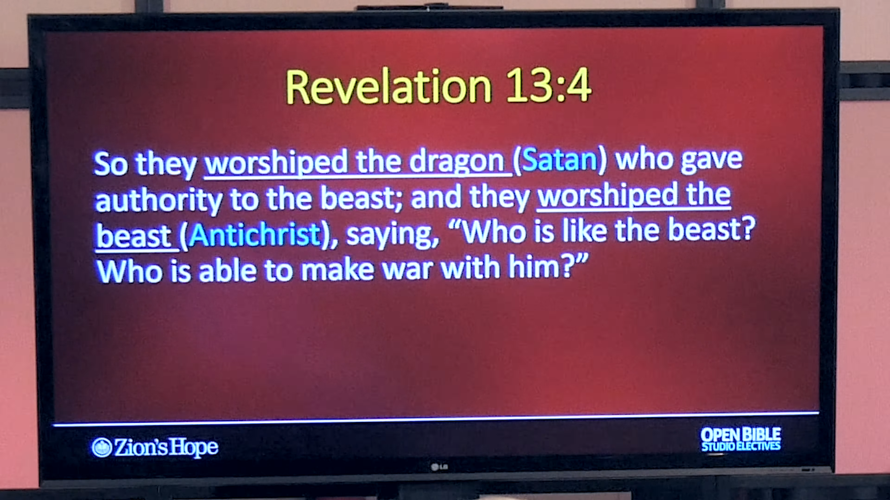
[00:12:19](https://www.youtube.com/watch?v=6lSlZahk0WU&t=739s)

| Entity | Identity | Revelation 13:4 Text |
| --- | --- | --- |
| The Dragon | Satan | "So they worshiped the dragon (Satan) who gave authority to the beast..." |
| The Beast | Antichrist | "...and they worshiped the beast (Antichrist), saying, 'Who is like the beast?'" |

### Dual Entities in End-Times Worship

- **[The Two Targets]** Revelation 13:4 identifies two distinct spiritual entities that receive worship:
    - **The Dragon (Satan):** The spirit behind the Antichrist who provides his authority
    - **The Beast (Antichrist):** The earthly figurehead whom people ask, "Who is like the beast?"

### Concept of Levels of Worship

- **[Differentiation]** Worship can be categorized into different levels or types of honor rather than being a single, uniform action
- **[Catholicism as an Example]** The speaker uses Catholic distinctions to illustrate how different entities receive varying degrees of recognition:

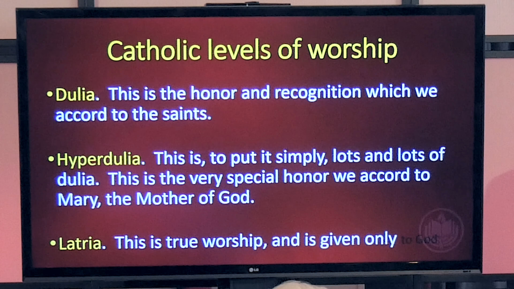
[00:13:29](https://www.youtube.com/watch?v=6lSlZahk0WU&t=809s)

    - **Dulia:** Honor and recognition accorded to the saints
    - **Hyperdulia:** A "very special honor" accorded to Mary, the Mother of God
    - **Latria:** True worship, which is reserved exclusively for God

### Critiquing the Concept of Levels of Worship

- **[The Practical Challenge]** There is a difficulty in how a person practically differentiates these levels in real-time:
    - It is hard to intuitively control or separate these levels of devotion during a single religious experience.
    - From a certain perspective, worship is seen as a singular, indivisible act rather than something that can be tiered by entity.

### Islamic Concepts of Worship Levels

- **[Theological Parallel]** Just as the Catholic model distinguishes between types of honor, Islam contains structures that allow for varying degrees of religious recognition
- **[The Messianic Connection]** Within certain Islamic interpretations, a messiah figure appearing on earth is believed to represent Allah, which could potentially meld the worship of the Dragon and the Beast into a singular, tiered system
- **[Ihsan]** The highest level of worship is known as *Ihsan*
    - It is defined as "perfection"
    - It represents the most elevated state of devotion

### Islam as a Tool of the Antichrist

- **[The Role of the Mahdi]** Within the Islamic framework, worship can be directed toward Allah through the Mahdi or Messiah appearing on earth
    - This provides a mechanism to meld the worship of the Dragon (Satan) and the Beast (Antichrist) into a single system of tiered devotion
- **[Satan's Motivation]** Satan has no inherent interest in Islam or leading people toward it
    - His primary objective is always the worship of himself
- **[The Transition of Worship]** Islam serves as a temporary "false religion" or tool to lead people away from the true God of the Bible toward a false idol
    - Eventually, the Antichrist will cast off this religious tool and demand direct worship of himself

### Cooperation Between the Harlot and the Beast

- **[The Biblical Symbolism]** Revelation 17 describes the Harlot (Mystery Babylon) riding the Beast (the Antichrist)
    - In biblical prophecy, "riding" signifies a form of cooperation or partnership between the two entities
- **[Strategic Partnership]** This cooperation is viewed as a method for the Antichrist to achieve his ultimate goals:
    - Global domination
    - Achieving universal worship of himself
- **[Proposed Application]** The speaker suggests that the Antichrist may work in tandem with the religion of Islam as part of this cooperative relationship

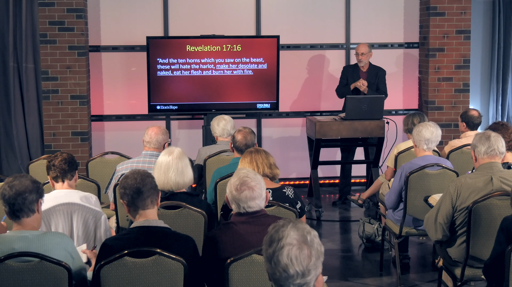
[00:17:10](https://www.youtube.com/watch?v=6lSlZahk0WU&t=1030s)

### The Destruction of the Harlot by the Beast

- **[The End of Cooperation]** While the Harlot and the Beast initially cooperate, the relationship is ultimately predatory
    - According to Revelation 17:16, the ten horns on the beast will eventually turn on the harlot
    - This involves hating her, making her desolate and naked, eating her flesh, and burning her with fire
- **[Satan's Ultimate Objective]** The abandonment of the false religion (the Harlot) aligns with Satan's core motivation
    - Satan recognizes that false gods/idols are just tools to draw people away from the true God
    - Once the tool has served its purpose, he will "do away with it" to demand worship for himself
    - This pattern of seeking self-exaltation is seen in the description of Satan's fall in Isaiah 14:12-14

### Deception

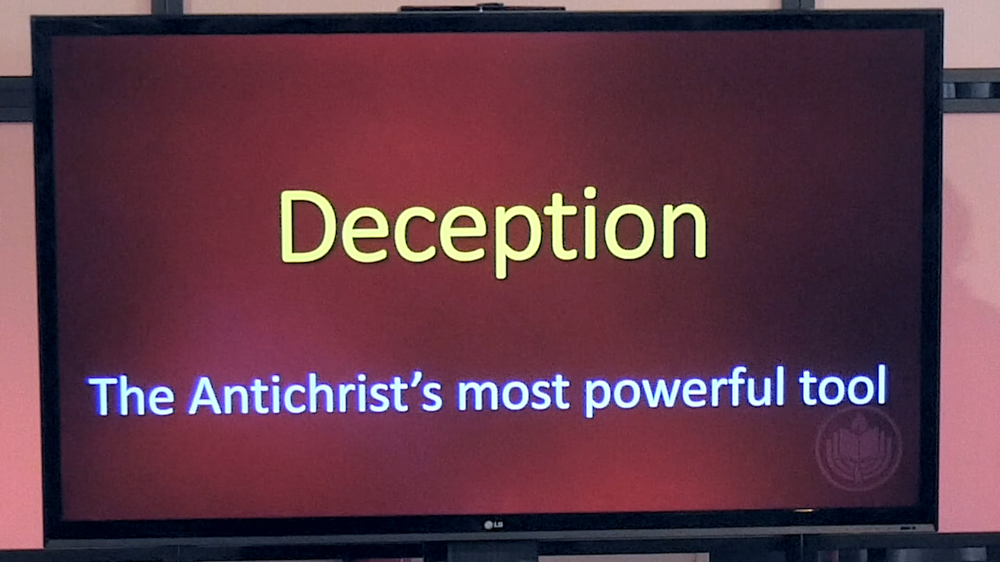
[00:19:04](https://www.youtube.com/watch?v=6lSlZahk0WU&t=1144s)

- **[The Primary Tool]** Deception is considered the Antichrist's most powerful instrument
- **[Current Climate]** The modern world is described as being "ripe to be deceived"
- **[Biblical Context]** Matthew 24 serves as a primary passage for understanding the nature of this deception

### Matthew 24 and the Warning Against Deception

- **[The Warning]** Jesus emphasizes that deception will run rampant during the end times
    - He warns followers to "take heed" and "beware" so they are not led astray
- **[The Nature of the Deception]** According to Matthew 24:4-5, the deception involves false claimants:
    - Many will come in the name of Christ
    - They will claim, "I am the Christ"
    - Their goal is to deceive a large number of people

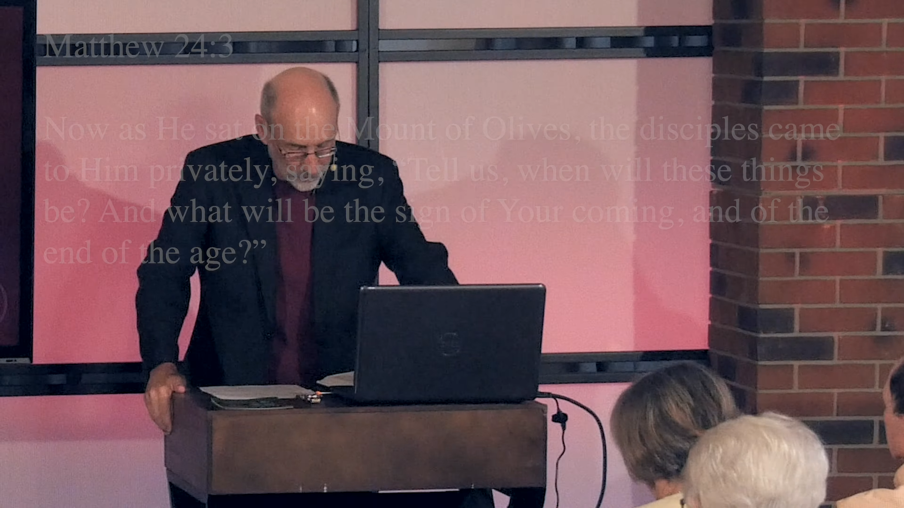
[00:20:25](https://www.youtube.com/watch?v=6lSlZahk0WU&t=1225s)

### Sophistication and Scale of Deception

- **[The Rise of False Prophets]** Matthew 24:11 warns that many false prophets will emerge and deceive a vast number of people
- **[The Power of Miraculous Deception]** According to Matthew 24:23-25, the deception will be extremely sophisticated:
    - People may claim, "Look, here is the Christ!" or "There!"
    - False Christs and false prophets will perform "great signs and wonders"
    - **[The Goal]** The purpose of these miracles is to deceive, "if possible, even the elect"

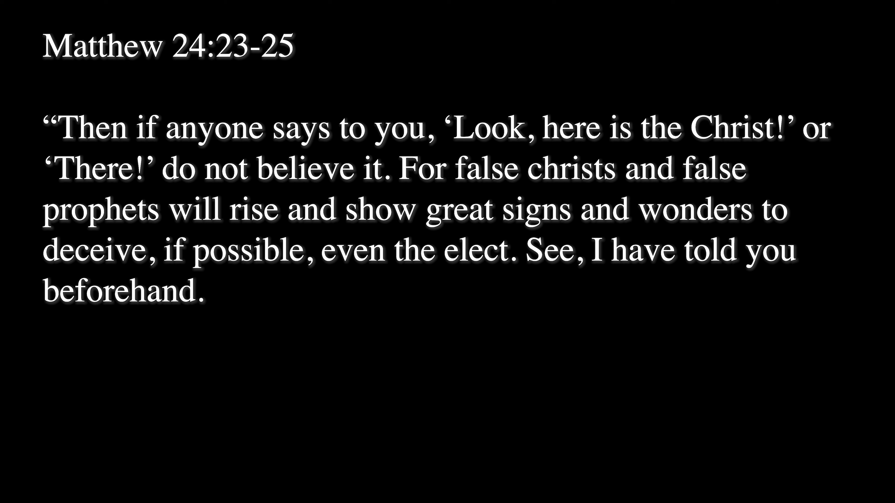
[00:21:14](https://www.youtube.com/watch?v=6lSlZahk0WU&t=1274s)

- **[A Period of Confusion]** This will be a time unlike any other, where the distinction between truth and falsehood is blurred
    - Satan will utilize these lies to cause the world to fall
- **[Modern Context]** The current world is already characterized by a "craft" of deception, particularly through digital media like the internet and social media

### The Greek Meaning of Deception

- **[Etymology]** The word "deceive" used in Matthew 24:4-5 comes from the Greek word *plananō*
    - *plananō* means to cause to stray, lead aside from the right way, wander, or roam about
- **[Satan's Objective]** This definition highlights the intent behind the deception:
    - Satan's goal is to prevent people from following the true Christ and God's Word
    - He seeks to lead individuals away from the truth so they will follow him instead

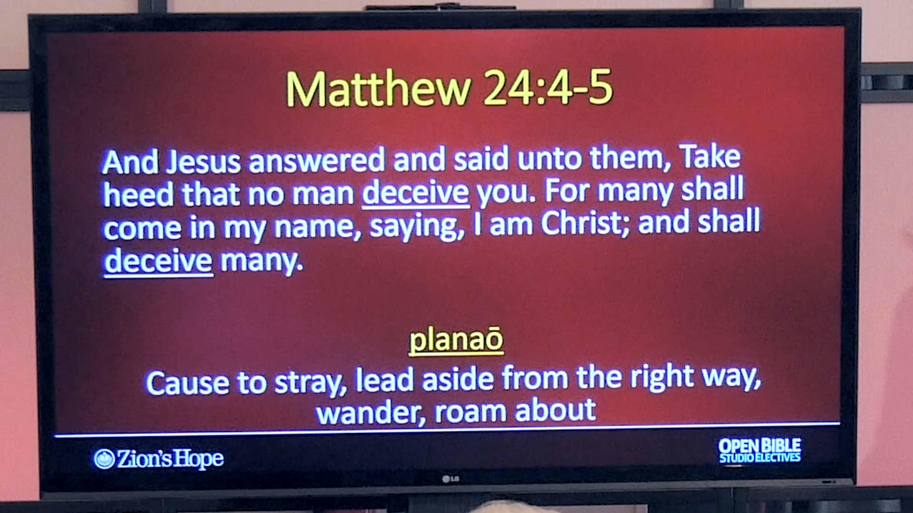
[00:22:51](https://www.youtube.com/watch?v=6lSlZahk0WU&t=1371s)

### Warnings of Deception in the Latter Times

- **[The Role of Deceiving Spirits]** Paul warns Timothy about the spiritual nature of end-times deception:
    - 1 Timothy 4:1 states that in "latter times," some will depart from the faith
    - This departure occurs because they give heed to "deceiving spirits and doctrines of demons"
    - These deceiving spirits are identified as the spirit of Satan and the spirit of the Antichrist

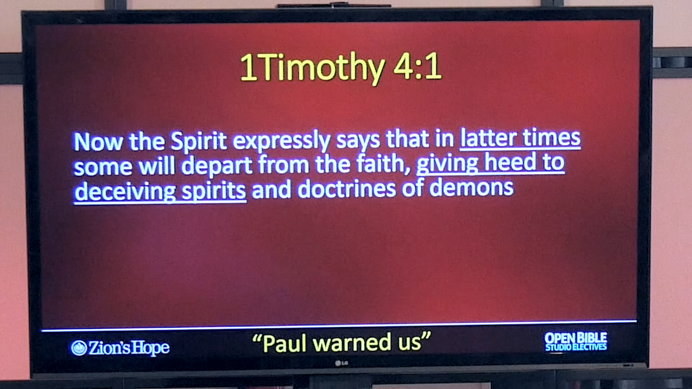
[00:23:28](https://www.youtube.com/watch?v=6lSlZahk0WU&t=1408s)

- **[Deception Within the Church]** Deception is not merely an external force but a prevalent issue within religious communities:
    - 2 Timothy 3:13 warns that "evil men and impostors will grow worse and worse, deceiving and being deceived"
    - **[Current Relevance]** The speaker suggests this is not just a future prophecy but a reality currently observed in churches today

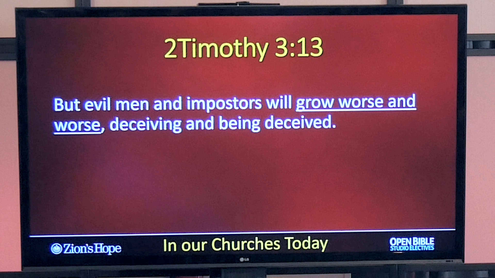
[00:23:56](https://www.youtube.com/watch?v=6lSlZahk0WU&t=1436s)

- **[The Primary Issue]** Deception is established as the central, defining characteristic of the end times, which will be further explored through 2 Thessalonians 2:9

### The Coming of the Lawless One

- **[The Nature of the Antichrist]** The arrival of the "lawless one" (the Antichrist) is not an isolated event but is driven by the direct influence of Satan (the dragon).
- **[Mechanisms of Deception]** According to 2 Thessalonians 2:9, this arrival is accompanied by:
    - All power
    - Signs
    - Lying wonders
    - Unrighteous deception

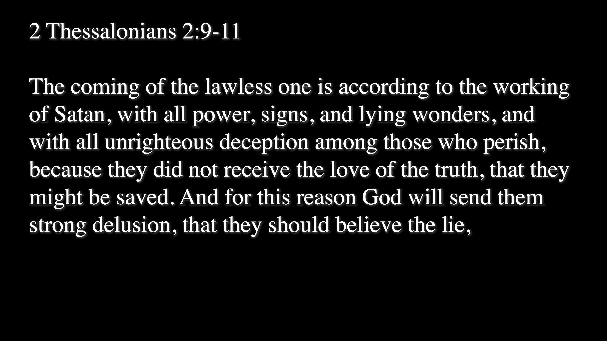
[00:24:50](https://www.youtube.com/watch?v=6lSlZahk0WU&t=1490s)

- **[The Cause of Deception]** Deception is effective among those who perish because of a fundamental rejection of truth:
    - They "did not receive the love of the truth"
- **[The Divine Consequence]** Because people have actively cast off God and chosen to believe lies, God will send a "strong delusion" so that they will believe the lie.
    - **[The Logic]** This is a consequence of people turning away from God in their hearts; they have already chosen the lie, so God allows the delusion to take hold.

### The Nature of Strong Delusion

- **[Divine Judgment]** The "strong delusion" is described as a form of divine judgment rather than just a random occurrence.
    - It echoes the principle in Romans 1 where God "gives them over" to the lusts of their hearts and flesh.
    - **[The Mechanism]** When people reach a point of total rejection of God, He responds by hardening their hearts.
    - This is seen in the book of Isaiah, where God's message to Israel and Judah involved blinding their eyes and hearts because they had already turned away.
- **[The Result]** This state of delusion allows Satan to operate with unprecedented levels of deception and deceit.

### The Deceitfulness of the Heart

- **[The Human Condition]** Because the heart is inherently unreliable, constant self-examination is required.
    - Jeremiah 17:9 states: "The heart is deceitful above all things, And desperately wicked; Who can know it?"
    - **[Application]** This underscores the necessity of Thomas Brooks' advice to examine one's own heart and lifestyle to ensure they are not being led astray.

### The Necessity of Self-Examination

- **[Individual and Collective Responsibility]** Examination is not just for the individual but also for the church as a whole.
    - **[The Goal]** To ensure that one's lifestyle and the church's direction are matching up with the words of God in the Bible.

### The Deception of "Another Jesus"

- **[The Prophecy]** Matthew 24:5 warns that a primary method of deception will involve people claiming to be the Messiah.
    - "For many shall come in my name, saying, I am Christ; and shall deceive many." (5)
- **[Historical Context]** This is not a new phenomenon; dozens or even hundreds of people throughout history have claimed to be Jesus Christ.
    - **[Increasing Trend]** While these claims have always existed, they appeared to be growing most significantly during the 20th century.

### Signs and Wonders of False Christs

- **[The Warning]** Jesus explicitly warns against believing claims of His return or presence.
    - "Then if anyone says to you, ‘Look, here is the Christ!’ or ‘There!’ do not believe it." (Matthew 24:23)
- **[The Method]** Deception will be accompanied by supernatural-looking events.
    - False Christs will rise and perform "great signs and wonders" specifically to deceive people if possible. (Matthew 24:24)

### The Concept of "Another Jesus" in Islam

- **[Biblical Caution]** The Apostle Paul warns against accepting a different spiritual message or a version of Christ that deviates from the truth.
    - "For if he who comes preaches another Jesus whom we have not preached, or if you receive a different spirit which you have not received, or a different gospel which you have not accepted—you may well put up with it!" (2 Corinthians 11:4)
- **[Islamic Connection]** This biblical warning is applicable to the study of Islam, as Islam teaches a version of Jesus that is fundamentally different from the one presented in the Bible.

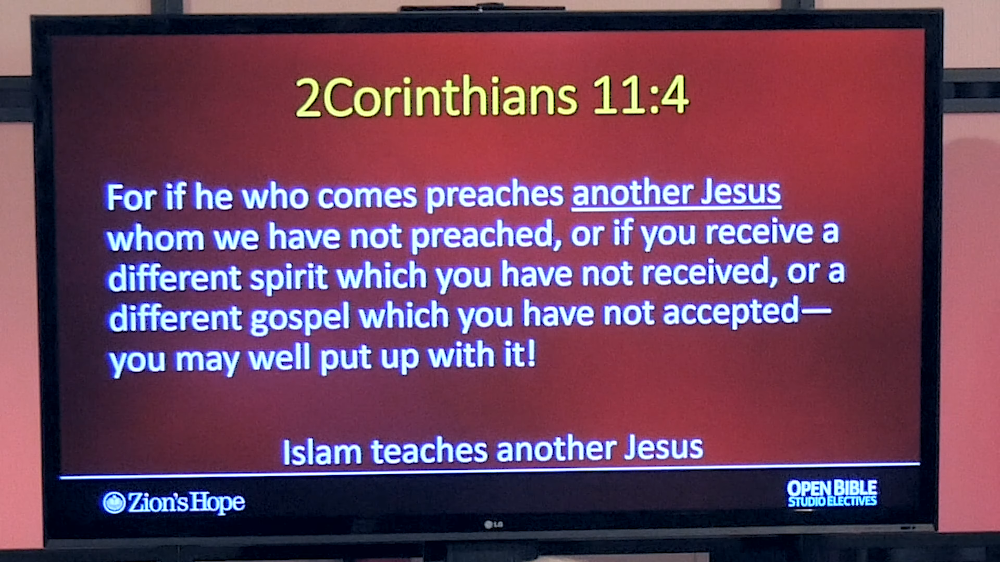
[00:29:13](https://www.youtube.com/watch?v=6lSlZahk0WU&t=1753s)

### The Deception of the "Islamic Jesus"

- **[The Core Deception]** Although Muslims believe in Jesus, the Jesus they describe is not the same Jesus presented in the Bible.
    - This represents a form of being deceived by a "different Jesus."
- **[Al Masha]** The speaker introduces the name "Al Masha" to describe this specific Islamic portrayal of Jesus.
- **[The Message of the False Christ]** This figure is expected to return claiming to be a Muslim.
    - He will assert that Christianity has been incorrect.
    - He will preach what the speaker identifies as "another gospel."

### Distinguishing the Mission Field from the Enemy

- **[People vs. Satan]** A critical distinction must be made: Muslims are not the enemy, but they are the mission field.
    - The true enemy is Satan, who has been the source of deception since the Garden of Eden.
- **[The Spiritual State]** The speaker suggests that in regions like the Middle East and Asia, the mission field is "ripe" because the current object of worship (Allah) is viewed as an idol.
    - This implies that, at their core, people may be searching for the one true God but are being led astray by spiritual deception.

### The Scope and Method of Deception

- **[The Deceiver's Goal]** Satan aims to deceive the entire world, not just isolated individuals.
    - Revelation 12:9 describes him as the "deceiver of the whole world."
- **[The Individual Approach]** Despite his global target, the process of deception happens "one person at a time."
- **[Enticement through Religiosity]** Many people are drawn into deception because they are enticed by the visible structure and discipline of a religion.
    - The speaker suggests that compared to the perceived lack of religiosity in contemporary America, the structured practices of Islam can be appealing.
    - Examples of this enticement include:
        - Praying five times a day
        - Ritualistic prayer
        - Giving alms (charity)

### Deceived vs. Radicalized

- **[The Deceived]** Most Muslims are categorized as the deceived rather than the enemy.
- **[The Radicals]** There exists a group of "radicals" who knowingly participate in and spread deception.
    - These individuals actively target different countries to advance their agenda.

### The Pursuit of Political Power

- **[Theological Aim]** Islamic theology includes a built-in design for claiming authority and political power.
- **[Strategic Targeting]** Because of this focus, the movement aims directly toward governments and places of political influence.
    - The speaker suggests the rise of Muslim leaders in certain political spheres is not a coincidence but a result of this theological design.

### The Mask of Peace

- **[Denial of Deception]** A major challenge in battling deception is that the deceiver often claims no deception is occurring.
    - The speaker notes that many people will actively deny that any kind of spiritual takeover or deception is taking place.
- **[The Role of Media]** The media can act as a significant source of misinformation by reinforcing the idea that Islam is a "peaceful religion."
    - This creates a false sense of security by claiming the religion is not attempting to influence or take over countries.
- **[The Source of Deception]** The speaker emphasizes a critical distinction: the deception is not inherent to the religion itself, but to the spiritual power behind it.
    - While the Koran may teach good things, the true problem is the entity operating behind the veil of Islam.

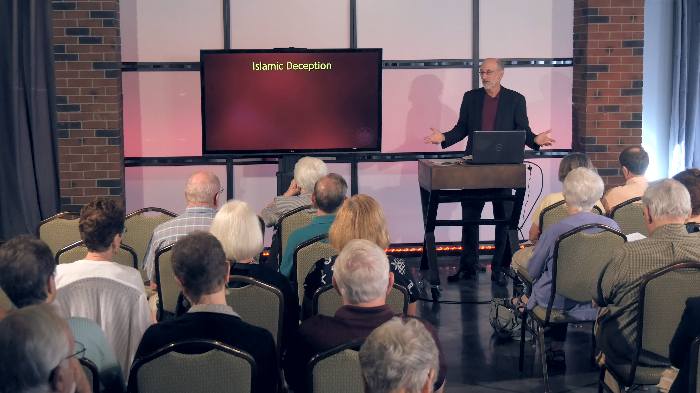
[00:33:29](https://www.youtube.com/watch?v=6lSlZahk0WU&t=2009s)

### Specific Concepts of Deception in Islam

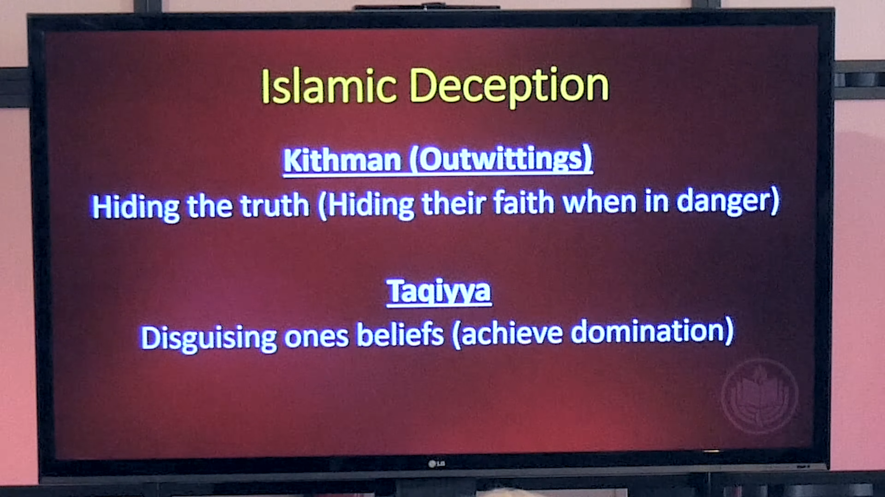
[00:34:29](https://www.youtube.com/watch?v=6lSlZahk0WU&t=2069s)

- **Kithman (Outwitting)**
    - Defined as hiding the truth or hiding one's faith when in danger
    - This allows for lying if the individual perceives they are in a position of risk
- **Taqiyya**
    - Defined as disguising one's beliefs to achieve domination
    - Unlike Kithman, which is about self-protection, Taqiyya involves lying specifically to promote the religion of Islam
- **[Theological Contrast]** The speaker notes a fundamental difference between these practices and the Bible
    - While these concepts permit lying as a strategic tool, the Bible does not support lying as a method of evangelism

### Scriptural Basis for Deception in Islam

- **[Hadith Evidence]** The speaker cites a highly respected source to show that 'inventing' information is permitted if it serves a specific purpose.
    - Source: *Sahih Al-Bukhari (49:857)*
    - Volume 3, Book 49, Number 857

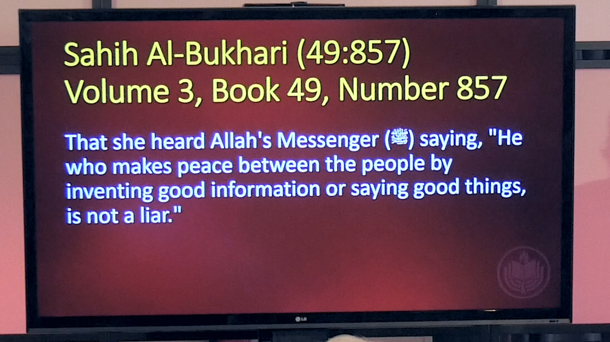
[00:35:34](https://www.youtube.com/watch?v=6lSlZahk0WU&t=2134s)

- **The Core Teaching:**
    - The text records that the Messenger of Allah (Muhammad) said:

      > "He who makes peace between the people by inventing good information or saying good things, is not a liar."

- **[Theological Implication]** This provides a religious framework for the concept of Taqiyya.
    - It suggests that one is not considered a 'liar' even when 'inventing' information, provided the intent is to make peace or achieve a specific goal (like domination).
    - This reconciles the practice of lying for strategic religious advancement with the religious identity of the practitioner.

### Discernment

- **[Definition]** The ability to decide between good and evil, right and wrong, and truth and lies.
- **[The World's Fatal Flaw]** The speaker posits that the world (and even the church) is currently failing miserably at exercising discernment.
- **[Post-Truth Era]** The concept of a "post-truth" world, which was the Oxford Dictionary's 2016 Word of the Year.
    - **Definition:** Circumstances where objective facts are less influential in shaping public opinion than appeals to emotion and personal belief.
    - In this state, personal convictions override objective facts.

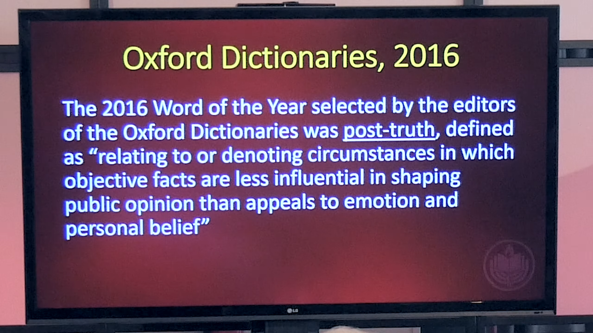
[00:37:01](https://www.youtube.com/watch?v=6lSlZahk0WU&t=2221s)

### The Erosion of Truth and Understanding

- **[Modern Examples of Undiscerning Culture]** The speaker notes a growing trend where objective reality is treated as subjective or negotiable.
    - **Subjective Facts:** Using the example of a student arguing that $1+1$could be$3$ if they "really feel it is," illustrating a departure from fundamental truths.
    - **"Fake News":** A potent modern buzzword describing the manipulation of information.
    - **"Fake Truth":** A term the speaker uses to describe the oxymoronic state of current discourse, where the distinction between what is real and what is manufactured is blurred.
- **[Biblical Parallel: Lack of Understanding]** This cultural state mirrors biblical descriptions of a nation's spiritual and cognitive decline.
    - **Deuteronomy 32:28:**

      > "For they are a nation void of counsel, nor is there any understanding (discernment) in them."

    - **[Historical Context]** The speaker notes that under Moses, the nation of Israel was described this way, highlighting that a lack of discernment is a recurring historical and spiritual problem.

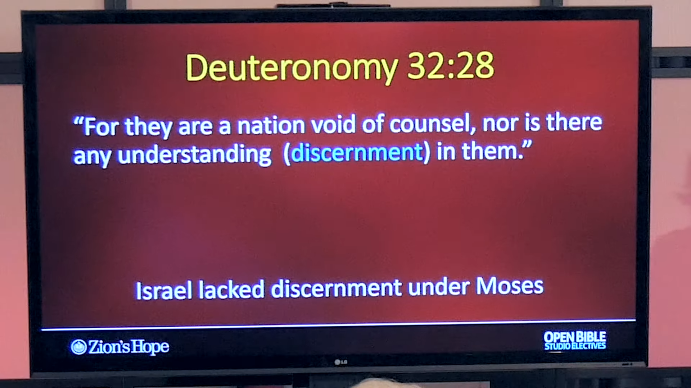
[00:38:57](https://www.youtube.com/watch?v=6lSlZahk0WU&t=2337s)

### The Need for Spiritual Discernment

- **[The Pharisee Paradox]** Christ pointed out a fundamental failure in discernment among the Pharisees.
    - They could interpret physical signs, like the weather (e.g., a red sky at night or morning), but failed to recognize the spiritual significance of the times.

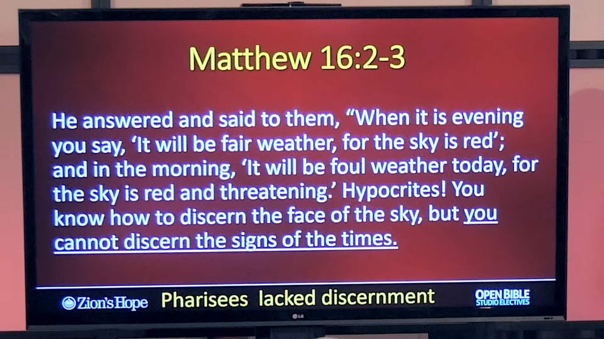
[00:39:11](https://www.youtube.com/watch?v=6lSlZahk0WU&t=2351s)

- **[The Cure for Deception]** Scripture is identified as the primary remedy for being misled.
    - **Proverbs 2:6:** The Lord is the source of wisdom, knowledge, and understanding.
    - **2 Timothy 3:16-17:** All Scripture is God-breathed and essential for doctrine, reproof, correction, and instruction in righteousness.
    - **1 Thessalonians 5:21 & 1 John 4:1:** The command to "test all things" and hold fast to what is good by testing everything against the standard of Scripture.

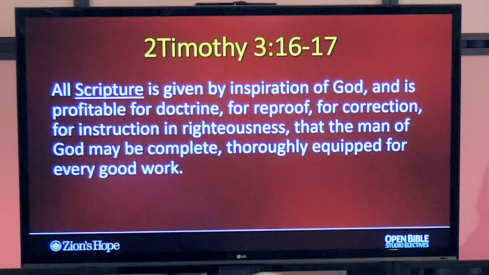
[00:39:38](https://www.youtube.com/watch?v=6lSlZahk0WU&t=2378s)

### Sacred Writings

- **[The Foundation of Religion]** Every religion is built upon its specific books or perceived sources of truth.

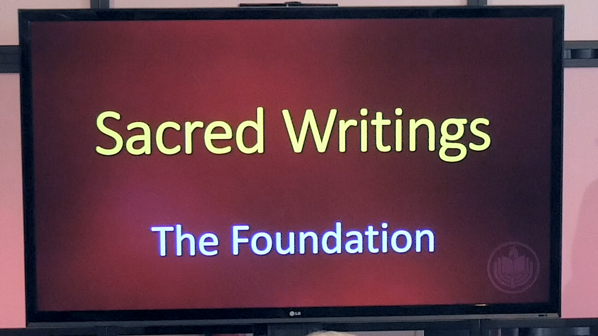
[00:40:18](https://www.youtube.com/watch?v=6lSlZahk0WU&t=2418s)

- **[Islam's Foundation]** Islam is built upon the Quran, which followers claim contains the words of Allah, purportedly delivered through an angel.

### Islamic Sacred Writings

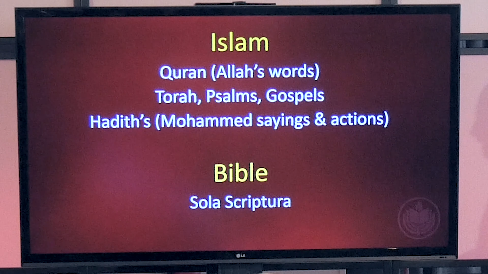
[00:40:39](https://www.youtube.com/watch?v=6lSlZahk0WU&t=2439s)

- **[Core Texts]** Beyond the Quran, Islam recognizes several other foundational sources:
    - **Quran:** Believed to be the words of Allah delivered through the angel Gabriel.
    - **Torah, Psalms, and Gospels:** Recognized as part of their religious framework.
    - **Hadith:** The recorded sayings and actions of Muhammad, which are held to be just as sacred as the words of Allah.
- **[Comparison to Christianity]** The speaker compares the Islamic reliance on these various texts to the Protestant principle of **Sola Scriptura** (Scripture alone), noting that these books serve as the ultimate source of truth for the faith.

### Conflicting Claims of Authority

- **[Competing Truth Claims]** Both the Bible and the Quran claim to be the direct, uncorruptible Word of God.
    - **Bible (2 Timothy 3:16):** Asserts all Scripture is given by inspiration of God and is profitable for doctrine, reproof, correction, and instruction in righteousness.
    - **Quran (15:9):** Claims, "We have, without doubt, sent down the Message; and we will assuredly guard it (from corruption)."

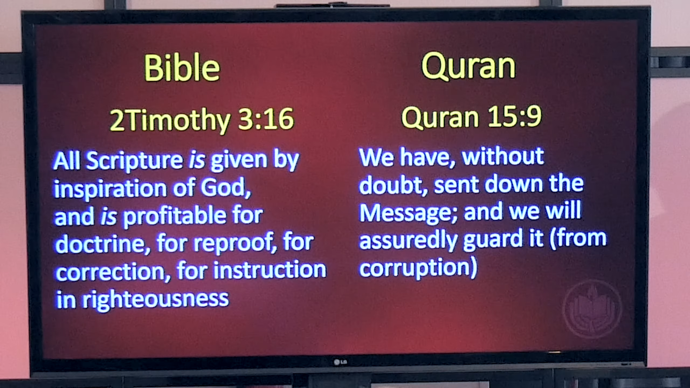
[00:41:50](https://www.youtube.com/watch?v=6lSlZahk0WU&t=2510s)

- **[The Problem of Contradiction]** Because both books claim to be the ultimate, uncorruptible truth, they cannot both be right if their teachings disagree.

### The Quranic Account of Human Creation

- **[Origins of Man]** The speaker begins testing the Quran's consistency by looking at its various descriptions of how humanity was created.

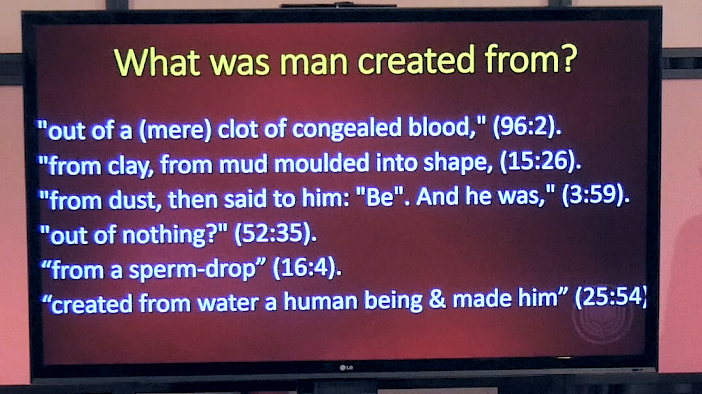
[00:42:35](https://www.youtube.com/watch?v=6lSlZahk0WU&t=2555s)

- **[Varied Creation Descriptions in the Quran]**
    - **96:2:** "out of a (mere) clot of congealed blood"
    - **15:26:** "from clay, from mud moulded into shape"
    - **3:59:** "from dust, then said to him: 'Be'. And he was"
    - **52:35:** "out of nothing?"
    - **16:4:** "from a sperm-drop"
    - **25:54:** "created from water a human being & made him"

### Contradictions in Quranic Creation

- **[The Problem of Inconsistency]** The Quran provides multiple, seemingly conflicting accounts of what humanity was created from:
    - **96:2:** "out of a (mere) clot of congealed blood"
    - **15:26:** "from clay, from mud moulded into shape"
    - **3:59:** "from dust, then said to him: 'Be'. And he was"
    - **52:35:** "out of nothing?"
    - **16:4:** "from a sperm-drop"
    - **25:54:** "created from water a human being & made him"
- **[Conclusion]** Because these descriptions vary so widely (blood, mud, dust, sperm, water), the speaker argues they constitute contradictions rather than a unified truth.

### Prophecy as the Test of Truth

- **[The Divine Challenge]** The speaker posits that the most significant proof of the Bible is prophecy.
- **[Isaiah 41:22]** Prophecy serves as a challenge to idols and false gods to demonstrate their validity by predicting the future:

> "Let them bring forth and show us what will happen; Let them show the former things, what they were, that we may consider them, and know the latter end of them; Or declare to us things to come."

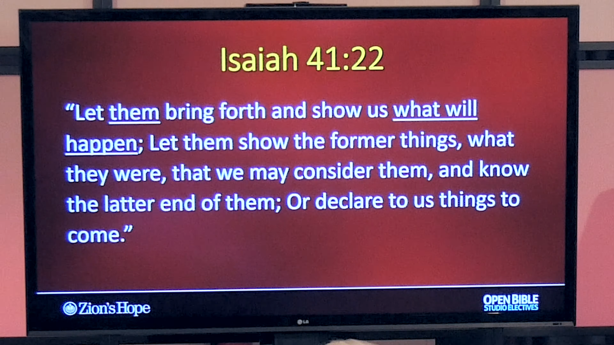
[00:43:30](https://www.youtube.com/watch?v=6lSlZahk0WU&t=2610s)

### Prophecy as Divine Validation

- **[The Reliability of God]** The speaker asserts that because God has never failed in His biblical prophecies, He will not fail regarding end-times prophecies.
- **[The Test of Truth]** Prophecy is used as the ultimate metric to distinguish between the Word of God and human delusion.

---

### The God Deception

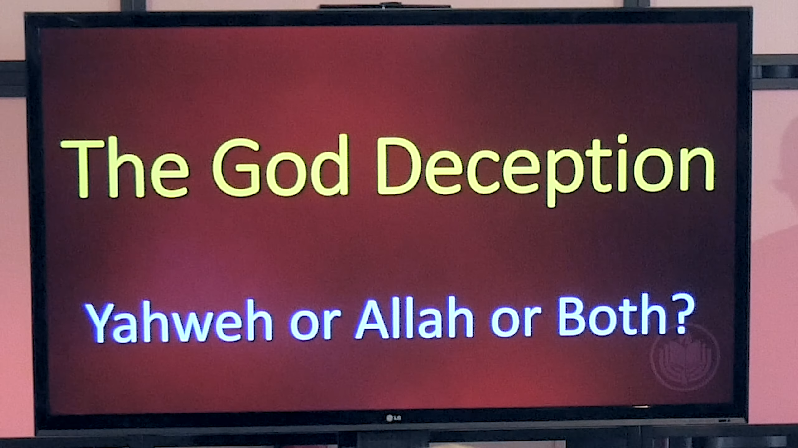
[00:44:04](https://www.youtube.com/watch?v=6lSlZahk0WU&t=2644s)

- **[The Foundational Question]** A central point of deception involves the identity of God: Is it Yahweh, Allah, or both?
- **[Claims of Exclusivity]** Both the Bible and the Quran claim to be the absolute truth and demand exclusive worship of a single deity, creating a logical contradiction:

| Source | Scripture | Claim |
| --- | --- | --- |
| Bible | Isaiah 45:6 | "...there is none besides Me. I am the LORD, and there is no other" |
| Quran | Quran 3:18 | "Allah witnesses that there is no deity except Him... There is no deity except Him..." |

- **[The Logical Dilemma]** Since both texts claim to be the uncorruptible Word of God and both claim there is no other deity, they cannot both be correct. One must be wrong.

### The Push for Religious Syncretism

- **[The Idea of One God]** There is a growing global movement toward extreme religious tolerance, suggesting that all religions are essentially worshiping the same deity.
- **[The Abrahamic Family House]** An example of this is a project in Abu Dhabi, United Arab Emirates, designed to house three different faiths in one complex:
    - A church
    - A synagogue
    - A mosque
- **[Goal of the Complex]** The purpose is to bring the followers of Judaism, Christianity, and Islam together under the premise that they are all children of the same God and that their books teach the same truth.

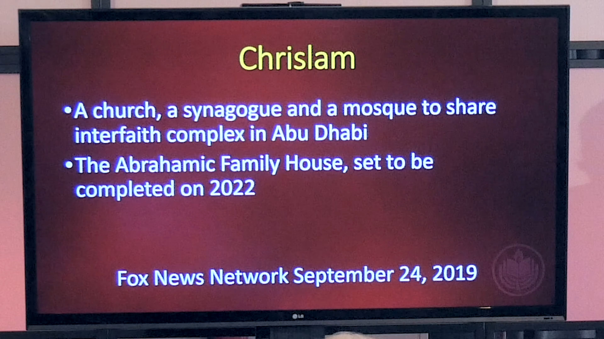
[00:45:20](https://www.youtube.com/watch?v=6lSlZahk0WU&t=2720s)

- **[The Question of Truth]** This movement raises the fundamental question: are these religions actually the same, or is the push for unity a form of deception?

### The Litmus Test for Religious Unity

- **[The Three-Word Test]** To counter the claim that all religions are essentially the same, the speaker proposes one critical question:
    - "Is Jesus God?"
- **[The Theological Divide]** This question exposes the fundamental contradictions between the Abrahamic faiths:
    - **Islam**: Denies the divinity of Jesus. They believe Allah is strictly one and has no Son, rejecting the concept of the Trinity.
    - **Judaism**: While acknowledging Jesus as a figure, they do not accept Him as God.
    - **Christianity**: Asserts that Jesus is God.
- **[Conclusion on Syncretism]** Because these faiths hold mutually exclusive views on the nature of Jesus, the claim that they are all worshiping the same deity is a deception.

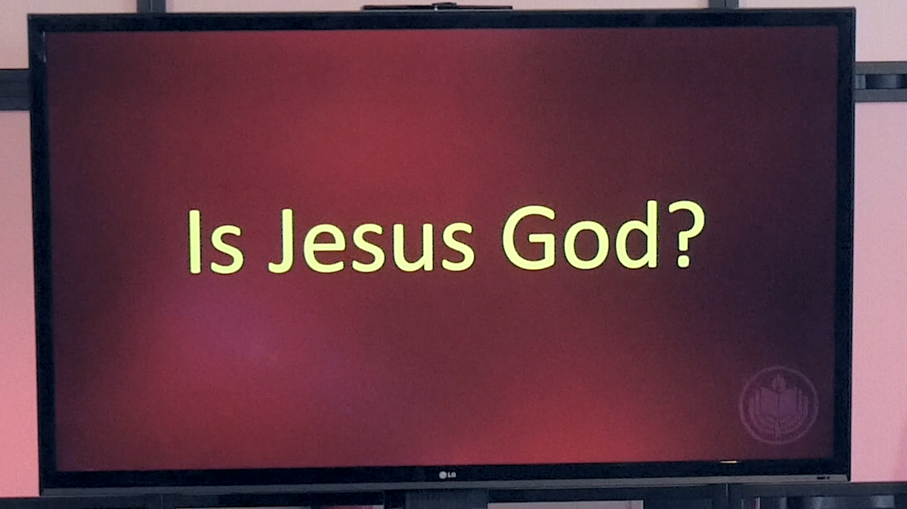
[00:46:41](https://www.youtube.com/watch?v=6lSlZahk0WU&t=2801s)

### The Ultimate Source of Truth

- **[The Crisis of Discernment]** Modern society is characterized by a lack of discernment, where truth is increasingly difficult to identify.
- **[The Bible as Authority]** Despite the claims of other religious texts, the Bible is presented as the only true source of spiritual truth.
- **[The Central Issue of Deception]** The identity of Jesus is the most critical point of contention:
    - False Christs will attempt to use the name of Jesus to mislead people.
    - The fundamental question remains: "Who is Jesus Christ?"
    - For the believer, Jesus is the Savior of the one true God, and this identity is the standard against which all claims must be measured.

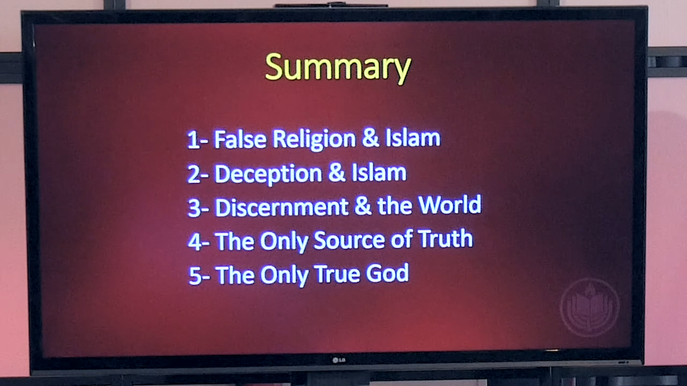
[00:47:41](https://www.youtube.com/watch?v=6lSlZahk0WU&t=2861s)

### Session Conclusion and Prayer

- **[A Prayer for Discernment]** The session concludes with a prayer focused on several spiritual needs:
    - Examining hearts to prevent deception
    - Planting understanding and discernment to see the truth
    - Recognizing the one true God and Christ as God Almighty

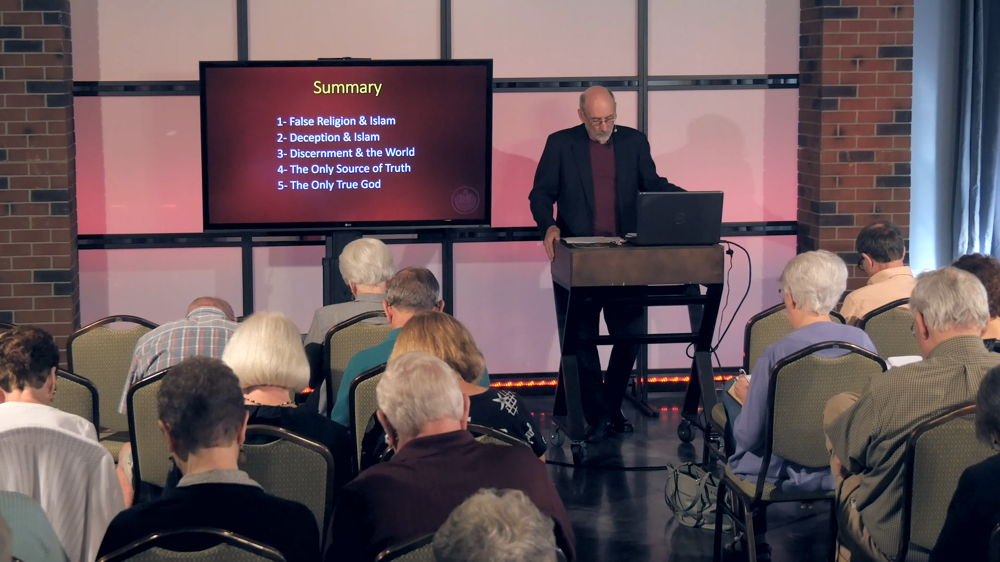
[00:48:57](https://www.youtube.com/watch?v=6lSlZahk0WU&t=2937s)