## Islamic Eschatology

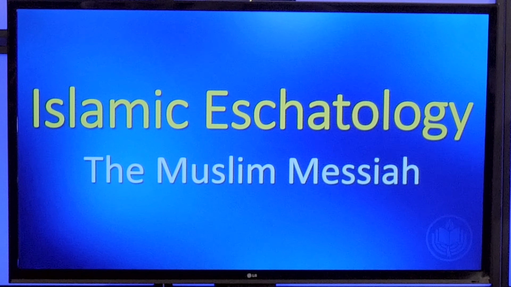
[00:00:15](https://www.youtube.com/watch?v=d38RCnCkevg&list=PLj9bOvimh2NyU1STwZqO7ccG5wdfGID64&index=41&t=15s)

- An exploration of how the world ends within Islamic belief
- **[Focus]** Examining the concept of the "Muslim Messiah"
    - Comparing Islamic end-times views with biblical eschatology
    - Analyzing the similarities and differences between their respective views of a savior

### Key Figures of Eschatology

To understand the end times, it is necessary to be familiar with three primary figures found in both biblical and Islamic traditions.

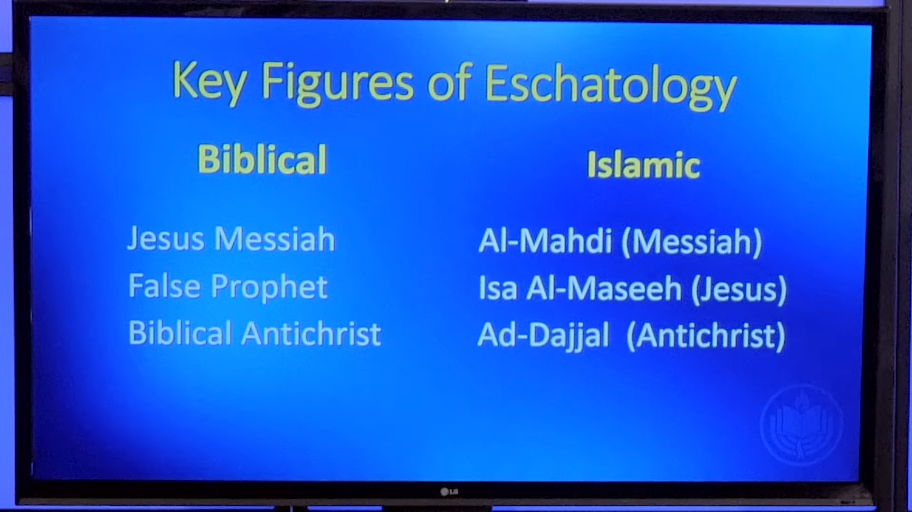
[00:01:48](https://www.youtube.com/watch?v=d38RCnCkevg&list=PLj9bOvimh2NyU1STwZqO7ccG5wdfGID64&index=41&t=108s)

| Biblical | Islamic |
| --- | --- |
| Jesus Messiah | Al-Mahdi (Messiah) |
| False Prophet | Isa Al-Maseeh (Jesus) |
| Biblical Antichrist | Ad-Dajjal (Antichrist) |

### Biblical Figures in the Final Era

- The False Prophet
    - His activities are described in Revelation chapter 13
- The Biblical Antichrist
    - Described in Revelation 13:1-8
- **[Context]** These figures are expected to emerge during the final epic era of mankind's history

### Islamic Parallels and Mirroring

- The speaker suggests the similarities between biblical and Islamic figures are not a coincidence, but a mirroring effect
- **Al-Mahdi**
    - Identified as the Muslim Messiah
    - The Muslim world awaits his appearance much like the Christian expectation of Jesus

### Islamic Counterparts to Biblical Figures

- **Isa Al-Maseeh (Jesus)**
    - The Islamic figure corresponding to Jesus Christ
    - While Muslims believe in the Gospels and the return of Jesus, the speaker suggests this figure serves as a "false Christ" as described in Matthew 24
- **Ad-Dajjal (Antichrist)**
    - The Islamic counterpart to the biblical Antichrist
    - Believed by some to be alive today
    - Expected to arise and challenge the Islamic faith and its followers

### Deception through Mirroring

- The speaker posits that the various eschatological figures in Islam are not true biblical figures
    - Instead, they are viewed as false figures put forth by Satan
    - The goal of this mirroring is to create confusion and divert people from biblical truth

### The Biblical Antichrist in Revelation 13

- An examination of the characteristics of the beast described in the Bible
- **[Source]** Revelation 13:1-8
    - Describes a beast rising out of the sea
    - Possesses supernatural, powerful, and vicious qualities
    - Represented by the apostle John

### Detailed Description of the Beast in Revelation 13

- **Physical Appearance (Revelation 13:1-2)**
    - Rising out of the sea
    - Possessing seven heads and ten horns
    - Ten crowns located on the horns
    - A blasphemous name on its head
    - Resembling a leopard
    - Feet like those of a bear
    - Mouth like that of a lion
- **Source of Power**
    - The dragon (Satan) gave the beast his power, his throne, and great authority
- **The Deadly Wound (Revelation 13:3)**
    - One of the beast's heads appeared to have been mortally wounded
    - The deadly wound was subsequently healed
    - This event caused the entire world to marvel and follow the beast
- **Worship and Authority (Revelation 13:4-6)**
    - The world worshipped the dragon for giving authority to the beast
    - The world also worshipped the beast itself, asking, "Who is like the beast? Who is able to make war with him?"
    - The beast was granted a mouth capable of speaking great things and blasphemies
    - It was given authority to continue its actions for forty-two months

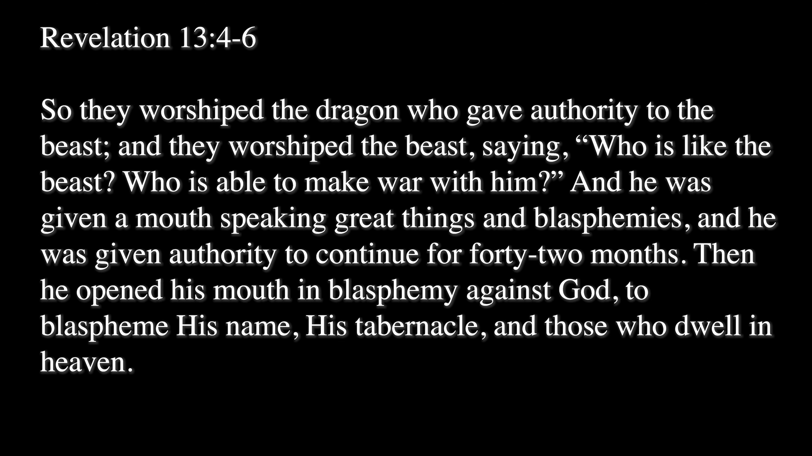
[00:07:04](https://www.youtube.com/watch?v=d38RCnCkevg&list=PLj9bOvimh2NyU1STwZqO7ccG5wdfGID64&index=41&t=424s)

### Continued Description of the Beast in Revelation 13

- **Blasphemy and Authority (Revelation 13:5-6)**
    - Granted a mouth to speak blasphemies against God
    - Targets include God's name, His tabernacle, and those in heaven
    - Granted authority to continue for forty-two months
- **Warfare and Global Worship (Revelation 13:7-8)**
    - Granted authority to make war with the Saints and overcome them
    - Authority extends over every tribe, tongue, and nation
    - All inhabitants of the earth will worship the beast
    - This applies to everyone whose names are not written in the Book of Life (the Lamb slain from the foundation of the world)

### Comparing Biblical and Islamic Attributes

- **Core Characteristics of the Biblical Antichrist**
    - Powerful
    - Seeking world domination
    - Supernatural
    - Spiritual
- **[Connection to Islam]**
    - These biblical attributes coincide with many descriptions of the Islamic figure, Imam al-Mahdi

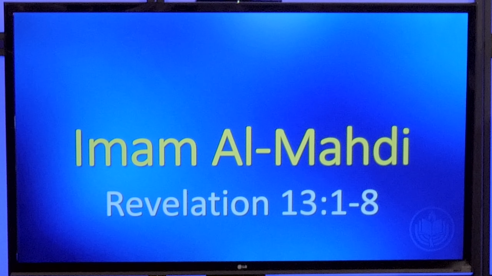
[00:08:46](https://www.youtube.com/watch?v=d38RCnCkevg&list=PLj9bOvimh2NyU1STwZqO7ccG5wdfGID64&index=41&t=526s)

### Imam Al-Mahdi

- **The Title 'Imam'**
    - Represents a position of divine authority
    - While some mosques have lower Imams, eschatology focuses on the final, divinely empowered Imam of world history
- **Meaning of Al-Mahdi**
    - Translates to "the divinely appointed one" or "the rightly guided one"
    - Often referred to simply as "Mahdi"

### Revelation 13:1

- **The Emergence of the Beast**
    - "Then I stood on the sand of the sea. And I saw a beast rising up out of the sea..."

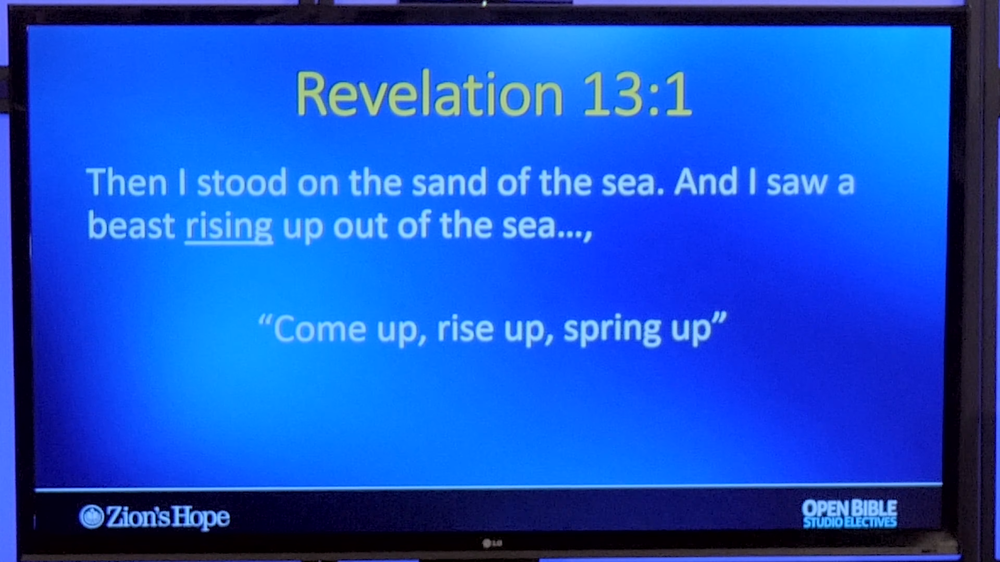
[00:09:45](https://www.youtube.com/watch?v=d38RCnCkevg&list=PLj9bOvimh2NyU1STwZqO7ccG5wdfGID64&index=41&t=585s)

### The Emergence of the Mahdi and the Beast

- **Expectation of Rise**
    - In the Muslim faith, many believe the Mahdi is already present on Earth
    - Others are waiting for him to "spring up" or rise up into history
- **The Beast's Origin (Revelation 13:1)**
    - The beast is described as rising up out of the sea
    - This "sea" can be interpreted as the sea of humanity or a sea of evil

### Mahdi Viewpoints in Islam

- **Major Islamic Branches**
    - The two primary groups with differing opinions on the Mahdi are the Shiites and the Sunnis

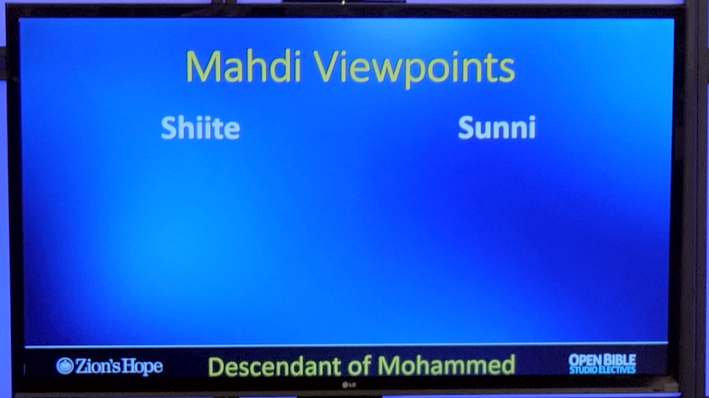
[00:10:59](https://www.youtube.com/watch?v=d38RCnCkevg&list=PLj9bOvimh2NyU1STwZqO7ccG5wdfGID64&index=41&t=659s)

### Shiite Perspectives on the Mahdi

- **The Twelvers (Imamiyyah)**
    - A specific subgroup within the Shiite branch
    - They are focused on the expectation of the **12th Imam**
    - **[Significance]** For this group, the 12th Imam is their creation, their savior, and their Messiah

### Historical Context of the Sunni-Shiite Split

- **The Origin of the Divide**
    - The split began following the death of Muhammad in 632 AD
    - This era was marked by a significant struggle for power that eventually defined the two major Islamic groups

### The Root of the Sunni-Shiite Split

- **The Core Conflict**
    - The divide was driven by a struggle over leadership succession
    - The central question was: "Who is in charge?"
- **Two Competing Models of Leadership**
    - **Bloodline**: Leadership should belong to a literal descendant of Muhammad
    - **Election**: Leadership should go to someone deemed qualified and appointed/elected by the community

### Shiite Lineage of Imams

- **The Concept of the Imam**
    - For the Shiite group, the Imam is a divinely appointed religious and spiritual leader
- **Consecutive Succession**
    - The Shiites followed a line of consecutive Imams
    - Between 632 AD and 874 AD, there were 11 Imams in succession

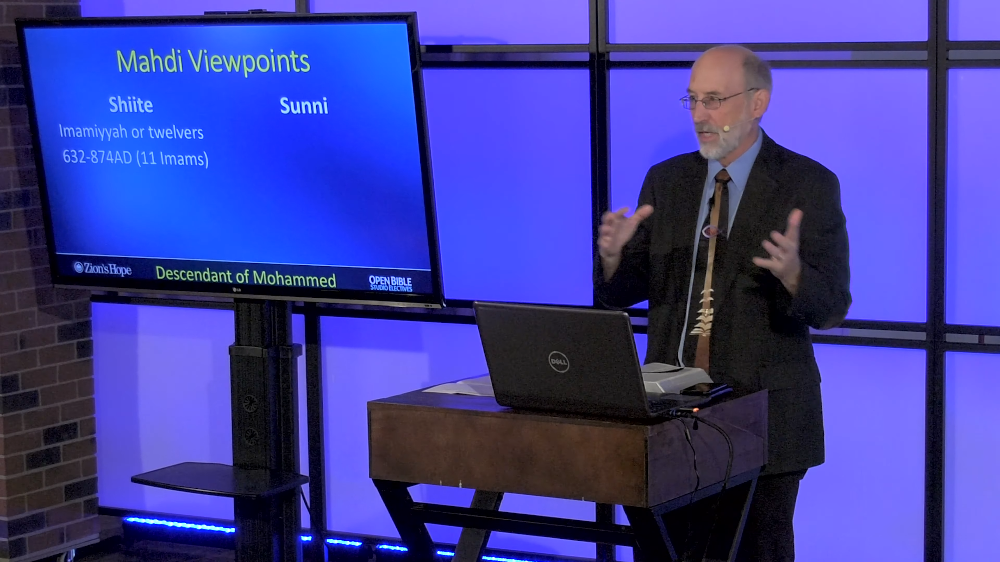
[00:13:12](https://www.youtube.com/watch?v=d38RCnCkevg&list=PLj9bOvimh2NyU1STwZqO7ccG5wdfGID64&index=41&t=792s)

### The 12th Imam and the Concept of Occultation

- **The 12th Imam's Birth**
    - Said to be the son of the 11th Imam
    - Born around 868 AD (approximately five years before his father's death)
- **[Why he was hidden]** To protect him from assassination due to the volatile political situation and ongoing wars
- **The State of the 12th Imam**
    - According to Shiite theology, he was "hidden and stored out of sight" for his own safety
    - He is believed to still be alive today through supernatural means

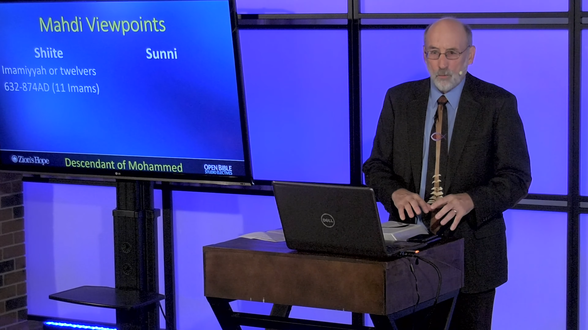
[00:14:17](https://www.youtube.com/watch?v=d38RCnCkevg&list=PLj9bOvimh2NyU1STwZqO7ccG5wdfGID64&index=41&t=857s)

### Comparison of Mahdi Viewpoints

- **Shiite (Imamiyyah or Twelvers)**
    - Believe the 12th Imam is currently alive but in a state of **Ghayba** (Occultation)
    - **[The concept of Ghayba]** He is present on Earth but remains hidden from view
    - It is claimed he has appeared at various points in history to help Muslims, only to return to a state of being hidden
    - Shiites are waiting for his final, public reappearance
- **Sunni**
    - Also await the Mahdi, but hold a different view on his current status
    - Believe the Mahdi is a figure who has not yet been born
    - Expect him to be born and rise to power at the appropriate time

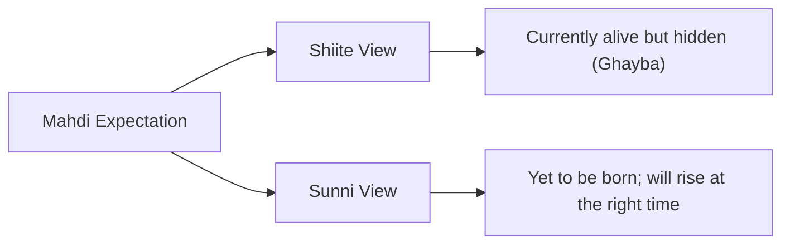

### Shared Belief in the Mahdi

- **Lineage Requirement**
    - Both Sunni and Shiite groups believe the Mahdi must be a literal descendant of Muhammad

### Anticipation of the Messiah Across Abrahamic Faiths

- **The Islamic Perspective**
    - The Islamic faith as a whole is characterized by great anticipation for the Mahdi to rise up and take leadership over the movement and the faith
- **The Jewish Perspective**
    - Unlike the active anticipation in Islam, most modern Jewish people are secular and are not actively looking for a Messiah
    - Among traditional Jews, there is a sense of 'missing' the coming Messiah rather than an active, expectant pursuit

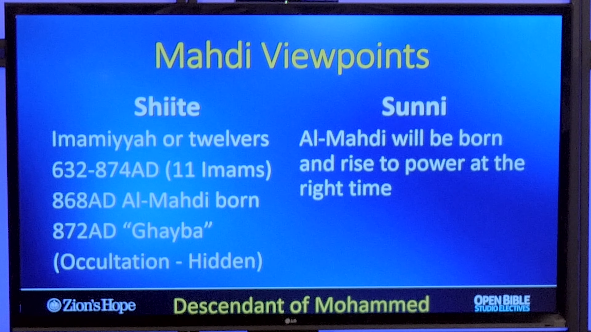
[00:15:48](https://www.youtube.com/watch?v=d38RCnCkevg&list=PLj9bOvimh2NyU1STwZqO7ccG5wdfGID64&index=41&t=948s)

### Comparing Messianic Anticipation

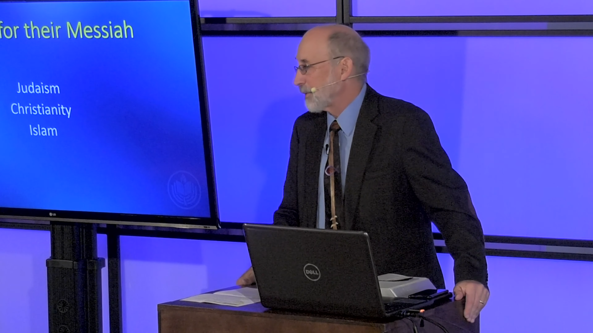
[00:17:10](https://www.youtube.com/watch?v=d38RCnCkevg&list=PLj9bOvimh2NyU1STwZqO7ccG5wdfGID64&index=41&t=1030s)

- **Judaism**
    - Lacks widespread active excitement for the coming Messiah
    - Many modern Jewish people are secular and do not actively look for one
    - Traditionalists experience a sense of 'missing' the Messiah rather than an active pursuit
- **Christianity**
    - Characterized by the belief that Jesus Christ is returning
    - **[The paradox of anticipation]** While there is high theoretical excitement, there is a risk of spiritual lethargy, where people live as if nothing will happen
- **Islam**
    - Defined by great anticipation for the rise of the Mahdi to lead the faith

### Biblical Expectation of Christ's Return

- **[2 Peter 3:12a]** "Looking for and hastening the coming of the day of God..."

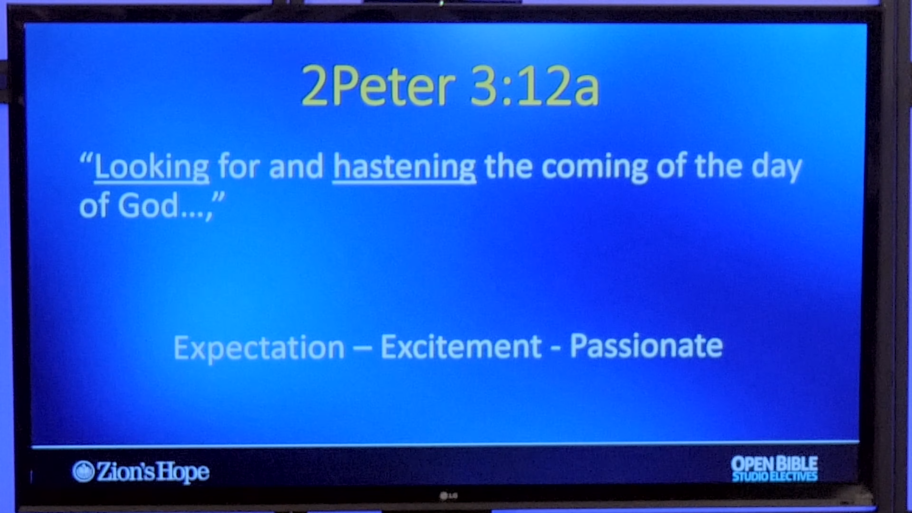
[00:17:49](https://www.youtube.com/watch?v=d38RCnCkevg&list=PLj9bOvimh2NyU1STwZqO7ccG5wdfGID64&index=41&t=1069s)

    - This implies a specific intent and attitude:
        - Expectation
        - Excitement
        - Passionate fervency
- **[The goal for believers]** To avoid a "lackadaisical" or "lukewarm" attitude, instead maintaining an active focus on Christ's return

### Zealous Expectation in Islam

- According to Pew Research Center data (August 9, 2012):

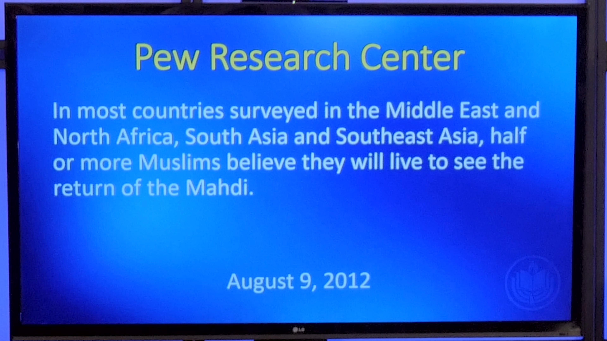
[00:18:31](https://www.youtube.com/watch?v=d38RCnCkevg&list=PLj9bOvimh2NyU1STwZqO7ccG5wdfGID64&index=41&t=1111s)

    - In most surveyed countries in the Middle East, North Africa, South Asia, and Southeast Asia:
        - Half or more Muslims believe they will live to see the return of the Mahdi
    - This expectation is characterized by fervency and is noted to be growing over time

### Historical Evidence of Messianic Fervor

- **Case Study: Iran**
    - As a primarily Shiite nation, there is a profound expectation for the return of the 12th Imam
    - This belief is not merely theoretical but manifests as intense passion and fervor
- **[The 1979 Revolution]** The anticipation of the Mahdi acted as a primary motivator for political and military action
    - Ayatollah Khomeini utilized the coming of the Mahdi as an impetus to lead the revolution
    - The belief that the Mahdi's arrival was imminent helped drive the movement toward seizing power

### Modern Manifestations of Messianic Fervor

- **Contemporary Iran**
    - The expectation of the Mahdi remains a central, permanent fixture in Iranian belief
    - **[The belief system]** There is a conviction that by working hard to advance Islam and their specific national agenda, they will trigger the Mahdi's rise
    - This transforms political and military movements into religious movements driven by the anticipation of a savior
- **Extremist Groups**
    - This same mentality is a driving force for groups such as ISIS
    - They are motivated by the belief that aggressive religious action will bring about the arrival of their Messiah

### Global Manifestations of Messianic Anticipation

- **Hezbollah (Lebanon)**
    - Driven by the same common anticipation of the Mahdi
    - **[Claims of divine aid]** The group claims the 12th Imam (the hidden Mahdi) made an appearance to assist them in winning strategic battles in 2006
- **Global Patterns**
    - Various nations and groups engage in military movements and jihad to encourage the Mahdi to emerge from his hidden position
- **The Final Conflict**
    - The belief is that once jihad reaches its peak, the Mahdi will appear to conclude human history with a final war
    - This mirrors the biblical concept of "wars and rumors of wars" leading to one major final conflict

### Understanding Jihad

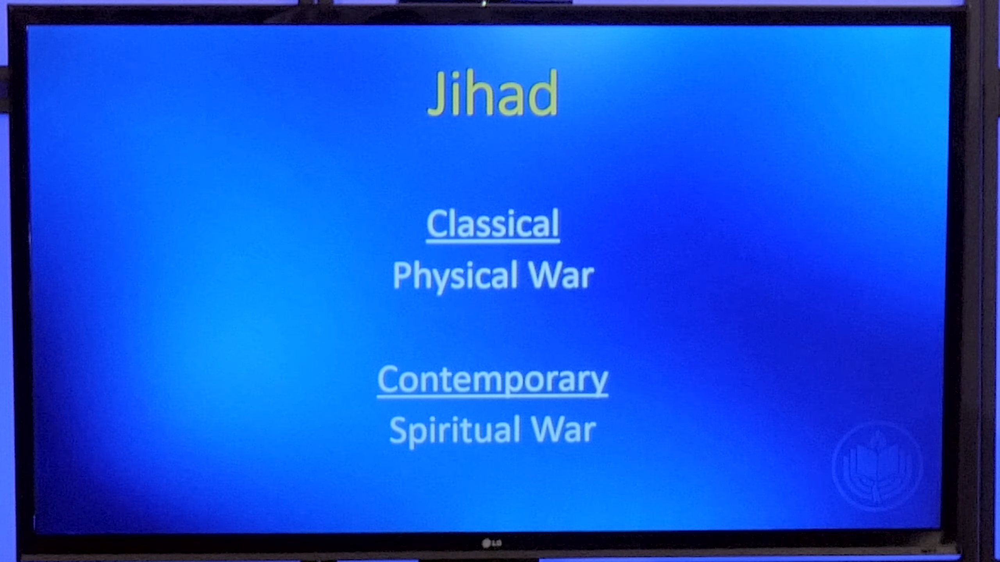
[00:22:29](https://www.youtube.com/watch?v=d38RCnCkevg&list=PLj9bOvimh2NyU1STwZqO7ccG5wdfGID64&index=41&t=1349s)

- **Jihad** is primarily understood as a struggle or war, categorized into two forms:
    - **Classical Jihad**: Physical, military warfare
    - **Contemporary Jihad**: Spiritual warfare

### The Nature of Jihad

- **[Historical vs. Modern]** There is a distinction between the primary scriptural meaning and how the term is marketed today
    - **Classical Jihad**: Primarily understood in the Quran and Hadith as physical, military warfare
    - **Contemporary Jihad**: Often presented as a spiritual battle (the internal struggle between good and evil), but this is not the primary historical definition
- **[The Reality for Many Nations]** For many nations and extremist groups, the expectation is not just a spiritual struggle, but a literal, physical war that serves as the final frontier before the Mahdi rises

### The Mahdi as a Military Figure

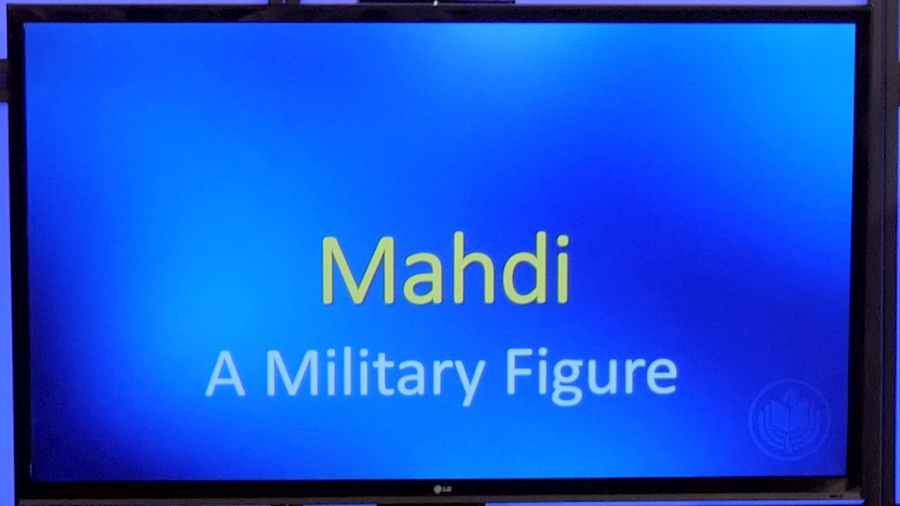
[00:23:30](https://www.youtube.com/watch?v=d38RCnCkevg&list=PLj9bOvimh2NyU1STwZqO7ccG5wdfGID64&index=41&t=1410s)

- **[Core Characteristic]** A primary characteristic of the Mahdi is that he will be a military leader
    - This distinguishes him from purely spiritual or political figures often speculated to be the Antichrist
    - To fit the eschatological profile, a figure must be capable of leading on a global military scale

### The Military Profile of the Mahdi and the Antichrist

- **[Shared Characteristics]** Both Islamic and biblical eschatology describe a figure with immense military and authoritative power
    - Muslims identify this figure as the Mahdi
    - Christians identify this figure as the Antichrist
- **[Biblical Reference: Revelation 6:1-2]** This scripture describes a figure that fits the profile of a global military leader

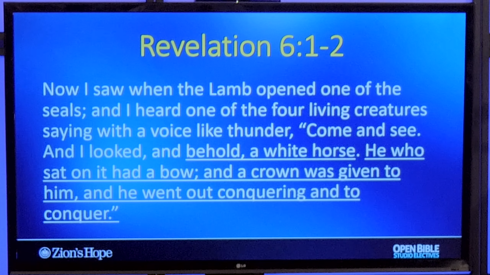
[00:24:44](https://www.youtube.com/watch?v=d38RCnCkevg&list=PLj9bOvimh2NyU1STwZqO7ccG5wdfGID64&index=41&t=1484s)

    - **The White Horse**: The figure rides a white horse
    - **Authority**: "a crown was given to him"
    - **Military Action**: "he went out conquering and to conquer"
- **[The Nature of the Rule]** This figure is expected to bring a period of intense global upheaval
    - The rule is characterized by great power and a demand for global obedience
    - The rise of this figure is associated with war, pestilence, and death

### The Ultimatum of the Beast

- **[The Choice]** A central conflict in eschatology is the demand for worship under threat of death
    - Revelation 13:15 describes a scenario where individuals must either worship the beast or face execution
    - This choice creates a divide between those who submit to the beast's authority and those who become martyrs

### Martyrdom and Resistance

- **[The Martyrs Under the Altar]** Revelation 6:9-11 provides a picture of those who have sacrificed their lives for their faith
    - These individuals are described as those who refused to bow to the beast's crown or authority
    - The text notes that many are given their lives through beheading
- **[Cultural and Scriptural Parallels]** The concept of beheading as a consequence of resistance is present in both traditions
    - It is a characteristic mentioned in the Bible regarding the Antichrist
    - It is also a significant element found in the Quran and Hadith

### The Global Scale of the Beast's Power

- **[Unparalleled Military Strength]** The figure described in eschatology is not a localized actor with limited impact, but a global military force.
    - Revelation 13:4b poses the question: "Who is like the beast? Who is able to make war with him?"
    - The implication is that no one is able to wage war against him due to his immense power, alliances, and military strength.
- **[Biblical Contexts of Military Conflict]** Several scriptures point to massive, world-shaking military struggles associated with this era:
    - **Daniel 11**: Describes the "King of the North," identified as the Antichrist, engaging in great military struggles.
    - **Ezekiel 38 and 39**: Mentions Gog, who leads a military war against the entire Middle East and the world.
- **[The Conquest of the Saints]** The authority of this figure includes the ability to suppress religious resistance.
    - **Revelation 13:7**: The beast is "granted him to make war with the saints and to overcome them."
    - This results in the fall of those who remain faithful during his rise.

### The Universal Scope of the Beast's Authority

- **[Global Influence]** The authority granted to the beast is not limited to the Middle East; it is a worldwide phenomenon.
    - **Revelation 13:7** states that authority is given to him "over every tribe, tongue, and nation."
    - This implies an influence so great that it could impact major world powers, including the United States.

### The Conflict in Daniel 7

- **[The Prevailing Horn]** Daniel's vision describes a specific conflict involving a "horn" that represents the Antichrist.
    - **Daniel 7:21-23** depicts this horn making war against the saints and "prevailing against them."
    - This indicates a period where the forces of the beast appear to be successful in their opposition to the faithful.
- **[Divine Intervention]** The period of the horn's dominance is not permanent.
    - The conflict continues "until the Ancient of Days came."
    - At that point, a judgment is made in favor of the saints, allowing them to possess the kingdom.

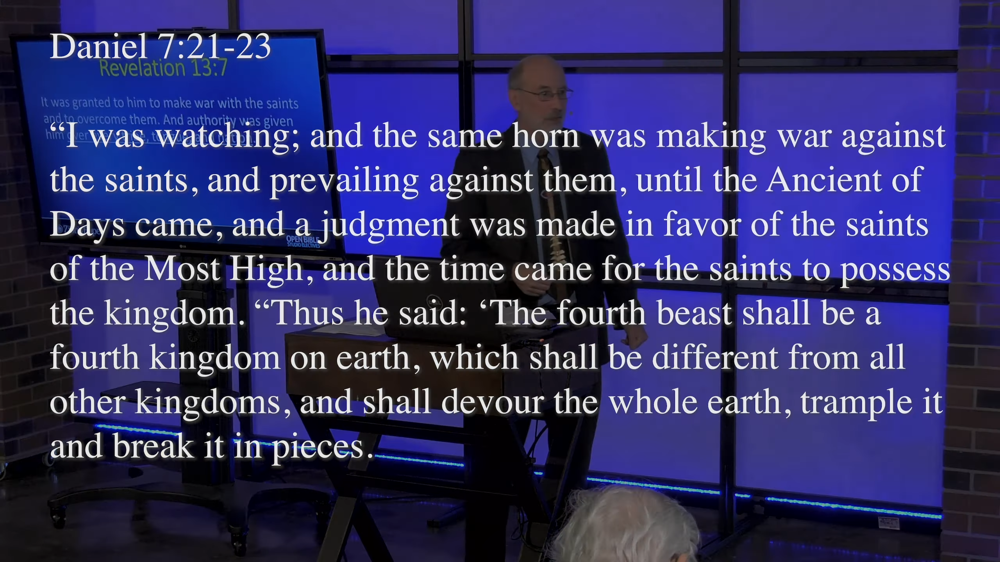
[00:29:37](https://www.youtube.com/watch?v=d38RCnCkevg&list=PLj9bOvimh2NyU1STwZqO7ccG5wdfGID64&index=41&t=1777s)

### The Unprecedented Nature of the Fourth Kingdom

- **[Viciousness and Power]** The fourth beast's kingdom is described as fundamentally different from all previous earthly kingdoms due to its extreme ruthlessness.
    - **Daniel 7:24-25** describes this kingdom as one that will "devour the whole earth, trample it and break it in pieces."
    - Unlike prior kingdoms, this one is characterized by a total and crushing attack upon the entire planet.
- **[Sources of Empowerment]** The rise of this kingdom is supported by specific spiritual forces:
    - It is empowered by a false god named Ali.
    - It is empowered by the "dragon serpent Satan."
    - Crucially, these events are permitted to occur according to the will of God in the final days.

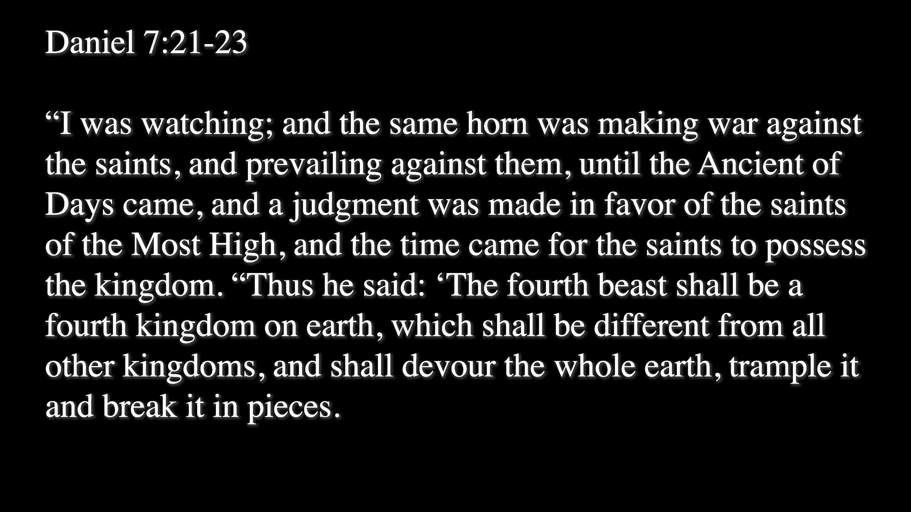
[00:30:12](https://www.youtube.com/watch?v=d38RCnCkevg&list=PLj9bOvimh2NyU1STwZqO7ccG5wdfGID64&index=41&t=1812s)

### The Connection Between Apostasy and the Man of Sin

- **[The Falling Away]** The revelation of the Antichrist is not an isolated event but is preceded by a period of spiritual decline.
    - **2 Thessalonians 2:3** states that "the Day will not come unless the falling away comes first."
- **[The Man of Sin]** This period of apostasy is directly linked to the appearance of the ultimate deceptive figure.
    - The "man of sin" and the "son of perdition" are revealed during this time.
    - These titles clearly identify the figure as the Antichrist/the Beast.

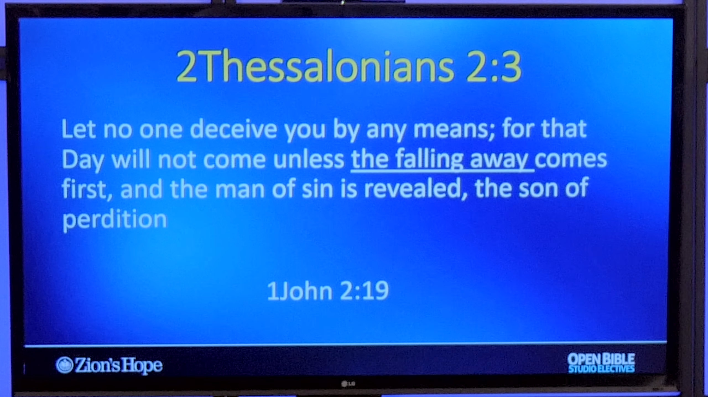
[00:31:23](https://www.youtube.com/watch?v=d38RCnCkevg&list=PLj9bOvimh2NyU1STwZqO7ccG5wdfGID64&index=41&t=1883s)

### The Nature of the Great Falling Away

- **[Distinction from General Decline]** The "falling away" described in **2 Thessalonians 2:3** is not merely the gradual abandonment of churches or a shift in cultural religious engagement.
    - It is described as a unique, unprecedented event.
    - It is a massive movement where people abandon the faith in "groups and hordes and vast numbers."
- **[The Cause of Apostasy]** This mass abandonment is tied directly to the rise of the Antichrist.
    - The speaker characterizes this as true **apostasy**.
    - The vulnerability lies in the depth of faith: those who have only a superficial or verbal profession of faith (e.g., attending church or teaching Sunday school without heart-felt belief) will fail when faced with the Antichrist's rise.
- **[Connection to Religious Ultimatums]** The speaker notes that this spiritual confrontation mirrors existing religious tensions seen in the world today.
    - He references the concept of "believe in Islam or die" as a real-world example of the kind of uncompromising confrontation that characterizes these end-times scenarios.

### Faithfulness vs. Apostasy in the Face of Ultimatums

- **[The Choice to Fall Away]** For those without a deep, heart-felt commitment to Jesus Christ, the pressure of the Antichrist's rise will lead to apostasy.
    - They may choose to recite the *shahada* (the Islamic declaration of faith) simply to save their lives.
- **[The Response of the True Believer]** In contrast, those with genuine faith are expected to remain steadfast.
    - Instead of falling away, they are described as joining the martyrs under the altar.

### The Mahdi's Focus on Israel and Jerusalem

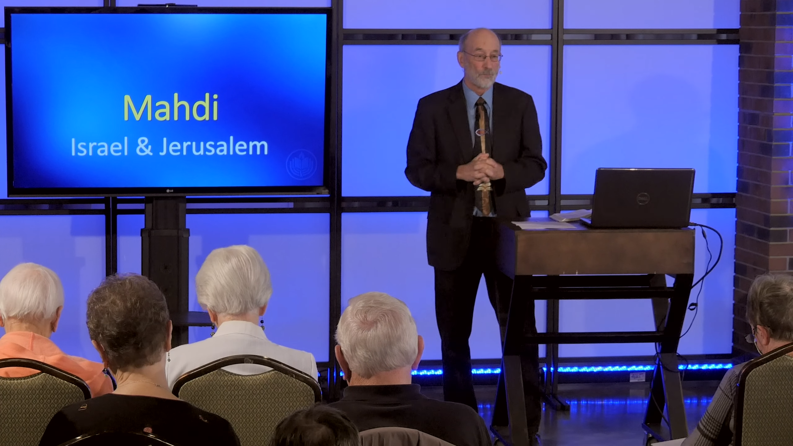
[00:33:56](https://www.youtube.com/watch?v=d38RCnCkevg&list=PLj9bOvimh2NyU1STwZqO7ccG5wdfGID64&index=41&t=2036s)

- **[The Geopolitical Bullseye]** From the perspective of the Mahdi, Israel and Jerusalem serve as a central target or "bullseye."
    - Geographically, Israel is surrounded by Islamic nations.
    - This creates a state of constant tension and lack of goodwill toward the Jewish people.
- **[The Significance of Jerusalem]** The conflict is driven by more than just politics; it is deeply religious.
    - Jerusalem, and specifically the Temple Mount, is a primary holy site for the Islamic faith.

### The Mahdi's Religious and Military Objectives

- **[The Goal for Jerusalem]** The Mahdi's focus on Jerusalem is driven by a desire for religious control over the Temple Mount.
    - It is considered the third most holy site in Islam, following Mecca and Medina.
    - The speaker notes that the Jewish people are viewed as an obstacle to gaining this access and control.
- **[Military Invasion]** The Mahdi is expected to rise as a military figure who will invade Jerusalem.
    - The primary purpose of this invasion is to destroy the Jewish people and secure the Temple Mount.

### Biblical Prophecies of the Attack on Israel

- **[Ezekiel 38:16a]** This passage describes a massive, cloud-like invasion of Israel in the latter days.

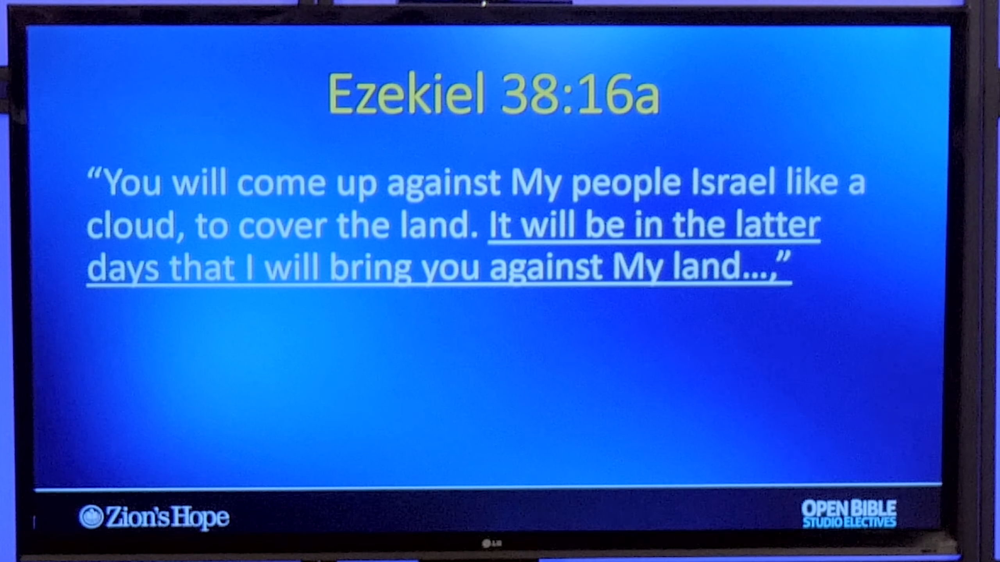
[00:35:18](https://www.youtube.com/watch?v=d38RCnCkevg&list=PLj9bOvimh2NyU1STwZqO7ccG5wdfGID64&index=41&t=2118s)

> "You will come up against My people Israel like a cloud, to cover the land. It will be in the latter days that I will bring you against My land..."

- **[Supporting Prophecies]** The speaker notes that several other biblical passages align with this description of a successful attack upon the nation of Israel:
    - Daniel 11
    - Revelation 16
    - Zechariah 12
- **[Anti-Semitism]** Because of these objectives, the speaker characterizes the Mahdi as being anti-Semitic.

### The Anti-Semitic Nature of the Mahdi

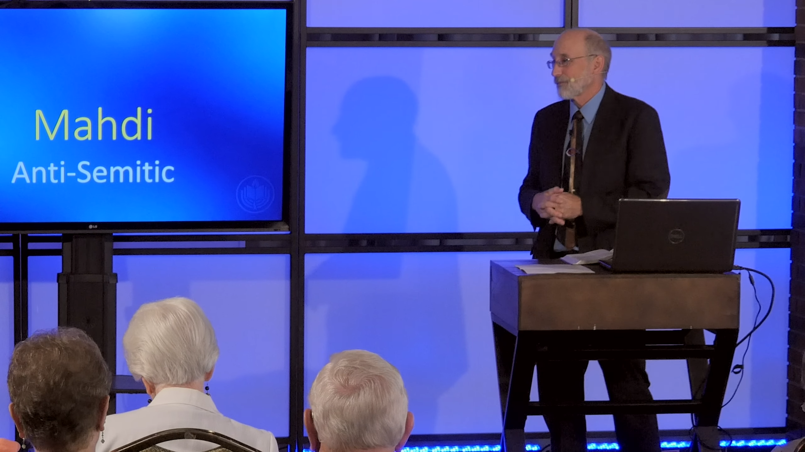
[00:36:05](https://www.youtube.com/watch?v=d38RCnCkevg&list=PLj9bOvimh2NyU1STwZqO7ccG5wdfGID64&index=41&t=2165s)

- **[Theological Basis]** The Mahdi's hostility toward Jews and Christians is presented as a fundamental aspect of the Islamic faith.
    - Jews and Christians are targeted because they do not adhere to Islam.
- **[Historical Context]** The speaker notes that anti-Semitism is not merely a modern phenomenon but is tied to historical figures.
    - He cites Muhammad's historical conflicts and massacres of Jewish populations as an example of this deep-seated tension.
- **[Religious Texts]** The speaker claims that Islamic writings, specifically the Quran and Hadiths, contain derogatory language toward Jewish people.
    - Terms like "swine," "pigs," and "apes" are used to describe them.
    - Christians are often characterized as polytheists and idolaters.
- **[Contemporary Context]** The speaker references a recent article to suggest that these sentiments remain prevalent.

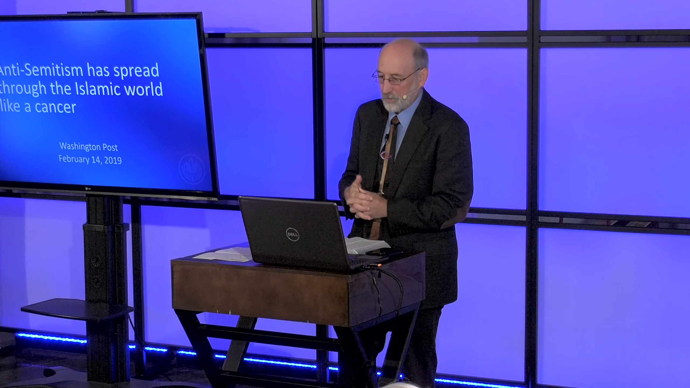
[00:37:27](https://www.youtube.com/watch?v=d38RCnCkevg&list=PLj9bOvimh2NyU1STwZqO7ccG5wdfGID64&index=41&t=2247s)

> "Anti-Semitism has spread through the Islamic world like a cancer" — Washington Post, February 14, 2019

### Motivations for Anti-Semitism

- **[Geopolitical]** The desire for control over Jerusalem and Israel is a primary driver.
- **[Spiritual]** The speaker claims that the Islamic religion is driven by satanic forces that oppose God's people.

### The Target of Spiritual Warfare

- **[Revelation 12:17]** The speaker notes that the conflict is not limited to one group, as biblical text indicates a broader target:

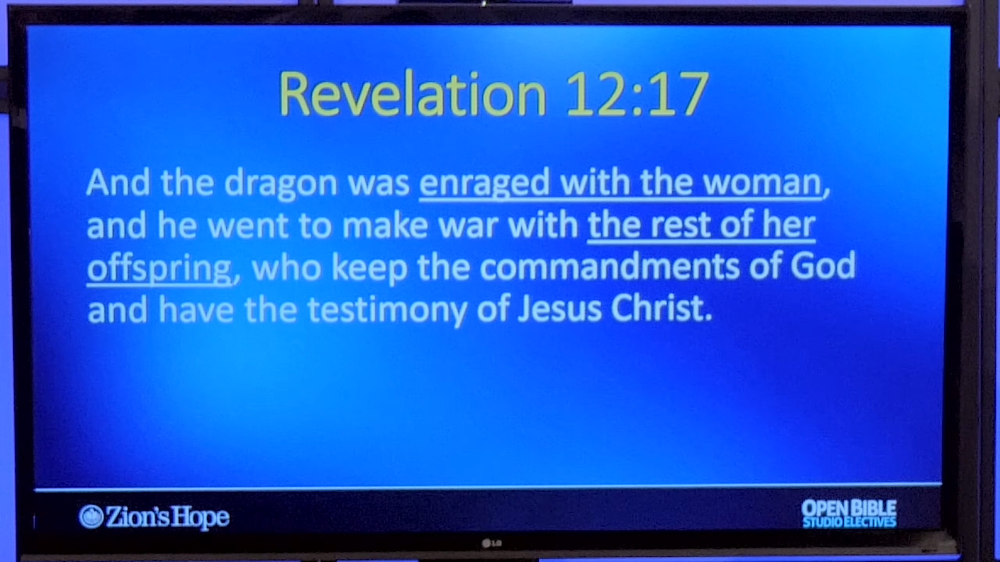
[00:38:44](https://www.youtube.com/watch?v=d38RCnCkevg&list=PLj9bOvimh2NyU1STwZqO7ccG5wdfGID64&index=41&t=2324s)

> "And the dragon was enraged with the woman, and he went to make war with the rest of her offspring, who keep the commandments of God and have the testimony of Jesus Christ."

- **[Implications for Christians]** Because the text mentions those who hold the testimony of Jesus, the speaker asserts that Christians are not exempt from this eschatological conflict.

### The Political Profile of the Mahdi

- **[Dual Nature]** The Mahdi is characterized as both a military and a political figure.
- **[Deceptive Diplomacy]** He is expected to use political maneuvering and peace agreements to achieve his objectives.
    - This is described as a "stepping stone" to gain control rather than a genuine pursuit of peace.
- **[The Covenant]** The speaker connects the Mahdi's rise to the prophecy in Daniel 9:27 regarding a covenant.

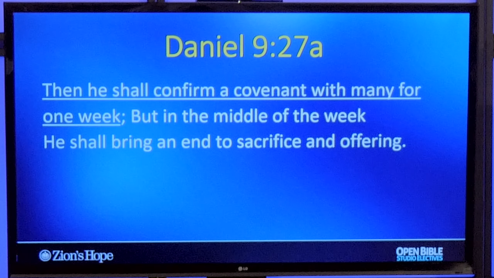
[00:39:46](https://www.youtube.com/watch?v=d38RCnCkevg&list=PLj9bOvimh2NyU1STwZqO7ccG5wdfGID64&index=41&t=2386s)

> "Then he shall confirm a covenant with many for one week; But in the middle of the week He shall bring an end to sacrifice and offering."

- **[Strategic Agreement]** It is suggested that this covenant may involve an arrangement regarding the Temple Mount to bring initial peace to the area.
- **[Targeting Descendants of Aaron]** Muslim writings suggest the Mahdi will enter an agreement with a descendant of Aaron (a Jewish figure).
    - The speaker notes this is paradoxical given the Mahdi's stated hostility toward Jewish people, suggesting the agreement is a tactic for control.

### The Political Structure of the Fourth Kingdom

- **[The Fourth Beast]** This kingdom is described as being fundamentally different from all others, possessing the power to devour and trample the entire earth.
- **[Political Alliance]** The kingdom is not a monolith from the start, but involves a coalition of leaders:
    - The "ten horns" represent ten kings who arise from within this kingdom.
    - This suggests a period of political alliance or a movement consisting of multiple kings/nations working together.
- **[The Rise of a Supreme Leader]** Following the initial group of kings, a single individual will emerge who is distinct from the others.
    - This individual will subdue three of the existing kings.
    - This leader will possess a combination of military, political, and religious characteristics.

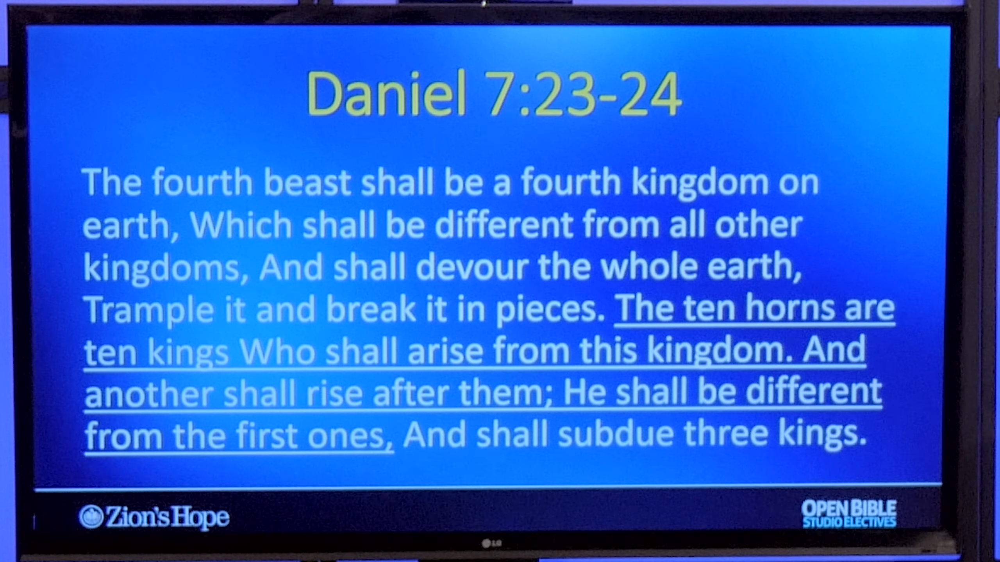
[00:40:43](https://www.youtube.com/watch?v=d38RCnCkevg&list=PLj9bOvimh2NyU1STwZqO7ccG5wdfGID64&index=41&t=2443s)

> "The fourth beast shall be a fourth kingdom on earth, Which shall be different from all other kingdoms, And shall devour the whole earth, Trample it and break it in pieces. The ten horns are ten kings Who shall arise from this kingdom. And another shall rise after them; He shall be different from the first ones, And shall subdue three kings."

- **[The Caliphate Connection]** The speaker notes that this coalition of nations and the subsequent rise of a single leader aligns with the Islamic concept of a "caliphate."

### The Rise of the Final Caliphate

- **[The Final Caliph]** There is a belief that the Mahdi will be the final caliph to rise on the scene.
    - He is expected to be divinely empowered.
    - He will be "different from the first ones," matching the biblical description of the leader in Daniel 7.
- **[The Spiritual Decision]** The organization of this caliphate will present a crisis of faith for Muslims.
    - They will be faced with a choice: follow the mandates of the caliphate or disobey and potentially leave the faith.

### The Antichrist's Intent to Change Laws

- **[The Persecution of Saints]** The Antichrist will target those considered "saints of the Most High," specifically Christians and Jews.
- **[Changing Times and Law]** A key characteristic of this figure is the intent to alter established times and legal frameworks.

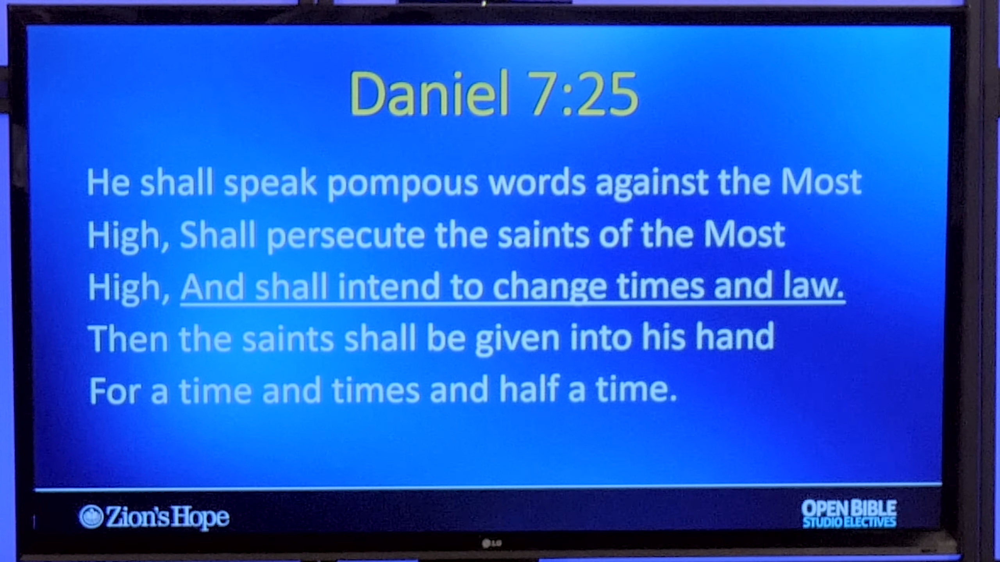
[00:43:45](https://www.youtube.com/watch?v=d38RCnCkevg&list=PLj9bOvimh2NyU1STwZqO7ccG5wdfGID64&index=41&t=2625s)

> "He shall speak pompous words against the Most High, Shall persecute the saints of the Most High, And shall intend to change times and law. Then the saints shall be given into his hand For a time and times and half a time."

- **[The Implementation of Shariah Law]** The speaker identifies the imposition of Shariah law as a modern parallel to the biblical prophecy of changing laws.
- **[Cultural Replacement]** Unlike previous empires (such as the Greeks or Romans) that often allowed existing cultures to persist, the expansion of Islamic law is noted for its tendency to:
    - Trample and crush existing cultural structures.
    - Systematically replace the old culture with a new one through the imposition of its own legal and religious framework.

### The Implementation of the Hijri Calendar

- **[The Hijri Calendar]** There is a potential push to replace the Gregorian calendar with the Hijri calendar.
    - The Gregorian calendar is rejected because it is based on the birth of Jesus Christ.
    - The Hijri calendar is a lunar calendar that begins in 622 AD, marking Muhammad's pilgrimage from Mecca to Medina.
    - In many Muslim countries, this calendar is already used to some extent.
- **[Rejection of Sabbath]** A key aspect of changing 'times' is the rejection of Saturday worship, which is rooted in Jewish tradition.

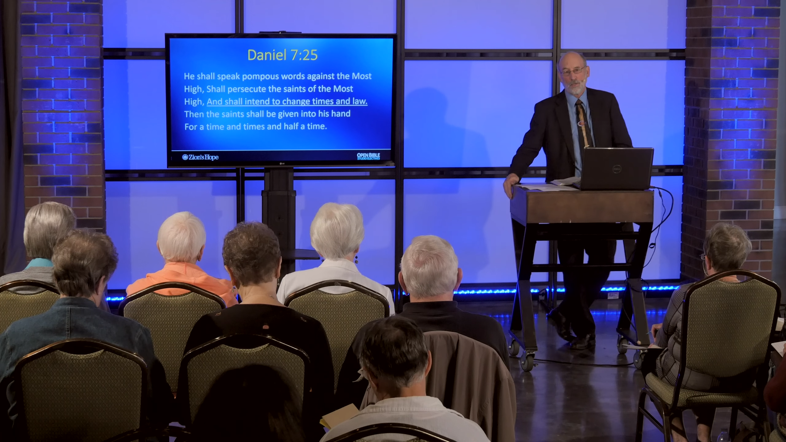
[00:46:07](https://www.youtube.com/watch?v=d38RCnCkevg&list=PLj9bOvimh2NyU1STwZqO7ccG5wdfGID64&index=41&t=2767s)

### The Shift in Days of Worship

- **[Rejecting Jewish and Christian Traditions]** The push to change 'times' involves moving away from traditional days of worship:
    - **Saturday (Shabbat):** Rejected as a Jewish tradition.
    - **Sunday:** Rejected as the Christian "Lord's Day."
- **[The Focus on Friday]** Friday is positioned as the central day of the week for worship.
    - This shift is intended to force a new rhythm of life where Friday is the day of rest and worship, while the rest of the week is dedicated to work under the new system.

### Summary Profile of the Antichrist

- The figure is described as having three primary dimensions of power:
    - **Military:** A powerful leader with strategic interests in Jerusalem.
    - **Religious:** A figure who will organize and utilize the Muslim religion to exert influence.
    - **Political:** A leader who will establish a global government to fundamentally change the structure of the world.

### Closing Prayer and Spiritual Outlook

- **[Biblical Perspective]** The goal is to use the Bible as the primary guide for interpreting world events, rather than being guided by external ideologies like Islam.
- **[Spiritual Readiness]** A plea for several qualities in believers:
    - **Zealousness:** A passion for telling others about the gospel.
    - **Watchfulness:** Eyes that can see, warn, and recognize the coming trouble.
    - **Expectation:** A fervent excitement for the return of Jesus Christ and the establishment of His kingdom.