## The Islamic Al-Mahdi

- A comparative study of the Al-Mahdi from an Islamic prophetic perspective versus biblical teachings
    - The figure described in the Bible is known as the Antichrist
- Primary Scripture Reference:
    - Matthew 24:4-12

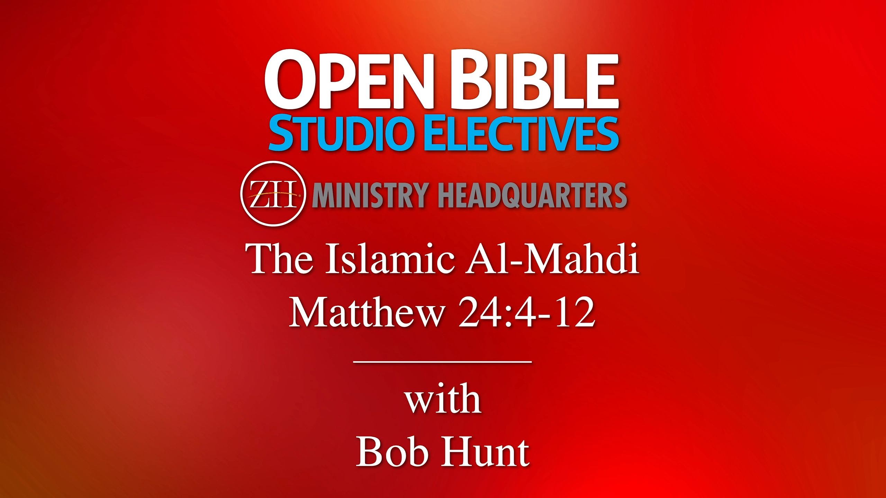
[00:00:02](https://www.youtube.com/watch?v=YPbv3bKOxuw&list=PLj9bOvimh2NyU1STwZqO7ccG5wdfGID64&index=40&t=2s)

### Matthew 24: World Conditions and Deception

- **[Context]** Matthew 24 describes the general world conditions that occur as the Antichrist rises.
- **The Warning Against Deception**
    - Jesus' primary answer to the question regarding the sign of His coming and the end of the age is a warning: "Take heed that no one deceives you" (Matthew 24:4).
    - Deception is identified as a central element that will be carried out to its fullest extent during the end times.
- **Signs of the End Times (Matthew 24:5-8)**

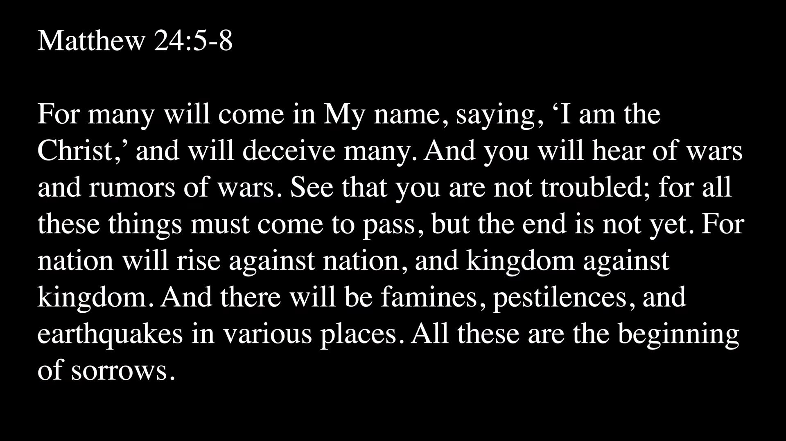
[00:02:41](https://www.youtube.com/watch?v=YPbv3bKOxuw&list=PLj9bOvimh2NyU1STwZqO7ccG5wdfGID64&index=40&t=161s)

    - False Messianic claims: "Many will come in My name, saying, 'I am the Christ,' and will deceive many."
    - Global instability and conflict:
        - Wars and rumors of wars
        - Nation rising against nation, and kingdom against kingdom
    - Natural disasters and hardships:
        - Famines
        - Pestilences
        - Earthquakes in various places
    - These events are characterized as the "beginning of sorrows."

### Matthew 24: Signs of Social and Spiritual Decay

- **The inevitability of these events**
    - Jesus notes that these conditions "must come to pass"
    - He cautions followers not to be "troubled" by them, as they are precursors to the end, though the end is not yet.
- **Escalating global conditions (Matthew 24:5-8)**
    - Geopolitical conflict: "nation will rise against nation, and kingdom against kingdom"
    - Natural and biological hardships: famines, pestilences, and earthquakes in various places
    - These events are collectively identified as the "beginnings of sorrows."
- **Social and spiritual erosion (Matthew 24:9-12)**
    - Persecution and hatred: believers will be delivered to tribulation, killed, and hated by all nations for His name's sake.
    - Breakdown of human relationships:
        - Many will be offended
        - Many will betray one another
        - Many will hate one another
    - Spiritual deception: the rise of many false prophets who will deceive many.
    - The impact of lawlessness:
        - As lawlessness abounds, the "love of many will grow cold."

### Escalation of Global Turmoil

- **Unprecedented Warfare**
    - Current conflicts are viewed as mere glimpses of what is coming
    - Anticipation of a global conflict (World War III) involving fanaticism and devastating weaponry
        - Nuclear weapons
        - Chemical weapons
- **Intensified Natural Disasters**
    - Earthquakes are expected to become common worldwide rather than isolated incidents
    - This is described as the world "shuddering" under the onslaught of the Antichrist and Christ
- **Biological and Resource Crises**
    - **Pestilence**: Widespread outbreaks of disease everywhere
    - **Famine**: Severe hunger due to food shortages
        - The speaker warns against putting ultimate trust in physical stockpiles
        - Instead, trust should be placed in the one who provides ultimate salvation

### The Impact of Lawlessness and Persecution

- **The nature of lawlessness**
    - Defined as individuals disregarding laws entirely for personal gain or selfishness
    - Described as an "all for me, all for myself" mentality where disregard for others becomes the norm
- **The cooling of human empathy**
    - As lawlessness abounds, the "love of many will grow cold"
    - This manifests as a worldwide indifference to the thoughts, desires, and needs of others
- **Persecution of believers**
    - As the world rejects truth, those holding to it will face increased scrutiny and opposition
    - Believers may be characterized as "intolerant haters" by a society that views their message as offensive
    - This persecution may escalate from social marginalization to physical death

### The Search for a Global Savior

- **The emergence of global desperation**
    - Increasing turmoil will lead to world summits and international conferences
    - Organizations like the European Union or various Muslim nations may convene to address global crises
    - This desperation creates a vacuum for a leader to emerge
- **The rise of false saviors**
    - The world will be looking for a hero to lead them into a peaceful existence
    - The Bible warns that many imposters and deceivers will arise during this time
- **The arrival of the Antichrist**
    - A specific figure will be put forth by the world to provide relief
    - The speaker identifies this figure as the Islamic Al-Mahdi, characterizing him as the Antichrist
    - This figure is part of a one-world religious system that stands in opposition to God Almighty

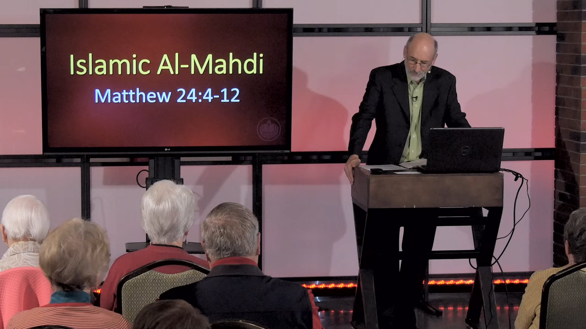
[00:08:07](https://www.youtube.com/watch?v=YPbv3bKOxuw&list=PLj9bOvimh2NyU1STwZqO7ccG5wdfGID64&index=40&t=487s)

### Guarding Against Deception

- **The danger of the Al-Mahdi**
    - He will be presented as the ultimate solution to the world's crises
    - The speaker warns that he is a "pawn of Satan"
- **Testing spiritual claims**
    - Believers are instructed to not believe every spirit but to test them
    - **[Why?]** Because many false prophets will enter the world
    - Testing involves examining and proving whether a thing is genuine or not

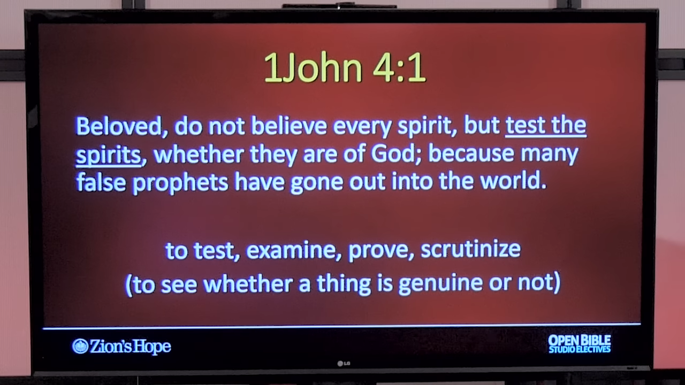
[00:09:17](https://www.youtube.com/watch?v=YPbv3bKOxuw&list=PLj9bOvimh2NyU1STwZqO7ccG5wdfGID64&index=40&t=557s)

> "Beloved, do not believe every spirit, but test the spirits, whether they are of God; because many false prophets have gone out into the world."

- **The role of the Word of God**
    - Scripture is the standard for discerning truth from the deception of the world
    - The true Savior is Jesus Christ, not the Al-Mahdi

### Key Figures of Islamic Eschatology

- **Islamic Deceivers**
    - The speaker identifies three specific figures within the Islamic worldview that play a role in end-times prophecy:

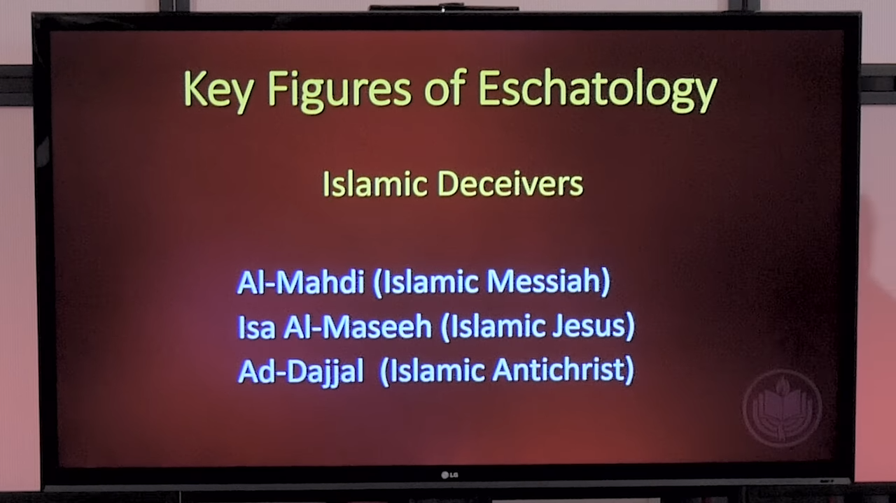
[00:10:11](https://www.youtube.com/watch?v=YPbv3bKOxuw&list=PLj9bOvimh2NyU1STwZqO7ccG5wdfGID64&index=40&t=611s)

| Figure | Description |
| --- | --- |
| Al-Mahdi | Islamic Messiah |
| Isa Al-Maseeh | Islamic Jesus |
| Ad-Dajjal | Islamic Antichrist |

### Characteristics of the Al-Mahdi

- **[Identity]** The speaker uses the terms Al-Mahdi, Antichrist, and the Beast interchangeably, as he is convinced they represent the same entity
- **[Role and Nature]** He is described as a figure who rises at the end of times to provide answers to the world's problems
- **Mahdi Characteristics**
    - He will be a military figure
    - He will want Israeli land and a rule from Jerusalem
    - He will hate Israel, Jews, and Christians
    - He will be a political and governmental figure of the world

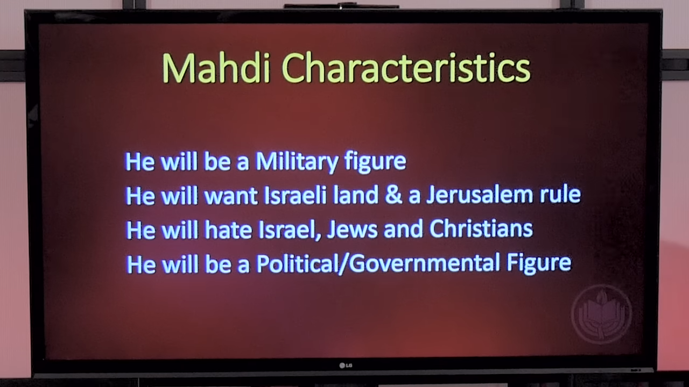
[00:10:58](https://www.youtube.com/watch?v=YPbv3bKOxuw&list=PLj9bOvimh2NyU1STwZqO7ccG5wdfGID64&index=40&t=658s)

### Additional Mahdi Characteristics

- **Spiritual and Religious Nature**
    - Beyond being political, governmental, and military, the Mahdi will act as a spiritual figure
    - **[Consequence]** Because of this religious role, he will demand worship from the masses
    - This will lead to a period of widespread false worship across the world

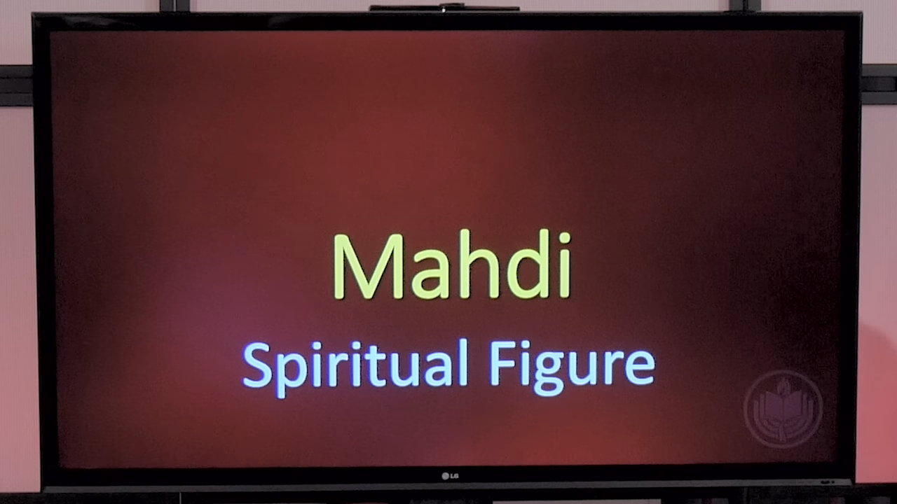
[00:12:02](https://www.youtube.com/watch?v=YPbv3bKOxuw&list=PLj9bOvimh2NyU1STwZqO7ccG5wdfGID64&index=40&t=722s)

- **Global Worship of the Beast**
    - The speaker notes that Islam is one of the fastest-growing religions, which he links to the potential for widespread false worship led by false prophets
    - According to Revelation 13, the majority of the world will "marvel" at the beast and follow him

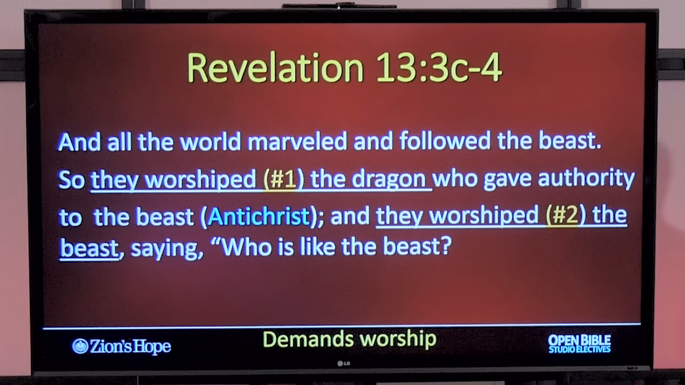
[00:12:44](https://www.youtube.com/watch?v=YPbv3bKOxuw&list=PLj9bOvimh2NyU1STwZqO7ccG5wdfGID64&index=40&t=764s)

> "And all the world marveled and followed the beast. So they worshiped (#1) the dragon who gave authority to the beast (Antichrist); and they worshiped (#2) the beast, saying, 'Who is like the beast?'"

- **The Object of Worship**
    - The deception involves a dual object of worship:

        1. The dragon (who provides authority to the Antichrist)
        2. The beast itself

### The Dual Nature of End-Times Worship

- **The Spiritual Force: The Dragon**
    - The dragon is identified as Satan, the "serpent of old"
    - He is the spiritual power behind the final cataclysmic battles on Earth
    - In the context of the Mahdi's leadership, the speaker suggests the dragon will be represented by the name Allah
- **The Physical Presence: The Beast**
    - The beast is the Antichrist, the human incarnation of evil on Earth
    - People will worship the physical man leading the charge
- **The Dual Objects of Worship**
    - Worship is directed toward both the spiritual authority and the physical leader:

| Object of Worship | Identity | Nature |
| --- | --- | --- |
| The Dragon | Satan | Spiritual force/authority |
| The Beast | Antichrist/Mahdi | Physical, human incarnation |

- **[Common Objection]** The speaker notes that a common objection to this view comes from Islam, which teaches that only Allah is to be worshiped alone.

### Reconciling the Objection of Monotheism

- **[Common Objection]** Critics argue that Islam cannot be the setting for the rise of the Antichrist because Islamic doctrine mandates that only Allah is to be worshiped.
- **The Mahdi as God's Representative**
    - In Islamic eschatology, the Mahdi is the most revered and anticipated savior
    - He is viewed as God's representative on Earth, essentially acting as if he were God himself
- **Parallels in Other Religions**
    - The speaker compares this level of reverence to the Catholic view of the Pope
    - In this context, the Pope is seen as "God on earth," where people worship God through him
    - This suggests there can be "levels" of worship that allow for the veneration of a human leader while still claiming to worship God

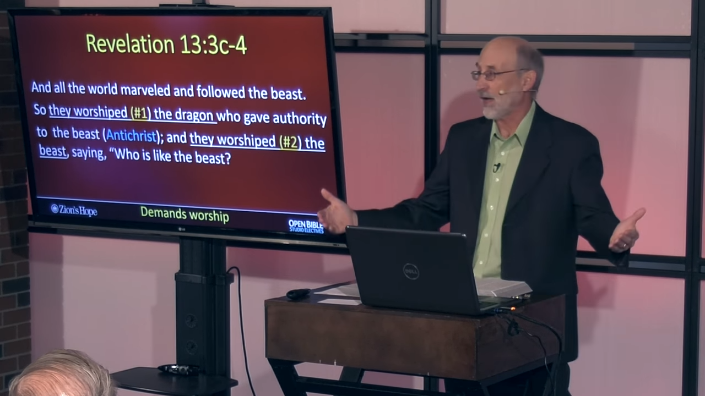
[00:14:50](https://www.youtube.com/watch?v=YPbv3bKOxuw&list=PLj9bOvimh2NyU1STwZqO7ccG5wdfGID64&index=40&t=890s)

### The Blurred Line Between God and Man

- During the rise of the Antichrist/Mahdi, the distinction between worshiping God and worshiping a human leader will become increasingly difficult to discern
- The lines of devotion will be intentionally blurred

### Ayatollah Ali Khamenei and the Application of Religious Authority

- **Ayatollah Ali Khamenei**
    - The Supreme Leader of Iran
    - Acts as the head of the religious aspects of the nation
- **The concept of a Fatwa**
    - A non-binding legal opinion based on Sharia law
    - Sharia law serves as the framework for how Islam is practiced in daily life
- **The 2010 Fatwa**
    - Issued by the Supreme Leader
    - While not carrying the weight of formal law, it establishes a standard of authority

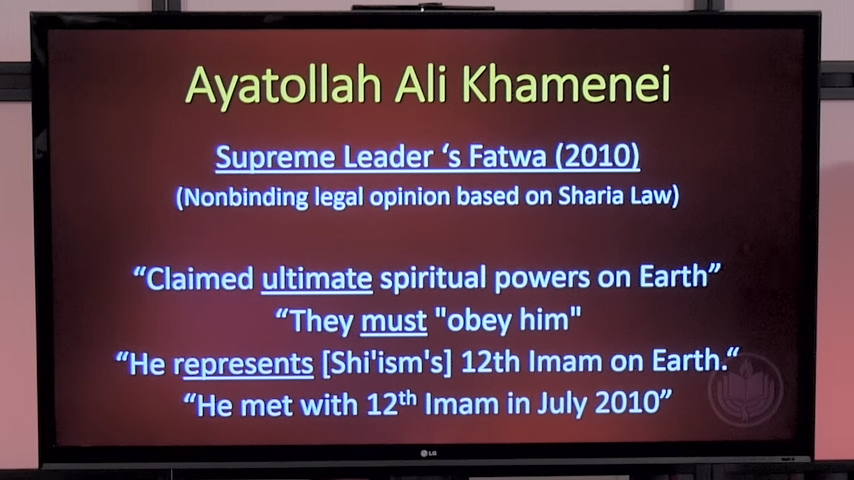
[00:16:47](https://www.youtube.com/watch?v=YPbv3bKOxuw&list=PLj9bOvimh2NyU1STwZqO7ccG5wdfGID64&index=40&t=1007s)

### Implications of the Supreme Leader's Fatwa

- **The weight of the Fatwa**
    - Although a Fatwa is a non-binding legal opinion, in the context of the Supreme Leader, it carries significant authority and is expected to be followed
- **Claims of spiritual authority**
    - The Fatwa claims "ultimate spiritual powers on Earth" for the leader
    - It mandates that the people "must obey him"
- **Connection to the 12th Imam**
    - The leader claims to represent the 12th Imam on Earth
    - Specifically, he claims to have met with the 12th Imam in July 2010
    - This is significant because, in Shiite belief, the 12th Imam is considered to be hidden
- **[Precedent for Worship]**
    - The speaker notes that these claims of spiritual power and required obedience are extremely close to the concept of worship
    - This provides a potential roadmap for how the worship of the Beast might occur: by presenting a human leader who is revered alongside the worship of God (Allah) or Satan (the dragon)

### Reaction to the Supreme Leader's Fatwa

- The leaders of Iran expressed concern regarding the 2010 statement
    - They understood the statement was raising the Supreme Leader's status to a level near that of a god

### The Relationship Between the Beast and the Harlot

- **[Initial Cooperation]** In the beginning of Revelation 17, the Beast and the Harlot appear to be in a cooperative relationship
    - The text describes the Harlot as "riding the beast"
    - The speaker suggests this represents a cooperation between the Antichrist and the religion of Islam
- **[The Shift]** The relationship between these two entities is expected to change as the chapter progresses toward verse 16

### The Conflict Between the Beast and the Harlot

- **[The Shift in Relationship]** While the Harlot and the Beast initially appear to be in cooperation (the Harlot "riding the beast"), Revelation 17:16 describes a sudden and violent turn
    - The ten horns on the beast will "hate the harlot"
    - They will make her "desolate and naked, eat her flesh and burn her with fire"
    - This is described as God putting it into their hearts to fulfill His purpose

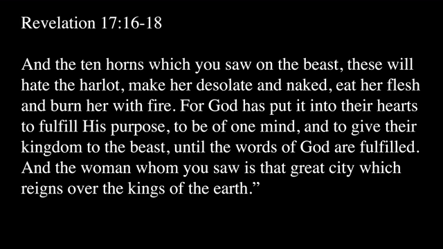
[00:20:35](https://www.youtube.com/watch?v=YPbv3bKOxuw&list=PLj9bOvimh2NyU1STwZqO7ccG5wdfGID64&index=40&t=1235s)

- **[The Cause of the Rift]** The speaker suggests a possible reason for this sudden enmity
    - The Mahdi's rising spiritual status may eventually push Islam away
    - This creates a rift that allows the Beast to use his global political and military power to crush Islam
- **[The Destruction of the "Great City"]** The text identifies the woman as the "great city which reigns over the kings of the earth"
    - The speaker suggests this "great city" could be Mecca
    - He notes that Islamic writings contain stories regarding the end-time destruction of Mecca
    - Following this destruction, Islamic leaders might relocate their rule to Jerusalem

### The Antichrist's Use and Suppression of Religion

- **[Strategic Foothold]** The Antichrist is expected to use the religion of Islam to gain a foothold and a platform to rule the world
    - Despite this cooperation, he holds no true love for Islam
    - Neither does Satan (the dragon) have love for the religion
- **[The Self-Exaltation of the Man of Sin]** According to 2 Thessalonians 2, the Antichrist will actively oppose and exalt himself above everything worshipped

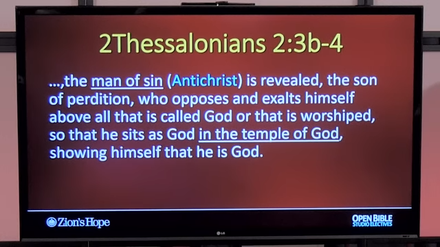
[00:22:35](https://www.youtube.com/watch?v=YPbv3bKOxuw&list=PLj9bOvimh2NyU1STwZqO7ccG5wdfGID64&index=40&t=1355s)

    - He will sit in the temple of God, showing himself to be God
    - This temple is anticipated to be a rebuilt structure for the Jewish people to resume sacrifices and worship
- **[The Banning of Religions]** The Antichrist's ultimate goal is the total suppression of all other faiths
    - Midway through the seven-year period, he is expected to effectively ban Judaism by ending Jewish worship of Yahweh
    - He will ultimately go beyond Judaism to ban all religions globally

### Supernatural Deception and the Antichrist

- **[Supernatural Powers]** The Antichrist is expected to possess and utilize supernatural abilities to gain global attention and authority
    - This aligns with the belief that the Mahdi will have control over elements like the climate
    - 2 Thessalonians 2:9 describes this as coming "according to the working of Satan, with all power, signs, and lying wonders"

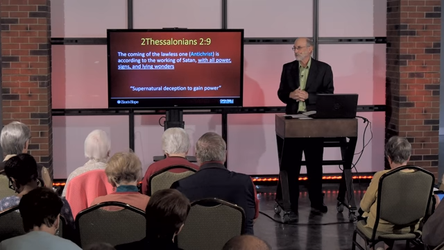
[00:23:45](https://www.youtube.com/watch?v=YPbv3bKOxuw&list=PLj9bOvimh2NyU1STwZqO7ccG5wdfGID64&index=40&t=1425s)

- **[Manipulation of Scripture]** To solidify his religious legitimacy, the Antichrist will attempt to "rewrite the book" or the scriptures
    - He will claim to have discovered lost ancient manuscripts, possibly in Syria
    - These fabricated scrolls would be presented as evidence that confirms Islam as the religion of Christ or Yahweh, thereby manipulating the faithful into following him

### The Closed Canon of Scripture

- **[The Warning Against Alteration]** Any attempt to add to or take away from the biblical text is met with divine judgment
    - Revelation 22:18-19 warns that adding to the prophecy brings plagues, and taking away from it results in being removed from the Book of Life

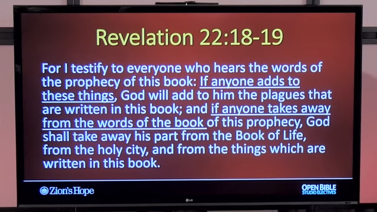
[00:25:04](https://www.youtube.com/watch?v=YPbv3bKOxuw&list=PLj9bOvimh2NyU1STwZqO7ccG5wdfGID64&index=40&t=1504s)

- **[The Impossibility of 'New' Scripture]** Because the Bible is a closed canon, any supposedly 'lost' manuscripts would be rejected
    - Even if manuscripts like "3rd Corinthians" were found, they would be set aside because God has already provided everything necessary through the current Bible
    - If a figure claims new scrolls (e.g., from Syria) prove Islam is the true religion, they are proven wrong by the existing Word of God

### Global Methods of Influence

- **[Dawah]** A central teaching/practice in Islam used to spread the faith
    - The word means "inviting"
    - It is the Islamic equivalent of Christian evangelism
    - It is characterized as a peaceful method of asking people to consider the Muslim faith

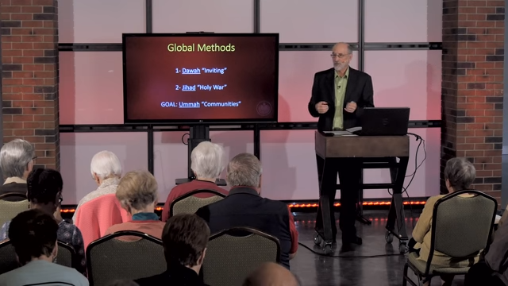
[00:26:23](https://www.youtube.com/watch?v=YPbv3bKOxuw&list=PLj9bOvimh2NyU1STwZqO7ccG5wdfGID64&index=40&t=1583s)

### Islamic Methods of Influence and the Ummah

- **[Dawah]** A peaceful method of inviting people to the faith
    - Aimed at leading people toward the Mahdi, who is perceived as a bringer of peace
- **[Jihad]** Often translated as "holy war"
    - Used as a secondary method when peaceful invitation (Dawah) is unsuccessful
    - Involves the use of force to advance the faith
- **[Ummah]** The ultimate goal of these methods
    - Defined as an Islamic community governed by Islamic tenets and teachings
    - The objective is to establish this community on a global, planetary scale

### The Mechanism of Antichrist Deception

- **[Unrighteous Deception]** The primary method the Antichrist uses to gain global acceptance
    - According to 2 Thessalonians 2:9-11, the Antichrist arrives with "all unrighteous deception"
- **[The Target of Deception]** Those who "perish"
    - Deception specifically affects unbelievers who fail to receive "the love of the truth"
    - Because they reject the truth, God allows a "strong delusion" to take hold so they believe the lie

### The Mechanism of Divine Delusion

- **[The Strong Delusion]** A consequence for those who reject the truth
    - Because people harden their hearts against the Gospel, God "gives them over" to believe the lie
    - This is a divine response to the active rejection of truth (as seen in Romans)
- **[The Falling Away]** A global religious shift
    - This is not a movement from religion to nothingness (atheism)
    - Instead, it is a mass movement away from existing religions toward the deceptive religious system of the Antichrist
    - As the Antichrist offers global solutions, people will "bail out" of their current faiths to follow him

### Escalation of Influence

- **[From Deception to Force]** The transition of methods
    - If unrighteous deception is not enough to secure global compliance, the Antichrist will pivot to force
    - This aligns with the concept of Jihad (holy war) being used to advance the faith when peaceful methods fail

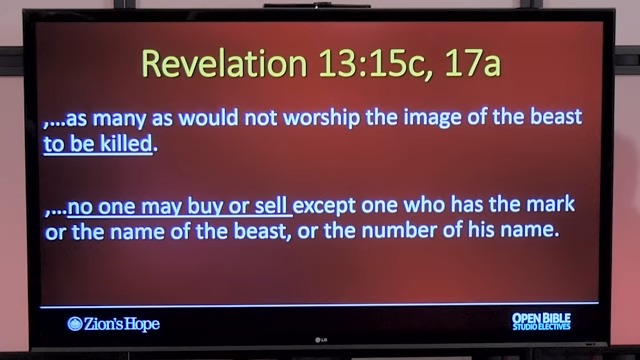
[00:29:29](https://www.youtube.com/watch?v=YPbv3bKOxuw&list=PLj9bOvimh2NyU1STwZqO7ccG5wdfGID64&index=40&t=1769s)

### Enforcement of Worship and Economic Control

- **[Methods of Coercion]** The Antichrist uses extreme pressure to ensure global compliance with the worship of his image
    - **Violence**: Those who refuse to worship the image of the beast will be killed (martyrdom)
    - **Economic Control**: No one will be able to buy or sell except those with the mark, name, or number of the beast
    - **Resource Deprivation**: These measures include starvation, hunger, and the use of weapons of force to drive people into his religious system

### Theological Divergence: Yahweh vs. Allah

- **[Denial of Yahweh]** A primary characteristic of the Antichrist is the denial of the God of the Bible (Yahweh) in an attempt to redirect worship toward Allah
- **[The Denial of the Trinity]** A fundamental theological barrier between Christianity and Islam is the rejection of the Triune nature of God
    - Surah 5:73 explicitly rejects the concept of God being "one in three"

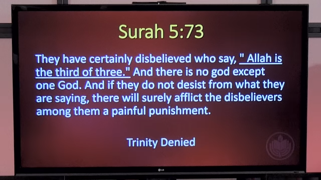
[00:30:29](https://www.youtube.com/watch?v=YPbv3bKOxuw&list=PLj9bOvimh2NyU1STwZqO7ccG5wdfGID64&index=40&t=1829s)

> "They have certainly disbelieved who say, 'Allah is the third of three.'" — Surah 5:73

### The Oneness of God

- **[Tawhid]** The central concept of the Islamic faith
    - It emphasizes that Allah is strictly one
    - This oneness precludes the existence of a Son or a Holy Spirit
- **[Shirk]** The rejection of the Trinity
    - To believe in the Trinity (God as one in three) is considered *shirk*
    - **[Definition]** Shirk is viewed as idolatry or polytheism
    - In the Islamic view, shirk is an unpardonable sin that leads to hell

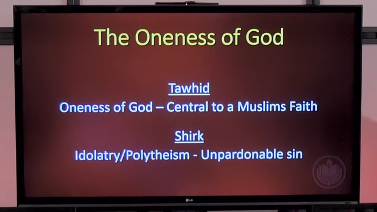
[00:31:31](https://www.youtube.com/watch?v=YPbv3bKOxuw&list=PLj9bOvimh2NyU1STwZqO7ccG5wdfGID64&index=40&t=1891s)

- **[Theological Conflict]** Because of this commitment to Tawhid, believers will deny any Trinitarian aspects of Yahweh to the death

### Revelation 13:6 and Blasphemy

- **[The Antichrist's Attack]** The Antichrist will actively attack Yahweh through blasphemy
    - This involves more than just words; it is a systematic effort to:
            - Take away God-like attributes
            - Add demonic attributes
            - Slander His name

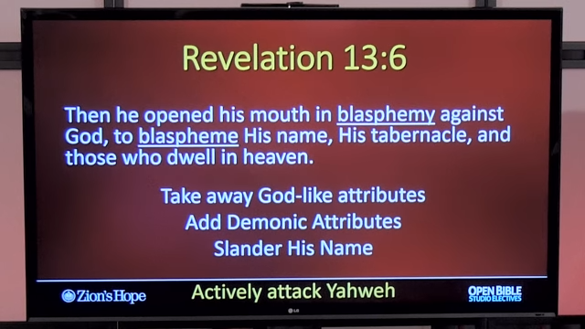
[00:32:29](https://www.youtube.com/watch?v=YPbv3bKOxuw&list=PLj9bOvimh2NyU1STwZqO7ccG5wdfGID64&index=40&t=1949s)

### The Nature of Blasphemy against Yahweh

- **[Definition of Blasphemy]** According to Revelation 13:6, blasphemy is an active attack on the person of Yahweh through several methods:
    - Adding demonic attributes to God
    - Taking away God-like attributes
    - Slandering, injuring, or cursing His name

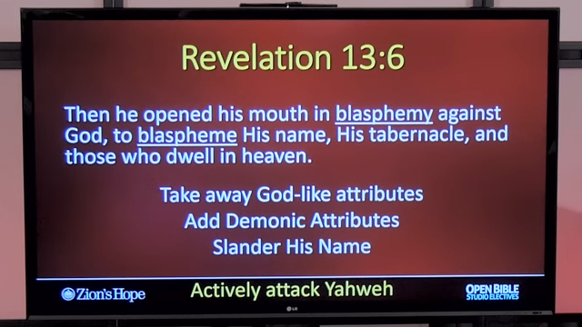
[00:32:32](https://www.youtube.com/watch?v=YPbv3bKOxuw&list=PLj9bOvimh2NyU1STwZqO7ccG5wdfGID64&index=40&t=1952s)

- **[Target of Attack]** This is not merely a disagreement over concepts, but a systematic attempt to defame and attack the biblical God, His name, His tabernacle, and those who dwell in heaven.

### The Mahdi's Denial of Jesus

- **[Recognition vs. Divinity]** While the Mahdi/Islamic perspective recognizes Jesus as a prophet who came to earth, there are fundamental denials regarding His identity:
    - **[Denial of Divinity]** He is viewed as a man created by God, not as God Himself
    - **[Denial of the Trinity]** He is not considered part of the Triune nature of God

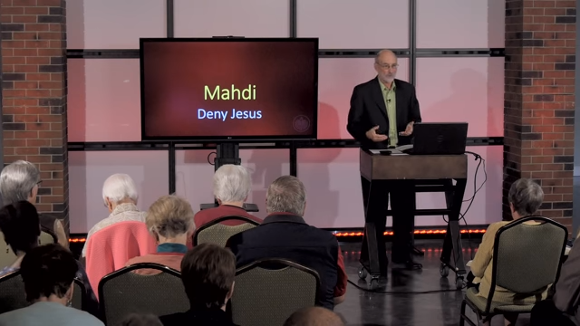
[00:33:20](https://www.youtube.com/watch?v=YPbv3bKOxuw&list=PLj9bOvimh2NyU1STwZqO7ccG5wdfGID64&index=40&t=2000s)

### The Uniqueness of Yahweh

- **[The First and the Last]** Biblical scripture emphasizes that Yahweh is incomparable and stands alone, a claim that contrasts with the Mahdi's theological framework

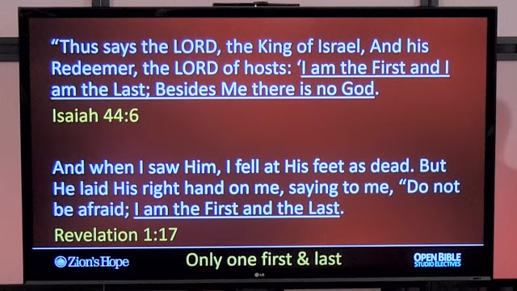
[00:33:44](https://www.youtube.com/watch?v=YPbv3bKOxuw&list=PLj9bOvimh2NyU1STwZqO7ccG5wdfGID64&index=40&t=2024s)

> "Thus says the LORD, the King of Israel, And his Redeemer, the LORD of hosts: 'I am the First and I am the Last; Besides me there is no God.'" — Isaiah 44:6

> "And when I saw Him, I fell at His feet as dead. But He laid His right hand on me, saying to me, 'Do not be afraid; I am the First and the Last.'" — Revelation 1:17

### The Identity of Jesus as "The First and the Last"

- **[The Logical Connection]** There is a significant theological overlap between the Old and New Testaments regarding the title "the First and the Last":
    - **Isaiah 44:6** attributes this to the LORD (Yahweh)
    - **Revelation 1:17** attributes this to Jesus
- **[The Conclusion]** Since the Bible is viewed as the infallible word of God, these two cannot be separate entities; therefore, Jesus is God.

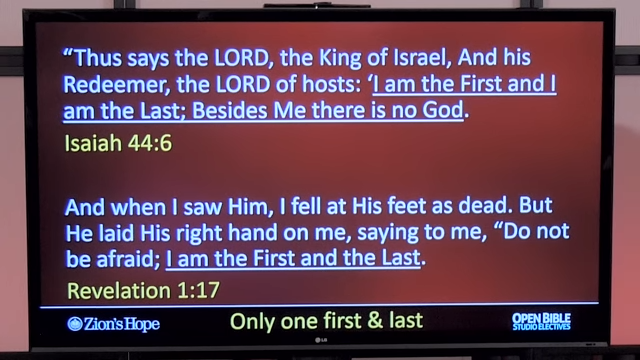
[00:34:02](https://www.youtube.com/watch?v=YPbv3bKOxuw&list=PLj9bOvimh2NyU1STwZqO7ccG5wdfGID64&index=40&t=2042s)

- **[The Necessity of Divinity]** To deny Jesus' status as the Son of God is to deny the indwelling of God within the believer
    - As stated in 1 John 4:15, confessing Jesus as the Son of God means God abides in that person, and they in God.

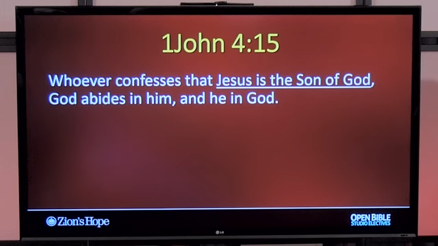
[00:34:54](https://www.youtube.com/watch?v=YPbv3bKOxuw&list=PLj9bOvimh2NyU1STwZqO7ccG5wdfGID64&index=40&t=2094s)

### The Centrality of the Cross

- **[The Foundation of Faith]** The death of Christ is the essential, non-negotiable element of the Christian faith
    - Without the reality of Christ dying for sins, there is no faith to be had.

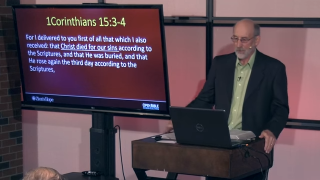
[00:35:10](https://www.youtube.com/watch?v=YPbv3bKOxuw&list=PLj9bOvimh2NyU1STwZqO7ccG5wdfGID64&index=40&t=2110s)

> "For I delivered to you first of all that which I also received: that Christ died for our sins according to the Scriptures, and that He was buried, and that He rose again the third day according to the Scriptures." — 1 Corinthians 15:3-4

### The Definition of the Antichrist

- **[The Denial of the Father and Son]** According to 1 John 2:22, the Antichrist is defined by the denial of both the Father and the Son
    - This specific dual denial is identified as a core component of Islamic theology

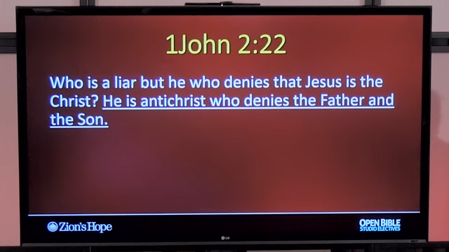
[00:35:48](https://www.youtube.com/watch?v=YPbv3bKOxuw&list=PLj9bOvimh2NyU1STwZqO7ccG5wdfGID64&index=40&t=2148s)

> "Who is a liar but he who denies that Jesus is the Christ? He is antichrist who denies the Father and the Son." — 1 John 2:22

### Summary of Mahdi Characteristics

- **[Multi-faceted Leadership]** The Mahdi is expected to operate across several domains to exert global influence:
    - **Military/Political:** A figure seeking control over Israel and the land of Jerusalem, acting as a governmental leader
    - **Spiritual:** A religious figure who denies the divinity of Yahweh and Jesus
- **[Global Impact and Hostility]**
    - He will have a worldwide impact
    - He will exhibit hatred toward both Jews and Christians

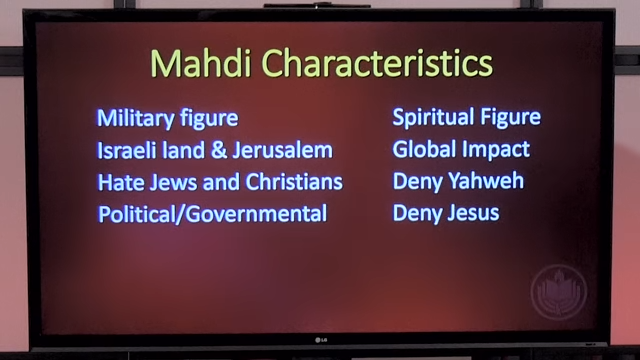
[00:36:10](https://www.youtube.com/watch?v=YPbv3bKOxuw&list=PLj9bOvimh2NyU1STwZqO7ccG5wdfGID64&index=40&t=2170s)

- **[Dawah and the Antichrist]**
    - There is a noted avoidance in some Islamic Dawah (evangelism) regarding discussions of the Antichrist
    - This is because the biblical description of the Antichrist closely resembles the expected characteristics of the Mahdi

### Political Landscape of Iran

- **[Religious Context]** Iran is predominantly Shiite, and there is a profound, fanatic focus on the arrival of the Mahdi
    - This religious fervor is a key component in understanding the nation's political motivations and end-times implications
- **[Leadership Examples]**
    - **Hassan Rouhani:** Current President
    - **Mahmoud Ahmadinejad:** Ex-President characterized by extreme Islamic fanaticism
        - He once claimed the purpose of the US presence in Iraq was to locate and eliminate the "hidden Mahdi"

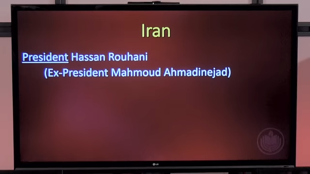
[00:37:22](https://www.youtube.com/watch?v=YPbv3bKOxuw&list=PLj9bOvimh2NyU1STwZqO7ccG5wdfGID64&index=40&t=2242s)

### Iranian Power Structure and Motivations

- **[President vs. Supreme Leader]** In the Iranian government, the President is not the primary leader of the Islamic nation
    - **President (e.g., Hassan Rouhani):** Characterized as a moderate figure
    - **Supreme Leader (e.g., Ali Khamenei):** The true authority who holds great power and commands obedience

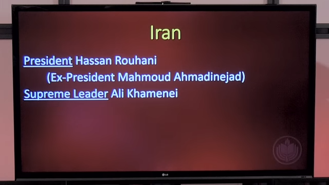
[00:39:11](https://www.youtube.com/watch?v=YPbv3bKOxuw&list=PLj9bOvimh2NyU1STwZqO7ccG5wdfGID64&index=40&t=2351s)

- **[The Quest for the Mahdi]** The spiritual leadership in Iran is driven by a desperate search for the Mahdi as the ultimate global solution
    - This religious drive directly fuels their quest for political power
    - This pursuit is more intense than in any other Muslim nation
- **[Geopolitical Objectives]** The mission of the Islamic Republic of Iran is explicitly stated as:
    - "It is the mission of the Islamic Republic of Iran to erase Israel from the map of the region."

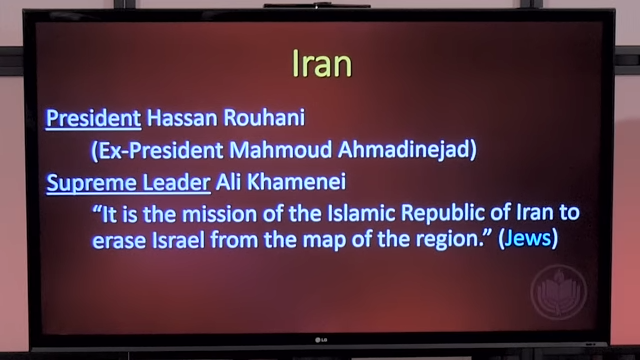
[00:40:01](https://www.youtube.com/watch?v=YPbv3bKOxuw&list=PLj9bOvimh2NyU1STwZqO7ccG5wdfGID64&index=40&t=2401s)

### Iranian Hostility and Prophetic Alignment

- **[Targets of Hostility]** Iranian leadership has expressed intense opposition toward two specific groups:
    - **Jews/Israel:** The stated mission is to "erase Israel from the map of the region."
    - **Christians/U.S.:** Supreme Leader Khamenei has identified the United States as Iran's "number one enemy."

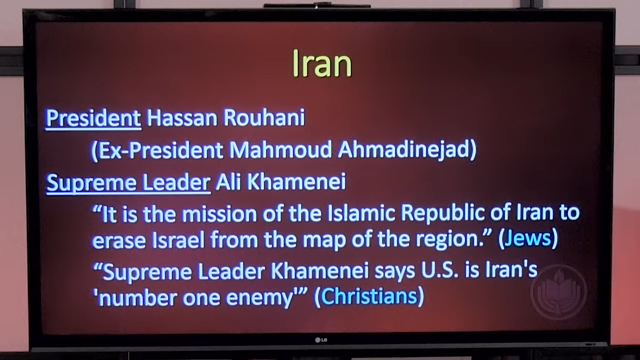
[00:40:21](https://www.youtube.com/watch?v=YPbv3bKOxuw&list=PLj9bOvimh2NyU1STwZqO7ccG5wdfGID64&index=40&t=2421s)

- **[Biblical Connection: Revelation 12:17]** This dual hostility aligns with the description of the dragon's rage in scripture:
    - The dragon makes war with the **woman** (identified as the Jewish people)
    - The dragon makes war with her **offspring** (those who keep God's commandments and have the testimony of Jesus Christ, identified as Christians)

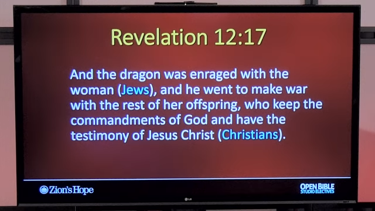
[00:40:53](https://www.youtube.com/watch?v=YPbv3bKOxuw&list=PLj9bOvimh2NyU1STwZqO7ccG5wdfGID64&index=40&t=2453s)

### Mahdi Fever

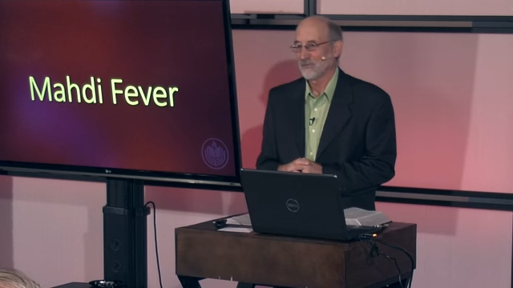
[00:41:39](https://www.youtube.com/watch?v=YPbv3bKOxuw&list=PLj9bOvimh2NyU1STwZqO7ccG5wdfGID64&index=40&t=2499s)

- A term used to describe the intense, fanatical religious excitement within Iran
    - This is a critical distinction for eschatology
    - The nation is not primarily driven by a hunger for power, but by a desperate search for their savior
- **[Implications for Diplomacy]** Because the motivation is religious and fanatical rather than purely political, they cannot be easily negotiated with
    - Their mission is seen as a holy quest that will ultimately lead to an ultimate religious war

### Religious Zealotry and Persecution

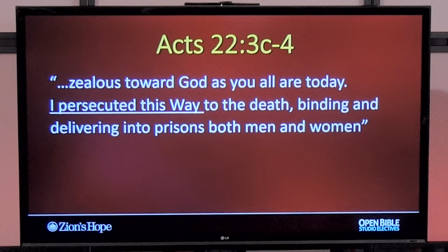
[00:42:43](https://www.youtube.com/watch?v=YPbv3bKOxuw&list=PLj9bOvimh2NyU1STwZqO7ccG5wdfGID64&index=40&t=2563s)

- The speaker compares the zeal of the Iranian people to the Apostle Paul's former life before his conversion
    - Paul described himself as being "zealous toward God" in a way that led to extreme persecution
- **[Biblical Parallel: Acts 22:3c-4]**

    > "...zealous toward God as you all are today. I persecuted this way to the death, binding and delivering into prisons both men and women"

### The Goal of Religious Warfare

- The conflict is not merely for political power, but is a religious war driven by the desire to spread Islam globally
- This religious principle is viewed as their specific solution to achieving world peace

### Exhortation to Spiritual Fervor

- **[Biblical Call: Romans 12:11]**
    - Paul implores believers to be "fervent in spirit"
    - The term "fervent" is interpreted as "boiling over" or being "zealous"

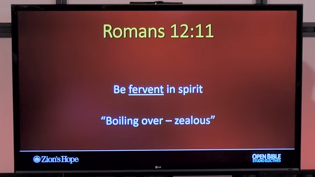
[00:43:31](https://www.youtube.com/watch?v=YPbv3bKOxuw&list=PLj9bOvimh2NyU1STwZqO7ccG5wdfGID64&index=40&t=2611s)

- **[The Balance of Vigilance and Joy]**
    - Believers should be discerning and aware that the Antichrist is active in the world
    - However, the primary focus should be an excitement for the return of Jesus Christ
    - The goal is to live with a sense of anticipation, looking up and saying, "Come, Lord Jesus."