## Islamic Eschatology: Common Ground

- The objective of studying these specific eschatological themes is to establish "common ground" between Christians and Muslims
    - This approach avoids controversial characterizations (like labeling the Mahdi as the Antichrist) that might shut down dialogue
    - Instead, it focuses on characters and concepts that allow for shared discussion
    - The ultimate goal is to use these common threads as a bridge to present the gospel

## Islamic Deceivers

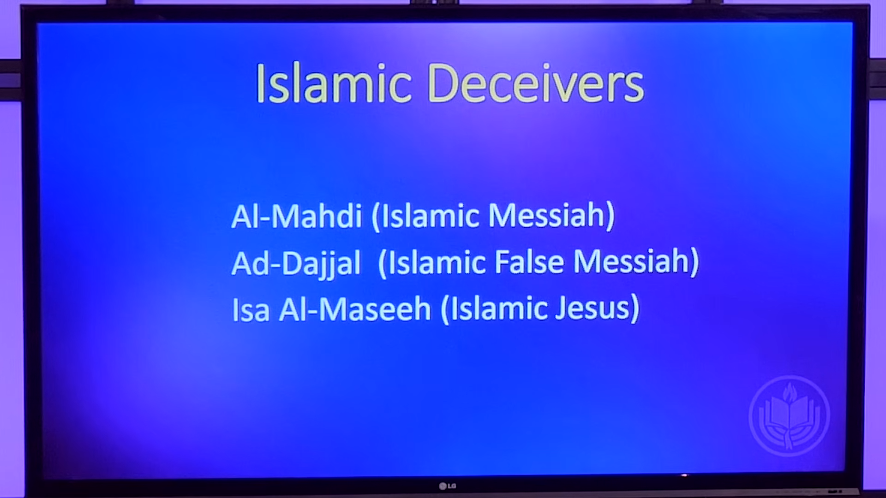
[00:02:15](https://www.youtube.com/watch?v=60TTXfi_Q8U&list=PLj9bOvimh2NyU1STwZqO7ccG5wdfGID64&index=39&t=135s)

- Three major players identified from an Islamic perspective:
    - Al-Mahdi (Islamic Messiah)
    - Ad-Dajjal (Islamic False Messiah)
    - Isa Al-Maseeh (Islamic Jesus)
- **[Contextual Note]** These figures are viewed through an Islamic lens, which is crucial for maintaining clarity during discussion.
- Al-Mahdi details:
    - Regarded as the savior or messiah
    - A figure Muslims are actively looking for in the world today
    - Current geopolitical tensions (e.g., in Iran) are linked to efforts to bring about his appearance

### Ad-Dajjal and Isa Al-Maseeh

- **Ad-Dajjal**
    - Viewed from an Islamic perspective as a false messiah
    - Comparable to the Christian concept of the Antichrist
    - A figure that Muslims are also actively looking for
- **Isa Al-Maseeh**
    - Represents the Islamic version of Jesus
    - **[Why this matters]** Understanding what Muslims believe about Jesus is a vital step in engaging them in conversation about the real Jesus
- **[Theological Connection]** From a Christian perspective, all three characters (Al-Mahdi, Ad-Dajjal, and Isa Al-Maseeh) can be categorized as antichrists

### Signs of the Last Hour

- The appearance of multiple individuals claiming to be the Messiah is a significant indicator of the end times
    - This includes figures within the Christian realm and Islamic figures like Al-Mahdi
    - These figures are collectively viewed as "antichrists"
- **[Biblical Reference]** 1 John 2:18
    - "Little children, it is the last hour; and as you have heard that the Antichrist is coming, even now many antichrists have come, by which we know that it is the last hour."
    - The existence of many antichrists serves as a marker that the current era is the last hour

### Warnings of False Christs

- Jesus provides specific discourse regarding the rise of false messiahs
- **[Biblical Reference]** Matthew 24:23-26
    - Christ warns of people saying, "Look, here's the Christ."

#### Deceptive Nature of False Christs

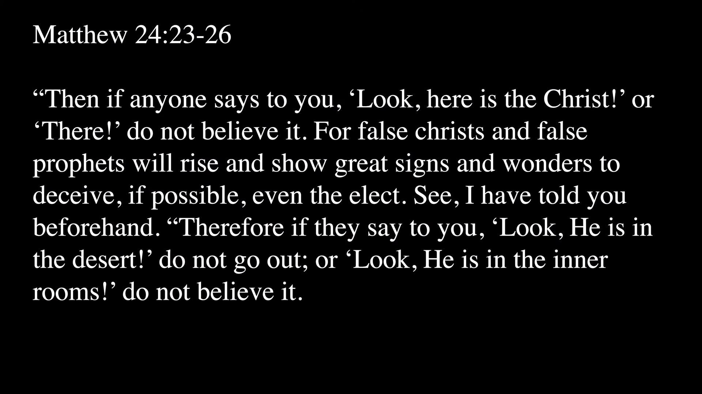
[00:05:57](https://www.youtube.com/watch?v=60TTXfi_Q8U&list=PLj9bOvimh2NyU1STwZqO7ccG5wdfGID64&index=39&t=357s)

- Christ provides specific warnings about the deceptive nature of end-times figures
    - False Christs and false prophets will rise, performing great signs and wonders
    - **[Warning]** These deceptions are powerful enough that, if possible, they could deceive even the elect
- **[Biblical Reference]** Matthew 24:23-26
    - "Then if anyone says to you, ‘Look, here is the Christ!’ or ‘There!’ do not believe it. For false christs and false prophets will rise and show great signs and wonders to deceive, if possible, even the elect. See, I have told you beforehand. Therefore if they say to you, ‘Look, He is in the desert!’ do not go out; or ‘Look, He is in the inner rooms!’ do not believe it."

#### Defining the False Christ

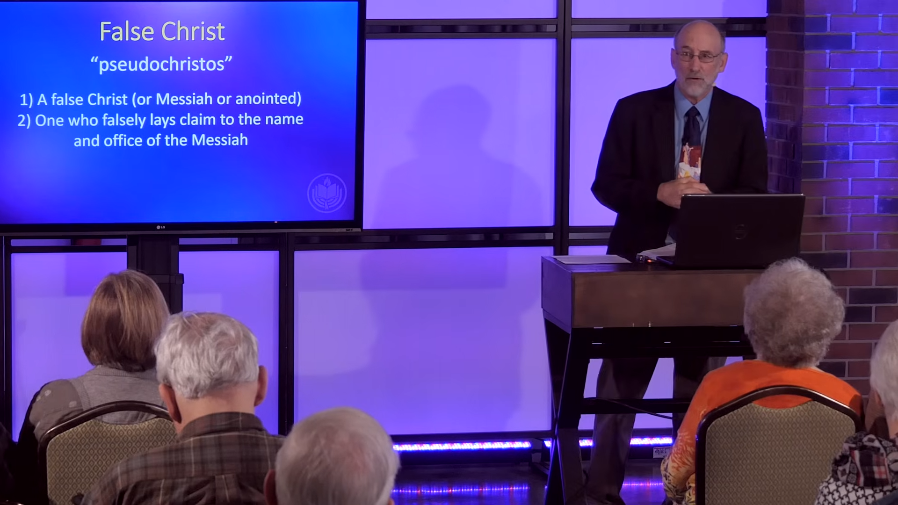
[00:07:18](https://www.youtube.com/watch?v=60TTXfi_Q8U&list=PLj9bOvimh2NyU1STwZqO7ccG5wdfGID64&index=39&t=438s)

- The Greek term used for false Christs is `pseudochristos`
- **Definition of a False Christ (or Messiah/Anointed One):**
    - One who falsely lays claim to the name and office of the Messiah

### Linguistic Breakdown of Islamic Titles

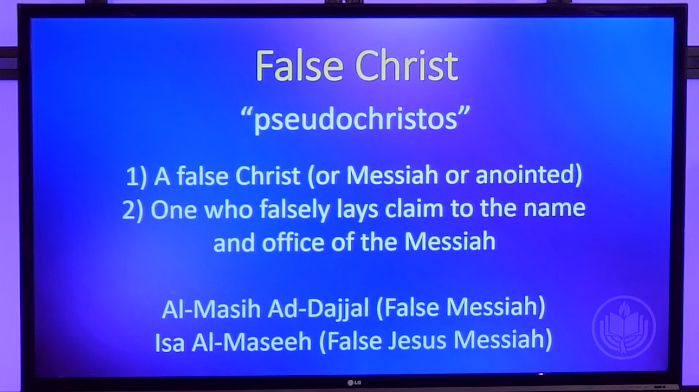
[00:07:38](https://www.youtube.com/watch?v=60TTXfi_Q8U&list=PLj9bOvimh2NyU1STwZqO7ccG5wdfGID64&index=39&t=458s)

- **Al-Masih Ad-Dajjal**
    - **Etymology:**
        - *Al*: Typically means "the" in Arabic
        - *Dajjal*: Refers to a deceiver or a liar
    - **Translation:** "The Messiah Deceiver"
- **Isa Al-Maseeh**
    - **Etymology:** "Isa" is the Arabic word for Jesus (sometimes spelled Esa)
    - **[Theological Distinction]** While the name refers to Jesus, the Islamic perspective is viewed as a "false Jesus Messiah" because their definition of his identity and mission is incorrect
    - **[Warning]** Even if this figure claims, "I am Jesus and I have returned," his actions will align with an antichrist figure

### Engaging with the Concept of the False Messiah

- **[Dialogue Strategy]** The concept of a false messiah can serve as a "stepping stone" to the gospel
    - Christians and Muslims can find common ground in agreeing that a false messiah will rise and preach a false message of salvation
- **Ad-Dajjal's Rise and Following**
    - He is expected to rise from among the Jewish people
    - He will lead a massive gathering, including approximately 70,000 Jewish people, as well as Turks, Pakistanis, and others from the Middle East
    - His influence is expected to be widespread, potentially fooling people globally

### Signs Preceding Ad-Dajjal

- According to Islamic teachings, certain societal conditions will exist when he arrives

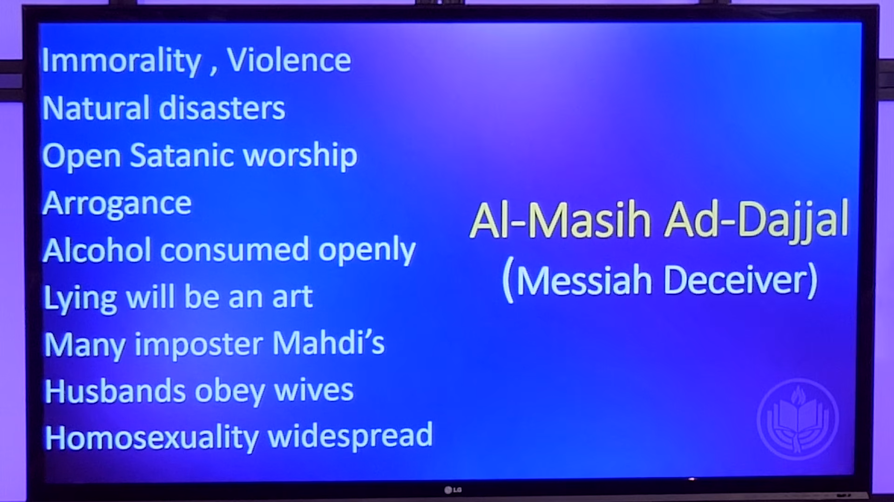
[00:10:20](https://www.youtube.com/watch?v=60TTXfi_Q8U&list=PLj9bOvimh2NyU1STwZqO7ccG5wdfGID64&index=39&t=620s)

- **Predicted Societal Signs:**
    - Immorality and violence
    - Natural disasters
    - Open Satanic worship
    - Widespread arrogance
    - Alcohol being consumed openly
    - Lying becoming an "art"
    - Many "imposter Mahdis"
    - Husbands obeying wives
    - Widespread homosexuality

### Biblical Descriptions of the Last Days

- **[Biblical Reference]** 2 Timothy 3:1-5
    - Describes the "perilous times" that will come in the last days
    - Characterizes the moral decay of humanity:
        - Men will be lovers of themselves, lovers of money, boasters, and proud
        - They will be blasphemers, disobedient to parents, unthankful, and unholy
        - They will be unloving, unforgiving, slanderers, and without self-control
        - They will be brutal, despisers of good, traitors, headstrong, and haughty
        - They will be lovers of pleasure rather than lovers of God, having a form of godliness but denying its power

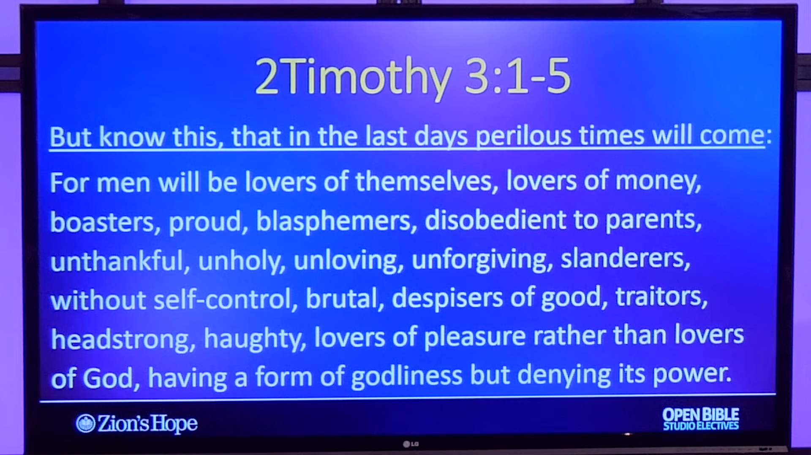
[00:11:41](https://www.youtube.com/watch?v=60TTXfi_Q8U&list=PLj9bOvimh2NyU1STwZqO7ccG5wdfGID64&index=39&t=701s)

### Parallels in End-Times Descriptions

- **[Dialogue Bridge]** The moral decay described in the Bible mirrors the 'lesser signs' in Islam
    - While Muslims may view these signs as the world being "ripe" for the Messiah, Christians see them as the "beginning of sorrows" (per Matthew 24)
- **[Biblical Reference]** 2 Timothy 3:1-5
    - Describes a world characterized by people being lovers of pleasure rather than lovers of God, having a form of godliness but denying its power
    - This description is noted as being very similar to the modern world

### Characteristics of Ad-Dajjal

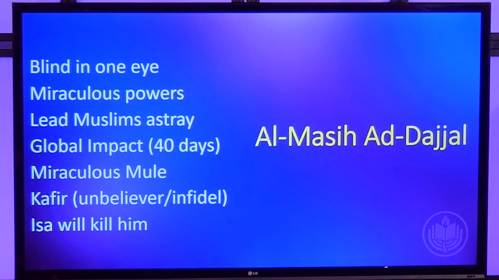
[00:12:44](https://www.youtube.com/watch?v=60TTXfi_Q8U&list=PLj9bOvimh2NyU1STwZqO7ccG5wdfGID64&index=39&t=764s)

- **Physical Appearance**
    - He is described as being blind in one eye, with a piece of flesh covering it
    - **[Theological Reason]** This blindness is a distinguishing mark; Muslims believe Allah would never create a true Messiah who is blind in one eye
- **Miraculous Powers**
    - He will possess the ability to perform deceptive miracles
    - Examples include creating prosperity and calling down rain from the heavens
- **Global Impact**
    - He is expected to have a widespread, worldwide influence
    - Islamic teaching suggests he will cover the entire globe in 40 days

### Further Details on Ad-Dajjal

[00:13:30](https://www.youtube.com/watch?v=60TTXfi_Q8U&list=PLj9bOvimh2NyU1STwZqO7ccG5wdfGID64&index=39&t=810s)

- **Global Preaching**
    - He is expected to preach to the entire world
    - It is suggested he may use a "miraculous mule" to cover vast distances at high speeds
- **Identification for Muslims**
    - **Kafir:** A term for an unbeliever or infidel
    - **The Mark:** The word *Kafir* will be written across his forehead, between his eyes
    - **[Crucial Distinction]** This mark is only readable by Muslims; unbelievers will not be able to see or understand it
- **Restrictions on Movement**
    - He will be supernaturally prevented from entering the mosque in Jerusalem
    - He will also be barred from the holy places of Mecca and Medina
- **[Warning]** Muslims are cautioned to avoid him due to his extreme charisma, which is intended to draw people in and deceive them
- **The End of Ad-Dajjal**
    - He will be killed by Isa (the Islamic Jesus)
    - Isa is expected to come down from Damascus and follow him into Jerusalem to carry out this act

### Cultural Controversy: A Television Show

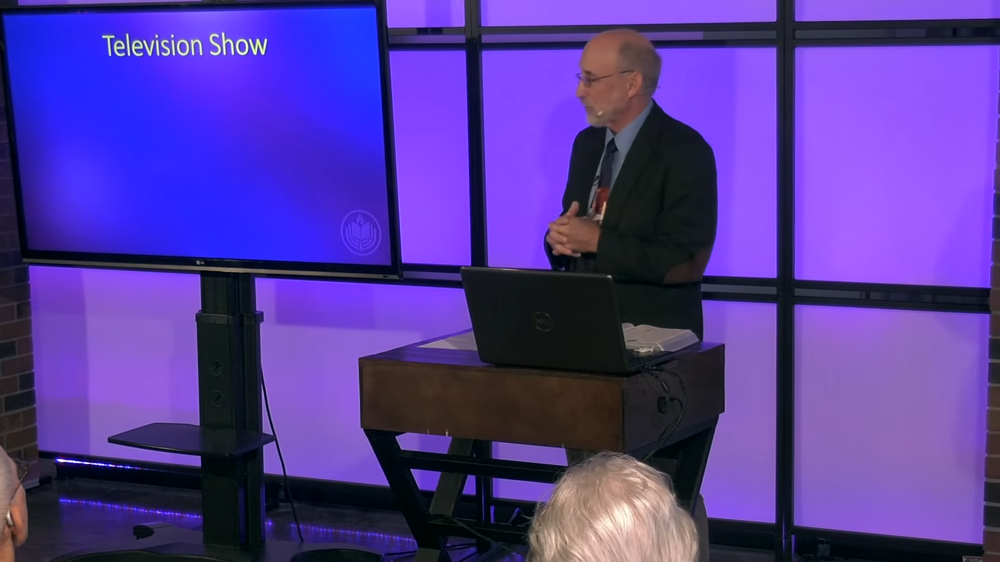
[00:15:02](https://www.youtube.com/watch?v=60TTXfi_Q8U&list=PLj9bOvimh2NyU1STwZqO7ccG5wdfGID64&index=39&t=902s)

A television show that premiered on January 1st, 2020, has caused an enormous stir among various religions due to its message.

- **Religious Reactions**
    - **Christians:** Some view the content as blasphemous, believing it misrepresents Jesus.
    - **Muslims:** Some are angered because they feel the show misrepresents Isa (their prophet/Jesus).
- **[Observation]** The controversy suggests the creator may be intentionally making the narrative confusing to provoke these different religious interpretations.

### Jordanian Response to the Series

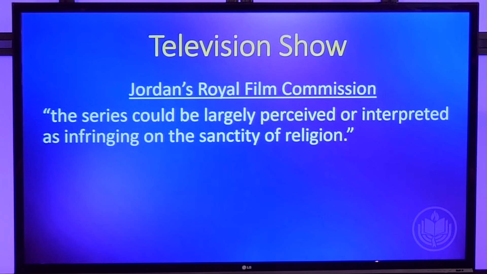
[00:17:29](https://www.youtube.com/watch?v=60TTXfi_Q8U&list=PLj9bOvimh2NyU1STwZqO7ccG5wdfGID64&index=39&t=1049s)

A television show incorporating Islamic eschatological themes has faced significant backlash and government intervention.

- **Narrative Elements**
    - The show includes a character referred to as "Esau"
        - In the context of the show's themes, this character represents a false Muslim Jesus
    - The plot involves this character leading a group of Jews across the border into Israel
- **Government Response in Jordan**
    - The series was produced partly in Jordan
    - The Jordan's Royal Film Commission issued a formal statement regarding the series:
        - "the series could be largely perceived or interpreted as infringing on the sanctity of religion, the Islamic religion."
    - **[Outcome]** Due to the confusing and sensitive nature of the theological teachings presented, the country of Jordan has banned the show entirely.

### The Creator's Intent for the Series

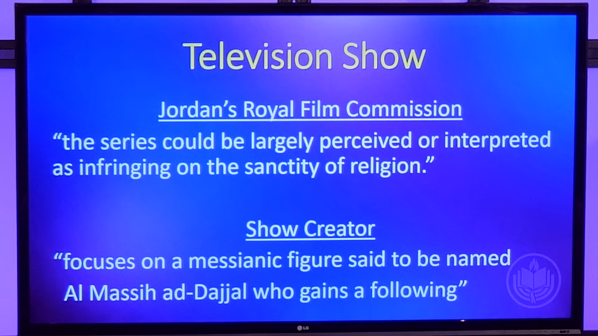
[00:18:08](https://www.youtube.com/watch?v=60TTXfi_Q8U&list=PLj9bOvimh2NyU1STwZqO7ccG5wdfGID64&index=39&t=1088s)

While the show's identity is debated, the creator's specific focus is on a messianic figure:

- **Name:** Al Massih ad-Dajjal
- **Goal:** He is a figure who "gains a following"
- **[Shared Identity]** Both Christians and Muslims can identify this character as an Antichrist
    - The show uses this shared theological concept to present a character that could potentially "bring the world together"
    - This highlights the importance of being aware of how Islamic eschatological themes are being integrated into mainstream Western media

### Isa Al-Maseeh (Jesus the Messiah)

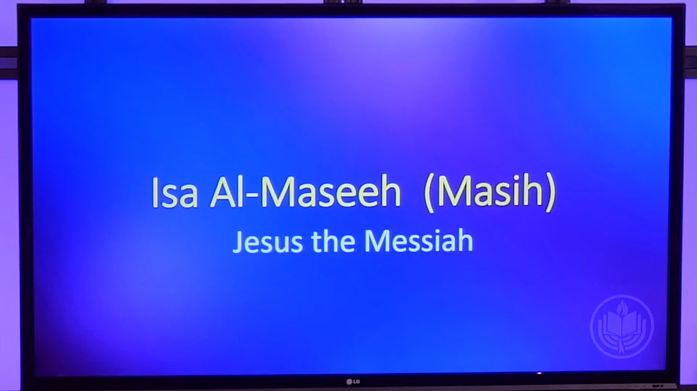
[00:19:33](https://www.youtube.com/watch?v=60TTXfi_Q8U&list=PLj9bOvimh2NyU1STwZqO7ccG5wdfGID64&index=39&t=1173s)

- **Linguistic Meaning:** The name translates to "Jesus the Messiah"
- **Islamic Perspective:** He is viewed as a prophet rather than the Son of God
    - He is expected to precede the Mahdi
    - He will arise from Damascus
    - His role includes killing the Dajjal
- **[Theological Conflict]** While Christians view him as the Savior, from an Islamic eschatological standpoint, he is a prophet who will bring a Muslim message

### Quranic Account of the Virgin Birth

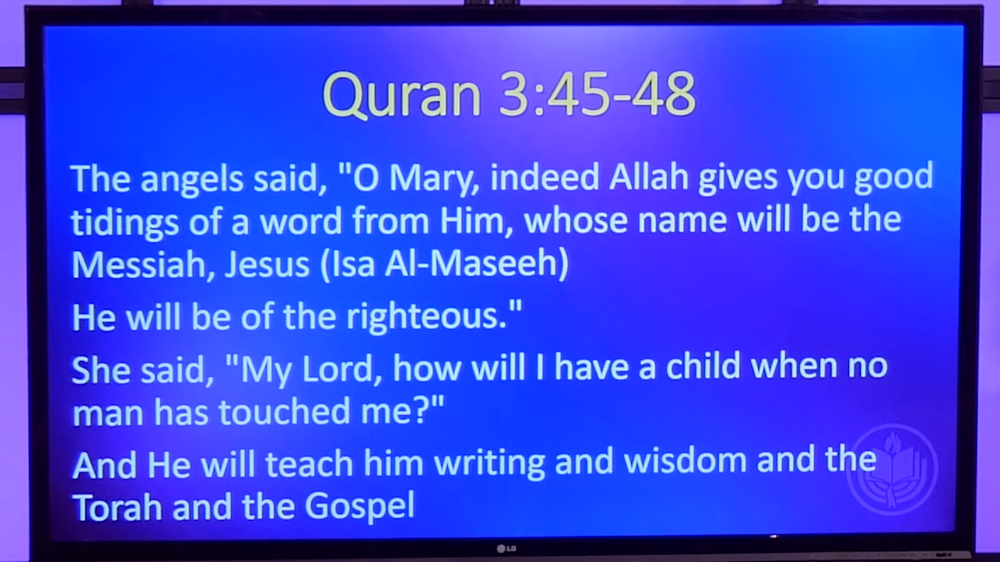
[00:20:30](https://www.youtube.com/watch?v=60TTXfi_Q8U&list=PLj9bOvimh2NyU1STwZqO7ccG5wdfGID64&index=39&t=1230s)

- **Quran 3:45-48** describes the announcement of Jesus' birth to Mary
    - The angel provides "good tidings of a word from Him"
    - The name of this word is the Messiah, Jesus (Isa Al-Maseeh)
- **Parallels with the Bible:** The Quranic narrative closely mirrors the account found in the Gospel of Luke
    - Mary questions how she can have a child without a man touching her
    - The text notes that He will teach him writing, wisdom, the Torah, and the Gospel

### The Islamic Expectation of the Second Coming

- **[Theological Belief]** Muslims believe in both the first coming and the second coming of Jesus
    - There is significant zeal in many Muslim communities regarding his return
- **Hadith on Jesus's Return**
    - According to **Bukhari, Vol. 4, Hadith No. 658**:
        - "How will you be when the son of Mary (i.e. Jesus) descends amongst you and he will judge people by the Law of the Qur'an and not by the law of the Gospel."
    - **[Key Distinction]** Unlike the Christian expectation, this figure is expected to uphold the Law of the Quran rather than the Gospel

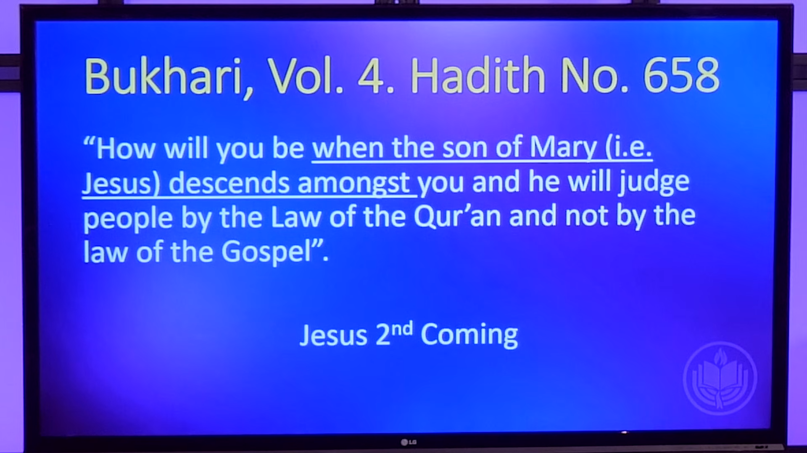
[00:21:28](https://www.youtube.com/watch?v=60TTXfi_Q8U&list=PLj9bOvimh2NyU1STwZqO7ccG5wdfGID64&index=39&t=1288s)

### Biblical Warnings of a False Messiah

- **[Christian Perspective]** From a biblical standpoint, this "Muslim false Jesus" is viewed as a figure that Christians should fully expect to rise
- **Revelation 13**
    - The Bible speaks of a figure (the beast of the earth) that parallels the concept of a rising false messianic figure

### The Second Beast in Revelation 13

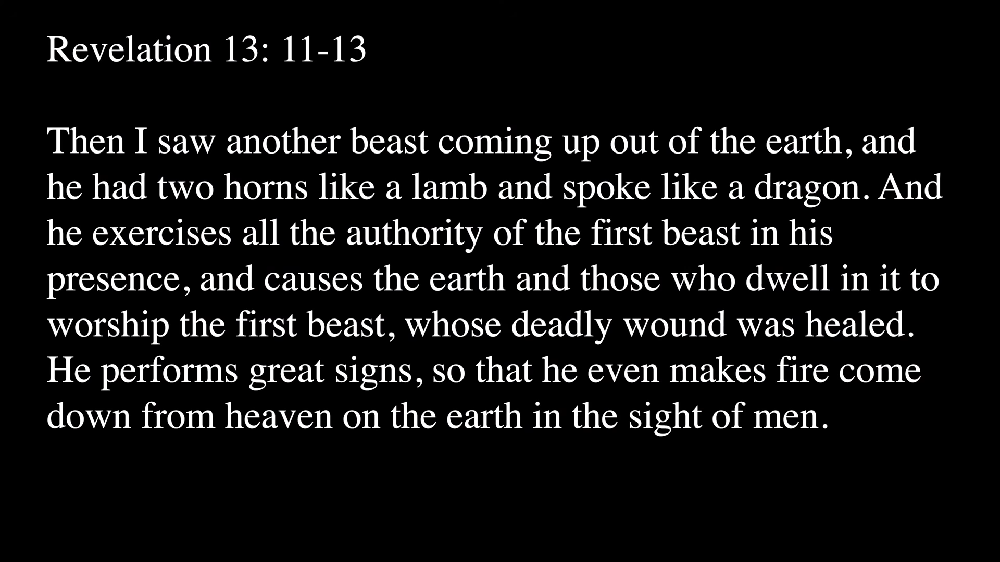
[00:22:37](https://www.youtube.com/watch?v=60TTXfi_Q8U&list=PLj9bOvimh2NyU1STwZqO7ccG5wdfGID64&index=39&t=1357s)

- **Revelation 13:11-13** describes a second beast that emerges from the earth:
    - It has "two horns like a lamb" but "spoke like a dragon" (indicating Satanic motivation)
    - It exercises all the authority of the first beast (the Antichrist/Mahdi)
    - Its presence causes those on earth to worship the first beast
- **[Connection to Islamic Eschatology]** This figure parallels how the Islamic Isa is expected to function:
    - He will perform "great signs and wonders" to deceive the inhabitants of the earth
    - One specific sign mentioned is making fire come down from heaven in the sight of men

#### Deception and the Image of the Beast

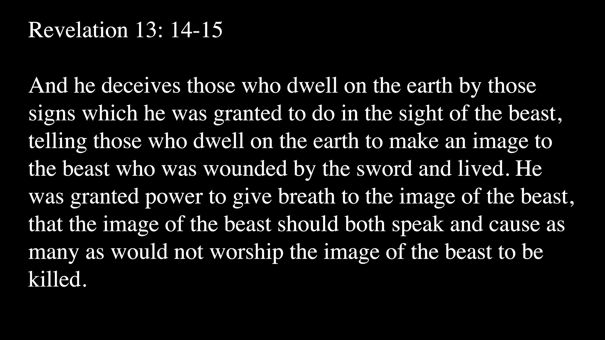
[00:23:31](https://www.youtube.com/watch?v=60TTXfi_Q8U&list=PLj9bOvimh2NyU1STwZqO7ccG5wdfGID64&index=39&t=1411s)

- **The Role of Deception:** The second beast uses granted signs to deceive people into making an image of the first beast (the one who was wounded and lived)
- **Empowering the Image:** The beast is granted the power to give "breath" to this image so that it can both speak and act
- **Enforced Worship:** The image is used to compel worship; anyone who refuses to worship the image is killed

#### The Mark of the Beast

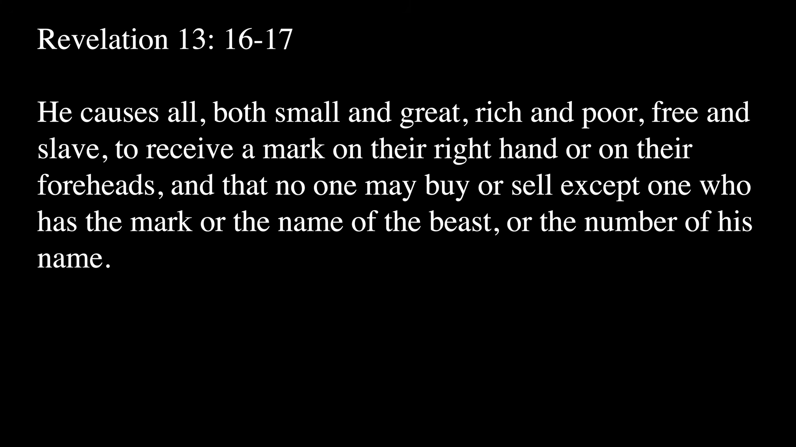
[00:23:57](https://www.youtube.com/watch?v=60TTXfi_Q8U&list=PLj9bOvimh2NyU1STwZqO7ccG5wdfGID64&index=39&t=1437s)

- **Universal Requirement:** The beast causes all people—regardless of status (small/great, rich/poor, free/slave)—to receive a mark
- **Placement of the Mark:** The mark is placed on either the **right hand** or the **forehead**
- **Economic Control:** This mark is required for anyone wishing to buy or sell anything

### Partnership of the Beasts

- **The False Prophet's Influence:** The second beast (the false prophet) works in close partnership with the first beast (the Antichrist/Mahdi)
    - The false prophet uses signs and wonders to coerce people into following the Antichrist figure
    - This partnership is a central theme in the end-times according to Revelation 13

### Islamic Expectations of Isa Al-Maseeh

- **A Radical Muslim:** From an Islamic perspective, Isa (Jesus) is expected to return as a "radical Muslim"
    - He will follow Islam to the letter of the law
    - He will be viewed as the perfect Muslim, adhering strictly to all Islamic teachings

### Isa Al-Maseeh as an Islamic Evangelist

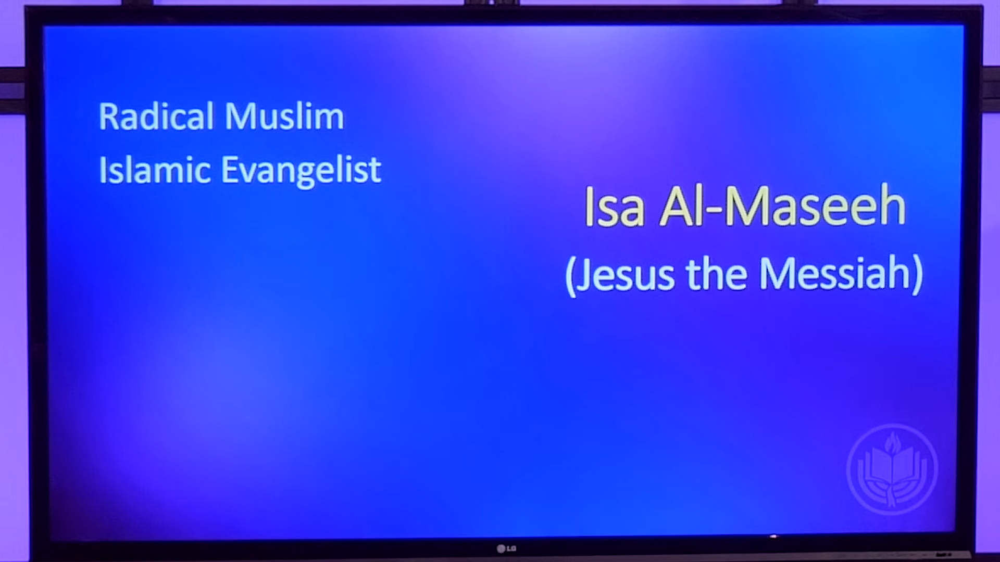
[00:25:51](https://www.youtube.com/watch?v=60TTXfi_Q8U&list=PLj9bOvimh2NyU1STwZqO7ccG5wdfGID64&index=39&t=1551s)

- **Submission to the Mahdi:** In the Islamic expectation, Isa will submit himself to the Mahdi, doing whatever the Mahdi requires
    - This parallels the biblical description of the second beast (false prophet) submitting to the first beast (Antichrist)
- **Promoting Islamic Theology:** He is expected to act as an "Islamic evangelist"
    - He will promote Islam and actively correct existing theological views
    - He will encounter Christians to influence them toward the Islamic perspective of who Jesus is
- **Targeting "Immature" Christians:** His influence will be particularly strong among those who are sidelined or not deeply rooted in their faith
- **Methods of Influence:**
    - **Signs and Wonders:** He will perform miracles and signs that will cause people to believe he is the true messenger
    - **Rejection of Christian Symbols:** He will lead people away from Christian traditions, such as removing or discarding crosses, because they are viewed as being in opposition to Islamic truth

### Deception through Signs and Wonders

- **The Rejection of the Cross:** The influence of the false prophet/Islamic evangelist may lead to an active campaign to destroy crosses, as the cross remains a symbol of intense hatred in the world
- **Biblical Mechanism of Deception:** According to 2 Thessalonians, the lawless one (Antichrist) operates through Satanic power
    - This includes "all power, signs, and lying wonders"
    - This results in "unrighteous deception"
    - **[Why people fall for it?]** Because they "did not receive the love of the truth, that they might be saved"

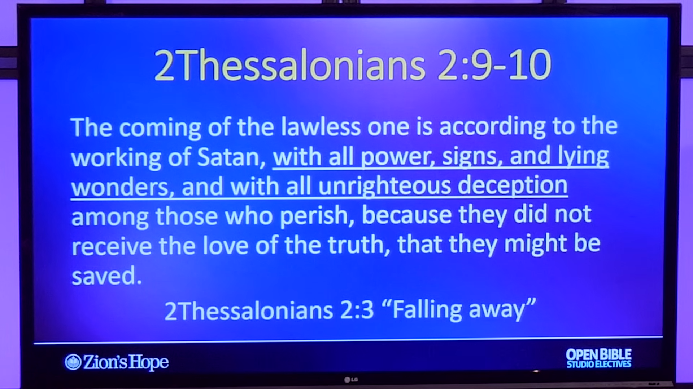
[00:27:34](https://www.youtube.com/watch?v=60TTXfi_Q8U&list=PLj9bOvimh2NyU1STwZqO7ccG5wdfGID64&index=39&t=1654s)

- **The Power of Miraculous Displays:** Miracles—such as walking on water or healing a child—can create significant religious stir and focus public attention on a false messiah
    - Such displays are not far-fetched in light of scripture
    - They serve as the primary tool to convince people to follow a deceptive figure

### The Deceptive Power of Miracles

- **[The Great Deception]** The false messiah will perform astounding signs to gain followers
    - One example includes making fire come down from heaven in the sight of men
    - **[The Consequence]** God allows these miracles to occur so that people will be deceived and follow the false figure
- **[Spiritual Falling Away]** These signs will cause many to drop their "tenuous hold" on Christianity
    - This includes both those who are not truly elect/Christians and those who are currently Christians

### Isa Al-Maseeh: Evangelist and Enforcer

- **Islamic Evangelist:** He will promote Islamic theology and use miracles to convince people of its truth
- **Islamic Enforcer:** Beyond mere persuasion, he will act as a coercive force to mandate acceptance of Islam
    - He will force people to accept the faith or face death

### Enforcement via Revelation 13

- **Coercive Control:** Following the pattern in Revelation 13, this figure will ensure religious conformity through extreme measures
    - **Killing Dissenters:** He will cause those who refuse to worship the image of the beast to be killed
    - **The Mark:** He will cause all people—regardless of status (small/great, rich/poor, free/slave)—to receive a mark on their right hand or forehead
    - **[The Ultimatum]** The choice presented is to preach, teach, and accept the mandate, or face starvation and death

### Implementation of Shariah Law

- **[Prophetic Connection]** Daniel 7:25 describes the Antichrist as one who "shall intend to change times and law"
    - The speaker suggests this refers to the worldwide institution of Shariah law
    - This will be enforced through the Antichrist and the false prophet via coercion (the mark of the beast) or death

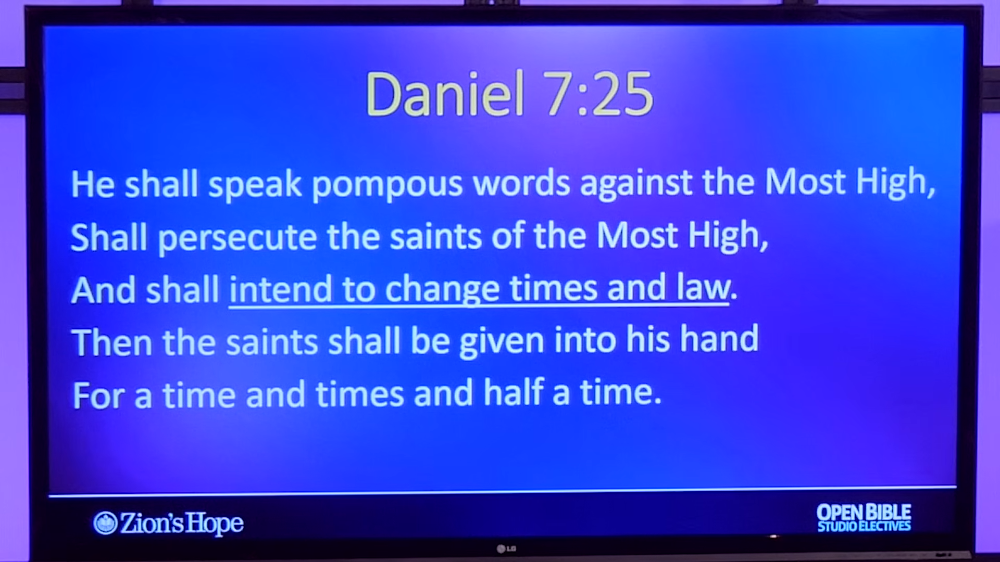
[00:30:15](https://www.youtube.com/watch?v=60TTXfi_Q8U&list=PLj9bOvimh2NyU1STwZqO7ccG5wdfGID64&index=39&t=1815s)

### Persecution of Christians

- **Targeting Christians:** The Islamic figure (Isa Al-Maseeh) is expected to target Christians specifically
- **Theological Conflict:** The speaker argues that at the core of Islam is a hatred for Christians, based on the classification of Christians as polytheists
    - **[The Polytheist Label]** Because Christians worship the Father, Son, and Holy Spirit, they are viewed by some Muslims as worshipping three gods rather than one
- **Quranic Basis for Conflict:** The speaker cites Quran 9:5 regarding the treatment of polytheists

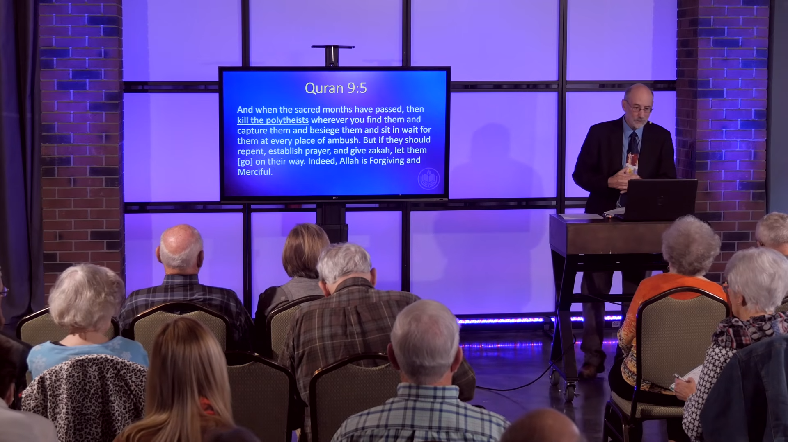
[00:31:02](https://www.youtube.com/watch?v=60TTXfi_Q8U&list=PLj9bOvimh2NyU1STwZqO7ccG5wdfGID64&index=39&t=1862s)

> "And when the sacred months have passed, then kill the polytheists wherever you find them, capture them and besiege them and sit in wait for them at every place of ambush..."

### Persecution and the Great Tribulation

- **[The Martyrs]** Revelation 20:4 describes the souls of those who were beheaded because of their witness to Jesus and the word of God
    - These individuals refused to worship the beast or his image
    - They also refused to receive the mark on their foreheads or hands

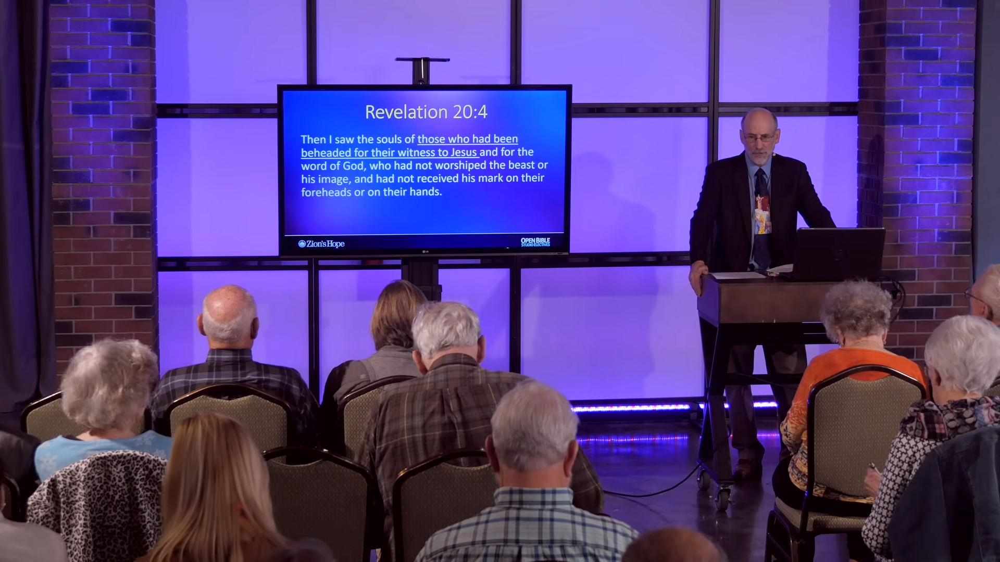
[00:31:55](https://www.youtube.com/watch?v=60TTXfi_Q8U&list=PLj9bOvimh2NyU1STwZqO7ccG5wdfGID64&index=39&t=1915s)

### Anti-Semitism in End-Times Prophecy

- **[Targeting Jews]** The speaker notes that the Islamic figure of Isa Al-Maseeh will also be anti-Semitic
- **Hadith on the Final Battle:** According to Bukhari, the 'last hour' (end times) involves a conflict with the Jewish people
    - The prophecy states that a stone will speak to a Muslim, revealing the location of a hiding Jew so that he may be killed

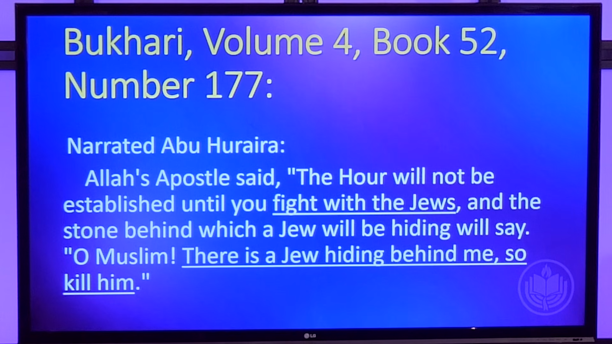
[00:32:36](https://www.youtube.com/watch?v=60TTXfi_Q8U&list=PLj9bOvimh2NyU1STwZqO7ccG5wdfGID64&index=39&t=1956s)

### Theological Basis for Anti-Semitism

- **[Reasoning for Hostility]** The speaker suggests the Islamic figure's anti-Semitism stems from the belief that the Jewish people persecuted and killed Jesus
    - He notes that from a Christian perspective, the focus is on the sin of the crucifixion rather than hatred for the people
- **Biblical Parallel in Revelation 12**
    - Revelation 12:13 describes the dragon (Satan) persecuting the woman (representing Israel/the Jews) after being cast to earth
    - Revelation 12:17 concludes that the dragon's attack extends to both the Jewish people and Christians
    - The speaker observes that both the Quran and Hadith promote similar end-times hostility toward these two groups

### Characteristics of Isa Al-Maseeh

- **[Human Nature]** In the Islamic view, Isa is seen as a human prophet rather than the divine Son of God
- **Life Span and Family**
    - Expected to live for 40 years
    - Expected to marry and have children
- **Summary of Roles**

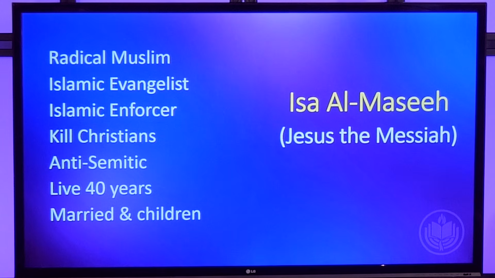
[00:34:01](https://www.youtube.com/watch?v=60TTXfi_Q8U&list=PLj9bOvimh2NyU1STwZqO7ccG5wdfGID64&index=39&t=2041s)

| Role | Description |
| --- | --- |
| Radical Muslim | A figure aligned with radical Islamic perspectives |
| Islamic Evangelist | Promotes Islamic teachings |
| Islamic Enforcer | Uses force/coercion to enforce religious laws |
| Anti-Semitic | Targets the Jewish people |
| Kill Christians | Targets Christians as polytheists |

### Summary of End-Times Deceivers

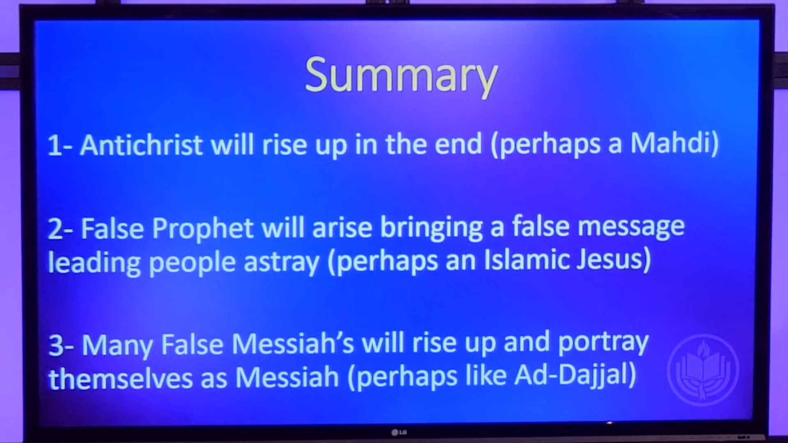
[00:34:27](https://www.youtube.com/watch?v=60TTXfi_Q8U&list=PLj9bOvimh2NyU1STwZqO7ccG5wdfGID64&index=39&t=2067s)

1. **Antichrist:** Will rise up in the end (potentially identified as a Mahdi)
2. **False Prophet:** Will arise bringing a false message to lead people astray (potentially an Islamic Jesus)
3. **False Messiahs:** Many will rise up and portray themselves as the Messiah (potentially like Ad-Dajjal)

### Common Ground for Dialogue

- **[The Opportunity]** Many Muslims are seeking truth and are hungry for it, especially as they move away from the "false Jesus" (the enforcer/persuader) toward the real Jesus
- **[Application]** This common ground can be used for evangelism locally, such as engaging with Muslim communities and mosques
- **[Connecting the Figures]** The end-times figures described in the Bible align closely with Islamic descriptions, providing a bridge for conversation:
    - The Antichrist (potentially the Mahdi)
    - The False Prophet (potentially an Islamic version of Isa)
    - False Messiahs (potentially like Ad-Dajjal)

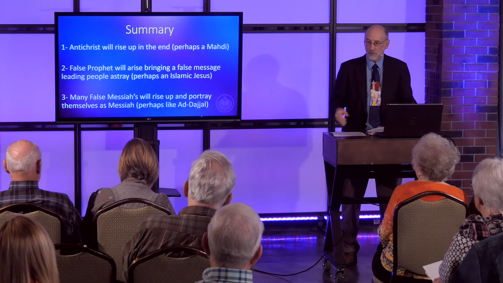
[00:35:00](https://www.youtube.com/watch?v=60TTXfi_Q8U&list=PLj9bOvimh2NyU1STwZqO7ccG5wdfGID64&index=39&t=2100s)

### Monitoring the End-Times Landscape

- **[Vigilance]** We must keep our eyes aware of the global landscape to see if these figures are rising.
- **[Geopolitical Context]** There is speculation regarding the potential rise of these figures from the region of the former Assyrian Empire (e.g., Iran, Iraq, or Turkey).
- **[Signs of Proximity]** The more we see various figures claiming to be the Messiah, the closer we are to the end times.

### The Crucial Question: Who is Jesus?

- **[The Witness Tool]** The question "Who is Jesus?" is a vital starting point for dialogue with those of the Islamic faith.
    - Even though they believe many things about Him, they may not truly know Him through the lens of their own religion.
    - This allows for a bridge to share the truth of the real Jesus.

### Addressing the Identity of Jesus

- **[The Islamic Perspective]** In Islam, Jesus is viewed as a man created by God, but not as God Himself.
    - **Quran 19:35** states that it is not befitting for Allah to take a son.
        - The belief is that when He decrees an affair, He simply says "Be," and it is.

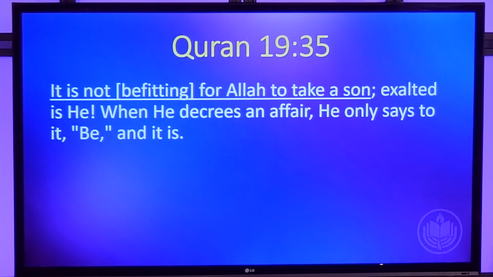
[00:37:41](https://www.youtube.com/watch?v=60TTXfi_Q8U&list=PLj9bOvimh2NyU1STwZqO7ccG5wdfGID64&index=39&t=2261s)

- **[The Biblical Perspective]** The Bible explicitly identifies Jesus as the Son of God.
    - **Matthew 17:5** describes the Transfiguration, where God speaks from a bright cloud:
        - "This is My beloved Son, in whom I am well pleased. Hear Him!"

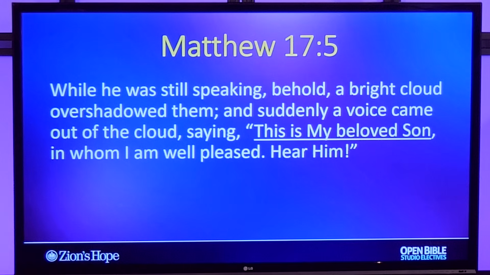
[00:38:26](https://www.youtube.com/watch?v=60TTXfi_Q8U&list=PLj9bOvimh2NyU1STwZqO7ccG5wdfGID64&index=39&t=2306s)

- **[Points of Theological Divergence]**
        - **Sonship:** While some may argue Jesus never explicitly claimed to be the Son of God, the Bible presents God's own declaration of His identity.
        - **The Crucifixion:** A significant point of contention is the belief that Jesus did not actually die on the cross.
            - One common Islamic belief is that Judas Iscariot took Jesus's place and died in His stead, while Jesus was hidden away.

### Islamic Perspectives on the Crucifixion

- **[Alternative Narratives]** There are various tales within Islamic tradition regarding how Jesus avoided the cross:
    - Some believe Judas Iscariot took His place and died in His stead.
    - Others suggest He was whisked away, similar to how Elijah was taken up to heaven.
- **[Biblical Counter-Evidence]** The scriptures provide clear testimony that Jesus died on the cross:
    - The Gospels provide eyewitness accounts.
    - The book of Acts alludes to the fact of His death.
    - Numerous testimonies throughout the New Testament confirm the crucifixion.
- **[Quranic Denial of the Crucifixion]** The Quran explicitly denies that Jesus was killed or crucified:

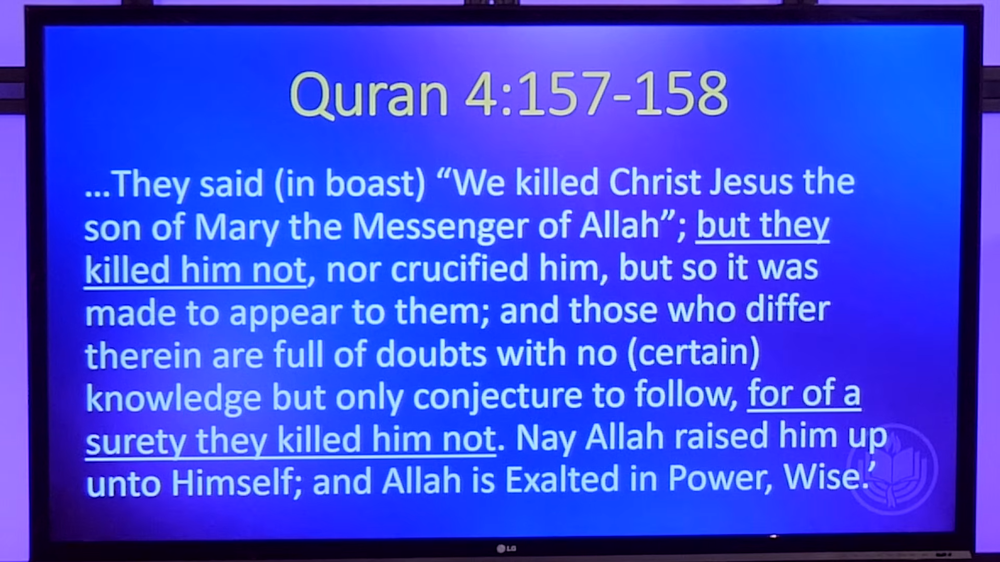
[00:39:45](https://www.youtube.com/watch?v=60TTXfi_Q8U&list=PLj9bOvimh2NyU1STwZqO7ccG5wdfGID64&index=39&t=2385s)

    > "...They said (in boast) 'We killed Christ Jesus the son of Mary the Messenger of Allah'; but they killed him not, nor crucified him, but so it was made to appear to them; and those who differ therein are full of doubts with no (certain) knowledge but only conjecture to follow, for of a surety they killed him not." (Quran 4:157-158)

- **[Theological Implication]** This creates a fundamental point of contention:
    - For Christians, the crucifixion is an absolute, certain fact.
    - For those following these Quranic interpretations, the event is viewed as an appearance or an illusion, leading to what the text describes as being "full of doubts."

### The Islamic Claim of Divine Ascension

- **[The Counter-Claim]** Following the denial of the crucifixion, the Islamic perspective asserts:
    - Allah raised Jesus up to Himself.
    - This is framed as an act of Allah's power and wisdom.

### Biblical Affirmation of Death and Resurrection

- **[Self-Attested Truth]** The reality of Christ's death is established by His own words in Scripture:
    - In **Revelation 2:8**, the angel of the church in Smyrna describes Jesus as "the first and the last," specifically noting that He "was dead, and is alive" (Revelation 2:8).
    - This self-attestation confirms that the death on the cross and the subsequent resurrection are absolute truths central to the Christian faith.

### Divergent Views on Salvation and Grace

- **[The Purpose of the Death]** A fundamental difference exists regarding the significance of Christ's death:
    - For Christians, the death and resurrection are the means of salvation.
    - In Islamic belief, there is a different understanding of how one enters heaven; it is often viewed as a result of the benevolent mercy and grace of Allah, rather than through the specific work of Christ's atonement.

### Salvation through the Weighing of Deeds

- **[The Islamic Concept]** According to certain interpretations of the Quran, salvation is determined by the weight of one's actions on a scale
    - **Quran 23:102-103** states:
        - Those whose scales are heavy [with good deeds] are the successful.
        - Those whose scales are light are those who have lost their souls and will abide in Hell eternally.

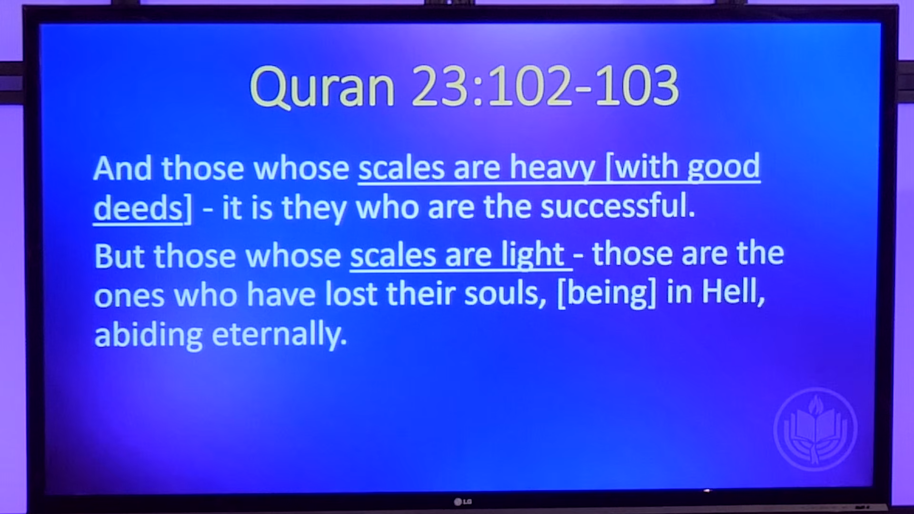
[00:42:07](https://www.youtube.com/watch?v=60TTXfi_Q8U&list=PLj9bOvimh2NyU1STwZqO7ccG5wdfGID64&index=39&t=2527s)

- **[The Theological Tension]** This creates a "burden of works" where the individual must constantly wonder if they have done enough to tip the scales in their favor
    - This stands in contrast to the Christian view of grace, where salvation is not earned by the quantity of good deeds but received through the finished work of Christ.

### The Sufficiency of Christ's Atonement

- **[The Christian Response]** Instead of attempting to tip the scales through personal effort, Christians rely on the substitutionary death of Jesus
    - The focus shifts from "what you can do" to "what Christ has already done" to bear the weight of sin.
- **[Biblical Foundation]** This is anchored in the reality of Christ's sacrifice as described in **1 Peter 2:24**:
    - > "who Himself bore our sins in His own body on the tree, that we, having died to sins, might live for righteousness—by whose stripes you were healed." (1 Peter 2:24)

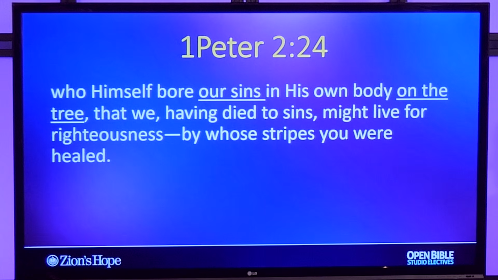
[00:43:17](https://www.youtube.com/watch?v=60TTXfi_Q8U&list=PLj9bOvimh2NyU1STwZqO7ccG5wdfGID64&index=39&t=2597s)

### The Exclusivity of Jesus Christ

- **[The Only Way]** Jesus defines His own unique role and exclusivity:
    - > "Jesus said to him, 'I am the way, the truth, and the life. No one comes to the Father except through Me.'" (John 14:6)
    - This excludes other messianic figures such as the Mahdi, Isa (the false Jesus), or Ad-Dajjal.

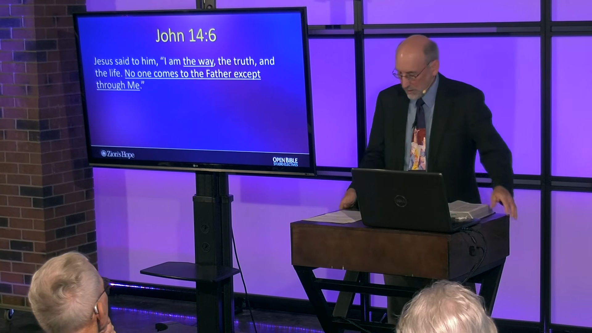
[00:43:54](https://www.youtube.com/watch?v=60TTXfi_Q8U&list=PLj9bOvimh2NyU1STwZqO7ccG5wdfGID64&index=39&t=2634s)

- **[Identifying the True Jesus]** To distinguish the biblical Jesus from deceptive figures, one must look at His specific actions and nature:
    - **The Crucified Savior**: He is the one who died on the cross and bore sins.
    - **The Returning King**: Unlike figures who emerge from Damascus, the true Jesus will return in a way that is unmistakable to the entire world.
        - This is described in **Revelation 19**, where He descends on a white horse.
        - His return will be so visible that "the sky will be open" and there will be no doubt about His identity.
- **[Summary of Messianic Distinctions]**
    - The true Jesus is defined by His finished work on the cross and His unmistakable, glorious return, rather than just being another religious leader or miracle worker.