## The Islamic Antichrist and Psalm 83

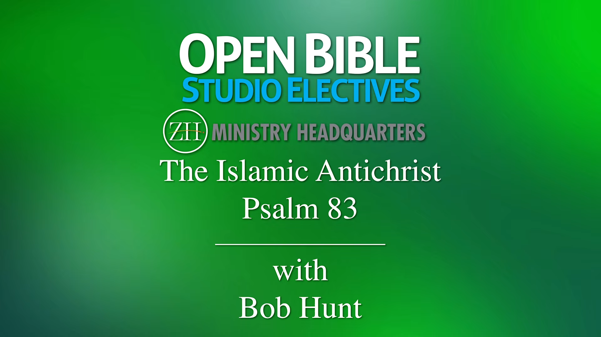
[00:00:02](https://www.youtube.com/watch?v=uLnxshh-pK0&list=PLj9bOvimh2NyU1STwZqO7ccG5wdfGID64&index=46&t=2s)

- The study focuses on the connection between the Islamic Antichrist and Psalm 83
- A primary question to address is: How is Psalm 83 connected to an Islamic Antichrist?

### Connecting Psalm 83 to the Islamic Antichrist

### Arguments Regarding an Islamic Antichrist

- Some prophecy teachers use Psalm 83 to argue that an Islamic Antichrist is impossible
    - They use a series of reasonings to attempt to prove this fact
- The speaker's position is that the Antichrist will most likely come from the religion of Islam
    - The goal is to reasonably argue against the positions that use Psalm 83 to deny this possibility

### Overview of Psalm 83

- The text consists of 18 verses
- A full reading of the Psalm is necessary to understand its general sentiment and context

### Reading of Psalm 83

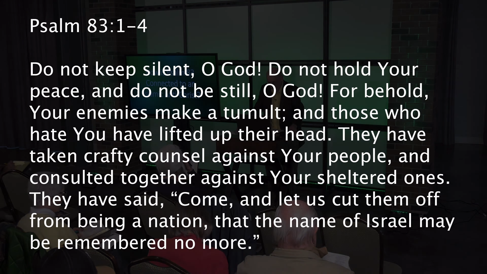
[00:03:01](https://www.youtube.com/watch?v=uLnxshh-pK0&list=PLj9bOvimh2NyU1STwZqO7ccG5wdfGID64&index=46&t=181s)

- The Psalm begins with a plea for God not to remain silent while enemies create a tumult and lift their heads against His people
- A central theme is the conspiracy to eliminate Israel's national identity
    - The enemies' stated goal is to "cut them off from being a nation, that the name of Israel may be remembered no more"

### The Confederacy Against Israel

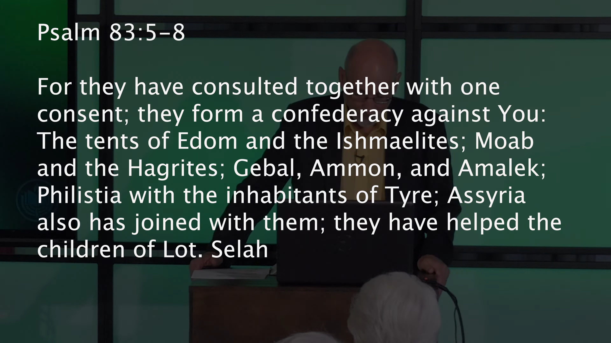
[00:04:13](https://www.youtube.com/watch?v=uLnxshh-pK0&list=PLj9bOvimh2NyU1STwZqO7ccG5wdfGID64&index=46&t=253s)

- The enemies of Israel do not act alone; they form a unified confederacy with "one consent"
- The nations identified in the conspiracy include:
    - Edom (the tents of Edom)
    - Ishmaelites
    - Moab
    - Hagrites
    - Gebal
    - Ammon
    - Amalek
    - Philistia (with the inhabitants of Tyre)
    - Assyria (who joined to help the children of Lot)

### The Psalmist's Request

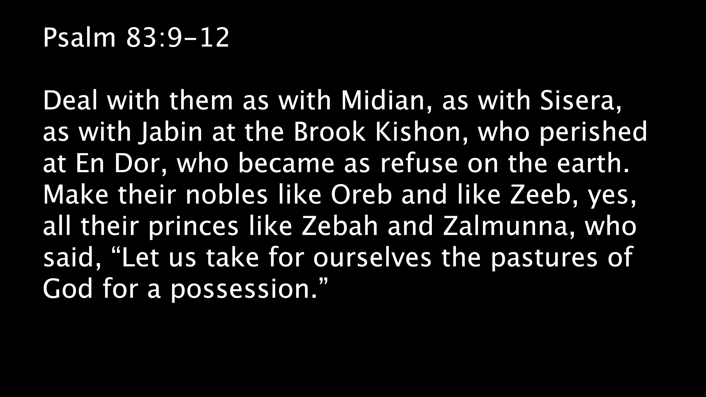
[00:04:23](https://www.youtube.com/watch?v=uLnxshh-pK0&list=PLj9bOvimh2NyU1STwZqO7ccG5wdfGID64&index=46&t=263s)

- The speaker requests that God deal with these conspiring nations as He did with Midian and Sisera
- This refers to historical precedents where God brought judgment upon specific leaders and nations

### Completion of Psalm 83 Reading

#### Historical Precedents for Judgment

- The psalmist references specific historical events as models for how God should deal with the current enemies:
    - **Midian and Sisera**: Refers to the book of Judges, specifically Gideon's victory where the Midianites were completely wiped out.
    - **Jabin at the Brook Kishon**: Another historical reference to God's intervention.
- The text mentions specific Midianite figures to illustrate the total destruction of their leadership:
    - **Oreb and Zeeb**: Midianite princes who perished.
    - **Zebah and Zalmunna**: Midianite kings who sought to seize God's pastures as their own.

#### The Nature of the Requested Judgment

- The psalmist asks God to destroy the enemies using metaphors of rapid, unstoppable destruction:
    - Like "whirling dust"
    - Like "chaff before the wind"
    - Like fire that burns woods and sets mountains on fire
- The goal of this pursuit and tempest is two-fold:
    - To fill the enemies' faces with shame
    - To confound and dismay them forever
- **The ultimate purpose**: So that the enemies may know that the Lord, whose name alone is the most high, is sovereign over all the earth.


[00:05:16](https://www.youtube.com/watch?v=uLnxshh-pK0&list=PLj9bOvimh2NyU1STwZqO7ccG5wdfGID64&index=46&t=316s)

### Psalm 83 Reasoning

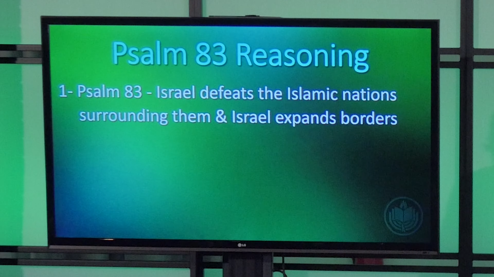
[00:06:25](https://www.youtube.com/watch?v=uLnxshh-pK0&list=PLj9bOvimh2NyU1STwZqO7ccG5wdfGID64&index=46&t=385s)

Some prophecy teachers use Psalm 83 to argue against the notion of an Islamic Antichrist through the following reasoning:

- Israel defeats the Islamic nations that immediately surround them
- Following these defeats, Israel expands its borders to become a much larger nation

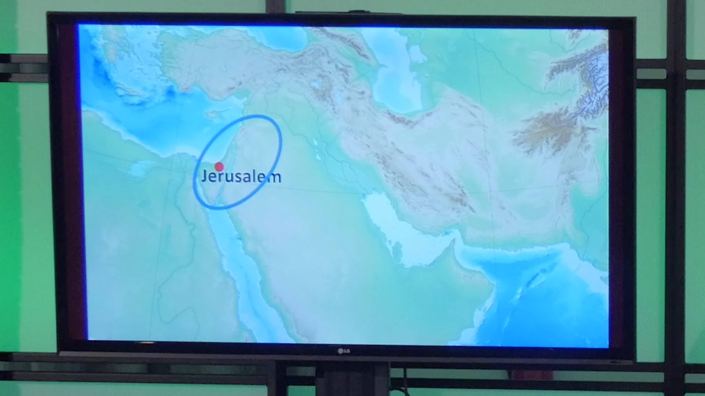
[00:07:03](https://www.youtube.com/watch?v=uLnxshh-pK0&list=PLj9bOvimh2NyU1STwZqO7ccG5wdfGID64&index=46&t=423s)

- This interpretation claims the entire passage describes the complete wiping out of Muslim nations and a subsequent expansion of Israel's territory.

### The Two-Step Argument Against an Islamic Antichrist

Some prophecy teachers use a specific chronological sequence to argue that Islam is eliminated before the rise of the Antichrist:

1. **Step 1: Psalm 83**

    - Israel defeats the Islamic nations immediately surrounding them
    - This results in Israel expanding its borders by wiping out these closest Muslim nations

2. **Step 2: Ezekiel 38/39**

    - God destroys the "outer bands" of the remaining Muslim nations
    - This expands the conquest to the point where all Islamic nations in the Middle East are completely eliminated

**[Timing of this sequence]**

- This entire process is claimed to occur prior to the beginning of Daniel's 70th week
- The sequence leads directly into the events of Armageddon

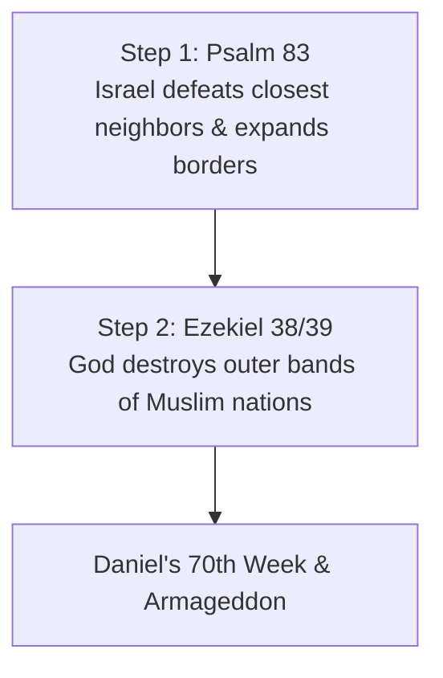

### The Logical Conflict of the Antichrist's Identity

The primary reason prophecy teachers utilize this specific chronological sequence is to address a potential contradiction regarding the Antichrist:

- **The Problem**: If the fulfillment of Psalm 83 and the Ezekiel Wars results in the total elimination of all Islam and all Muslim nations from the Middle East, it creates a theological dilemma.
- **The Contradiction**: Scripture describes an Antichrist who arises to gain power over the entire world; however, if Islamic influence is completely wiped out beforehand, it would be impossible for an Antichrist to emerge from an Islamic background to fulfill those prophetic roles.

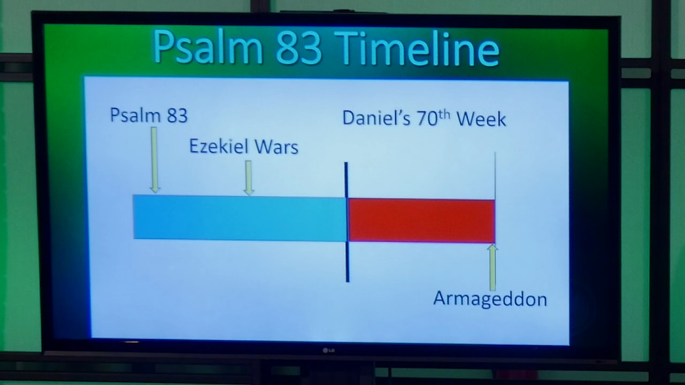
[00:09:16](https://www.youtube.com/watch?v=uLnxshh-pK0&list=PLj9bOvimh2NyU1STwZqO7ccG5wdfGID64&index=46&t=556s)

### The Argument for a European Antichrist

- Some interpretations use the proposed sequence of Psalm 83 and Ezekiel 38/39 to reach a specific conclusion:
    - **The Conclusion**: The Antichrist must be European, Roman, or from the EU/Europe
    - **The Reasoning**: Because the sequence supposedly eliminates all Islamic influence from the Middle East before the Antichrist rises, he cannot be from an Islamic background
- **[Critique]** This is described as a "concoction" or starting backwards: choosing a desired identity for the Antichrist and then interpreting scripture to fit that identity, rather than letting the scripture dictate the identity.

### Foundations in Ezekiel 38

- To support the theory that Islam is eliminated before the 70th week, proponents ground their argument in Ezekiel 38
- The argument relies on specific conditions within the Ezekiel Wars that supposedly prove the total removal of Islamic influence

### Ezekiel 38 and the Identity of Gog

To examine the arguments regarding the Antichrist's identity, the speaker turns to Ezekiel 38 to provide context for the upcoming prophetic wars.

#### The Nature of Gog

- **[Identity]** Gog is interpreted as a title rather than a proper name for a specific individual
- The speaker suggests that Gog may be a title for the Antichrist

#### Nations and Regions in Ezekiel 38:1-3

- The prophecy specifically addresses the following entities:
    - The land of Magog
    - The prince of Rosh
    - Meshech
    - Tubal

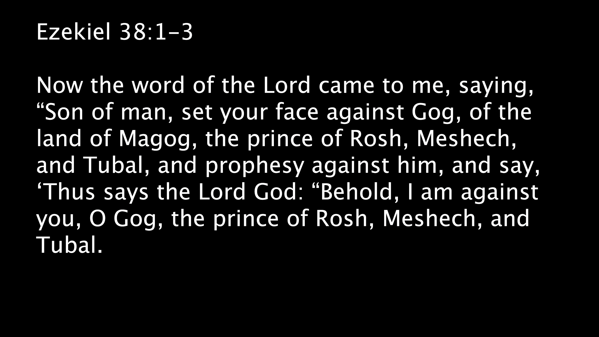
[00:11:56](https://www.youtube.com/watch?v=uLnxshh-pK0&list=PLj9bOvimh2NyU1STwZqO7ccG5wdfGID64&index=46&t=716s)

```text
Ezekiel 38:1-3

Now the word of the Lord came to me, saying,
"Son of man, set your face against Gog, of the
land of Magog, the prince of Rosh, Meshech,
and Tubal, and prophesy against him, and say,
'Thus says the Lord God: "Behold, I am against
you, O Gog, the prince of Rosh, Meshech, and
Tubal."
```

### Nations Involved in Ezekiel 38:4-6

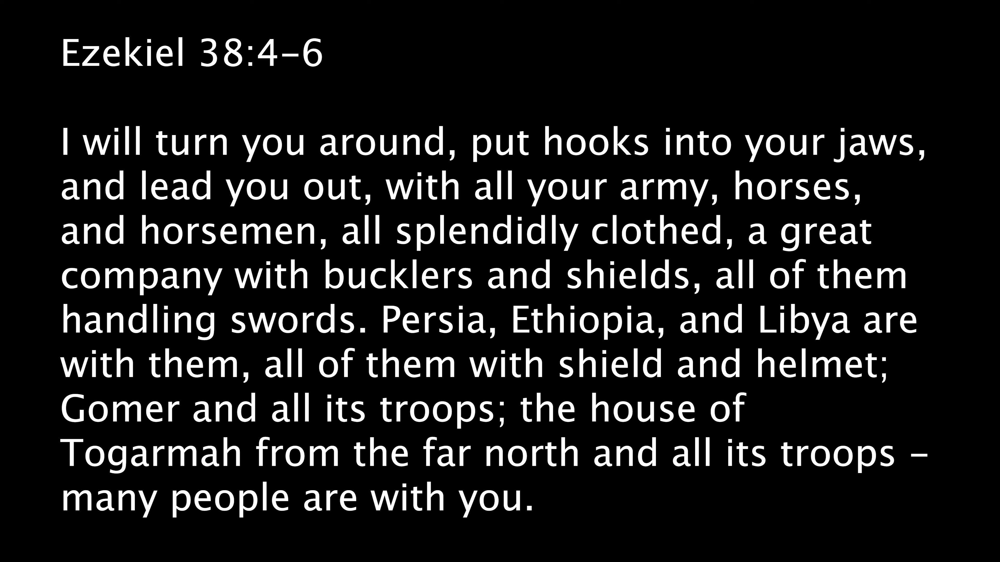
[00:12:49](https://www.youtube.com/watch?v=uLnxshh-pK0&list=PLj9bOvimh2NyU1STwZqO7ccG5wdfGID64&index=46&t=769s)

Beyond the initial nations, the prophecy includes several others:

- Persia, Ethiopia, and Libya
- Gomer and all its troops
- The house of Togarmah from the far north and all its troops

### The Sovereignty of God in Prophecy

- **[Theological Context]** The gathering of these nations is viewed as part of God's orchestration
    - God is in charge of end-time events
    - He leads and uses these nations to fulfill His specific plan, timing, and methods
- This includes the collection of the Antichrist (Gog) and these various nations to move against Israel

### Timing in Ezekiel 38:7-8

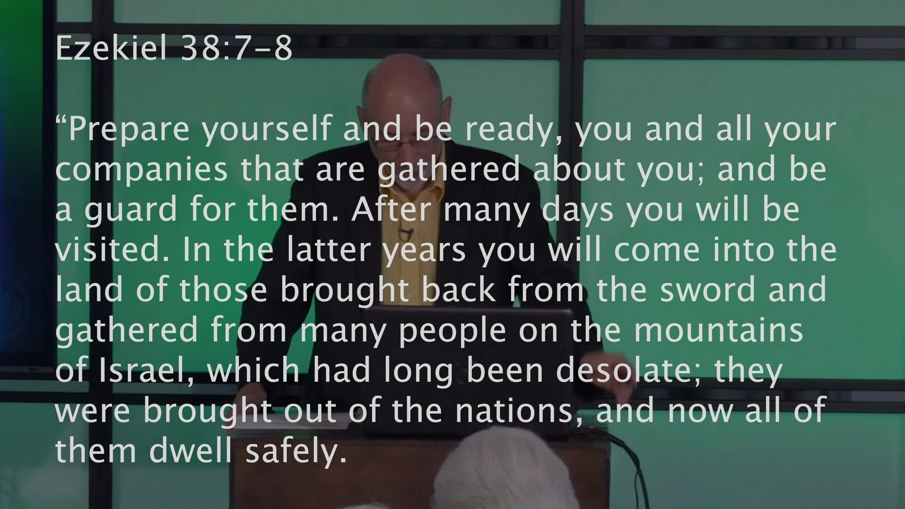
[00:14:16](https://www.youtube.com/watch?v=uLnxshh-pK0&list=PLj9bOvimh2NyU1STwZqO7ccG5wdfGID64&index=46&t=856s)

- **[The Gathering]** The prophecy describes companies being gathered around the leaders
- **[The Timing]** Verse 8 provides a temporal marker:
    - "After many days you will be visited in the latter years"
    - This occurs when Israel is in the land of those "brought back from the sword" and gathered on the mountains of Israel

### Ezekiel 38:9-11 and the Connection to Psalm 83

#### The Timing and Nature of the Attack

- **[Temporal Marker]** The term "latter years" is used, which is a common prophetic term referring to the end times or specifically to Daniel's 70th week
- **[The Invasion]** Verse 9 describes the approach of Gog and his troops:
    - They will ascend "like a storm"
    - They will cover the land "like a cloud"
    - This rapid, overwhelming movement is seen as a parallel to the conspiracy described in Psalm 83

#### The Target: A Peaceful Israel

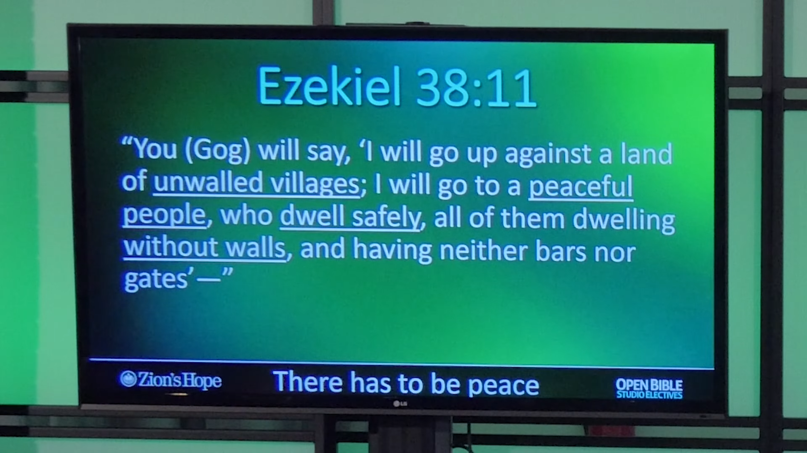
[00:15:27](https://www.youtube.com/watch?v=uLnxshh-pK0&list=PLj9bOvimh2NyU1STwZqO7ccG5wdfGID64&index=46&t=927s)

- **[The Evil Plan]** Verse 10 states that Gog will formulate an "evil plan" to attack a specific type of territory
- **[The Description of Israel]** The text emphasizes that the target is a nation characterized by peace and lack of defense:
    - "A land of unwalled villages"
    - "A peaceful people who dwell safely"
    - "Dwelling without walls, and having neither bars nor gates"
- **[Prophetic Significance]** The repetition of the concept of peace (emphasized four times in the context) is the specific detail that prophecy teachers point to when linking this passage to the confederacy of nations in Psalm 83.

### The Requirement for a Larger Israel

- **[The Argument for Expansion]** Some prophecy teachers argue that the current state of Israel is incompatible with the description in Ezekiel 38
    - Israel is currently seen as a small nation
    - It faces constant security threats, such as rockets from surrounding areas
    - Because of this, they argue Israel cannot currently be the "peaceful people" described in the prophecy
- **[The Proposed Solution]** To fulfill the prophecy, these teachers suggest a specific sequence of events:
    - Israel must first conquer surrounding nations to expand its geographic borders
    - Only through this expansion can the nation achieve the level of peace and security required for the "unwalled villages" description to apply
- **[The Prophetic Sequence]** This logic positions Ezekiel 38 as the "second war," occurring after a period of expansion and peace

### The Relationship Between Psalm 83 and Ezekiel 38

- **[The Pre-requisite Peace]** To satisfy the description of Israel as a "peaceful people" in Ezekiel 38, some teachers claim a prior event must occur
    - They identify Psalm 83 as that event
    - In this view, the Psalm describes the destruction of all surrounding nations, which then grants Israel the peace required for the Ezekiel 38 timeline
- **[The Role of Ezekiel 37]** Beyond the peace requirement, prophecy teachers point to Ezekiel 37 as a critical preceding chapter to establish their sequence of events

### Ezekiel 37: The Valley of Dry Bones

- **[The Vision]** The passage describes a prophetic vision where the hand of the Lord brings Ezekiel into a valley filled with very many bones that were "very dry"
    - God asks Ezekiel, "Son of man, can these bones live?"
- **[The Prophecy of Life]** God commands Ezekiel to prophesy to the dry bones, promising a restorative process:
    - Breath will enter them, and they shall live
    - Sinews, flesh, and skin will be restored to them
    - The purpose of this restoration is so that they "shall know that I am the Lord"
- **[The Physical Restoration]** As Ezekiel prophesies, a physical transformation occurs:
    - A noise and a rattling sound is heard
    - The bones come together, bone to bone
    - Sinews, flesh, and skin cover them, though they initially lack breath

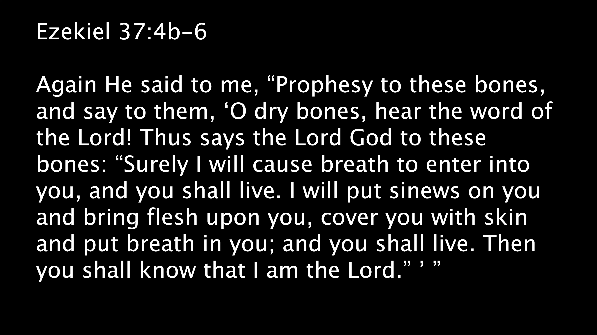
[00:19:08](https://www.youtube.com/watch?v=uLnxshh-pK0&list=PLj9bOvimh2NyU1STwZqO7ccG5wdfGID64&index=46&t=1148s)

### The Interpretation of Ezekiel 37:10

- **[The Restoration of Israel]** Verse 11 clarifies that the bones in the vision represent the "whole house of Israel," signifying a prophetic regathering and restoration.
- **[The "Exceedingly Great Army" Argument]** Some prophecy teachers focus on verse 10 to establish their timeline:
    - They point to the description of the restored people as "an exceedingly great army"
    - **[The Logic]** Because chapter 37 precedes chapter 38, they argue this army is the force that goes out and conquers the surrounding nations
    - This conquest is seen as the mechanism that makes the "peace" described in Ezekiel 38 possible

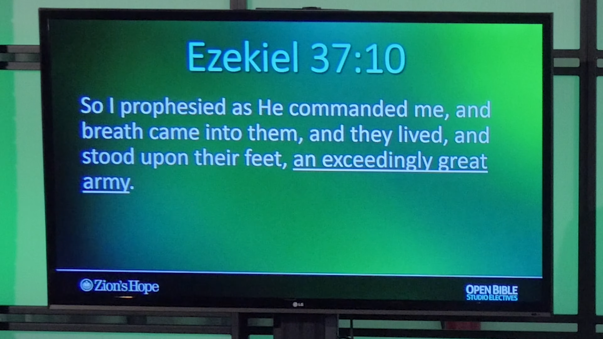
[00:20:23](https://www.youtube.com/watch?v=uLnxshh-pK0&list=PLj9bOvimh2NyU1STwZqO7ccG5wdfGID64&index=46&t=1223s)

### Critique of the "Exceedingly Great Army" Interpretation

- **[The Argument]** Some teachers use the "exceedingly great army" in Ezekiel 37:10 to claim Israel conquers surrounding nations to enable the peace of Ezekiel 38
- **[The Counter-Argument]** This is viewed as "manipulating" or "massaging" the scripture because:
    - The chapter focuses on what God is doing to restore the nation
    - The text contains no information regarding the army's actions or purpose

### Ezekiel 37:14 and the Restoration of Israel

- **[Spiritual and Territorial Restoration]** The verse describes two key elements of God's work:
    - **The Spirit:** "I will put My Spirit in you, and you shall live"
    - **The Land:** "and I will place you in your own land"
- **[Theological Implication]** The timing of when God's Spirit is placed within the nation of Israel is a critical factor in determining if this occurs during or after a potential Psalm 83 war

### Ezekiel 37:23-24 and Spiritual Cleansing

- **[Spiritual Purification]** Verse 23 describes a profound cleansing of the nation:
    - God promises to deliver them from their dwelling places and cleanse them from idols and transgressions
    - **[The Result]** "Then they shall be My people, and I will be their God"
- **[The Timing Argument]** The speaker challenges the idea that this occurs during the wars of the "latter years" (like Psalm 83 or Ezekiel 38), noting that this level of spiritual restoration is not seen elsewhere in Scripture in that specific context.
- **[Messianic Kingship]** Verse 24 introduces a new ruler:
    - "David My servant shall be king over them"
    - **[The Identity of David]** Since the historical David was not alive during Ezekiel's time, this is interpreted as a prophecy pointing toward Jesus Christ
    - This connection to Jesus implies that the restoration described in Ezekiel 37 is a spiritual and messianic event rather than a purely military one

### Zechariah 12:6 and the Argument for Conquest

- **[The Prophecy]** Some teachers use Zechariah 12:6 to support the idea that Israel will destroy all surrounding nations:
    - "In that day I will make the governors of Judah like a firepan in the woodpile, and like a fiery torch in the sheaves; they shall devour all the surrounding peoples on the right hand and on the left..."

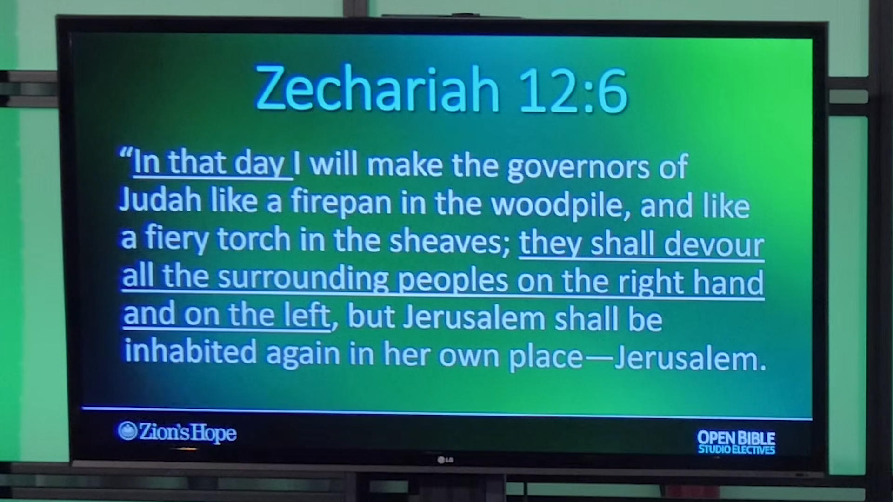
[00:24:09](https://www.youtube.com/watch?v=uLnxshh-pK0&list=PLj9bOvimh2NyU1STwZqO7ccG5wdfGID64&index=46&t=1449s)

- **[The Critique]** This interpretation is challenged by the context of the passage:
    - While the nation is real and empowered, the text indicates that God is the primary actor driving the event
    - The focus is on God's involvement rather than a purely human military conquest

### Zechariah 12:10 and the Timing of Israel's Salvation

- **[The Spiritual Outpouring]** Just four verses after the description of military empowerment in Zechariah 12:6, the text shifts to a profound spiritual event:
    - "And I will pour on the house of David and on the inhabitants of Jerusalem the Spirit of grace and supplication"
- **[The Identity of the Pierced One]** The passage describes a period of national mourning:
    - "...then they will look on Me whom they pierced. Yes, they will mourn for Him as one mourns for his only son, and grieve for Him as one grieves for a firstborn."
    - **[Theological Interpretation]** This is interpreted as the nation of Israel looking to Jesus Christ in repentance.

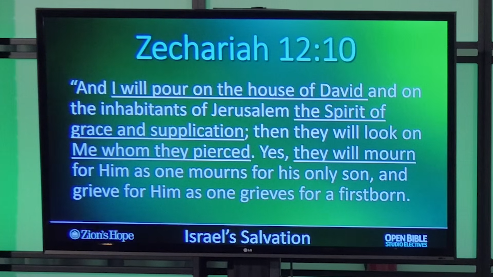
[00:25:14](https://www.youtube.com/watch?v=uLnxshh-pK0&list=PLj9bOvimh2NyU1STwZqO7ccG5wdfGID64&index=46&t=1514s)

- **[The Logical Conflict]** The speaker argues that this creates a chronological problem for certain prophecy teachers:
    - If Zechariah 12:6 (military conquest) is seen as happening *prior* to the Ezekiel wars, which are *prior* to the 70th week, it conflicts with the reality of Zechariah 12:10.
    - Zechariah 12:10 describes a period where "all Israel is saved," which does not align with a timeline of continuous war and judgment without spiritual restoration.

### The Role of Daniel's 70th Week

- **[The Covenant]** To address the requirement for peace, the speaker points to Daniel's 70th week:
    - "Then he shall confirm a covenant with many for one week; But in the middle of the week He shall bring an end to sacrifice and offering."
    - **[The Argument]** This suggests that the period of peace and the specific covenantal arrangements are handled within the framework of Daniel's prophecy rather than being solely explained by the military actions in Zechariah.

### Critiques of the Peace/Covenant Argument

- **[The "False Peace" Rebuttal]** Some prophecy teachers argue that a covenant must be established to provide peace before the Ezekiel wars can occur. They claim any peace before Christ's return is merely a "false" or "temporary" peace.
    - The speaker argues this creates a logical loop where Psalm 83 and Ezekiel 38 are both dismissed as "false peace" events.
    - This suggests there would be no real peace on earth until the return of Jesus Christ.
- **[Misplacement of "Day of the Lord" Passages]** A fundamental error in this line of reasoning is pulling passages describing the "Day of the Lord" into time periods where they do not belong:
    - Passages like Zechariah 12:6 and Ezekiel 38 are often used to claim Israel is being empowered for conquest *prior* to the 70th week.
    - The speaker contends these passages actually belong at the end of the timeline, specifically during Armageddon.

### Ezekiel 38 Analysis Continues

- **[Returning to Ezekiel 38]** To address the second argument, the speaker returns to the text of Ezekiel 38, specifically focusing on verse 11.

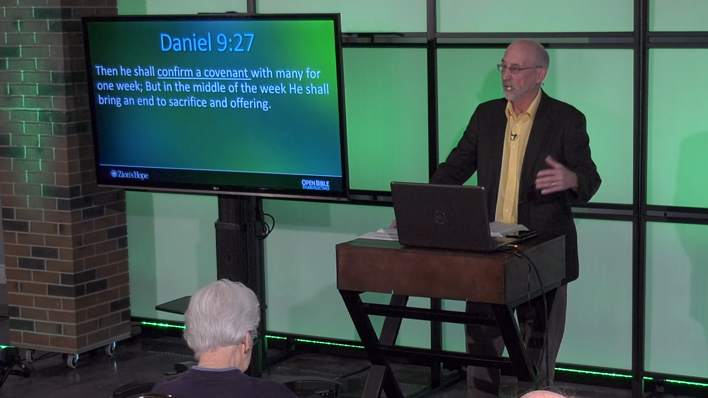
[00:26:28](https://www.youtube.com/watch?v=uLnxshh-pK0&list=PLj9bOvimh2NyU1STwZqO7ccG5wdfGID64&index=46&t=1588s)

### Ezekiel 38:11-13 and the Motivation for Plunder

- **[The Target]** Ezekiel 38:11 describes the target as a "peaceful people" living in "unwalled villages" without bars or gates:
    - They dwell safely in the midst of the land.
- **[The Motivation]** The primary driver for the invasion is the acquisition of immense wealth (plunder and booty):
    - The text lists silver, gold, livestock, and goods as targets for seizure.
    - Specific groups mentioned in relation to this wealth include Sheba, Dedan, and the merchants of Tarshish.

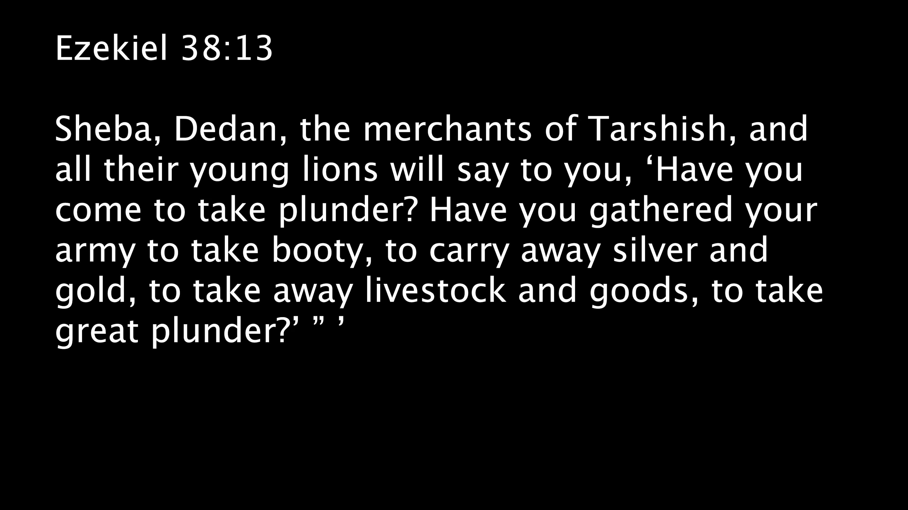
[00:28:32](https://www.youtube.com/watch?v=uLnxshh-pK0&list=PLj9bOvimh2NyU1STwZqO7ccG5wdfGID64&index=46&t=1712s)

- **[The Argument of Wealth]** Some prophecy teachers focus on the emphasis in verse 13 regarding the scale of the plunder:
    - They argue that for such a massive collection of silver, gold, and livestock to be a motivation for an army, the nation of Israel must be significantly large and wealthy.
    - This is used to claim that the current state of Israel is not yet the nation described in this prophecy.

### Rebuttal to the Wealth/Size Argument

- **[The Counter-Argument]** Some claim Israel must gain more land and resources to be a "better target" for the plunder described in Ezekiel 38:
    - This logic suggests a "resource scavenger hunt" where an invading army requires a massive, expanded territory to make the plunder worthwhile.
- **[The Speaker's Rebuttal]** Wealth and status as a target are not strictly tied to landmass or total regional conquest:
    - A nation can be relatively small and still possess immense wealth that attracts invaders.
    - Modern resources, such as oil and gas exploration, can provide significant wealth within a smaller footprint.

#### Comparison of Wealth and Scale

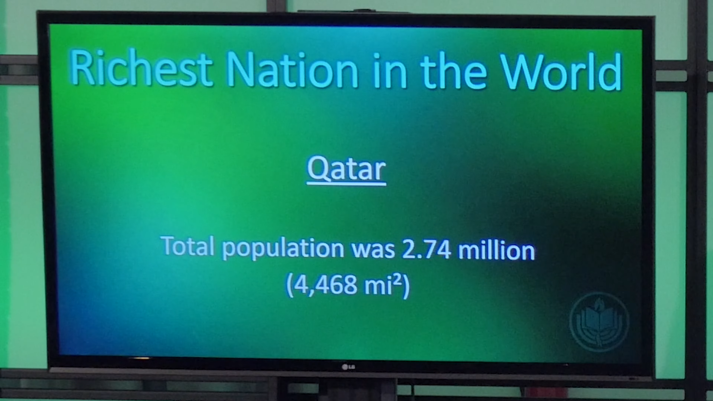
[00:30:14](https://www.youtube.com/watch?v=uLnxshh-pK0&list=PLj9bOvimh2NyU1STwZqO7ccG5wdfGID64&index=46&t=1814s)

- **Qatar as a Case Study**:
    - Despite being a "tiny nation," it has been the richest nation in the world per capita.
    - **Scale of Qatar (2017 data)**:
        - Population: 2.74 million
        - Landmass: 4,468 square miles
- **Comparison to Israel**:
    - Israel is significantly larger than Qatar (nearly double the landmass).
    - Israel's population is approximately 0.7 million (at the time of the presentation).
    - The speaker notes that being a larger nation with significant resources is sufficient to meet the criteria for being a target for plunder.

### The "Different Nations" Argument

- **[The Argument]** Some prophecy teachers argue that Psalm 83 and Ezekiel 38/39 must represent two separate, sequential wars because the lists of nations involved are different:
    - They observe that nations mentioned in Psalm 83 (such as Edom, Ishmaelites, Moab, Hagrites, Gebal, Ammon, Amalek, Philistia, and Tyre) are not listed in Ezekiel 38/39.
    - **[The Conclusion drawn by teachers]** Because these nations are absent from the Ezekiel prophecy, they must have been eliminated or "wiped off the earth" during the fulfillment of Psalm 83.
    - This is used to support a chronological sequence where Psalm 83 happens first, followed by Ezekiel 38.

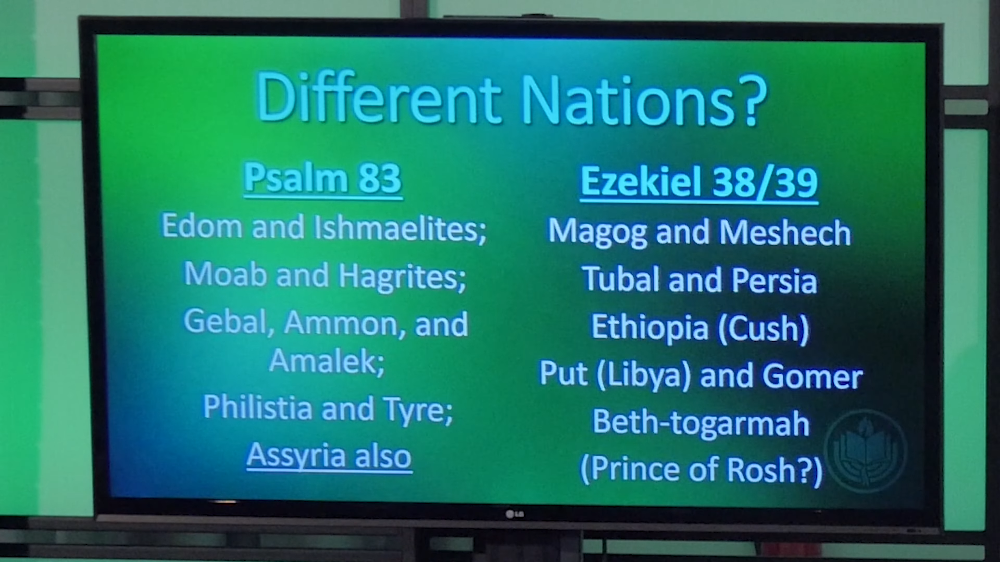
[00:31:20](https://www.youtube.com/watch?v=uLnxshh-pK0&list=PLj9bOvimh2NyU1STwZqO7ccG5wdfGID64&index=46&t=1880s)

- **[The Speaker's Initial Critique]** The speaker suggests this logic may be flawed by looking at the discrepancies in the lists:
    - While many Psalm 83 nations are missing from Ezekiel, the speaker notes that Assyria is also present in the Psalm 83 list but is not mentioned in the Ezekiel 38/39 list.

### The "Argument from Silence" Critique

- **[The Logical Flaw]** The absence of Psalm 83 nations from the Ezekiel 38/39 list does not prove they were "wiped off the earth"
    - The speaker suggests that some nations, like Assyria, may have functioned more like an empire, potentially covering much of the land occupied by nations like Magog, Meshech, Tubal, and Persia.
- **The "Argument from Silence"**
    - This is a logical fallacy where one concludes that because something is not mentioned, it does not exist.
    - **Example in Theology**: Some argue that because the Church is not mentioned after Revelation chapter 3, it must have been raptured.
    - The speaker argues that just because a group or nation is not explicitly mentioned in a specific text, it does not mean they have been removed from the scene.

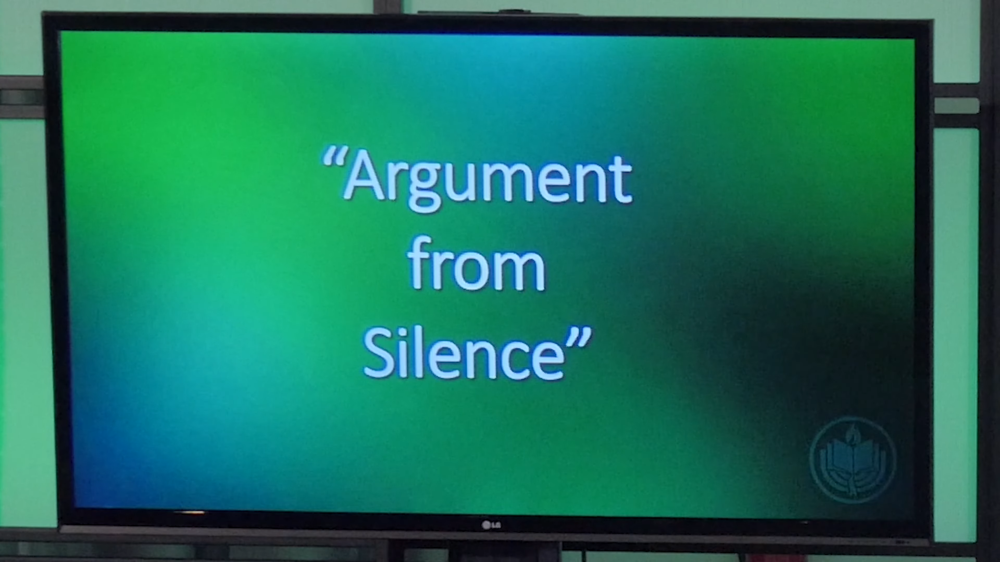
[00:32:24](https://www.youtube.com/watch?v=uLnxshh-pK0&list=PLj9bOvimh2NyU1STwZqO7ccG5wdfGID64&index=46&t=1944s)

### Philosophical and Historical Context of the Lists

- **[The Logical Flaw]** The speaker argues that the "argument from silence" is at best weak and at worst illogical.
    - In philosophy, you cannot rely on the mere absence of a mention to prove a claim.
    - To establish that something happened, you must have other supporting texts; you cannot stand alone on the fact that a text "doesn't say."
- **[Comparing Perspectives]** The differences in the lists of nations may be explained by the distinct historical and geographical contexts of the writers:
    - **Asaph (Psalm 83)**
        - Lived approximately 980–940 BC
        - Wrote from Jerusalem
        - Served as David and Solomon's musician and worship leader
    - **Ezekiel (Ezekiel 38/39)**
        - Lived approximately 593–571 BC
        - Wrote from Babylon under Nebuchadnezzar

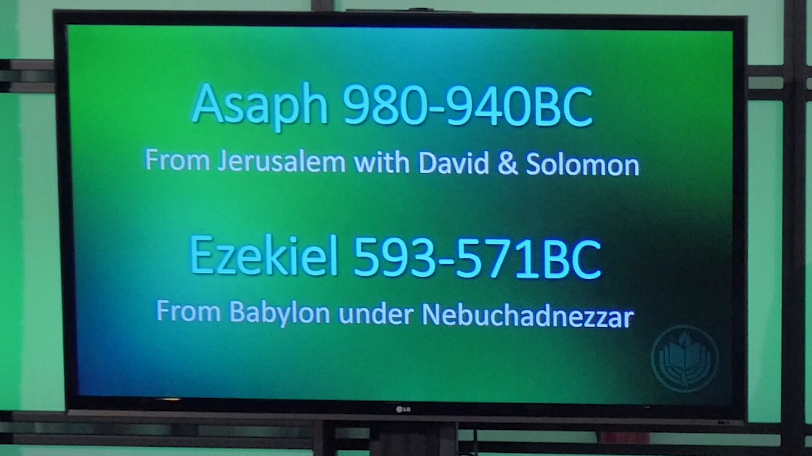
[00:33:35](https://www.youtube.com/watch?v=uLnxshh-pK0&list=PLj9bOvimh2NyU1STwZqO7ccG5wdfGID64&index=46&t=2015s)

### Temporal and Situational Divergence

- **[The 400-Year Gap]** The speaker emphasizes that the nearly 400-year difference between the authors fundamentally changes the geopolitical reality of Israel:
    - **Asaph's Perspective**: Writing from Jerusalem, his concerns were driven by the immediate, tangible threats posed by neighboring nations (such as the Philistines) during his own time.
    - **Ezekiel's Perspective**: Writing from exile in Babylon under Nebuchadnezzar, he was not focused on the immediate neighbors of the historical nation of Israel, but rather on a specific prophecy concerning nations involved in the "latter days."

### Avoiding Over-Interpretation

- **[The Danger of Over-Reading]** The speaker warns against reading too much into what is *not* written in the text.
    - Prophecy teachers often assume that because Asaph's nations are not mentioned in Ezekiel, they must have been destroyed in a prior war.
    - This is a logical error; the absence of a mention does not equal the destruction of the entity.

### Conclusion: Psalm 83

- **[Structure and Authorship]** Psalm 83 is identified as a song composed by Asaph.
    - While English translations often use "Do not keep silent, O God" as the opening, the original Hebrew text begins by identifying it as a "song of Asaph."
    - The song consists of 19 verses.
    - As previously noted, Asaph's role as a musician and worship leader for David and Solomon establishes the historical context of the psalm.

### Prayer vs. Prophecy in Psalm 83

- **[The Prophetic Question]** Although 2 Chronicles 29:30 identifies Asaph as a prophet, the speaker argues that Psalm 83 may not be a prophetic text:
    - It functions more as a prayer for God to judge enemies.
    - While the prayer may be fulfilled at the end of time, it lacks the standard linguistic markers of prophecy.
- **Missing Prophetic Language**
    - The text does not contain common prophetic phrases such as "thus saith the Lord" or "I got a vision."
    - Because of this, the speaker views the text as a plea for divine intervention rather than a formal prophetic revelation.

### Psalm 83 Structural Summary

- The Psalm can be divided into three distinct segments:
    - **Ps 83:1**: "A plea for help"
    - **Ps 83:2-8**: "What the enemies are doing"
    - **Ps 83:9-18**: "A call for divine judgment"

### The Intensity of the Prayer in Psalm 83

- **[The Nature of the Plea]** The speaker describes the psalm as a reach toward God in response to being surrounded by enemies.
- **The Three Segments of the Psalm**
    - **Ps 83:1**: A plea for help (reaching out to God)
    - **Ps 83:2-8**: The description of the enemies' actions (naming the surrounding nations)
    - **Ps 83:9-18**: A call for divine judgment (asking God to act against these nations)

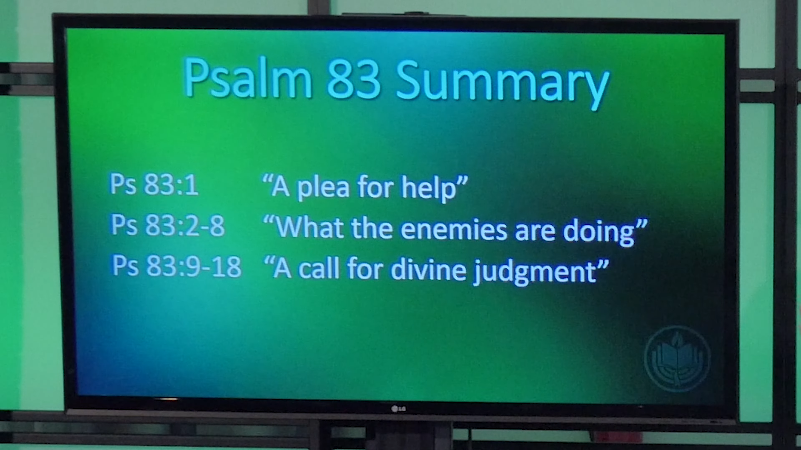
[00:38:09](https://www.youtube.com/watch?v=uLnxshh-pK0&list=PLj9bOvimh2NyU1STwZqO7ccG5wdfGID64&index=46&t=2289s)

- **[Strong Language for Divine Judgment]** While some might find the language uncomfortable, the speaker notes that Asaph uses extremely forceful imagery to pray for the annihilation of enemies:
    - **Metaphors of destruction**:
        - "make them like the whirling dust"
        - "like the chaff before the wind"
        - "As the fire burns the woods"
        - "as a flame sets the mountains on fire"
    - **The goal of the prayer** is to have God pursue, frighten, and confound these enemies, filling their faces with shame.
- **[Connection to Genesis 12:3]** The speaker suggests that this intense prayer is an application of God's promise to Abraham:
    - In Genesis 12:3, God says, "I will curse those who curse you."
    - Asaph is effectively calling down that promised curse upon the nations that are actively cursing Israel.

### Imprecatory Psalms

- **[Definition]** Derived from the term "imprecate," which means:
    - To pray evil against
    - To invoke a curse upon
- **[Purpose]** These are "cursing psalms" where the writer prays down God's judgment on the enemies of Israel and, by extension, the enemies of God.

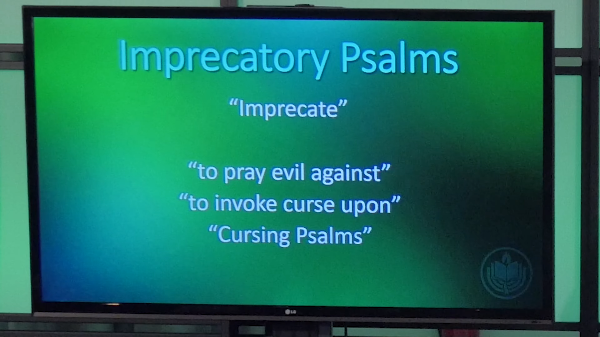
[00:39:33](https://www.youtube.com/watch?v=uLnxshh-pK0&list=PLj9bOvimh2NyU1STwZqO7ccG5wdfGID64&index=46&t=2373s)

- Asaph and David are noted for writing many of these types of songs.

### Core Desires in Jewish History

- Throughout the Old Testament, the Jewish people expressed several consistent hopes and pleas in their prayers:
    - **A Messiah**: The desire for a promised Savior (though the speaker notes He was ultimately rejected).
    - **National Restoration**: The plea for God to restore the nation of Israel, a promise made through the prophets.

### The Ultimate Purpose of Psalm 83

- **[Not about personal relief]** The prayer is not primarily a plea for personal comfort or simple relief from struggle.
- **[The Goal: God's Recognition]** The core motivation is for the surrounding nations to acknowledge God's unique status.
- **[Psalm 83:18]** The final verse clarifies the intent of the prayer:
    - "That they may know that You, whose name alone is the LORD, are the Most High over all the earth."
    - The prayer seeks to demonstrate God's sovereignty to the entire world.


[00:41:39](https://www.youtube.com/watch?v=uLnxshh-pK0&list=PLj9bOvimh2NyU1STwZqO7ccG5wdfGID64&index=46&t=2499s)

### Recurring Theme: The Recognition of God

- **[The Common Conclusion]** Multiple prophetic texts conclude with the same ultimate goal: the recognition of God's sovereignty by the nations:
    - **Psalm 83:18**: "That they may know that You, whose name alone is the LORD"
    - **Ezekiel 38:23**: "Then they shall know that I am the LORD"
    - **Joel 3:17**: "So you shall know that I am the LORD your God"

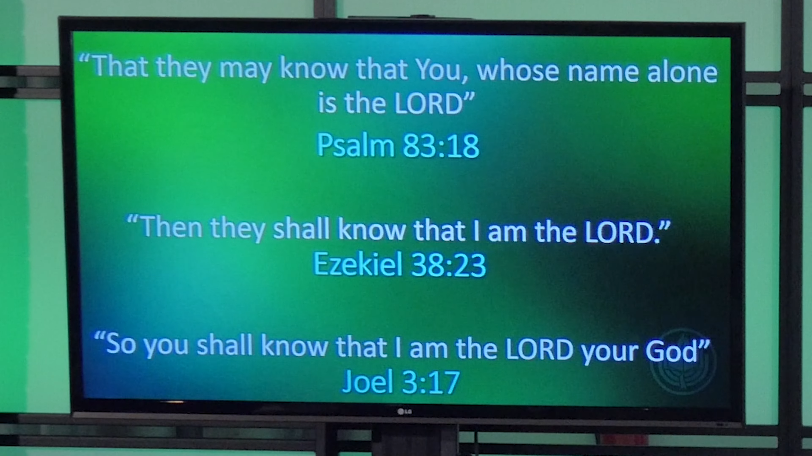
[00:42:04](https://www.youtube.com/watch?v=uLnxshh-pK0&list=PLj9bOvimh2NyU1STwZqO7ccG5wdfGID64&index=46&t=2524s)

- **Critique of Sequential Interpretations**
    - Some prophecy teachers argue these are three separate wars (Psalm 83, then Ezekiel 38, then Armageddon).
    - The speaker argues this is illogical: it would imply the nations "forgot" God's sovereignty after one war, only to be reminded again in the next.
    - **[Alternative View]** It is more consistent to view these passages as describing the same end-time period rather than a sequence of distinct, disconnected conflicts.

### Unified Fulfillment Timeline

- The speaker suggests that Psalm 83, Ezekiel 38 & 39, and Armageddon all occur within the same general window of time.

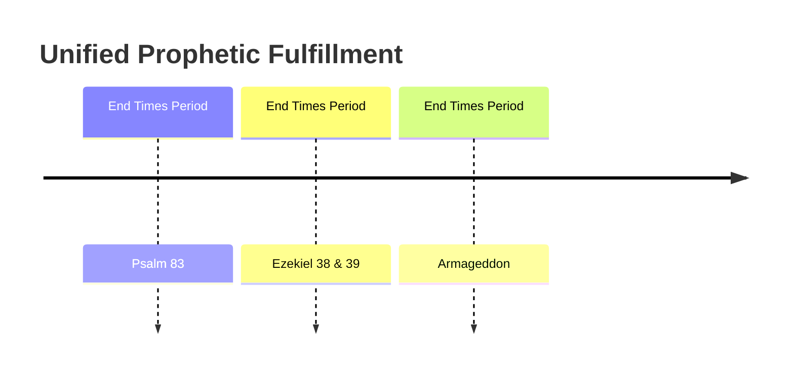

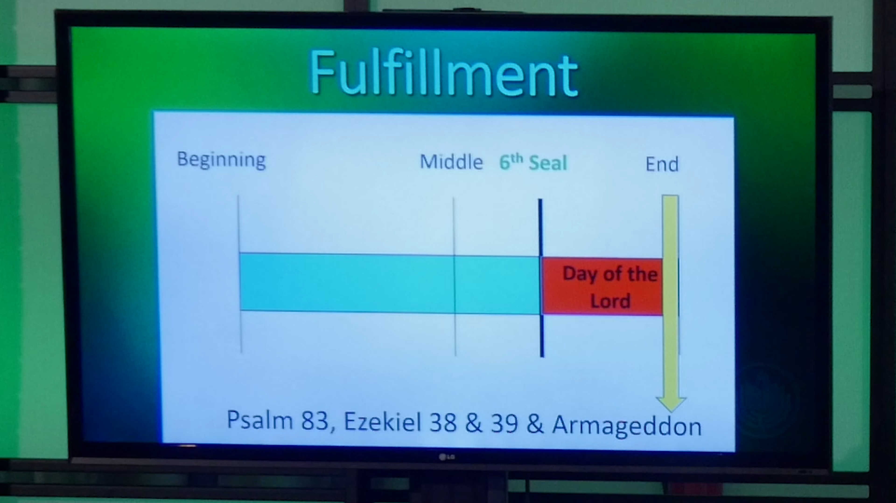
[00:43:16](https://www.youtube.com/watch?v=uLnxshh-pK0&list=PLj9bOvimh2NyU1STwZqO7ccG5wdfGID64&index=46&t=2596s)

### Unified End-Time Timeline

- **[The Argument]** Rather than viewing Psalm 83, Ezekiel 38-39, and Armageddon as a sequence of separate wars, they should be seen as pointing to the same period of time.
- **[The Purpose]** These events are not isolated conflicts but are all directed toward the same end goal: the recognition of God's sovereignty.


[00:43:35](https://www.youtube.com/watch?v=uLnxshh-pK0&list=PLj9bOvimh2NyU1STwZqO7ccG5wdfGID64&index=46&t=2615s)

### The Shared Goal of Prophetic Fulfillment

- Multiple scriptures conclude with the same theme of God's identity being revealed to the nations:
    - **Psalm 83:18**: "That they may know that You, whose name alone is the LORD, are the Most High over all the earth."
    - **Ezekiel 38:23**: "Then they shall know that I am the LORD."
    - **Joel 3:17**: "So you shall know that I am the LORD your God."

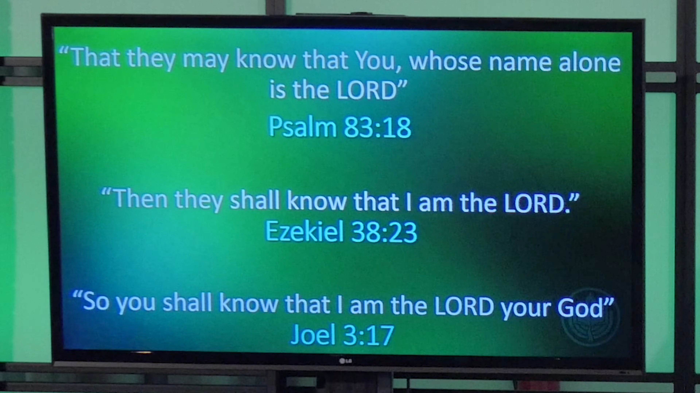
[00:44:01](https://www.youtube.com/watch?v=uLnxshh-pK0&list=PLj9bOvimh2NyU1STwZqO7ccG5wdfGID64&index=46&t=2641s)

- **[The takeaway]** The study of eschatology (end-times prophecy) is not merely an academic exercise in gathering facts and figures.
    - The ultimate purpose is to use what is learned to lead others to know the Lord personally.

### The Practical Purpose of Eschatology

- **[The Goal]** Studying end-times prophecy is not merely to gather facts and figures to become "smarter."
- **[The Application]** Knowledge of these events should drive a believer's life in three directions:
    - **Salvation**: Starting with a personal relationship with God.
    - **Sanctification**: Continuing to grow in holiness.
    - **Evangelism**: Branching out to lead others to know the Lord.

> "We gather... so that we can use what we learn so that we can lead people to know the Lord."

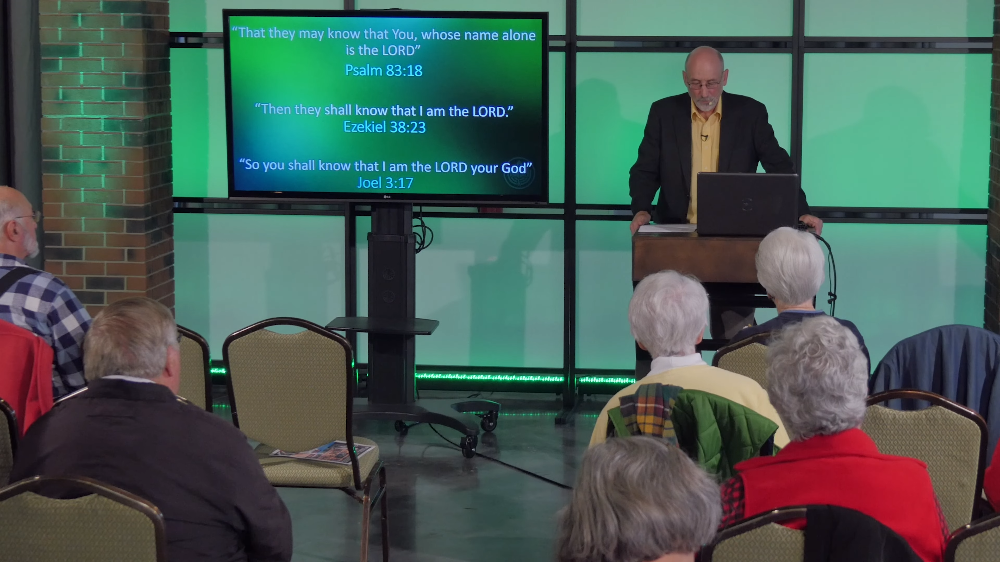
[00:45:16](https://www.youtube.com/watch?v=uLnxshh-pK0&list=PLj9bOvimh2NyU1STwZqO7ccG5wdfGID64&index=46&t=2716s)