## Ezekiel 38 & 39

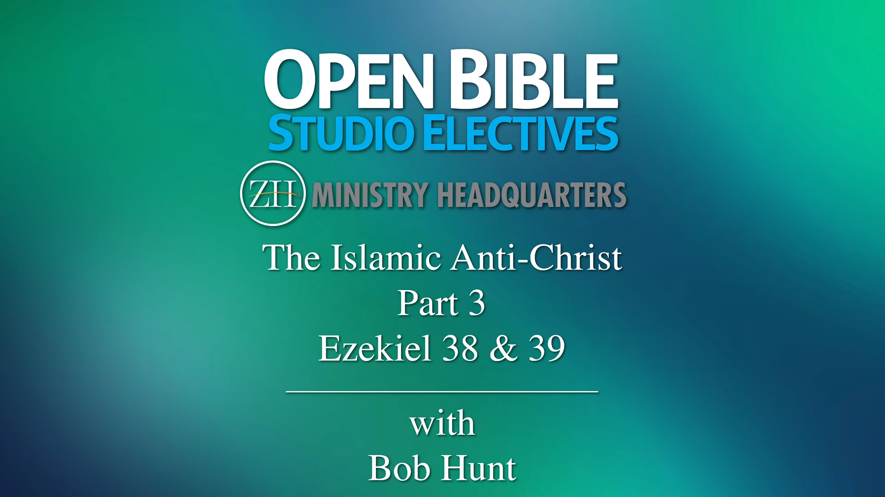
[00:00:02](https://www.youtube.com/watch?v=0loyC_D-eZY&list=PLj9bOvimh2NyU1STwZqO7ccG5wdfGID64&index=45&t=2s)

- Study focus on Ezekiel chapters 38 and 39
    - Analyzing the specific war and battle described
    - Investigating the involvement of the Antichrist
    - Determining if the Antichrist is Islamic or Roman

### Who is Ezekiel?

- A prophet known as a "man of vision"
    - God spoke to him through various visions

### Background from Ezekiel 1:1-2

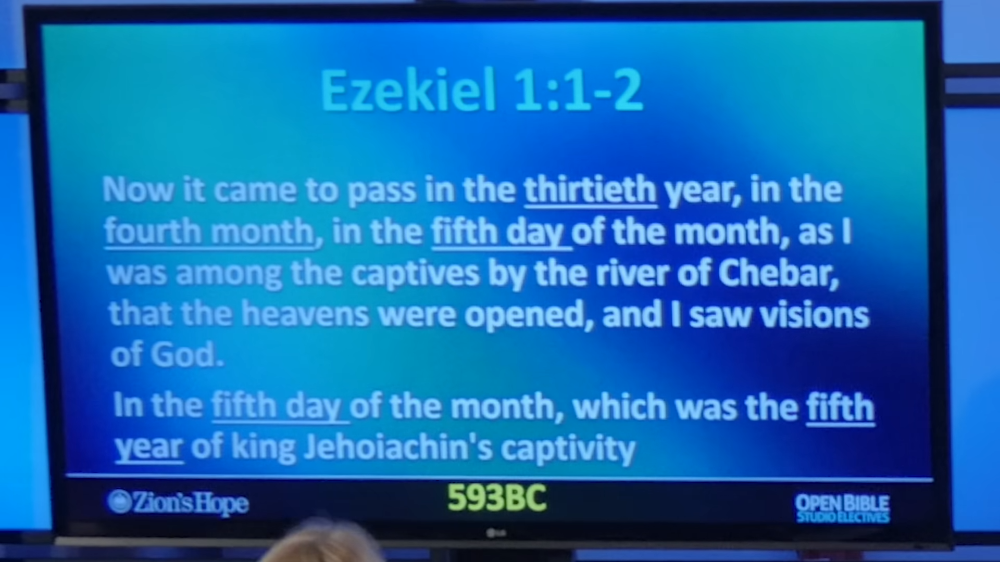
[00:01:32](https://www.youtube.com/watch?v=0loyC_D-eZY&list=PLj9bOvimh2NyU1STwZqO7ccG5wdfGID64&index=45&t=92s)

- **Timing and Age**
    - Occurred in the thirtieth year
        - This likely refers to Ezekiel's age
        - As a priest, this was the age he would become active in his duties
    - Specific date: the fourth month, on the fifth day of the month
- **Context of the Vision**
    - Ezekiel was among the captives by the river of Chebar
    - The heavens were opened, and he saw visions of God
- **Historical Setting**
    - Occurred in the fifth year of King Jehoiachin's captivity
    - Dated to approximately 593 BC

### Dating Ezekiel 38-39

- Ezekiel is highly precise with his dating
    - He provides specific dates approximately eight times throughout the book
    - These dates follow a chronological progression through his life
- **[Timeline for Chapters 38 & 39]**
    - The prophecies in these chapters fall between two specific markers:
        - Ezekiel 32:1 occurs around 585 BC
        - Ezekiel 40:1 occurs around 573 BC
    - This places the events of chapters 38 and 39 in the window of 585 BC–573 BC

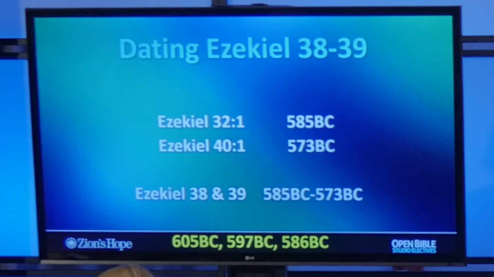
[00:03:15](https://www.youtube.com/watch?v=0loyC_D-eZY&list=PLj9bOvimh2NyU1STwZqO7ccG5wdfGID64&index=45&t=195s)

- **Historical Context**
    - These dates align with the approximate period of the Babylonian sieges and the captivity of Jerusalem
    - Key dates mentioned: 605 BC, 597 BC, 586 BC

### Historical Context of Chapters 38 & 39

- Written after the completion of all three Babylonian sieges
    - Jerusalem had been reduced to ruins
    - Exiles from three different waves were living outside the country
- **[Purpose of the Message]** To provide hope to a despondent nation
    - The people were scattered and dispersed
    - They had lost both their city and their temple

### Ezekiel 38:1-2

> Now the word of the LORD came to me, saying, “Son of man, set your face against Gog, of the land of Magog, the prince of Rosh, Meshech, and Tubal, and prophesy against him,

- **Key Figures and Locations mentioned:**
    - Gog
    - Land of Magog
    - Prince of Rosh, Meshech, and Tubal

#### Ezekiel's Title

- **"Son of Man"**
    - God frequently addresses Ezekiel by this title
    - This specific phrase appears in verse 2
- **[Significance of "Son of Man"]**
    - Emphasizes Ezekiel's humanness and fleshliness
    - Serves as a contrast to the divine nature of God
- **Biblical Distinction in Numbers 23:19a**
    - Highlights that God is not like humans
    - God is not a man that He should lie, nor a son of man that He should repent

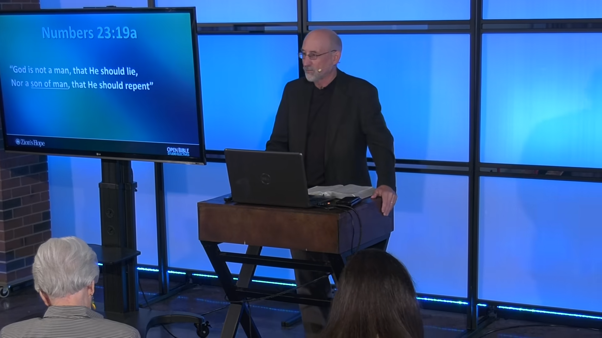
[00:06:14](https://www.youtube.com/watch?v=0loyC_D-eZY&list=PLj9bOvimh2NyU1STwZqO7ccG5wdfGID64&index=45&t=374s)

- **Connection to the New Testament**
    - The Gospel writer Matthew also uses the term "son of man" frequently
    - However, Matthew applies the title to someone other than Ezekiel

### The "Son of Man" in the New Testament

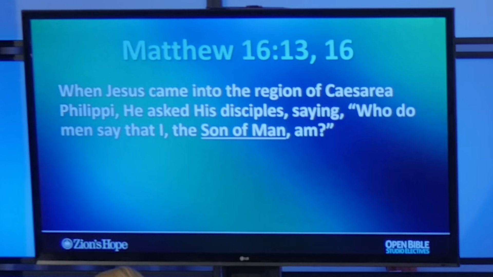
[00:07:28](https://www.youtube.com/watch?v=0loyC_D-eZY&list=PLj9bOvimh2NyU1STwZqO7ccG5wdfGID64&index=45&t=448s)

- **Jesus as the Son of Man (Matthew 16:13)**
    - In the region of Caesarea Philippi, Jesus asks, "Who do men say that I, the Son of Man, am?"
    - **[Significance]** This emphasizes His humanness
        - He is the perfect human representative for the mission of dying on the cross
        - Connects to the prophecy in Daniel 7:13 regarding the one coming on the clouds
- **Peter's Recognition (Matthew 16:16)**
    - Simon Peter answers: "You are the Christ, the Son of the living God."
    - **[Theological Implication]** This passage combines two aspects of Christ's nature:
        - Human nature (Son of Man)
        - Divine nature (Son of the living God)

### Ezekiel 38:2: The Prophecy Against Gog

- **The Command to Prophesy**
    - "Son of man, set your face against Gog..."
- **Gog**
    - The target of the prophecy

### Identifying Gog

- **Frequency of the name 'Gog'**
    - The name appears only 11 times in the entire Bible
    - 9 of those occurrences are found within Ezekiel chapters 38 and 39
- **The 'Gog' of 1 Chronicles 5:4-6**
    - This is the first mention of the name in the Old Testament
    - It appears in the Reuben genealogy:

```text
The sons of Joel were Shemaiah his son, Gog his son, Shimei his son, Micah his son, Reiah his son, Baal his son, and Beerah his son, whom Tiglath-Pileser king of Assyria carried into captivity. He was leader of the Reubenites.
```

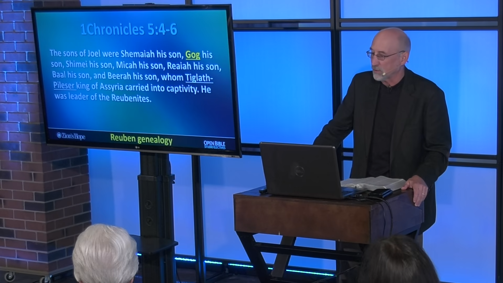
[00:09:11](https://www.youtube.com/watch?v=0loyC_D-eZY&list=PLj9bOvimh2NyU1STwZqO7ccG5wdfGID64&index=45&t=551s)

- **[Is this the same Gog?]** No
    - **[Reasoning]** The chronological gap between the figures is too large
        - The 1 Chronicles Gog was captured by Tiglath-Pileser, who ruled around 725 BC
        - Ezekiel's prophecy is dated much later, between 585 BC and 573 BC
        - Therefore, the Gog in Ezekiel cannot be the same person mentioned in the Assyrian captivity context

### Timing of the Prophecy: "Latter Years"

- **Ezekiel 38:8b and 38:16**
    - "After many days you will be visited. In the **latter years** you will come into the land..."
    - "...It will be in the **latter days** that I will bring you against My land..."
- **[Eschatological Significance]** These phrases indicate the prophecy concerns the end times
    - In the study of eschatology, "latter" refers to the end, the last things, or a future prophetic time
    - This defines the period when Gog will attack the land of Israel

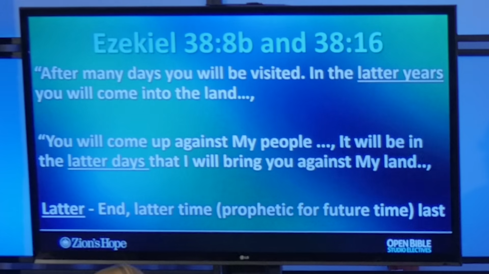
[00:10:52](https://www.youtube.com/watch?v=0loyC_D-eZY&list=PLj9bOvimh2NyU1STwZqO7ccG5wdfGID64&index=45&t=652s)

### The Mention of Gog in Revelation

- **Revelation 20:7-8**
    - "Now when the thousand years have expired, Satan will be released from his prison and will go out to deceive the nations which are in the four corners of the earth, **Gog and Magog**, to gather them together to battle, whose number is as the sand of the sea."
- **[Context]** This occurs during the millennial period
    - This takes place after Christ has already returned
    - It involves the release of Satan to deceive the nations

### Comparing Gog in Ezekiel and Revelation

- **[Difference in Leadership]**
    - In Ezekiel 38-39, God is the one leading Gog
    - In Revelation 20, Satan leads Gog and Magog in a rebellion
- **[Difference in Timing]**
    - The Revelation passage describes events occurring at the end of the millennial period

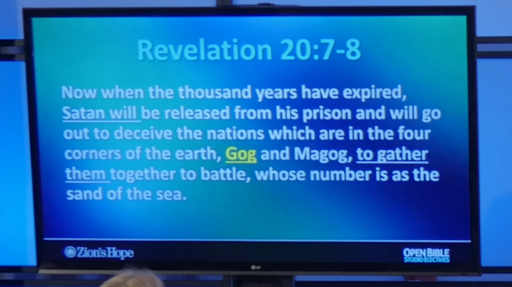
[00:11:52](https://www.youtube.com/watch?v=0loyC_D-eZY&list=PLj9bOvimh2NyU1STwZqO7ccG5wdfGID64&index=45&t=712s)

### The Millennial Period (Revelation 20:4)

- **[Context of the Millennium]**
    - Occurs after the period of the Antichrist's reign
    - Characterized by those who were martyred for their witness to Jesus and the word of God
    - These individuals did not worship the beast or receive his mark
    - They "lived and reigned with Christ for a thousand years"

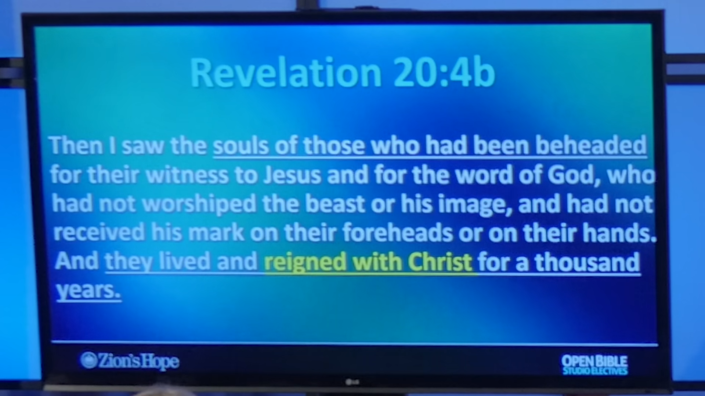
[00:12:52](https://www.youtube.com/watch?v=0loyC_D-eZY&list=PLj9bOvimh2NyU1STwZqO7ccG5wdfGID64&index=45&t=772s)

### Chronological Distinction: Ezekiel vs. Revelation

- **[The Timing Conflict]** There is a significant chronological gap between the two passages that makes them difficult to reconcile as the same event:
    - **Ezekiel 38-39**: Prophesies a war that occurs **prior** to Christ's reign on earth.
    - **Revelation 20:7-8**: Describes a rebellion that occurs **after** Christ's reign has already begun (potentially up to a thousand years into the Millennium).
- **[Conclusion]** Because of this difference in timing, the Gog mentioned in Ezekiel is likely not the same event described in Revelation 20:7-8.

### The Meaning of "Gog"

- **[Not a Personal Name]** "Gog" should not be treated as a specific individual's name to be found in a genealogy or a specific person in history.
- **[A Title]** It is more likely a title.
    - In its original context, the name Gog actually means **"mountain"**.
    - **[Biblical Symbolism]** In the Bible, the term "mountain" is frequently used as a representation of an **empire**.

### Placement of Ezekiel's Wars

- **[Popular View]** Many believe the wars described in Ezekiel 38-39 occur **prior** to Daniel's 70th week
- **[The Logic]** Because Ezekiel describes a war that happens before Christ's reign, it does not align with the timing of the rebellion in Revelation 20:7-8 (which occurs at the end of the Millennium)

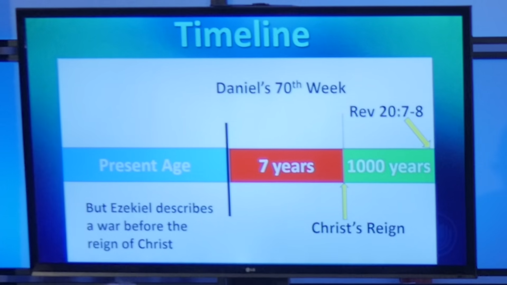
[00:15:15](https://www.youtube.com/watch?v=0loyC_D-eZY&list=PLj9bOvimh2NyU1STwZqO7ccG5wdfGID64&index=45&t=915s)

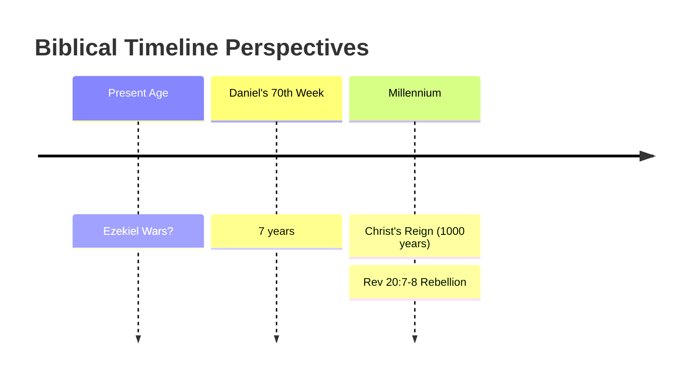

### Interpretations of the Ezekiel War

- **[Theological Implication]** A common interpretation is that the Ezekiel war results in the complete elimination of Islam from the Middle East

### Avoiding Presuppositions

- **[Definition]** A presupposition is the act of bringing pre-existing thoughts and imposed viewpoints into the interpretation of Scripture.
- **[The Scholarly Approach]** Rather than forcing the text to fit a preconceived idea, a student should let the Bible speak for itself:
    - If the Bible reinforces a belief, that belief is validated.
    - If the Bible contradicts a belief, the belief must be changed.

### The Roman Antichrist View

- **[The Premise]** This is a very popular modern opinion regarding the timing and nature of the Ezekiel wars.
- **[The Logic]** The view follows this progression:

    1. The war described in Ezekiel will result in the complete elimination of Islam from the Middle East.
    2. Because Islam is eliminated by this war, the Antichrist cannot be an Islamic figure.
    3. Therefore, the Antichrist must be Roman.

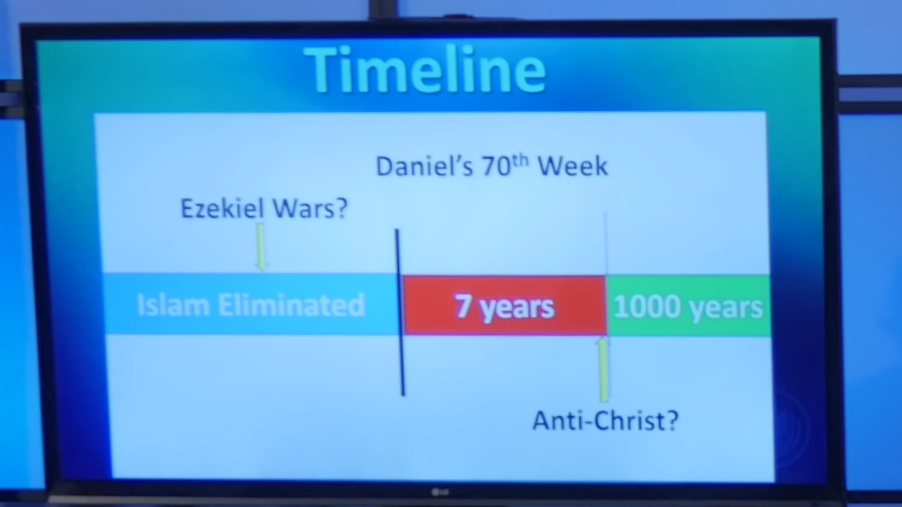
[00:17:29](https://www.youtube.com/watch?v=0loyC_D-eZY&list=PLj9bOvimh2NyU1STwZqO7ccG5wdfGID64&index=45&t=1049s)

### Nations Involved in the Ezekiel War

- **[Divine Opposition]** God declares His opposition to Gog, marking him as a specific target of divine judgment
    - "I am against you O Gog, the Prince of Rosh, Meshech, and Tubal" (Ezekiel 38:3)
- **[Military Readiness]** The forces are described as being prepared for war, equipped with horses, horsemen, bucklers, shields, and swords

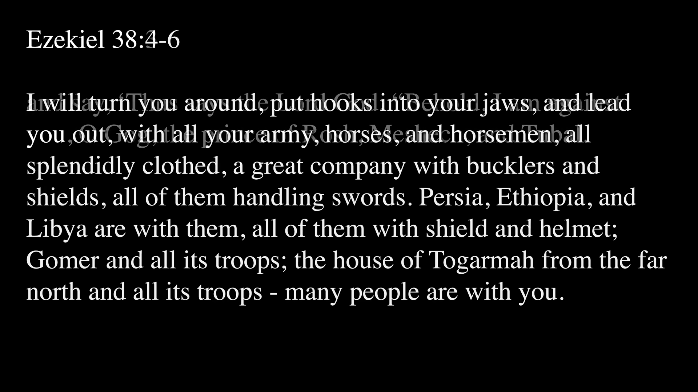
[00:18:40](https://www.youtube.com/watch?v=0loyC_D-eZY&list=PLj9bOvimh2NyU1STwZqO7ccG5wdfGID64&index=45&t=1120s)

- **[The Coalition of Nations]** A list of specific groups and regions participating in the conflict:
    - Persia
    - Ethiopia
    - Libya
    - Gomer (and all its troops)
    - The house of Togarmah (from the far north)

### Ezekiel 38:2

- In some translations, such as the New King James Version (NKJV) or the American Standard Version (ASV), the verse begins with a specific address:
    - "Son of man, set your face..."

### Translation Variations in Ezekiel 38:2

Different Bible translations render the description of the leadership in Ezekiel 38:2 differently, which can impact the interpretation of the text:

- **NKJV and NASB Translations**
    - Use the phrase: "the prince of Rosh, Meshech, and Tubal"

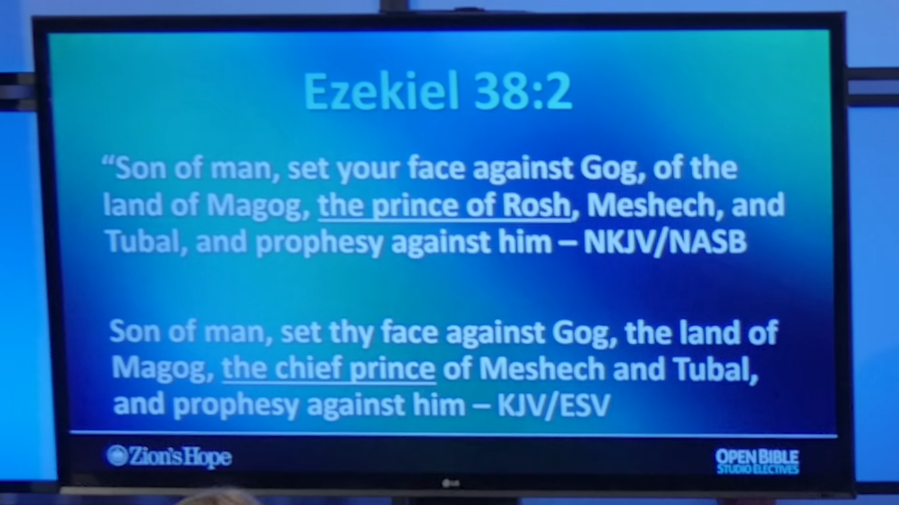
[00:20:02](https://www.youtube.com/watch?v=0loyC_D-eZY&list=PLj9bOvimh2NyU1STwZqO7ccG5wdfGID64&index=45&t=1202s)

- **KJV and ESV Translations**
    - Use the phrase: "the chief prince of Meshech and Tubal"
    - These versions effectively combine the terms, identifying the "chief prince" as being of Meshech and Tubal rather than explicitly naming "Rosh" as a separate entity.

### Connection to the Table of Nations

- The nations listed in Ezekiel 38 correspond to the "Table of Nations" found in Genesis 10:2
    - These groups are identified as the sons of Japheth
- **[Identified Groups]** Four of the names in Ezekiel match the Genesis lineage exactly:
        - Gomer
        - Magog
        - Tubal
        - Meshech

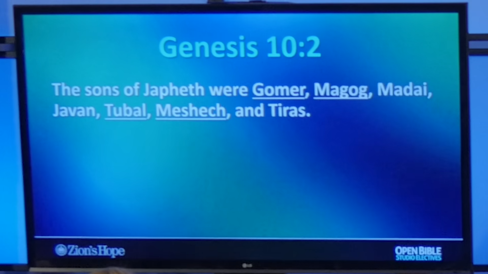
[00:20:45](https://www.youtube.com/watch?v=0loyC_D-eZY&list=PLj9bOvimh2NyU1STwZqO7ccG5wdfGID64&index=45&t=1245s)

### Geographical Location of the Nations

- **[Historical Settlement]** The sons of Japheth generally settled north of Israel
    - This area corresponds to modern-day Turkey and parts of Iraq
- **[Atlas Mapping]** According to the Holman Bible Atlas, the primary location for these specific groups is Turkey:
        - Magog, Meshech, Gomer, Tubal, and Togarmah are all located in the Turkey region
        - In contrast, Persia is located in modern-day Iran

### Geographical Placement of Remaining Nations

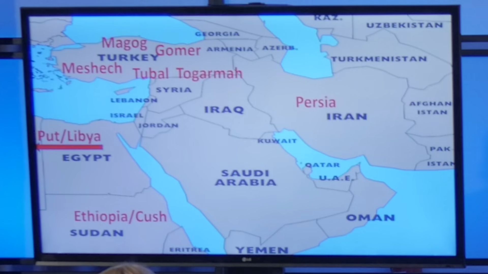
[00:22:56](https://www.youtube.com/watch?v=0loyC_D-eZY&list=PLj9bOvimh2NyU1STwZqO7ccG5wdfGID64&index=45&t=1376s)

- **[North Africa]** Put/Libya is located in the North African region
- **[South of Egypt]** Ethiopia and Kush are situated south of Egypt
- **[Interpretational Variations]** While some scholars suggest alternative locations, the speaker notes they are often based on phonetic similarities rather than strong hermeneutics:
    - Gomer is sometimes placed in Germany (due to the similar starting letter)
    - Magog is sometimes placed in Russia
- **[Scholarly Consensus]** The current mapping is supported by multiple major biblical atlases, including:
    - Zondervan Atlas
    - IVP Atlas
    - New Moody Atlas

### Ezekiel 38:2 Translation Focus

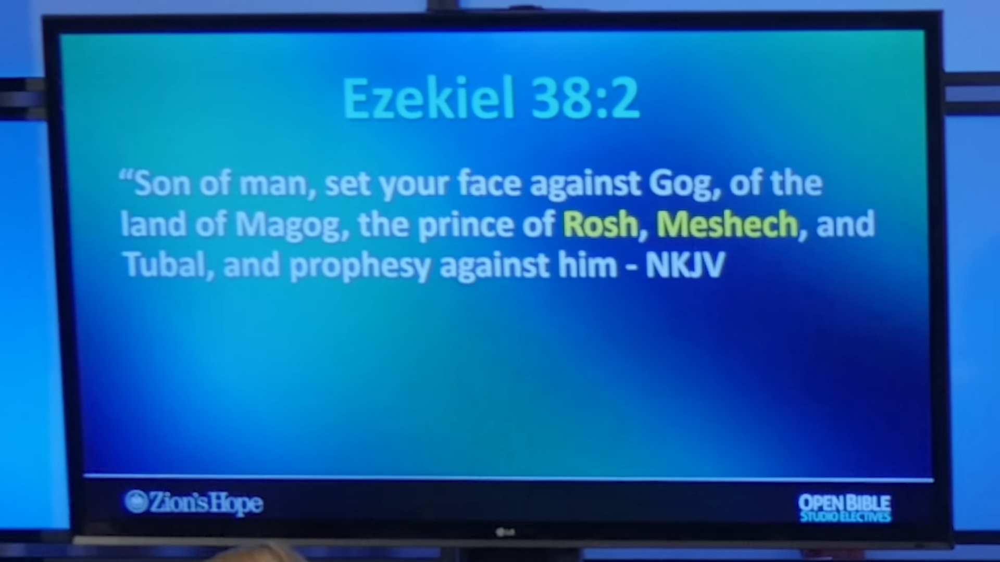
[00:23:02](https://www.youtube.com/watch?v=0loyC_D-eZY&list=PLj9bOvimh2NyU1STwZqO7ccG5wdfGID64&index=45&t=1382s)

- **[The "Prince of Rosh"]** The New King James Version (NKJV) includes the specific term "Rosh":
    - "Son of man, set your face against Gog, of the land of Magog, the prince of Rosh, Meshech, and Tubal, and prophesy against him"

### Interpretations of the "Prince of Rosh"

- **[Phonetic Interpretations]** Some scholars/interpreters attempt to link the nations in Ezekiel to modern locations based on how the names sound:
    - **Rosh** $\rightarrow$ Russia
    - **Meshech** $\rightarrow$ Moscow
- **[Critique of Method]** The speaker cautions against using phonetic similarity or legends (fables) as a basis for hermeneutics:
    - Relying on name sounds can lead to speculative conclusions
    - Using legends (e.g., stories about King Masak) is not a sound way to interpret Scripture
- **[The People Group "Rosh"]** There was a historical group known as the Rosh:
    - They originated in the Turkey region
    - Some theories suggest they were Scythians or the Trias who later migrated north

### The Meaning of "Ro'sh"

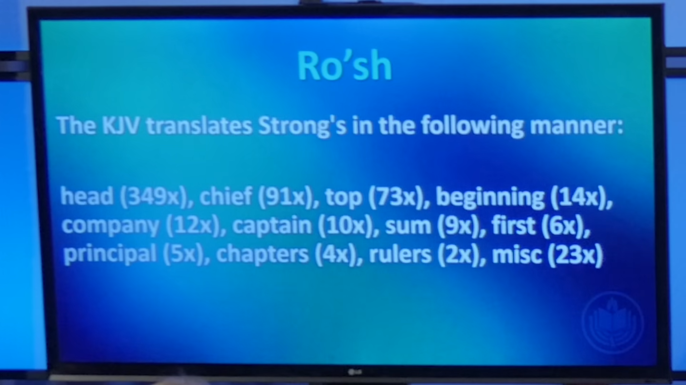
[00:24:36](https://www.youtube.com/watch?v=0loyC_D-eZY&list=PLj9bOvimh2NyU1STwZqO7ccG5wdfGID64&index=45&t=1476s)

- **[Linguistic Definition]** According to Strong's Concordance, the word "Ro'sh" (or "Rosh") carries meanings related to position and priority rather than being a proper name for a nation:
    - head (349x)
    - chief (91x)
    - top (73x)
    - beginning (14x)
    - company (12x)
    - captain (10x)
    - sum (9x)
    - first (6x)
    - principal (5x)
    - chapters (4x)
    - rulers (2x)
    - misc (23x)
- **[Contextual Usage]** The term is used to denote a "number one" or primary position.
    - An example of this usage is found in the Jewish calendar: *Rosh Hashanah*, which means "Head of the year."
- **[Critique of the "Russia" Interpretation]** The speaker argues that the NKJV translation of "the prince of Rosh" is often misinterpreted to mean a leader from Russia:
    - This interpretation relies on the phonetic similarity between "Rosh" and "Russia."
    - This is often done to support a specific viewpoint where a Russian military leader attacks Israel, which aligns with certain eschatological theories.
    - However, grammatically, the text refers to a "chief prince" rather than a person from a place called Rosh.

### Religious Identity of the Nations in Ezekiel 38

- The nations identified in the prophecy (including Turkey, Iran, Iraq, Sudan, and Libya) are primarily Islamic
    - Millions of Muslims reside in these specific areas
- **[Critique of the Roman Antichrist View]** Proponents of the Roman view often attempt to reinterpret these passages to "eliminate" the Muslim element to fit their theory

### Reinterpreting "The Far North"

- Some interpreters use Ezekiel 38:15 to support a Russian connection:
        - "Then you will come from your place out of the far north..."
        - They use maps to argue that "far north" relative to Israel points to Russia
- **[The Problem of Presupposition]** This interpretation is often driven by a desire to see a Russian military leader involved, rather than an objective reading of the text
        - Instead of looking at the Arctic (which is even further north), they stop at Russia because it fits their preconceived narrative

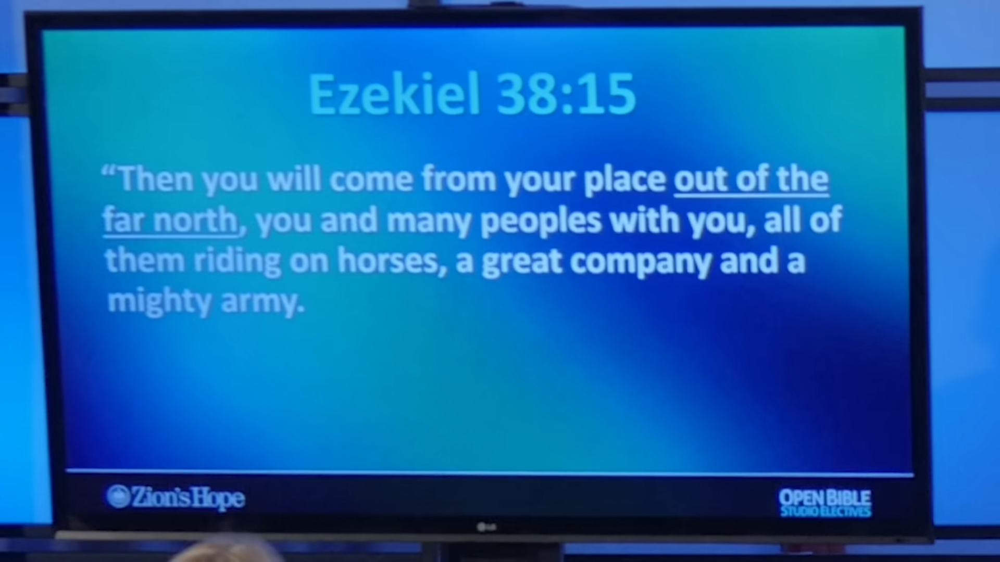
[00:26:42](https://www.youtube.com/watch?v=0loyC_D-eZY&list=PLj9bOvimh2NyU1STwZqO7ccG5wdfGID64&index=45&t=1602s)

### Biblical Context for "The North"

- To understand what Ezekiel meant, one must adopt the mindset of a 600 BC Jewish person
- In the biblical context, "the north" has specific historical and geographical connotations, as seen in Jeremiah 6:22:
        - "...the people comes from the north"

### The Relativism of Biblical Geography

- The concept of "the north" is relative to the worldview of the time
    - Modern interpreters often claim "the north" must be Russia
    - However, for a person in 600 BC, the farthest reaches of the north were the territories of the Babylonians
    - To an ancient Jew, Babylon was the "far north"

### Daniel 11:31 and the King of the North

- The term "King of the North" in Daniel is used to identify the Antichrist
- **[Actions of the Antichrist]** According to Daniel 11:31, he will:
        - Muster forces
        - Defile the sanctuary fortress
        - Take away the daily sacrifices
        - Place the "abomination of desolation" in the sanctuary

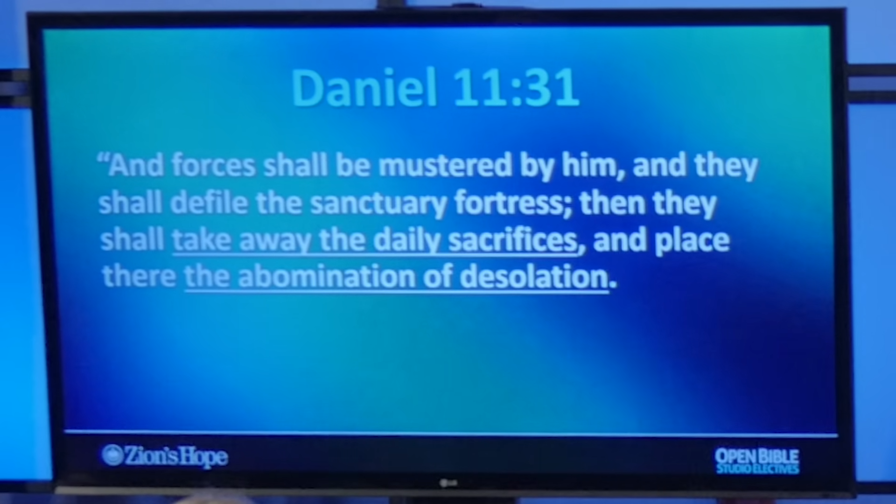
[00:28:37](https://www.youtube.com/watch?v=0loyC_D-eZY&list=PLj9bOvimh2NyU1STwZqO7ccG5wdfGID64&index=45&t=1717s)

### Daniel 11:43 and the Antichrist's Power

- The Antichrist will possess authority over significant wealth:
    - The treasures of gold and silver
    - All the precious things of Egypt
- Certain nations will support him:
    - The Libyans and Ethiopians will "follow at his heels"

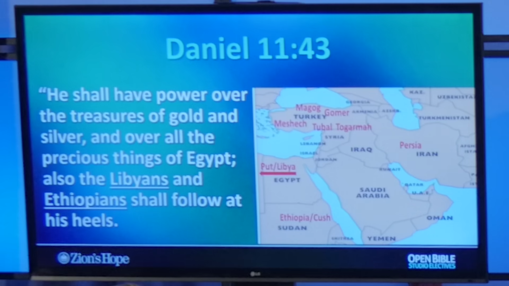
[00:29:27](https://www.youtube.com/watch?v=0loyC_D-eZY&list=PLj9bOvimh2NyU1STwZqO7ccG5wdfGID64&index=45&t=1767s)

- **[Timing of the Events]** This occurs during the middle of Daniel's 70th week, which aligns with Jesus' mention of the "abomination of desolation" in Matthew 24

### Critique of the Roman Antichrist View

- The Roman view posits that the nations mentioned (like Libya and Ethiopia) are destroyed *prior* to Daniel's 70th week
- **[The Conflict with Scripture]** This view is challenged by Daniel 11:43, which places these nations in active support of the Antichrist during the 70th week
- **[Historical Contradiction]** The Roman view does not account for the fact that Libya and Ethiopia made a remarkable recovery, rather than being destroyed as the theory suggests
- **[The Logical Hurdle]** The Roman Antichrist view faces a contradiction with Ezekiel 38 and 39:
    - These chapters describe the destruction of nations like Libya and Ethiopia
    - However, if these nations are wiped out, they cannot "follow at the heels" of the Antichrist

### Prophetic Consistency in Ezekiel 38:17

- Ezekiel 38:17 emphasizes that Gog is not a new or unexpected figure, but one God has spoken about through His servants for years:

    > "Thus says the Lord GOD: 'Are you he of whom I have spoken in former days by My servants the prophets of Israel, who prophesied for years in those days that I would bring you against them?'"

- **[The Many Names of the Antichrist]** While the name "Gog" may only appear once in 1 Chronicles, the figure he represents is a consistent prophetic subject described by various names depending on the prophet's cultural context:
    - King of the North
    - The Assyrian
    - The King of Babylon
- **[Prophetic Sources]** This recurring figure can be identified by studying the books of:
    - Joel
    - Amos
    - Hosea
    - Zephaniah
    - Isaiah
    - Micah
    - Daniel

### Singularity of the Prophetic Message

- The Old Testament prophets present a unified vision rather than fragmented events:
    - One judgment
    - One war
    - One salvation
    - One final reign of Christ
- **[The Implication]** This consistency suggests that the Antichrist and his associated conflicts are not multiple, separate occurrences, but a single, climactic event tied to the 'Day of the Lord'
- **[Timing]** This 'Day of the Lord' occurs during Daniel's 70th week, not before it

### The "Day of the Lord" in Ezekiel 39:8

- Ezekiel 39:8 reinforces the certainty and specific timing of this divine intervention:

> "Surely it is coming, and it shall be done. It shall be done. Says the Lord GOD: 'This is the day of which I have spoken.'"

- **[The "Day"]** Throughout the Old Testament, there is a recurring theme of a specific "day" or time when God will pour out His wrath against the Antichrist

### The Timing of the "Day of the Lord"

- The "Day of the Lord" is a recurring prophetic theme found in the books of:
    - Joel
    - Zephaniah
    - Isaiah
- **[Timing]** This "day" is not an event that occurs prior to the start of all other prophetic timelines, but is specifically situated at the end of Daniel's 70th week
    - This aligns with descriptions of the battle of Armageddon in the Valley of Jezreel

### Parallelism Between Ezekiel and Revelation

- There are significant thematic similarities between the descriptions in Ezekiel 38-39 and Revelation 16-19:

| Theme | Ezekiel Reference | Revelation Reference |
| --- | --- | --- |
| Time of God's wrath and fury | Ezekiel 38:18-19 | Revelation 6:17 |
| Gathering of the nations | Ezekiel 38:9 | [Not explicitly detailed in this segment] |

- **[Comparative Study]** Comparing the two accounts reveals a unified prophetic message regarding the climactic judgment of God.

### Expanded Parallels Between Ezekiel and Revelation

- Additional thematic connections exist between the two accounts:
    - **Great Earthquake**: Ezekiel 38:19–22 describes a massive earthquake, which parallels the descriptions in Revelation 16:18–21

### The Manifestation of God's Presence in Ezekiel 38:20

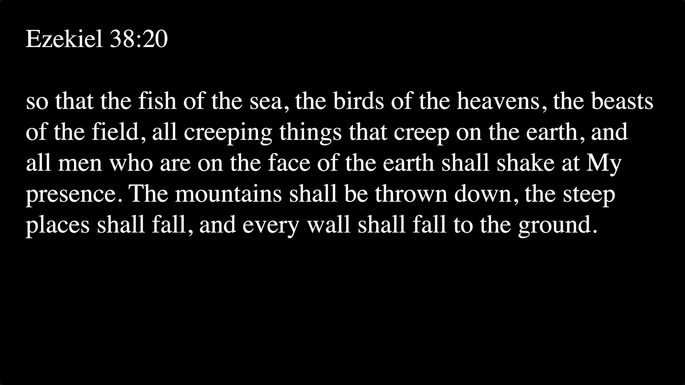
[00:35:42](https://www.youtube.com/watch?v=0loyC_D-eZY&list=PLj9bOvimh2NyU1STwZqO7ccG5wdfGID64&index=45&t=2142s)

- Ezekiel 38:20 describes a universal reaction to God's arrival:

> "so that the fish of the sea, the birds of the heavens, the beasts of the field, all creeping things that creep on the earth, and all men who are on the face of the earth shall shake at My presence. The mountains shall be thrown down, the steep places shall fall, and every wall shall fall to the ground."

- **[The Significance of "Presence"]** The term "presence" implies God is literally standing in front of creation—physically present on Earth.
- **[Timing]** This physical presence aligns with the return of Christ in glory, breaking through the clouds, rather than an event occurring prior to the 70th week.

### Final Parallels Between Ezekiel and Revelation

- Additional thematic connections reinforce the idea that these accounts describe the same event:
    - **Sacrificial Meal**: Ezekiel 39:17–18 describes birds and animals feasting on the flesh of enemies, a description that mirrors Revelation 19.

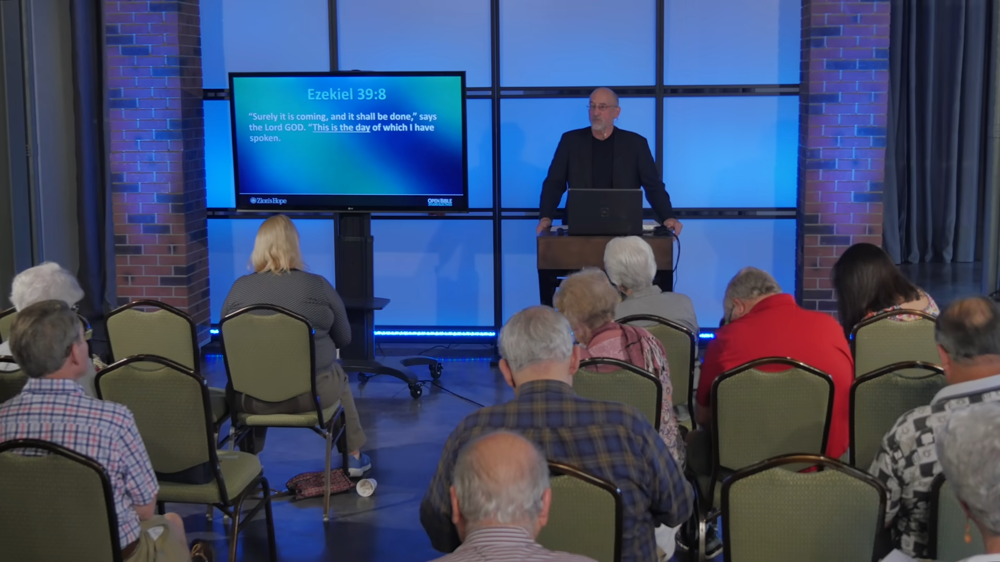
[00:36:17](https://www.youtube.com/watch?v=0loyC_D-eZY&list=PLj9bOvimh2NyU1STwZqO7ccG5wdfGID64&index=45&t=2177s)

- **[Conclusion]** The volume of similarities between Ezekiel 38–39 and Revelation 16–19 is too significant to be considered mere coincidence; they must represent the same prophetic event.

### The Results of the War

- The conflict results in a global recognition of God's sovereignty:
    - **Hallowing God's Name**: Ezekiel 38:16 states that the Gentile nations will hallow God's name.
    - **Knowing the Lord**: Ezekiel 38:23 describes the nations coming to know the Lord God.
- **[Timing]** Given these results—the global recognition of God—it is argued that this cannot occur prior to Daniel's 70th week, but must happen during/at the end of that period.

### Spiritual Restoration in Ezekiel 39

- The aftermath of the war results in a profound spiritual shift for Israel:
    - **Knowing the Lord**: Ezekiel 39:7 states that Israel will know the Lord from that day forward, implying a new, established relationship.
    - **God's Glory among Nations**: Ezekiel 39:21 describes God setting His glory among the nations, which signifies His presence and the person of Jesus Christ being visible in Jerusalem and seen out of Zion.
    - **Restoration of Land**: Ezekiel 39:25-26 promises that Israel will be restored and the promised land will be theirs forever.
    - **Hallowing God's Name**: Ezekiel 39:27 notes that Israel will finally hallow God's name.
    - **Outpouring of the Spirit**: Ezekiel 39:29 describes God pouring His Spirit upon the nation of Israel.
- **[Connection to Zechariah]** This outpouring of the Spirit parallels Zechariah 12:10, where Christ, upon His return at the end of times, makes His presence known and pours His Spirit upon Israel.
- **[Conclusion on Timing]** Because these events—the establishment of a relationship with God, the visible glory of Christ, and the outpouring of the Spirit—are so central, they are most logically situated at the end of Daniel's 70th week (Armageddon) rather than prior to it.

### The Battle of Armageddon

- The events of Ezekiel 38-39 represent the Battle of Armageddon
    - This occurs at the end of Daniel's 70th week
    - It takes place just before the second coming of Christ
- **[Unified Identity of the Antichrist]** Different prophetic descriptions refer to the same Satan-empowered entity:
        - The "little horn" that rises from the ten in Daniel
        - The "beast" with seven heads and ten horns in Revelation
        - The figure described in Ezekiel 38-39

### Religious Context and Implications

- The nations involved are described as rising out of Islam
    - This is because Islam is viewed as being in opposition to the Judeo-Christian understanding of God
- **[Call to Action]** The increasing rejection of the biblical God in the world serves as a reason for urgent prayer for souls.

### Living in Light of Prophecy

- **[Anticipation vs. Fear]** Because believers possess the Holy Spirit, the coming wrath should be met with anticipation rather than fear
    - Ezekiel 66 suggests an attitude of eagerly waiting for Him
- **[The Believer's Responsibility]** Knowledge of the end times should drive action, not passivity:
    - Praying for others
    - Sharing the necessary message with the world
    - Living expectantly
- **[The Reality of Judgment]** Isaiah 66 describes a fire of judgment for those who do not know God, centered on the issue of sin

### Summary of the Islamic Antichrist

- The predicted Antichrist is expected to rise from among Islamic nations
- This figure will be characterized by direct opposition to both Jews and Christians

### The Motivation for Boldness

- Share the message of the coming end with boldness
    - This should not be driven by an interest in dramatics
    - It must be driven by a love for people
- **[The Goal of Evangelism]** To reach those who do not know Christ so they may know Him before the final judgment, rather than encountering Him from the "wrong side of the river."